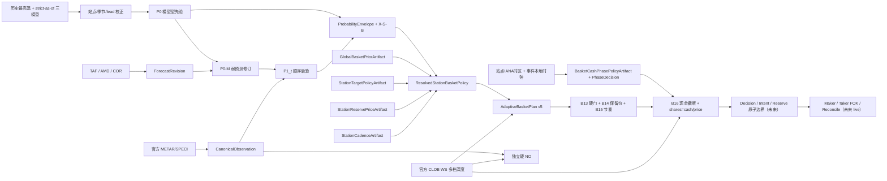
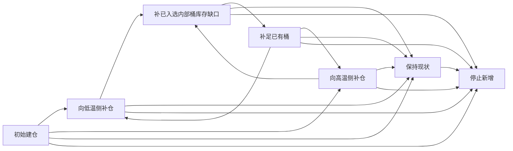
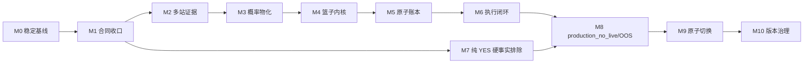

# Bayes + 最高温篮子：开发地图、计划与 Checklist

## 2026-08-01 来源泳道修订：AWC 全球替代 AMSC（熊先生授权）

正式实时来源统一为 AWC 全球正式泳道：45 站（含原中国/台湾 AMSC 站）的 realtime truth、P1、校准和 production_no_live OOS 均只消费官方 NOAA/AWC METAR/SPECI。AWC 可替代原 AMSC；AMSC 生产采集、参考证据与旧 lineage 仅保留历史审计/离线对照，禁止进入正式链路。生产只保留纯 YES 篮子，任何 NO 侧策略与决策均退役。AWC truth lane 禁止同站混源、跨源 fallback、旧 lane 伪造；AWC 缺失、陈旧、重复或更正未复核即 fail closed。NWP model lane 在官方原生缺失、无效、过期或迟到时可使用带 `aggregator_republisher` lineage 的 Open-Meteo no-live fallback，但不得冒充 native、进入 P1 或 formal/live。下文较早双泳道记录仅代表历史状态，不覆盖本合同。

> **2026-08-02 进度口径覆盖**：所有 OOS、20+8、TAF-24 与正式晋级证据只用闭日历史 strict-as-of 数据；未来/forward 只登记 `observational_candidate_not_oos`，不计 OOS、不阻断 `production_no_live` 或扩站。官方原生优先复用，原生缺失/无效/过期/迟到才走 Open-Meteo `aggregator_republisher` no-live fallback，并保留 native/P1/formal 禁入边界。当前统一账本由 `output/audits/oos_gap_ledger_45station_current.json` 指向 `output/audits/oos_gap_ledger_45station_20260803_post_sbgr_atomic_p1_recheck.json`（2503 条，历史1,653、未来observational 850，SHA `c8fec3688964282642f9268cfeee4571a90a641afdd185b38989777929c012aa`）。

## 唯一交付状态表

本表是唯一进度权威；其他文档、测试数量、artifact和演练回执只能作为证据，不得另立状态。当前交付范围是冻结canonical 45站，RKPK仅是历史纵向证据子集，不再作为范围门；生产与模型采集按完整registry候选每周期最多4个scope有界轮转。2026-07-30原子切换、用户域连续两轮和真实service closure均已通过，system同名服务为0；SSOT WAL硬上限为64MiB且最新切换/验收在限额内。当前未完成项是45站真实概率与纵向链物化覆盖，不能把“用户域已运行”外推成“45站全部完成”。未来/forward 只作非 OOS 观测，不阻断`production_no_live`或45站扩展；正式参数、权重与 live 只由历史 strict-OOS artifact 晋级。全程保持`production_no_live`、零gateway和零订单。

> 2026-08-02 全局推进快照：15Z 后 TAF/P0-M 只读 exact-join 扫描覆盖 45/45 站、42 个合法 P0 scopes、132 个 exact samples，当前最高 10、24 样本门尚未满足且未写生产 P0-M；AIFS-Single 复用已保留官方 raw/wrapper 完成 45/45 曲线闭日扫描，新增 14 个合法训练事实（14 站），2 站等待已接受 AWC closed truth、29 站本地日尚未关闭。两条链均保持 candidate/accumulating，未重复抓取 ECMWF/DWD、未写 production DB、未调用 gateway；下一轮继续全45站轮转，不以 RKPK 代替全局闭环。

> 2026-08-02 统一缺口账本建立记录（历史快照）：`output/audits/oos_gap_ledger_45station_20260802.json` 曾固定 `station × model/family × run_cycle × lead × event_date` 账本；当前唯一指针为 `output/audits/oos_gap_ledger_45station_current.json`，并固定到最新 2026-08-03 post-SBGR/P1 recheck（2503条）。账本只汇总已保留证据，不触发重新抓取或降低门槛。

> 2026-07-30 用户域迁移完成：三个生产owner均为`gui/$(id -u)` LaunchAgent，wrapper、installer、日常`targetctl`、readiness/closure及当前DeltaBasketScore/接替维护入口拒绝system残留、双活和root执行；日常路径无sudo。M9-06原子回执为`COMPLETED`，幂等复跑为`NOOP_IDEMPOTENT`；真实service closure确认system三服务为空、用户域三服务均运行，live pause、CLOB read-only、`production_no_live`、零gateway和零订单保持不变。

| 纵向环节 | 当前状态 | 当前真实证据 | 升级到下一状态的唯一门 |
|---|---|---|---|
| 冻结生产宪章 | `TESTED` | architecture v1.14.46已冻结三阶段、canonical 45站有界轮转、历史模型/历年同日双lineage、P1轨迹根重算、概率唯一方向及“组合概率定核心、模型极值限候选边界、方向排外围”合同 | 新合同迁移、真实物化和OOS分别按自身状态晋级；不阻断现有`production_no_live`或45站扩展 |
| 最新SSOT DDL/迁移 | `RUNNING` | 真实SSOT `quick_check=ok`；七张概率evidence/bridge表已物化，用户域target resident连续两轮验收PASS；20U资本epoch为`target-no-live-38b09d67282ad08d46b5b3bd`且reserved=0 | 继续扩展45站真实物化；后续schema变更仍须先DDL/回滚演练再target-only维护窗 |
| RKPK registry | `RUNNING` | registry保持唯一`Asia/Seoul`结算scope；7月30日前向链已按该时区真实落表，错配仍fail closed | 持续消费同一scope；truth/label始终使用registry时区，ET只作运营报表 |
| RKPK calibration/2+模型组合 | `RUNNING` | 正式OOS组合`ECMWF=0.65/GFS=0.35`已物化并被7月30日P0消费；单模型和在线临时追随均未进入P0 | 新模型成熟时继续验证exact-mask与上一成熟兼容run回退 |
| RKPK P0 | `RUNNING` | 真实SSOT累计269条RKPK probability；7月30日P0已在结算前物化并由resident消费 | 按新成熟模型run追加P0并证明旧根不得被高阶段裸消费 |
| 历史同日弱倾斜P0 | `TESTED` | 纯领域artifact/proof、P0 packet、显式theta=0回退、append-only authority、promotion/activation exact-scope门及proof＋envelope同事务已通过；DDL临时副本双跑为`REHEARSED`，完整Target/Basket矩阵1911项通过 | 真实SSOT执行窄迁移；生成并晋级RKPK正式同日与OOF meta artifact后证明非零/零proof被resident消费 |
| P0连续核心与候选边界 | `TESTED` | 组合概率覆盖唯一生成连续核心；正式模型极值仅形成有层数上限候选边界，方向只排序外围与调集中度；外围逐桶门、核心Maker缺腿HOLD、低→高→低和UP→NEUTRAL→DOWN已回归 | 真实SSOT迁移并加载resident后，用RKPK新P0/P1、官方WS和decision证明新支持集被消费 |
| RKPK P0-M | `RUNNING` | 7月30日P0-M已在结算前物化；TAF无新revision时确定性零写，不等待TAF或结算 | 新TAF revision原子接替、重复revision零写、冲突revision fail closed |
| RKPK提前WS→预选→decision | `RUNNING` | 7月30日未来市场已物化P0/P0-M/P1、62+份官方WS snapshot、inventory/order-state、165+条no-live decision与9条training fact；当前经济门为HOLD而非未来日/结算阻断 | 刷新官方WS后按新经济scope重算完整bundle；相同经济scope零写 |
| RKPK P1 | `RUNNING` | 7月30日已有2条P1并由resident消费；无新reported high时确定性零写。P1只在市场日开始并有METAR/SPECI后生成，但不等待市场日结束 | 新METAR/SPECI推进新高时接替；只将已关闭日送入truth/label |
| METAR轨迹软似然P1 | `TESTED` | P1 compiler已按每份canonical报文从不可变P0-M/P0根＋完整前缀重算，同温/低温更新软似然但不触发交易；正式artifact路径证明`applied_strength>0`，缺artifact为LR=1且硬排除保留，proof＋P1同事务且重复零写 | 真实SSOT执行窄迁移；完成RKPK严格OOS trajectory artifact晋级并证明resident读取，未晋级前保持LR=1 |
| RKPK COR人工复核 | `RUNNING` | 真实archive已物化append-only review schema及`rthreview_16b3...`，明确将`rtobs_b213...`的03:15Z COR判为`CLEAR_REFERENCE_ONLY`；正式03:00Z/04:00Z整点METAR保持35℃，resident truth已消费该复核后冻结7月28日35℃ | 后续任何COR继续要求新append-only复核，禁止覆盖或自动反向 |
| RKPK官方WS | `RUNNING` | 用户域`market_ws`持续官方CLOB WS多scope运行；7月30日前向链已绑定真实11桶快照，根级`calls_order_gateway=false`、`live_submit_authorized=false`、`orders_submitted=0` | 持续验证仅经济盘口变化追加、stale fail closed、fresh恢复使用新snapshot |
| RKPK inventory/order-state | `MATERIALIZED` | 历史P1 training fact已绑定inventory/order-state；当前无active reservation、order event或execution receipt | 恢复target后验证新snapshot绑定、prepared retention及未知订单回绕 |
| DeltaBasketScore v2 | `RUNNING` | v2 authority与完整Maker bundle合同由resident消费；7月30日前向链因`complete_basket_delta_not_positive/regime_direction_not_allowed`而HOLD，没有退化为先买单桶 | 持续累积forward fact/label；forward OOS只阻断参数/权重`FORMAL_PROMOTED`与live晋级 |
| RKPK no-live decision/reconcile | `RUNNING` | 当前全库1084+条decision，7月30日165+条；live intent=0，order event/execution receipt/active reservation均为0 | 持续验证新scope接替、纯prepared释放和未知执行事实fail closed |
| RKPK training fact | `RUNNING` | RKPK累计714条training fact，其中7月29日283条、7月30日9条；未来日fact可提前写，label不得提前写 | 持续生成前向fact；关闭日才exact join truth生成label |
| RKPK settlement label | `MATERIALIZED` | 7月29日正式truth为39℃；283条label权威已物化，forward store投影246条eligible并明确跳过37条ineligible。已修复truth/label共享节流、64条单页游标、P0区间lineage丢失及revision 0拒绝四个根因 | 继续验证重复零写、晚到revision supersede、QUARANTINED与未来日跳过 |
| RKPK forward OOS | `TESTED` | 已按RKPK/2026-07-29封闭日精确scope生成内容寻址只读scorecard：283条fact与283条label完整匹配，0 unlabeled、0 invalid revision、0 global blocker；修复旧256行前缀遮挡和`d2label_`身份误判。正式cash/station子scorecard仍缺失，故不得写成`OOS_PASSED` | 用现有283条样本生成预注册cash/station子scorecard并通过promotion gate；只阻断formal promotion/live，不阻断`production_no_live` |
| 45站扩展 | `RUNNING` | 用户域resident已加载canonical 45站调度：90个站点日scope、每轮最多4个scope、candidate prefetch最多1个并持久化公平轮转；概率schema已真实迁移且两轮resident验收PASS。当前只有具备正式2+ OOS exact-scope的站点可生成P0，多数站仍在candidate accumulation，故`RUNNING`只表示有界调度正在消费，不表示45站已全部物化 | 持续补齐45站官方 AWC truth 与正式2+模型artifact，逐站完成P0→P0-M/P1→WS→decision→fact→label；不等待未来日结算 |
| 旧实现退役与物理清理 | `TESTED` | 当前生产闭包只含用户域三个服务，system同名服务为0且无旧策略fallback；全仓复核发现128个退役运行候选仍存在代码、配置、测试、文档或未提交工作引用，因此当前真正安全删除候选为0。闭包审计禁止把“未被当前生产闭包引用”误报为可删除，最新runtime isolation manifest SHA为`c7d2c2cc...`且真实closure为PASS | label与45站主链不因文件清理阻断；后续按完整依赖图先拆引用、再全量回归、最后只删除零引用且无lineage/审计/历史重建价值的文件，禁止按名称批量删除 |

> 2026-07-30 新概率能力代码闭环：`SameDayClimatologyArtifact/P0HistoricalMetaCombinationArtifact/P0HistoricalTiltProof`、`MetarTrajectoryLikelihoodArtifact/MetarTrajectoryUpdateProof`、完整canonical前缀P1重放、概率证据artifact→promotion→activation权威链、proof＋envelope同事务和组合概率连续核心均已`TESTED`。正式P1 artifact测试的`applied_strength>0`，缺artifact时确定性`LR=1`且硬排除不复活；P0缺正式同日/meta任一方时内容寻址`theta=0`。连续核心已删除“UP越过最暖模型/反向裁端”旧参数，模型极值只限候选边界。完整Target/Basket矩阵1865项PASS；窄DDL临时副本双跑为`REHEARSED`。真实SSOT尚未执行本次迁移，target resident尚未加载，因此三项仍不得升级为`MATERIALIZED/RUNNING/OOS_PASSED`。

> 2026-07-30 lifecycle与label回绕闭环：`BasketState`已成为P0预选语义哈希、P1 decision和training fact共同引用的唯一持久化生命周期投影，plan/decision漂移在原子写边界fail closed，label继续只通过`fact_id`引用而不复制第二权威。settlement label扫描升级为新数据高水位＋低位pending轮转双游标，单行页在retry/new间交替，33+ malformed/open/resource项不再被固定前缀遮挡；fact、envelope与intent均在载荷读取前执行UTF-8字节、行数和RSS投影门。完整矩阵1865项PASS，关键回绕集合连续三轮各119项PASS。真实resident尚未维护窗加载，因此lifecycle真实状态仍保持`PARTIAL/TESTED`，不得误报`RUNNING`。

> 2026-07-30 canonical 45站采集与M9-06切换完成：resident默认不再读取RKPK-only范围，冻结45站registry按90个当前站点日scope运行，每轮最多4个网络scope并对missing/stale/fresh保留轮转槽位；无正式2+ OOS activation的站点每轮最多预采集1个candidate-only scope，完整绑定publication/arrival、raw/provider SHA和transport lineage，不写P0、activation、DB或gateway。轮转进度只保留一个内容寻址状态文件并可跨重启续跑；网络失败计公平调度尝试但不冒充成功物化，损坏状态只让NWP lane fail closed而不拖垮独立hard-NO读句柄。临时provider目录只在完整后原子提升，失败残片清理，研究原始数据递归受1GiB/100000文件/512MiB空闲硬门。M9-06真实原子回执为`COMPLETED`，重复执行为`NOOP_IDEMPOTENT`；用户域连续两轮与验签回执均PASS，system残留为0，live pause、受保护WS/CLOB和零订单边界保持不变。扩站状态已进入`RUNNING`，但45站完整物化仍为M9-08的未完成覆盖门。

> 2026-07-30 P1→M5 lineage与候选消费边界闭环：P1现分别保留完整canonical序列SHA和最后一条官方报文raw SHA，并补齐canonical commit time、source lane、report type；`compile_station_p1_packets→materialize_p1→target_atomic_facts_from_cycle→atomic ledger`已真实同构测试贯通。M5在build与commit双边界独立核对plan/observation/bound，已存在cycle重放若任一不可变事实缺失或漂移立即fail closed；持久化候选消费前完整CAS仍固定`evidence_only/authorizes_order=false`。方向入口新增非有限、负值和未归一化拒绝，正式模型极值只约束有层数上限的候选边界；proof内direction与positive-core明确仅作诊断。完整Target/Basket矩阵1911项PASS；本轮未写真实SSOT、未重启resident，因此新增能力状态仍为`TESTED`。

> 2026-07-30 M5迁移前置误阻断修复：execution-vector inspector现按写入时合同兼容校验decision deadline；带`target_execution_hard_deadline_at`的新行将该字段纳入decision SHA，NULL deadline旧行继续按旧身份验证。blocked decision允许绑定唯一同cycle、decision及decision SHA的training fact，但NO_EXECUTION向量的订单、价格、概率、库存、订单状态和策略执行证据仍必须为空。真实SSOT只读复核由`418 covered + 476 false drift`恢复为`894/894 covered、0 invalid、0 repair`，无需改写append-only历史事实；专项112项和当前宽口径Target/Basket 1818项PASS。真实剩余no-live阻断仅为WAL资源门、四张概率证据表迁移及官方WS manifest旧schema；forward OOS仍只阻断formal promotion。

> 2026-07-30 target-only迁移包收口：readiness已原生校验resident多scope WS根SHA、嵌套scope SHA、station/date及token隔离，真实RKPK为`1 scope/11 tokens/0 incomplete`，旧schema假阻断消除。新增quiescence-bound target WAL TRUNCATE工具，checkpoint后强制重签数据库identity，切换仍只停止`reported_trajectory_no`并要求market WS/CLOB PID不变。正式RKPK ingress已从旧v3模型方法包升级为当前五模型池v4合同的`bayes_basket_target_no_live_vertical_slice_RKPK_v3.json`，packet SHA为`91c30974...`；真实源库只读在线backup→临时四表DDL→v3包ingress→第二次幂等迁移全部PASS，事实计数不变且trial/backup自动删除。未执行真实维护窗，故M5及新概率能力仍保持`TESTED/PARTIAL`。

## 当前变更影响矩阵

| 项目 | 本次影响 |
|---|---|
| 修改合同 | 同scope重复轮询零写；新P1/WS/inventory/order-state形成新`decision_scope_key`时，只允许原子接替纯本地no-live prepared候选；任何执行事实或非quiescent状态fail closed |
| 影响表/artifact | 新增`basket_target_prepared_supersession_receipts`；旧decision/training fact不修改，旧intent/reservation/cycle仅按CAS推进到cancelled/released/settled；新bundle与receipt同事务提交 |
| 失效消费者 | 将低绝对价格直接视为价值、统一惩罚所有集中、用负ExpectedPnL拟合源账户、把9.05 USDC硬编码为收益偏好、允许执行分数突破保留价的候选实现全部判定失效 |
| 历史重建 | 不改写现有P0/P0-M/P1或历史决策；源账户逆向优化只作研究先验。正式训练必须以真实P0/P0-M/P1、官方WS queue/fill、inventory/order-state和final truth重建forward choice set |
| 作废测试/回执 | 现有strict-delta v1物化回执继续作为历史/基线，不证明v2已实现；无约束负系数和63.2% Top-3诊断结果不得作为promotion证据 |
| 维护窗 | 本次不需要维护窗。未来只有v2 schema、writer、reader和artifact均完成并在临时副本演练通过后，才另行提交真实迁移影响矩阵 |
| 回滚 | 当前仅文档版本回滚；未来实现必须以独立版本artifact、activation CAS和旧v1可读审计事实实现受控回退，禁止覆盖历史evaluation |
| 资源与live边界 | `production_no_live`、零gateway/订单；DB/WAL/RSS/磁盘任一越界在写前拒绝 |

## 历史同日P0＋METAR轨迹P1影响矩阵

| 项目 | 本次冻结影响 |
|---|---|
| 修改合同 | P0由“当前NWP经历史模型校准组合”升级为“模型基础概率＋独立历年同日单点truth的OOF有界倾斜”；P1由硬排除基线升级为“不可变预测根＋完整canonical轨迹软似然＋硬下界”；方向仍只来自阶段概率 |
| 新增artifact/proof | `SameDayClimatologyArtifact`、`P0HistoricalMetaCombinationArtifact`、`P0HistoricalTiltProof`、`MetarTrajectoryLikelihoodArtifact`、`MetarTrajectoryUpdateProof` |
| schema/消费者影响 | 已新增artifact/promotion/activation/proof append-only DDL、exact-scope resolver、P0/P1 writer/reader和完整前缀绑定；临时副本迁移已`REHEARSED`，真实SSOT尚未执行，因此当前不得写成`MATERIALIZED/RUNNING` |
| 历史数据重建 | 历史模型as-of档案与历年同日单点truth保持双lineage；METAR轨迹按站点×registry日×canonical到达序列重建，并绑定当时OOF P0/P0-M及最终truth。中国站临时AWC历史标签不得进入实时P1或硬NO |
| 失效语义 | 历史同日与模型概率直接相乘、历史/TAF/METAR在概率外投方向票、在上一P1上反复乘完整轨迹似然、把模型极值区间当核心、要求方向越过模型极值、因两端入选就填满中间外围桶及只提交部分核心Maker腿全部失效 |
| OOS与降级 | 历史同日无稳定增益时`theta_h=0`且不阻断P0；轨迹artifact未晋级时`alpha_t=0/LR=1`且P1只做硬排除归一化。新OOS只阻断新artifact正式晋级，不阻断现有no-live主链 |
| 作废测试/回执 | 旧P0/P1真实回执只证明模型P0与硬排除P1运行；新1841项测试证明代码合同，不证明真实SSOT或resident已消费非零历史/轨迹artifact |
| 维护窗 | 用户域target-only切换已完成：只维护/重启`com.weather.weather_basket_yes`，强验`com.weather.market_ws`/`com.weather.clob_order_service` PID不变、live pause、零订单、DB≤256MiB、WAL≤64MiB、free≥1GiB；后续日常维护使用用户域入口，无需sudo |
| 回滚与资源 | 新能力以独立activation强度0/LR1回退，不覆盖旧概率、计划或成交事实；训练、重建和runtime均须分页/流式、RSS/临时落盘/最低剩余磁盘有界，超限fail closed |
| live边界 | 始终`production_no_live`、`live_submit_authorized=false`、`calls_order_gateway=false`、`orders_submitted=0`；硬NO lane仍只读取官方硬下界 |

## DeltaBasketScore v2 最终统一开发合同

2026-07-29 完整篮子执行合同升级：Maker执行单位由单一边际动作改为完整basket bundle。`execution_gap_support`中的每个正缺口桶必须在同一SSOT周期各选择一条Maker候选，联合枚举成交结果并只计算一次全篮`V(q)`；完整bundle严格`DeltaBasketScore>epsilon`且总资本、地板、lineage、WS、inventory/order-state与资源门全部通过后，decision、多intent、training fact和总预留同事务提交。任何缺腿或超预算整篮HOLD；任一腿回报触发全篮重算。FOK仍为确认撤销Maker后的有上限单桶收口，不能与Maker bundle共存。

### 唯一动作、HOLD与硬可行域

候选动作统一为`a=(event, bucket, cash_clip, limit_price, timeout, order_mode)`，并显式加入`HOLD`，其效用固定为0。现金clip是离散搜索变量，成交上限份数为`cash_clip/limit_price`，不因接近源账户9.05 USDC而加分。

候选必须先进入硬可行域`A(s)`：唯一SSOT与lineage、registry结算时区、bucket contract、官方WS新鲜度、库存/订单确定性、正库存缺口、预算、利润硬地板、资源探针及保留价全部通过；任一失败令该动作效用为负无穷并进入`HOLD/RECONCILE`，高分不得抵消硬门。

### 唯一篮子价值与目标库存

设完整库存向量为`q`，情景`y`下净结算利润为`Pi_y(q)`，正式篮子价值冻结为：

```text
V(q;s) =
    ExpectedPnL(q)
  + lambda_F    * ProfitFloor(q)
  + lambda_CVaR * CVaR(q)
  + lambda_S    * ShortfallCoverage(q)
  + lambda_B    * BreakthroughCoverage(q)
  - lambda_O    * Overfill(q)
  - lambda_HHI  * ExcessHHI(q)
```

`lambda_i>=0`且ExpectedPnL系数严格为正。Shortfall/Breakthrough只在P1正式reported-high lineage派生的每侧最多两层风险scope内计分，不生成新概率、不修改支持集。

目标库存不再由第二个经济目标独立决定，而是：

```text
q* = argmax_{q in Q(s)} V(q;s)
```

`StationTargetPolicyArtifact`只提供层级收缩先验、约束和数值正则，不能覆盖`V(q)`。`InventoryFit(q,q*)`只用于使离散订单逐步逼近已求出的`q*`，不得与ExpectedPnL、风险覆盖重复计分。`Overfill`只惩罚超过`q*`的部分，`ExcessHHI=max(0,HHI-HHI_max)^2`只惩罚超限集中；历史持仓不自动恢复为当前支持桶。

### 随机部分成交下的唯一执行效用

令`F_a∈[0,cash_clip/limit_price]`为Maker动作的随机实际成交份数，统一覆盖零成交、部分成交、全成和撤单前迟到成交。最终唯一目标函数为：

```text
DeltaBasketScore_v2(a) =
    E_Fa[V(q + F_a*e_b; s_a) - V(q; s)]
  - lambda_W * WaitCost(a)
  - lambda_Q * QueueRisk(a)
  - lambda_A * AdverseSelection(a)
  - lambda_R * RepriceRisk(a)
  - lambda_K * CapitalLockCost(a)
```

它同时优化`event×bucket×cash_clip×limit_price×timeout×order_mode`。二元`P_fill×DeltaV`只保留为零/全成特例，正式Maker必须使用有界部分成交分布。最终选择：

```text
a* = argmax_{a in A(s) union {HOLD}} DeltaBasketScore_v2(a)
```

仅当最优交易动作严格大于`epsilon_score`和HOLD时才形成候选。

### 保留价、低价Maker与紧迫FOK

每个`event×bucket×cash_clip`独立反解数学保留价：

```text
p_reserve(e,b,c) = sup{p : V(q+(c/p)*e_b;s)-V(q;s) > 0}
p_limit <= min(p_reserve, p_reference-d*_OOS, p_budget_cap)
```

`d*_OOS`按station×stage×season×maturity×liquidity分层离线学习。低价定义为低于经济保留价并保留OOS安全边际，不是绝对价格低；极低但无成交概率的挂单由Wait/Queue/CapitalLock压低，易成交但高于保留价的挂单被硬拒绝。

正常只使用post-only GTC Maker。紧迫单桶FOK必须在Maker撤销确认后重读SSOT和官方WS，并重新通过保留价、预算、利润地板、逐档全包成本和严格正增量；失败后重新计算，禁止猜测重发。

### 跨事件资本统一选择

多个事件同时存在候选时，在共用资金池内求：

```text
max_{A subseteq candidates} sum_{a in A} DeltaBasketScore_v2(a)
                               - lambda_P*PortfolioConcentration(A)
subject to sum CapitalReserved(a) <= CapitalAvailable
```

confirmed pending计入资本占用与`CapitalLockCost`；未知订单先reconcile。跨事件机会排序只分配资本，不改写任何事件概率、中心、方向或支持集。

### 参数识别、证据与晋级

所有目标项使用训练窗冻结的RMS或稳健尺度归一化；`481.924`一类旧裸分只保留审计。`F_a`分布、Wait/Queue/AdverseSelection/Reprice/CapitalLock、折价和跨事件机会成本只能经严格时间顺序`train→promotion holdout→final audit→immutable artifact→as-of activation`更新，禁止在线追随单次结果。

源账户无约束负系数和63.2% Top-3只作错配诊断；可保留的研究先验仅为市场锚定Maker、小幅折价、离散现金clip、递减补仓和有限双侧覆盖。私有概率、外部对冲、隐藏挂单和真实资本总额不可识别，不得伪造成目标项。

v2必须连续至少两个事件级forward OOS窗口同时优于v1、EV-only、零权重与HOLD基线，且ExpectedPnL、ProfitFloor、CVaR、超额集中、成交率、折价、等待、资本占用、故障和资源边界全部达标。缺真实P0/P0-M/P1、官方WS queue/fill、未成交/撤单、inventory/order-state、HOLD反事实及final truth的回放不得promotion。

### 实施顺序

`合同冻结→V(q)纯函数/尺度→q*求解与超额惩罚→随机部分成交分布→HOLD反事实→保留价反解→price×timeout执行效用→跨事件资本选择→DDL/迁移/回滚→writer→reader→RKPK materialization→多轮边界/折返/回绕→{45站扩展 ∥ forward OOS}`。二者并行；forward OOS只阻断live及参数/权重正式晋级。

当前状态为`RUNNING`：真实SSOT已有2个policy、4个fill的`NO_LIVE_ACTIVATED` authority及v2双经济schema，625条旧execution vector无损；resident持续写入前向`d2fact_`并在结算关闭后生成exact label，订单三表为0。7月29日283条label权威及246条eligible forward投影已物化；7月30日9条fact保持未标注是因为市场日尚未关闭，但这不阻断其P0/P0-M/P1、WS与decision。M8-13两个连续真实forward OOS窗口只阻断live及参数/权重正式晋级，不阻断no-live物化。v1只保留历史解码/OOS基线，v2不得进入live或gateway。

## 当前实现附录（2026-07-28；证据时钟截至 2026-07-28T04:06Z）

- 2026-07-28 forward OOS与结算调度最终拆门：readiness/release把forward scorecard不足从`production_no_live` blockers移入独立`formal_promotion_blockers`，gateway/order越界仍保留为no-live硬阻断；缺OOS时no-live可ready但`FORMAL_PROMOTED=false`。真实v2维护已物化2个policy、4个fill、post-fill双经济列并无损保留625条execution vector，market/order PID保持98056/95880，订单三表为0。15:00Z后发现新开7月29日P1 blocker错误阻止已关闭7月28日truth；真实24条整点AWC、35℃最高温及已审核COR在隔离内存副本可生成truth。worker已改为结算scope自证，旧日truth/label不再依赖当前日P1，当前日P1仍阻断其WS/decision；完整target矩阵1315项通过，待只重启reported服务加载。
- 2026-07-28 DeltaBasketScore v2最终统一：源账户逆向诊断边界不变；`V(q)`现为目标库存唯一经济权威，`q*=argmax V`，InventoryFit降为非重复计分的逼近正则；Maker由随机部分成交量`F_a`统一零/部分/全成/迟到成交，最终效用扣除Wait/Queue/AdverseSelection/Reprice/CapitalLock；HOLD为零基线，跨事件在共用资本约束下比较同一分数。数学保留价继续为不可突破硬门。本次只更新路线图，未修改内核、schema、SSOT、服务或订单状态；状态为DESIGN。
- 2026-07-28 DeltaBasketScore v2实现收口：正式`production_no_live`路径已切换为`DeltaBasketScoreV2Optimizer→compile_delta_v2_runtime_plan→delta_v2 policy/fill authority`；execution version vector升级为v2 generic经济权限，历史v1仅显式解码并无损迁移；decision/intent/capital、`d2fact_` training fact、forward observation和成交后重算均绑定v2双SHA。单站临时SSOT已贯通`P1→v2唯一动作→原子账本→training fact→forward observation→重复零写`，并通过低→高→低、pending 0→partial→0、fresh→stale→fresh、三次迁移零写、故障回滚与SQLite quick_check。142个target测试文件逐进程隔离运行，1396项全部通过；generation 21三个resident未重启、真实SSOT未迁移、gateway/order零写。状态为`REHEARSED`；真实双窗口forward OOS只硬阻断live与参数/权重晋级，不再阻断`production_no_live` activation。
- 2026-07-28 forward OOS/no-live门控拆分：policy与fill authority新增`NO_LIVE_ACTIVATED`生命周期，`PRODUCTION_NO_LIVE`可解析`oos_gate_passed=false`的内容寻址bootstrap，`FORMAL_PROMOTED`仍只接受完整双窗口及v1/EV_ONLY/ZERO_WEIGHT/HOLD比较。旧policy promotion CHECK与fill无CHECK表均具备无损、幂等、故障全回滚迁移；policy写入删除`INSERT OR IGNORE`，内容冲突和约束错误显式fail closed。真实resident scope核验发现RKPK现行为`d2_fallback/target-v1`，故单站bootstrap同时覆盖`d1`与`d2_fallback`，固定summer/liquid、每scope 2个价格点及stage/bucket层级通配；首次真实clone写14行、二次0写、错误FOK注入后0残片，并增加切换前最新training fact scope预检和切换后`d2fact_`/v2 vector/零order-event有界验收。全量target回归1381项通过，新增门控定向回归继续通过。真实SSOT仍未迁移，等待唯一sudo维护切换；market_ws/clob_order_service不得重启，live pause与零gateway写保持。
- 2026-07-28 P0 exact OOS组合预取收口：P0的两模型或三模型集合只能来自同站点×季节×lead×起报时次下离线OOS winner对应的`ModelEnsembleArtifact.candidate_models`与最新activation generation，不能按provider先到顺序凑够两个。resident preflight现把selected models、ensemble artifact SHA、selection evidence SHA、activation id/generation/SHA绑定为自哈希对象；scheduler按registry站点、结算时区、run cycle、lead和有效窗二次校验后只预取该exact mask，未选模型不抓取、不阻塞、也不能替代。selected mask未完整时整套run失败并有界回退上一成熟兼容run，禁止跨run逐模型拼接；显式旧activation不能绕过同scope较新generation。通用materialize CLI已禁止直接写P0，P0唯一入口固定为resident官方预取→native decode→P0 inbox→worker；P0-M/P1不受此入口收口影响。定向111项通过，完整target矩阵1358项中代码测试全通过，唯一失败为roadmap Markdown/JSON旧版本号不一致，本版本同步后恢复文档authority。
- 2026-07-28 WS/decision零写根因修复已`RUNNING`：旧resident把shard `stream_confirmed_at`保活时钟混入每桶`quote_version`与append-only官方WS snapshot，继而让`source_sequence`、cycle、decision与training fact约每15秒递增；真实只读观测20秒内四类事实各新增1行并使DB增加49,152字节。现已冻结三类边界：实际`book_observed_at+价格/深度+token+generation`才是经济盘口，连接保活只留在有界root manifest，决策scope只由概率、经济盘口、inventory/order-state、正式策略/成本artifact及离散决策语义组成，墙钟仅作审计。100次保活验证snapshot/inventory/order-state均保持1行；真实低→高→低盘口严格形成3个连续snapshot；相同blocked/HOLD authority scope由worker在M5前零写，authority变化后才允许新事实。完整target矩阵1588项/180文件PASS，receipt SHA为`fadd0bc093e86bbf954d4b016bfcbaceea4a776d36c8bf7d1d318dc1dede6fe8`；production closure PASS，receipt SHA为`35e9d3f7a00e13992f4036ae0f89cb83030c33ba31b0fe987c17b484ec4f69ef`。熊先生已完成code-only no-live切换，最终reported generation 21/PID 97722，market WS PID 98056与order service PID 95880均未变化，live pause保留。随后10轮真实监测中，6次真实经济盘口变化只追加WS snapshot `504→510`，cycle/decision/training fact保持`434/434/422`，稳定盘口3轮零snapshot，订单三表与`will_order`均为0；DB仅随6个真实snapshot增加53,248字节，quick_check与空日志通过。运行回执SHA为`e6a0fb5aad555d7d594addc9dea60bde75a6f2515a46e204c75718d5747349c4`。
- 2026-07-28 COR复核权威收口：旧`reported_trajectory_station_halts`只有可变active/cleared缓存，既无reviewer/evidence/decision，也没有合法clear入口。现新增append-only `reported_trajectory_station_halt_reviews`，每条receipt绑定exact correction observation、reviewer、rationale、review time、supersession和双SHA；非整点COR只允许`CLEAR_REFERENCE_ONLY`或`QUARANTINE_STATION_DAY`，整点COR裸clear硬拒绝。唯一operator CLI在同一事务追加receipt、验证站点日所有COR均已解决后才更新派生halt缓存，任何失败全量回滚且零gateway/order。真实RKPK证据为03:00Z METAR=35℃、03:15Z COR SPECI=34℃、04:00Z METAR=35℃；该COR是非整点且后续整点再次确认35℃，代码可支持`CLEAR_REFERENCE_ONLY`，但真实receipt必须在schema维护窗后才可写，当前状态仍为`TESTED`。
- 2026-07-28 COR narrow migration：独立迁移入口只执行新增review表/index/append-only triggers，明确`performs_legacy_backfill=false`，resident仍运行时拒绝，事务完成后执行`quick_check`。当前archive约19GiB、同盘仅约12GiB空闲，禁止制作会填满磁盘的全库clone；已用旧schema形状的有界SQLite fixture证明新增DDL不改既有observation并可幂等安装。真实dry-run确认review表尚未物化且不写库；必须在维护窗停唯一writer后执行。
- 2026-07-28 单命令维护入口：`cutover_rkpk_correction_review_no_live.sh`把零授权/零订单/exact observation SHA preflight、只停reported服务、以`SUDO_USER`执行narrow migration、写`CLEAR_REFERENCE_ONLY` receipt、恢复服务、生产验收及另外两服务PID不变postflight收成一个fail-closed流程。脚本不复制19GiB archive、不删除文件、不bootout market/clob；bash语法与6项迁移/静态边界测试通过。尚未由交互sudo执行，因此review schema/receipt和新resident仍不是`MATERIALIZED/RUNNING`。
- 2026-07-28 RKPK settlement truth闭环修复：新增registry-timezone唯一权威的有界finalizer，只扫描已有training fact scope，每轮最多16个scope、每scope 64条canonical观测；结算关闭前、非正式lane、COR/AMD、同刻冲突、无整点报文、资源探针异常均零写。resident顺序冻结为`P0/P0-M/P1→settlement truth→training label→forward projection→官方WS/decision`，P1 blocker会在truth、label、WS与decision之前级联停牌；truth批次任一scope失败会回滚全部本轮写入。label只接受as-of最新总体truth revision，最新`QUARANTINED`时不得回退旧`ACCEPTED`。专项59项通过；真实只读复核截至04:32Z为RKPK probability 19、training fact 3、truth 0、label 0、intent/order-event/reconcile 0，03:15Z `COR SPECI`返回`resident_p1_correction_requires_manual_review`。代码为`TESTED`，resident PID尚未加载，不能写成`RUNNING`。
- 2026-07-28 RKPK COR切换与P1 replay闭环：narrow migration已在唯一writer停止时新增append-only review表/触发器，exact 03:15Z非整点COR以`CLEAR_REFERENCE_ONLY` receipt提交；03:00Z与04:00Z正式整点均确认35℃，COR仍永久排除于P1/truth。修复延迟正式新高因freshness已过而永久未消费的循环：stale P1只作为durable replay cursor幂等追加，当前stage selector继续`latest_stage_stale_fail_closed`且禁止降级P0。resident调度改为先消费durable inbox/官方观测，再刷新有界NWP/TAF供下一轮，消除网络采集对P1/truth/label的头部阻塞。真实结果为35℃checkpoint恰好1条、04:00Z同温零重复、probability 26、WS snapshot 10、inventory/order-state各14、training fact 3、truth/label 0、intent/order/reconcile 0；`reported_trajectory_no=15023`，受保护`market_ws=98056`和`clob_order_service=95880`切换前后未变。相关专项59项通过；全库旧路径回归在约35%/2075 passed时暴露37项既有退役Bayes/auto-trade支线失败并受执行时限中止，这些失败不属于RKPK当前唯一实现，未据此改动支线。
- 2026-07-28 运行态纵向范围偏差：旧`reported_trajectory_no` PID在COR之后仍于04:00Z/04:03Z为CYYZ/KATL/KLGA/KMIA追加`blocked` decision/cycle，原因是旧进程尚未加载RKPK默认allowlist和COR级联停牌；没有新增training fact、intent、order-event或reconcile。此事实证明当前resident不是RKPK单站`RUNNING`，不能用“只是blocked decision”掩盖横向写入。维护窗加载新worker后必须验证非RKPK表计数零增量，失败即回滚并保持no-live。
- 2026-07-28 中国8站registry-timezone历史校准闭环（旧双泳道口径，已于2026-08-01退役为历史审计）：历史canonical merge改用站点时区不变量解析早于首个市场行的日期，仍对站点缺失、时区漂移和混合时区fail closed；allowlist的`excluded_source_lanes`按实际站点泳道推导。该历史回执包含1566条AMSC观测、65个truth station-day，AWC 2797条当时只作reference lineage；不得据此恢复旧 AMSC 正式路由或拒绝当前中国站 AWC formal row。ECMWF/GFS/ICON共240条完整曲线生成24个模型candidate和8个至少两模型ensemble并完成OOS；严格概率与RMSE非退化门只允许ZGSZ/ZSPD/ZUCK/ZUUU进入`PRODUCTION_NO_LIVE_ONLY`候选，形成8个模型artifact、4个ensemble、12个activation，另4站不降门继续fail closed。修复OOS残留AWC-only假设、ICON model-role与aggregator transport-class混淆，以及“两模型winner+完整三模型候选分区”的错误拒绝。45站cash/policy与校准现由唯一合并器输出自哈希v2 ingress packet；一次性SSOT克隆真实提交45 cash policy、45 authority manifest、8 calibration、4 ensemble、12 activation，第二次提交所有表计数均为0，源库SHA不变且临时克隆自动删除；维护脚本已切换到该v2 packet。正式promotion/live/gateway写均关闭；172个focused文件、1515 passed、0 skipped，receipt SHA `87c12312638f9b0a24a415efe4d30ed7f65ec6c28c2c6811c033095c43047a88`，文档authority和production closure均PASS。
- 2026-07-28 当时真实闭环快照：最新SSOT schema/activation迁移已真实物化。真实DB已有RKPK probability 25行（P0=5、P0-M=2、P1=18）、官方WS snapshot 9行、inventory/order-state各13行、cycle 16行、training fact 3行、settlement label 0行；intent/order/reconcile仍全部为0。该段保留为迁移前历史证据，不代表2026-07-30用户域切后状态；当前服务域与零授权状态以M9-03/M9-06及最新closure回执为准。Clash Verge `127.0.0.1:7897`继续生效。
- 2026-07-28 formal cash authority收口：现有`basket_policy_promotion.artifact_kind` CHECK不接受`cash_phase_policy`，不得伪装成其他artifact kind。未做DDL前，formal cash从authority生成、artifact ingress、解析和resident统一返回`cash_phase_formal_oos_authority_schema_missing`；`PRODUCTION_NO_LIVE_CANDIDATE`仍可精确manifest解析和幂等物化。新增registry/cash时区完全一致门、显式`clip_max_notional_usdc`门和三表零写原子反例；完整target矩阵1292 passed。
- 2026-07-28 resident NWP饥饿根因修复：旧轮询只取优先级第一scope，若该站缺calibration或无兼容run便立即返回，导致后续有正式artifact的站永久得不到采集。唯一worker现按“无P0优先、最旧P0其次”确定性排序，有界检查最多45个scope，逐站记录不兼容原因并跳过，每轮仍只采集首个兼容站以保持网络、RSS和落盘有界；全部不兼容才fail closed。RCSS缺artifact、RKSI兼容的对抗回归证明可跳过前者采集后者，且gateway/live/order始终关闭。runtime isolation资源哈希及manifest自哈希已同步，带system服务探针的production closure恢复PASS；canonical focused matrix为169个文件、1494 passed、0 skipped。该实现尚未随下一维护窗加载，不能把代码完成写成45站运行覆盖完成。
- 2026-07-28 维护事务与存储收口：切换脚本不再以单一`mutation_started`粗粒度停机；forward store、hard-NO timezone、SSOT schema和activation分别记录提交状态，首个数据变更前原子写固定cutover journal，普通失败由EXIT trap逆序恢复，`SIGKILL`/断电则在下一次维护入口任何新preflight前先恢复。所有恢复镜像和结果均`quick_check`，部分失败保留journal、恢复镜像与双pause且不重启。新增有界maintenance retention，按明确前缀/后缀、数量、年龄、总字节、目录项和扫描字节生成内容寻址dry-run plan，显式apply前重扫inode/mtime/size；active DB/WAL/SHM、symlink、hardlink或漂移一律fail closed。当前真实目录dry-run只保留3个最新可恢复备份、删除0项。
- 2026-07-28 forward v2生命周期收口：显式空库初始化、settlement label独立rowid keyset、合法前缀+identity-only poison quarantine、正式scorecard/attribution receipt双证明retention与内容寻址tombstone均已实现。主SSOT label先提交，target-local投影失败仅形成可重试lag；label累计超过64条仍分页前进，JSON导出只返回每个observation最新revision。资源门固定为64MiB DB、16MiB WAL、512MiB余量及RSS探针。真实DB现有training fact 3行、label 0行；RKPK结算关闭并形成正式AWC truth前，label和forward OOS继续阻断，不能伪造。
- 2026-07-28 主线收口：Clash Verge代理已统一为`127.0.0.1:7897`，CLOB HTTPS与market_ws实连验证通过，三服务未重启且持续`production_no_live`、`orders_submitted=0`、`live_submit_authorized=false`。修复ingress replay缺失TAF live compatibility lineage的6项回归、AMSC SPECI分钟规则测试、blocked-cycle NO_EXECUTION JSON文本格式误判和完整NULL契约；runtime isolation源哈希/self-hash同步，带服务探针production closure为PASS。新增直接针对实际live NWP组合指纹的TAF nested OOS链，并把有界cash-phase forward v2 SQLite投影接入唯一resident cadence；加入跨阶段自动回滚、SIGKILL/断电journal恢复、有界维护保留、resident NWP防饥饿及其对抗性测试后，当前canonical focused matrix为169个文件、1494 passed、0 skipped，receipt状态PASS。
- 2026-07-28 RKPK历史补齐：补获2026-07-26/27关闭日ECMWF、GFS、AWC TAF与truth，并重建crossfit/exact join；live组合outer样本从21增至23，距24硬门仍缺1。6月25–27日NWP可回取，但AWC TAF历史端返回400；7月28日Asia/Seoul结算窗尚未关闭，禁止写未来truth。当前23样本下TAF修订NLL `0.622930` 劣于baseline `0.586463`、CRPS `0.213314` 劣于`0.182791`，故即使补足样本仍须重新过双指标门，当前不建立bridge、不晋级P0-M artifact。
- 2026-07-28 cash-phase证据链：旧的cycle/WS/probability/cash五文件拼装入口与resident单体JSON历史存储均已删除。唯一入口是M5原子decision中内容寻址的统一cycle receipt；完整候选与零意图HOLD绑定概率、官方WS、inventory、order-state、站点策略、cash policy及strict-delta artifact/evaluation SHA。resident以`auto_trade_decisions.rowid`做keyset游标，先按UTF-8 BLOB字节预检reason/details/policy/feature，再以256行批次写入唯一target-local v2 SQLite证据投影；generation CAS、append-only observation/label、64MiB store、16MiB WAL、16MiB批次和target root隔离关闭并发丢写、4096永久阻断及磁盘无限增长。JSON只作最新4096行有界离线OOS导出，不再充当resident SSOT或常驻副本。当前真实resident尚未维护窗加载，HEAVY/STANDARD/TAIL各30个已结算唯一事件、价格覆盖与settled attribution仍未形成，M8-13保持PARTIAL/BLOCKED_EVIDENCE。
- 2026-07-27 M0-05维护入口唯一化（历史状态，已被v1.6.58 supersede）：`cutover_bayes_basket_target_ssot_v4_no_live.sh`已完成当时的target schema/activation迁移并保留恢复镜像、journal、`quick_check`与no-live回执。当时“下一窗不执行DDL、只重启market_ws”的结论已因COR review权威缺口失效；当前必须先迁移新增append-only review表，再分别加载两个服务，`clob_order_service`仍不动。
- 2026-07-27 registry与存储热路径收口：resident已删除周期Gamma registry executor及“registry缺失即REST回补”的启动fallback，只每60秒读取已物化registry，缺失即fail closed；`--once registry`仅保留为显式维护工具，不是生产热路径。新增archive资源硬门：WAL超过512MiB或同盘剩余空间低于1GiB时，AMSC/AWC、candidate prewarm、target cycle与reconcile均停止调度，资源探针异常同样fail closed。SSOT维护窗在唯一writer停止后仅执行非阻塞`PASSIVE` checkpoint，不`TRUNCATE`、不`VACUUM`、不删除或替换受保护`archive.db`；checkpoint后WAL仍超限则在target mutation前终止。相关61项测试通过；当前PID尚未重启，故运行态仍保持旧调度直至同一维护窗切换。
- 2026-07-28 strict deadline、目标函数与运行闭包复核：官方WS首个可行动时间原子派生timezone-aware `target_execution_hard_deadline_at`，并受quote expiry上限约束；decision、intent及intent payload同值写入SSOT，缺失、naive、内容漂移、刚好到期或已过期均在任何写入/交易所POST前fail closed。唯一`DeltaBasketScore`显式物化命中`x_b-C`与未命中`-C`曲线并校验`J1-J0`场景分解；optimizer只保留逐桶边际和整体delta均严格大于epsilon的自然稀疏支持。Maker grid现为production_io→state-machine唯一正式消费者：独立append-only body/promotion/activation/pointer authority、公共五维scope resolver、逐点price/tick/timeout/queue成本和strict-delta复验已接通；旧单点`MakerOOSArtifact`模块、authority、DDL、候选脚本和测试已删除，真实target DB也不存在旧表。当前仍缺正式forward官方WS queue/fill/PnL/故障scorecard及真实晋级artifact，故M6-10/11/12继续PARTIAL。system域仍只加载`reported_trajectory_no/market_ws/clob_order_service`，三服务环境均为Clash Verge 7897；`reported_trajectory_no`尚待单服务sudo重载以持续消费新版tick/queue和独立forecast prefetch，另外两服务不得重启。
- 2026-07-29 完整bundle post-fill升级：确定性的`MAKER_PARTIAL_FILL`不再错误进入`reconcile_required`。权威Maker部分成交和完整成交都会按实际matched notional扣减资本、释放旧cycle总预留、取消仍为prepared的兄弟腿并生成全篮重算请求；FOK部分成交、未知/迟到、cancel-fill race及已有兄弟腿在途仍fail closed到`reconcile_required`。真实RKPK三intent周期的临时同构SSOT演练以37℃腿25%成交验证：三条旧intent全部关闭、cycle settled、1条recompute request、实际消耗0.0034925 USDC、无gateway/live。另修复官方WS时钟`.677Z`与执行向量`.677000Z`同一时刻被字符串误判漂移的问题，现按带时区instant比较。
- 2026-07-27 SSOT v4维护门复核：真实target DB仍为generation 5旧activation，缺execution deadline、regime、cash-phase、strict-delta、Maker OOS及exact training schema，故M0 activation一致性重新判PARTIAL。首次真实clone rehearsal暴露旧execution-vector空表缺`vector_policy`时升级器先读不存在列的根因；现已改为仅当旧表零行时无损重建exact表，非空旧表继续要求offline rebuild并fail closed。21项迁移专项通过，真实59.6MB库的有界clone rehearsal为`passed`、二次执行`already_ready`、4条blocked decision保留、0 intent/order/event，临时trial/backup/workdir均自动删除且源库只读不变。PID 238仍持有target DB句柄，维护迁移不得绕过quiescence，真实DB activation仍未切换。
- 2026-07-27 阶段语义收敛：唯一阶段合同改为`NWP→P0`、`TAF→P0-M`、`METAR/SPECI→P1`，彻底删除`P0-F/P0-F^r`。P0-M内部先以校准后TX完成第一次确认/有限修正，再以云量、降水、风场做物理证据二次确认与强度折扣，两层原子生成一个checkpoint；物理算术、lineage或OOS绑定不一致立即fail closed。
- 2026-07-27 TAF增量证据v2收口：`TafCalibrationSample`逐行强制绑定station×season×lead×run-cycle×settlement scope与同决策时点NWP组合artifact，scope混用或调用方标签不一致立即fail closed；TX、云量、降水、风联合模型必须在holdout上同时满足NLL/CRPS不劣于裸TX。相关性折扣改为holdout上的TAF残差与正式NWP组合残差Pearson相关，禁止继续用TAF自身序列相关冒充独立增量。旧v1回执只保留审计，不得进入新校准；resident已将ForecastRevision链整批预编译并在同一writer事务中原子物化P0-M，TX校准中心、物理确认后中心、`CONFIRMS/CONFLICTS/NEUTRAL`、冲突折扣和物理字段SHA均进入lineage；仍缺按v2重新exact join并晋级正式artifact，故M3-04保持PARTIAL。
- 2026-07-27 P0-B逐档联合求解及双风险保险闭环：旧`whole_basket_scenario_optimizer_v2`已从当前源码删除并由唯一`piecewise_ws_basket_proposal_optimizer_v3`替代；官方WS每个ask level作为独立成本段直接进入`q*`联合求解，跨档成本、总预算、单桶集中度、情景PnL和风险在同一可行域闭合。固定角色预算、share target、`max_bias_buckets/max_edge_buckets`、`allocation_mode`及`basket_score_usdc`已从正式合同、默认策略和消费者删除，旧字段输入显式fail closed；BASE/BIAS/EDGE只保留审计标签。P1 reported-high lineage按bucket ordinal派生最多两层underreach/breakthrough scope，逐桶负EV保险必须位于该scope、显式声明、经OOS激活、改善保护风险且同时通过绝对/比例补贴上限与严格正`DeltaBasketScore`；低→已达→低回绕、P0夹带、零概率复活、普通负EV及双补贴上限反例均通过。数学、逐档求解和三重授权实现完成；正式versioned strict-delta OOS artifact/promotion/activation尚未完成，故M4-26保持PARTIAL；M6-12仍待正式Maker fill OOS、保留价反解和真实成交后重算。
- 2026-07-27 strict-delta前向训练事实合同落地：`basket_policy_training_fact`逐决策绑定market-registry结算时区、P0/P0-M/P1 envelope、P1官方排除掩码SHA、官方WS snapshot、inventory/order-state、policy版本向量、plan、decision和确定性intent集合；完整P1 HOLD也写零intent事实。`basket_policy_training_label`只在registry日界关闭且accepted canonical truth冻结后追加。该段原“训练表为空/待迁移”状态已被2026-07-29的711条training fact、283条label权威与246条eligible forward投影 supersede。
- 2026-07-27 RKPK KST当前主链闭环：按`market_registry.settlement_timezone=Asia/Seoul`重建2026-07-16至26日的22个RKSI/RKPK关闭站点日truth与ECMWF/GFS/ICON曲线，exact join为66模型行/22站点日/0 coverage gap。RKPK严格OOS正式选择ECMWF 70%+GFS 30%，ICON只作分歧诊断；当前18Z/d2_fallback P0中心36℃、中心领先1.7707个百分点并稳定。首个正式AWC canonical新高从该最新P0根生成唯一P1，尚无硬排除，P1继续中心36℃、方向DOWN；21:08:23.560Z官方CLOB WS覆盖11/11 token，最终候选支持为34–37℃，但全局fallback下无正增量且风险地板不满足，故正式结果为HOLD。隔离原子账本为1 observation/1 bound/1 decision/1 cycle/1零金额reservation、0 intent、0 order event、0 reconcile_required；重复提交内容哈希一致，`production_no_live`、`live_submit_authorized=false`、`calls_order_gateway=false`、`orders_submitted=0`。
- 2026-07-27 resident P1落地：唯一P1 compiler已从脚本抽出到`bayes_basket_target/p1_compiler.py`，resident canonical adapter只读`reported_trajectory_observations`，按registry时区、正式source lane、结算窗口、strict-as-of、整点METAR/SPECI和correction硬门生成P1。生产worker仅扫描已有committed概率根的开放scope，避免无P0市场误扫；真实target副本完成`P0→P1→重复零写`，order intent/event始终为0，`calls_order_gateway=false`。当前完整目标矩阵615 passed。
- 2026-07-27 真实schema迁移门（历史）：五张无`settlement_timezone`旧表已整体保留为`*_legacy_no_settlement_timezone_v1`审计表并完成真实迁移；该段“尚待执行迁移”的旧状态已被2026-07-28回执 supersede。当前维护窗只重启`market_ws`加载RKPK exact publisher，另外两个服务PID保持不变。
- 2026-07-27 AWC历史缺数修复：当时Shadowrocket/1082的TLS根因为本机证书已被系统curl信任、但Python 3.13 CA链拒绝；当前网络配置已由上方7897条目接替。系统证书验证的有界curl transport继续禁止insecure并限制4MiB/连接/总时限；更深层缺数根因是country router把AWC滚动窗口固定为2小时。现已改为按registry结算日期/时区计算当前开放市场日回看，未来日、陈旧active行和关闭日不扩大窗口，1小时余量且硬限制2–30小时，内部主路径不再允许隐式2小时默认。`2026-07-26T19:50Z`真实26小时请求新增272条canonical observation并验证RKPK窗起点`15Z=29℃`，窗前`13Z=30℃/14Z=29℃`不进入7月27日P1；production_no_live下0 submit。
- 2026-07-27 RKPK TAF确认闭环：已修复历史源误判，AWC官方TAF/METAR历史必须用`date=`寻址，`hours=`只代表滚动当前窗。资源有界回放获得27个完整`Asia/Seoul`结算日、1个结构性TX窗口排除日、0个传输blocker；OOS fitter硬门为至少24个独立日、holdout至少6日、严格时间切分、NLL/CRPS不得劣化、`trained_through < valid_from`。正式scope为`summer/d2_fallback/18Z`，裸TAF→校准后NLL为1.751558→1.700214、CRPS为0.748215→0.711099。
- 2026-07-27 RKPK P0-M与零订单闭环：P0与版本化P0-M共享唯一预事件P0策略族，P1不得复用；当前TAF `TX=35℃`形成`CONFIRMATION`，中心35℃不变、概率质量仅搬移0.34825个百分点。官方WS重选支持集为34–37℃，中心领先0.1292个百分点低于1个百分点门，故`NEUTRAL/HOLD`。隔离scratch账本为1条decision、1个cycle、0 intent、0资本预留、0 order event、0 reconcile_required、0订单；capture明确为retrospective、非本机原生回执，不写生产DB且不调用gateway。
- 2026-07-27 重构优先级提升：目标函数重构不改变现有L1-L7运行分层，但开发优先级提升为与概率层齐平的最高级双主线。`P0-A 概率核心`负责正确结算时区、strict-as-of校准/组合和P0/P1 SSOT；`P0-B 目标函数核心`负责M4-26严格`DeltaBasketScore`、利润地板保险和M6-12模式化成本。两条主线并列推进，任何篮子功能扩展、参数个性化、Maker/FOK晋级或live准备不得越过未闭环的P0-A/P0-B。
- 2026-07-27 顶层目标函数审计更新：旧v2、顶层ask线性`q*`、固定角色预算/桶数和绝对score授权均已删除；当前唯一proposal schema为`piecewise_ws_basket_proposal_optimizer_v3`，最终授权只认同版本严格`DeltaBasketScore>epsilon_score`。尚未完成项收敛为正式Maker fill OOS artifact、保留价反解、真实成交后重算以及双风险保险桶在生产scope中的显式映射；期间保持`production_no_live`、`live_submit_authorized=false`、`orders_submitted=0`。
- 2026-07-27 结算日界硬门：概率artifact、历史模型曲线与truth必须按`market_registry.settlement_timezone`构建并完全匹配；ET只作运营和报表日界，不得覆盖市场结算窗口。时区不一致一律fail closed，并按正确结算时区重新执行历史构建、OOS校准、2+模型组合、P0/P1及篮子计划。
- 2026-07-26 最新闭环：三层稀疏支持语义已固化为 `diagnostic_extrema`（只诊断分歧）、`candidate_boundary`（只限制最远搜索范围）和 `final_support`（实际入篮桶）；组合概率决定核心支持集，侧质量决定方向与排序，分歧只控制最多外扩层数和集中度，离群模型不能强制扩桶，远端桶不得触发区间填充。当前 focused matrix 为600 passed。M0只读闭环审计确认 `actionable_unresolved_cycle=0`，231个已有`blocked/will_order=0` cycle作为append-only审计事实原样保留；target intent/reservation/order event/reconciliation均为0，资本池与请求预留均为0，activation文件/DB运行时authority/generation一致，连续两次production-no-live acceptance均PASS。该M0闭环不等于所有站点市场输入已齐；缺完整官方WS的站点仍独立fail closed。
- 历史章节中的 `Adaptive Shadow`、`accepted_shadow_only` 和旧 acceptance 只保留为 v1.6 离线研究证据，不是当前 target 运行名称或生产授权；当前唯一运行语义是 `production_no_live`。
- 当前 target 已收口为 `TARGET_PRODUCTION_NO_LIVE`：专属 production-no-live 激活合同、forward evidence、cash gate 和 release manifest 均已更新；目标闭包不导入旧候选包。
- 当前正式事实源规则固定（2026-08-01 修订）：45站（含 RCSS、ZBAA、ZGGG、ZGSZ、ZHHH、ZSPD、ZSQD、ZUCK、ZUUU）的 realtime truth、P1 与纯 YES 篮子硬事实排除集合均只由官方 AWC METAR/SPECI 推进。AMSC 的任意报文与旧 AMSC lineage 仅保留历史审计/离线对照，禁止进入 realtime truth、P1、篮子或校准；硬事实不得生成 NO 侧策略；AWC 缺失、陈旧、重复、同站混源或未复核更正均 fail closed。
- 市场日期边界按`market_registry.settlement_timezone`分站点拆分：历史回填、最终truth、exact join与calibration训练只处理已关闭的市场结算日；ET关闭只影响运营和报表，不得冻结或改写其他结算时区的市场truth。目标日前在有界d2/d1成熟窗口物化首个P0；进入d0后，最优模型组合中任一模型的新成熟同周期版本只要命中已激活exact mask即可追加P0并触发篮子重算，不等待未选模型。尚无高阶段证据时P0负责初选；已有TAF/METAR后，新P0必须重放P0-M与P1链，最终仍由唯一当前P1决定，不得形成P0/P1并行权威或从P1裸降级。每个d0 run必须匹配自身lead/run-cycle calibration；未来实况、事后模型、跨cycle拼接和未到达数据仍fail closed。
- 发布选择固定为 newest-complete-compatible：新周期尚未形成已激活、至少含2个正权重模型的exact mask时，回退上一组真实cycle/lead且calibration scope兼容的共同bundle；新周期命中已晋级exact mask后追加新版P0并重放高阶段证据。禁止18Z冒充00Z、禁止18Z读取00Z calibration；新周期数据已齐但专属校准未晋级时只保留有界证据并明确阻断P0。
- 2026-07-26 实现核验已删除 P0 packet 对 `d2/00Z` 的硬编码：多个独立 decode receipt 分别验证content hash，再按`station_id+event_date+run_init`组成同周期诊断集合并按真实maturity派生`lead_bucket/run_cycle`；概率组合只消费该scope已激活的2+模型exact mask，单模型只作ablation，诊断集合可保留未入选模型用于分歧边界。最新周期未命中兼容mask时整体回退上一组，禁止逐模型拼接或运行时重归一。
- 未来日根因已闭合：旧版 worker 曾把提前挂牌的未来市场 registry scope 当作正式决策 scope，于 `2026-07-24T14:26:49.366Z` 为 `2026-07-25` 写入29条 `blocked/will_order=0` cycle/decision；均无 intent、资本预留、盘口快照、对账或订单。该29条 append-only 记录仅作隔离审计残留，不删除、不进入任何正式消费者；registry 快照中的363条未来日目录行仅保留 lineage，`load_started_registry_rows`、worker scope、materialization 和 atomic ledger 均在 ET 日开始前拒绝未来 scope。`future_day_residue` 只读审计与3项回归已通过，readiness 当前不再以未来日残留阻断。
- 当前可验证结果：target focused matrix 615 passed，覆盖TAF v2 scope/NWP相关折扣、中心领先差低→高→低、三层稀疏支持、P1双风险与负EV保险上限、单模型ablation/正式2+模型组合、WS strict-as-of/content binding、P0→P1禁止降级、M5三层P1硬门、原子故障矩阵、幂等身份与唯一worker写authority、SSOT v4迁移回执新鲜度/数据库身份/磁盘余量/备份完整性/幂等回绕，以及candidate/global-prior/station-activation自由布尔promotion绕过反例；orders_submitted=0。canonical AMSC/AWC只读证据链与target-local fact ingress已接通；正式live promotion仍未授权。
- 当前已完成独立 `data/bayes_basket_target_ssot.db` 的 M5/SSOT、target-only no-live activation、零资本 epoch、file/DB activation 对齐与 target-local market registry ingress；唯一 target worker 已收口到 `bayes_basket_target/production_worker.py`，resident daemon 仅调度。2026-07-27 已物化同一09:40Z checkpoint的11站P0，正式组合均至少2个模型，三模型诊断包络保持独立；09:45Z一次性官方CLOB WS捕获覆盖121/121 token，并由唯一worker追加11份新版`PRELIMINARY_NO_LIVE`初选计划，重复回放11/11零写。EFHK缺失的3份station-family artifact、1份candidate activation与1份自有cash-phase design artifact已按内容寻址补齐，promotion仍为0。resident P1代码与真实target副本回放已经完成；真实target的结算时区表迁移已经完成，但strict-delta exact-version v4仍只在完整在线备份副本上通过迁移、失败回滚与幂等回绕，真实库尚未执行v4维护事务。当前未完成项为该单一维护窗、迁移后的多站P1→正式WS/inventory/order-state→M5最终决策/对账，以及M8-12/M8-13正式晋级证据。全链保持零intent/reservation/order，不授权资本、不调用gateway；target默认入口禁止指向resident live `data/archive.db`，其他生产线保持不变。

> 本 Markdown 是 v1.6 唯一主版本；PDF 只是派生阅读版。当前实现仅限独立零订单 production_no_live，不接入、不修改、不重启现有生产线；历史 `Shadow` 术语仅作离线证据标签。

## 0. 最高重构优先级（强制）

当前重构资源与验收顺序只允许两条并列最高主线：

| 优先主线 | 核心范围 | 必须交付 | 阻断关系 |
|---|---|---|---|
| `P0-A 概率核心` | registry结算时区、strict-as-of历史、模型校准与2+模型组合、P0/P0-M/P1唯一SSOT | 可回放ProbabilityEnvelope、OOS组合artifact、lineage与时区硬门 | 未闭环时不得为目标函数提供正式概率 |
| `P0-B 目标函数核心` | M4-26严格`J0/J1/DeltaBasketScore`、ProfitFloor/双风险/保险补贴、连续核心＋外围自然稀疏支持、M6-12模式化成本 | 唯一动作求解、完整delta审计分解、Maker/FOK成本曲线与约束余量 | 未闭环时不得继续篮子功能扩展或执行晋级 |

两条主线优先级相同，但因果关系不变：`P0-A committed probability → P0-B objective`，目标函数不得反写概率。允许接口、测试夹具和各自OOS准备并行；端到端验收必须同时具备P0-A正式概率和P0-B正式求解器。

以下工作全部降为两条核心闭环之后：

- 新增篮子角色、固定桶数替代物或站点参数个性化；
- Maker/FOK策略晋级、clip/cadence精调和live前向准备；
- UI、报表增强及不影响核心判定的便利功能；
- 任何不能直接缩短P0-A或P0-B阻断链的旁支数据扩展。

优先级验收门：M4-26与M6-12未完成时，任何proposal都只能由`piecewise_ws_basket_proposal_optimizer_v3`产生并继续通过strict delta；已删除的旧v2不得恢复为对照或fallback。

## 1. 技术结论

- 固定4→3→2、阶段内等份和“逐腿FOK全腿必成”已确认为旧硬编码，不是源账户事实，也不再是目标生产语义；v1.6以自适应支持集、全情景目标库存和Maker→有上限单桶FOK状态机替代。
- 校准层采用一个统一逻辑SSOT：station_id是训练与结算主键，城市只作展示；原始事实、残差、单模型artifact、组合artifact、晋级决定和激活指针解耦，禁止每站独立权威数据库。
- 关键路径为：稳定基线 → 合同/证据等级收口 → 多站证据 → P0/P0-M/P1物化 → 自适应双账本篮子 → 原子账本与分批执行 → production_no_live/OOS验证 → L0修订 → 原子切换。
- TAF属于ForecastRevision弱预测层：早期P0不等待TAF；TAF只修订弱预测checkpoint；只有METAR/SPECI创建P1强更新和硬NO事实。
- P0、P0-M、P1都能改变各自阶段概率和篮子：P0负责早期模型概率与早期建仓，P0-M负责TAF/AMD/COR确认及过程调整，P1负责正式整点硬实况后验、死亡桶排除和动态篮子。三者按顺序追加新计划版本，不覆盖历史概率、计划或成交事实。
- 统一B09/B15公式正式降级为GlobalBasketPriorArtifact，只提供冷启动与层级收缩中心；任何站点没有明确activation时均不得把全局参数直接变成订单候选。
- 每个站点分别学习目标仓位、保留价和补仓节奏：目标只能在当前概率支持集内调整浓度，保留价只能收紧B14，节奏只能控制等待/重评估且不得绕过B13。
- 留一站点迁移支持分层而非统一执行：非深圳27个初始事件Precision@observed K=75.2%；1,496笔时间外Maker补仓Top-1=34.6%，随机=25.3%，提升=9.3个百分点，但逐站增益正负并存。
- 候选篮子使用“初始连续核心建仓→概率检查点重算核心→核心各桶补缺→按方向排序外围风险桶增删→保持现状/停止新增”的中文状态语义；每版核心只由组合概率覆盖重算并保持连续、每桶正目标库存，方向不得平移核心，外围风险桶才允许非连续，成本/份额双账本解释动态重仓与主桶切换。
- 官方报文硬实况排除优先于模型概率和盘口：若正式报文确认当前实况为30℃，29℃及所有更低桶从有效剩余篮子中删除，剩余概率重新归一化；被排除桶的历史成交不删除，单独进入对账且不再计入新篮子的概率、成本、份额、覆盖或收益地板。
- 研究支持集可单独保留卖一价总和诊断；当前 production/no-live 每个立即执行阶段必须按官方 CLOB WS 逐档深度严格满足`sum(all_in_yes_ask)<1`。达到或超过1、任一腿不可FOK、深度不足或证据陈旧时整阶段`HOLD/blocked`，不得部分执行；该硬门不等于无条件保本证明。
- 独立AdaptiveBasketPlan骨架已落地：149/149项候选测试通过，当前接入 `production_no_live` 合同，`orders_submitted=0`；未导入跟单、数据库、网络或gateway。target 专项回归当前 316/316，覆盖 canonical 时间链/修订隔离、target-local fact、前瞻到达合同、资源边界、readiness blocked-evidence、官方 WS 边界与零订单链路。
- B14目标价已删除上游limit输入：由后验边际价值、期望收益地板、保护情景地板、手续费与预算求解并按tick取整；盘口只决定表达，不改写p(B)。
- Maker零订单仿真已覆盖post-only挂价、队列消耗、部分成交、超时撤单、撤单成交交叉、迟到成交、未知POST与权威状态恢复；真实exchange适配仍未接入。
- B12紧迫Taker已从单档标签升级为官方CLOB WS多档逐档VWAP/FOK仿真：报价过期、深度不足1e-9、越过价格上限、fee/slippage后越限、乱序/重复档与版本混代全部fail closed，全成或零成交。
- B13已物化十二因子合取硬门和七字段版本向量：任一因子或任一版本漂移均清零执行候选，不允许混代。
- B15已物化time/gap/fill/spread/depth五因子紧迫度与checkpoint/quote/fill/time_gate触发向量；它们只决定Maker/Taker表达，不改写概率、中心或方向。
- M4-13 已闭环：229个中国八站成熟事件的23,747个确认YES BUY clip逐笔物化双领导桶，归因出616次成本领导切换和691次份额领导切换；pending、unknown、盘口和天气字段不进入历史账本。
- M8-11 完成第一层独立时间holdout：8个可检验行为矩保持预定义方向、0个在充分证据下被否定、2个因订单族证据无法按日期拆分而判定证据不足；这只验证源账户矩稳定性，不等于候选策略已复现。
- M4-15 已闭环：预注册30个内容寻址候选（CAPITAL_FIRST/SHARE_FIRST × 5组B15机制权重 × 3阈值），训练与holdout严格隔离；精确参数仍是待证伪候选，不是源账户事实。
- M8-11 第二层审计229个成熟事件：建仓窗口内有效P0=0、P1=1、完整逐档WS=0、执行可回放=0；30个候选全部NOT_EVALUATED而非伪造排名。
- M8-05/M8-06 的旧固定时区回放已降为`BLOCKED_EVIDENCE`；strict-as-of核心API不再提供ET默认值，正式调用必须显式绑定registry结算时区，禁止重标日期或伪造arrival。
- target calibration evidence 已切换为 canonical truth 优先：当前 ET 历史证据为45个 joined station-days，strict-as-of replay 已通过，但 calibration candidate、ensemble、OOS 和 promotion 仍为0，阻断点已从 ET exact join 前移至 `CALIBRATION_ENSEMBLE`。45站均只认官方 AWC；任意 AMSC 报文与旧 AMSC lineage 只作历史审计/离线对照，不得进入 realtime truth、P1、硬下界或任何正式概率/篮子输入；不得把旧时区、旧泳道或参考报文重标为正式 truth。
- native model decode 已接入 target-only 闭环：当前前向 2026-07-25 00Z 已形成 ECMWF/GFS/ICON 共135条完整曲线、45站 exact three-model join，ICON 为45/45；该数据对应开放 ET 日，只能作 prospective evidence，不能进入历史 SSOT 或 calibration。历史 GFS/ECMWF/ICON 仍须独立以关闭 ET 日和原生 arrival lineage 验收；目标 raw 约425 MB、资源审计为 `within_budget`，未来日对象只保留可核验 lineage，不得下游消费。
- ICON 状态已明确拆分：当前前向 ICON `PRESENT`（45/45完整曲线），2026-07-24 关闭 ET 也已有 `PRESENT`（45/45完整曲线、45个 station-days exact join），但 calibration/OOS 仍因关闭历史日只有1天而阻断；较早日期的 retained raw 仍有缺失/哈希不匹配。官方历史 archive metadata 对 `2026-07-12/14/21/23` 的 `00/06/12/18Z` 检查仍显示 DWD ICON 为 current-run directory only，5个 date-stamped exact 文件探测均不可用；这只阻断较早历史补齐，不代表当前 ICON 或2026-07-24数据缺失。证据：`output/audits/bayes_basket_target_icon_gap_audit.json`、`output/audits/bayes_basket_target_icon_retained_raw_rebuild_evidence.json`、`output/audits/bayes_basket_target_official_historical_archive_probe_20260725_dwd.json`。
- 官方历史归档探针已覆盖 `2026-07-12`、`2026-07-14`、`2026-07-21`、`2026-07-23` 的 00/06/12/18 UTC cycle：NOAA GFS 16/16 可由官方 PDS `.idx` + Range 重建，ECMWF 8/16 可由官方日期归档寻址；DWD ICON 当前目录可访问，但日期目录 404，仍为 current-run directory only，没有日期可寻址历史归档。GFS 与 ECMWF 历史重建已完成并纳入 ET 诊断；历史目标日若缺 ICON 仍统一 fail closed，不能将此结论外推为当前前向缺 ICON。探针不下载 GRIB，`raw_payload_bytes_retained=0`。
- 已落地 target-only 前瞻到达合同、唯一聚合SSOT与直连采集器：`bayes_basket_target/model_arrival.py`、`scripts/capture_bayes_basket_target_model_arrival.py`、`scripts/build_bayes_basket_target_model_arrival_evidence.py`、`scripts/record_bayes_basket_target_model_arrival.py`；仅接受原生 provider HTTP `Last-Modified` 与本机 response completion，强制 `published_at ≤ received_at ≤ decision_at`，历史回溯 receipt、缺 publish metadata、Open-Meteo/republisher 一律 BLOCKED。arrival index v2 按 provider/station/date/run/valid-time 去重，允许同一 run 的完整 hourly 曲线但仍拒绝同一点冲突。当前前向聚合已验证 ECMWF/GFS/ICON 45站 exact join；历史和开放 ET 日仍按边界分别隔离，calibration/promotion 继续关闭。
- 原始NWP只保留可追溯 lineage、严格回放或审计所需对象；当前 target resource audit 盘点 962 个 raw 对象，0 个无引用对象、0 个陈旧临时残片，未执行无必要清理。target 证据采集继续执行响应/累计/磁盘硬上限，禁止无界落盘；受保护生产线数据库、配置和回执不作为清理对象。
- target 资源治理已扩展到所有 JSON/SQLite 物化入口：JSON 输入/输出 16 MiB、深度/节点上限，target 进程 RSS 512 MiB、DB 256 MiB、WAL 64 MiB、研究 raw 聚合 1 GiB、最低剩余磁盘保留，写入前拒绝 shared-live DB；任一资源探针不可用、失败残片或重复副本均 fail closed 且不保留。arrival index v2、native decode、order-state、scope 子集和 readiness coverage 回归均通过；目标 lane 仍只生成 no-live evidence，不改变真实晋级门。
- target 性能预算已声明为 `bounded_read_only_audit_only`：runtime/resource P95/P99 与 WS 年龄阈值均受 target RSS/DB/WAL/raw/磁盘硬边界约束；本轮预算和两类审计指标通过，但 target-owned writer lock-wait telemetry 与全 scope 官方 WS materialized snapshot 仍缺失，M8-09 继续 `BLOCKED_EVIDENCE`。
- target readiness 已增加逐项 `unfinished_target_inputs` gap matrix、受保护生产线只读边界观测和有界报告写入；新增只读 `bayes_basket_target_resource_audit.py`，当前 962 个 raw 文件中无无引用 raw、无陈旧临时残片，target DB/raw/WAL/磁盘均在预算内，不执行清理也不依赖外置盘。
- resident target market ingress 已增加显式完整 scope 边界：只把当前官方 WS manifest 中每个 YES 桶均有完整 bid/ask 的 scope 交给材料化；旧/重连/部分 scope 只形成有限诊断，不阻塞同批完整 scope；显式选中的 scope 仍全桶 fail closed。readiness 增加只读 scope coverage 诊断，不改变输入晋级门。
- target-only 新增 `basket_official_ws_evidence_cache` 最新值缓存：每个 scope 仅保留最新完整官方 WS 多档证据，`evidence_only=true`、`authorizes_order=false`；缓存不满足 `basket_official_ws_snapshot` materialization，不读取 q=0/order-state/cash policy，不进入 compiler 或 readiness，避免无用旧盘口无限留存。
- Maker等待、离散clip和临近截止Taker补仓只属于机制推断；精确权重、阈值、未成交挂单与私有模型不可识别，必须以候选族做严格as-of回放。
- 最近7天45站精确签名订单把下单职责拆开：支持集/目标仓位由当前阶段后验与站点目标决定，全部正库存缺口共同决定完整Maker bundle腿集合，市场路径在B14上限内逐腿决定挂价，显式clip policy版本×站点本地cash phase提供有界现金上下文，各腿份数由唯一`DeltaBasketScore v2`联合求解；禁止先提交单桶。
- 现金阶段与P0/P0-M/P1证据阶段正交：旧源行为版本完整观察到15/9.05/2.22，新部分版本只观察到STANDARD/TAIL=10.77/0.25且HEAVY必须fail closed；源值只进入行为先验，不直接成为live参数。
- M4-18～M4-22已形成45站候选bundle、三层promotion decision与lineage，以及9项resolver fault matrix；所有候选仍promoted=false，真正forward/OOS晋级和live activation未完成。
- M8-12 gate 已明确阻断：严格as-of仅证明上游天气/模型输入，现有8站行为迁移不是45站 target/reserve/cadence 分项晋级证据；3/7/15/30 join、跨季节策略族、逐站基线与区间仍缺失。
- M8-13 gate 仍阻断：源账户19/19、旧版33/33、新部分版本27/27和自有零订单映射均通过；现已形成11站首批官方WS价格覆盖与P0初选计划，但候选成交、PnL归因、故障scorecard、窗口与跨季节覆盖尚未形成，任何 cash policy 仍不得正式晋级。
- M8-12/M8-13 的自有前向证据验收器已补齐：`bayes_basket_target/promotion_evidence.py` 只接受有界、target-owned、严格 as-of 的 cash/station scorecard，强制验证三现金阶段、价格/成交/PnL/故障覆盖，以及45站三策略族和3/7/15/30、跨季节、逐站基线区间、前向归因；缺 scorecard 或样本结构不完整仍 `BLOCKED_EVIDENCE`，验证通过也只允许 `EVIDENCE_COMPLETE_NO_LIVE_REVIEW`，不写 SSOT、不授予 live。
- M5目标账本的离线事务/并发/幂等/释放验证已通过；独立 target DB 已安装 target SSOT/M5 ledger，资本池保持 0 USDC 并绑定 `bayes-basket-target-production-no-live-bootstrap-v1`，不借用 resident live 资本。
- 受控SSOT迁移、SQLite在线备份、旧表保留改名、target authority 安装和 no-live activation 对齐均有真实回执；用户域切换也已完成，但这些回执仍不等于45站artifact输入全部齐备。
- 新版221笔10.77与25笔0.25逐单匹配站点本地阶段；13个完整10.77→0.25转换在D 09:58本地阈值F1=1.000、UTC负对照F1=0；挂价与参考价Spearman=0.967，shares=cash/price最大误差2.27e-13。
- 旧L0的4→3→2等份与FOK-only语义已退役；当前仍保持`production_no_live`，待新的目标库存、Maker撤单竞态、单桶有上限FOK和前向scorecard全部验收后再讨论live授权。
- 用户域切后production closure与连续两轮no-live验收均已PASS；当前剩余覆盖缺口为`target_materialized_inputs_incomplete`，即canonical 45站的概率、inventory/order-state、cash-phase、站点策略和calibration artifact尚未逐站齐备。官方WS动态完整scope/报价只作对应站点的只读覆盖证据，不能冒充其余站点已物化；全程零订单、零gateway。

### 1.1 当前可验证状态

| 检查面 | 当前结果 | 含义 |
|---|---:|---|
| AdaptiveBasketPlan 专项测试 | 149/149 通过 | v5 计划合同、当前阶段概率偏置门、领导权 v1、B13/B14/B15、Maker/Taker 与 replay 可重复 |
| target 回归 | 316/316 通过 | 包含基础合同、canonical、arrival、native decode、资源边界、fault matrix、三模型 strict-as-of、scope 子集材料化、readiness blocked-evidence、B06 方向置信门/盘口无关性与路线图派生状态一致性 |
| production_no_live acceptance | BLOCKED_NOT_RELEASE | `orders_submitted=0`；输入 artifact 未齐，不得进入 live |
| M4-13 领导权归因 | 23,747 clip / 229 事件 | 每次成本/份额领导切换闭合到唯一 clip lineage |
| M8-11 独立 holdout | 8 复现 / 0 否定 / 2 证据不足 | 只验证源账户可见矩，不授权候选晋级 |
| M4-15 候选族 | 30 个预注册候选 | 2种allocator × 5组B15权重 × 3阈值；不作账户点估计 |
| M8-11 第二层决策点 | 0 个可执行回放事件 | BLOCKED_EVIDENCE；30个候选均未排名、未晋级 |
| 站点层级迁移 | Top-1 34.6% / 随机 25.3% | 1,496笔非深圳时间外Maker补仓；提升9.3个百分点但站点异质 |
| 站点策略合同 | PASS | 全局公式仅作先验；目标/保留价/节奏三个artifact尚未接生产 |
| 最近7天现金阶段行为 | 19/19 + 33/33 + 27/27 通过 | 19项行为证据、旧版33项纯函数、新部分版本27项纯函数；只证明公开行为复刻，不授权live |
| 自有现金阶段策略 | NO_LIVE_MAPPED_NOT_PROMOTED | 已接入显式自有BasketCashPhasePolicyArtifact与OrderSizingDecision；仍未完成M8-13前向/OOS晋级，生产仍不可用 |
| 既有生产 focused regression | 97 通过 / 2 失败 | 现存失败保留为既有阻断，本阶段未修复或绕过 |
| 生产只读 acceptance | BLOCKED | target `production_no_live` 输入未齐，不授权接入 live |

### 1.2 v1.6 相对 v1.5 的实质变化

- 新增 `IdentifiabilityCandidate / IdentifiabilityGrid / DecisionPointEvidence / ReplayEligibility`，把精确权重和阈值从叙述性推断改成可证伪候选族。
- 预注册 30 个候选：CAPITAL_FIRST/SHARE_FIRST × observed/time/gap/fill/liquidity 五组B15权重 × 0.55/0.67/0.80 三阈值。
- 新增 32 项可识别性边界测试，覆盖单字段缺失、未来时间泄漏、topbook冒充逐档、private pending不可见以及低→高→低多次回绕。
- 对 229 个成熟事件做第二层历史决策点审计：173 train / 56 holdout；仅成都7月17日在建仓窗口内有有效P1，仍缺完整新鲜11桶盘口、逐档深度和order-state。
- M4-15 标记DONE；M8-11继续PARTIAL，30个候选全部 `NOT_EVALUATED_MISSING_EVIDENCE`，不输出伪排名或伪收益。
- 新增站点层级策略：统一公式降级为`GlobalBasketPriorArtifact`，目标仓位、保留价和补仓节奏改为三个独立站点artifact。
- 七个非深圳站点迁移结果：初始Precision@observed K为75.2%；动态Top-1为34.6%，随机为25.3%；跨站规律只足以做先验。
- 新增M4-18～M4-22与M8-12：分别落地全局先验、站点目标/保留价/节奏、activation/fallback解析和跨站/跨季节分项验证。
- 最近7天10,949笔、45站精确签名Maker YES BUY把统一职责拆为：阶段后验+站点目标决定目标库存，全部正库存缺口共同决定完整Maker bundle，市场路径+B14逐腿决定挂价，版本×站点本地cash phase提供有界现金上下文，各腿份数由唯一`DeltaBasketScore v2`联合求解。
- 新增`BasketCashPhasePolicyArtifact / BasketCashPhaseDecision / OrderSizingDecision`：P0/P0-M/P1与HEAVY/STANDARD/TAIL成为两条正交状态轴，cash phase不得修改天气信念或目标库存。
- 冻结两个源行为版本：旧版15.00/9.05/2.22完整可见；新部分版本只观察10.77/0.25，HEAVY保持`UNOBSERVED_FAIL_CLOSED`；10.800分钟切换空洞不得伪装成私有配置秒。
- 新增M1-12、M4-23、M4-24和M8-13；M1-12合同与M4-24 production_no_live 映射已完成，M4-23只作源行为先验；自有cash policy仍须M8-13前向/OOS晋级，生产仍不可用。

## 2. 宪章、定义与边界

### 2.1 术语定义

| 术语 | 定义 | 不等于 |
|---|---|---|
| P0 | 历史最高温、站点/季节/lead 校正和当时已发布模型形成的模型型初始概率 | TAF 或实况 |
| P0-M | 首份 TAF 或 AMD/COR 对弱预测 checkpoint 的可替换修订 | P1 强观测 |
| P1_t | canonical METAR/SPECI 到达后的顺序后验 | 盘口隐含概率 |
| 站点长期误差 | 历史实际最高温与当时模型预测最高温的 strict-as-of 残差，按站点/季节/lead 分层 | 站点仪器本身的测量误差 |
| 中心桶 | 当前阶段已物化桶概率 `p_s(b)` 的最大概率精确桶；同时物化top1-top2领先差，低于OOS阈值即标记中心不稳定并令方向NEUTRAL | 盘口最贵桶、模型极值或第二套天气方向修正 |
| 方向偏置 | 当前阶段后验上下尾质量差 `D_s`，并由偏斜强度、熵、尾质量与 freshness 联合放行 | 单一模型、单一 TAF 或价格方向 |
| 主成本桶 / 主份额桶 | 累计成本最大 / 累计份额最大的桶，二者分别记账 | 固定主桶标签 |
| Trigger | 允许重新求值的事实变化 | 必须加仓 |
| Urgency | Maker 等待与有上限 Taker/FOK 之间的执行表达分数 | 天气概率或方向 |
| Cash phase | 由站点IANA时区和事件本地时钟确定的HEAVY/STANDARD/TAIL订单现金阶段 | P0/P0-M/P1天气证据阶段 |
| 标准现金片段 C_base | 显式clip policy版本与cash phase查表得到的单笔上限基准 | 最终订单现金、目标库存或概率下注比例 |
| 订单份数 q_order | 风险截断后的订单现金除以挂价 | 可独立优化的第三个自由变量 |

### 2.2 不可突破的运行边界

- 当前 target 包固定 `execution_mode=production_no_live`、`target_only=true`、`places_orders=false`、`orders_submitted=0`；历史 v5 acceptance 仅作为研究证据。
- 不读取生产数据库，不联网，不调用 gateway，不生成 intent/order，不成为第四个服务。
- 只消费已物化且带 lineage 的 P0/P0-M/P1 当前阶段概率和官方 CLOB WS 多档 asks；缺证据即 fail closed。
- 硬 NO 继续是独立泳道，只消费45站官方 AWC METAR/SPECI形成的硬下界。任意 AMSC 报文、旧 AMSC lineage、缺失、陈旧、重复、未复核更正以及 Bayes、TAF、NWP均不得进入该 lane。
- 目标生产合同已删除固定桶数、等份和全腿FOK语义；自适应支持集、Maker和五因子紧迫度仍只具`production_no_live`权限，未获得live提交权限。

## 3. 目标架构与层级

### 3.1 端到端目标架构



### 3.2 分层所有权

| 层级 | 名称 | 唯一所有权 | 输出合同 |
|---|---|---|---|
| L0 | 宪章与授权 | 三服务边界、策略allowlist、资本上限、禁止事项 | Activation + Invariants |
| L1 | 合同与事实 | 站点、目标日、结算源、单位、桶映射、StationDailyHighTruth、HistoricalAsOfModelRun和官方实况 | MarketContract + CalibrationFacts + CanonicalEvent |
| L2 | Bayes编译平面 | 残差配对、ECMWF/GFS/ICON逐模型站点校正、OOS模型组合，以及P0/P0-M/P1分阶段物化 | CalibrationArtifact + ModelEnsembleArtifact + Stage-versioned ProbabilityEnvelope |
| L3 | 物化概率边界 | 每阶段通用桶投影、lineage/freshness/bridge校验与独立NEW_CHECKPOINT触发；同一时点优先级仅作冲突消解 | Committed p_stage(B) + BasketReevaluationTrigger |
| L4 | 篮子决策内核 | 解析全局先验与站点三个策略artifact；用当前阶段概率生成自适应支持集、base/bias/edge角色、成本/份额双目标、状态转换与增量缺口；保持证据阶段与现金阶段正交 | ResolvedStationBasketPolicy + Versioned AdaptiveBasketPlan + PositiveInventoryGap |
| L5 | 风险与原子决策 | 情景PnL、预算、库存、资本预留、停牌、reconcile | DecisionFact + Intent |
| L6 | 执行 | CLOB WS证据、B14目标价、BasketCashPhasePolicy版本/本地时钟、现金截断、份数恒等式、Maker排队/撤单、紧迫Taker/FOK、幂等与对账 | BasketCashPhaseDecision + OrderSizingDecision + Order/Fill/Inventory facts |
| L7 | 审计与晋级 | 严格回放、3/7/15/30天、跨季节、结算归因、原子晋级 | Validation + Promotion |

### 3.3 v5 数据合同

| 合同 | Schema | 必须绑定 | 失败语义 |
|---|---|---|---|
| MaterializedEvidence | 内嵌 v5 | probability stage、posterior version/SHA、dispersion | 未知字段、缺失或 SHA 非法即拒绝 snapshot |
| AdaptiveBasketSnapshot | `adaptive_basket_snapshot_v5` | market/station/date、quote、inventory、order-state、触发向量、多档 asks | 非官方 WS、时间倒退、概率不归一、桶重复即拒绝 |
| AdaptiveBasketPolicy | `adaptive_basket_policy_v5` | 全局allocator/角色预算/五权重先验、当前阶段概率偏置门、risk floor、clip | 只能作为GlobalBasketPrior输入，不得直接绕过站点activation执行 |
| GlobalBasketPriorArtifact | `global_basket_prior_artifact_v1` | 三参数族、特征规范、kappa、训练窗、站点集、OOS指标、artifact SHA | 只作冷启动/收缩；直接执行即拒绝 |
| StationTargetPolicyArtifact | `station_target_policy_artifact_v1` | station scope、theta_local/post、rho、n_eff、目标与风险指标 | 修改中心或翻转方向即拒绝 |
| StationReservePriceArtifact | `station_reserve_price_artifact_v1` | station scope、margin、删失规则、rho、n_eff | `r_learned>r_math`仍取r_math；试图突破数学上限即拒绝 |
| StationCadenceArtifact | `station_cadence_artifact_v1` | station scope、离散hazard、等待/重评估指标、rho、n_eff | 绕过B13/B14或订单状态即拒绝 |
| StationBasketPolicyActivation | `station_basket_policy_activation_v1` | station、三个artifact ID、global prior ID、scope、generation、fallback mask | 缺失/过期/scope错配且无预晋级fallback则FAIL_CLOSED |
| BasketCashPhasePolicyArtifact | `basket_cash_phase_policy_artifact_v1` | 显式版本、IANA时区、本地阈值、阶段现金表、有效期、证据状态、artifact SHA | 未知版本、有效期空洞、未知时区或未观察阶段即FAIL_CLOSED |
| BasketCashPhaseDecision | `basket_cash_phase_decision_v1` | previous/clock/next phase、checkpoint、reason、policy SHA | 只进不退；不得写入p_s(B)、支持集或目标库存 |
| OrderSizingDecision | `basket_order_sizing_decision_v1` | Deltaq、r_limit、C_base、预算、可执行深度、C_order、q_order | 任一输入缺失或cash/share恒等式不闭合即零候选 |
| TargetPriceResult | `adaptive_target_price_result_v1` | posterior、保护情景、预算、fee、tick | B14 不可行则 limit=0 且无候选 |
| UrgencyEvaluation | `adaptive_urgency_evaluation_v1` | 五分量、五权重、四触发、snapshot/policy SHA | ID、布尔值或权重不一致即拒绝 |
| ExecutionGateDecision | `adaptive_execution_gate_decision_v2` | 十二因子、七字段 expected/candidate version vector | 任一 false 即 `allow=false` |
| AdaptiveBasketPlan | `adaptive_basket_plan_v5` | state、后验方向、逐桶 target/delta/price/urgency/gate | 不创建 order 或 intent |
| ZeroOrderReplay | `adaptive_basket_zero_order_replay_v5` | 有序 snapshots、Maker events、所有候选/回执 | 序号/时间倒退、同 ID 异内容即拒绝 |
| BucketFillClip | `adaptive_bucket_fill_clip_v1` | event/bucket/time/shares/cost/status 与源行 SHA lineage | 只有 FILLED 入账；未知字段和内容篡改拒绝 |
| BucketLeadershipAudit | `adaptive_bucket_leadership_audit_v1` | 双领导桶、前后差额、触发 clip、滚动 clip 根 | pending/unknown 不入账；每次切换闭合到唯一 clip |

### 3.4 全局先验到站点后验

```text
theta_post,s,j = rho_s,j * theta_local_hat,s,j + (1-rho_s,j) * theta_global,j
rho_s,j = n_eff,s,j / (n_eff,s,j + kappa_j)
j in {target, reserve, cadence}
```

一个统一逻辑SSOT按`station_id + stage + season + maturity + liquidity + strategy_version + decision_at`解析；线上不训练、不查询模糊latest、不临时借邻站参数。三个参数族独立晋级：目标仓位不得改写`c_s*`或`sign(D_s)`，保留价必须满足`r_final=tick_down(min(r_math,r_learned))`，cadence hazard只能控制等待/重评估。

迁移证据：七个非深圳站点初始Precision@observed K=75.2%；1,496笔动态补仓Top-1=34.6%，随机=25.3%，提升=9.3个百分点。该指标只衡量源账户公开YES行为复刻，不是温度、结算胜率或PnL准确率。

### 3.5 天气证据阶段与订单现金阶段正交

| 状态轴 | 枚举 | 唯一输入 | 可改变 | 禁止改变 |
|---|---|---|---|---|
| 天气证据阶段 | P0 / P0-M / P1 | 历史+校正模型 / TAF修订 / METAR-SPECI | p_s(B)、中心、方向、支持集与目标库存 | cash policy版本和时钟阈值 |
| 订单现金阶段 | HEAVY / STANDARD / TAIL | station timezone、event local date、observed_at、显式policy版本 | 有界现金上下文 | p_s(B)、中心、方向、支持集、q*与完整Maker bundle腿集合 |

状态Bayes始终起作用：每个P0/P0-M/P1新checkpoint都重新生成概率和计划；P0启动早期建仓，P0-M确认并调整过程篮子，P1在正式整点硬实况约束下排除死亡桶并动态重算。cash clock是独立的执行定额轴，即使从STANDARD切到TAIL，也只能改变本次标准现金片段，不能被当作天气变冷/变热或换桶信号。

## 4. 从概率到选桶、偏置与配仓

### 4.1 概率检查点

| 阶段 | 触发 | 使用证据 | 允许的策略作用 |
|---|---|---|---|
| P0 | 首建前或已选模型新版本到达 | 历史最高温、站点残差校正、该scope经时间外验证选出的最优正式2+模型exact mask及非等权组合；单模型仅作benchmark/ablation | 物化早期概率并进行早期建仓；任一已选模型更新时追加P0并重算中心、支持集、目标和增量；不等待未选模型、TAF或正式实况 |
| P0-M | 首份 TAF 或有效 AMD/COR | 同scope激活OOS `TafRevisionArtifact`编译的确认/有限修正proof | 从同一P0根物化过程概率并重算篮子；LR严格为正且受强度、质量迁移、中心位移和相关性上限约束；不使用硬实况排除 |
| P1_t | 新正式整点 canonical METAR/SPECI | 顺序强似然、硬下界和官方实况排除掩码 | 物化硬实况后验；先删除不可能桶，再用剩余概率重算篮子；仅新事件恰消费一次 |
| HARD_FACT_EXCLUSION | 45站官方 AWC METAR/SPECI 推进最高温硬下界 | 对应官方 AWC 有效时间报文 | 仅从纯 YES 篮子支持集剔除数学排除桶；不创建 NO lane、不读取或改变概率 |

### 4.2 选桶与偏置原则

1. 每个阶段都由自身 `c_s*=argmax_b p_s(b)` 决定；P0形成早期中心，P0-M可确认和调整中心，P1在整点硬实况约束下重新确定中心。价格不能直接平移中心，TAF只能先编入P0-M后验。
2. 模型极值、候选边界和最终支持集是三个不同对象：极值只作分歧诊断；模型分歧只决定候选边界最多向外扩几层和集中度；组合概率决定核心支持集。外围桶必须同时满足概率质量、正式组合模型可靠性、价格覆盖价值和扩桶上限，最终支持集可稀疏且不得自动填满两个端点之间的温度桶。
3. 方向唯一来自当前阶段后验的上下尾质量差 `D_s`；诊断模型集合、TAF 与 METAR/SPECI 必须先进入各自规定的物化或诊断链路，禁止在篮子层叠加第二套方向。单个离群模型只产生风险提示，不强制扩桶。
4. `K_base / K_bias / K_edge` 分别承担覆盖、方向和边缘可选性；精确预算和权重必须由独立 OOS 晋级，不能从公开成交点估计成事实。
5. 成本账本 `k_b` 与份额账本 `q_b` 分开；重仓与主桶切换是逐次成交后的结果，不在首建时永久锁死。
6. 不存在“先买下一桶”的正式执行语义：先对每桶计算`Delta q=max(q*-filled-pending,0)`，全部正缺口桶必须共同进入本轮完整Maker bundle；状态、风险门、B14、逐腿可执行性和联合预算任一失败时整篮HOLD。
7. 价格、金额和份数不是一条模糊评分：B14给每桶最高可接受挂价，cash policy给标准现金片段，预算/深度/库存缺口向下截断现金，最后机械计算份数；篮子总卖一价小于1不是动态篮子硬门。

### 4.3 自适应状态机



| 状态 | 进入条件 | 允许结果 |
|---|---|---|
| 初始建仓 | 无既有桶且至少一个候选通过 B13 | 首批候选，不要求一次建完 |
| 向低温侧/高温侧补仓 | 既有区间外出现可执行支持桶，且未被官方实况排除 | 只增加对应一侧库存 |
| 补齐中间缺口 | 既有最低与最高桶之间，某个已经独立进入当前最终支持集`S_t`的桶存在正库存缺口 | 只补该已入选内部桶；不扩展候选边界`C_t`，不创造支持桶，不把`S_t`自动填成连续区间 |
| 补足已有桶 | 已持有桶仍有正目标缺口，且该桶仍属于有效集合 | 同桶追补 |
| 保持现状 | 无触发、证据陈旧、无缺口或候选门失败 | 零候选 |
| 停止新增 | 合同、订单、风险、预算硬失败或此前已停止新增 | 不能自动恢复 |

## 5. 数学合同 B00-B18

以下公式是候选系统的可审计定义；其中权重、阈值和候选族仍需 OOS 晋级，不能被误写成源账户私有公式。

### B00 历史配对残差

```text
e_m,s,d,h,c = y_s,d - f_raw,m,s,d,h,c
```

- 所属层：Bayes层。
- 系统语义：官方站点日最高温与当时已发布模型运行严格配对；禁止未来泄漏、单位或结算定义错配。

### B00A 逐模型站点偏差校正

```text
b_hat_m,s,k,h,c=ShrinkageMean(e|model,station,season,lead,cycle); f_cal,m=f_raw,m+b_hat_m,s,k,h,c
```

- 所属层：Bayes校准层。
- 系统语义：残差定义为y-f_raw时使用加号；ECMWF/GFS/ICON分别校正并对小样本做层级收缩。

### B00B 逐模型概率分布

```text
p_m(X)=Discretize(Family(location=f_cal,m,scale=sigma_hat_m,s,k,h,c,tails=q_hat_m))
```

- 所属层：Bayes校准层。
- 系统语义：必须保存bias、scale、tails、n/n_eff、父层与OOS指标，禁止只校正点预测。

### B00C 相关性约束模型组合

```text
w*=argmin OOS_NLL(Sum_m w_m p_m)+lambda_corr*w^T Sigma_e w+lambda_shrink||w-w_prior||^2
P_model(X)=Sum_m w_m p_m(X)
```

- 所属层：Bayes组合层。
- 系统语义：非负归一OOS权重、残差协方差和可用模型exact mask全部绑定artifact hash；正式候选、winner、artifact和在线mask至少包含2个正权重模型。`P_model`是P0内部基础分布而非第四stage；禁止运行时缺模型重归一。

### B00D-B00E 历史同日弱气候锚与OOF元组合

```text
Q_same_day(T)=Normalize[Sum_i weight_i*K_h(T-TrendAdjust(y_same_day,i))]
delta_h=E[Q_same_day]-E[P_model^OOF]
P0(b)=Normalize[P_model(b)*exp(theta_h*z_b)]
```

- 所属层：Bayes层。
- 系统语义：历年同日单点truth与历史模型档案保持独立lineage，只使用目标年前已结算truth；`theta_h`由站点日分组rolling OOF元组合artifact给出并受中心位移、KL、质量迁移、单桶放大和反转门约束。缺artifact、样本不足或无增益时`theta_h=0`，不阻断P0。

### B01 P0方向与连续核心

```text
D_0=Sum_{b>c_0*}P0(b)-Sum_{b<c_0*}P0(b)
Core_P0=MinimalContiguousInterval(TopProbabilityBuckets(P0,rho_core) union {c_0*})
CandidateBoundary=LayerCappedTowardFormalModelExtrema(Core_P0,k_disagreement)
```

- 所属层：概率到篮子边界。
- 系统语义：组合概率唯一决定连续核心，核心包含稳定中心且每桶正目标库存；模型极值只决定分歧诊断与有层数上限的候选边界，方向侧质量只决定UP/DOWN/NEUTRAL、外围排序和集中度。单个离群模型不得强制扩桶，两个外围端点入选也不得强制填满中间桶。

### B01R TAF弱预测修订

```text
P0-M_r=Normalize[P0_root * LR_r^alpha_r]
0 < LR_floor <= LR_r(b) <= LR_ceiling
```

- 所属层：Bayes层。
- 系统语义：TAF先按站点×季节×lead×起报时次做TX偏差/残差OOS校准，再联合TX、云量、降水和风场编译为`CONFIRMATION`或`CORRECTION`。一致时只有限提高中心附近集中度；分歧时只有限搬移概率质量。首份TAF生成P0-M，AMD/COR生成P0-M，但每版都从同一P0根替换重算，不在上一版P0-M上累计。TAF不得硬排除、归零、覆盖P0、冒充P1或阻断无TAF的P0篮子。
- 物化边界：只接受绑定ForecastRevision、激活artifact、P0根、当前前驱、settlement timezone及内容SHA的`TafRevisionProof`；拒绝裸`likelihood_ratio_by_bucket`。artifact强制OOS指标、n_eff、确认/修正强度上限、质量迁移上限、中心位移上限、LR正下限/上限和相关性折扣。

### B02 METAR/SPECI硬下界与轨迹软似然

```text
P1_t(b)=Normalize[P_base(b) * LR_traj,t(b)^alpha_t * I_hard(H_t,b)]
```

- 所属层：Bayes层。
- 系统语义：`P_base`为同根最新P0-M，TAF缺失时为P0；每版从不可变预测根和截至当前的完整canonical序列重算，禁止在上一P1上重复乘完整轨迹。artifact未晋级时`alpha_t=0/LR=1`，确定性退化为硬排除归一化。

### B03 市场桶投影

```text
p_s(b)=Sum_x P_s(X=x) * P(B=b|X=x,contract), s in {P0,P0-M,P1}
```

- 所属层：物化边界。
- 系统语义：每个阶段均要求sum_b p_s(b)=1并绑定stage、checkpoint与bridge hash。

### B04 唯一中心

```text
c*_s=argmax_b p_s(b), s in {P0,P0-M,P1}
```

- 所属层：篮子层。
- 系统语义：价格不得平移c*。

### B05 阶段概率偏斜方向

```text
D_s=Sum_{b>c*_s}p_s(b)-Sum_{b<c*_s}p_s(b)
```

- 所属层：篮子层。
- 系统语义：只形成候选UP/DOWN，不直接加仓。

### B06 当前阶段概率偏置置信门

```text
L_center,s=p_s(c_s*)-max_{b!=c_s*}p_s(b)
G_bias,s=1[L_center,s>=ell_min(scope) and |D_s|>=delta_s and H(p_s)<=h_max,s and M_tail,s>=m_min,s and fresh(p_s)]
```

- 所属层：风险层。
- 系统语义：`ell_min`必须经离线OOS晋级并绑定artifact；当前no-live保守基线为1个百分点。中心领先差不足时保留名义中心和模型分歧边界，输出`center_stable=false`并将方向降级`NEUTRAL`；其余置信不足时K_bias=0或HOLD，不调用外部天气方向。

### B07 连续核心与可选外围支持

```text
Core_s*=argmax_[i,j] [lambda_p*Mass_s([i,j])+lambda_d*DirectionalCoverage_s([i,j])-lambda_w*Width([i,j])-lambda_o*OmittedRisk_s([i,j])]
S_s*=Core_s* union OptionalRiskBuckets_s
```

- 所属层：篮子层。
- 系统语义：核心连续且每桶正目标库存，并只由当前阶段组合概率覆盖决定；模型中心极值只诊断分歧并限制有层数上限的候选边界，UP/DOWN只排序相应方向外围候选和调节集中度。外围风险桶可非连续，但逐桶通过概率、可靠性、WS、预算和严格正`DeltaBasketScore`；两个外围端点入选不得强制填满其间外围桶。每个周期必须为全部核心正库存缺口原子生成完整Maker bundle，各腿成交可异步，任一回报后全篮重算。

### B08 角色分解

```text
r_b=(u_b,v_b,x_b); u_b=g_base(p_t,b), v_b=g_bias(p_t,b,D), x_b=g_edge(p_t,b,a_b^eff)
```

- 所属层：篮子层。
- 系统语义：K_base/K_bias/K_edge分别表达覆盖、方向和边缘可选性；函数与权重须由严格OOS晋级。

### B08A 全局先验到站点策略后验

```text
theta_post,s,j=rho_s,j*theta_local_hat,s,j+(1-rho_s,j)*theta_global,j; rho_s,j=n_eff,s,j/(n_eff,s,j+kappa_j), j in {target,reserve,cadence}
```

- 所属层：站点策略层。
- 系统语义：统一公式仅为theta_global；三个参数族独立学习与晋级，缺失或未激活时fail closed或命中预先晋级fallback。

### B09 站点目标仓位与成本/份额双账本

```text
w_s,b=softmax(phi_target(p_s,stage,season,maturity,spread,depth,inventory)_b*theta_post,s,target); (k_b*,q_b*)=ProjectTarget(w_s,b,K_base,K_bias,K_edge,Budget,PnL_floor,concentration_caps,a_b^eff)
```

- 所属层：配仓层。
- 系统语义：站点目标只在当前概率支持集内调整集中度和角色预算；不得翻转sign(D_s)，同时保存k与q并禁止固定等份/固定2:1。

### B10 逐情景PnL

```text
Pi_t(y)=q_filled,y-Sum_b k_filled,b-fees; define q_filled,y=0 when y is outside held buckets
```

- 所属层：风险层。
- 系统语义：必须包含赢家落在所有已选集合外的情景。

### B11 增量补仓

```text
Delta q_b=max(q_target,b - q_filled,b - q_pending,b, 0)
```

- 所属层：篮子层。
- 系统语义：只增不减；未知pending先reconcile。

### B12 真实有效买价

```text
a_b^eff(q,mode)=maker_limit_b+fee+queue_cost when mode=MAKER; VWAP_ask,b(q)+fee+slippage_buffer_b when mode=TAKER
```

- 所属层：执行层。
- 系统语义：行情只来自官方CLOB WS；Maker排队成本与Taker逐档成本分开估计。

### B13 订单状态硬门

```text
ALLOW_b=EvidenceFresh*ContractMatch*BudgetOK*OrderStateKnown*RiskInputsComplete*RiskFloorOK*1[Delta q_b>0]*TriggerChanged*ClipMinimumMet*1[a_b^eff<=limit_b]*VersionVectorMatch*CandidatePresent
```

- 所属层：风险层。
- 系统语义：十二因子合取；任一因子为0即零执行候选并HOLD/STOP/RECONCILE。

### B14 数学上限与站点保留价

```text
r_math,b=sup{l: EV_after(l)>=EV_min and min_{y in protected}Pi_after(y,l)>=pi_floor and Capital_after(l)<=Budget}; r_final,s,b=tick_down(min(r_math,b,r_learned,s,b))
```

- 所属层：执行层。
- 系统语义：站点保留价artifact只能比数学上限更保守；盘口涨跌不改变天气概率，公开历史成交只提供删失区间而非精确保留价。

### B15 触发与站点补仓节奏

```text
TRIGGER_b=1[checkpoint or quote_change or fill_update or time_gate]; h_s,b,t=sigmoid(phi_cadence(stage,time_left,gap,fill_rate,spread,depth,quote_change)*theta_post,s,cadence)
```

- 所属层：执行层。
- 系统语义：原五权重只保留为GlobalBasketPrior候选；站点hazard只决定等待/重评估节奏，低/高紧迫表达仍须B13与B14全部通过。

### B15A 版本化现金阶段

```text
cash_phase_t=ClockPhase(event_date_local,station_timezone,observed_at_utc,current_cash_phase); C_base=T[explicit_clip_policy_version,cash_phase_t]
```

- 所属层：执行定额层。
- 系统语义：现金阶段与P0/P0-M/P1证据阶段正交；只进不退；未知版本、有效期空洞或未观察阶段fail closed。

### B16 订单现金与份数恒等式

```text
C_order,b=min(C_base,r_limit,b*Delta q_b,remaining_budget,executable_depth_cash_b); q_order,b=C_order,b/r_limit,b
```

- 所属层：执行定额层。
- 系统语义：版本×本地现金阶段只给标准片段；库存缺口、预算和深度向下截断；份数不是独立决策变量。

### B17 自适应状态与动态重算

```text
state_t ∈ {初始建仓,向低温侧补仓,向高温侧补仓,补已入选内部桶库存缺口,补足已有桶,保持现状,停止新增}; official_observation -> eligible_buckets -> p_s(B) -> sparse_support/target -> Delta q -> r_cap/r_limit -> cash_phase/C_order/q_order
```

- 所属层：篮子与执行编排层。
- 系统语义：官方实况先删除确定性死亡桶并重算剩余概率；概率检查点再重算支持集和目标；盘口只重算价格/深度；成交只重算库存缺口；cash clock只重算标准片段；停止新增不可自动恢复。

### B18 策略增益归因

```text
PnL=P_base+P_bias+P_edge+P_coverage-C_spread-C_slippage-C_queue-C_failure
```

- 所属层：审计层。
- 系统语义：主成本桶切换、扩桶方向和每次clip均按当时lineage归因，禁止事后改写。

## 6. B13 十二因子执行硬门

```text
ALLOW_b = EvidenceFresh * ContractMatch * BudgetOK * OrderStateKnown
        * RiskInputsComplete * RiskFloorOK * DeltaPositive
        * TriggerChanged * ClipMinimumMet * EffectivePriceOK
        * VersionVectorMatch * CandidatePresent
```

| 因子 | 通过定义 | 失败后动作 |
|---|---|---|
| EvidenceFresh | 已物化证据未过期 | 清零候选，HOLD |
| ContractMatch | 市场/站点/日期/桶合同一致 | STOP |
| BudgetOK | 已提交资本 + 本 clip 不超预算 | 清零候选 |
| OrderStateKnown | 当前订单状态确定 | STOP / RECONCILE |
| RiskInputsComplete | 全情景风险输入齐全 | STOP |
| RiskFloorOK | B14 可行且 EV、保护情景、资本均过门 | 清零候选 |
| DeltaPositive | `target - filled - pending > 0` | 清零候选 |
| TriggerChanged | checkpoint/quote/fill/time_gate 至少一个变化 | HOLD |
| ClipMinimumMet | clip notional 达到最小值 | 清零候选 |
| EffectivePriceOK | Maker/Taker 全成本不高于 B14 limit | 清零候选 |
| VersionVectorMatch | 七字段 expected 与 candidate 完全相同 | 清零候选并废弃混代结果 |
| CandidatePresent | mode 非 NONE、notional 与 price 均为正 | 清零候选 |

### 6.1 七字段版本向量

| 字段 | 防止的混代 |
|---|---|
| posterior_version | 后验代际错配 |
| posterior_sha256 | 同版本名异内容 |
| snapshot_sha256 | snapshot 全内容与候选错配 |
| quote_version | 盘口快照错配 |
| inventory_version | 库存缺口错配 |
| order_state_version | pending/known 状态错配 |
| target_price_id | B14 限价与候选错配 |

专项测试不是只断言 `allow=false`：每个单因子失败时，其余十一因子必须保持为真；七字段也逐项单独漂移，以排除多因子同时失败造成的伪覆盖。

## 7. B15 触发、全局节奏先验与站点补仓hazard

```text
u_time   = clamp((T_threshold - time_left) / T_threshold)
u_gap    = clamp(delta_shares / max(target_shares, epsilon))
u_fill   = clamp(1 - recent_fill_rate)
u_spread = clamp(1 - max(ask-bid, 0) / spread_reference)
u_depth  = clamp(total_ask_depth / delta_shares), delta_shares > 0; else 0
U_global = 0.45*u_time + 0.25*u_gap + 0.15*u_fill + 0.075*u_spread + 0.075*u_depth
theta_post,s,cadence = rho_s*theta_local,s,cadence + (1-rho_s)*theta_global,cadence
h_s,b,t  = sigmoid(phi_cadence * theta_post,s,cadence)
```

| 分量 | 全局先验候选权重 | 越大表示 | 设计解释 |
|---|---:|---|---|
| time | 0.450 | 越接近截止 | 等待的机会成本上升 |
| gap | 0.250 | 未完成目标比例越大 | 目标缺口更迫切 |
| fill | 0.150 | 近期成交率越低 | Maker 等待效果更差 |
| spread | 0.075 | 当前价差质量越好 | 立即执行摩擦更低 |
| depth | 0.075 | 深度覆盖缺口越充分 | FOK 全成可行性更高 |

上述五权重正式降级为`GlobalBasketPriorArtifact`候选，不再直接应用于所有站点；每个站点用独立`StationCadenceArtifact`学习hazard。触发回答是否允许重新求值，hazard回答等多久、何时再评估；两者都不能改变`p(B)`、中心或方向，也不能绕过B13/B14。

### 7.1 B15A/B16：现金片段与份数的唯一计算链

```text
cash_phase_t = ClockPhase(event_date_local, station_timezone, observed_at_utc, previous_phase)
C_base        = T[explicit_clip_policy_version, cash_phase_t]
C_order,b     = min(C_base, r_limit,b * Delta q_b, remaining_budget, executable_depth_cash_b)
q_order,b     = C_order,b / r_limit,b
```

| 决策问题 | 唯一权威 | 最近7天公开证据给出的约束 |
|---|---|---|
| 先补哪个桶 | 当前支持集内的正库存缺口，经状态/B13/B14排序 | 公开成交无法看见私有pending，所以只能形成可证伪候选，不能声称完全还原 |
| 挂什么价格 | B14数学上限与站点保留价，盘口路径只在上限内选tick | 10,949笔挂价与参考价Spearman高，但这不等于复制盘口价 |
| 挂多少金额 | 自有显式版本×站点本地cash phase给C_base，再由缺口/预算/深度向下截断 | 源账户旧版15/9.05/2.22、新部分版本10.77/0.25只作行为先验 |
| 买多少份 | `q_order=C_order/r_limit` | 最近7天恒等式误差接近机器精度，份数不是独立优化变量 |

冻结证据为：10,949笔、45站；行为验证19/19，旧版时钟纯函数33/33，新部分版本纯函数27/27。新版本HEAVY未观察，故`T[new,HEAVY]`必须返回fail closed；最后9.05与第一10.77之间的10.800分钟只是不识别区间。

本系统的可执行目标不是‘照抄源账户固定金额’，而是保留上述职责分离并学习自有`BasketCashPhasePolicyArtifact`；旧AdaptiveBasketPlan离线候选已完成M4-24映射，当前只允许在同一resident的`production_no_live forward`链形成证据，尚未通过M8-13前向/OOS晋级，任何源账户金额仍不是live默认。

### 7.2 待开发：方向约束的赔率曲线目标与 Maker→Taker 执行

该候选只解释与检验源账户“早期低价Maker等待、后期有上限Taker收口”的可见行为，不声称恢复其私有目标函数。天气信念、目标库存与订单执行必须保持三层单向依赖：

```text
已物化P0/P1 → 中心/方向/有效支持集
             → 全情景赔率曲线目标q*
             → 正库存缺口Deltaq
             → Maker价格/等待或有上限FOK
```

对每个结算桶`y`，按模式化真实成本计算利润曲线；本节旧绝对`BasketScore(q)`方案已降级为M4-25中间实现，最终授权只认M4-26严格增量：

```text
Pi_y(q,a) = q_y - Σ_b Cost_mode,b(q_b,a_b,L_b)
J0 = J(State_t, no_new_action)
J1 = J(State_t, proposed_action)
DeltaBasketScore = J1 - J0
  = DeltaEV
  + lambda_floor*DeltaProfitFloor
  - lambda_downside*DeltaDownside
  + lambda_shortfall*DeltaShortfallCoverage
  + lambda_breakthrough*DeltaBreakthroughCoverage
  - lambda_concentration*DeltaConcentration
  - lambda_execution*DeltaExecutionRisk
Deltaq_b = max(q*_b - q_filled,b - q_confirmed_pending,b, 0)
```

- 唯一授权门为同版本`DeltaBasketScore>epsilon_score`。常规桶净EV必须非负；仅利润地板/双风险保险桶可标记`coverage_subsidized`并承担有上限的负`DeltaEV`，同时要求组合ExpectedPnL不低于政策地板、负EV补贴不超过绝对/正EV比例双上限且策略已OOS激活。绝对score、`>=0`、最高概率、最低价格或最高赔率均不能替代。`D_s`只来自当前阶段后验两侧概率质量差；它只调整方向侧覆盖价值、排序和集中度，不修改`p(B)`，也不允许按单一模型标签直接移桶。
- 尾部凸性只是改善特定结算情景的受限结果，不是“低价即买”的彩票目标。新增`x`份桶`b`、全包价`a_b`时，命中增益为`x(1-a_b)`，未命中成本为`x*a_b`；必须同时满足`DeltaBasketScore>epsilon_score`、正EV或受限保险合同、尾部覆盖、集中度、预算和真实WS深度。
- Maker与FOK分别反解模式化保留价：Maker显式计入fill distribution、queue/nonfill/adverse-selection/wait cost；FOK直接使用官方WS逐档累计全包成本与真实VWAP。两者不得共用未注明含义的reservation value；常规桶保留价不得超过概率价值上限，`coverage_subsidized`桶只能在补贴合同内提高到风险调整后的保险价格上限。不得机械复制买一、固定减tick或源账户价格。
- 状态机固定为`POST_MAKER→WAIT→FILLED/REPRICE/CANCEL→BOUNDED_FOK/HOLD`。新后验、成交/撤单确认、盘口签名或显式时间门才可重评估；空轮询不得改价。撤单未确认、部分成交不明或迟到回报一律`reconcile_required`。
- Maker未成交不计入已实现利润地板，但必须计入`confirmed_pending`以防重复下单；成交后立即按实际价格重算库存、净成本、全情景利润和剩余缺口。
- 旧4→3→2、阶段内等份及全腿FOK原子语义已删除。独立GTC Maker允许确定性部分成交，但必须把实际成交立即带回唯一SSOT重算；撤单未确认、迟到回报或成交结果不明仍fail closed。本节继续只进入显式`production_no_live`候选与前向scorecard，未经撤单竞态闭合及G0-G8晋级不得获得live提交权限。

## 8. M4-13 双领导桶归因与 M8-11 独立 holdout

### 8.1 成交后领导权的唯一数学口径

```text
q_b(t) = Σ shares_i · 1[bucket_i=b, status_i=FILLED, time_i≤t]
k_b(t) = Σ cost_i   · 1[bucket_i=b, status_i=FILLED, time_i≤t]
share_leader(t) = argmax_b q_b(t)
cost_leader(t)  = argmax_b k_b(t)
```

平局固定按更早首次成交、更低桶序、桶名字典序决定；所有累计使用十进制精确运算。盘口、后验、TAF、METAR 和 pending 均不能改写历史领导权。

| 审计量 | 结果 |
|---|---:|
| 中国八站成熟事件 | 229 |
| 逐笔确认成交 clip | 23,747 |
| 成本领导切换 | 616 |
| 份额领导切换 | 691 |

每个 transition 同时保存前后快照 ID、触发 clip ID、新桶/既有桶追加、切换前后成本/份额差和滚动 clip lineage 根；因此‘为什么主桶变了’不再是事后叙述，而是可复算账本事实。

### 8.2 训练 / holdout 的冻结边界

| 样本 | 训练 | Holdout | 排除 |
|---|---|---|---|
| 30天全城市成交/阶段 | 截至 2026-07-13 | 2026-07-14～2026-07-20 | 7/21及以后未成熟终局 |
| 七日模型关联事件 | 截至 2026-07-13 | 2026-07-14～2026-07-16 | 7/17不完整事件 |

特征只使用当时成交与已冻结形成时模型跨度；赢家、结算 PnL 和未来成交不进入特征，训练/holdout 日期集合完全互斥。

### 8.3 OOS 行为矩结果

| ID | 行为矩 | 训练 n / 估计 | Holdout n / 估计 | 结果 | 证据解释 |
|---|---|---:|---:|---|---|
| E02 | 25%成本点至最终的主成本桶切换率 | 997.0 / 0.3811 | 315.0 / 0.4921 | REPRODUCED | holdout=0.492; threshold fixed before estimation |
| E08 | 25%成本点后继续扩桶的事件率 | 997.0 / 0.7623 | 315.0 / 0.7429 | REPRODUCED | holdout=0.743; threshold fixed before estimation |
| M4-13 | 最终主成本桶与主份额桶分离率 | 997.0 / 0.5406 | 315.0 / 0.4286 | REPRODUCED | holdout=0.429; threshold fixed before estimation |
| E04-cost | 首笔成交价与最终成本占比 Pearson r | 5237.0 / 0.5028 | 1283.0 / 0.3783 | REPRODUCED | holdout cost r=0.378; share r=0.010 |
| E04-share | 首笔成交价与最终份额占比 Pearson r | 5237.0 / 0.0736 | 1283.0 / 0.0101 | REPRODUCED | holdout cost-minus-share r=0.368 |
| E03-bucket-count | 高分歧减低分歧：最终桶数均值差 | 19.0 / 0.3646 | 16.0 / 0.9315 | REPRODUCED | minimum group n in holdout=16; chronological model holdout |
| E03-main-concentration | 高分歧减低分歧：主成本桶占比均值差 | 19.0 / -0.0721 | 16.0 / -0.0794 | REPRODUCED | minimum group n in holdout=16; chronological model holdout |
| E05 | 最终主成本桶减其他桶的已成交订单哈希均值差 | 112.0 / 7.7838 | 113.0 / 13.0683 | REPRODUCED | minimum group n in holdout=113 |
| E06-clip | 最常见原始意图 clip 的独立 holdout 复现 | NA / NA | NA / NA | INSUFFICIENT_EVIDENCE | aggregate intended clip=9.05; Maker/Taker weighted fill=0.391/0.992; current frozen evidence has only aggregate headline, so no honest chronological split is possible |
| E06-maker-taker | Maker/Taker 加权填单率的独立 holdout 复现 | NA / NA | NA / NA | INSUFFICIENT_EVIDENCE | aggregate intended clip=9.05; Maker/Taker weighted fill=0.391/0.992; current frozen evidence has only aggregate headline, so no honest chronological split is possible |

### 8.4 能复现、不能复现、证据不足

- **能复现：8 项。** 主成本桶从25%成本点到最终的切换、后续扩桶、成本/份额领导分离、首价更影响成本而非份额、模型跨度扩大支持集并降低集中度、主桶拥有更多成交订单哈希，均在后置时间窗保持预定义方向。
- **不能复现：0 项。** 当前有充分证据的测试项没有出现方向反转；这只是本次样本结果，不得写成永真规律。
- **证据不足：2 项。** 9.05 USDC 原始意图 clip 与 Maker/Taker 加权填单率现有冻结证据只有全样本汇总，无法诚实按日期拆分，因此拒绝给出 OOS 通过。
- **候选策略本身尚未复现。** 现有历史没有与每个决策点对齐的 P0/P0-M/P1、官方 CLOB WS 多档快照、inventory/order-state 版本，因此只能证明源账户可见行为矩有时间稳定性，不能证明当前 B13/B14/B15 参数会生成相同成交。

结论：M4-13 可标 DONE；第一层 M8-11 仍只证明可见行为矩的时间稳定，严禁误写成候选策略 OOS 收益或 live 安全。

### 8.5 M4-15 候选族与 M8-11 第二层决策点审计

```text
candidate = allocation_mode × urgency_weight_family × urgency_threshold
30 = 2 × 5 × 3
promotion = 1[完整train证据] × 1[完整holdout证据] × 1[预注册门通过]
```

| 证据面 | 229事件覆盖 | 结论 |
|---|---:|---|
| 建仓窗口内有效 P0 | 0 | 不能检验源账户早期首建的模型型概率路径 |
| 建仓窗口内有效 P1 | 1 | 仅成都 2026-07-17，且属于 holdout 局部证据 |
| 官方 WS 完整桶 topbook | 0 | 成都代表点11个概率桶仅6个在5秒新鲜窗内 |
| 官方 WS 逐价位多档 | 0 | top-N聚合深度不得冒充逐档FOK证据 |
| 确认成交库存可重建 | 229 | 只证明filled，不证明pending/cancelled/unknown |
| 权威历史pending/order-state | 0 | Maker等待、撤单和补仓时点不可精确还原 |
| 可执行候选回放 | 0 | 30个候选全部NOT_EVALUATED，不产生排名 |

第二层把‘缺数据’从模糊免责声明升级为逐事件、逐证据面的硬门：任一posterior/quote/inventory/order-state时间晚于决策点，或只有topbook没有逐档深度，都会明确拒绝执行回放。源账户私有未成交挂单即使未来补齐本系统Shadow状态仍不可倒推出账户事实。

结论：M4-15=DONE，M8-11=PARTIAL，promotion_permitted=false；当前正确结果是BLOCKED_EVIDENCE，不是两种allocator打平。

## 9. 源账户证据与设计映射

| ID | 等级 | 可见发现 | 进入设计的方式 |
|---|---|---|---|
| E01 | FACT | 79.1%的早期核心桶靠近当时诊断模型包络的冷端或暖端。 | 校准后模型极值只作分歧诊断，不直接定义或夹紧候选边界；经策略封顶的分歧扩展层数只规定核心支持集最多可向外搜索几层。组合概率决定核心支持集，侧质量独占方向偏置和仓位倾斜。不得把极值作为平行方向证据、直接支持桶或区间填充指令，也不得让组合概率掩盖真实分歧诊断。 |
| E02 | FACT | 40.4%的事件最终主成本桶发生切换。 | 主桶必须是随成交与时间演进的账本结果，不能在首建时永久锁死。 |
| E03 | FACT | 三模型跨度从不超过1°C增至超过2°C时，平均桶数由3.74增至4.37，主桶成本占比由53.1%降至45.1%。 | 模型分歧应扩大候选支持集并降低单桶集中度，禁止固定桶数。 |
| E04 | FACT | 首价与成本占比相关约+0.409，与份额占比相关约+0.015。 | 成本重仓与份额重仓必须分账，不得用一个权重同时代表二者。 |
| E05 | FACT | 主桶平均成交订单哈希20.29个，其他桶9.85个。 | 重仓更像多次追补累积，不是一次性固定比例下单。 |
| E06 | FACT | 20,694个订单族中常见clip约9.05 USDC，Maker/Taker填单率约39.1%/99.2%。 | 离散clip、Maker等待与紧迫Taker进入候选执行模型。 |
| E07 | FACT | 同价、上涨、下跌加仓成本占比约37.6%、30.5%、26.1%。 | 价格涨跌不是充分驱动，补仓还必须解释库存缺口、证据和时间。 |
| E08 | FACT | 237个事件中97.5%在D-1 20:30后继续买，72.2%扩桶；向低、向高、补内部缺口约27.0%、25.3%、27.8%。 | 扩桶方向不是固定单边，状态机必须同时支持低扩、高扩和补缺口。 |
| E09 | FACT | 七个非深圳站点留一站点初始选桶Precision@observed K为75.2%；1,496笔时间外Maker补仓的Top-1为34.6%，随机基线25.3%，提升9.3个百分点。 | 跨站规律足以形成全局先验，但不足以作为各站点直接执行公式。 |
| E10 | FACT | 动态补仓Top-1在成都/北京/上海明显高于随机，在重庆接近随机，在广州/武汉/深圳低于随机。 | 目标仓位、保留价和补仓节奏必须按站点分别学习并做层级收缩。 |
| E11 | FACT | 最近7天10,949笔精确签名Maker YES BUY覆盖45站；挂价与当时市场参考价Spearman为0.967，中位参考价减挂价为0.006 USDC。 | 实际挂价由市场路径在B14保留价上限内表达，概率/edge负责准入与价值上限而非生成精确tick。 |
| E12 | FACT | 旧行为版本完整观察到HEAVY/STANDARD/TAIL现金模板15.00/9.05/2.22；新部分版本221笔10.77全部位于STANDARD、25笔0.25全部位于TAIL。 | 标准单笔现金必须从显式版本化BasketCashPhasePolicyArtifact读取，不能用概率、edge、累计成本或站点截距连续回归。 |
| E13 | FACT | 13个新版本完整10.77→0.25转换以站点本地D 09:58预测Precision/Recall/F1均为1.000，错误使用UTC时F1为0。 | cash phase必须使用事件本地日与站点IANA时区；UTC、机器本地时区或P0/P1阶段枚举不得替代。 |
| E14 | FACT | 最近7天订单shares=cash/limit_price最大绝对误差2.27e-13。 | 份数不是独立决策变量；先决定价格和现金并完成风险截断，再机械计算份数。 |
| I01 | INFERENCE | 初始建仓→向温度一侧补仓/补已入选内部桶库存缺口→补足已有桶→停止新增与Maker→紧迫Taker最能统一解释可见成交。 | 作为可证伪候选机制进入production_no_live验证，不声称是源账户私有算法；库存补缺不得创建支持桶。 |
| N01 | NORMATIVE | 未知订单、陈旧证据、预算、单桶价值或风险约束不满足时必须fail closed；篮子总卖一价小于1不是硬门。 | 这是本系统安全设计，不是从源账户行为识别出的事实。 |

> 证据边界：公开成交只能识别已签名/成交订单与部分角色，不能识别未成交挂单、私有天气模型、目标库存、精确权重、阈值或私有策略切换秒；新版cash policy的HEAVY阶段仍未观察并必须fail closed。所有INFERENCE必须在跨站、3/7/15/30天和跨季节严格as-of回放中被证伪或晋级。

## 10. 当前实现到目标方案的迁移动作

| 动作 | 范围 |
|---|---|
| 保留 | Physical-State Bayes核心、P1优先/P0缺失兜底、X-S-B bridge、只增库存、reconcile、资本/订单账本、AMSC/AWC路由、CLOB WS、本机唯一gateway与独立硬NO |
| 新增 | GlobalBasketPriorArtifact、StationTarget/Reserve/Cadence三个artifact、BasketCashPhasePolicyArtifact、统一站点策略SSOT、activation/fallback解析器、双账本、Maker/Taker候选和主桶切换归因 |
| 重写 | 统一B09/B15参数降为全局先验；目标仓位、保留价、补仓节奏按站点学习；单常数clip改为显式版本×站点本地cash phase；方向只由阶段概率分布产生，价格/节奏/现金阶段只决定表达 |
| 删除候选硬编码 | 4→3→2、equal_share、固定2:1、重仓仅由阶段重叠产生、价格涨跌单因子加仓、损坏P1回退P0、市场REST/tick/task queue、UI/monitor、copy-follow、three-leg、Target Realization |
| 先production_no_live前向回放 | 三个站点策略artifact、层级收缩rho/kappa、K_base/K_bias/K_edge预算、clip大小、保留价margin、补仓hazard及所有源账户私有机制推断 |

## 11. 开发地图与关键路径



| 阶段 | 目标 | 依赖 | 工作量 | 退出门 |
|---|---|---|---|---|
| M0 稳定基线与清账 | 先把当前生产事实恢复为可重复验收的干净起点，禁止带未决状态迁移。 | 无 | 0.5-1.5净开发日 | G0：cycle未决=0、gateway幂等未决=0、资本账本闭合、三服务单域、验收可重复 |
| M1 合同收口与漂移消除 | 建立唯一候选合同，删除固定4→3→2、等份、2:1等自设硬编码，并显式登记与现行L0生产宪章的冲突。 | M0 | 1-2净开发日 | G1：候选schema/hash一致；固定桶数/等份/2:1在候选闭包零命中；L0冲突未获批时live_authorized=false |
| M2 多站证据入口 | 把P1强观测扩成45站官方 AWC canonical 链；AMSC 与旧 AMSC lineage 仅保留历史审计/离线对照。 | M1 | 3-5净开发日 | G2：45/45站恰有 AWC 一路正式来源；AMSC/参考证据不可进入 realtime truth/P1/纯YES硬事实排除；每条事件至多消费一次；更正/修订默认人工复核 |
| M3 Bayes概率物化 | 按P0、P0-M、P1_t三类checkpoint发布不可变、可追溯的市场桶概率。 | M2 | 4-7净开发日 | G3：P0不依赖TAF；P1损坏不降级；归一化、bridge、strict-as-of与增量=全量回放通过 |
| M4 源账户式自适应篮子内核 | 把统一公式降级为全局先验，按站点分别学习目标仓位、保留价和补仓节奏，再用物化概率与执行证据生成可证伪篮子计划。 | M3 | 4-7净开发日 | G4：站点策略不改概率中心/方向、不突破B14、不绕过B13；缺artifact fail closed；固定4→3→2/等份/2:1零命中 |
| M5 原子风险与资本账本 | 把证据、bounds、decision、intent和资本预留收进一个原子事实边界。 | M4 | 3-5净开发日 | G5：故障注入证明事务要么全成要么零写；未知订单状态只进入reconcile |
| M6 目标价与分批执行闭环 | 只用官方CLOB WS实现离散clip、Maker等待/撤单与紧迫Taker/FOK候选，并对每桶订单状态确定性对账。 | M5 | 4-6净开发日 | G6：先在同一resident运行零订单`production_no_live forward`；陈旧/缺深度/未知状态fail closed；L0修订和全部竞态测试前不得live |
| M7 纯YES硬事实排除 | 仅以官方 AWC 报文形成硬事实排除集合；所有 NO 策略、NO 持仓和 NO 下单路径退役。 | M1,M5 | 已收口 | G7：生产依赖图无 NO lane；硬事实只能裁剪纯 YES 支持集，不能生成 NO intent/order |
| M8 production_no_live与鲁棒验证 | 通过多层测试、严格回放和同服务零订单前向链证明策略语义与故障边界。 | M3-M7 | 4-7净开发日 | G8：所有阻断测试通过；研究样本只控制版本晋级，不成为运行时阻断 |
| M9 旧路径退役与原子切换 | 删除退役执行路径，用内容寻址activation一次切换，不允许双活或旧fallback。 | M8 | 1-2净开发日 | G9：system域仅三服务；旧入口不可达；全部G0-G8为真后才允许人工授权 |
| M10 结算反馈与版本治理 | 只把事后结算用于归因、校准和下一版本promotion，不反向改写当时证据。 | M9 | 持续 | 持续门：每次候选均重跑G0-G9；线上异常只fail closed，不自动回退旧composer |

## 12. 发布门与验证矩阵

`promotion_ready = G0 × G1 × ... × G9`；任一门为 0 即不得晋级。

| 门 | 定义 | 验收 |
|---|---|---|
| G0 | 基线干净 | 未决cycle=0；gateway未决=0；资本账本闭合；三服务单域 |
| G1 | 合同唯一 | schema/hash/activation一致；无互斥live配置；权威文档唯一 |
| G2 | 证据正确 | AMSC/AWC隔离；exactly-once；乱序/重复/更正/跨日通过 |
| G3 | 概率可信 | P0、P0-M、P1_t角色隔离；lineage/freshness/bridge/归一化通过 |
| G4 | 计划确定 | 全局先验、站点三artifact与BasketCashPhasePolicyArtifact可重放；目标不改中心/方向、保留价不破B14、节奏不绕门、cash phase不改天气信念；固定硬编码零命中 |
| G5 | 事务原子 | observation/bounds/decision/intent/reserve全成或零写；CAS防重复 |
| G6 | 执行可对账 | WS证据新鲜；版本化cash phase、现金截断、shares=cash/price、Maker撤单竞态、Taker/FOK和未知态均可确定性reconcile；未修订L0不得live |
| G7 | 硬NO隔离 | 零概率/TAF/NWP依赖；YES先卖完确认；FAK/GTC合同正确 |
| G8 | production_no_live通过 | 同服务零订单前向链、故障注入、3/7/15/30天、跨季节、性能与归因通过 |
| G9 | 唯一生产 | 仅三用户域服务且system残留为0；旧入口删除；内容寻址activation；live持续关闭 |

### 12.1 测试矩阵

| 层 | 范围 | 通过标准 |
|---|---|---|
| 单元/纯函数 | 概率归一、桶映射、偏斜、层级收缩、站点三策略解析、cash phase版本/时区、自适应支持集、目标价、金额/份数恒等式、状态机、PnL、硬下界 | 每个公式含正例、反例、边界、随机属性测试 |
| 时间回绕 | ET/站点本地日、IANA时区、cash phase阈值、UTC跨日、DST、乱序、重复、迟到、AMD/COR | 天气stage和cash phase分别前后越界并多次回绕；同事件只消费一次；cash phase只进不退 |
| 数据质量 | 缺模型、缺TAF、缺P1、损坏P1、bridge不闭合、后验过期 | P0可独立；其余按合同fail closed，禁止静默降级 |
| 市场执行 | 陈旧快照、深度不足、Maker未成/部分成、撤单竞态、队列跳变、Taker/FOK失败、未知POST | 无猜测重发；每桶订单状态确定性收敛，风险门决定其他桶HOLD/STOP |
| 事务故障 | 每个写点前后断电、锁竞争、重复回报、CAS冲突 | 全成或零写；恢复后确定性收敛 |
| 回放 | 3/7/15/30天互斥窗口、跨季节、跨站、同成熟度 | 不泄漏未来；incremental=full replay；输出可复核lineage |
| 统计 | Brier/CRPS/NLL/ECE、同站时间外、留一站点、跨季节、目标/价格/节奏分项指标、外桶损失与滑点 | 全局先验和站点artifact分别晋级；研究结果不阻断已激活live链 |
| 架构 | 依赖图、服务域、导入闭包、gateway唯一性、退役入口 | 仅三服务；硬NO依赖墙；旧路径不可达 |

## 13. 可执行 Checklist

状态图例：`[x] DONE`、`[-] PARTIAL`、`[ ] TODO`、`[!] BLOCKED`。

### M0 稳定基线与清账

- [x] **M0-01 [P0] 生产事实**：冻结当前activation、配置、DB与运行闭包hash；验收：重跑两次hash一致；证据：`output/audits/bayes_basket_target_production_facts_baseline.json`（`facts_sha256=7e0e082cb805f839e5c54b4983eb2a046e065fea3b205289c2907178a174ecba`，连续两次一致）+ receipt。`data/market_ws_latest_quotes.json` 是受保护的 evidence-only 动态文件，仅保留前后原始hash用于保护观测，不纳入稳定 facts hash；依赖：无。
- [-] **M0-02 [P0] cycle对账**：按唯一阻断权威`auto_trade_decisions`核对未决cycle；当前actionable unresolved为0；截至2026-07-27T22:02:40Z，118条`blocked/will_order=0` decision中114条具备完整`NO_EXECUTION` vector，历史缺口固定为4条严格append-only repair候选，因此真实闭环为BLOCKED/PARTIAL；完整v4临时副本演练达到118/118且源库不变，不能替代维护窗。证据：`output/audits/bayes_basket_target_m0_closure_audit.json`与`output/audits/bayes_basket_target_current_ssot_v4_rehearsal.json`；依赖：M0-01。
- [x] **M0-03 [P0] 幂等对账**：只核对target-local gateway边界，不读取共享live gateway DB；验收：will_order/nonblocked decision、intent、order event和reconciliation均为0；证据：`output/audits/bayes_basket_target_current_et_20260726/m0_closure_audit.json`；依赖：M0-01。
- [x] **M0-04 [P0] 资本账本**：核对reserve/release/filled与cycle总账；验收：target reservation、requested reserve、pool balance和reserved均为0并闭合；证据：`output/audits/bayes_basket_target_current_et_20260726/m0_closure_audit.json`；依赖：M0-02,M0-03。
- [-] **M0-05 [P0] 激活一致性**：generation 6曾完成当时版本的真实切换，但最新文件合同又增加regime superseded约束；当前真实DB缺4条execution vector与formal cash authority manifest。完整真实DB临时副本演练已完成最新v4 delta、114→118 append-repair及45站cash candidate preview，源DB SHA不变、零intent/reservation/order/reconcile、零gateway/live写。下一次真实增量迁移仍须唯一维护窗满足quiescence，禁止在线绕过；入口已具备逐阶段自动回滚与有界恢复物保留。验收：维护窗后contract hash/generation一致且`production_no_live`、gateway/live-submit仍关闭；证据：`output/audits/bayes_basket_target_current_ssot_v4_rehearsal.json`、`output/audits/bayes_basket_target_no_live_candidate_artifacts_v1.json`及M0 closure；依赖：M0-01。
- [x] **M0-06 [P0] 验收**：重复运行篮子+硬NO只读验收；验收：两份独立receipt均PASS且语义输出可重放，orders/gateway/production writes均为0；证据：`production_no_live_acceptance_run_a.json`、`production_no_live_acceptance_run_b.json`及M0 closure receipt；依赖：M0-02:M0-05。

### M1 合同收口与漂移消除

- [x] **M1-01 [P0] 权威合同**：发布唯一Bayes+篮子ADR并废止冲突文档；验收：Markdown/JSON为同一逻辑authority、current authority恰为1，roadmap与下位合同不越权；证据：`docs/adr/ADR-0008-BAYES-BASKET-TARGET-AUTHORITY.md` + `output/audits/bayes_basket_target_document_authority.json`；依赖：M0。
- [x] **M1-02 [P0] ProbabilityEnvelope**：定义P0/P0-M/P1阶段、完整桶向量、lineage、freshness与bridge hash；验收：概率和、桶ordinal、schema、未知字段、时间窗与内容寻址正反例通过；证据：`bayes_basket_target/contracts.py` + `test_bayes_basket_target_m1_contracts.py`；依赖：M1-01。
- [x] **M1-03 [P0] ForecastRevision**：定义TAF首份、AMD/COR线性supersession、sequence、arrival与有效时间；验收：每个前驱最多被下一版本替换一次，重复sequence、分叉、到达回绕与未知字段fail closed；证据：`bayes_basket_target/event_contracts.py` + M1 contract tests；依赖：M1-01。
- [x] **M1-04 [P0] CanonicalObservation**：定义METAR/SPECI事件身份、source lane、序号、修订、arrival与QC；验收：重复ID、sequence空洞、乱序/到达回绕、非线性修订与未review correction反例通过；证据：`bayes_basket_target/event_contracts.py` + M1 contract tests；依赖：M1-01。
- [x] **M1-05 [P0] StageProbabilityBiasContract**：物化D_s、H(p_s)、方向侧质量、中心领先差、freshness及方向唯一来源；输入只允许当前ProbabilityEnvelope与策略阈值，不接受市场anchor或外部天气方向字段；验收：未知字段拒绝、同一阶段重复运行content hash一致；证据：`bayes_basket_target/stage_bias.py` + probability-only direction/M1 contract tests；依赖：M1-01。
- [x] **M1-06 [P0] AdaptiveBasketPlan**：定义state、每桶成本/份额目标、base/bias/edge、filled/pending、snapshot/version/CAS与全情景PnL；验收：schema可表达全部状态且无固定桶数/等份/2:1；证据：adaptive shadow contracts + 30-test receipt；依赖：M1-02,M1-05。
- [x] **M1-07 [P0] 删除硬编码**：从候选配置/schema删除4→3→2、equal_share、固定2:1和重仓仅由阶段重叠产生；验收：候选运行闭包静态搜索零命中；证据：adaptive shadow dependency audit；依赖：M1-06。
- [-] **M1-08 [P0] 方向语义**：删除center-vs-market-anchor方向，改为当前阶段p_s(B)偏斜；首建明确使用P0；验收：P0/P0-M/P1各阶段方向均只随本阶段概率变化，盘口anchor不影响方向；证据：target B05/B06 probability-only resolver + entropy/side-mass/stale fail-closed regression，仍待三阶段完整物化链证据；依赖：M1-02。
- [x] **M1-09 [P0] NO策略退役**：删除同桶YES→NO顺序、NO入场/退出和相关执行状态；硬事实只保留纯 YES 支持集裁剪，任何 BUY NO intent/order 均拒绝；证据：生产 acceptance `hard_no_execution_removed=true` 与纯 YES 篮子回归；依赖：M1-01。
- [x] **M1-10 [P0] 证据等级**：每项源账户机制标记FACT/INFERENCE/NORMATIVE并绑定可证伪反例；验收：精确私有参数不以FACT出现；证据：evidence ledger audit；依赖：M1-01。
- [x] **M1-11 [P0] 执行宪章收口**：目标运行闭包已冻结“目标库存→post-only Maker→确认撤销→有上限单桶FOK→成交后重算”的唯一合同；撤单未确认、部分/未知/迟到成交和cancel-fill race均进入`reconcile_required`。目标runtime已删除对受保护L0配置的cross-read，L0只保留为独立owner/consumer的内容寻址资源；两个退役forecast daemon声明与加载均为0。execution constitution为`ok=true`，最新service closure为PASS，用户域恰为三服务且system同名服务为0；全程`production_no_live`、不赋予live权限。证据：`config/bayes_basket_target/runtime_config_isolation_v1.json`、`basket_kernel/state_machine.py`、`production_worker.py`及constitution/closure audit；依赖：M1-06。
- [x] **M1-12 [P0] BasketCashPhasePolicy合同**：定义与P0/P0-M/P1正交的cash phase枚举、显式clip policy版本、IANA时区阈值、阶段现金表、有效期和artifact SHA；验收：未知版本、版本空洞、无时区时间、未知IANA时区和未观察阶段全部fail closed；cash phase变化不改p_s(B)/支持集/q*；证据：basket_phase_policy_versions_v2.md + bayes_basket_target cash-phase contract tests；依赖：M1-01,M1-06。

### M2 多站证据入口

- [-] **M2-01 [P0] 源路由（AWC全球回归）**：正式 lane-map 必须使45站均归 AWC；市场结算时区唯一权威仍为`market_registry.settlement_timezone`。AMSC 路由、报文与旧 lineage 只保留历史审计，不构成当前验收；重新验收须证明45/45每站恰有 AWC 一路正式来源、无跨源 fallback、缺失即 fail closed；依赖：M1-04。
- [-] **M2-02 [P0] 正式 ingress（AWC全球）**：canonical ingress 必须按官方有效时间接收45站 AWC 正式报文；AMSC 报文和旧 AMSC lineage 均不得进入 formal/realtime truth、P1 或 YES 篮子硬事实。验收须绑定来源、站点和 registry 结算时区并完成 integration replay；依赖：M2-01。
- [-] **M2-03 [P0] 反跨泳道隔离**：45站 AWC 可进入 production truth/P1/纯 YES 篮子硬事实链，任何 AMSC 或参考证据不可消费。验收须证明 AMSC/cross-lane evidence 不能改变 truth、P1、硬事实排除集合或篮子，且同站不混源；依赖：M2-01。
- [-] **M2-04 [P0] 数据驱动路由**：正式P1闭包必须由 registry/canonical 的数据拥有 station-lane 作用域解析，不得用代码硬编码站点列表、全站单泳道默认或 SQL 单泳道过滤绕过合同。验收：显式P1 Python文件集执行AST与SQL字符串审计，且由反例证明可检测硬编码站点、代码单泳道和SQL单泳道过滤；依赖：M2-02,M2-03。
- [x] **M2-05 [P0] exactly-once**：事件ID、sequence与消费水位原子提交；验收：AMSC/AWC同事件及P1各重复100次仍仅首次写入，同ID异内容与sequence rewind均fail closed；证据：`output/audits/bayes_basket_target_ingress_replay.json` + property tests；依赖：M2-02,M2-03。
- [x] **M2-06 [P0] 乱序迟到**：定义旧报、迟到报和跨日事件处理；验收：前进→后退→前进及低→错→低多轮回绕不改最终结果，跨日scope fail closed；证据：`output/audits/bayes_basket_target_ingress_replay.json` + time-warp tests；依赖：M2-05。
- [x] **M2-07 [P0] 修订停牌**：COR/AMD或矛盾修订触发站点日停牌；验收：AMD/COR/矛盾修订进入`HALTED_REVIEW`且后续事件阻断，不得自动反向或二次更新；证据：`output/audits/bayes_basket_target_ingress_replay.json` + fault tests；依赖：M2-05。
- [x] **M2-08 [P0] TAF到达**：TAF/AMD/COR独立进入ForecastRevision队列；验收：producer与resident P0-M consumer绑定同一有界inbox schema，TAF不得写CanonicalObservation或纯YES硬事实排除，METAR/SPECI不得进入ForecastRevision；证据：`output/audits/bayes_basket_target_taf_role_isolation.json` + role-isolation tests；依赖：M1-03。
- [x] **M2-09 [P1] 时间语义**：统一但严格分离resolution local date、ET运营日和UTC事件时钟，市场日界只来自registry；验收：RKPK KST跨日、纽约春秋DST 23/25小时、半小时时区、UTC fold和无时区反例全部通过；证据：`output/audits/bayes_basket_target_time_contract.json` + time-contract tests；依赖：M2-01。

### M3 Bayes概率物化

- [x] **M3-00 [P0] 统一校准SSOT合同**：建立统一逻辑库而非每站独立数据库，物化StationRegistry、真值、原始模型、残差、单模型artifact、组合artifact、晋级和激活八类合同；正式组合mask仅允许3个二模型集合与1个三模型集合，单模型仅作benchmark/ablation且不得激活，零/单模型正式物化fail closed；strict-as-of和多次时间回绕全部通过。证据：station_model_calibration_ssot_v1.* + min-2 ensemble contract/selector tests；依赖：无。
- [-] **M3-01 [P1] 站点偏差**：严格as-of残差可用时刻已改为结算关闭、truth接收/提交、模型发布/接收四者最晚值；holdout起点purge、训练/holdout不重叠、future输入拒绝及旧权重防复用均已测试。canonical candidate receipt现已有正式adapter：逐receipt、provider及evidence binding复核内容哈希、station/date/timezone/run和raw/provider lineage，只从原始provider payload投影完整native arrival；缺字段不得按文件名或发布时间表推算，聚合源明确隔离且不能进入native arrival index，所有输入受文件数、单文件字节、symlink和流式哈希门约束。adapter输出仍为`promotion_allowed=false`，尚未自动接入resident backlog和truth exact join；真实旧残差与artifact也尚未按新版`paired_asof`合同重建，故保持PARTIAL；依赖：M2。
- [-] **M3-02 [P1] 模型集合与组合**：ECMWF/GFS/ICON先分别做偏差/方差校正；每个station×season×lead×run-cycle×settlement scope以expanding rolling-origin评分七种非空组合，但3个单模型仅标记`single_model_ablation`，正式排序只比较3个二模型与1个三模型exact mask。正式winner和在线mask至少2个正权重模型，联合长/近期窗口Brier、NLL、CRPS、残差相关性和n_eff收缩选择组合，禁止三模型等权占位。近期更准只能经新版不可变`ModelEnsembleSelectionEvidence`和外层概率级OOS提高权重；artifact必须绑定父artifact和`max_weight_delta`，任一scope退化不得激活，禁止在线根据最近一次结果追随某模型。P0运行时只消费已激活2+模型最优mask或其预先验证2+模型子mask，不等待未选模型、不临时归一；当前正式promotion继续PARTIAL；依赖：M3-01。
- [-] **M3-03 [P0] 模型基础P0**：已用真实保留native decode、registry逐字段等价rebind和SQLite online backup临时副本完成P0 v4隔离演练：正式2模型`ECMWF=0.65/GFS=0.35`、权重和1、无TAF/METAR、历史同日缺正式artifact时`theta=0`且前后概率完全一致；proof、envelope和X-S-B bridge同一事务提交，重复回放零写，proof后/bridge history故障注入全回滚，乱序旧P0不降低latest。多站修复已把时区校验限定到每份decode实际覆盖站点，禁止把单份时区错误套用全registry。代码和演练为`TESTED/REHEARSED`，真实SSOT尚未迁移概率表、全站resident尚未消费新P0，因此保持PARTIAL；证据：`p0_producer.py`、`rehearse_bayes_basket_target_m3_03_p0_historical_meta.py`及专项测试；依赖：M3-01,M3-02。
- [-] **M3-03A [P0] 历史同日弱倾斜**：用独立历年同日单点最终最高温构建`SameDayClimatologyArtifact`，再以站点日分组rolling OOF的`P0HistoricalMetaCombinationArtifact/Proof`有界倾斜`P_model`；目标年/同折truth泄漏、历史模型混入、直接相乘、裸方向、强方向未经OOS反转、KL/中心/质量迁移越界均已由合同与回归fail closed，缺artifact或无增益时`theta_h=0`。代码和测试已完成，但最新真实resident事实尚未消费`theta_h=0`回退proof，故PARTIAL；证据：`same_day_climatology.py`、`p0_historical_meta.py`及专项测试；依赖：M3-03。
- [-] **M3-04 [P0] P0-M**：首份TAF仅能经激活OOS `TafRevisionArtifact`和有界`TafRevisionProof`形成确认/有限修正checkpoint；不消费METAR、不重写P0、不允许硬排除或正概率归零。v2已强制每个样本绑定station×season×lead×run-cycle×settlement scope及同决策NWP组合artifact，以holdout TAF/NWP组合残差相关折扣重复信息，并要求TX+云量+降水+风联合模型通过OOS门；resident已完成ForecastRevision整链预编译、同一writer事务原子物化及失败整批回滚。artifact读取已支持最多256项的内容寻址registry，按station×settlement timezone×season×lead×run-cycle精确选择；旧RKPK单artifact只对RKPK有效，其他站缺exact artifact时保留P0并记录`IGNORED_NO_EXACT_TAF_ARTIFACT`，不得再因station mismatch阻断全站概率lane，也不得回退使用RKPK权重。直接面向实际live组合的nested OOS链已落地，RKPK当前23/24个outer样本且NLL/CRPS均劣于baseline，因此正确状态为`NA/candidate_only`，不得用旧crossfit transport或降低阈值建立bridge。`date=`只提供官方归档定位，不能生成或替代本机native arrival；只有真实`received_at`证据可进入native arrival index。真实多站TAF artifact registry尚未物化，故继续PARTIAL；证据：`taf_live_combination_oos.py`、`taf_revision.py`、`materialization.py`及live compatibility/OOS测试；依赖：M2-08,M3-03。
- [x] **M3-05 [P0] P0-M修订**：AMD/COR从同一P0根替换重算，拒绝裸likelihood ratio和上一版累计；验收：低→高→低多次回绕、质量迁移/中心位移/LR上下限、时区错配、硬排除篡改全部fail closed或确定性回绕。证据：`test_bayes_basket_target_materialization.py`、`test_bayes_basket_target_time_replay.py`；依赖：M3-04。
- [-] **M3-06 [P0] P1硬下界基线**：现有canonical METAR/SPECI执行HardBound-Normalize，当前正式compiler逐桶LR固定1；RKPK已完成正式AWC整点回放、未来commit拒绝、canonical事件时钟、独立P1 activation、P1后官方WS及原子零订单对账。该项只证明硬排除基线，不证明轨迹软似然；证据：`p1_rkpk_20260727_retrospective.json`、`p1_no_live_reconcile_receipt.json`、`resident_p1_cutover_replay.json`及P1专项回绕测试；依赖：M2-05,M3-03。
- [-] **M3-06A [P0] METAR轨迹软似然**：按站点×registry日重建strict-as-of canonical序列，以当时OOF P0/P0-M和最终truth训练剩余升温条件分布；每版P1从不可变预测根＋完整有序观测集重算`P_base×LR_traj^alpha×I_hard`。重复、乱序、长间隔、缺报、低→高→低回绕、软似然复活硬排除桶、在上一P1重复乘完整轨迹、跨source lane及时区错配已确定性拒绝或回绕，artifact未晋级时`alpha=0/LR=1`。代码和测试已完成，但最新真实resident事实尚未消费identity-likelihood fallback proof，故PARTIAL；证据：`metar_trajectory.py`、`metar_trajectory_training.py`及专项测试；依赖：M3-06,M3-03A,M3-04。
- [-] **M3-07 [P0] 多站P1**：P1 builder必须以 started registry 而非“已有观测站”作为覆盖分母，并使45站只消费 AWC。完全缺报、请求站未进入 started registry、无概率根、旧 AMSC lineage 或 schema 未迁移均逐站显式阻断，不再静默遗漏。2026-07-30T03:15:35Z 的旧 AWC 只读候选只作历史证据，不替代当前按正式 AWC lane-map 生成的 P1 覆盖 receipt。依赖：M3-06。
- [-] **M3-08 [P0] X-S-B**：概率和`1±1e-9`、bucket-map/bridge/envelope/projection逐桶哈希及全局连续ordinal已通过；真实SSOT尚待迁移物化，故PARTIAL；依赖：M3-03:M3-07。
- [-] **M3-09 [P0] P1/P0优先级**：损坏/过期P1或P0-M立即fail closed，乱序低→高→低不降级，只有高阶段未生效或不存在时才回退；真实resident尚待加载，故PARTIAL；依赖：M3-08。
- [-] **M3-10 [P0] 物化事务**：checkpoint、history、latest与p(B)已在同一savepoint提交，断点及写后资源门失败全成或零写；真实SSOT尚待迁移，故PARTIAL；依赖：M3-08。
- [-] **M3-11 [P0] 确定性**：40轮随机乱序增量回放与全量canonical结果差异`<=1e-9`并生成零写等价回执；真实两轮resident回执尚待物化，故PARTIAL；依赖：M3-10。
- [-] **M3-12 [P1] 版本晋级**：3/7/15/30天、跨四季、station×lead×run-cycle×settlement exact scope、父artifact与M3-11 equivalence receipt现已绑定到内容寻址`CANDIDATE_NO_LIVE_REVIEW`；窗口缺失、样本不足、时间泄漏、漂移和低→高→低回放统一为`BLOCKED_EVIDENCE`，篡改父对象、child或M3-11 receipt均fail closed。代码与专项回归已`TESTED`，但尚未用真实3/7/15/30天前向样本生成可审查candidate，且合同明确禁止activation、`FORMAL_PROMOTED`、DB写、gateway和live，因此保持PARTIAL；证据：`probability_promotion.py`、`build_bayes_basket_target_probability_promotion_candidate.py`及专项测试；依赖：M3-11。

### M4 源账户式自适应篮子内核

- [-] **M4-01 [P0] 概率中心与稳定门**：c*=argmax p(B)，平局规则内容寻址固定；已物化top1-top2领先差、`center_stable`、策略阈值和NEUTRAL降级，且模型包络保持独立。当前no-live保守基线`ell_min=1pp`已通过低于阈值、跨越阈值及再次回落的通用回绕；测试中的具体站点、桶边界和0.291pp仅为合成示例，不是策略常量。正式阈值仍待按station/season/lead/run-cycle离线OOS晋级。证据：center-lead/metamorphic tests；依赖：M3-08。
- [x] **M4-02 [P0] 方向候选**：方向唯一取当前阶段sign(D_s)，模型/TAF/实况只通过后验影响方向；验收：三个阶段都可产出候选，同后验下价格或外部标签变化不改变方向；证据：three-stage metamorphic tests及价格/anchor隔离回归均通过；依赖：M4-01。
- [-] **M4-03 [P0] 当前阶段概率偏置置信门**：仅在中心领先差、|D_s|、阶段熵、方向侧质量和当前阶段概率新鲜度全部达标时启用K_bias，否则方向降级NEUTRAL并退回base或HOLD。P0/P0-M/P1的强信号、弱偏斜、高熵、低方向质量、过期及NaN/Inf/未归一化旁路均已确定性覆盖；仍待station/season/lead/run-cycle正式OOS阈值晋级。证据：center-lead + all-stage probability confidence gate tests；依赖：M1-05,M4-02。
- [-] **M4-04 [P0] 连续核心与候选边界**：阶段组合概率按覆盖目标生成包含稳定中心的最小连续核心；正式组合正权重成员的校准中心极值只形成`ModelAnchorRange`分歧诊断，并在`k_disagreement`层数上限内约束候选边界。方向只决定外围排序和集中度，不移动核心、不要求越过模型极值。核心每桶正目标库存，外围风险桶可非连续但逐桶通过概率、可靠性、价格覆盖、Maker和边界门。验收：远端模型不拉宽核心且候选边界受层数限制；两个外围端点不填满中间桶；中心不稳转NEUTRAL、核心Maker缺腿HOLD、未知订单RECONCILE；低→高→低及UP→NEUTRAL→DOWN多轮确定性回绕。代码状态`TESTED`，真实resident尚未物化；依赖：M4-01,M4-03,M3-03A。
- [-] **M4-05 [P0] 连续核心状态语义**：已实现独立确定性的`SEED/EXTEND_LOW/EXTEND_HIGH/FILL_GAP/REPLENISH/HOLD/STOP`解析，并接入DeltaBasketScore v2 resident plan；经济授权继续保留为独立`TRADE/HOLD`字段，basket state只解释支持集/库存生命周期，不能改概率、支持集、目标或授权。初始完整核心、单侧扩展、双侧/内部补缺、现有支持补仓、未知订单HOLD及terminal STOP均已测试，terminal即使正delta也禁止新bundle；低→高→低与STOP→resume重放确定。仍待真实resident新版本物化及撤单/迟到成交跨cycle回执证明后升级`RUNNING`；依赖：M4-04。
- [-] **M4-06 [P0] 状态门槛**：posterior、quote、inventory、fill、time、risk共同决定迁移；验收：单一价格涨跌或空轮询均不能加仓；证据：boundary tests；依赖：M4-05。
- [-] **M4-07 [P0] 全局allocator先验候选**：实现CAPITAL_FIRST和SHARE_FIRST候选并同时产出每桶k*/q*，但只允许进入GlobalBasketPriorArtifact；验收：任一候选都无固定等份/2:1，且不能绕过站点策略activation直接执行；证据：shadow allocation tests；依赖：M1-07,M4-06。
- [-] **M4-08 [P0] 全局角色预算先验**：K_base/K_bias/K_edge作为全局先验分别核算基础覆盖、方向偏置和边缘可选性；验收：三本和总账闭合且受集中度/预算上限；站点目标artifact只做受限收缩；证据：shadow role-ledger tests；依赖：M4-07。
- [-] **M4-09 [P0] 全情景PnL**：按实际filled份额与成本枚举全部市场结果，包括篮子外赢家；验收：外桶情景显示全成本损失；selected情景逐桶闭合；证据：shadow scenario tests；依赖：M4-07。
- [x] **M4-10 [P0] 只增缺口**：Delta=max(target-filled-pending,0)；验收：任何bucket delta不为负；主成本桶可随追加切换；证据：shadow property tests；依赖：M4-07。
- [x] **M4-11 [P0] 触发向量**：仅新checkpoint、盘口签名、成交/撤单状态或时间门变化允许重算；验收：四类触发可独立打开求值门；空触发零候选；变化也不自动等于加仓；证据：B15 four-trigger and zero-candidate tests；依赖：M4-10。
- [x] **M4-12 [P0] 多版本CAS**：持久化候选消费前绑定完整execution version vector、intent集合、quote expiry与target execution hard deadline；验收：任一字段/intent漂移或过期均废弃候选，zero-intent明确验证且始终不授权订单；证据：持久化CAS已接入worker原子commit边界，字段漂移矩阵与E2E通过；依赖：M4-11。
- [x] **M4-13 [P1] 主桶归因**：分别计算主成本桶、主份额桶及切换原因；验收：成本/份额重仓可分离且每次切换闭合到clip；证据：leadership pure function + 10 boundary tests + 23,747-clip audit；依赖：M4-08。
- [x] **M4-14 [P0] 目标价**：由后验边际价值、情景风险、手续费和预算求每桶limit；验收：盘口变化不改p(B)，篮子总卖一价大于1不自动阻断高概率桶，但单桶价值、预算、深度和风险门仍必须通过；证据：B14 pure solver + 50-seed boundary tests；依赖：M4-09。
- [x] **M4-15 [P0] 可识别性**：精确权重/阈值按候选网格而非账户点估计写入；验收：训练样本与promotion holdout隔离；缺完整决策点时全部NOT_EVALUATED；证据：30-candidate grid + 229-event evidence audit + 32 boundary tests；依赖：M1-10,M4-14。
- [x] **M4-16 [P0] B13执行硬门**：十二因子合取且每桶物化内容寻址ExecutionGateDecision；验收：十二因子逐项单失败时其余十一项为真且候选清零；证据：B13 single-failure truth matrix；依赖：M4-12,M4-14。
- [x] **M4-17 [P0] B15全局节奏先验**：把time/gap/fill/spread/depth五权重冻结为GlobalBasketPrior候选，不再作为所有站点直接参数；验收：五分量逐项单调且不得改概率/中心/方向；旧权重只能被站点cadence层级收缩消费；证据：B15 monotonicity and determinism matrix；依赖：M4-11,M4-16。
- [-] **M4-18 [P0] GlobalBasketPriorArtifact**：冻结目标/保留价/节奏三参数族的全局先验、特征规范、kappa、训练窗、站点集合和OOS指标；验收：内容寻址、不可变、不可直接执行；缺站点activation时仍不能自动下单；证据：candidate bundle + explicit global-prior promotion decision + lineage; OOS promotion pending；依赖：M4-15,M4-17。
- [-] **M4-19 [P0] StationTargetPolicyArtifact**：按站点学习当前支持集内每桶目标成本/份额、集中度与角色预算并向全局先验收缩；验收：不改c_s*、不翻转sign(D_s)、不恢复等份/2:1；k/q双账本闭合；证据：45-station candidate artifacts + lineage; forward/OOS promotion pending；依赖：M4-18,M4-08。
- [-] **M4-20 [P0] StationReservePriceArtifact**：按站点用区间删失与前向production_no_live成交候选事实学习保守价格margin；验收：r_final=tick_down(min(r_math,r_learned))；对B14上限零突破；证据：45-station candidate artifacts + reserve boundary tests; forward/OOS promotion pending；依赖：M4-18,M4-14。
- [-] **M4-21 [P0] StationCadenceArtifact**：按站点学习离散时间hazard、等待与重评估节奏；验收：hazard不授权下单、不绕过B13/B14/预算/风险/订单状态；多次时间回绕一致；证据：45-station candidate artifacts + cadence boundary tests; forward/OOS promotion pending；依赖：M4-18,M4-17。
- [-] **M4-22 [P0] 站点策略解析与回退**：按station_id+stage+season+maturity+liquidity+version+decision_at解析三个artifact和activation；验收：精确activation优先；仅预晋级fallback可用；缺失/过期/scope错配FAIL_CLOSED_NO_STATION_POLICY；证据：station_policy_resolver_fault_matrix_v1: 9/9 cases passed; activation promotion is explicit; live activation pending；依赖：M4-19,M4-20,M4-21。
- [x] **M4-23 [P0] 源账户现金阶段证据**：冻结最近7天旧完整版本15/9.05/2.22与新部分版本10.77/0.25、站点本地D-1 19:54/D 09:58阈值、版本观测空洞和逐单lineage；验收：45站源范围完整；旧版33/33、新版行为19/19、新部分版本27/27通过；新版HEAVY保持UNOBSERVED_FAIL_CLOSED；证据：recent_7d_clip_policy_versions_v2 + basket_phase_state_machine.py；依赖：M1-10。
- [x] **M4-24 [P0] 自有BasketCashPhasePolicyArtifact**：将显式自有clip policy版本、单调cash phase纯函数、C_base与OrderSizingDecision映射到同服务production_no_live链；验收：不读取源值作为运行默认；C_order=min(C_base,r_limit*Deltaq,budget,depth)且q_order=C_order/r_limit；未知/空洞/未观察阶段零候选；证据：tests/test_bayes_basket_cash_phase.py + Bayes bridge/acceptance receipts；依赖：M1-12,M4-22,M4-23,M4-14。
- [x] **M4-25 [P0] 全情景赔率曲线基础优化（已退役完成）**：旧v2已被无兼容分叉地删除，其应保留的情景PnL、下行、方向覆盖、集中度、总预算与篮子外损失能力已迁入`piecewise_ws_basket_proposal_optimizer_v3`；历史回执只读审计，不得重新消费。证据：旧schema/字段静态零消费者、proposal optimizer性质与回绕测试；依赖：M4-03,M4-04,M4-09,M4-14,M4-19。
- [-] **M4-26 [P0-B/CRITICAL] 唯一严格DeltaBasketScore顶层目标函数**：v2唯一篮子价值`V(q)`、`q*=argmax V(q)`、InventoryFit非重复逼近正则、HOLD零基线、完整Maker bundle联合随机成交效用与严格epsilon授权已实现并接入正式`production_no_live`。跨事件共享资本也只接受完整bundle，每个事件整包入选或整包HOLD，单腿不再是portfolio候选。多意图、总资本预留、decision与training fact同事务全成或零写；真实RKPK已连续物化三腿bundle，最新38℃/39℃/40℃总预留2.65290 USDC与腿名义金额之和精确一致，resident正在消费。故实现状态已达`MATERIALIZED＋RUNNING`；两个连续forward OOS窗口仍只控制live/参数晋级，尚未`OOS_PASSED/DONE`。证据：`delta_v2.py`、`delta_v2_runtime.py`、`runtime.py`、`production.py`、真实SSOT与target回归；依赖：M4-25,M4-04,M4-09,M4-14,M4-19。

### M5 原子风险与资本账本

- [-] **M5-01 [P0] 原子事实**：observation/bounds/decision/intent/reserve同事务；验收：每个写点故障注入全成或零写；证据：P1 plan与canonical observation/raw SHA/commit time/source/report type/hard bound在build＋commit双边界独立核对，幂等重放事实缺失/漂移fail closed，生产同构多腿演练通过；真实resident尚未加载本轮代码；依赖：M4。
- [-] **M5-02 [P0] 阻断事实**：auto_trade_decisions成为唯一执行阻断原因；验收：其他表无独立阻断语义；证据：target schema/append-only boundary passes offline；旧表已改名保留，target authority 已落地；依赖：M5-01。
- [-] **M5-03 [P0] cycle状态机**：明确prepared/submitting/submitted/reconcile/settled终态；验收：非法跃迁全部拒绝；证据：no-live下prepared→submitting显式不可达，`close_target_cycle`为唯一settled入口并原子释放/消耗资本，相反outcome replay fail closed；待真实resident闭环验证；依赖：M5-01。
- [-] **M5-04 [P0] 资本预留**：篮子与硬NO共用统一资金池且防超卖；验收：并发决策总预留不超余额；证据：8-thread shared-pool regression passes + 真实30 USDC capital epoch ready；待真实输入闭环验证；依赖：M5-01。
- [-] **M5-05 [P1] 优先级**：定义同一资金池的确定性仲裁和饥饿保护；验收：同输入给出同一胜出策略；证据：deterministic arbitration/aging tests pass offline; no production pool authority yet；依赖：M5-04。
- [-] **M5-06 [P0] plan幂等**：plan/cycle/intent/order key均内容寻址；验收：重复100次只产生一个事实；证据：100-replay idempotency plus three-leg replay passes offline; production migration pending；依赖：M5-01。
- [-] **M5-07 [P0] 账本释放**：结算/失败/阻断按唯一状态释放资本；验收：无悬挂reserve；证据：release/consume/blocked close tests pass offline；target reconciliation tables 已安装且 order-state producer 对 pending/unknown/partial fail closed，仍待首批真实输入驱动 cycle/reconciliation 闭环；依赖：M5-03。

### M6 目标价与分批执行闭环

- [-] **M6-01 [P0] 盘口来源**：只允许官方CLOB WS token shard快照；验收：REST/tick读取静态审计零命中；证据：dependency audit；依赖：M5。
- [-] **M6-02 [P0] 版本快照**：每个clip绑定posterior/quote/inventory/order-state generation；验收：混代快照被拒绝；证据：four-version content hash; live CAS pending；依赖：M6-01。
- [-] **M6-03 [P0] 离散clip**：按目标缺口、预算、深度与晋级clip规则拆单；验收：常见9.05只作校准参照而非硬编码；证据：zero-order clip tests；依赖：M6-02。
- [x] **M6-04 [P0] Maker候选**：低紧迫度以post-only限价单等待并记录队列/超时/撤单意图；验收：零吃单、可取消、重复触发不重复挂单；证据：content-addressed Maker candidate + queue simulator；依赖：M1-11,M6-03。
- [-] **M6-05 [P0] 撤单竞态**：处理撤单与成交交叉、部分成交、迟到回报和未知状态；验收：每种交错经多次回绕后账本唯一收敛；证据：shadow race/late-fill/reconcile tests; exchange adapter pending；依赖：M6-04。
- [x] **M6-06 [P0] 紧迫Taker**：高紧迫度且limit/风险门通过时用有上限FOK吃单；验收：不得裸market；失败不猜测重发；证据：official WS multi-level VWAP/FOK shadow simulator + atomic receipts；依赖：M6-03,M6-05。
- [-] **M6-07 [P0] 对账**：仅用确定性order id对账Maker/Taker未知POST；验收：同桶未知pending阻断新单；跨桶动作由显式风险门决定；证据：reconcile tests；依赖：M6-05,M6-06。
- [x] **M6-08 [P0] 持有语义**：篮子不MERGE、不选择性配平、不提前卖出，持有到结算；验收：候选闭包无自动退出路径；证据：`output/audits/bayes_basket_target_hold_closure_audit.json`，`hold_closure_verified=true`，无自动退出/merge/选择性配平路径；依赖：M6-07（对账本身仍保持PARTIAL）。
- [x] **M6-09 [P0] L0授权门**：Maker/Taker路径当前固定为同一resident的`production_no_live`且`places_orders=false`，不得创建第二套Shadow运行线；验收：宪章修订、G0-G8与显式live晋级缺一则无法提交；历史adaptive shadow acceptance receipt只作离线回归证据；依赖：M1-11,M6-08。
- [-] **M6-10 [P0] Maker价格与等待优化器**：已实现同一`J0/J1/DeltaBasketScore`下的有界价格×timeout求解、逐格`MakerGridOOSArtifact`合同、独立append-only authority与统一SSOT迁移DDL；每格独立绑定price/tick/timeout、station/season/lead/issuance/liquidity/price-distance/queue、训练/holdout窗口、正式realized lifecycle、官方WS、promotion与内容哈希，缺点、复用、邻点、跨scope/as-of、时间倒挂和no-live proxy均fail closed。`production_io→state_machine→solve_maker_reservation`已成为唯一正式grid消费者，旧单点`MakerOOSArtifact`模块、authority、DDL、候选脚本和测试已删除，并有静态契约防止恢复分叉。`price_distance_bin`由每个价格×timeout点独立拥有，固定减tick/复制买一零命中，confirmed pending不进入情景PnL或地板。当前仅剩forward official-WS queue/fill/PnL/故障scorecard和正式晋级artifact未闭环，故继续PARTIAL、HOLD且无promotion/order权限；依赖：M4-26,M6-04,M6-05,M6-12。
- [-] **M6-11 [P0] Maker→Taker收口与晋级门**：确认撤销Maker后才允许同桶有上限单桶FOK。权威Maker部分/完整成交与FOK完整成交均原子推进transition、按实际matched notional结算旧总预留并生成post-fill recompute request；仍为prepared的兄弟腿原子取消，任何兄弟腿已submitting/submitted/filled/reconcile则整个cycle转`reconcile_required`。FOK部分成交、未知/迟到、cancel-fill race和版本漂移继续fail closed且不猜测重发；这些`RECONCILE_REQUIRED`分支现也会原子取消仍安全的prepared兄弟腿，同时保留未知库存与active reservation等待权威对账。真实RKPK三腿SSOT副本已通过25% Maker部分成交→三腿关闭→实际资本结算→全篮recompute request演练；5类未知/迟到/FOK异常已锁定prepared sibling清理、cycle poison和资本不释放。正式forward realized lifecycle与promotion仍缺，故保持PARTIAL且仅`production_no_live`。
- [-] **M6-12 [P0-B/CRITICAL] Maker/FOK模式化成本曲线与保留价**：v2已实现并接线`event×bucket×cash_clip×limit_price×timeout×order_mode`有界候选、随机`F_a`零/部分/全成分布、Wait/Queue/AdverseSelection/Reprice/CapitalLock扣减、数学保留价反解、HOLD比较、跨事件资本选择和confirmed pending资本占用；Maker部分成交后按实际成交重算，未知/迟到/撤单竞态进入`reconcile_required`，FOK仍要求已确认撤销Maker。`NO_LIVE_ACTIVATED` policy/fill bootstrap不得声称OOS，可先用于no-live事实积累；只有`FORMAL_PROMOTED`才硬要求至少两个连续forward窗口并完整比较v1/EV_ONLY/ZERO_WEIGHT/HOLD。代码与临时SSOT演练已完成；真实forward queue/fill/PnL/故障scorecard和正式promotion仍缺，故保持`REHEARSED/PARTIAL`。证据：`delta_v2_artifact.py`、`delta_v2_fill_artifact.py`、`execution_transition_runtime.py`、post-fill E2E及门控/迁移回归；依赖：M4-26,M6-02,M6-04,M6-05,M6-06。

### M7 纯 YES 硬事实排除

- [x] **M7-01 [P0] 依赖隔离**：硬事实只读取官方 AWC METAR/SPECI 与站点日状态，不导入概率、先验、似然、TAF 或 NWP；验收：硬事实只能裁剪纯 YES 支持集，不能生成 BUY NO；证据：生产 acceptance 与 source-lane isolation receipt；依赖：M1。
- [x] **M7-02 [P0] 硬下界**：仅45站官方 AWC METAR/SPECI更新最高温硬下界；任意 AMSC、旧 AMSC lineage、其他参考证据、缺源、重复与未复核更正均不能改变 bound；缺证据即 fail closed；依赖：M2。
- [x] **M7-03 [P0] NO 路径退役**：删除 NO 选择、下单、退出和反向交易状态机；BUY NO intent/order 在 writer 与 gateway 边界均拒绝；依赖：M1-09,M7-02。

### M8 production_no_live与鲁棒验证

- [x] **M8-01 [P0] 当前失败**：当前196个跨域相关测试文件、1689项测试全部通过。TAF live组合OOS历史inbox夹具已在合成副本中显式重绑定`RKPK×summer×d2_fallback×18Z`的ensemble、两模型calibration、权重和内容哈希，生产exact-scope唯一门未放宽；完整bundle、跨事件整包资本、确定性部分成交、5类reconcile sibling清理、低→高→低与重复回绕均绑定回归。带system服务探针的production closure PASS；依赖：M0,M2。
- [-] **M8-02 [P1] 属性测试**：公式B00-B18覆盖随机、边界和反例；验收：多seed重复通过；证据：adaptive v4 adds B13/B15 full gate matrices, B14 50-seed and B12 multi-level/FOK fault boundaries; full B00-B18 pending；依赖：M3,M4。
- [-] **M8-03 [P0] 时间回绕**：跨时区、DST、跨日、乱序、重复来回回绕；验收：状态与全量回放一致；证据：通用B00-B18 replay与真实target SSOT适配器已拆分；RKPK 2026-07-29的283条、2026-07-30的15条training-fact锚点均完成registry时区、P0/P0-M/P1、官方WS、inventory/order-state、cycle/decision、execution/NO_EXECUTION vector、资本与training fact精确SHA只读回放，prefix+suffix等价且未来label/forward OOS不阻断production_no_live。WS经济semantic digest排除transport keepalive但保留真实价格回绕：7月29日识别280次经济变化和3次相邻keepalive重复；low→high→low不丢第三状态的当前合同反例、as-of future排除、HOLD继承及core/direction前驱漂移均已回归。真实7月30日旧resident事实仍为`explicit_core_seen=false`，待受控切换后产生新版连续核心事实，故保持PARTIAL；依赖：M2,M3。
- [x] **M8-04 [P0] 故障注入**：在事务、gateway、WS、artifact读取点逐点失败；验收：每类故障均fail closed；证据：fault matrix; 31 cases, six focused tests, zero production writes/gateway/orders；依赖：M5,M6。
- [-] **M8-05 [P1] 窗口回放**：3/7/15/30天互斥窗口按相同成熟度比较；验收：按每个市场registry结算时区无重叠、无未来泄漏，混合时区必须拆分artifact；依赖：M3,M4。
- [-] **M8-06 [P1] 跨季节**：跨季节跨站严格as-of回放；验收：每个样本与模型run均有registry结算时区和lineage，跨时区scope不得合并为单一日界；依赖：M3。
- [-] **M8-07 [P0] production_no_live前向链**：同一服务内运行不接gateway的正式零订单链，不创建第二套Shadow运行线；验收：gateway/order提交零增量，candidate intent与reserve仅在完整M5事务合同允许时写入并可确定性回绕；证据：isolated target chain rehearsal passes，resident仍受v4 schema门阻断；依赖：M3:M7。
- [-] **M8-08 [P1] 归因**：新结算label writer已原子生成内容寻址的settlement-version binding与`Settlement-Version Evidence Packet v1`，仅限`HYPOTHETICAL_REQUESTED_INTENTS`的coverage/overlap/edge/execution/failure五项严格闭合；production_no_live无真实成交证据时显式写`NA_ACTUAL_FILL_EVIDENCE_MISSING`，禁止伪造为0。旧label不回填伪造；scorecard已改为有硬总量/64MiB JSON上限的完整keyset分页，不再被512行页边界截断。代码与回归完成，真实新label及actual-fill归因尚未物化，故PARTIAL；证据：`settlement_evidence_packet.py`、`delta_v2_settlement_label.py`、`settled_attribution.py`、`forward_scorecard.py`及专项测试；依赖：M4,M6。
- [-] **M8-09 [P1] 性能**：只读性能审计器已落地并以有限样本测量 target runtime/resource audit、读事务获取延迟和 WS evidence/cache 年龄；`config/bayes_basket_target/performance_budget_v1.json` 已声明仅用于 bounded no-live audit 的 P95/P99、WS 年龄和资源阈值，`bayes_basket_target/runtime_config.py` 另行把 no-live 预算默认锁为 target-owned `0.0 USDC`；target-owned writer lock-wait telemetry 已产生真实样本，当前仅缺可执行官方 WS materialized snapshot，缺失时仍 `BLOCKED_EVIDENCE`；证据：`output/audits/bayes_basket_target_performance.json`；依赖：M3:M7。
- [x] **M8-10 [P0] 晋级边界**：校准/OOS不足只阻止新版本promotion；验收：已激活live不读取研究门；证据：`bayes_basket_target_promotion_boundary_audit.json` 五项检查通过；依赖：M3-12。
- [-] **M8-11 [P1] 源账户矩检验**：在独立holdout比较桶数-模型跨度、主桶切换、成本/份额分离、clip与Maker/Taker矩；验收：同时报告能复现、不能复现和证据不足；候选无完整历史向量时禁止排名；证据：layer1: 8 reproduced/0 contradicted/2 gaps; layer2: 30 candidates NOT_EVALUATED, 0 promotion-grade events；依赖：M4,M6。
- [-] **M8-12 [P0] 站点层级迁移验证**：对目标仓位、保留价、补仓节奏分别执行同站时间外、留一站点、跨季节及3/7/15/30天验证；验收：逐站对比全局先验/随机/市场基线并报告n_eff与区间；任一族不得用聚合Top-1替代自身指标；证据：`output/audits/station_policy_transfer_gate_m8_12.json`为BLOCKED_EVIDENCE；45站候选但仅8站聚合行为、三族分项/窗口join/区间缺失；依赖：M4-18:M4-22,M8-05,M8-06。
- [-] **M8-13 [P0] 现金阶段与DeltaBasketScore v2晋级验证**：源账户行为复刻与本系统经济目标继续分开；逆向优化的合法权重全零和无约束Top-3 63.2%只作诊断。自有forward choice set必须同时保存交易动作与HOLD、完整price×timeout×clip反事实、随机部分成交/未成交/撤单、跨事件可用机会、资本锁定、P0/P0-M/P1、官方WS、inventory/order-state、strict-delta v2双SHA和final truth。v2连续至少两个事件级OOS窗口同时优于v1、EV-only、零权重和HOLD基线，并且ExpectedPnL、ProfitFloor、CVaR、超额集中、成交率、折价、等待、资本占用、故障和资源门均不退化。当前这些真实scorecard仍缺，cash policy和v2均不得promotion；证据：逆向研究产物与现有forward store只作起点，统一v2 scorecard为`BLOCKED_EVIDENCE`；依赖：M1-12,M4-24,M4-26,M6-02:M6-12,M8-04,M8-07,M8-08。

### M9 旧路径退役与原子切换

- [-] **M9-01 [P0] 旧代码**：three-leg与Target Realization已从声明、加载和target运行闭包移除；copy-follow并行gateway入口已从源码删除，用户域唯一gateway对`weather_copy_follow_v1`执行零持久化、零submit硬拒绝，真实closure反回归门PASS。离线旧文件尚无完整依赖/审计删除证明，安全删除候选仍为0，故保持PARTIAL；证据：最新用户域production closure；依赖：M8。
- [x] **M9-02 [P0] 旧基础设施**：UI、monitor、市场REST、tick写入和任务队列均无声明/加载服务且不在target热路径；带真实system/user probe的closure确认禁止服务、REST/tick fallback和旧runtime依赖均为0；证据：production closure receipt `148cccd9...`；依赖：M8。
- [x] **M9-03 [P0] 三服务**：声明、wrapper、installer、readiness与closure均已冻结为`gui/$(id -u)`三个用户域服务；2026-07-30真实closure为PASS，system同名服务为0、用户域三服务均running、无双活，live pause、CLOB read-only及`production_no_live`保持不变。日常`targetctl`拒绝root与system残留，无需sudo；证据：`output/audits/bayes_basket_target_production_closure_user_domain_latest.json`；依赖：M9-01,M9-02。
- [-] **M9-04 [P0] 切换包**：内容寻址schema、45站cash authority、概率evidence candidate、activation与release闭包均已进入同一受控包；2026-07-30以真实SSOT只读在线备份生成可丢弃克隆，完整执行v4 DDL、7张概率表与12个不可变触发器、45站cash packet、6行概率candidate ingress、bridge backfill及二次幂等迁移，源DB身份不变、trial/backup/temp全部自动删除、WAL归零且零gateway/订单。证据：`output/audits/bayes_basket_target_probability_evidence_migration_rehearsal_latest.json`为PASS；正式概率evidence activation仍为0，真实release继续`BLOCKED_NOT_RELEASE`，故保持PARTIAL；依赖：M8。
- [x] **M9-05 [P0] 零订单演练**：迁移后的用户域resident已完成连续两轮真实SSOT消费并通过独立验签；两轮均为PASS，零gateway、零订单、零execution receipt，forward OOS未通过不阻断该`production_no_live`验收。证据：`output/audits/bayes_basket_target_probability_resident_two_rounds_20260730T075033Z.json`与对应`verified`回执；依赖：M9-04。
- [x] **M9-06 [P0] 原子切换**：2026-07-30已一次性退役root-owned system jobs，在登录用户域完成writer quiescence、WAL checkpoint、七表schema/activation替换与target-only重启；9个原子阶段全部完成，受保护`market_ws/clob_order_service` PID稳定，恢复备份在可回滚完成回执落盘后清理，零gateway/订单。正式回执为`COMPLETED`，重复执行为`NOOP_IDEMPOTENT`；证据：`output/audits/bayes_basket_target_m9_06_atomic_cutover_20260730T075033Z.json`及`20260730T075516Z.json`；依赖：M9-03:M9-05。
- [x] **M9-07 [P0] 永久live deny**：当前目标只允许`production_no_live`，`live_submit_authorized=false`、`places_orders=false`、`calls_order_gateway=false`必须由代码、activation与验收三重固定；任何人工短语不得放宽。证据：production/no-live boundary与零订单验收；依赖：M9-06。
- [-] **M9-08 [P0] 切后验收**：用户域切后连续两轮、回执验签与真实service closure均已PASS；runtime isolation按冻结source closure重封印为`c7d2c2cc...`，专项61项通过，system残留、双活、WAL超限、概率schema缺失和runtime hash漂移均已消除。该项仍保持PARTIAL，因为验收范围尚未覆盖canonical 45站完整纵向物化；多数站仍在candidate accumulation或缺正式2+模型P0，不能用RKPK/部分scope成功替代全站完成。forward OOS继续不阻断`production_no_live`，只阻断formal promotion/live；证据：用户域two-round/verified回执及`bayes_basket_target_production_closure_user_domain_latest.json`；依赖：M9-06,M9-07。

### M10 结算反馈与版本治理

- [-] **M10-01 [P1] 结算回填**：append-only truth/label writer已绑定registry结算时区、最终truth revision/SHA以及当时P0/P0-M/P1、WS、inventory/order-state、decision和策略版本lineage；新label原子写入内容寻址settlement-version binding、五项归因terms和Evidence Packet v1且不改写checkpoint，no-live实际成交缺失保持显式NA。代码与回归完成，真实resident仍待受控迁移后产生新版label，故PARTIAL；证据：`settlement_evidence_packet.py`、`delta_v2_settlement_label.py`及settlement truth/label tests；依赖：M9。
- [-] **M10-02 [P1] 版本评分**：`Settlement-Version Evidence Packet v1`已按显式station×event-date固定窗口和稳定策略版本身份生成校准、支持覆盖、counterfactual PnL、归因及执行质量分母，并校验packet/terms/binding/vector SHA及算术闭合；scorecard对facts、labels和官方WS使用有界keyset全量分页，页大小不再充当分母上限。真实旧label仍因无packet/概率向量/actual fill保持`BLOCKED_EVIDENCE`；证据：`settlement_evidence_packet.py`、`settled_attribution.py`、`forward_scorecard.py`、`settlement_version_scorecard.py`及tests；依赖：M10-01。
- [-] **M10-03 [P1] 新版本**：packet生成内容寻址offline promotion receipt，完整性漂移时`BLOCKED_FAIL_CLOSED`，证据不足时`BLOCKED_EVIDENCE`；始终`activation_written=false`、禁止在线调参。forward OOS明确只阻断formal promotion/live，不阻断`production_no_live`；真实证据尚不足，故无promotion；依赖：M10-02。
- [-] **M10-04 [P1] 日常验收**：已实现有界只读daily acceptance，检查仅三个用户域服务/PID且system残留为0、target资源、官方WS、当前P0/P0-M/P1 authority、原子账本、执行零边界、training/label和lineage；合法no-live `EXECUTION`与`NO_EXECUTION`版本向量均可验收，历史阶段过期不覆盖当前authority。服务域、WAL和schema门已通过；当前daily acceptance仍可能因站点级P1/WS stale或45站物化缺口fail closed，forward OOS不在no-live blocker，故保持PARTIAL；证据：`accept_bayes_basket_target_daily_no_live.py`及tests；依赖：M9。

## 14. Definition of Done

- 需求、schema、纯函数、事务、执行、测试、运行闭包和activation均有内容寻址证据。
- 每个phase只有在exit gate全部满足后才可进入下一phase；不得以部分通过或人工口头确认代替。
- 所有测试必须覆盖边界、越界、折返和多次回绕；未知状态必须可确定性reconcile。
- 生产只有三个`gui/$(id -u)`用户域服务且system同名job必须为0；Bayes物化可作为reported_trajectory_no内部无下单worker，但不得成为第四服务或订单权威。
- 任何离线校准、3/7/15/30天或跨季节证据只决定候选版本能否晋级，不得成为已激活live链的实时依赖。
- 候选闭包不得包含固定4→3→2、阶段内等份、固定2:1或‘重仓仅由阶段重叠产生’；公开成交不可识别项必须保留INFERENCE标签。
- 统一公式只作为全局先验；站点目标/保留价/节奏必须分别具备artifact、n_eff、rho、OOS指标、promotion与activation，缺失时fail closed。
- 站点目标不得修改c_s*或sign(D_s)，站点保留价不得突破r_math，站点cadence不得绕过B13/B14、预算、风险与订单状态。
- 天气证据阶段P0/P0-M/P1与订单现金阶段HEAVY/STANDARD/TAIL必须使用不同字段、枚举和版本权威；cash phase只提供有界现金上下文，不得改写概率、中心、方向、支持集、目标库存或完整Maker bundle腿集合。
- 每笔订单必须依次闭合到正库存缺口、B14保留价、显式BasketCashPhasePolicyArtifact、预算和可执行深度；C_order=min(C_base,r_limit*Deltaq,remaining_budget,depth_cash)，份数只能由q_order=C_order/r_limit产生。
- 源账户15/9.05/2.22和10.77/0.25只作行为复刻先验；本系统自有cash policy必须通过同一resident的前向零订单`production_no_live`、价格/成交/PnL及故障验证后独立晋级，未观察的新版HEAVY禁止猜值。
- Maker/Taker和双allocator只有在独立holdout优于基线、竞态/故障测试通过、L0宪章单独修订且人工授权后才可进入live。

## 15. 验收证据与可重复入口

- [AdaptiveBasketPlan v5 合同说明](../../../../docs/development/ADAPTIVE_BASKET_SHADOW_V5.md)
- [桶领导权归因合同 v1](../../../../docs/development/ADAPTIVE_BASKET_SHADOW_LEADERSHIP_V1.md)
- [B13/B15 专项故障矩阵](../../../../tests/test_adaptive_basket_shadow_execution_gates.py)
- [M4-13 领导权边界测试](../../../../tests/test_adaptive_basket_shadow_leadership.py)
- [M4-15 可识别性合同](../../../../docs/development/ADAPTIVE_BASKET_SHADOW_IDENTIFIABILITY_V1.md)
- [M4-15 可识别性边界测试](../../../../tests/test_adaptive_basket_shadow_identifiability.py)
- [v5 不可变 replay fixture](../../../../tests/fixtures/adaptive_basket_shadow_replay_v5.json)
- [v6 acceptance receipt](../derived/adaptive_basket_shadow_v6_acceptance.json)
- [M8-11 OOS 可执行 notebook](../analysis/bayes_basket_behavioral_moments_oos_v1.ipynb)
- [M8-11 行为矩 CSV](../derived/bayes_basket_behavioral_moments_oos_v1.csv)
- [M8-11 数据质量 receipt](../derived/bayes_basket_behavioral_moments_data_quality_v1.json)
- [M4-15 候选网格](../derived/adaptive_basket_identifiability_grid_v1.json)
- [M8-11 第二层证据矩阵](../derived/adaptive_basket_historical_evidence_inventory_v1.csv)
- [M8-11 第二层数据质量回执](../derived/adaptive_basket_historical_evidence_quality_v1.json)
- [M8-11 第二层候选回放门](../derived/adaptive_basket_candidate_replay_gate_v1.json)
- [M8-11 第二层可执行 notebook](../analysis/adaptive_basket_identifiability_oos_v1.ipynb)
- [站点层级策略合同](station_basket_policy_hierarchy_v1.md)
- [站点层级迁移明细](../derived/station_hierarchical_basket_transfer_v1.csv)
- [站点层级迁移摘要](../derived/station_hierarchical_basket_transfer_v1.json)
- [站点层级迁移验证](../derived/station_hierarchical_basket_transfer_validation_v1.json)
- [现金阶段与策略版本合同](basket_phase_policy_versions_v2.md)
- [M8-05/M8-06 strict-as-of 回放 runner](../../../../scripts/bayes_basket_target_strict_asof_replay.py)
- [M8-05/M8-06 strict-as-of 回放回归](../../../../tests/test_bayes_basket_target_strict_asof_replay.py)
- [M8-05/M8-06 strict-as-of 回执](../output/audits/bayes_basket_target_strict_asof_replay.json)
- [M2/M3 AMSC/AWC canonical ingress replay runner](../../../../scripts/bayes_basket_target_ingress_replay.py)
- [M2/M3 canonical ingress replay contract](../../../../bayes_basket_target/canonical_event_replay.py)
- [M2/M3 ingress replay 回归](../../../../tests/test_bayes_basket_target_canonical_event_replay.py)
- [M2/M3 ingress replay 回执](../output/audits/bayes_basket_target_ingress_replay.json)
- [M5 controlled SSOT migration runner](../../../../scripts/bayes_basket_target_production_ssot_apply.py)
- [M5 writer-quiescence probe](../../../../scripts/probe_bayes_basket_target_writer_quiescence.py)
- [M5 writer-quiescence 回执](../output/audits/bayes_basket_target_writer_quiescence.json)
- [M5 real legacy-shape migration rehearsal](../../../../scripts/bayes_basket_target_migration_rehearsal.py)
- [M5 migration rehearsal 回执](../output/audits/bayes_basket_target_migration_rehearsal.json)
- [SSOT v4 exact-shape migration rehearsal](../../../../scripts/bayes_basket_target_ssot_v4_migration_rehearsal.py)
- [SSOT v4 exact-shape migration rehearsal 回执](../output/audits/bayes_basket_target_ssot_v4_migration_rehearsal.json)
- [M6-08 basket hold-closure audit runner](../../../../scripts/bayes_basket_target_hold_closure_audit.py)
- [M6-08 hold-closure 回归](../../../../tests/test_bayes_basket_target_hold_audit.py)
- [M6-08 hold-closure 回执](../output/audits/bayes_basket_target_hold_closure_audit.json)
- [M7-01 hard-NO dependency audit 回执](../output/audits/reported_trajectory_no_dependency_audit.json)
- [M8-10 promotion boundary audit runner](../../../../scripts/bayes_basket_target_promotion_boundary_audit.py)
- [M8-10 promotion boundary 回归](../../../../tests/test_bayes_basket_target_promotion_boundary.py)
- [M8-10 promotion boundary 回执](../output/audits/bayes_basket_target_promotion_boundary_audit.json)
- [112项 roadmap compliance matrix](../output/audits/bayes_basket_target_roadmap_compliance.json)
- [最近7天现金阶段行为摘要](../derived/recent_7d_clip_policy_versions_v2/headline.json)
- [最近7天现金阶段行为验证](../derived/recent_7d_clip_policy_versions_v2/validation.json)
- [旧版现金阶段纯函数验证](../derived/recent_7d_basket_phase_thresholds_v1/pure_function_validation.json)
- [新部分版本现金阶段纯函数验证](../derived/recent_7d_clip_policy_versions_v2/pure_function_validation.json)
- [结构化 roadmap JSON](bayes_basket_development_roadmap_v1_6.json)
- [机器可读 Checklist CSV](../derived/bayes_basket_development_checklist_v1_6.csv)
- [派生 PDF 阅读版](../output/pdf/bayes_basket_development_roadmap_v1_6.pdf)

```bash
python3 -m pytest -q tests/test_adaptive_basket_shadow_*.py
python3 scripts/replay_adaptive_basket_shadow.py --input tests/fixtures/adaptive_basket_shadow_replay_v5.json
python3 scripts/adaptive_basket_shadow_acceptance.py
python3 data/reports/polymarket_wallet_0x8fbd7cf5_20260721/analyze_bayes_basket_behavioral_moments_oos.py
python3 data/reports/polymarket_wallet_0x8fbd7cf5_20260721/analysis/execute_notebook_stdlib.py data/reports/polymarket_wallet_0x8fbd7cf5_20260721/analysis/bayes_basket_behavioral_moments_oos_v1.ipynb
python3 data/reports/polymarket_wallet_0x8fbd7cf5_20260721/audit_adaptive_basket_historical_evidence.py
python3 data/reports/polymarket_wallet_0x8fbd7cf5_20260721/analysis/execute_notebook_stdlib.py data/reports/polymarket_wallet_0x8fbd7cf5_20260721/analysis/adaptive_basket_identifiability_oos_v1.ipynb
python3 data/reports/polymarket_wallet_0x8fbd7cf5_20260721/analyze_station_hierarchical_basket_transfer.py
python3 data/reports/polymarket_wallet_0x8fbd7cf5_20260721/analyze_recent_7d_clip_policy_versions.py
python3 data/reports/polymarket_wallet_0x8fbd7cf5_20260721/validate_recent_7d_clip_policy_versions.py
python3 scripts/bayes_basket_target_document_authority_audit.py
python3 scripts/bayes_basket_target_roadmap_compliance.py
```

## 16. 限制、不确定性与进一步问题

- 公开成交无法识别未成交挂单、私有模型、精确紧迫度阈值或账户内部风险预算；B13/B15 是可证伪候选，不是账户事实还原。
- 当前没有真实 exchange acknowledgement、生产原子资本预留或 live CAS；因此不能把production_no_live零订单成功外推成实盘安全。
- B13/B15 证明的是确定性、单调性和 fail-closed，不证明策略有正收益；收益性需要严格 as-of 的 3/7/15/30 天、跨站、跨季节独立 OOS。
- 既有生产focused回归的历史状态仍单独保留为 97 通过 / 2 失败；本轮没有修改旧跟单生产线。target专项测试与该历史矩阵不是同一证据集。
- 真实生产库target SSOT迁移已执行并保留回执：旧 `auto_trade_decisions` 已改名保留，target ledger/资本池/activation 已安装；旧迁移回滚二进制不再保留，不能把迁移回执误读成运行链路已 ready。
- 真实 production target 输入已物化到RKPK及部分扩展scope：RKPK历史快照为probability 269行、7月30日官方WS 62+行、inventory/order-state各9+行、training fact 711行、label权威283行；用户域`market_ws`已加载exact publisher。当前HOLD来自真实经济/方向/报价新鲜度硬门，不是未来日结算或输入表为空；该单站事实不得外推成45站全部完成。
- 本次 OOS 验证的是源账户可见行为矩的时间稳定，不是 AdaptiveBasketPlan 候选的行为或收益复现；后者必须补齐历史 P0/P0-M/P1、逐档盘口、inventory/order-state 和决策点版本向量。新增 ET history boundary 严禁把旧 Asia/Shanghai 日界重标为 ET；当前 `calibration_evidence` 已强制读取该 blocked receipt 并保持候选/晋级数为 0。
- 第一层M8-11旧历史切分中的9.05意图clip和Maker/Taker填单率仍缺可按事件日拆分的订单族证据；新补的最近7天精确签名订单只验证现金阶段模板和金额/价格/份数关系，不能反向补成旧holdout。
- 第二层审计确认历史 `event_market_ticks` 只有topbook与top-N聚合深度，不含逐价位asks；任何用聚合深度合成多档VWAP的做法都被禁止。
- 229个事件虽都能从确认成交重建filled inventory，但源账户私有pending/cancelled/unknown与队列位置不可见；这项边界不能靠更多公开成交回填。
- 站点迁移Top-1/Precision只衡量源账户公开YES选择与补仓行为；不得解释为天气预测准确率、结算胜率、收益率或私有概率恢复。
- 当前历史数据能支持目标仓位/下一补仓桶的候选迁移，却不能点识别真正未成交保留价和精确等待hazard；后二者必须依赖同服务production_no_live前向事实。
- 新部分版本开始时已经处于STANDARD/TAIL观察窗，因此HEAVY金额在公开数据中不可识别；任何填入数值、跨版本插值或沿用旧15 USDC都会制造伪证据。
- 公开记录证明源账户使用离散现金模板，却不证明模板由概率、edge、Kelly或PnL目标直接生成；本系统只能把模板视为执行定额候选，并用自身风险与OOS结果决定是否采用。

## 17. 下一个主线任务

下一主线固定为`已具备2+模型selection evidence的26站→registry/P0→可用TAF时P0-M→市场日开始后METAR/SPECI P1→提前官方WS→inventory/order-state→DeltaBasketScore→no-live decision→training fact`，不等待未来日结算；每站truth/label只在自身registry结算窗关闭后异步补齐。模型/OOS副进程并行处理1个单模型站、8个缺selection evidence站和9个缺模型artifact站；forward OOS继续不阻断`production_no_live`或扩站，只阻断参数/权重及live晋级。扩站期间不得重启`market_ws`与`clob_order_service`，保持PID 80378/95880、live pause、零gateway和零订单。
