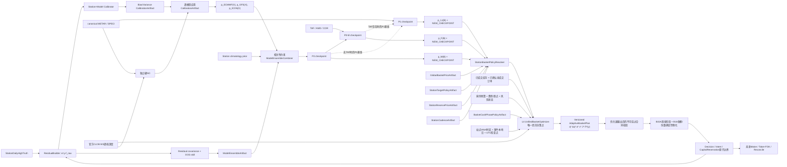

# Bayes概率核心 × 自适应最高温篮子目标架构

- 版本：1.14.47
- 状态：TARGET_PRODUCTION_NO_LIVE
- 生产授权：false
- 生产变更：false
- 当前权威开发计划：`bayes_basket_development_roadmap_v1_6.md`（v1.6.92）

> **2026-08-02 当前宪章覆盖**：所有 OOS 与样本门只认已闭日、strict-as-of、官方 AWC truth 可验证的历史同日数据。未来/forward 仅为 `observational_candidate_not_oos`，不计 OOS、不阻断 `production_no_live`、不构成未来 OOS 硬门；正式参数/live 只接受历史 strict-OOS artifact。NWP 仍 native-first，官方原生缺失、无效、过期或迟到时才走带 `aggregator_republisher` lineage 的 Open-Meteo no-live P0/P0-M fallback；不得进入 native arrival、P1 或 formal/live，且必须绑定独立历史 OOS activation。AIFS、ICON Global/EPS、ICON-EU、ICON-D2、ECCC/加拿大和区域模型按独立产品/家族登记，既有 raw 优先复用，不重复抓取。

> **2026-08-05 正式P0顶层定义（当前有效）**：active model-product registry只保留`ECMWF_IFS_ENS_OPEN_PF50 / ECMWF_AIFS_ENS_GLOBAL / DWD_ICON_GLOBAL_EPS / NOAA_GEFS_05 / ECCC_GEM_GLOBAL_ENS`五套官方原生全球集合成员产品。`FORMAL_P0`只能由同一`station_id × lead_bucket × run_cycle`下至少两个正权重、不同`independence_family_id`系统组合生成；每套系统必须完成原生成员、arrival/receipt、闭日历史strict-as-of OOS和exact activation绑定。AIFS Single及全部确定性、区域确定性和Open-Meteo republisher产品退出active registry，历史对象不得改名晋级。

## 0. 冻结生产宪章

### 2026-08-01 来源泳道修订：AWC 全球替代 AMSC（熊先生授权）

本修订冻结唯一正式实时来源为 AWC 全球正式泳道：45 站（含原中国/台湾 AMSC 站）均只消费官方 NOAA/AWC METAR/SPECI 推进 realtime truth、P1、篮子硬事实排除集合、校准和 production_no_live OOS。AWC 可替代原中国站 AMSC；AMSC 生产采集、:30 参考和旧 AMSC lineage 均退役为历史审计/离线对照，不得进入正式概率、truth、P1或篮子。生产不再运行任何 hard-NO/买-NO 策略。禁止同站混源、跨源 fallback、旧 lane 伪造；AWC 缺失、重复、陈旧或更正未复核即 fail closed。本文更早的双泳道描述仅是历史证据，不再构成当前合同。

本节是唯一生产宪章。实现、迁移、回放和验收不得临时改变下列合同；任何冲突需求必须先修改本节、同步机器合同并提交影响矩阵，之后才能改代码。

1. 概率阶段唯一为`符合第4条的当前官方原生集合组合经历史档案校准＋历年同日单点最高温弱倾斜→P0`、`TAF TX＋云量/降水/风物理二次确认→P0-M`、`METAR/SPECI硬下界＋轨迹软似然→P1`；不得新增并行中心或P0-F。P0不等待TAF/METAR，TAF缺失时P1可从最新P0根生成；P1存在后模型更新必须重放当前有效TAF和截至决策时刻的canonical实况，禁止裸降级P0。
1a. “历史模型档案”和“历年同日单点最高温”是两套独立lineage：前者由strict-as-of原生集合系统运行与最终truth配对，只训练成员偏差、离散度、概率可靠度和至少两套官方原生集合系统的OOS组合；后者不读取历史模型，只以目标年前已结算的历年同日最终最高温构造弱气候锚。二者只能经严格OOF元组合artifact合入P0，禁止直接相乘、共享当折truth或在P0之外再次修正方向/经济目标。
1b. 每阶段方向唯一为当前有效概率向量的上下侧质量差；历史同日、TAF和METAR进入对应阶段概率后不得再投方向票或给`DeltaBasketScore`加天气bonus。连续核心集只由当前组合概率覆盖形成，必须连续、包含稳定概率中心且每桶具有正目标库存；方向只决定UP/DOWN/NEUTRAL及外围桶排序和集中度，不得平移概率中心或用方向强制扩核心。正式组合成员校准中心的最冷/最暖极值只用于分歧诊断和有层数上限的候选边界，不能直接成为最终支持、不能强制填满两极之间所有桶；外围桶必须逐桶通过概率质量、模型可靠性、价格覆盖价值、Maker和扩桶上限。
2. 45 站正式 realtime truth、P1 与纯 YES 篮子硬事实排除集合只使用官方 AWC METAR/SPECI；AMSC 仅为历史审计/离线对照，任何旧 AMSC evidence、参考证据或跨源 fallback 均不得进入正式链路。
3. 市场目标日和truth窗口只取`market_registry.settlement_timezone`；ET只作运营与报表统计。
4. 正式P0组合至少包含两个正权重官方原生集合系统，并按冻结的`independence_family_id`完成跨系统组合；权重只能由同scope离线严格历史OOS不可变artifact更新，禁止在线追随单系统。确定性模型、确定性残差扩散、单套集合或republisher组合均不得冒充正式P0。
4a. TAF修订artifact必须按station×settlement timezone×season×lead×run-cycle精确解析；单站artifact不得向其他站fallback。某站没有exact TAF artifact时只跳过该站P0-M并保留最新P0，不得阻断其他站P0/P0-M/P1；同一exact scope多artifact或registry哈希漂移必须fail closed。
5. 唯一经济授权目标为`delta_basket_score_policy_artifact_v2`驱动的严格`DeltaBasketScore v2`；`V(q)`直接产生唯一`q*`，HOLD为零基线，随机部分成交与执行成本进入同一动作效用。目标函数、价格和cash phase不得反写概率；`strict_delta_basket_objective_v1`只允许作为离线历史基线，不得成为runtime、decision或training fact权威。
6. 目标库存必须自适应求解；Maker优先，只有紧迫度和全部硬门通过时才允许有上限单桶FOK。固定4→3→2、阶段等份和多腿全成旧路径不得恢复。
6a. Maker的授权与提交单位是完整篮子bundle，不是“先买一个桶”。篮子激活时，`execution_gap_support`中每个正缺口桶必须在同一SSOT周期各产生一条Maker intent；完整多意图计划、decision、training fact与总资本预留必须同事务全成或零写。任一腿缺候选、资金不足或硬门失败时整篮HOLD。各腿可独立部分成交，但任一成交、撤销、未知或迟到回报都触发全篮重算；FOK仍只允许在Maker确认撤销后作为有上限单桶紧迫收口，且不得与Maker bundle共存。
7. 运行模式固定`production_no_live`，`live_submit_authorized=false`、`calls_order_gateway=false`、`orders_submitted=0`，直到另行修订宪章并通过全部发布门。
7a. 唯一三个生产服务`com.weather.weather_basket_yes/com.weather.market_ws/com.weather.clob_order_service`固定由登录用户的`gui/$(id -u)` LaunchAgent持有；旧`com.weather.reported_trajectory_no`与 system 域任一同名 job 存在、用户域任一服务缺失或双活均 fail closed。首次退役既有root-owned LaunchDaemon只允许`sudo -n`非交互授权，权限不可用时必须在任何停服前退出；完成一次性迁移后，安装、启停、重启、切换与验收全部禁止sudo。全过程保留live pause，CLOB固定read-only。
8. 数据与输出必须资源有界；RSS、DB/WAL、响应、临时文件或最低剩余磁盘任一探针失败立即fail closed，不保留重复、失败残片或无下游依赖旧输出。
9. 交付顺序固定为`合同冻结→DDL→迁移/回滚→真实维护窗→writer→reader→materialization→OOS`，不得先铺消费者再补schema。
10. 当前交付范围为冻结 canonical 45站纵向主链：`registry→calibration→P0→P0-M/P1→WS→inventory/order-state→DeltaBasketScore→decision→training fact→label`。生产采集和模型采集不得再以RKPK作为范围门；网络执行按全量registry候选做有界轮转，每周期最多4个scope并在失败后确定性回绕。未来/forward观测与no-live生产和扩站并行，不能作为二者阻断门，也不计入任何 OOS；正式参数、权重及 live 的 `FORMAL_PROMOTED` 晋级只接受历史 strict-OOS artifact。每站正式P0仍必须具备离线严格OOS形成的至少两套官方原生集合系统正式组合。
10a. candidate receipt进入arrival/decode/OOS前必须经独立adapter复核receipt、provider、evidence binding和原始payload哈希；native arrival字段只能来自被绑定的真实provider payload，禁止从文件名、发布周期或接收目录推算。`aggregator_republisher`永远不得进入native arrival index；官方原生缺失时，只有在严格同日OOS已激活且至少两个独立家族的下游组合，才可作为显式 `production_no_live` P0 fallback，官方同站原生包优先，且不得进入 P1 或官方硬事实排除集合。adapter本身不得创建activation、P0或promotion。
11. 任一正式站点日出现未解决`COR/AMD`或相同时刻冲突报文，必须在下游物化前停牌：不得新增P1、settlement truth、label、市场decision或订单事实；非整点修订不得被整点truth过滤掩盖。truth只能在registry结算窗关闭后由正式source lane整点报文追加，最新revision若为`QUARANTINED`，旧`ACCEPTED` revision不得继续生成label。
12. 人工复核不得直接改表或口头清除停牌。每条COR必须绑定append-only、内容寻址的review receipt；非整点COR仅允许`CLEAR_REFERENCE_ONLY`或`QUARANTINE_STATION_DAY`，前者仍不得进入正式P1/truth。整点COR禁止直接clear，必须另有正式替代报文合同。可变halt行只是由review receipt派生的执行缓存，不是复核权威。
13. 同站点×市场日的新P0/P0-M/P1、官方WS、inventory或order-state改变`decision_scope_key`时，旧`prepared`候选不得继续阻断新SSOT。只有旧cycle仍为`prepared`、全部intent为本地`prepared`且`live_submit_authorized=0`、active reservation存在，并且没有order event、execution receipt、transition、reconciliation或post-fill事实时，才允许在同一SQLite writer事务中取消旧intent、释放旧reservation、settle旧cycle、追加内容寻址supersession receipt并提交新decision/intent/reservation/training fact；任一步失败必须整体回滚。旧decision与training fact保持append-only不修改；`submitting/submitted/reconcile_required`或任何未知执行事实一律fail closed。

唯一进度状态枚举为`DESIGN→IMPLEMENTED→TESTED→REHEARSED→MATERIALIZED→RUNNING→OOS_PASSED→DONE`。`TESTED`或`REHEARSED`不得表述为“已落地”；权威状态表和变更影响矩阵只维护在`bayes_basket_development_roadmap_v1_6.md`。

本次新增的`SameDayClimatologyArtifact/P0HistoricalMetaCombinationArtifact/MetarTrajectoryLikelihoodArtifact`、概率证据append-only authority、完整前缀P1重放及连续核心/候选边界合同已达`TESTED`；DDL已在临时副本双跑达到`REHEARSED`。真实SSOT尚未执行本次窄迁移，resident尚未加载新代码，正式同日/轨迹artifact也尚未完成OOS promotion，因此不得写成`MATERIALIZED/RUNNING/OOS_PASSED`；当前真实resident仍按历史同日强度0、轨迹LR=1运行。

P1原子lineage必须同时携带最后一条canonical报文的event id、raw SHA、canonical commit time、source lane、report type及对应hard bound id；完整轨迹序列SHA必须独立保存，禁止冒充单条raw SHA。M5 writer在bundle构建和提交两处独立核对这些身份，并在既存cycle幂等重放时重新确认observation/bound事实仍存在且内容一致。轨迹proof中的direction和positive-core只作概率诊断，不得作为篮子方向或连续核心的第二权威。

2026-07-30 canonical 45站扩展代码闭环：生产worker默认站点范围已由单站改为冻结45站，registry最多发现135个站点日scope，每轮最多4个网络scope并按missing/stale/fresh各保留轮转槽位；没有正式2+模型OOS组合的站点进入独立candidate-only原始模型预采集，每轮最多1个scope，只积累有publication/arrival、raw/provider receipt SHA和transport lineage的证据，不创建P0或activation。轮转进度以唯一、内容寻址、1MiB上限状态文件持久化，绑定catalog SHA、优先级游标、最近选择和已尝试scope；重启恢复、135 scope/34轮完整覆盖、低→高→低catalog变化、失败scope公平尝试及损坏状态NWP独立fail-closed均有合同测试。scheduler status与rotation state还必须绑定同一完整scope catalog SHA；45/90/135 scope均可验收，数量或哈希漂移立即fail closed。candidate provider在临时目录完整后原子提升，失败残片清理，研究原始对象递归受1GiB/100000文件/512MiB最低空闲空间硬门。正式P0的至少两套官方原生集合系统OOS activation硬门未放宽。M9-06切换回执已增加canonical scope、release、受保护PID、target PID、live pause、DB指纹和schema完整性复核；重复切换NOOP自身可完整验签。恢复镜像改为先持久化`COMPLETED_RECOVERY_RETAINED`回执并解除rollback trap，再删除无用备份并晋级`COMPLETED`，避免先删备份后回执失败。分批Target/Basket回归共2164项通过，本轮scheduler/rotation/cutover专项109项通过；真实system切换尚未执行，故仍为`TESTED`而非`RUNNING`。

## 1. 核心结论

> 2026-07-28 当前运行事实（动态计数截至2026-07-28T15:55Z）：三个system服务继续`production_no_live`、gateway只读、零live授权，PID为`reported_trajectory_no=96801`、`market_ws=98056`、`clob_order_service=95880`，live pause保留。v2维护与resident加载均已真实执行：625条execution vector无损，post-fill表已有双经济权威列，2个policy与4个fill artifact均以`PRODUCTION_NO_LIVE/oos_gate_passed=false`物化；intent/order-event/post-fill-recompute仍全为0。RKPK的2条7月29日`d2fact_`已由权威SSOT重新通过完整validator，并在target-local forward store物化为2条observation；旧timestamp字符串误判留下的2条`QUARANTINED`审计事实保持append-only，另追加2条内容寻址repair receipt后有效quarantine为0，store generation从2升至3且source cursor保持630，重复执行零写。对应`d2label_`只能在7月29日15:00Z结算关闭后生成，禁止借用已冻结的7月28日35℃truth跨日标注。forward OOS仍只阻断参数/权重及live的`FORMAL_PROMOTED`，不阻断no-live或45站扩展。

> 2026-07-29 45站truth容量修复（证据时钟2026-07-29T03:45:53Z）：settlement truth扫描已从“全历史scope一次性装入且最多16个”改为按`basket_policy_training_fact.rowid`做每页最多45条的keyset分页；同一scope用最新fact rowid作为页键，避免多fact跨页重复。resident重启后的首次扫描从最新45个scope开始，随后按keyset尾页确定性回绕历史，因此当前45站与晚到新fact不被旧历史饿死。游标严格在writer commit成功后推进；注入commit失败、普通blocker或异常时数据库回滚且原游标不动。相关truth/worker/隔离闭包测试76项通过。`settlement_truth.py`已纳入target运行隔离冻结scope，manifest由30增至31项，重封装后同输入为`UNCHANGED`，SHA为`48b6840c0267d07e75a62e98af25382288ce15840b3bbabe3b00f118779f12fc`；带system服务探针的production closure为`PASS`（receipt `d9803481104720993d0d417cf5fe70a0c16f3589d5887b8bc8b266e954782aaf`），安全删除候选仍为0。该代码尚未加载到当前resident PID 3795，因此状态仅为`TESTED`，不得写成45站`RUNNING`；在RKPK同日truth/label闭环后、45站物化前再做target-only受控重启。

> 2026-07-29 prepared接替缺陷与修复（证据时钟2026-07-29T04:23:32Z；历史检查点，已被下方07:26Z运行证据接替）：真实P0已更新为`p0_73c20fb68c82ffbbed7d8b9845fe756c`，P0-M为`p0m_98a472ae2f5a14ccf1c9137ba5a3db65`，AWC新高36℃后的P1为`p1_3b84a85e7b649fb5c30a82fb36b56164`，最新官方WS为`ws_d54be1fcfd1cc5e30b58778b88c233d3d9828d9b`；但decision/training fact仍停在03:10Z旧P1/WS。根因是prepared retention guard把“同scope幂等保留”和“新authority scope接替”混成一个分支。现已新增append-only `basket_target_prepared_supersession_receipts`及原子接替helper：仅零执行事实的本地no-live prepared候选可被新scope接替，旧decision/fact不修改，提交失败全回滚；atomic ledger同时拒绝绕过worker直接追加第二个不同scope活跃候选。该时点生产表尚未迁移、PID 3795尚未加载；此状态不再代表当前运行态。

> 2026-07-29 完整篮子收口（最新复核2026-07-29T07:26Z）：上述迁移、resident加载和真实接替均已完成。Maker授权/提交单位固定为完整bundle；跨事件资本分配器也只接受完整bundle，单腿输入不得成为portfolio候选。`POST_UNKNOWN/FOK_PARTIAL_FILL/LATE_FILL/CANCEL_FILL_RACE/FOK_FAILED`会把cycle置为`reconcile_required`并原子取消仍安全的`prepared`兄弟腿，未知腿库存和active reservation保持不猜测。TAF live OOS保留夹具已按请求的`RKPK×summer×d2_fallback×18Z`显式重绑定ensemble、两模型calibration和内容哈希，生产exact-scope唯一门未放宽。196个跨域相关测试文件共1689项通过。当前target resident PID为20861，`market_ws=98056`与`clob_order_service=95880`未变；带system服务探针的production closure为PASS。RKPK同一cycle已真实物化38℃/39℃/40℃三腿，预留2.65290 USDC与三腿名义金额之和精确一致；当前真实表有400条no-live intent、0条live intent、0条order event、0条execution receipt和0条gateway订单。

> 2026-07-28 历史校准增量（证据时钟2026-07-27T23:59:25Z）：按`market_registry.settlement_timezone`重建中国8站2026-07-15至24日正式历史，形成1566条AMSC正式观测、65个truth station-day和240条ECMWF/GFS/ICON完整曲线；中国站AWC共2797条只绑定为`reference-only` lineage，不复制进formal packet且新增calibration station-lane硬门。8站均完成OOS；严格非退化门只接纳ZGSZ/ZSPD/ZUCK/ZUUU，生成8个模型校准artifact、4个至少两模型ensemble和12个`PRODUCTION_NO_LIVE_ONLY` activation，其余4站继续fail closed。Open-Meteo ICON保持`aggregator_republisher`，不伪造native arrival；formal promotion、live和gateway写均为false。45站cash/policy与上述校准已合并为唯一自哈希ingress packet（SHA `7ae254d67d78e67cab0f7a14f20e4413e7845fb8a3fd3c45974b343716094d28`），在一次性SSOT克隆真实提交后第二次提交全零，维护脚本已改为消费该packet。focused matrix更新为172个文件、1515 passed、0 skipped（receipt SHA `87c12312638f9b0a24a415efe4d30ed7f65ec6c28c2c6811c033095c43047a88`），production closure与唯一文档authority均PASS。

### 0. 顶层设计目标

本方案的顶层设计目标由三部分组成：概率驱动的动态库存管理、组合赔率/收益曲线重塑、以及约束下的组合期望收益最大化。三者必须在官方事实、后验概率、真实盘口、预算、集中度、风险和订单状态等约束下共同成立，而不是单纯追求最高赔率、最高概率桶或单笔订单收益。

其中天气概率链的顶层输入定义为：只有至少两个官方原生集合系统在同一exact scope下完成成员lineage、闭日历史OOS、冻结selection与activation后的跨系统组合，才是正式P0。其他任何模型组合都只能作为benchmark、candidate或显式no-live fallback，不得获得正式P0语义。

可执行目标表达为：

```text
概率 → 目标仓位 → 动态库存缺口 → 补仓路径
                         ↓
              组合赔率/收益曲线
                         ↓
最大化：组合预期结算收入 − 总成本 − 费用 − 滑点 − 执行风险成本
同时满足：证据有效、预算有界、集中度受控、盘口可执行、订单状态确定
```

- 概率决定最终结果分布和目标篮子结构；价格决定概率是否转化为正向价值；目标仓位把概率和价格转化为组合配置；情景收益与风险约束决定配置规模。
- 动态库存管理负责把目标仓位转化为执行顺序：持续比较目标仓位、已成交仓位和已确认未成交仓位，按正向缺口决定动态补仓。
- 组合赔率/收益曲线重塑是对自身组合结算结构的重塑：通过各温度桶的仓位分配改变不同最终温度情景下的收益表现，不代表操纵市场报价或市场赔率。
- 组合期望收益最大化必须与情景收益、风险、预算、集中度和执行成本一起评估，不等于最大化单桶赔率或单份期望收益。
- 顶层行为抽象为“组合概率定核心、模型分歧限边界、方向侧质量排外围”：当前阶段组合概率按覆盖目标生成包含稳定中心的连续核心；正式组合成员校准中心极值只诊断分歧，并在策略层数上限内限定候选搜索边界。方向通过时只改变外围桶排序与集中度，不要求核心越过某个模型极值；核心之外的风险桶仍须逐桶通过概率质量、模型可靠性、价格覆盖价值和扩桶上限。目标仓位与实际仓位的缺口决定完整Maker bundle各腿补多少，盘口、价格、深度和离散现金片段决定如何成交。
- 当前RKPK KST验收实例严格按`P0→P1→官方WS→篮子→no-live decision`单链运行：P1从最新18Z/d2_fallback P0根接管唯一SSOT，官方WS时钟晚于P1，支持集为34–37℃；因没有正增量且风险地板未通过，结果为HOLD并原子记录零订单决策。该实例不把TAF当作前置条件；TAF只有在同根、已激活OOS artifact与有界proof均存在时才可插入P0-M确认/有限修正版本。
- 2026-07-28 实现状态：TAF已新增直接面向实际live NWP组合指纹的nested rolling-origin OOS链，历史行强制绑定2+模型mask、selection evidence、逐模型原始lineage和严格as-of；RKPK可用outer样本由21补至23，仍低于24硬门，且当前TAF组合NLL/CRPS均劣于NWP baseline，因此保持`NA/candidate_only`、不建立bridge。cash-phase forward writer已接入唯一resident no-live cadence：完整执行候选与零意图HOLD都把概率、官方WS、inventory、order-state、站点策略、cash policy及DeltaBasketScore v2 artifact/evaluation SHA绑定进同一`auto_trade_decisions`内容地址；各来源保留自身时钟并强制`source_time≤cycle decision_at<quote_expiry`。forward OOS不阻断`production_no_live`事实积累，只阻断cash/v2参数、权重和live的`FORMAL_PROMOTED`晋级。现金输入时区必须与registry结算时区完全一致，单次clip cap必须显式提供，禁止从总预算推导；`orders_submitted=0`、`live_submit_authorized=false`。
- 2026-07-28 forward v2完整生命周期：结算label在主SSOT提交后按独立source-label rowid keyset有界投影，主SSOT始终是权威，投影失败只形成可重放lag；单条poison只保存decision identity、source SHA/rowid和稳定error code，合法前缀继续提交。清理只接受逐observation绑定的内容寻址scorecard与attribution receipt，且必须已结算、超过保留期、无下游依赖。代码、DDL、迁移、reader/writer和临时clone回绕已`REHEARSED`，但真实v2 schema/authority尚未`MATERIALIZED`；真实training fact为422行、label为0。维护切换只重启`reported_trajectory_no`，必须硬验`market_ws/clob_order_service` PID不变以及零gateway/live/order。
- 2026-07-28 维护事务升级：唯一切换脚本已按forward store、hard-NO timezone、SSOT schema、no-live activation四个独立提交阶段记录状态，并在首个数据变更前写入固定路径、原子替换的有界cutover journal；普通失败由EXIT trap逆序恢复，`SIGKILL`/断电遗留journal则由下一次维护入口在任何新preflight前优先恢复。恢复顺序为activation/schema→hard-NO→forward store→pause原状态，每个SQLite恢复镜像与恢复结果均执行有界`quick_check`，任何部分恢复失败都保留journal、恢复镜像和双暂停且禁止重启writer。成功或完整回滚后才执行内容寻址dry-run/apply保留计划，最少保留最新可恢复备份，按数量、年龄、总字节和目录扫描上限删除无引用旧恢复物；active DB/WAL/SHM、symlink、hardlink或状态漂移一律fail closed。
- 当前唯一生产proposal实现为`DeltaBasketScoreV2Optimizer→compile_delta_v2_runtime_plan`：官方WS逐档深度、随机成交分布、执行成本、目标库存与动作效用进入同一v2链，固定角色预算/桶数、allocation mode和旧绝对score均不得进入生产。正式经济授权唯一依赖内容寻址的v2 policy/fill双authority；缺authority、哈希/版本漂移或`DeltaBasketScore<=epsilon_score`统一HOLD/fail closed。旧`basket_kernel/state_machine.py`、`optimizer.py`、`pricing.py`、`taker_simulator.py`及`strict_delta_training.py`已从生产源码删除，包入口不再加载；历史v1只允许显式解码和OOS基线，不得成为运行时fallback。
- 该行为抽象不等于只买最高概率桶，也不等于每笔订单按概率成比例配置，更不等于已证明源账号显式优化凸性；它描述本方案的可执行结构，源账号私有意图仍须与公开成交事实分开。
- 赔率只是价值判断的一个表达：低价高赔率不等于高价值，高概率也不等于应当不计价格地买入。每桶仍须通过自身概率价值、预算、深度、集中度、证据新鲜度和订单状态门；当前 production/no-live 篮子阶段另须通过 `sum(all_in_yes_ask)<1` 硬执行门。
- 动态补仓不直接追逐最高赔率或最高概率，而是先重算目标仓位，再根据`目标仓位−已成交仓位−已确认未成交仓位`形成正向缺口并排序执行。
- 篮子卖一价总和不构成保本承诺或硬性最大化目标；动态篮子不是地板保本策略。总和诊断与单桶价值、组合情景收益、风险门分离处理。
- 对源账号的行为复刻采用较低层的可观测机制假设：概率形成有效篮子与目标结构，库存缺口驱动动态补仓，盘口、时间和现金片段驱动实际执行；不能把源账号私有的完整组合目标函数写成已被成交记录证明的事实。

### 0.0.1 顶层经济前提：正EV、Maker与多城市

本方案不把胜率、赔率倍数、低价挂单或城市数量单独视为收益来源。唯一可交易的原始edge是系统严格校准后的后验概率高于官方CLOB WS真实可执行全包价格，并在扣除费用、滑点、模型不确定性、排队、未成交和逆向选择成本后仍为正：

```text
GrossEdge_b = p_b - all_in_price_b
NetEdge_b
  = GrossEdge_b
  - fees_b
  - slippage_b
  - model_uncertainty_buffer_b
  - queue_nonfill_adverse_selection_cost_b
```

`edge`与`保险成本`必须分开：常规新增桶依赖正`NetEdge`；为了抬升已存在组合的最低利润或受保护尾部，允许极少量`coverage_subsidized`桶承担可审计的负`DeltaEV`，但它不是新edge，也不能把整体负EV组合包装成正EV。该保险成本必须由同一动作带来的利润地板/双风险覆盖改善补偿，并同时通过严格`DeltaBasketScore`、组合ExpectedPnL地板、补贴上限和OOS激活门。

对一个胜时净赚`W`、败时净亏`L`、费用为`C`的城市篮子：

```text
EV = p_win*W - (1-p_win)*L - C
p_break_even = (L+C)/(W+L)
```

因此“篮子真实命中概率约50%”只有在`p_break_even`显著低于50%时才构成正EV；50%胜率本身不授权交易。所有概率必须来自当时可用的P0/P1与lineage，不能用事后胜率替代。

Maker与多城市承担不同职责：

- `Maker`是执行优化器，不是概率来源。它通过在数学价值上限和站点保留价内等待更低成交价，降低盈亏平衡概率并改善单位资本赔率；是否挂单必须比较`fill_probability*NetEdge`与排队、未成交、逆向选择及机会成本。若有上限Taker的净edge更高或等待价值为负，不要求机械Maker。
- `多城市`是机会池和风险组合器，不创造单城市edge，也不能把一组负EV交易变成正EV。每个城市必须先独立通过正`NetEdge`、证据、深度和风险门，再按城市/气团/模型误差相关性配置共享资本：

```text
PortfolioEV(x) = Σ_i x_i*NetEdge_i
PortfolioScore(x) = PortfolioEV(x) - lambda_cov*x'Σx
```

- 多城市的价值是扩大可筛选的正EV机会集、降低单站预测或流动性异常的影响并平滑收益；相邻城市、同一气团或相同模型系统性误差不得伪装成独立分散。
- 尾部低价桶只在`NetEdge>0`或其作为受限保险桶使`DeltaBasketScore>epsilon_score`并通过`coverage_subsidized`合同时使用。高赔率是低成本成交的结果，不是独立目标；禁止按`1/price`、赔率倍数或城市数量机械扩仓。

顶层因果顺序固定为：

```text
官方天气事实与模型 → 严格校准后验p(B)
→ 与真实可执行价格比较得到NetEdge
→ 单城市全情景目标库存与Maker/Taker表达
→ 仅对已过门正EV城市做相关性约束的共享资本配置
```

### 0.1 顶层目标宪章（唯一规范）

本宪章是本方案的最高层设计约束。所有P0、P0-M、P1概率、目标仓位、动态补仓、价格和执行逻辑都必须服从同一目标，不得在不同阶段偷偷切换为“最高概率优先”“最高赔率优先”“最低价格优先”或“凸性最大化”。

#### 0.1.1 唯一顶层目标

在官方事实约束后的有效桶集合、当前阶段后验概率、官方WS盘口、预算、库存、订单状态和执行风险约束下，最大化组合预期净收益与结算情景表现：

```text
J(q,a)
= E[p_s(B)] [Π(B; q,a)]
  + λ_f × ProfitFloor(Π)
  − λ_d × DownsideRisk
  + λ_s × ShortfallCoverage
  + λ_b × BreakthroughCoverage
  − λ_c × ConcentrationRisk
  − λ_e × ExecutionRisk
```

对于互斥的精确温度桶，最终温度为`y`时：

```text
Π(y; q,a)
= q_y
  − Σ_b(已成交份数_b × 已成交成本_b)
  − Σ_b(本次实际成交份数_b × 实际成交全包成本_b)
  − 费用
  − 滑点
```

`J`优化的是组合，不是某一个桶；`q`是目标仓位，`a`是当前补仓动作，最终实际成交必须以真实盘口和订单回执为准。

#### 0.1.2 目标函数的计算顺序

```text
官方事实与market_registry.settlement_timezone对齐
→ 有效桶集合 A_t
→ 当前阶段后验概率 p_s(B)
→ 支持集与目标仓位 q*
→ 目标仓位缺口 Δq_b
→ 价格、盘口、预算和订单状态门
→ 当前补仓动作 a*
→ 更新成交、库存、情景收益与J
```

每次新概率、官方整点实况、盘口、成交或订单状态变化，都必须沿此顺序重新求值。不得用旧目标仓位直接延续到新概率或新事实。

#### 0.1.3 三个中间层的职责

- `概率层`：决定结果分布、中心、方向、有效桶和支持范围；概率不是未经校准的模型原始输出。
- `目标仓位层`：把概率、官方WS逐档成本、双风险覆盖、组合风险和结算情景转换为每桶唯一`q_b*`；桶数和规模由同一目标函数自然产生，不得由固定角色桶数或固定角色预算预先决定。
- `库存执行层`：按`Δq_b=max(q_b*−q_filled,b−q_pending,b,0)`识别欠配桶，再在价格、深度、预算、集中度、证据新鲜度和订单状态门内决定`a*`。

#### 0.1.4 赔率曲线与凸性的定位

- 组合赔率/结算收益曲线是`q*`映射到不同最终温度情景的结果，也是组合优化要改善的对象之一。
- 凸性是收益曲线的形状特征，不是独立的顶层目标；允许保留适度尾部非线性，但不得为追求凸性牺牲概率价值、组合期望收益、预算或风险上限。
- 低价高赔率不自动等于高价值；每桶必须满足概率价值和执行门。高概率桶也不能因为概率高就无视价格、深度和集中度。
- 总卖一价之和不是保本承诺或顶层最大化目标；动态篮子也不是无条件地板保本策略。但当前 production/no-live 每个立即执行阶段仍必须满足 `sum(all_in_yes_ask)<1`，该门只约束可执行阶段，不把该不等式解释为无条件保本证明。

#### 0.1.5 不可越过的约束

```text
q_b ≥ 已成交仓位_b
新增仓位_b ≤ Δq_b
官方已排除桶不得新增
Σ新增实际成本 ≤ 剩余预算
单桶全包价格 ≤ 数学上限与站点保留价
常规新增桶净EV ≥ 0；coverage_subsidized桶满足独立补贴合同
DeltaBasketScore > epsilon_score
盘口深度、证据新鲜度和订单状态必须有效
未知、部分、迟到或冲突订单状态必须停止新增
```

只增不减表示新计划不能自动卖出历史成交仓位；它不是说旧仓位仍然属于新的有效支持集。被排除桶的历史仓位必须保留为对账事实，但新缺口归零。

#### 0.1.6 参数与证据边界

`λ_f`、`λ_d`、`λ_s`、`λ_b`、`λ_c`、`λ_e`、`epsilon_score`、站点目标策略、模式化保留价和现金阶段都必须以独立版本、严格OOS证据和激活指针管理；在参数未完成晋级前只能输出`production_no_live`候选，不能进入live。

本宪章是本方案的规范性目标，不宣称源账号已经公开使用同一个显式`J`函数。源账号只能作为低层行为证据：模型/中心形成结构、库存缺口驱动补仓、价格和现金规则驱动成交。

#### 0.1.7 统一全链路数学优化器

本方案目标实现为一个统一的`UnifiedBasketOptimizer`，所有经济决策必须由同一个优化问题产生；概率、目标仓位、库存缺口、价格、盘口、预算、风险和订单状态不得各自独立地产生互相矛盾的决策。

**输入状态**：

```text
p_b                 当前阶段有效后验概率（时区必须匹配market registry）
A_t                 官方事实约束后的有效桶集合
f_b                 已确认成交份数
u_b                 已确认未成交份数
c_b                 已成交成本
L_b                 官方WS逐档卖盘与深度
B                   剩余预算
F_b(a_b)            在订单动作a_b下的保守成交/未成交分布
fee, slippage       费用与滑点模型
S, U, C, E          未达成、突破、集中度和执行风险度量
cash_phase          站点本地现金阶段及其版本
```

**联合决策变量**：

```text
q_b                 每桶最终目标仓位
x_b                 当前计划新增且实际可成交的份数
a_b                 当前桶的订单动作、价格、方式和现金片段
z_b∈{0,1}           是否将桶b纳入当前有效组合
```

其中：

```text
q_b ≥ f_b + u_b
Δq_b = q_b − f_b − u_b
0 ≤ x_b ≤ Δq_b
```

对互斥的精确温度桶，在最终结果为`y`时的随机组合收益为：

```text
Π_y(q,a)
= f_y + X_y(a_y)
  − Σ_b c_b
  − Σ_b Cost_mode,b(X_b,a_b,L_b)
```

统一优化目标为：

```text
J*(state)
= max_{q,a,z}
    E_{Y~p, X~F(a)}[Π_Y(q,a)]
    + λ_f  ProfitFloor(Π; protected_scenarios)
    − λ_d  DownsideRisk(Π)
    + λ_s  ShortfallCoverage(q; M,R)
    + λ_b  BreakthroughCoverage(q; R,new_high)
    − λ_c  ConcentrationRisk(q)
    − λ_e  ExecutionRisk(a)
```

其中：

- `ProfitFloor`是版本化受保护情景集合上的`min_y Π_y`或其平滑保守近似，只衡量自有组合最低利润曲线；它不是市场无风险保本承诺；
- `DownsideRisk`衡量尾部亏损或CVaR，与利润地板分别记账，禁止重复计分掩盖负EV；
- `ShortfallCoverage`只评价`predecessor(M)`、`predecessor²(M)`对P1未达成风险的覆盖；
- `BreakthroughCoverage`只在官方新高后评价`successor(R)`、`successor²(R)`对上行突破风险的覆盖；
- `ConcentrationRisk`约束单桶成本/份额集中度；
- `ExecutionRisk`包含费用、滑点、深度不足、队列不确定性、未成交和订单状态风险；
- 目标库存`q*`是该优化问题的结果，`Δq*=max(q*−filled−confirmed_pending,0)`只是执行缺口；禁止再用`TargetGapPenalty`把另一套外部目标库存塞回目标函数；
- `λ_f/λ_d/λ_s/λ_b/λ_c/λ_e`必须由独立版本和严格OOS证据晋级，未晋级时不得进入live。

**联合硬约束**：

```text
z_b = 0, q_b = x_b = 0                         b∉A_t
q_b = f_b + u_b + Δq_b                         Δq_b≥0
0 ≤ x_b ≤ Δq_b
Σ_b Cost_mode,b(x_b,a_b,L_b) ≤ B
DeltaBasketScore(state,a_b) > epsilon_score
price_b(a_b) ≤ reserve_cap_mode,b(x_b)
x_b ≤ depth_b(L_b, price_b)
evidence_fresh = true
order_state_known = true
contract_matches = true
probability.settlement_timezone = market_registry.settlement_timezone
unknown/partial/late/conflicting order state ⇒ x_b=0
```

优化器输出唯一的联合结果：

```text
q*       目标仓位
Δq*      各桶库存缺口
a*       当前补仓动作与价格/现金片段
x*       保守可成交份数
J*       目标函数值
J0       同版本基线目标函数值
DeltaJ   J*−J0及逐项分解
Π*(y)    各最终温度情景收益
reason   通过或阻断原因
```

这意味着“目标仓位模块”“B14价格模块”“库存缺口模块”和“执行门模块”在方案层不再是四个相互独立的最优解，而是同一个`UnifiedBasketOptimizer`的变量、约束和输出。任何一个输入版本变化，都必须重新求解联合问题并生成新计划版本。

统一优化器只适用于YES篮子经济决策。硬NO lane继续独立消费官方整点事实形成硬下界，不得读取`p_b`、`q_b`、`J*`或任何篮子风险变量；资源上限、lineage、激活、fail closed和`production_no_live`则作为优化器外部的系统级安全边界。

本节是目标架构，不代表当前代码已经具备可live的统一数值求解器；在严格as-of概率、官方WS逐档深度、订单状态、参数OOS晋级和no-live前向证据完成前，优化器只能输出候选计划和审计结果。

#### 0.1.8 严格增量目标函数与执行宪章（唯一规范）

所有新增库存、挂单、改价、撤单后转FOK和角色调仓提案，只能比较同一版本状态下的“无新增动作”基线与“拟议动作”；绝对目标函数值、单桶高概率、低价格或高赔率均不是授权。

统一状态快照必须至少包含：

```text
State_t
= probability artifact + valid buckets
  + filled/pending inventory + committed cost
  + official WS depth + budget + risk state
  + order state + settlement contract
  + probability/quote/inventory/order/policy/solver version hashes
```

严格基线、提案与唯一增量授权定义为：

```text
J0 = J(State_t, no_new_action)
J1 = J(State_t, proposed_action)
DeltaBasketScore = J1 − J0

authorize(proposed_action)
⇔ DeltaBasketScore > epsilon_score
   ∧ all_hard_constraints_pass
```

`DeltaBasketScore≥0`、`J1>0`、某个单项改善或旧计划曾被接受均不能替代严格门；`epsilon_score`必须版本化并经OOS晋级。基线与提案必须共享完全相同的概率、盘口、库存、订单、预算、策略和求解器版本向量，任何漂移都使比较失效并重新求解。

纯期望价值与风险调整项必须分开记账。对完整情景集合：

```text
DeltaEV = Σ_y p_y × DeltaΠ_y

单桶b完整成交x_b份：
DeltaEV_b = x_b × (p_b − all_in_cost_b)
ROI_b = p_b / all_in_cost_b − 1 = p_b × O_b − 1
```

这里`O_b=1/all_in_cost_b`仅是十进制赔率表达；`p_b(1-a_b)/a_b`是命中侧收益率加权量，不是净EV，禁止以EV名义用于准入。顶层增量分解唯一为：

```text
DeltaBasketScore
= DeltaEV
  + λ_f × DeltaProfitFloor
  − λ_d × DeltaDownsideRisk
  + λ_s × DeltaShortfallCoverage
  + λ_b × DeltaBreakthroughCoverage
  − λ_c × DeltaConcentrationRisk
  − λ_e × DeltaExecutionRisk
```

`ShortfallCoverage`与`BreakthroughCoverage`只评价既定概率下的情景覆盖，不生成概率、不改写P0/P1、不扩大模型概率质量。常规正EV桶必须满足`DeltaEV_b≥0`。若某个桶`DeltaEV_b<0`，只有同时满足以下合取条件才可作为`coverage_subsidized`候选：

```text
coverage_subsidized = true
DeltaBasketScore > epsilon_score
DeltaProfitFloor > 0 或受保护尾部损失严格下降
ExpectedPnL_after ≥ expected_pnl_policy_floor
Subsidy_b = max(-DeltaEV_b,0)
Σ Subsidy_b ≤ min(subsidy_absolute_cap,
                  subsidy_ratio_cap × Σ positive_DeltaEV)
coverage_policy_oos_activated = true
```

负`DeltaEV`、正覆盖贡献和利润地板改善必须分别物化，禁止净额后把该桶称为正EV。双风险覆盖可以有限度地把模式化保留价推过单桶概率价值，但只能推到由上述补贴上限和组合`DeltaBasketScore`共同反解出的保险价格上限；不得用低价、高赔率、模型极值或抽象“安全感”授权。

两种执行模式必须使用不同、可审计的成本曲线：

```text
FOK:
  C_FOK,b(x) = 官方WS逐档累计全包成本
  r_FOK,b(x)
    = sup { c | DeltaBasketScore(mode=FOK,c,x) > epsilon_score
                ∧ EVOrCoverageSubsidyContract(c,x) = true }

Maker:
  C_Maker,b(x,r)
    = 候选价格r下的保守fill distribution
      + queue/nonfill/adverse-selection/wait cost
  r_Maker,b(x)
    = sup { r | E_fill[DeltaBasketScore(mode=Maker,r,x)] > epsilon_score
                ∧ EVOrCoverageSubsidyContract(r,x) = true }
```

- FOK必须直接消费官方WS多档累计成本和真实VWAP，禁止用顶层ask乘份数冒充多档成本；真实成交后按回执成本立即重算`J0/J1/DeltaBasketScore`。
- Maker未成交份额不进入已实现结算地板，但必须进入`confirmed_pending`；保留价必须显式计入队列、未成交、等待与逆向选择，不得与FOK共用未注明含义的`reservation_value`。
- Maker确定性部分成交、撤单确认、FOK全成或零成后都必须以新SSOT重新求解；未知、迟到、冲突或撤单未确认状态直接`reconcile_required`。

最终支持由“连续核心＋可选外围风险桶”组成。连续核心只由阶段组合概率覆盖原子生成，核心两端之间的桶必须全部入选并各有正目标库存；外围风险桶仍由统一优化逐桶判断，可保持非连续。模型极值只作分歧诊断并限定有层数上限的候选边界，方向只排序外围候选和调节集中度；二者都不能绕过概率质量直接把桶塞入最终支持。禁止固定`max_bias_buckets`、固定`max_edge_buckets`或固定角色预算决定最终桶数。

每个候选动作必须物化以下最小审计闭包：

```text
baseline_score
proposed_score
delta_basket_score
delta_expected_pnl
delta_downside
delta_shortfall_coverage
delta_breakthrough_coverage
delta_concentration
delta_execution_risk
delta_profit_floor
coverage_subsidized
negative_delta_ev_subsidy
subsidy_cap_slack
mode_specific_cost_curve_sha256
probability_artifact_sha256
quote_snapshot_sha256
inventory_version
order_state_version
policy_version
solver_version
constraint_slacks
```

缺任一分解、哈希、版本或约束余量时fail closed。该闭包只授权YES篮子候选，不进入硬NO lane；当前仍只允许`production_no_live`物化与对账，不因此获得live提交授权。

**当前实现偏差必须按新公式单轨整改：**

| 当前偏差 | 禁止继续承担的语义 | 新公式中的唯一替代 | 完成验收 |
|---|---|---|---|
| 外围预筛`p_b(1-a_b)/a_b` | 不得称为EV或单独决定外围桶 | 先算`DeltaEV_b=x_b(p_b-all_in_cost_b)`，再进入完整`DeltaBasketScore` | 同赔率、不同净EV反例只由新公式决定准入 |
| `q*`按顶层ask线性计价 | 不得冒充可成交成本 | FOK使用`C_FOK,b(x)`逐档累计；Maker使用`C_Maker,b(x,r,F)`保守成交分布 | 深度跨档、档位回绕与真实VWAP逐分闭合 |
| 目标库存、Maker保留价、FOK上限分开求 | 不得产生三个冲突的“最优解” | 全部作为同一`State_t`、同一`J0/J1`下的决策变量和模式化约束 | 相同状态只能产出一个计划；任一输入版本变化全量重求 |
| 通用`DirectionalTailCoverage` | 不得混合未达成与突破风险 | 拆为`DeltaShortfallCoverage`、`DeltaBreakthroughCoverage`，另显式记录`DeltaProfitFloor` | 两类风险单开、双开、关闭并多次回绕，贡献不串线 |
| 固定`max_bias_buckets/max_edge_buckets` | 不得决定最终桶数 | 仅保留分歧对应的外围风险层上限；连续核心由组合概率覆盖生成，外围桶按方向排序后再由逐桶边际`DeltaBasketScore`筛选 | 核心内部不得跳桶；离群极值不强制扩桶或填满中间桶 |
| 固定角色预算 | 不得预切资本或强制角色占位 | `base/bias/edge`仅作特征/审计标签，资本由统一预算和风险约束竞争 | 删除角色预算后，同输入输出仍唯一且总预算闭合 |
| 绝对`BasketScore`或`>=0`接受 | 不得把存量收益冒充新动作增益 | 严格比较同版本`J1-J0>epsilon_score` | `J1>0`但`J1<J0`的反例必须拒绝 |
| 宽松负ExpectedPnL地板 | 不得无界补贴尾部或掩盖负EV | 版本化`expected_pnl_policy_floor`、`subsidy_absolute_cap`、`subsidy_ratio_cap` | 超任一补贴上限、地板不改善或整体ExpectedPnL跌破政策地板均拒绝 |
| 单桶负EV与组合保险混记 | 不得把保险费用称为正EV | `coverage_subsidized=true`并分别物化负`DeltaEV`、正`DeltaProfitFloor/coverage`和补贴余量 | 可独立还原牺牲多少EV、换来多少地板改善 |
| 仅记录最终score | 不得隐藏目标项互相抵消 | 物化baseline、proposed、全部delta分解、约束余量和输入哈希 | 分解求和等于`delta_basket_score`，误差超阈值fail closed |

整改必须直接替换旧决策语义，不建立旧/新双轨；旧字段仅可作为带`deprecated_intermediate`标签的历史回放证据，不得进入M4-26候选、M5决策或任何执行门。

#### 0.1.9 优化器的唯一层级、环节与边界（强制）

`UnifiedBasketOptimizer`唯一归属 **L4 篮子决策核心层**，唯一作用环节是：

```text
L3 已提交阶段概率/有效桶
  + L4 当前站点策略解析结果
  + 官方WS盘口/逐档深度
  + 已成交库存/已确认未成交订单
  + 剩余预算/费用/滑点/风险状态
  + 版本化站点本地现金阶段（只约束动作，不改写概率与目标结构）
             ↓
L4 UnifiedBasketOptimizer（唯一经济决策点）
             ↓
q*、Δq*、a*、x*、J*、情景收益、阻断原因
             ↓
L5 原子决策边界：auto_trade_decisions → intent → capital reservation
             ↓
L6 严格执行或 production_no_live 候选
```

**为什么放在L4：**

- L0只负责授权、资源上限、服务边界和fail-closed；这些是优化器外部的安全边界，不能被`J`用收益交换掉。
- L1/L2/L3负责事实、结算时区、校准、模型组合、阶段概率和官方实况排除；它们提供`p_s(B)`与`A_t`，但不能直接决定买哪一桶、买多少或以什么价格成交。
- L4同时拥有“概率表达为篮子结构”和“当前库存缺口转为补仓动作”的语义，能够把`q`、`a`、价格、预算、盘口、风险和订单状态放入同一个可回放纯函数求解，避免目标仓位、价格、缺口和执行门各自给出冲突答案。
- L5的职责是对优化器输出做不可绕过的硬校验并原子写入决策、意图和资本预留；L5不得重新计算另一套最优解或偷偷修改`q*`、`a*`。
- L6只执行已提交的动作和订单合同，并回传成交/订单状态供下一次L4重算；执行层不得用实时盘口临时改写优化器结果。

**统一决策环节的触发规则：**

以下任一输入发生版本变化，都必须从同一份新快照重新运行`UnifiedBasketOptimizer`，不得沿用旧`q*`或只局部修补：

```text
P0、P0-M、P1新概率检查点
官方整点实况导致的排除/恢复边界变化
官方WS报价、逐档深度或报价新鲜度变化
成交、未成交、撤单、部分/未知订单状态变化
预算、费用、滑点、风险或站点策略版本变化
```

求解失败、输入缺失、版本冲突或订单状态不确定时，L4只输出`HOLD/blocked`及原因；不得由下游自行拼接补仓动作。官方整点硬事实只生成纯 YES 候选桶排除集合，不得生成 NO intent/order。

#### 0.1.10 双风险层：未达成风险与上行突破风险（v1）

篮子选桶和赔率优化必须把“P1目标可能未达成”与“官方实况形成上行突破”拆成两个独立、可回放的风险 overlay。两者只改变候选桶、排序、预算和组合覆盖价值，不修改已经物化的 P0/P1、regime、官方事实下界、resolution bridge 或硬事实排除结果。

**未达成风险 `underreach_risk`**：它表示 P1 主桶可能达不到，不表示 METAR 从主桶回落。设：

```text
M = argmax(P1)                         # P1 主桶
R = official_reported_high             # 官方已报最高温/当日进度
G = max(0, M - R)                      # 目标缺口
τ = market_registry.settlement_timezone 对应结算日界剩余时间
E_rem = 当前同周期、同scope且通过诊断资格门的校准模型集合 D_t 在 τ 内的剩余升温包络
```

`predecessor(b)`、`successor(b)`及其重复应用必须由冻结的 bucket contract 解析；`M-1`、`R+1`等只可作为一度整数桶的说明性写法，运行时禁止硬编码绝对温度、固定桶宽或固定边界。

`D_t`是诊断集合，不等于正式组合概率 exact mask。当`G`较大、剩余时间缩短、最近升温速度不足、`E_rem`不足以填平`G`、诊断模型集合整体下修、正式组合后验上尾质量下降或证据变旧时，`shortfall_pressure`升高。若`M=30℃`、而当前官方已报最高温只有`R=25℃`，下方尾部是`D1=29℃`、`D2=28℃`；当前25℃不是下方尾部目标，也不能把当前实况的下一个桶26℃误判成上行突破。

**上行突破风险 `upside_breakthrough_risk`**：只有官方实况形成新的已报最高温后才开启。设：

```text
U1 = successor(R)                      # 新高后的下一温度桶
U2 = successor(U1)                     # 仅在上尾证据足够时启用
```

例如官方实况突破31℃后，`U1=32℃`，必要时才加入`U2=33℃`；这些绝对温度仅是说明性例子。没有官方新高事件时，不得仅凭 P1 或普通预报制造突破事件。官方硬事实排除优先于任何 overlay；若R已使低于事实下界的桶数学排除，则它们先从`A_t`剔除，不能由未达成风险重新加入。

风险压力必须绑定 strict-as-of、模型组合 artifact、ET 剩余时间、证据新鲜度和 WS 快照版本：

```text
shortfall_pressure
  = f(G - E_rem, τ, warming_slope, model_agreement, evidence_freshness)
breakthrough_pressure
  = f(new_official_high, upper_tail_mass, τ, model_agreement, evidence_freshness)
```

默认任一方向最多扩展两层，避免风险扩散造成无限选桶。两类风险同时升高时只允许扩大候选集并降低单桶集中度；若无法证明新增桶改善组合目标，必须`HOLD/blocked`，不得用无限扩桶替代证据。

动态候选集固定为：

```text
BaseSet      = P1 中通过 lineage、硬事实、盘口、预算和执行门的候选桶
DownsideSet  = {predecessor(M), predecessor²(M)}  when underreach_risk is active
UpsideSet    = {successor(R), successor²(R)}       when upside_breakthrough_risk is active
CandidateSet = BaseSet ∪ DownsideSet ∪ UpsideSet
```

这三个对象必须分离：

```text
ModelAnchorRange_t  = hull(calibrated centers of active ensemble members) # 分歧诊断
CoreInterval_t      = minimum contiguous probability-coverage interval    # 每桶均有正目标库存
CandidateBoundary_t = layer-capped range informed by ModelAnchorRange_t   # 外围风险最远范围
SupportSet_t        = CoreInterval_t ∪ OptionalRiskBuckets_t
```

`ModelAnchorRange_t`只读取正式OOS组合中的正权重成员，未入选诊断模型和低于正式成员权重门的模型不能拉动候选边界。`CoreInterval_t`始终由当前阶段组合概率覆盖生成，连续并包含稳定概率中心；UP/DOWN只排序相应方向的外围候选并调节集中度，不平移核心，也不要求越过模型极值。外围风险桶不要求连续，但必须逐桶通过自身概率质量、正式组合模型可靠性、官方WS价格覆盖价值和扩桶上限。单个离群模型只形成风险提示，不能强制扩桶；两个外围端点入选也不能强制填满其间外围桶。

每次新官方事实、ET 剩余时间跨越风险阈值、模型组合、WS 快照、成交或订单状态变化，都必须重新求值；同温、旧温和`REFERENCE_ONLY`报文不触发新风险事件。

风险调整只进入组合目标，不生成第二套概率：

```text
J_overlay(B)
  = J(B)
  + λ_shortfall    × ShortfallCoverage(B)
  + λ_breakthrough × BreakthroughCoverage(B)
```

`ShortfallCoverage`衡量下方近端/深度桶对“P1主桶未达成”情景的增量覆盖，`BreakthroughCoverage`衡量`successor(R)`及`successor²(R)`对上行突破情景的增量覆盖；29℃/28℃、32℃/33℃和31℃均只是说明性例子。它们是组合覆盖价值，不是新的概率；赔率曲线必须继续使用官方 CLOB WS 逐档 `all_in_yes_ask`，并满足边际组合价值为正、预算/深度/新鲜度闭合及`sum(all_in_yes_ask)<1`等当前执行合同。overlay不得改写硬事实排除集合、不得调用gateway、不得改变`production_no_live`或受保护生产线的状态。

### 1.0 第一性原理与目标仓位宪章

本方案的第一性原理是：经过官方事实约束、市场registry结算时区对齐、模型校准与组合后的后验概率，驱动自适应篮子的目标仓位；目标仓位是概率到订单之间的中间控制态，动态补仓由目标仓位与实际仓位之间的正向缺口驱动。ET只可作为运营和报表日界，不得覆盖`market_registry.settlement_timezone`定义的市场结算日界。

```text
官方事实 + 市场registry结算时区对齐 + 校准/组合
        ↓
阶段后验概率 p_s(B)
        ↓
有效桶集合、支持集与目标仓位 (q_b*, k_b*)
        ↓
目标仓位 − 已成交仓位 − 已确认未成交仓位
        ↓
正向库存缺口 Δq_b
        ↓
在盘口、预算、深度、集中度、风险和订单状态门内动态补仓
```

- “概率驱动目标仓位”是底层方向原则；这里的概率不是未经处理的原始模型输出，而是当前P0、P0-M或P1阶段、带完整lineage的有效后验概率。P1还必须先应用官方整点实况排除掩码，再对剩余桶重新归一化。
- “目标仓位驱动动态补仓”是执行原则。每个SSOT周期先完整重算`Δq_b=max(q_b*-q_filled,b-q_pending,b,0)`；只要篮子被激活，全部正缺口桶必须共同进入同一Maker bundle，不允许按最大缺口先提交单桶。概率、盘口、成交或任一硬门变化后，旧bundle失效并全篮重算。
- 盘口、预算、深度、集中度、证据新鲜度、风险和订单状态是执行约束，不是替代概率的方向信号；执行约束不允许把低概率桶变成高优先级，也不允许在概率目标变化后沿用旧目标仓位。
- P0、P0-M、P1均可以改变阶段概率和目标篮子，但三者定位不同：P0负责早期建仓，P0-M负责确认与过程调整，P1负责正式整点实况约束下的硬排除和动态调整。每次新提交都追加新计划版本，不覆盖历史概率、计划或已成交事实。
- TAF是P0的独立增量确认器和有界修正器，不是另一套概率中心：必须先用逐样本绑定同站点×季节×lead×起报时次×结算定义的历史OOS artifact校正TX偏差/残差，并把TX、云量、降水和风场联合编译为有上下限的revision proof。TAF还必须与同决策时点的正式NWP组合artifact exact join，以holdout上的TAF残差与NWP组合残差相关性折扣重复信息；不得再用TAF自身序列相关性冒充独立增量。一致时只在artifact上限内提高中心附近集中度；分歧时只有限搬移概率质量；禁止裸似然、在线临场定权、概率归零、硬排除或覆盖P0。TAF缺失不阻断P0初选。
- 官方硬实况排除的桶从新篮子中删除并令其新缺口为零；已成交旧仓位不删除，只作为不可变历史事实进入对账。若被排除桶外的桶概率上升，先重算剩余概率和全部目标仓位，再按新的缺口排序。
- 该宪章描述本方案的可执行设计原则，不宣称已从公开成交记录证明源账户的私有算法；对源账户的“概率形成目标结构、库存缺口驱动补仓”只能作为高可信行为假设，必须与观测证据分开记录。

- P0、P0-M、P1不是先压成单一概率入口再接篮子；每个新提交检查点都独立直连同一个`UnifiedBasketOptimizer`纯函数。
- P0、P0-M、P1都拥有独立的阶段概率`p_s(B)`和篮子重算权；三者按时间顺序追加而不是互相替代：P0负责早期模型建仓，P0-M负责弱预测确认与过程调整，P1负责正式整点硬实况约束下的动态篮子。后阶段产生新计划版本，但不覆盖历史概率、计划或成交事实。
- 每条正式canonical METAR/SPECI在形成P1_t的同时，必须生成独立的官方实况篮子排除掩码；先从有效温度桶集合中删除已被硬实况确定性排除的桶，再对剩余桶重新归一化概率并重算篮子。例：官方报文确认当前实况为30℃时，29℃及所有更低桶不得继续进入剩余篮子的概率、支持集、成本、份额、情景地板或完整Maker bundle。
- 历史最高温本身不是被“偏差校正”的对象：它既是气候先验样本，也是与历史as-of模型预报配对后的验证真值；校正器实际作用于当前各模型预报。
- 正式P0候选池中的ECMWF ENS/PF50、NOAA GEFS、ECCC GEPS、DWD ICON Global/EPS及其他已登记官方原生集合系统，必须先分别完成站点×季节×lead×起报时次的成员偏差、离散度与可靠度校准；组合器在每个精确scope内用时间有序训练/验证选择至少两套正权重原生集合系统，再经历史OOS晋级形成正式P0。ECMWF/GFS/ICON等确定性产品及AIFS Single只作benchmark/ablation，禁止等权占位、残差扩散、直接平均或把相关证据重复计算。
- 校准数据采用一个统一逻辑SSOT，不为每个城市/站点建立独立权威数据库；以官方`station_id`作为训练和结算主键，城市只作展示维度，物理上可按站点/模型/年份分区。
- 原始真值、原始as-of模型运行、配对残差、单模型校准artifact、组合artifact、晋级决定和激活指针必须解耦；在线P0只按`decision_at`查已晋级激活版本，禁止覆盖原始模型或临场训练。
- `HistoricalAsOfModelRun`只有在原生provider前瞻receipt同时证明`published_at_utc ≤ received_at_utc ≤ decision_at_utc`时才可进入production calibration；回溯下载、文件mtime、run_init或retrospective request time不得冒充arrival evidence。缺证据必须保留为quarantined research，不能生成可晋级artifact。
- 原始模型候选预采集与正式P0物化必须分离：resident按冻结canonical 45站registry有界轮转；无至少两套官方原生集合系统的正式OOS exact-scope时，每周期最多选择1个station-date和1个已成熟同run，抓取2–5个全局候选模型并记录真实provider receipt，输出必须固定`candidate_only=true`、`p0_materialization_authorized=false`。该路径不得创建P0、activation、native arrival index、数据库事实或订单；aggregator必须保留`aggregator_republisher`身份。正式P0采集仍只消费已激活exact native-ensemble-system mask，候选预采集的成功或失败都不能放宽P0硬门。
- 市场日期状态只按`market_registry.settlement_timezone`判定：已关闭结算日才可冻结最终truth并进入历史exact join与calibration训练；ET仅用于运营和报表。目标日前允许在有界d2/d1窗口捕获并物化首个P0，目标d0日内任一已选择模型的新成熟运行都可触发P0追加版本。P0不是固定快照：尚无TAF/METAR时，最新P0可直接生成初选`Plan@P0`；已有P0-M/P1后，模型更新必须以新P0为根，顺序重放当前有效TAF及截至决策时刻的正式METAR/SPECI，生成同一SSOT链上的新P0-M/P1后再选桶，禁止从P1降级回裸P0。未来实况、未到达模型和事后信息不得泄漏；d0必须使用自身lead/run-cycle calibration，禁止拿d2 artifact冒充。
- `Plan@P0` 的已落地写边界是 target SSOT 的 append-only `basket_p0_preselection_plan`：允许目标 ET 日开始前消费已物化 P0、已验证 forward-P0 market catalog、官方 CLOB WS 和显式 `PRODUCTION_NO_LIVE_CANDIDATE` 策略，记录中心、方向、候选支持与盘口计划；它固定为 `PRELIMINARY_NO_LIVE`、`final_authority=P1`，不得写 intent/reservation、不得调用 gateway、不得授权资本或订单。P1 到达后仍只通过 `auto_trade_decisions` 与 M5 原子账本形成最终执行权威，P0 preselection 不能与 P1 并行夺权。
- 唯一版本链为`P0_v1→P0_v2→P0-M_v3→P0-M_v4→P1_v5`式追加接替：新模型先生成新P0并立即重选；首份TAF、AMD、COR分别生成新的P0-M checkpoint，以revision lineage区分而不新增stage；P1到达后成为最终权威。历史版本保留审计，但同一决策时点只有一个current SSOT，禁止并行概率中心。
- 模型发布选择按“最新同周期、同scope、已激活exact model mask”执行：不等待未入选模型；同一run initialization内，当前已到达模型与站点×季节×lead×cycle的最优组合或其预先验证子mask相交后，只要命中对应calibration、ensemble和activation即可追加新P0。禁止把新旧run initialization拼接；新周期尚无任何已激活mask时才回退上一组兼容P0。18Z不得冒充00Z或读取00Z calibration，缺对应scope artifact时保留证据并fail closed。
- 实现边界固定在P0 packet、历史同日元组合proof与`materialize_p0m/materialize_p1`：每份模型decode receipt独立验hash，随后按相同站点、事件日和真实run initialization形成候选；packet必须分别携带`current_model_runs`（概率exact mask）与`diagnostic_model_runs`（同周期全部strict-as-of、QC合格且有有效校准activation的模型），并分别绑定校准artifact与模型集合hash。正式组合成员校准中心生成`ModelAnchorRange`；诊断集合只能生成分歧告警，禁止进入组合概率或拉动锚点。历史同日proof只接受独立lineage的最终truth样本和已激活OOF元组合artifact。P1每次从同一P0-M/P0预测根与截至当前的完整canonical observation序列重算，禁止在上一版P1上重复乘完整轨迹似然。桶ordinal必须按数值区间上下界派生，运行时不得临时删模型、等权、重归一或读取未来run/报文。
- 2026-07-24 官方归档元数据探针确认：NOAA GFS 0.25°历史PDS同时提供GRIB与`.idx`且可做受限Range提取；ECMWF Open Data样本仅保留近期文件；DWD ICON目录不是可寻址历史归档，针对旧日期的5个 date-stamped exact 文件探测均不可用。该结果只阻断已关闭历史日的 ICON 回填，不代表当前前向 ICON 缺失：当前2026-07-25 00Z已有45站/24时次ICON完整曲线并完成45/45三模型 exact join。该结果只证明源可取性，不替代三模型原生到达receipt、ET strict-as-of样本或晋级证据；历史缺模型时继续fail closed。证据：`output/audits/bayes_basket_target_icon_gap_audit.json`、`output/audits/bayes_basket_target_official_historical_archive_probe_20260725_dwd.json`。
- RKPK 2026-07-27 已按 registry 权威 `Asia/Seoul` 窗口（`2026-07-26T15:00:00Z`至`2026-07-27T15:00:00Z`）完成隔离 P1 回放：正式 AWC 整点 METAR 为15Z=29℃、16Z=28℃、17Z=28℃，只有首份29℃推进当日新高，生成唯一 `p1_9adc7f1f389f822ef85e83bac18caf84`，事件时钟固定为 canonical commit `2026-07-26T17:53:02Z`，不得被稍后的回放时钟改写。该 P1 未形成硬排除，继续以35℃为中心、36℃为次中心，领先0.1292个百分点低于1个百分点门，故`center_stable=false`、`NEUTRAL/HOLD`，支持集34–37℃。P1使用独立`target-no-live-RKPK-p1-cold-start-v1` activation，只显式回退已治理global prior，不复用P0站点参数或声称P1站点OOS。官方WS盘口时间`2026-07-26T17:56:03.005Z`晚于P1；隔离原子账本为1 observation、1 bound、1 decision、1 cycle、1个零金额reservation、0 intent、0 order event，重复提交receipt字节级一致。该证据仍是`retrospective_replay_only`、`settlement_truth_final_frozen=false`，不调用gateway、不写生产DB、不授权live。
- 方向偏置完全来自当前阶段校准后概率分布的上下尾偏斜；模型校正、模型组合、TAF与METAR/SPECI只能先进入对应阶段后验，禁止再引入第二套天气方向修正或重复计算同源证据。
- 统一篮子公式正式降级为`GlobalBasketPriorArtifact`：只承担冷启动、层级收缩中心和预先晋级的缺样本回退，不得作为所有站点的直接执行参数。
- 每个站点分别学习`StationTargetPolicyArtifact`、`StationReservePriceArtifact`和`StationCadenceArtifact`；三族独立训练、晋级、激活和回退，不合并成不可解释总分。
- 站点策略只决定“如何表达同一份后验”：目标仓位不能修改中心或翻转`sign(D_s)`，保留价只能低于B14数学上限，补仓节奏不能绕过B13/B14、预算、风险或订单状态门。
- 每次P0、P0-M或P1新提交都完整重算中心、方向、支持集、角色预算、成本/份额目标、状态和增量；篮子调整不能只归属于P1。只有P1额外应用官方整点实况排除掩码，且该掩码必须先于中心、支持集和目标仓位计算。
- 计划按`Plan@P0 → Plan@P0-M → Plan@P1_t`追加演进；后计划不覆盖历史计划，也不自动卖出已成交库存。
- `P1 > P0-M > P0`只处理同一决策时点多个有效新版本的冲突，不得用于等待后阶段或抹掉前阶段决策。
- 新检查点只打开重新求值门；正增量、目标价、预算、风险、盘口、库存、订单状态和版本向量仍须全部过门。
- TAF/AMD/COR属于ForecastRevision弱预测层；METAR/SPECI才属于canonical实况强更新。
- 正式报文来源规则固定为：45站（含 RCSS、ZBAA、ZGGG、ZGSZ、ZHHH、ZSPD、ZSQD、ZUCK、ZUUU）均只认官方 AWC METAR/SPECI 作为正式实时事实。AMSC 的任意报文与旧 AMSC lineage 均为历史审计/离线对照，不能进入 realtime truth、P1、校准、篮子或硬事实排除集合；AWC 缺失、陈旧、重复或未复核更正即 fail closed，禁止同站混源与跨源 fallback。
- 目标篮子不把4→3→2、阶段等份或固定2:1误写成概率/风险模型；当前 production/no-live 执行只认自适应目标库存与完整Maker bundle：同一周期对全部正缺口桶原子生成多意图，单桶高分不得绕过不完整篮子。紧迫时仅允许确认撤销Maker后的有上限单桶FOK；固定staged和“逐腿FOK全成”旧路径不得输出可执行候选。
- 动态篮子不是“总卖一价小于1”的保本证明；但当前 production/no-live 篮子的每个立即执行阶段必须满足`sum(all_in_yes_ask)<1`，该门是入场、扩桶和补仓的硬执行条件。研究或离线支持集可以单独保留总和诊断；当前阶段达到或超过1时必须`HOLD/blocked`，不能绕过该门。
- 本方案不接入、不修改、不重启现有生产线；在单独修订L0并通过全部门禁前不得live。
- 45站时间外复刻已把“站点常数偏置”从选桶公式中删除：同一choice set内常数会严格抵消，选桶若需站点化只能学习可晋级的站点斜率；桶数、保留价、clip和节奏才允许数值截距。
- 最近7天45站订单把决策拆成五个输出：当前阶段后验与站点目标决定支持集/目标库存，全部正库存缺口共同决定完整Maker bundle的腿集合，市场路径在B14上限内逐腿决定挂价，显式`clip_policy_version × station-local cash_phase`提供有界现金上下文，最终各腿份数由唯一`DeltaBasketScore v2`联合求解。禁止把“下一桶排序”解释为先提交单桶。
- `P0/P0-M/P1`是天气证据阶段，`HEAVY/STANDARD/TAIL`是订单现金阶段；两套枚举、版本和状态权威必须完全分离，现金阶段变化不得修改概率、中心、方向、支持集或目标仓位。
- 源行为旧版本完整观察到`15.00/9.05/2.22`，新部分版本观察到`STANDARD=10.77`与`TAIL=0.25`但没有`HEAVY`样本；新版未观察阶段必须fail closed，所有源值只进入行为先验，不能直接写入live。
- 现有零订单 production_no_live 实现已用`BasketCashPhasePolicyArtifact`替换旧`8.4822 USDC`单常数基线；合同映射已完成，但前向证据、自有风险和OOS晋级仍未完成，不能进入 live activation。
- M5目标账本已落地为唯一`auto_trade_decisions → YES intent → capital reservation`原子边界：纯 YES 篮子资金池、内容寻址幂等、cycle CAS和释放/消耗对账均在no-live writer内闭合；官方 observation/bound 只物化排除集合，不得形成 NO intent，阻断原因只写入`auto_trade_decisions`。
- target order-state ingress 只读取 target SSOT 的`basket_target_execution_cycles`、`basket_target_order_intents`、`basket_target_order_reconciliations`与`auto_trade_decisions`；`prepared`仅表示无权威性的production_no_live候选，不计算为交易所pending；`submitting/submitted/reconcile_required`以及`pending/unknown/resolved_partial`一律fail closed。任何`basket_strategy_*`旧表和共享live表均不是target证据。
- M6目标证据账本已落地七字段执行CAS与确定性order-event对账：版本漂移、报价过期、未知POST、部分/迟到成交和撤单竞态全部fail closed并进入`reconcile_required`；该层不接exchange adapter、不调用gateway，待M9切换门禁后才具备外部执行资格。
- M6盘口来源已完成静态依赖审计：目标链只消费官方CLOB WS manifest，REST、历史tick表和盘口抓取调用均零命中；M6-03离散clip已将目标clip上限、正库存缺口、剩余预算、逐档深度、最小clip和显式份数量化纳入同一纯函数。
- resident market ingress 只选择官方 WS manifest 中每个 YES 桶均已物化且含 bid/ask 的完整 target scope；重连、旧日期或部分 scope 仅保留有限诊断，不能阻塞同批完整 scope，也不能被视为已物化。对显式选中的 scope 仍执行全桶缺证据 fail closed；scope coverage 诊断为只读，不改变 live authorization。
- target-only 新增 `basket_official_ws_evidence_cache` 最新值缓存：每个 scope 只保留最新完整官方 WS 多档证据，明确 `evidence_only=true`、`authorizes_order=false`；不绑定 q=0、order-state 或 cash policy，不计入 readiness 的 materialized 输入，不被 compiler 消费，避免无用旧盘口持续占用磁盘。
- 硬NO依赖墙已独立收口：METAR/SPECI主温度解析、保守硬下界和严格 lower-than-bound 选桶不导入概率、TAF、NWP或任何外部天气方向字段；弱字段变异不能改变硬NO候选。
- 篮子侧的官方实况排除掩码与硬NO lane共用同一份官方事实，但职责完全分离：篮子只用掩码剔除不可能的YES桶并重算剩余篮子；硬NO lane仍不得读取P0/P0-M/P1、概率、先验、TAF或NWP。

## 2. 三阶段直连架构



## 3. 分层所有权

| 层级 | 唯一所有权 | 输出合同 |
|---|---|---|
| L0 宪章与授权 | 三服务边界、策略allowlist、资本上限、禁止事项 | Activation + Invariants |
| L1 合同与事实 | 站点、目标日、结算源、单位、桶映射、StationDailyHighTruth、HistoricalAsOfModelRun和官方实况 | MarketContract + CalibrationFacts + CanonicalEvent |
| L2 Bayes编译平面 | 构建残差配对；逐模型站点校正；OOS模型组合；分别物化P0、可选P0-M和P1检查点 | CalibrationArtifact + ModelEnsembleArtifact + Stage-versioned ProbabilityEnvelope |
| L3 物化概率边界 | 每阶段通用桶投影、官方实况排除掩码、freshness/lineage/bridge校验与独立检查点触发 | Committed p_stage(B) + EligibleBucketMask + BasketReevaluationTrigger |
| L4 篮子决策内核（含UnifiedBasketOptimizer） | 先应用官方实况排除掩码，再解析全局先验与站点三策略artifact；将阶段概率、盘口、库存、预算、订单状态、风险和执行成本放入同一个数学优化问题，统一求解目标仓位、正库存缺口、价格/动作、保守可成交量与全情景收益 | ResolvedStationBasketPolicy + Versioned AdaptiveBasketPlan + `q*`/`Δq*`/`a*`/`x*`/`J*` |
| L5 原子决策与不可绕过复核 | 只复核优化器硬约束、资源/授权/停牌/reconcile条件并原子写入`auto_trade_decisions`、Intent和资本预留；不得另算或改写经济最优解 | DecisionFact + Intent + CapitalReservation |
| L6 执行 | 官方CLOB WS证据、B14目标价、BasketCashPhasePolicy版本/本地时钟、现金截断、份数恒等式、Maker/Taker-FOK、幂等与对账 | BasketCashPhaseDecision + OrderSizingDecision + Order/Fill/Inventory facts |
| L7 审计与晋级 | 严格回放、3/7/15/30天、跨站、跨季节、结算归因 | Validation + Promotion |

### 3.1 偏差校正与模型组合数据合同

| 合同 | 必须字段 | 用途 |
|---|---|---|
| StationDailyHighTruth | station、local_date、official_tmax、unit、source_lane、settlement_definition、received_at、content_sha | 气候先验和模型误差验证真值 |
| HistoricalAsOfModelRun | model、run_init、published_at、received_at、station、target_date、lead、cycle、raw_tmax、interpolation、run_sha、prospective native arrival receipt | 防止未来运行回填到历史决策点；缺原生到达receipt即隔离 |
| ModelStationResidual | truth_id、model_run_id、`e=y-f_raw`、season、lead、cycle、QC、pair_sha | 逐模型站点校正训练样本 |
| ModelCalibrationArtifact | model、station、分层键、训练窗、n/n_eff、bias、scale、tails、shrinkage_parent、OOS指标、artifact_sha | 把当前原始模型转成校正后的单模型概率分布 |
| ModelEnsembleSelectionEvidence | scope、长/近期/holdout窗、七种exact mask、Brier/NLL/CRPS、残差相关矩阵、n_eff、父artifact、权重漂移上限、选择结果、evidence_sha | 不可变地证明“近期更准→新版离线OOS组合”，禁止在线追随模型 |
| ModelEnsembleArtifact | 候选模型集、可用掩码规则、权重、selection_evidence_sha、父artifact_sha、残差协方差、相关性惩罚、n_eff、最大权重漂移、训练/近期/holdout窗、OOS NLL/Brier/CRPS、artifact_sha | 将多个校正后模型组合成P0 |
| SameDayClimatologyArtifact | station、settlement_timezone、calendar_day、仅目标年前已结算truth ids、趋势/站点制度校正、同日核心样本、相邻日收缩样本及显式标签、KDE带宽、n_eff、中心/离散度、桶映射、artifact_sha | 只把历年同日单点最高温编译为弱气候锚；不得读取历史模型、TAF、METAR轨迹或订单数据 |
| P0HistoricalMetaCombinationArtifact | station/season/lead/cycle/settlement scope、OOF模型概率样本、同日气候锚、增量映射、最大中心位移、KL/总质量迁移/单桶放大上限、反转策略、OOS NLL/Brier/CRPS、activation、artifact_sha | 在不重复使用同折truth的前提下，将历史同日增量有界合入当前模型概率；无稳定增益时强度为0 |
| P0HistoricalTiltProof | 当前模型概率/ensemble/activation SHA、同日artifact/activation SHA、历史与模型中心差、应用强度、倾斜前后逐桶概率、中心/方向变化、KL/质量迁移余量、proof SHA | `materialize_p0`唯一允许的历史同日输入；禁止调用方提交裸权重、裸方向或直接相乘 |
| TafRevisionArtifact | station/season/lead/run-cycle/settlement scope、TX bias/残差、TX+云量+降水+风物理特征系数、OOS NLL/Brier/CRPS、n_eff、确认/修正强度上限、概率质量迁移上限、中心位移上限、LR正下限/上限、相关性折扣、activation、artifact SHA | 只把TAF编译为有界P0-M revision proof；不得进入P0、P1或硬NO |
| TafRevisionProof | ForecastRevision/TAF artifact/activation/P0根/当前前驱绑定、正值LR、重算后验、质量迁移、中心位移、物理一致性、无硬排除证明、proof SHA | materializer唯一允许的P0-M输入；拒绝调用方裸似然 |
| MetarTrajectoryLikelihoodArtifact | 正式source lane、station/season/local-time/maturity/settlement scope、特征定义、缺失与报文间隔规则、剩余升温条件分布、成熟度强度、LR上下限、硬排除基线对照、OOS NLL/Brier/CRPS/尾部校准、activation、artifact_sha | 将截至当前的完整canonical METAR/SPECI轨迹编译为剩余升温软似然；不得进入P0/P0-M或硬NO |
| MetarTrajectoryUpdateProof | P0-M/P0不可变预测根、canonical observation有序ID与序列SHA、as-of时钟、running high、hard bound、逐桶LR与强度、硬排除集合、P1后验、方向/核心诊断、proof SHA | `materialize_p1`唯一允许的轨迹软更新；每版从预测根和完整序列重算，禁止重复累计 |
| ArtifactPromotionDecision | artifact_kind、artifact_id、PROMOTED/REJECTED/SUPERSEDED、gate_version、metrics_sha、decided_at、receipt_sha | 以追加事件管理晋级状态，不修改artifact |
| CalibrationActivation | scope_key、artifact_id、available_model_set_hash、generation、valid_from/until、activated_at、supersedes、content_sha | 按decision_at解析唯一激活artifact；严格回放固定activation_id |

这些合同属于概率编译平面，不进入篮子热路径；篮子只读取已经物化且带lineage的P0/P0-M/P1。

### 3.2 统一校准SSOT与查询键

- 统一逻辑库：`ONE_UNIFIED_CALIBRATION_SSOT`；禁止每城市或每站建立独立schema、独立版本线或独立晋级权威。
- 单模型在线查询：`station_id + model_id + season_bin + lead_bucket + run_cycle + settlement_definition + decision_at_utc`。
- 组合在线查询：`station_id + season_bin + lead_bucket + run_cycle + settlement_definition + available_model_set_hash + decision_at_utc`。
- 严格回放不查询“latest”，而是固定`activation_id + artifact_id`；原始事实和残差无运行TTL，artifact与activation必须同时覆盖`decision_at`。
- 正式P0的exact集合至少包含2套正权重官方原生集合系统；单套集合或任何确定性模型候选只允许作为OOS benchmark/ablation，不得进入正式候选排名、`supported_masks`、激活或P0/P1物化。缺系统只允许命中`ModelEnsembleArtifact.supported_masks`中已OOS晋级的2+官方原生集合系统exact集合；未登记即fail closed，禁止运行时自行删权重后归一。
- 完整合同、字段、主键、索引和append-only DDL见`station_model_calibration_ssot_v1.md/json/sql`。

### 3.3 全局先验与站点策略SSOT

天气概率校准和交易行为策略是两套解耦artifact：前者把历史真值与模型转成`p_s(B)`，后者在不改写`p_s(B)`的前提下学习站点的目标仓位、保留价和补仓节奏。

```text
theta_post,s,j = rho_s,j * theta_local_hat,s,j + (1-rho_s,j) * theta_global,j
rho_s,j = n_eff,s,j / (n_eff,s,j + kappa_j)
j in {target, reserve, cadence}
```

| 合同 | 唯一职责 | 不能做什么 |
|---|---|---|
| BasketPolicyTrainingFact | 冻结决策点的概率、盘口、库存、订单状态、选择/成交/等待事实与partition | 不用未来成交或结算重写当时特征 |
| GlobalBasketPriorArtifact | 提供冷启动和层级收缩中心 | 不直接作为所有站点的订单参数 |
| StationTargetPolicyArtifact | 学习当前支持集内的成本/份额目标与集中度 | 不改中心、支持集天气语义或翻转方向 |
| StationReservePriceArtifact | 学习站点保守价格margin | 不突破B14数学上限 |
| StationCadenceArtifact | 学习等待、重评估和补仓hazard | 不授权下单或绕过硬门 |
| StationBasketPolicyActivation | 将站点、scope、decision_at映射到三个已晋级artifact | 不查询模糊`latest`或临时借邻站参数 |
| ResolvedStationBasketPolicy | 在线纯读取解析结果并绑定计划版本 | 不在线训练或重新估计参数 |
| BasketCashPhasePolicyArtifact | 显式clip policy版本、IANA阈值、阶段现金表、有效期与artifact SHA | 不修改天气概率、支持集、方向或目标仓位 |
| BasketCashPhaseDecision | 单调解析previous/clock/next cash phase及`C_base` | 未知版本、有效期空洞、时区缺失或未观察阶段必须fail closed |

- 统一逻辑库为`ONE_UNIFIED_BASKET_POLICY_SSOT`，以`station_id`为主键；城市只作展示，物理分区不产生第二权威。
- 查询键固定为`station_id + stage + season_bin + maturity_bin + liquidity_bin + strategy_version + decision_at_utc`。
- 有精确站点activation时使用站点后验；样本不足只允许命中预先晋级并显式激活的全局/区域fallback mask。
- artifact缺失、过期、scope不匹配或fallback未晋级时返回`FAIL_CLOSED_NO_STATION_POLICY`。
- 当前45站严格日期证据说明统一规律适合作为先验而非终局参数：155个留出事件的初始支持集Precision约79.6%、Recall约69.6%；6,248笔留出Maker补仓中完整全局式Top-1约34.3%、随机约28.9%，但动态消融显示等份库存缺口单独式在晋级与最终审计更稳定。
- 上述比例只衡量源账户公开YES行为复刻，不是天气预测准确率、结算胜率、盈利率或私有概率恢复率。

### 3.4 45站公式晋级与回退证据

- 冻结范围：45站、306个ECMWF/GFS/ICON事件、15,158笔精确签名YES BUY、8,465,432个CLOB分钟参考价点；价格历史3,366/3,366 token成功并保留失败首轮与定向重试lineage。
- 时间纪律：2026-07-10至07-13训练，07-14至07-16晋级，07-17最终审计；模型校准只使用严格此前站点日的`actual-model`误差。
- 初始选桶：全局式最终审计Precision 78.3%、Jaccard 59.4%；站点斜率在晋级片段未达到1%提升，回退全局。
- 桶数：全局Ridge最终审计MAE 0.55桶；站点offset未胜出。
- 重仓偏置：站点斜率在晋级片段MAE 0.232优于全局0.238，但最终审计MAE 0.313输给等权0.261，触发等权回退；不得把短窗偏置写成站点长期规律。
- 动态补桶：等份share/cost deficit单独式晋级Top-1 35.2%、最终审计40.6%，均高于随机；概率/中心单独式最终审计25.3%，说明P0负责先定篮子，动态层主要补最欠配桶，B14再决定当前价格是否值得成交。
- 保留价：晋级窗`reference-0.011`略优，但最终审计输给实时参考价，故当前`r_active=reference_price`，仍须取`min(r_math,r_active)`。
- clip旧结论已被更细粒度的本地时钟回放替代：现有 production_no_live 实现不再使用`8.4822 USDC`单常数基线，源行为复刻也不再使用固定9.05；旧版本`HEAVY/STANDARD/TAIL=15.00/9.05/2.22`，新部分版本`STANDARD/TAIL=10.77/0.25`，现金阶段阈值为站点本地`D-1 19:54`与`D 09:58`。
- 新版证据：221笔10.77全部位于本地STANDARD、25笔0.25全部位于TAIL；13个完整转换以本地`D 09:58`预测F1=1.000、错误使用UTC时F1=0；新版HEAVY无样本，必须fail closed。
- 挂价与份数：最近7天10,942笔带参考价Maker订单中挂价与参考价Spearman=0.967、中位折让0.006；`shares=cash/limit_price`最大误差`2.27e-13`，所以盘口路径决定实际tick，现金策略决定标准片段，份数不再单独拟合。
- 上述源版本表只属于零订单行为复刻证据；现有 production_no_live 单常数实现已替换为显式 cash-phase policy，现有跟单和生产L0均未修改。

## 4. 阶段语义

| 阶段 | 证据 | 直连篮子后的完整动作 | 历史边界 |
|---|---|---|---|
| P0 | 历史档案训练的各官方原生集合系统成员偏差/离散度/可靠度与至少两套系统的跨集合OOS组合，加上独立历年同日单点truth弱气候锚和OOF元组合proof | 原子物化早期概率；重算中心、中心领先差、方向、组合概率连续核心、模型分歧候选边界、双账本目标、初始完整Maker bundle和增量 | 不等待TAF或正式实况；历史同日artifact缺失/无增益时强度归零但不阻断正式P0；缺2+官方原生集合系统exact mask或任一系统校准artifact则fail closed |
| P0-M | 首份TAF或AMD/COR弱修订 | 经激活OOS artifact编译确认/有限修正proof，从同一P0根重算过程概率；每次修订追加新的P0-M checkpoint，完整重选支持集并重算中心、方向、目标、状态、缺口和执行候选 | 不使用硬实况排除；LR严格大于0；受质量迁移/中心位移/强度上限约束；AMD/COR替换而非累计旧TAF贡献 |
| P1_t | 截至当前的完整正式整点canonical METAR/SPECI轨迹、预测根、硬下界和已激活轨迹软似然artifact | 每版从同一P0-M/P0根重算“硬排除＋剩余升温软似然”后验；重新计算中心、方向、连续核心、外围风险桶、目标和完整Maker bundle | 不在上一P1上重复乘完整轨迹；已排除桶不得复活；软似然artifact未晋级时LR=1并退化为硬排除归一化，不阻断正式P1 |
| HARD_FACT_EXCLUSION | P1正式整点实况、已报最高温硬下界与桶合同 | 生成有效桶掩码；删除确定性死亡 YES 桶并对剩余概率重新归一化 | 只属于P1附加约束；不删除历史事实；绝不生成 BUY NO intent/order |

### 4.1 端到端计算顺序

P0、P0-M或P1不是“每个桶分别运行一个模型”，而是当前阶段一次性物化覆盖全部互斥温度桶的概率向量；风险预算与该概率向量并行进入篮子求值，而不是先由预算决定天气方向：

```text
历史真值 + as-of原始模型运行
  -> 逐模型站点偏差/方差校正
  -> OOS模型组合
  -> 当前阶段物化概率向量 p_s(B)
                                \
风险与资本账本 -> 事件预算上限 B_e -> 自适应选桶与目标仓位
                                         |
                                         v
                                 每桶最高愿付价 r_cap
                                         |
官方CLOB WS盘口 + 成交紧迫度 ----------> 实际限价 r_limit
                                         |
filled + pending ----------------------> 库存缺口 Delta q 与完整Maker bundle腿集合
                                         |
clip policy版本 + 站点本地cash phase -> 标准片段 C_base
                                         |
C_base + target_clip + Delta q + 剩余预算 + 真实深度 -> 本笔金额 C_order
                                         |
                                         q_order = floor(C_order / r_limit, share_quantum)
                                         |
                                         v
                               HOLD / REPRICE / EXECUTE / RECONCILE
```

各层唯一职责如下：

1. `p_s(B)`决定概率中心、方向、支持集候选、目标集中度和价格价值上限，不直接指定盘口档位。
2. `B_e`决定单事件最多承担多少资本风险，不直接修改概率、中心或方向。
3. 选桶器同时检查概率质量、方向、组合覆盖、价格、外桶风险和可执行性，输出支持集`S_s*`。
4. 目标策略在`S_s*`内产生`q_b*`与`k_b*`；基础库存负责情景覆盖，偏置库存表达当前阶段概率偏斜。
5. `r_cap,b`是模型和风险允许的最高愿付价；官方盘口、排队成交率与紧迫度只在该上限以内选择实际`r_limit,b`。
6. `Delta q_b`决定完整Maker bundle包含哪些正缺口桶以及何时停止；它不允许先买单桶，也不直接决定精确挂价。
7. `BasketCashPhasePolicyArtifact`按显式版本和站点本地现金阶段给出正常单笔上限；它与天气证据阶段正交，不决定选桶或目标仓位。
8. 目标 clip 上限、库存缺口、预算和真实深度继续向下截断现金；低于自有最小 clip 或无法满足显式 share quantum 时产生零候选，最终金额按量化后的份数回算为`C_order=q_order×r_limit`，份数不是独立策略变量。
9. 新概率检查点重算全部计划；纯盘口变化只重评价格与可执行量；fill只改变库存与缺口；cash clock只改变标准片段，四者不得反向污染天气概率。

## 5. 数学合同

### B00 历史配对残差

`e_{m,s,d,h,c}=y_{s,d}-f_raw,m,s,d,h,c`

其中`y`是官方站点日最高温真值，`f_raw`必须是当时已发布且可证明as-of的模型运行；二者按站点、目标日、单位和结算定义严格配对。

### B00A 逐模型站点偏差校正

`b_hat_{m,s,k,h,c}=ShrinkageMean(e | model=m, station=s, season=k, lead=h, cycle=c)`

`f_cal,m=f_raw,m+b_hat_{m,s,k,h,c}`

残差定义为`y-f_raw`时必须使用加号；若定义为`f_raw-y`才使用减号，禁止混用符号约定。

### B00B 逐模型预测分布

`p_m(X)=Discretize(Family(location=f_cal,m, scale=sigma_hat_{m,s,k,h,c}, tails=q_hat_m))`

校正不仅修正中心，还必须保留残差方差、尾部与有效样本量；小样本站点向区域/季节父层做层级收缩。

### B00C 模型组合

`w*=argmin_{w>=0, Sum w=1} [Brier+NLL+CRPS]_{long,recent}(Sum_m w_m p_m)+lambda_corr w^T Corr_e w+lambda_shrink(n_eff)||w-w_prior||^2`

并满足`max_m |w_m(new)-w_m(previous)| <= delta_max`；近期表现只改变下一版离线OOS artifact，单次命中、在线误差或模型名称不得直接改权重。

`P_model(X)=Sum_m w_m p_m(X)`；正式P0 lane中的`m`只能代表官方原生集合系统，每个已晋级exact mask有独立预拟合权重。运行时只解析同scope、同run generation的已激活mask，禁止删除缺失系统后临时归一。`P_model`是P0内部的当前模型基础分布，不是独立stage。正式组合中达到正权重系统门的校准中心定义`L_model/U_model`无方向锚点；未入选诊断模型只形成分歧告警，不能拉动锚点、概率、方向或核心。

正式OOS selector必须把单套集合与所有确定性模型候选标为benchmark/ablation并排除出正式排序；正式winner、artifact、exact mask和在线物化均至少包含2套正权重官方原生集合系统。该约束按所有站点、季节、lead和起报时次统一执行，不允许站点特例。

模型分歧扩大时，只允许在策略上限内扩大外围候选边界并降低单桶集中度；单个离群诊断模型只能形成风险提示，不能强制扩桶。连续核心内部必须填满，但其边界由组合概率覆盖决定；核心之外的外围桶逐桶通过概率质量、正式组合可靠性、价格覆盖价值和扩桶上限。不得使用外部“跟随ECMWF/GFS/ICON”标签平移中心。

### B00D 历年同日单点最高温弱气候锚

历史同日样本固定为目标年之前、按`market_registry.settlement_timezone`已经结算的最终最高温：

`Y_same_day={TrendAdjust(y_year) | same station, same calendar day, year<target_year}`

`Q_same_day(T)=Normalize[Sum_i weight_i K_h(T-Y_same_day,i)]`

同日样本是主体；相邻日历日只能作为显式标记的层级收缩样本。中国站正式历史truth与临时`TEMPORARY_AWC_CALIBRATION_LABEL`必须保持独立lineage，后者不得进入实时truth、P1或硬NO。样本年份、趋势校正、站点制度变化、带宽、`n_eff`和桶映射必须内容寻址；任何目标年或未来truth泄漏立即fail closed。

### B00E 历史同日与模型概率的OOF元组合

历史模型档案只训练B00A–B00C；历年同日单点truth只训练B00D。二者不得直接相乘。元组合训练必须使用外折`P_model^OOF`，并按站点日分组做rolling-origin：

`delta_h=E[Q_same_day(T)]-E[P_model^OOF(T)]`

`Delta_mu_h=f_OOS(delta_h,n_eff,sigma_same_day,model_disagreement,station,season,lead,cycle)`

`P0(b)=Normalize[P_model(b) exp(theta_h z_b)]`

`theta_h`求解到`Delta_mu_h`，并满足最大中心位移、KL、总质量迁移、单桶放大和反转门。历史同日默认只可增强/削弱强方向或帮助近中性模型形成方向；未经独立OOS证明不得把强UP直接翻为DOWN或反之。artifact缺失、过期、样本不足或相对`P_model`无稳定OOS增益时固定`theta_h=0`，此降级不阻断P0。

### B01 P0概率、方向与连续核心

`c_0*=argmax_b P0(b)`

`D_0=Sum_{b>c_0*}P0(b)-Sum_{b<c_0*}P0(b)`

方向只在中心领先差、熵、方向侧质量和freshness门全部通过后有效。先按组合概率覆盖目标`rho_core`选取高质量桶，并取包含稳定中心的最小连续区间：

```text
S_core = TopProbabilityBuckets(P0, coverage=rho_core)
Core_P0 = MinimalContiguousInterval(S_core union {c_0*})
```

正式组合成员校准中心极值`[L_model,U_model]`只用于分歧诊断；候选边界最多向极值方向扩`k_disagreement`层，单个远端模型不能突破该层数上限。UP/DOWN只决定外围候选审查顺序和集中度倾斜，不改变`Core_P0`，也不要求填满`L_model`与`U_model`之间所有桶。核心必须连续、包含稳定概率中心并满足最低概率质量；若完整核心缺Maker腿、预算或经济门，标记`BLOCKED/HOLD`。外围桶只有同时满足概率、模型可靠性、价格覆盖和边界门才进入最终支持。

### B01R TAF弱预测修订

`P0-M_r=Normalize[P0_root × LR_r^{α_r}]`

其中`LR_floor≤LR_r(b)≤LR_ceiling`且`LR_floor>0`；`α_r`、最大概率质量迁移、最大中心位移及相关性折扣全部来自同scope离线OOS晋级的`TafRevisionArtifact`。TAF必须按两层顺序原子编译：第一层由校准后TX相对P0形成`CONFIRMATION/CORRECTION`候选；第二层由云量、降水、风场检查该方向的物理一致性，输出`CONFIRMS/CONFLICTS/NEUTRAL`并折扣修订强度。第二层不得另建中心或stage，proof必须同时绑定TX校准中心、物理确认后中心与调整量，算术或lineage不一致立即fail closed。

首份TAF、AMD、COR都生成新的P0-M checkpoint，但每一版都从同一`P0_root`和当前TAF revision重算。禁止在`P_prev`上继续乘新似然造成重复累计，禁止调用方直接提交裸`likelihood_ratio_by_bucket`。TAF不得产生`hard_excluded_buckets`，也不得把P0中原本为正的桶概率归零。

### B02 METAR/SPECI硬下界与轨迹软似然

设截至时刻`t`的正式canonical整点序列为`O_1:t`，已报最高温为`H_t=max(O_1:t.temperature)`，最终结算最高温为`Y`，剩余升温为`R_t=Y-H_t>=0`。轨迹artifact使用当前温度、running high、15/30/60/120分钟斜率、本地太阳时、距典型峰值时段/上次新高的时间、云量/天气/降水/风、报文间隔、预测根分位数与小时峰值等strict-as-of特征，学习：

`Q_t(r)=P(R_t=r | O_1:t,P_base)`

`LR_traj,t(b)=Q_t(Y in b)/max(P_base(b),epsilon)`

其中`P_base`优先为同根最新P0-M，TAF缺失时为P0。P1每次从不可变预测根和完整有序序列重算：

`P1_t(b)=Normalize[P_base(b) × LR_traj,t(b)^alpha_t × I_hard(H_t,b)]`

禁止在`P1_{t-1}`上再次乘`O_1:t`的完整轨迹似然。`alpha_t`、LR上下限、成熟度强度、缺报与长间隔规则全部来自同scope严格OOS artifact；未晋级或证据不足时`alpha_t=0`，P1确定性退化为硬排除归一化。硬排除桶概率必须为0且不得被软似然复活。报文间潜在漏峰只能从与最终结算truth严格配对的历史序列学习，不能人为固定增加温度余量。

### B03 三阶段市场桶投影

`p_s^{raw}(b)=Σ_x P_s(X=x)P(B=b|X=x,contract), s∈{P0,P0-M,P1}`

每个阶段都必须绑定stage、checkpoint和bridge hash。经过官方实况排除后，篮子只消费有效概率`p_s^{eligible}(b)`。

### B03A 官方实况排除与剩余概率重算

设`A_t`为根据官方实况、结算定义和桶映射合同仍然可能发生的有效桶集合：

```text
A_t = { b ∈ B : PossibleUnderOfficialObservation(b, bound_t, bucket_contract) }
p_s^{eligible}(b) = 0,                         b ∉ A_t
p_s^{eligible}(b) = p_s^{raw}(b) / Σ_{j∈A_t}p_s^{raw}(j), b ∈ A_t
```

对整数精确温度桶，若正式报文已确认当前实况为30℃，则`A_t`至少排除所有`b<30℃`的桶，29℃不得继续进入剩余篮子。`A_t`为空、归一化分母为零、桶合同不一致或官方事实无法确定时，必须fail closed。

新检查点必须按`p_s^{eligible}`重新计算中心、方向、支持集、目标成本、目标份额、情景地板、盘口可执行性和完整Maker bundle；禁止沿用排除前的旧篮子结果。

### B04 阶段中心

`c_s*=argmax_{b∈A_t} p_s^{eligible}(b)`

`L_center,s=p_s(c_s*)-max_{b≠c_s*}p_s(b)`；`Stable_center,s=1[L_center,s≥ℓ_min(scope)]`。`ℓ_min`是经离线OOS晋级并绑定策略artifact的中心稳定阈值；当前no-live保守基线为1个百分点。低于阈值时保留名义中心与诊断模型包络，但必须输出`center_stable=false`且方向降级为`NEUTRAL`，不得形成方向仓位倾斜。

### B05 阶段方向偏斜

`D_s=Σ_{b>c_s*}p_s(b)-Σ_{b<c_s*}p_s(b)`

### B06 当前阶段概率偏置置信门

`G_bias,s=1[Stable_center,s ∧ |D_s|≥δ_s ∧ H(p_s)≤h_max,s ∧ M_tail,s≥m_min,s ∧ fresh(p_s)]`

方向恒为`sign(D_s)`；`H(p_s)`为阶段桶概率熵，`M_tail,s`为方向侧可分配概率质量，任一条件失败只允许`K_bias=0`或HOLD，不得调用外部天气方向改写后验。

### B07 连续核心与可选外围支持

天气层先由组合概率覆盖求核心：

`Core_s*=MinimalContiguousInterval(TopProbabilityBuckets(p_s,rho_core) ∪ {c_s*})`

并满足稳定中心、硬事实有效桶、最低概率质量、最大宽度和每桶正目标库存约束。核心两端之间不得跳桶；模型极值只诊断分歧并在层数上限内约束外围候选边界，方向只改变外围排序和集中度。核心之外的`OptionalRiskBuckets_s`可非连续，但每桶必须独立通过概率质量、可靠性、真实WS、预算、风险层上限和严格正`DeltaBasketScore`：

`S_s*=Core_s* ∪ OptionalRiskBuckets_s`

`sum(all_in_yes_ask)<1`仍是当前production/no-live新增篮子的外部硬执行门，不是概率或无条件保本定理。任何核心腿缺WS、资金、正库存缺口或硬门时，完整Maker bundle整体HOLD，禁止只执行部分核心后声称篮子已形成。

### B07R 双风险层与动态候选桶

风险层先于目标仓位和赔率曲线求值，但晚于官方硬事实过滤：

```text
M = argmax_{b∈A_t} p_1^{eligible}(b)
R = official_reported_high
G = max(0, M-R)
shortfall_pressure = f(G-E_rem, τ, warming_slope, model_agreement, freshness)
breakthrough_pressure = f(new_official_high, upper_tail_mass, τ, model_agreement, freshness)
```

当`shortfall_pressure`达到策略阈值时，按`predecessor(M)`、`predecessor²(M)`加入未达成近端/深度尾部；当且仅当官方形成新高事件并且上尾、剩余时间、深度和新鲜度通过时，按`successor(R)`、`successor²(R)`加入上行突破桶。`P1=30℃、R=25℃`的尾部为`29℃/28℃`，以及`R=31℃`后出现32℃，都只是整数桶说明性示例；运行时不硬编码这些温度。

```text
S_candidate
  = BaseSet(P1)
  ∪ {predecessor(M), predecessor²(M)}  if underreach_risk
  ∪ {successor(R), successor²(R)}  if upside_breakthrough_risk
```

官方硬排除桶、无 lineage 桶、无真实 WS 深度桶、过期证据桶先剔除；任一方向最多扩展两层。两类风险同时升高时降低单桶集中度并收紧门槛，不能用无限扩桶代替证据。该层只生成候选和覆盖特征，不重写`p_s^{eligible}`、`c_s*`、`D_s`或硬事实排除结果。

### B08-B09 角色、站点目标仓位与双账本

`r_b=(u_b,v_b,x_b)`分别表示base、bias、edge；统一角色公式只形成`theta_global,target`先验，站点通过B08A收缩得到`theta_post,s,target`：

`w_s,b=softmax(phi_target(p_s,stage,season,maturity,spread,depth,inventory)_b · theta_post,s,target)`

选桶/动态排序若按站点学习，必须使用`beta_post,s=beta_global+rho_s(beta_local,s-beta_global)`的特征斜率；禁止把同一个`alpha_s`加到同一choice set的所有桶，因为该常数在排序和softmax中严格抵消。

`(k_b*,q_b*)=UnifiedBasketOptimize(p_s,S_t,L_b,Inventory,OrderState,Budget,Risk,Policy), b∈S_t`

目标仓位在“连续核心＋可选外围风险桶”内调整集中度与风险覆盖，不得改写`c_s*`或翻转`sign(D_s)`；连续核心每桶必须有正目标库存，份额不要求相等，方向侧可在概率和风险约束内获得更高目标。每桶同时保存成本目标`k_b*`和份额目标`q_b*`。`base/bias/edge`只能作为审计标签或版本化特征，固定`K_base/K_bias/K_edge`不得决定最终桶数或预切预算；旧`normalized_role_weight×role_budget/price`及固定角色上限均须由M4-26统一目标替代。

### B10-B11 风险与只增缺口

`Π_t(y)=q_filled,y-Σ_{b∈A_t} k_filled,b-fees`

`Δq_b=max(q_target,b-q_filled,b-q_pending,b,0), b∈A_t;  Δq_b=0, b∉A_t`

风险 overlay 只通过新增桶对组合情景的边际覆盖价值进入严格增量目标函数：

```text
DeltaBasketScore
  = DeltaEV
  + λ_profitfloor  × DeltaProfitFloor
  - λ_downside     × DeltaDownsideRisk
  + λ_shortfall    × DeltaShortfallCoverage
  + λ_breakthrough × DeltaBreakthroughCoverage
  - λ_concentration× DeltaConcentrationRisk
  - λ_execution    × DeltaExecutionRisk
```

`ShortfallCoverage`和`BreakthroughCoverage`不是概率，不能回写`p_s^{eligible}`；它们只允许影响支持集排序、`q_target`、预算和当前增量动作。当前主桶仍由P1决定，P1缺失才按既定合同读取P0；硬事实排除、lineage、WS深度、预算、证据新鲜度或订单状态任一失败，新增缺口必须为零并`HOLD/blocked`。

M4-25 的当前`production_no_live`求解器采用以下可重放严格凹实例；它只属于迁移中的基础优化器，不是最终唯一目标函数，不能越过M4-26严格`DeltaBasketScore`与M6-12模式化成本曲线获得执行授权。所有系数均属于完整策略artifact，不能在线临时修改：

```text
Π_y(q)             = q_y - C(q),  y遍历全部互斥结算桶
Downside(q)        = Σ_y p_y·max(0,-Π_y(q))²
Directional(q,D_s)= Σ_{b与D_s同向} p_b·distance_norm(b,c*)·Δq_b
Concentration(q)   = Σ_b (k_b(q)/Budget)²
g_disagreement(t)  = 1 + η_layer·L_t
λ_concentration,t  = λ_concentration·g_disagreement(t)
f_max,t            = f_max/g_disagreement(t)

J(q)
  = Σ_y p_y·Π_y(q)
  - λ_downside·Downside(q)
  + λ_directional·Directional(q,D_s)
  - λ_concentration,t·Concentration(q)
```

其中`L_t`是已封顶的分歧扩展层数。分歧增大时只提高集中度惩罚并收紧单桶预算占比上限，不提高核心概率覆盖阈值，也不直接增加支持桶。当前实现已删除角色上限、固定角色预算、顶层ask线性成本和绝对score授权；约束现为`Δq≥0`、总预算、逐桶集中度、官方WS逐档可执行成本、篮子外损失、保护情景地板、常规桶净EV非负及严格`DeltaBasketScore>epsilon_score`。外围桶先通过M4-04资格门，再进入联合求解；最优正缺口为零的桶从最终`S_t`移除，低价或高赔率本身不能保留该桶。

新计划因官方实况排除旧桶时，该桶在新篮子中的`Δq_b=0`，不得用于新的概率、成本、份额、覆盖或收益地板计算。已成交旧仓位仍作为不可变历史事实单独保留并进入对账，不得因重算而被删除；本规则本身不自动卖出，任何退出必须遵守单独的退出合同和订单状态门。

### B14 数学上限与站点保留价

每桶净价值函数为：

`EV_b(l)=p_s(b)-l-fee_b(l)-u_b`

其中`u_b`是不确定性、模型误差、滑点和不利选择的保守折扣；绝对edge与收益率约束共同给出概率价格上限：

`r_prob,b=sup{l: EV_b(l)≥e_min ∧ EV_b(l)/l≥rho_min}`

全情景利润地板和资本约束进一步给出数学上限：

`r_math,b=sup{l≤r_prob,b: min_{y∈protected}Π_after(y,l)≥π_floor ∧ Capital_after(l)≤Budget}`

这里的`π_floor`是可配置的风险限制和资本保护参数，不是动态篮子必须实现的无条件保本承诺，也不等价于`sum(all_in_yes_ask)<1`。

站点保留价artifact只能收紧数学上限：

`r_cap,s,b=tick_down(min(r_math,b,r_learned,s,b))`

实际挂价必须与最高愿付价分离。盘口执行器在`r_cap`以内权衡成交概率、剩余时间和未成交代价：

`r_queue,b*=argmax_{l∈ticks,l≤r_cap} [P_fill(l,book,queue,time_left)×EV_b(l)-lambda_urgency×P_unfilled(l)×Delta q_b]`

`r_limit,s,b=tick_down(min(r_cap,s,b,r_queue,b*))`

时间充足且缺口不急时，`r_queue*`通常接近买一或买一加一tick；临近执行截止、缺口较大且卖一仍低于`r_cap`时，候选可以靠近或吃卖一。无论紧迫度多高，`r_limit`都不得突破`r_cap`。

风险覆盖可以形成桶级`reservation_value`，但不得伪装成新的概率：

```text
reservation_value_b
  = p_s^{eligible}(b)
  + λ_shortfall × incremental_shortfall_coverage_b
  + λ_breakthrough × incremental_breakthrough_coverage_b
  - execution_penalty_b
```

`reservation_value_b`只用于与真实逐档`all_in_yes_ask(b,q)`比较和篮子级边际排序；最终是否纳入仍以组合`BasketScore`、预算、集中度、真实深度、订单状态和既定 staged/FOK 合同为准。未成交挂单不计入已实现结算地板，成交后按实际成交差额重算。

站点模型只能把价格变得更保守，不能提高`r_math`；历史公开成交只能给出成交价与未观测挂单之间的删失区间，精确保留价、排队成交函数和紧迫度系数必须用本系统 production_no_live 前向证据学习。

### B15 触发与站点补仓节奏

`TRIGGER_b=1[checkpoint ∨ quote_change ∨ fill_update ∨ time_gate]`

`h_s,b,t=sigmoid(phi_cadence(stage,time_left,gap,fill_rate,spread,depth,quote_change) · theta_post,s,cadence)`

原`0.45/0.25/0.15/0.075/0.075`五权重只保留为`GlobalBasketPriorArtifact`候选，不再直接应用于所有站点；站点hazard只决定等待/重评估节奏，`eligible=0`时必须HOLD，且任何动作仍需B13/B14全门通过。

### B15A 版本化现金阶段

```text
cash_phase_clock =
  HEAVY     if station_local_time < D-1 19:54
  STANDARD  if D-1 19:54 <= station_local_time < D 09:58
  TAIL      otherwise

cash_phase_next = max(cash_phase_current, cash_phase_clock)
C_base = T[explicit_clip_policy_version, cash_phase_next]
```

`D`是站点本地事件日；时区必须来自带lineage的IANA站点合同。cash phase只进不退，并与`P0/P0-M/P1`证据阶段使用不同枚举和版本权威。

| 源行为先验 | `HEAVY` | `STANDARD` | `TAIL` | 证据状态 |
|---|---:|---:|---:|---|
| `source_clip_clock_v20260714_16` | 15.00 | 9.05 | 2.22 | 完整观察，离线行为先验 |
| `source_clip_clock_v20260716_17_partial` | 未观察 | 10.77 | 0.25 | `HEAVY`强制fail closed |

新旧源版本之间只有10.800分钟观测空洞，私有切换秒不可识别；本系统自有`BasketCashPhasePolicyArtifact`必须另行晋级，不能把这些源值直接变成live配置。

### B16 订单金额、份数与截断顺序

库存缺口先按份数计算：

`Delta q_b=max(q_target,b-q_filled,b-q_pending,b,0)`

当前显式版本与本地现金阶段给出的`C_base`只代表正常单笔金额上限，不覆盖目标库存、预算或深度：

`C_order,b=min(C_base, r_limit,b×Delta q_b, Budget_remaining, DepthCash_executable,b)`

`q_order,b=C_order,b/r_limit,b`

因此订单份数不是独立决策变量：相同现金模板下价格越低，取得份数越多；相同库存缺口下，实际订单金额等于完成该缺口所需现金，并受模板、预算和真实深度继续截断。若`Delta q_b=0`、`r_limit,b>r_cap,b`、盘口陈旧、深度为零或pending未知，则不得生成订单。

现有目标篮子 production_no_live 实现不得继续以9.05或8.4822作为静默fallback；在完成`BasketCashPhasePolicyArtifact`的前向证据、成本、成交率、风险与PnL晋级前，live 设计门保持关闭。源账户版本表只提供行为复刻先验。

### B17 自适应状态与动态重算闭环

对每个新提交检查点或执行事实，依次重算：

`official_observation -> A_t -> p_s^{eligible}(B) -> risk_overlay -> (c_s*,D_s,S_s*) -> (q_b*,k_b*) -> Delta q_b/next_bucket -> r_cap,b -> r_limit,b -> cash_phase/C_base -> C_order,b -> q_order,b`

- `NEW_P0 / NEW_P0-M`：不应用硬实况排除，仅按当前预测后验重算中心、方向、支持集、目标仓位和最高愿付价。`NEW_P1`才先应用官方实况排除掩码，再进行同样重算；被排除桶从新篮子中删除，历史成交只读且不因重算被抹除。
- `RISK_STATE_CHANGE`：未达成风险只围绕P1主桶生成`predecessor(M)/predecessor²(M)`，上行突破风险只在官方新高后生成`successor(R)/successor²(R)`；风险层只改变候选、排序、预算和组合覆盖价值，不改变P0/P1、硬事实排除结果或事实下界。
- `QUOTE_CHANGE`：不改变`p_s(B)`；只重算`r_queue*`、`r_limit`、真实深度与当前可执行金额。
- `FILL_UPDATE`：更新`q_filled`并缩小`Delta q`；达到目标后该桶立即HOLD。
- `PENDING_UNKNOWN`：进入`RECONCILE`，在订单状态确定前禁止把未知份数再次视为缺口。
- `TIME_GATE`：只改变等待成本和紧迫度，不得单独越过概率、价格、预算、风险与库存门。
- `CASH_PHASE_CHANGE`：只更新`C_base`；不得改变`p_s(B)`、支持集、方向、目标库存或库存缺口排序。

`sum(all_in_yes_ask)<1`不是保本证明，但在当前 production/no-live 篮子中是每个立即执行阶段的入场、扩桶和补仓硬条件；研究或离线支持集可以单独保留诊断结果。高概率桶导致该和达到或超过1时，当前阶段必须`HOLD/blocked`，不能绕过该门。

官方实况排除优先于所有模型和盘口输入：报文确认30℃后，29℃不能因为模型概率仍为正、价格便宜或已有库存而重新进入新篮子；只有后续官方更正/修订并通过停牌与人工复核规则，才允许形成新的事实版本。

### B18 策略增益归因

`PnL=P_base+P_bias+P_edge+P_coverage-C_spread-C_slippage-C_queue-C_failure`

每次选桶、主成本/份额桶切换、cash phase、限价、金额和份数都绑定当时lineage；禁止用事后结算重写当时输入。

### B19 数值例：为什么挂12 USDC而不是15 USDC

假设当前P0投影为：

| 温度桶 | `p_s(b)` | 风险折扣后`r_cap` | 买一/卖一 | 候选`r_limit` |
|---|---:|---:|---:|---:|
| 31°C | 0.27 | 0.22 | 0.17 / 0.20 | 0.18 |
| 32°C | 0.41 | 0.36 | 0.29 / 0.32 | 0.30 |
| 33°C | 0.22 | 0.17 | 0.09 / 0.12 | 0.10 |

事件预算为70 USDC，目标策略产生`q*={100,140,100}`份，则按候选限价的计划成本为：

`100×0.18 + 140×0.30 + 100×0.10 = 70 USDC`

若当前`filled+pending={80,100,100}`，库存缺口为`Delta q={20,40,0}`。32°C还缺40份，当前限价0.30 USDC/份，完成缺口只需：

`r_limit×Delta q = 0.30×40 = 12 USDC`

即使当前离散现金模板上限为15 USDC，仍有：

`C_order=min(15,12,Budget_remaining,DepthCash)=12 USDC`

`q_order=12/0.30=40份`

若错误挂15 USDC，则会买入50份并超过目标10份。该例同时说明：模型概率主要决定32°C最多值多少钱和应持有多少；盘口决定实际挂0.30而非直接挂0.36；库存缺口决定只需40份；现金模板只允许向下截断，不强迫把15 USDC用满。

## 6. 动态调整不变量

- 三阶段使用同一篮子纯函数与同一数据合同，只有输入检查点和证据成熟度不同。
- 历史站点真值、历史as-of模型运行、残差样本、逐模型CalibrationArtifact和ModelEnsembleArtifact必须分别保存并有完整lineage；不得只保存最终平均温度。
- 模型组合权重只能来自严格OOS评分和相关性约束；钱包公开成交无法识别源账户私有权重，因此只能作为待证伪候选，不得写成源账户事实。
- 统一篮子公式只作为冷启动与层级收缩先验；目标、保留价、节奏按站点分别学习、分别晋级，任何站点策略缺失或失配均不得临场训练补齐。
- 站点策略不得改变概率中心或天气方向；目标仓位仅调整表达浓度，保留价只能收紧B14，节奏只能控制何时重新求值与等待多久。
- 每个计划绑定posterior、quote、inventory、order-state、policy、bridge和activation七字段版本向量。
- 新阶段可改变期望中心、支持集、偏置、预算、目标和状态，但历史计划、成交事实与lineage不可变。
- 盘口只影响成本、目标价、可成交量与执行表达，不得反向改写天气概率或中心。
- cash phase只提供有界现金上下文，不得反向改写天气概率、中心、方向、支持集、目标仓位或完整Maker bundle腿集合；它必须使用独立版本和站点IANA时钟，也不得把整篮授权降级为逐桶串行提交。
- 未知cash policy版本、版本间有效期空洞、时区缺失、时间无时区或未观察阶段必须fail closed；禁止回退旧单常数clip。
- 订单份数严格由`C_order/r_limit`产生，禁止再训练第二个份数模型制造不一致。
- `NEW_CHECKPOINT`不等于订单；无正增量或任一硬门失败时必须HOLD/STOP/RECONCILE。
- 已成交有效篮子库存只增不减，直到另行设计、授权并验证退出合同；被官方实况排除的旧仓位不再属于有效剩余篮子，但其历史成交事实和对账记录不可删除。
- 45站官方 AWC METAR/SPECI 形成的硬下界只进入 P1 的 `HARD_FACT_EXCLUSION`掩码。任意 AMSC 报文、旧 AMSC lineage、缺失、陈旧、重复、未复核更正或其他`reference-only`证据均不得推进该掩码；任何报文事实都不得生成 BUY NO。
- target 物化平面必须资源有界：JSON 输入/输出不超过16 MiB且限制深度/节点，当前受管性能合同为进程 RSS≤4 GiB、SQLite≤4 GiB、WAL≤512 MiB、raw aggregate≤1 GiB且剩余磁盘≥512 MiB；只保留lineage引用的原始对象与回执，重复副本、失败残片和无引用旧输出不得保存，超限一律fail closed。
- M5 migration rehearsal 另受硬上限保护：源库不超过1 GiB、legacy行数不超过100,000、临时trial/backup不超过512 MiB；超限在复制前拒绝。当前受保护共享`data/archive.db`约19 GiB，只读探测后直接拒绝，不复制、不删除、不切换。
- WS token shard 只读加载也受文件数上限；根 manifest 的 `quotes_by_token={}` 在分片模式是正常结构，必须逐 shard 验证 hash、active generation、YES side 与完整 bid/ask 后再形成 scope coverage，不得用根计数或空内嵌 map 伪判定盘口可用。
- 已完成一次 target 资源清账：两份无运行时依赖的旧迁移回滚镜像及四个 sidecar 已删除，迁移回执保留为审计事实但不保留约38GiB二进制副本；共享`data/archive.db`及受保护生产进程不在清理范围。
- 旧运行代码的“退出生产闭包”与“允许物理删除”必须严格分离：生产闭包审计只证明system域三个服务不消费旧实现，不能据此授权删除。当前全仓128个退役候选均仍有代码、配置、测试、文档或未提交工作引用，安全删除候选为0；必须先拆除完整引用图并证明无lineage、审计、解码或历史重建依赖，之后才允许逐批删除。运行隔离manifest只能由受控生成器按冻结scope重新封印，首次更新后相同输入必须`UNCHANGED`。
- 官方历史源探测同样资源有界：仅允许HEAD和≤128 KiB目录索引，禁止下载或留存GRIB原始载荷；探针回执声明`raw_payload_downloaded=false`、`raw_payload_bytes_retained=0`，不能绕过target raw/磁盘上限。
- target 运行时唯一 owner 为`bayes_basket_target/production_worker.py`：resident daemon 只调度，不再复制概率编译、market ingress 或 M5 提交逻辑；相同`decision_scope_key`的重复轮询零写复用，新authority scope只可原子接替零执行事实的本地no-live `prepared`候选；`submitting/submitted/reconcile_required`或任何执行事实一律阻断。

## 7. 当前边界与下一开发门

- 当前状态：TARGET PRODUCTION NO-LIVE / 零订单；live 授权仍为 false。
- resident P1 已收口为现有用户域 `com.weather.weather_basket_yes` 内部组件：正式 registry 只扫描已有 committed P0/P1 根的开放 scope，并从只读 canonical 表消费45站官方 AWC METAR/SPECI，经唯一 `p1_compiler.py` 仅对新高追加 P1。任意 AMSC 报文、旧 AMSC lineage、重复、同温、旧温与不合格更正均不得触发 P1；correction fail closed，不新增第四服务。
- 正式采集不得把 AWC 设为全站隐式默认：resident 必须按站点正式泳道与`market_registry.event_date + settlement_timezone`计算当前仍开放结算日所需回看；未来日、陈旧 active 行和已关闭日不得扩大请求。统一保留 1 小时发布/收尾余量，硬限制 2–30 小时，并继续受 4MiB 响应、超时、RSS 与剩余磁盘门约束。2026-07-26T19:50Z 的 RKPK/AWC 历史请求按多站开放窗口取 26 小时，新增 272 条 canonical observation，确认 RKPK 结算窗起点 `15Z=29℃`；窗前 `13Z=30℃/14Z=29℃` 不得进入 7 月 27 日 P1。该非中国站证据不授权中国站 AWC 进入正式链路。
- pre-timezone五表迁移已真实完成并保留逐表审计行数，新正式表强制非空`settlement_timezone`；当前真实入口继续硬验`execution_mode=production_no_live`、`calls_order_gateway=false`和零intent/event/order。
- RKPK COR review维护窗与resident worker加载已完成；`market_ws`和`clob_order_service`在切换中PID保持不变。resident调度现先消费已落盘概率/官方观测，再执行有界NWP/TAF网络刷新供下一轮使用，避免网络采集头部阻塞P1、truth和label；概率SSOT内部阶段顺序仍唯一为`NWP模型基础＋历史同日弱倾斜→P0→P0-M→P1`，其中历史同日与轨迹软似然在完成正式晋级前分别确定性退化为强度0和LR=1。
- 当前生产no-live目标合同已经冻结为自适应目标库存、Maker优先、紧迫时有上限单桶FOK；固定4→3→2等份与FOK-only只保留为退役历史，不得恢复。
- RKPK TAF确认链已形成真实隔离证据：AWC官方历史接口必须使用`date=`寻址，不能再以`hours=`当前窗误判历史不可取；当前有界回放获得27个完整`Asia/Seoul`结算日、1个结构性排除日、0个传输blocker。严格时间切分OOS要求至少24个独立结算日、holdout至少6日，且NLL与CRPS均不得劣于裸TAF；当前`d2_fallback/18Z` artifact的OOS NLL由1.751558降至1.700214、CRPS由0.748215降至0.711099，`trained_through=2026-07-25T15:00:00Z`且严格早于生效时点。
- P0策略权威保持唯一：`P0 → P0-M_v1 → P0-M_v2`只是同一预事件策略族上的概率SSOT版本接替，不得为每次TAF修订复制策略artifact；P1仍须解析独立最终阶段策略。历史回放的35℃/34–37℃/NEUTRAL/HOLD只保留为历史证据，不代表当前运行态。当前真实链为P0 `p0_89a7a9f4ced8f8a26baca1419b269811`→P0-M `p0m_e0d198cdee55d515a6a513c7725ff0ae`→P1 `p1_c8ff3dd84006a9b30439fae0971ca3d6`，同根且绑定`Asia/Seoul`；P1中心38℃、方向DOWN、最终支持集36–40℃。
- 历史TAF回放仍明确`native_local_receipt=false`与`retrospective_replay_only=true`，不得冒充当时本机实时到达；当前纵向证据已经是target真实SSOT的`production_no_live`运行事实：RKPK累计275条Delta v2 training fact，其中246条完整评估具备forward observation、29条明确标记为不合格HOLD；完整Maker周期按全部正缺口原子绑定多intent和总预留，不再存在单intent权威。`live_submit_authorized=false`、`will_order=false`、order event/execution receipt/orders_submitted均为0，不调用gateway；`market_ws`与`clob_order_service` PID在target切换中保持不变。
- 已完成开发门：统一校准SSOT合同、八类表结构、append-only约束、TTL/晋级/激活和exact缺模型规则已落地，离线验证器通过且零生产写入。
- 已完成新证据门：45站公式JSON、最近7天现金策略版本/本地阶段回放及纯函数已落地；旧版33/33、新版行为19/19、新部分版本27/27检查通过，未知pending/未知cash版本/未观察HEAVY/陈旧盘口/B13失败/零深度/低→高→低多次回绕均保持零订单与fail closed。
- 下一开发门固定为：按有界轮转积累45站官方原生集合系统publication/arrival；具备至少两套正权重官方原生集合系统、同scope严格历史OOS与exact activation的站点才可生成正式P0，不等待TAF或forward OOS。TAF可用时原子生成P0-M，市场日开始后由METAR/SPECI生成P1，再接官方WS、inventory/order-state、DeltaBasketScore、no-live decision和training fact。truth/label仅在各站registry结算窗关闭后异步补齐。PR04通过前不启动生产服务，不进入篮子消费，并全程保留live pause、零gateway和零订单。
- 45站truth消费者的代码容量门已修复、加载到当前target PID 20861并通过测试：每页最多45个training-fact scope，以各scope最新rowid做keyset；重启首次优先最新45个scope，随后回绕历史。只有commit成功才推进游标，注入commit失败或普通阻断均回滚且不跳页。运行隔离manifest SHA为`1145744f2118b7c0ec3f0f46f089bf224ecf7016e1b72f6dfd1dc685643f5da7`，production closure为PASS。当前45站门只剩`rkpk_same_day_settlement_labels_incomplete`，结算关闭前不提前写truth、不提前扩站。
- 运行语义已统一为`production_no_live`；`Shadow`仅可出现在离线历史材料中，不得作为当前 target worker、服务或 readiness 状态名。旧口径中“ECMWF/GFS两个确定性模型组合已生成当前正式P0”的结论已被文首`FORMAL_P0`顶层定义撤销；该类历史对象只能按其真实lineage重新分类为benchmark、candidate或`REPUBLISHER_NO_LIVE_P0`，不得进入P1或formal/live。正式P0只能由至少两套官方原生集合系统通过同scope历史OOS artifact与activation CAS生成。始终不接gateway、不写live订单。
