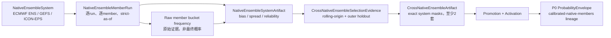
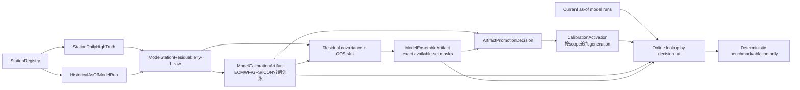

# 统一站点模型校准 SSOT：数据合同、表结构与查询边界

- version: 1.4.18

> **2026-08-05 原生集合历史 OOS 当前有效覆盖**：正式 P0 仍须至少两套独立官方原生集合系统。历史 no-live OOS 可使用官方 archive 的精确成员/message/object-id 证据；HTTP `Last-Modified` 只能登记为 `official_object_available_by_utc` 上界，证明对象不晚于冻结 decision 存在，绝不得改名为 publication、received 或 native arrival。该历史事实固定 `native_arrival_indexed=false / formal_live_authority=false / p1_eligible=false`；forward/live 仍须真实 publication/received/arrival。顺序唯一为 `capture/normalize（无 truth）→ reserve exact input mask 与 20+8 → 单次开放闭日 ET AWC truth → native ensemble event/cohort → frozen selection → activation`。首批允许不少于 3 站 READY 上线，45 站其余 `station × d0/d1/d2` 保持唯一 READY/BLOCKED terminal，不再要求同步 READY。
- status: TARGET_PRODUCTION_NO_LIVE

> **2026-08-26 canonical-day 口径换代（当前有效）**：唯一事实日口径由市场挂牌自身声明的 `settlement_timezone` 决定，逐站逐事件日取自 `basket_target_market_registry`，覆盖OOS、P0/P0-M/P1、TAF、策略、WS与篮子。2026-08-05 的 `America/New_York`（ET）统一口径**仅对该代已停产事实继续有效**——`model`(12,600)、`republisher_oos_artifact`(4)、`native_ensemble_oos_event`(280)、`p0_calibrated_distribution`(3) 均于 2026-08-03 至 08-05 之间停止写入——不再适用于现行链路。现行链路本就按各站市场时区产出（近一周 164,939 份概率信封覆盖 30 种时区，ET 仅占 7.9%），与市场赔付口径一致；45 站中仅 KATL/KLGA/KMIA 三站由市场声明为 ET。`calibration_station_registry.timezone_name` 仍非权威且 45 站中 33 站错标，禁止用它推导、补写或改写 `settlement_timezone`；权威仅两处：挂牌侧 `basket_target_market_registry.settlement_timezone` 与其绑定表 `calibration_station_market_timezone_binding`。旧 ET 代事实原样保留为历史，不改名、不回填、不与新代共用 lineage；跨代比较逐 scope `BLOCKED`。

> **2026-08-05 canonical-day / release override（已由 2026-08-26 换代取代；仅适用该代已停产事实）**：四大方案的唯一事实日口径为`America/New_York`（ET）；`market_registry`中的站点地理/历史市场时区只保留为原始市场映射元数据，绝不再反向推导、默认回填或改写`settlement_timezone`。旧非ET模型/真值事实若没有同一字段语义与同代lineage，只能以逐scope terminal保持`BLOCKED`，不得改名兼容。PR04固定为最终十一类manifest/CAS闸门：PR05–PR16只物化`MATERIALIZED_UNPUBLISHED / PRODUCTION_NO_LIVE_ONLY / BLOCKED`，不切pointer、不启动服务、不进入篮子或live。

> **2026-08-04 PR04 current-root override（当前有效）**：所有 OOS、20 train/8 holdout、TAF-24 与正式参数/live 晋级证据只允许使用已闭日、strict-as-of、官方 AWC truth 可验证的历史同日数据；未来/forward 仍只可登记为 `observational_candidate_not_oos`。唯一指针为 `output/audits/oos_gap_ledger_45station_current.json`，pointer SHA=`35777f0d3dc8aa8542ea039d118e55bf3f248b56efe007fb6eefcb557294e9c1`，release=`fa3e301bceaa82b57bd74fda5c7825348cb230f2c1001b00f66c7d421cfc9032`，effective as-of=`2026-08-03T21:08:00Z`，ledger SHA=`b6eda076f0d6c9eef673978a7ce7b0a4ed57c1612c6b78309e2face9e8a961e6`，baseline identity=`a95ae2ef6d2cd9128b78b76d0e204c22fc6dd63b08ea547866cd8ce23b35c7e4`。当前12,600 records中5,690为`OOS_READY`、6,910为`BLOCKED(DATA_MISSING)`，90/90 MODEL_OOS builders为`BLOCKED(OOS_SAMPLE_SHORT)`，activation index=0；active canonical facts为12,600 model + 596 truth + 2,845 residual + 0 activation。P0仅9站、native linkage仅41站，其余六类typed scope尚缺root，故current整体正确为`BLOCKED`，不授予P0/P0-M/P1/live。模型来源继续native-first，Open-Meteo仅显式`aggregator_republisher` no-live fallback；既有raw优先复用，禁止重复抓取。

> **2026-08-04 W3c canonical current（当前有效补充）**：active canonical SSOT已原子迁移到V9；迁移保持103,887行与row fingerprint=`5035c94d…b3b6`不变，随后唯一ingress新增CYYZ/NZWN两条Gen1 `republisher_no_live_activation`，当前103,889行、fingerprint=`2f7f6bea…82b8`。两条activation逐字保留`run_cycle=null`和`REPUBLISHER_HISTORICAL_DAY_NO_NATIVE_CYCLE`，只引用已闭日strict-OOS selection，native/P1/formal-live均为false；它们不含forward packet、TTL、native-unavailable或P0。PR04 current pointer尚未切换，通用/native activation与P0仍为0；下一步必须另行物化forward applicability receipt和no-live P0 snapshot，禁止从静态activation直接生成P0。

> **2026-08-03 canonical contract consolidation（持续有效）**：模型、真值、残差、activation及activation supersession authority只能走 `bayes_basket_target_canonical_contract_v1` → `canonical_ssot_fact` 的单一 ingress；字段不在规范集合、旧字段语义不能一一对应或 lineage/hash 不一致时立即 fail closed。旧 calibration packet 仅允许通过显式 legacy adapter 投影，不能改名冒充 canonical。当前ledger schema为`bayes_basket_target_canonical_gap_ledger_v2`；MODEL_OOS固定粒度为`station × model × model_family × run_cycle × lead_bucket × event_date`，其他typed scope使用自身canonical natural key。未实现scope只返回`BLOCKED`，不得跨lead、跨家族或跨lineage借样本。

> 2026-08-02T10:26Z canonical refresh（历史记录）：`output/audits/oos_gap_ledger_45station_open_meteo_fallback_final_20260802.json`曾为1,797条，后续2,503条deterministic+republisher ledger亦仅保留历史引用；当前authority只认文首PR04 v2 current root。

> 本版冻结唯一阶段合同：`NWP → P0`；`TAF TX 校准确认/有限修正 + 云量/降水/风物理二次确认 → 原子 P0-M`；`METAR/SPECI → P1`。本文只治理 NWP 校准与组合到 P0，TAF 不得混入本层。
>
> P0权威已直接替换为：`至少两个原生集合系统 → 原生成员逐桶 → 各集合偏差/离散度/可靠度校准 → 跨集合严格OOS组合 → P0`。确定性模型加历史残差扩散退出P0权威，只保留离线benchmark与ablation；原生集合条件未满足时`FAIL_CLOSED_NO_P0`。

## 1. 技术结论

> 2026-08-01T12:17Z执行更新：P0/P0-M/P1分别为225/45/2,096条（43/1/37站）。KDAL/KHOU已具备ECMWF PF50、NOAA GEFS及ECCC候选，但严格20+8 OOS仍未胜过climatology，且待补闭日AWC truth含COR，因此不激活。AWC历史捕获已将truth与TAF TX解耦：缺TX时只保留`truth_only_samples`，明确`taf_p0m_eligible=false`，COR必须人工/权威复核。AIFS-Single已使用保留raw重建自洽decode lineage；NZWN闭日truth已合法提交，但曲线仅3个有效点，低于4点门，下一批合法候选为15Z的RJTT/RKPK/RKSI；全程未重抓ECMWF raw。

> 2026-08-01T13:50Z数据闭环加固：AIFS-Single已从179个本地retained wrapper/raw离线生成lifecycle-v2 decode，逐条冻结wrapper capture/current/immutable、arrival identity/timing、receipt与raw SHA；闭日消费者只允许`formal_consumed_at_utc`生命周期变化，并在eligible消费时重新流式校验当前receipt/raw，网络请求为0。RJTT/RKPK/RKSI三站子集为12点、3条完整四点曲线、0 blocked，正在等待15Z正式AWC闭日truth。DWD ICON Global/EPS官方40成员×45站cohort已通过独立sidecar哈希/shape校验并标为`official observed, strict OOS pending`；Open-Meteo Global EPS与Seamless仍保持`aggregator_republisher`、native-arrival/P0均false，后者仍无官方原生证据。未重复抓取ECMWF或DWD raw。

> 2026-08-02全局闭日推进：AIFS-Single继续复用同一179个retained raw/wrapper，45/45曲线均完成扫描；按站点本地日与官方AWC accepted truth 生成14条合法训练事实（14站），2站因truth缺失保持等待，29站因本地日未关闭保持不写。15Z后TAF/P0-M exact-join只读扫描覆盖45站、42个P0 scopes和132个exact samples，最高10条/站，24样本门未满足，未生成生产P0-M。两条链均为candidate/accumulating，不改变P0 authority，不重复网络抓取已成功的ECMWF/DWD raw，也不写生产数据库或gateway。

> 同日全局OOS gap ledger及其后2,503条混合账本均为历史记录；当前唯一缺口索引与内容地址只认文首PR04 v2 current root。

> 2026-08-02T02:00Z linkage 复核：`native_ensemble_activation_oos_linkage_20260802.json` 对139条 no-live cross activation逐条 exact lookup；55条/42站为`CONSUMABLE_EXACT_OOS_PASS`，84条（69 selection mismatch、12 exact evaluation缺失、3 latest rejected）继续fail closed。没有安全的DB回填、删除或晋级路径，历史保持append-only；PF50+GEFS、ECCC三家族、AIFS/ICON及区域候选均不得由旧指针越过新门。

> 同日运行边界修复：45站 no-live runner 改用 WAL-safe `mode=ro + query_only`，不再以 `immutable=1` 忽略 resident `-wal`；实跑45站全部`FAIL_CLOSED`、gateway=0、orders=0。统一账本已刷新为990条固定记录；最新P1 dry-run覆盖45/45站且0站可执行，P0-M exact-join仍0个24样本合格scope。

> 2026-08-02T12:00Z 回绕刷新：复用同一官方 AIFS raw 后得到15条合法闭日训练事实，30站仍缺 accepted AWC truth；DWD ICON Global/EPS 训练事实为0（45站均待闭日 truth/arrival-index），strict-OOS candidate=0。既有 IFS/GEFS/ECCC native activation repair 已完成57/57 independent-family registry 核验，55条 exact-OOS activation 可消费，仍不回填12条缺评估和3条 latest-rejected。账本最新为990条、content-addressed 输入齐全；无网络重抓、无生产库写入、无 gateway。

> 2026-08-02T21:05Z统一多时区刷新（历史记录）：calibration 已按 `market_registry.settlement_timezone × strict_maturity_key` 分成16个只读packet，聚合receipt绑定完整45站registry；当时 OOS gap ledger 为1704条。该旧快照不再是当前 SSOT，当前指针见文首 override。

> 2026-08-01T22:54Z证据收口（历史记录）：统一账本当时为`output/audits/oos_gap_ledger_45station_20260802_latest.json`（1,797条）；该文件及后续2,503条混合账本均只保留审计lineage，不覆盖文首PR04 v2 current root。

> 同轮 resident replay 只读回执 `output/audits/resident_p1_replay_binding_20260802_latest.json`：17 站需要 P1 重放、6 站 P1 同时刻歧义、FORMAL_PROMOTED 轨迹绑定为 0；最新 P0 刷新后 stale P1 不得静默回退，继续 fail closed。

> 账本代码接入 resident replay binding 后的最新内容 SHA：`9f962a61ed3e87e260361661d92d6ca8aba7ae543163cc1b5d9fd84380f23f4f`。

> 本轮 no-live worker 回执纳入后，统一账本最新内容 SHA：`9067504ce7c0dd131bf6f111d85131630cff88376ea9a24cb65e0185f35d56fa`。

> worker 同一 as-of 的 resident replay 回执刷新后，统一账本最新内容 SHA：`cc48eb1344b76e2a184f9685934d3cdccb0dfe42c96246dae56480005c5f979f`。

> 账本对缺失 replay receipt 的 clean-checkout 可运行性修补后，最新内容 SHA：`6b53ac80525e2810240287268b646fd57be1710e754cea5b9b2ffff9abf0ae80`。

> 2026-08-02T00:45:38Z canonical 收口（历史记录）：当时账本为 `output/audits/oos_gap_ledger_45station_p1_atomic_20260802.json`（1,797 条）；当前 deterministic+republisher 指针以文首 override 为准。

- 不为每个城市或站点建立独立数据库；建立一个统一校准 SSOT，以官方 `station_id` 为主键维度，必要时只做物理分区与索引。
- “站点长期误差”不是站点自身的固定误差，而是`原生集合系统 × 站点 × 季节 × lead × 起报时次`上的成员偏差、离散度与概率可靠度。
- 历史最高温是真值和气候先验，不被校正；ECMWF PF50、NOAA GEFS、ECCC GEPS及具备官方历史发布证据的区域集合（如 DWD ICON-EPS）必须先保存逐成员运行，再分别校准成员分布，最后跨集合组合。AIFS Global/EPS 与 AIFS Europe/EPS 当前由 Open-Meteo 以 51 成员候选接入，分别标记为全球/区域、`aggregator_republisher`、ECMWF 同一家族。官方 AIFS-Single 0.25 已完成7个官方原生valid-time对象、按market registry逐站时区的179条arrival及45/45站完整forward曲线；它仍是deterministic Single且与IFS同属ECMWF家族，在自身闭日严格OOS、promotion与provider authority闭合前只能作为prospective native candidate，不能替换IFS或进入正式P0。DWD ICON Global/EPS已完成同一官方00Z run的15个三小时lead、每lead单raw内40成员×45站解码，并生成2026-08-02按45站market-registry时区切分的完整成员日曲线；所有lead均绑定同一R03B06官方grid UUID及737,280 cell，未生成40份伪raw。该链仍须等待闭日AWC truth、历史同日训练事实与自身rolling strict-OOS，不能进入正式P0。官方原生不可得时才允许带lineage的Open-Meteo候选。
- 原始事实、原生成员、集合内校准artifact、跨集合组合artifact、晋级决定与激活指针必须解耦；校准过程绝不能覆盖原始成员数据。
- 离线训练读取 strict-as-of 历史事实并产出不可变 artifact；在线 P0 只按 `decision_at` 查经严格离线 OOS 验证、已激活且未过期的 artifact，禁止临场训练和含糊的 `latest` 查询。
- 未来日/forward 数据只登记为 `observational_candidate_not_oos` 到达、接口与时序验证证据：它不是 OOS，绝不计入任何 OOS、20 train/8 holdout 或 TAF 24 样本门，也不阻断 `production_no_live`；只有已闭日 AWC truth 才能形成严格 OOS。Open-Meteo只可作为显式`aggregator_republisher`的历史同日 OOS/calibration fallback，绝不取得native arrival或native P0 gate。
- 正式P0组合必须至少包含两个正权重原生集合系统；一套集合即使包含多个成员也不得单独物化P0。确定性模型与其残差分布只能进入离线benchmark/ablation。
- `PRODUCTION_NO_LIVE_ONLY` 表示原生跨集合组合已通过自身严格离线OOS、但尚未取得live/formal晋级权；允许用于`production_no_live` P0。确定性组合不再适用该授权。`FORMAL_PROMOTED`是更高授权；ΔBasketScore的未来日时序验证与本层历史跨集合OOS是两个独立门。
- 本 SSOT 是 `com.weather.weather_basket_yes` 域内的数据合同，不新建第四个生产服务；当前只允许用户域 `com.weather.weather_basket_yes`、`com.weather.market_ws`、`com.weather.clob_order_service` 消费，旧 `com.weather.reported_trajectory_no` label 已退役，保持 `production_no_live`、零 gateway 写和零订单。

## 2. 为什么不是“每站一个数据库”

| 方案 | 结论 | 原因 |
|---|---|---|
| 每城市一个数据库 | 拒绝 | 城市不是训练和结算主键；同城可能映射不同官方站点，容易串站 |
| 每站一个数据库 | 拒绝 | 会产生多个 schema、版本、TTL 和晋级权威，跨站训练/OOS及原子激活难以治理 |
| 一个统一数据库、按站点键查询 | 采用 | 合同、版本、晋级和 lineage 只有一个权威，仍可按站点/模型/年份物理分区 |

城市只保存在 `StationRegistry.city_label` 中用于展示和报告；任何训练、结算、模型运行提取和 artifact 查询都使用官方 `station_id`。

## 3. 分层与数据流

下图中的确定性`HistoricalAsOfModelRun / ModelCalibrationArtifact / ModelEnsembleArtifact`自1.2.0起仅是离线对照，不再通向P0。正式路径使用独立原生集合命名空间，禁止把“多个确定性模型的组合”与“单一模型的原生成员集合”都叫作`MODEL_ENSEMBLE`。





| 层级 | 所有权 | 允许动作 | 禁止动作 |
|---|---|---|---|
| L1 不可变事实 | 站点注册、官方日最高温、历史 as-of 模型运行 | 追加、内容寻址、QC 隔离 | 覆盖原始模型或真值 |
| L2 离线训练 | 残差配对、逐模型 bias/scale/tails、相关性约束组合 | 产出不可变候选 artifact | 在篮子热路径训练 |
| L2 在线编译 | 当前模型运行 + 激活 artifact | 校正单模型、组合并物化 P0 | 查询含糊 latest、未校准平均 |
| L3 物化边界 | P0 与完整 lineage | 提交 checkpoint 并触发篮子重算 | 把训练表暴露给篮子 |
| L7 治理 | OOS、晋级、激活和退役 | 追加 promotion/activation 事件 | 原地改 artifact |

## 4. 实体合同

### 4.0 权威替换与命名边界

- 既有`HistoricalAsOfModelRun`、`ModelCalibrationArtifact`、`ModelEnsembleArtifact`降级为确定性离线对照，不得生成P0。
- 正式权威使用七个独立实体：`NativeEnsembleSystem`、`NativeEnsembleMemberRun`、`NativeEnsembleSystemArtifact`、`CrossNativeEnsembleSelectionEvidence`、`CrossNativeEnsembleArtifact`、`NativeEnsemblePromotion`、`NativeEnsembleActivation`。
- 原始成员频率只是未校准证据；不得把`命中成员数÷成员总数`直接写成最终P0。
- `aggregator_republisher` transport 不得以自身 transport identity 登记或伪装为`NATIVE_ENSEMBLE_PROVIDER`，不得伪造publication/arrival。上游模型 product/family catalog 行只用于识别产品和独立家族，不授予任何 transport authority；正式资格必须由逐 member-run 的 native timestamps/authority scope 与逐 bucket `source_role` 共同证明。官方原生缺失时可作为显式 Open-Meteo fallback 候选，但只有至少两个独立家族的严格同日 OOS 已激活，才可进入 `production_no_live` P0，且官方原生同站永远优先。该 fallback 不进入 native arrival index 或 P1。
- AIFS 的两个 Open-Meteo 系统固定为 `ECMWF_AIFS_ENS_GLOBAL`（全球）与 `ECMWF_AIFS_ENS_EUROPE`（区域），均为 ECMWF 家族内产品，不得把 IFS+AIFS 当作两个独立家族；当前数据只允许进入 calibration candidate/积累与离线 ablation，尚无 AIFS cross-OOS activation。官方 `ecmwf_aifs025_official` AIFS-Single 已有原生前向采集/arrival adapter，但只有当 signed binding 同时绑定其自身严格 OOS artifact、官方 native provider lineage 与当前 activation/ensemble 哈希，才可占用既有 ECMWF 角色；旧 binding 或任一证据缺失必须在采集前 fail closed。

### 4.1 `StationRegistry`

- 主键：`station_id`；自然键：`icao_code`。
- 保存 `city_label`、IANA 时区、正式来源泳道和结算定义。45站（含中国及台湾站）正式生产泳道唯一为官方 AWC：同站 `:00` METAR 与有效 SPECI 是唯一 realtime truth、P1 及篮子硬事实来源；硬事实仅用于剔除纯 YES 篮子中已数学排除的桶，生产不再运行任何 hard-NO/买-NO 策略。官方 AWC TAF 仅可在 strict-as-of、原始修订链、有效窗、目标峰值覆盖和 exact-OOS join 齐备时作为 P0-M 候选输入。
- AMSC 状态固定为 `retired_history_only`：只可保留为离线历史审计/对照，不启动、不写入 production truth，且不得进入 P1、篮子或伪装为 AWC lineage。AWC truth lane 不得同站混源、跨源 fallback 或以旧 AMSC 证据覆盖 AWC；模型 NWP lane 仍可按本 SSOT 第 6 节使用有界 Open-Meteo republisher fallback。AWC 缺失、陈旧、重复、更正未复核，或 TAF 证据不完整均 fail closed。
- 城市是展示属性；`station_id` 才是所有事实和 artifact 的连接键。

### 4.2 `StationDailyHighTruth`

- 主键：内容寻址 `truth_id`。
- 自然键：`station_id + local_date + settlement_definition + revision_no`。
- 保存官方最高温、来源泳道、发布时间、接收时间、QC 和原始 payload hash。
- 无运行 TTL；更正产生新 revision，不覆盖旧真值。

### 4.3 `HistoricalAsOfModelRun`

- 主键：内容寻址 `model_run_id`。
- 自然键：`model_id + station_id + target_local_date + run_init + member_id + extraction_version`。
- 保存原始 `raw_tmax_c`、起报时间、发布时间、接收时间、lead、cycle、插值规则和源对象 hash。
- `raw_tmax_c` 永远不被校准写回；训练/回放只允许使用当时已经发布且已经接收的运行。

### 4.4 `ModelStationResidual`

- 主键：内容寻址 `residual_id`；自然键：`truth_id + model_run_id`。
- 唯一符号约定：`e = y - f_raw`。
- 保存 `station/model/season/lead/cycle` 分层键、QC、配对时点和 pair hash。
- 真值修订后建立新配对；旧配对保留但不再进入新训练窗。

### 4.5 `ModelCalibrationArtifact`

- scope：`station_id + model_id + season_bin + lead_bucket + run_cycle + settlement_definition`。
- ECMWF、GFS、ICON 分别保存 bias、残差 scale、尾部参数、`n/n_eff`、层级收缩父节点、训练窗、OOS 指标和训练 lineage 根。
- 应用公式：

```text
e = y - f_raw
b_hat = ShrinkageMean(e | model, station, season, lead, cycle)
f_cal = f_raw + b_hat
p_m(X) = Family(location=f_cal, scale=sigma_hat, tails=q_hat)
```

### 4.6 `ModelEnsembleArtifact`

- scope：`station_id + season_bin + lead_bucket + run_cycle + settlement_definition`。
- 保存候选模型、残差协方差、相关性惩罚、OOS 权重、`selection_evidence_sha256`、父 artifact、`n_eff`、`max_weight_delta`、长/近期/holdout 窗及每个允许的 exact 模型可用集合。
- 组合发生在单模型校正之后；禁止直接平均 ECMWF/GEFS/ECCC/区域模型原始温度。
- 每个可执行 exact mask 至少两个模型且每个权重严格大于零；单模型候选不得与多模型候选同池排序后胜出。当前官方预注册掩码为 `ECMWF_PF50+NOAA_GEFS` 锚定双模型与“同一严格 holdout 上所有 READY 官方家族（含 ECCC GEPS）”三家族掩码；两者各自独立 OOS，禁止按 holdout 分数事后挑选。
- 近期表现只能通过离线 expanding rolling-origin 与外层 OOS 生成新 artifact；禁止在线根据最近一次命中临时追随模型或删权重重归一。
- 概率组合成员与诊断模型集合必须分离：概率成员仅为当前已激活exact mask；诊断集合为同一run generation中全部strict-as-of、QC合格且有有效模型校准activation的模型。校准后诊断模型极值/包络只形成分歧诊断，不直接定义或夹紧候选支持集边界；经策略封顶的分歧扩展层数决定核心支持集最多可向外搜索几层并降低单桶集中度。组合桶概率侧质量决定方向偏置、中心附近排序和仓位倾斜。极值不得直接决定方向、支持桶或仓位，组合概率不得掩盖分歧诊断。

### 4.6A `ModelEnsembleSelectionEvidence`

- 每个 ensemble artifact 必须引用一个不可变、内容寻址的 selection evidence。
- evidence 至少保存七种 exact mask 的候选分数、Brier/NLL/CRPS 长短窗口、残差协方差/相关性、有效样本量、父 artifact、权重变化上限、实际变化和最终权重。
- `train_end < holdout_start`，近期窗必须完全包含于训练窗；任一概率级 OOS scope 相对基准退化、权重越限或 hash/父链断裂均不得生成 activation。

### 4.7 `ArtifactPromotionDecision`

- 对每个 artifact 追加 `PROMOTED / REJECTED / SUPERSEDED` 决定和门禁回执。
- artifact 自身不可变；状态变化只能表现为新决定事件。
- 原生跨集合组合自身严格离线OOS通过后，允许追加`PRODUCTION_NO_LIVE_ONLY`激活供no-live P0使用；只有最新决定为`PROMOTED`的artifact才可进入`FORMAL_PROMOTED`/live激活。旧确定性组合不得新增P0 activation。

### 4.8 `CalibrationActivation`

- 每个 scope 追加单调递增 `generation`，指向一个已晋级 artifact。
- `generation` 只表示 append-only 写入序列与禁止回退；它不是 current 权限、发布时间排序或逻辑 successor 证明。在线查询不得取最高 generation、最近写入、mtime、文件名或 fallback 名称。
- 同一 business scope 仅有一个候选 activation 时，可在其余 exact-lineage/OOS 门均通过后作为 current head；同一 scope 出现多个 generation 时，必须先有一条经同一 ingress 写入的 `CanonicalActivationSupersessionFact`，显式指定唯一 successor。缺少该事实或其哈希校验失败时，该 scope 固定为 `BLOCKED(ACTIVATION_CURRENT_AMBIGUOUS)`。
- `CanonicalActivationSupersessionFact` 固定字段为：`station_id`、`model_family`、`lead_bucket`、`run_cycle`、`superseded_activation_content_sha256`、`successor_activation_content_sha256`、`superseded_generation`、`successor_generation`、`candidate_activation_set_sha256`、`semantic_equivalence_sha256`、`supersession_reason`、`authority_as_of_utc`、`authority_scope`、`content_sha256`。`supersession_reason`只允许`IDENTITY_DEDUPLICATION`或`EVIDENCE_REPLACEMENT`；它不是旁路pointer或文件清单。
- `IDENTITY_DEDUPLICATION`必须逐字段精确相等：`candidate_models`、`selected_models`、`selected_weights`、`available_model_set_hash`、`selection_evidence_sha256`、`artifact_content_sha256`、`oos_role`、`authority_scope`。无论字段相等与否，都必须显式写出 successor，禁止由相等性自动推断。
- 严格回放固定 `activation_id + artifact_id + activation/current-authority content hash`；在线查询只解析由当前已验证release投射的唯一 current head。
- 禁止 `ORDER BY created_at DESC LIMIT 1` 一类没有 scope 和 as-of 语义的“最新版本”查询。

### 4.9 长期原生集合七实体

- `NativeEnsembleSystem`冻结provider、预期成员数、成员身份合同和发布合同；同一机构的确定性产品与集合产品必须是不同身份。
- `NativeEnsembleMemberRun`自然键固定为`ensemble_system_id + station_id + target_local_date + run_init + member_id + extraction_version`，逐成员保存真实`published_at/received_at`与源对象hash。
- `NativeEnsembleSystemArtifact`对单套集合执行成员偏差、离散度与可靠度校准，保存训练窗、外层holdout、fold数、`n_eff`与概率级OOS指标。
- `CrossNativeEnsembleSelectionEvidence`比较单集合ablation与至少两套原生集合的预注册 exact-mask 组合；训练窗与holdout严格分离。ECCC 00Z 与 ECMWF/GEFS 18Z 可组成 mixed-cycle，但每个系统保留自己的 run-init/arrival lineage。
- `CrossNativeEnsembleArtifact`只接受`CALIBRATED_NATIVE_MEMBERS_CROSS_ENSEMBLE`路径，系统数不得少于2。
- `NativeEnsemblePromotion/Activation`是P0唯一模型权威；旧`CalibrationActivation(MODEL_ENSEMBLE)`不得再授权P0。

完整字段、约束和索引见 [station_model_calibration_ssot_v1.sql](station_model_calibration_ssot_v1.sql)，机器合同见 [station_model_calibration_ssot_v1.json](station_model_calibration_ssot_v1.json)。

## 5. 在线查表合同

### 5.1 单模型校准查询

```text
request = station_id + model_id + season_bin + lead_bucket + run_cycle
        + settlement_definition + decision_at_utc

result  = exactly one OOS-validated, scope-authorized, activated,
          unexpired ModelCalibrationArtifact
replay  = activation_id + calibration_artifact_id
```

同时必须满足：当前模型运行的 `published_at` 和 `received_at` 均不晚于 `decision_at`；artifact 的 `trained_through` 不晚于 `decision_at`；artifact 和 activation 的有效窗口同时覆盖 `decision_at`。

### 5.2 原生集合组合查询

```text
request = station_id + season_bin + lead_bucket + run_cycle
        + settlement_definition + available_ensemble_system_set_hash
        + decision_at_utc

result  = exactly one OOS-validated, scope-authorized, activated,
          unexpired CrossNativeEnsembleArtifact with at least two
          positive-weight native ensemble systems, calibrated member
          distributions and an exact available-system mask
replay  = native_ensemble_activation_id + cross_ensemble_artifact_id
```

模型集合哈希固定为：

```text
available_ensemble_system_set_hash =
    sha256("|".join(sorted(available_ensemble_system_ids)))
```

## 6. 缺原生集合规则

| 当前有效原生集合系统 | 允许动作 | 禁止动作 |
|---|---|---|
| 三套及以上 | 使用已独立 OOS 通过的预注册 exact mask（可含 ECCC/区域原生系统） | 使用未晋级临时权重或按 holdout 事后选模 |
| 任意两套 | 仅使用该exact双系统mask的已晋级权重；三家族未通过时可回退预注册锚定双模型 | 从多系统权重临场删项并随意归一 |
| 任意一套 | 只积累证据或做ablation | 物化P0，或用确定性模型补成第二套 |
| 零套官方原生 | 默认 fail closed；若至少两个独立家族的 Open-Meteo `aggregator_republisher` 历史样本已通过闭日 AWC strict-OOS 并完成 `PRODUCTION_NO_LIVE_ONLY` exact activation，可仅物化带 republisher lineage 的 no-live fallback P0 | 把 republisher 伪装为 native、伪造 arrival、进入 native arrival/P1/formal P0，或用陈旧成员、旧artifact、气候先验凑数 |

51个ECMWF ENS成员仍只算一套系统。允许“权重重归一”的唯一条件，是`supported_exact_masks`已明确声明该exact系统mask的规则并通过OOS晋级；运行时不得自行推导。

## 7. TTL、版本与修订

- `StationRegistry`、真值、原始模型运行和残差无运行 TTL，作为审计和重放事实长期保留。
- 校准/组合 artifact 必须有 `valid_from/valid_until`；激活也有独立有效窗口，两者取交集。
- 任何 artifact 过期、hash 不符、激活重叠、授权 scope 不匹配或查询返回零/多行，统一 `FAIL_CLOSED_NO_P0`。
- 不回退旧 artifact，不在线训练，不用未校准平均替代。
- 真值更正、模型提取规则升级、训练窗变化和权重变化都产生新内容哈希，不允许原地更新。

## 8. 数据与模型真正如何解耦

```text
原始事实层：y、f_raw、source hashes
       ↓ 只读配对
训练特征层：e=y-f_raw、season/lead/cycle
       ↓ 离线训练
模型层：CalibrationArtifact、EnsembleArtifact
       ↓ 受控promotion/activation
在线编译层：current f_raw + activated artifacts → p_m(X) → P0
       ↓ 已物化概率边界
篮子层：P0 → 初选桶/偏置/目标库存；TAF到达后由下游原子修订为P0-M
```

因此“直接对站点、历史数据、模型进行偏差校正”应拆成两个动作：离线用站点历史真值和历史模型训练校正器；在线只把该校正器应用于当前模型预报。历史真值和历史模型本身永远不被改写。

## 9. 失败语义与安全边界

- 站点、日期、单位、结算定义或来源泳道不一致：拒绝配对。
- 决策点之后发布/接收的模型运行：未来泄漏，拒绝。
- `e=y-f_raw` 与 artifact 符号元数据不一致：拒绝 artifact。
- 小样本无已晋级父层收缩：拒绝校准 artifact。
- 强相关模型未保存协方差或无相关惩罚：拒绝组合 artifact。
- exact两套以上原生集合系统mask未通过跨集合OOS或未激活：拒绝P0。
- 激活有效窗重叠或查到多个 generation：拒绝 P0。
- 篮子不得直接读取残差或训练表；只读取已经物化、带完整 lineage 的 P0/P0-M/P1。

## 10. 验收 Checklist

- [x] 统一逻辑 SSOT，明确禁止每站独立权威数据库。
- [x] 城市与站点主键职责分离。
- [x] 原始事实、残差、单模型 artifact、组合 artifact、晋级和激活分层。
- [x] 主键、自然键、lineage、有效窗口、版本和缺模型规则已定义。
- [x] 参考 SQLite DDL 可在空内存数据库执行。
- [x] append-only 表具备 UPDATE/DELETE 拒绝触发器。
- [x] 残差正负号和零偏差公式已固定。
- [x] 2/3 模型 exact mask 与不足两模型失败语义已固定；单模型只允许研究候选。
- [x] strict-as-of、过期、hash 漂移和多次时间回绕已纳入验证器。
- [x] 原生集合系统、逐成员运行、集合内校准、跨集合OOS、晋级与激活已建立独立SSOT schema基座。
- [x] 36站旧确定性calibration/ensemble artifact与activation仅保留为历史离线对照证据，不再代表P0 readiness。
- [ ] canonical 45站仍需补齐完整历史 truth 与 calibration 事实层；当前正式生产 truth 已统一采用官方 AWC 全球泳道，AMSC 固定为 `retired_history_only`。历史 AWC 训练/校准事实必须保留独立 AWC lineage；任何 AMSC 对照、无对应 AWC 原始事实或未复核修订均不得进入 realtime truth、P1 或篮子。
- [ ] 45站 P0 尚未全量物化；2026-08-01T11:10:48Z只读快照已有225条P0（43站）、45条P0-M（仅RKPK）和2,067条P1（37站）。KDAL/KHOU仍因自身严格OOS不达标而无P0根；KATL/KBKF/KLAX/KLGA/KMIA/MMMX虽有P0，但当前没有合法P1，禁止制造rootless或跨源P1。TAF exact join现有42个artifact、132个exact samples；RKPK/RKSI最高各10，仍低于24样本门，`formal_p0m_eligible=false`。任一缺 exact OOS 的站点继续 `FAIL_CLOSED_NO_P0/P0-M`；Open-Meteo 只能在官方原生缺失、闭日 AWC truth、独立家族 strict-OOS 与 exact `PRODUCTION_NO_LIVE_ONLY` activation 全部成立时作为带 lineage 的 fallback，不能绕过这些门。
- [ ] 45站 formal/live promotion 尚未完成；该项不阻断 `production_no_live`，但继续阻断参数/live 晋级。
- [x] 官方原生集合历史与离线滚动时序 OOS 已完成首个可执行闭环：ECMWF IFS ENS Open PF50（2026-06-18—07-31，44日×45站×50成员，18Z）、NOAA GEFS 0.5（同窗、44日×45站×31成员，18Z）和 ECCC GEPS/GEM（2026-07-03—07-30，28日×45站×21成员，00Z）均保留逐成员、run-init、源对象哈希与独立 transport lineage。最终回执 `output/audits/native_ensemble_forward_oos_final_20260801.json` 共 61 个预注册 exact candidates，56 个 `PRODUCTION_NO_LIVE_OOS_PASS`：42 个 ECMWF+GEFS pair、14 个 ECCC+ECMWF+GEFS tri；其余站点/掩码继续 `FAIL_CLOSED`。ICON 分类固定为 DWD ICON Global/EPS（全球）与 ICON-EU、ICON-D2（区域）；DWD ICON Global/EPS 的 Open-Meteo数据仍是显式`aggregator_republisher`历史同日 OOS/calibration fallback，不能混称DWD native、不能进入native arrival或native P0 gate；独立DWD官方未来日到达链现已完成15 leads×40成员×45站和45站本地日曲线，正确绑定R03B06 grid，但尚无闭日历史事实与strict-OOS activation。AIFS Global/EPS与AIFS Europe/EPS仍为Open-Meteo candidate lane、ECMWF同家族且无cross-OOS activation；独立的官方AIFS-Single链已完成7 valid times、179条逐站时区arrival和45/45 future曲线，但尚无自身closed-day strict-OOS/promotion/provider authority，故不能进入正式P0。区域集合（ICON-EU/D2、AROME、HARMONIE、UKMO-2KM等）当前仅有Open-Meteo候选，样本尚不足严格OOS，不得伪造native或进入正式P0。历史训练与外层holdout使用已结算同日事实；未来日时序验证只服务formal/live晋级，不是OOS。

> 2026-08-01T22:41:27Z 最新回执：AIFS strict-OOS 已切换到最新保留事实 pointer（15 scopes，各 1 case，formal=false）；统一账本为 45 站、1,704 条，native/TAF/P1/utility 缺口仍逐项 fail-closed。策略 utility v2 已定义 candidate/baseline、官方 WS、真实 fill/partial-fill、settlement、reserve/cadence 机会成本的完整证据合同，但 direct binding 未完成，score rows 仍为 0。模型回执所有输入 SHA 已重新对齐；未重新抓取既有 raw。

> 2026-08-02T01:00Z OOS口径修订（历史记录）：未来日/forward evidence 在统一 ledger 中明确标记为 `observational_candidate_not_oos`；其 arrival/raw 缺口仍保留为诊断，但绝不计入任何 OOS、20 train/8 holdout、TAF-24 或 `production_no_live` 阻断。正式参数/live 晋级只接受独立的历史 strict-as-of OOS artifact；未来日时序数据可以作为非 OOS 的接口/到达观测，但不得被称为 OOS 或成为未来 OOS 硬门。

> 2026-08-02T02:00Z lineage 迁移与历史 OOS 回绕：未重新抓取任何已保留 raw；18 个 Open-Meteo 产品、82,321 条 forward member、2,243 个 forward bucket、63,872 条历史 member 和 1,744 个历史 bucket 已由旧 native candidate 表以内容寻址方式复制到独立 `calibration_republisher_ensemble_*` 表，旧审计行保持 append-only。45 站严格历史 OOS 只读回绕得到 56 个 exact cross candidates，其中 50 个 `PRODUCTION_NO_LIVE_OOS_PASS`；官方 IFS/GEFS/ECCC 可用时优先官方，Open-Meteo 只在官方独立家族不足时作为显式 republisher no-live fallback，永不进入 native arrival/P1/formal gate。未来日仍只登记为 `observational_candidate_not_oos`，`production_no_live` 不受其阻断；P0-M、P1、站点 utility 与 Delta 继续各自遵守历史闭日合同。

## 11. 限制与证据边界

- 本合同定义本系统的可审计校准架构，不证明源账户使用相同表结构、模型权重或阈值。
- 钱包公开成交无法识别其私有校准器、模型集合、未成交挂单或 exact 权重；相关内容必须继续标记为候选设计。
- 当前实现可写 target SSOT 的 no-live 事实，但禁止 live、gateway、订单和跨域数据库写。

## 12. 下一个主线任务

下一步主线：用最新 ledger 逐项补 artifact pointer、AWC truth 和 TAF AMD/COR quarantine/revision 证据；随后让 AIFS-Single、DWD ICON Global/EPS 及区域/加拿大模型在闭日后直接复用已保存官方 raw/日曲线，累积自身历史 20 train + 8 holdout strict-OOS。官方原生缺失的模型只走独立 republisher 历史 no-live fallback，不重复抓取 ECMWF/GEFS/ECCC/DWD 已保留 raw；TAF 24 样本门、P1 trajectory、策略 utility 和 Delta 自然样本仍各自闭合后，再重跑 45 站 P0/P0-M/P1 与纯 YES basket scorecard。
