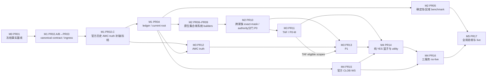

> **2026-08-05 native pilot 当前有效 Goal**：先完成 `KMIA × d2/18Z × NOAA GEFS + ECMWF PF50 × 2026-07-02..29` 的单站全链路，再扩展45站。KMIA 已有两套官方原生集合历史 OOS、正式 native P0 activation 与 `p0_forecast_snapshot`；当前唯一主线为 canonical observation winner → P1_BASE → 保守纯 YES basket → PR16-A → PR04 → PR16-B → PR17。KATL 的两套组件均为`OOS_REJECTED`；其误生成的selection/distribution/activation保持不可变历史行，但唯一builder/ingress重建已fail closed，禁止进入PR04或消费。V17仍只使用同一`canonical_ssot_fact`、同一ingress；future/forward永不计入OOS，服务、live pause和订单在PR04前保持冻结。

# 最高温纯 YES 篮子：Live 落地 PR 与里程碑执行计划

## 0. 文档定位

本文把四大方案的未完成项拆成 **18 个可独立审查 PR、6 个里程碑**，用于组织实现、数据回填、验收和 live 切换。PR 按合同、模型家族、消费链和运行边界拆分，不按单站拆分；任何 RKPK、MMMX 或其他单站结果都不能代表 45 站完成。每个 PR 的具体交付、非范围和验收见 [18 个 PR 工作包](./weather_basket_live_pr_charters_v1.md)；当前实施状态唯一以本文第17节为准，两份文档不一致时 fail closed。

本文是执行路线图，不是新的平行 SSOT，也不单独授予 production/live authority。规范来源仍为：

1. [统一站点模型校准 SSOT](./station_model_calibration_ssot_v1.md)
2. [45站统一可执行篮子公式](./global_station_executable_basket_formula_v1.md)
3. [全局篮子先验 → 站点策略后验](./station_basket_policy_hierarchy_v1.md)
4. [最高温篮子交易操作系统](./weather_basket_trading_operating_system_v1.md)

若四份规范之间或规范与代码之间出现字段、来源、模型角色或晋级语义冲突，必须由 PR02 收口为一个 canonical contract；收口前消费者 fail closed，禁止通过改名、猜测、默认补值或跨表兼容继续运行。

本文与 [18 个 PR 工作包](./weather_basket_live_pr_charters_v1.md) 共同构成唯一 PR 文档集：本文唯一负责里程碑、依赖、波次、当前状态和下一主线；工作包文档唯一负责每个 PR 的交付、非范围与验收合同。禁止再为同一 PR 新建另一套平行路线图、状态表或字段合同。

### 发布循环解除决议（2026-08-04）

PR04 固定为**最终汇聚与发布门**：维持 `BLOCKED`、current pointer 不切换；不再单独优化 PR04 代码、preview 或重复审计。PR05–PR16 可先在同一 canonical contract、唯一 ingress 和唯一缺口账本中物化事实、artifact、domain basis 与 terminal receipt。PR04 发布前，结果只可处于：

```text
MATERIALIZED_UNPUBLISHED
PRODUCTION_NO_LIVE_ONLY
BLOCKED(<唯一 blocker>)
```

它们不是 `CONSUMABLE`。未发布对象只允许后续 builder 以 exact hash 作为输入；禁止生产服务、篮子运行时、gateway 或 live 路径读取。待 PR10–PR16 的十一类 manifest 输入齐全后，才一次性返回 PR04 合并、preview 与 CAS；此前不启动服务、不进入篮子消费、不解除 live pause。

### 四大方案 → 唯一 PR 归属

| 来源规范 | 规范中尚未闭合的主问题 | 唯一主 PR | 下游只能消费的已验证输出 |
|---|---|---|
| 统一站点模型校准 SSOT | canonical schema/lineage/ingress、历史 AWC truth、模型/集合 OOS、activation 与P0 | PR01–PR10（含PR02.C） | 内容寻址 canonical fact、每 lead×模型家族 builder、跨家族且authority分门的 P0 activation |
| 45站统一可执行篮子公式 | P0/P0-M/P1阶段接口、纯 YES 支持集、盘口深度与目标库存公式 | PR10–PR16 | 原子P0-M/P1、YES target inventory、官方 WS 与 no-live 执行链 |
| 全局篮子先验 → 站点策略后验 | global prior、站点target/reserve/cadence、真实 utility OOS 与策略 activation | PR14、PR17 | 有真实结算/机会成本的策略artifact、45站策略scorecard |
| 最高温篮子交易操作系统 | AWC METAR/SPECI/P1、订单状态机、三服务、回滚/reconcile和受控live | PR12–PR17 | AWC trajectory proof、P1、官方 WS、三个用户域服务与live receipt |

任何工作项只归属一个主 PR。其他 PR 不得复制修复、读取未验收的局部实现，或用新的兼容格式绕过该 PR 的 blocker。

### 本次拆分决议

本轮审计正式落为 **18个工作包、6个里程碑**，不再新增平行“修复清单”。18个工作包是PR01–PR17加独立历史数据补取包PR02.C；PR02.A/B与PR03.B/C属于其主PR内部切片，不增加新的权威编号。PR03.C是member receipt manifest、ordinal binding、V6 append-only迁移与真实native arrival证据合同的唯一owner；PR06–PR09分别拥有native与Open-Meteo republisher历史OOS builder，不得再建平行入口。

| 里程碑 | PR范围 | 唯一可验收结果 | 不构成完成的局部结果 |
|---|---|---|---|
| M0 停止循环 | PR01 | 冻结可复算baseline与stale-evidence fence | 新生成一份audit或重抓raw |
| M1 唯一事实面 | PR02、PR02.C、PR03、PR04 | 一个canonical contract、一个ingress、一个typed缺口账本与一个current pointer | schema存在、单类writer迁移或BLOCKED preview |
| M2 模型与P0 | PR05–PR10 + PR15.A前置切片（PR15仍属M4） | 每lead/模型家族一个builder；至少两个独立家族在同holdout形成P0 activation，native与republisher authority分门 | legacy OOS标签、成员数据存在、单模型、单站或republisher冒充native |
| M3 P0-M与P1 | PR11–PR13 | 官方TAF历史exact-join形成P0-M；AWC METAR/SPECI形成有根P1 | TAF inventory、rootless P1、forward观察 |
| M4 篮子与no-live | PR14–PR16 | 真实utility、纯YES库存、官方WS、唯一gateway与三用户域服务no-live闭环 | 模拟成交、REST盘口、第四服务或代码测试通过 |
| M5 受控live | PR17 | 45站terminal scorecard、非空端到端live allowlist、单独live授权receipt | 单站READY、代码合并或自动解除pause |

PR文档的权威分工固定为：本文保存顺序、依赖、状态、复盘与下一主线；[18个PR工作包](./weather_basket_live_pr_charters_v1.md)保存每个PR的Goal、范围、非范围、输入/输出、验收与回滚。实现证据只更新这两份文档，不再复制成第三份路线图。

## 1. Goal：清晰终点线

最终主链固定为：

```text
闭日历史 strict-as-of 模型事实
→ canonical SSOT
→ 历史 OOS / artifact / selection / activation
→ P0
→ 官方 AWC TAF exact-join / P0-M
→ 官方 AWC METAR/SPECI trajectory / P1
→ 纯 YES 篮子桶 / utility / ΔBasketScore
→ 官方 CLOB WS
→ 唯一 order gateway
→ 三个用户域服务
→ 受控 live
```

对每个：

```text
station × event_date × lead × run_cycle × model_family
```

必须得到且只能得到以下状态之一：

```text
DATA_READY → OOS_READY → ACTIVATION_READY → CONSUMABLE
CANDIDATE_ONLY
BLOCKED(<唯一 blocker code>)
```

不存在未知状态、隐式 fallback、跨 lead 借样本、跨家族借 activation 或由 forward 数据形成 OOS 的路径。

对 PR05–PR09 的 `MODEL_OOS` shared coverage matrix，唯一 terminal state 仅为
`DATA_READY / OOS_READY / CANDIDATE_ONLY / BLOCKED(<唯一 canonical blocker>)`。
`ACTIVATION_READY / CONSUMABLE` 只属于 PR10 之后的下游生命周期，不得作为
coverage row 状态、别名或完成证明。

服务级终点线：

- 45 站全部进入统一 registry 和统一状态机；不要求每个时点全部可交易，但每个不可交易 scope 必须有唯一、可追溯 blocker。
- 生产仅保留 `gui/$(id -u)` 用户域三个服务：
  - `com.weather.weather_basket_yes`
  - `com.weather.market_ws`
  - `com.weather.clob_order_service`
- `system` 同名服务、旧 `com.weather.reported_trajectory_no`、hard-NO 和任何 BUY NO 路径为零。
- 只有完整 `FORMAL_PROMOTED` native authority 的 scope 才可获得 live 权限；Open-Meteo republisher可解除no-live P0历史OOS数据门，但永远不取得 P1、native arrival 或 formal/live authority。

## 2. 不可突破的执行边界

### 2.1 OOS

- 所有 OOS、20 train + 8 holdout、TAF-24、参数晋级和 live promotion 只使用已闭日、strict-as-of、可绑定官方 AWC truth revision 的历史数据。
- 未来/forward 数据只登记为 `observational_candidate_not_oos`；不计样本、不阻断 `production_no_live`、不形成晋级门。
- forward snapshot 的 TTL 只影响当前预测可用性，不能回头阻断历史 OOS。

### 2.2 来源

- 模型数据 native-first；已有 raw 必须复用，尤其禁止重复抓取已保存的 ECMWF、GEFS、ECCC、AIFS 或 DWD 对象。
- 官方原生对象确实不可用、无效、过期或迟到时，Open-Meteo 才可进入独立 `aggregator_republisher` no-live fallback lane。
- Open-Meteo 事实固定：

```text
source_class = aggregator_republisher
native_arrival_indexed = false
p1_eligible = false
formal_live_authority = false
```

- AWC 是 45 站正式 realtime truth、P1、篮子硬事实和历史校准真值来源；AMSC 固定为 `retired_history_only`。

### 2.3 资源与网络

- 需要网络补 inventory 真缺口时使用代理 `127.0.0.1:1082`。
- 64MB guard 只允许针对已识别、可验证大小的官方 EPS 对象做有界放宽；仍须流式处理、累计响应上限、RSS/临时落盘/最低剩余磁盘门。
- 任一资源探针不可用或越界立即 fail closed，禁止全局取消资源门。

### 2.4 交易

- 篮子只生成纯 YES 目标库存和 YES intent。
- 官方报文硬事实只剔除数学上已排除的 YES 桶，不生成或补仓 NO。
- PR01–PR16 始终保持 `production_no_live=true`、live pause、零 gateway 写、零订单。
- PR17 的代码/config 审查与真实解除 pause 是两个不同操作门；真实资金风险需要明确 live 授权。

## 3. 2026-08-03 历史只读基线与已纠正结论

以下数字只描述当日冻结快照并用于解释拆分原因；其中 receipt=`BLOCKED` 是该快照的验证结论，不表示 PR01 的实现状态。PR01 已完成重冻结/验证合同，当前实施状态以第17节为准，本文数字不得作为永久 current pointer：

| 事实 | 当前只读结论 | 对执行计划的影响 |
|---|---|---|
| canonical 模型事实 | 12,600 条；d1/d2 各 45站×5模型×28日=6,300 | 先复用并绑定，不重新抓模型 |
| 旧 canonical ledger | 10,920 条；12 个 builder scope 为 `BLOCKED`，但 10,920 个 record 仍全为 `ACTIVATION_READY` | 缺口是输出/语义失配，不是 1,680 条模型数据缺失 |
| current pointer | 仍保留 2,503 条旧混合账本计数；与当前 ledger 的 content SHA、file SHA、record count 三项失配 | 必须由 PR04 原子重建并重新指向 |
| baseline v2 inner evidence | 旧候选 P0 scope 为 42/44、native linkage 为 41、TAF 为 45，且 TAF evidence clock 缺失 | 该历史 baseline receipt 必须保持 `BLOCKED`；PR04 不得拿它重建或晋级 |
| activation | d1 gen4×45；d2 gen1×45 与 gen4×33 并存 | 必须建立唯一 current-generation 消费策略 |
| MMMX d1 | 新闭日 AWC truth 已追加 | 只重跑 exact cohort/binding；不得重新抓模型 |
| TAF | 15站仅有19–28日 archive candidate inventory，15/15 `candidate_input_complete=false`；当前 exact join 最大11样本，0 scope达到24门 | PR11必须同时补官方TAF raw/revision、strict historical exact join及PR10 authoritative P0 root绑定，不能把candidate inventory写成READY |
| AWC raw | realtime 到达与历史 strict-OOS 可用度必须分开判断；现有 raw 中大量 routine METAR 为非`:00`时刻 | PR02.A重验已有raw；PR02.C负责仅补真正缺失的官方AWC历史产品、扩展历史窗和冻结不可得缺口；PR12消费其canonical结果 |
| P1 evidence | 当前固定范围为45站×JJA×4 intraday×D0=180 scopes；180/180 `BLOCKED_EVIDENCE`、0 formal eligible，promotion/activation缺失 | PR12/PR13 是 live 关键路径；季节或maturity扩展后必须重算scope总数 |
| utility | target/reserve/cadence score rows 为0，真实 fill/settlement 未绑定 | PR14 不得用天气概率或模拟成交伪造 utility |
| runtime | 三正式服务未加载、8765无监听、WS快照过期 | 只能在上游闭合后由 PR15/PR16 恢复 |

因此本计划不设置“重新抓 ECMWF”“等待未来 OOS”“按站点逐个打补丁”类 PR。

## 4. 目标架构

```text
一个 canonical contract
        ↓
一个 canonical ingress
        ↓
一个 canonical SSOT
        ↓
一个缺口账本 + 一个 current pointer
        ↓
每个 lead / 模型家族一个 builder
        ↓
每个 scope 一个 current activation
        ↓
P0 → P0-M / P1 → Basket → WS → Gateway
```

唯一规范主键至少包含：

```text
station_id
model_id / ensemble_system_id
model_family
provider_id
source_class
event_date
run_init_utc
lead_bucket
run_cycle
settlement_timezone
raw_object_sha256
content_sha256
```

truth、selection、artifact 和 activation 必须形成以下反向链：

```text
raw receipt
→ normalized canonical fact
→ closed AWC truth revision
→ residual / historical evaluation
→ calibration artifact
→ selection evidence
→ ensemble artifact
→ activation root
```

字段或语义不能一一对应时立即 fail closed；legacy adapter 只能解释，不能改变原事实语义。

## 5. 依赖图

下图只表达静态数据依赖，不表达当前执行顺序或完成状态；当前唯一执行顺序以§17.32及其后续checkpoint为准：`PR10→PR12→PR13→PR11→PR14→PR15/16→PR05–PR09→PR04`。以下为PR03.C/V6历史时点证据，最新状态以第17节最高编号checkpoint为准：当时canonical SSOT受控apply V6，迁移前后均为103,881行，逐行指纹保持`0879d2b9…5087`，apply receipt SHA=`3b02d501…c9fea`；迁移后幂等preview状态为`PREVIEW_ALREADY_V6`、SHA=`6d72869a…82c03`，FK violation=0、WAL=0。active V6计数为12,600 model + 596 truth + 2,845 residual + 87,840 ensemble_member + 0 native_arrival + 0 receipt manifest + 0 binding + 0 activation。V6-only 55-scope重跑完成：55个`LINEAGE_MISMATCH`、0 artifact/activation/P0，SHA=`fb30d350…055f`。

Open-Meteo republisher历史builder已纠正为只读V6 canonical AWC truth，旧读取legacy projection得到的43/44站候选结论全部撤销。三段retained capture的探索性AIFS与ICON deterministic报告各只有CYYZ、NZWN两个20 train + 8 holdout候选，其余43站样本短缺；但尚未冻结权威capture cohort，也没有canonical republisher artifact fact、selection、activation或P0。该结果只能指导下一PR实现，不能替换current pointer或授予no-live消费权限。



历史静态依赖路径（不得作为当前发布顺序）：

```text
PR01 → PR02.A/B canonical contract / authority入口封口 → PR03
→ PR02.C官方历史AWC真缺口补取/冻结（已完成）
→ PR04同钟inner snapshot / release / baseline发布
→ root-owned旧LaunchDaemon一次性退役
→ M0/M1复盘 → PR05–PR09覆盖矩阵与单系统builder → PR10跨集合P0
→ PR11 / PR12 / PR15 → PR13 / PR14 → PR16 → PR17
```

PR05确定性/区域benchmark、PR06–PR09单系统集合builder与PR15.A静态bucket bridge可在各自不重叠的合同面并行生成canonical fact或唯一terminal，但PR04固定留到十一类manifest齐全后一次性回收。PR10开始物化no-live P0的最小数据依赖是：PR06–PR09中至少两个独立模型家族在同一holdout上形成合格单系统artifact，以及PR15.A的immutable bucket bridge；republisher可满足no-live数据门但不得取得formal/native authority。其余单系统builder可以保持`CANDIDATE_ONLY/BLOCKED`，但必须已有唯一terminal状态。M2出口仍要求PR05–PR09全部工作包的合同面完成且所有登记模型都有明确builder/status，不能留未登记模型。PR10是P0唯一权威。

PR17的显式发布依赖不是“代码文件存在”，而是：最新已验证PR04 current release已经CAS发布，且PR05–PR16各自所有scope均有canonical phase或`CANDIDATE_ONLY/BLOCKED` terminal state；`READY`仅可作为`CONSUMABLE`的派生展示值。任何一个下游PR仍引用pre-PR02.C root、无terminal缺口或未绑定current release，M5一律阻断。

## 6. PR 通用合同

每个 PR 必须在描述中固定：

1. Goal 和非范围；
2. 上游依赖及所消费的内容哈希；
3. 影响代码、表、artifact、服务和配置；
4. 是否需要 append-only 数据迁移/回填；
5. 目标验收命令和 45 站验收范围；
6. 回滚方式；
7. `production_no_live`、gateway 和订单边界；
8. 里程碑出口尚未满足的 blocker。

PR03完成的是AWC closed-day truth的第一纵切片，不代表其他领域writer已自动统一。PR05–PR16凡新增model/artifact/P0/P0-M/P1/policy/market/runtime事实，都必须调用同一个canonical ingress并在同一PR加入“绕过ingress零写”的负测；禁止以领域专用writer建立第二权威。

Git PR 不提交 2.8GB SQLite、raw 对象或不断漂移的大型 audit 输出。PR 只提交代码、schema、配置、紧凑 manifest 和小型内容寻址 receipt；数据 backfill/promotion 在代码合并后 append-only 执行，并由 receipt 反向绑定对应 commit。

代码 PR 合并与里程碑完成是两件事：代码可以在正确 fail closed 的状态下合并，但数据门未通过时不得宣布里程碑完成，更不得绕过 blocker 晋级。

## 7. M0：停止循环

### PR01 — 冻结事实基线与 stale-evidence fence

**Goal**

冻结 DB、ledger、pointer、activation generation 和当前脏工作树的唯一审计基线，禁止后续继续把旧输出当作当前事实。

**范围**

- 只读读取 `data/bayes_basket_target_ssot.db`；
- 记录 WAL-safe DB identity、`data_version`、`schema_version`、最大 `ingested_at_utc`、事实计数；
- 记录 canonical ledger/current pointer 的 file SHA、content SHA、as-of 和计数；
- 显式绑定内容寻址的 inner OOS snapshot：outer/inner as-of 都是 UTC-Z，且 `inner <= outer`；ledger as-of、pointer effective-as-of 与 inner 精确一致；
- 重新计算 P0 内容地址；要求 P0、TAF、native linkage/repair 四方均为 exact canonical 45-station scope，TAF 同时绑定 P0 hash 与 frozen evidence clock；
- 解析 canonical gap ledger 的 schema、scope 唯一性、record/builder status 与 blocker，而不只比较文件名或 hash；
- 生成当前工作树 file/hunk ownership map，后续 PR 不得覆盖用户已有修改；
- 对 stale pointer、stale ledger、漂移 snapshot 给出结构化 blocker。

**非范围**

- 不修改 DB、ledger pointer 或 activation；
- 不抓取模型/TAF/METAR；
- 不启动或重启服务。

**合并门**

- 一条只读命令可重算全部计数和 SHA；
- inner evidence 的 scope、时钟、P0/TAF binding 与 DB `ingested_at <= inner_as_of` projection 均精确可复核；
- duplicate scope、record/builder status 矛盾或任一 builder `BLOCKED` 均确定性阻断，不得写成 READY；
- 网络请求、DB write、gateway、order 均为0；
- 篡改已绑定对象必须 `BLOCKED`，精确字节恢复后才可回到原 verification identity；固定 current 文件可更新，但每次可接受 baseline 必须保留内容寻址 receipt，不能把 current 文件名当历史证据。

**回滚**

仅删除或回退本 PR 新增的只读工具/文档；不涉及数据回滚。

## 8. M1：一个 canonical contract、一个 ingress、一个缺口账本

### PR02 — Canonical contract、lineage、truth role 与 timezone 收口

**Goal**

所有模型、truth、residual、artifact 和 activation 只接受唯一 canonical 字段及语义；修复 active AWC truth 的 legacy AMSC role 和时区权威分叉。

**范围**

- canonical schema、严格解析器、legacy adapter；
- `source_class/provider/model_family/run_cycle/lead/event_date` 约束；
- truth 的 `source_role` 是内容寻址字段：正式 AWC 只接受 `CANONICAL_AWC_SETTLEMENT_TRUTH_INGRESS_V1`，独立官方历史回放只接受 `AWC_HISTORICAL_REPLAY_INGRESS`；下游 no-live 权限不得反向改写 truth role；
- 结算日与统计日统一固定为 `America/New_York`；站点 registry 的地理 `timezone_name` 仅作地理元数据，不得写入或改写 settlement identity；
- 新写入 truth/model 必须持久化 `settlement_timezone` 并与引用 packet exact match；旧行只可标记为 unbound/BLOCKED，禁止从 registry、站点默认值或另一张表回填；
- 以 append/supersede 方式纠正 active AWC truth 中的 `CANONICAL_AMSC_AWC_INGRESS` role；
- 退役临时 AMSC/AWC calibration builder 及其 AMSC/reference-only/`TEMPORARY_AWC_LABEL` 入口；不能把这类历史输入改名为 AWC 或 historical replay；
- native 资格必须同时具备 publication/received/arrival/raw/hash/strict-as-of 证据；
- Open-Meteo 保持 `aggregator_republisher` 及 no-live 边界。
- 生成内容寻址的 authority-entrypoint inventory，逐入口记录 owner、读/写能力、canonical-only/retired/typed-reject 状态与验收证据；PR02.A 负责 historical AWC truth 子合同，PR02.B 负责旧 CLI、P1 replay、DDL/view 等可活化旁路清零，二者都通过才允许 M1 出口。
- PR02.A 只能逐 raw 对象授予 historical replay role：验证官方 HTTPS URL、poll identity、raw SHA/body、站点、报文类型、valid time、温度、时区和 closed-day；旧 observation packet 只可作为 raw locator，不能自行授予 lineage。
- 只为证据完整的 station-day 生成新的 truth/residual contract；证据不完整时写入唯一 gap ledger，禁止为了凑齐 20+8 生成空值、默认值或 synthetic truth。

**非范围**

- 不在本 PR 切换 P0/P0-M/P1 consumer；
- 不把 legacy `native_or_official_cloud_replica` 直接改名为 `native_official`。
- 不把 reference-only AWC/AMSC dataset 或临时 label 映射为任何正式 AWC role。

**合并门**

- 全库 `CanonicalContract` replay/hash PASS；
- canonical payload 不含别名或默认补值；
- 45站 timezone binding 唯一；
- canonical truth role、hash 和 persisted timezone 可精确复核；旧缺时区行不能被引用；
- 每个 historical replay fact 均可回指已验证 raw object；缺 raw、raw body/温度不一致、非 closed-day 或不满足报文时刻合同的 scope 均保持 `BLOCKED`；
- active formal AWC view 不再出现 AMSC role；
- 无证据的 native 行保持 BLOCKED。
- 本切片的 temporary builder、专属测试与 reference/temporary CLI 无入口；45站 builder 无旧 import，dataset/runner 仅接受 `FORMAL_STATION_LANE_TRUTH`、canonical AWC observation、整点 METAR/有效 SPECI。全仓其他 temporary authority 路径另行清点，不能被本条误称为已删除。

**回滚**

停用新 adapter/current view；append-only 历史事实不删除、不原地改写。

### PR02.C — 官方历史 AWC truth 真缺口补取与终局冻结

**Goal**

为20 train + 8 holdout提供明确的数据获取owner：只补当前inventory证明尚未保留的官方AWC历史产品，扩大闭日历史窗，并把确实不可得的station-day冻结为可审计缺口，避免“只审已有raw但无人补缺”形成永久循环。

**范围**

- 输入只接受PR02.A逐对象inventory与PR04缺口投影，不以forward、AMSC、Open-Meteo或`:52`改名补truth；
- 官方AWC历史产品native-first获取，按`station × event_date × expected :00 slot × report/revision`保存URL、请求/接收时刻、raw/body SHA、receipt、COR/AMD状态与closed-day；
- 优先扩展早于当前28日窗的已闭日历史，避免把单一缺失日变成永久硬依赖；
- 已有raw只复用，不重复下载；网络使用`127.0.0.1:1082`且受累计响应/RSS/临时落盘/最低剩余磁盘硬门约束；
- 每批append-only进入唯一canonical ingress，并把ready/blocked日期、缺时隙、receipt缺失、correction未复核等diagnostics交给PR04；
- 官方端不存在、不可检索或资源门阻断时，留下内容寻址终局receipt和`DATA_MISSING/OOS_SAMPLE_SHORT`，不降低20+8。

**非范围**

- 不获取模型raw，不重复抓ECMWF；
- 不用Open-Meteo替代AWC truth；
- 不等待未来事件形成OOS；
- 不直接生成residual、artifact、activation或P0。

**合并门**

- 输入inventory绑定content SHA、target count与唯一去重键；每个`45站 × 目标日期 × expected slot/revision`只有一个terminal state；
- 每个请求记录精确响应/RSS/临时盘/最低剩余磁盘边界，并将HTTP状态、官方产品不存在、检索窗外、资源门等保留为terminal diagnostic subtype；
- 所有新增truth均以`raw receipt → canonical truth → station-day diagnostic`逐对象exact绑定，并满足closed-day与`:00`/有效SPECI合同；
- 重复对象零写且不重复下载；每批完成后45站均得到`truth-ready dates`或唯一blocked原因；
- PR02.C不承诺达到20+8、不直接生成residual；它只输出terminal receipts与canonical truth供后续builder重算，且不生成activation/P0。

**回滚**

停止后续补取；已提交canonical事实、raw receipt和缺口证据append-only保留，不删除、不改名。

### PR03 — 唯一 canonical ingress 与 legacy writer 封口

**Goal**

在不扩大为“所有领域一次性重写”的前提下，先闭合 AWC closed-day truth 的唯一 canonical ingress；legacy projection 不再拥有第二写权限，随后才扩展至其余已登记 writer。

**范围**

- canonical ingress 的校验、幂等和单事务投影；
- 第一纵切片固定为 `AWC closed-day observation → CanonicalTruthFact → canonical_ssot_fact → typed AWC daily-truth projection`，其中 canonical append 与 projection 必须同一事务同成败；
- `settlement_truth` 的幂等/修订只读取 canonical truth，不得反读 projection；historical AWC direct-append 脚本退役；
- standalone legacy calibration commit、legacy→canonical adapter 与 `legacy_projection` 一律 typed reject；canonical contract 只能由其原生 canonical producer 生成，不存在 legacy 恢复通道；
- canonical fact 与必要 projection 同事务提交；
- read-only audit 路径强制 `mode=ro/query_only`。

**明确不做**

- 不在本 PR 将 market、regime、P0/P1、artifact 等所有领域改造成第二个“大迁移”；它们必须先登记 writer 与唯一归属，未经 canonical ingress 不可晋级。
- 不保留 `legacy_projection` 或 adapter 作为由旧 truth/model 反向制造新 canonical authority 的兼容通道。

**合并门**

- 绕过 canonical 的直接写入确定性拒绝；
- AWC truth 首包、重放、合法晚到 revision 都能精确追链到 canonical fact；
- canonical append 后故障、projection 冲突、commit 前故障均为 canonical/projection 零半写；
- legacy adapter 与 `legacy_projection` 的任何 public 输入均为零写 typed reject；formal AWC projection 必须与 canonical truth 的 `source_role` 等字段精确匹配，AMSC/旧 role 注入时 canonical/projection 均零半写；被拒 scope 的唯一 ledger 登记由 PR04 承接；
- 失败不会留下半写事实或第二 activation 根。

**回滚**

恢复上一个内容寻址 ingress 版本；不得恢复旁路 writer。

#### PR03.B — Canonical contract v2 / SSOT v4 / ensemble ingress（PR03内部切片）

**Goal**

在PR08/PR09物化单系统artifact前，为ensemble member和native arrival建立唯一canonical表达；不允许GEFS、GEPS、ECMWF或ICON各建平行schema/ingress。

**合同边界**

- member与arrival必须是两类独立append-only事实。member natural key固定包含`station_id/ensemble_system_id/event_date/run_init_utc/lead_bucket/run_cycle/member_id/extraction_version`；arrival scope固定包含`ensemble_system_id/provider_id/run_init_utc/lead_bucket/run_cycle/native_object_id`。
- legacy `source_object_sha256`只有证明其为receipt-set SHA后才可映射到`raw_receipt_set_sha256`，不得冒充单一raw object SHA。
- `archive_query_at_utc`只能保持archive query语义，不能改名为`published_at_utc`或`received_at_utc`；run-init与HTTP Last-Modified同样不能替代publication/receipt。
- `aggregator_republisher`不得生成native arrival，无法逐字段映射立即`BLOCKED(LINEAGE_MISMATCH)`。
- contract v1 producer不得静默兼容；所有现役producer必须显式输出v2的`ensemble_member_facts`和`native_arrival_facts`数组。
- SSOT v4必须无损保留现有16,041行并只新增两类active fact；先preview，完整回归前不apply真实数据库。

**当前回执与合并门**

PR03.B基础设施已闭合：contract v2、V4 migration、单一ingress、全部现役producer升级、绕过ingress零写和republisher负测已通过；真实V3→V4迁移16,041行零损失，迁移前后行内容SHA均为`4cd298ac9e2b00f63bdf5cc666b6f7c25a583e18d689bf098bbdd608b64ef128`，迁移后preview=`PREVIEW_ALREADY_V4`，组合回归104 passed。PR03总体仍为`PARTIAL_VERIFIED_NO_LIVE`；PR08/PR09现可开始retained member canonical ingress，但字段不可一一映射时仍必须`BLOCKED(LINEAGE_MISMATCH)`。

#### PR03.C — Exact receipt manifest、ordinal binding / SSOT V6（PR03内部切片）

**Goal**

为每条canonical ensemble member建立exact receipt manifest，并用binding ordinal union证明完整receipt-set覆盖；V5的“至少一条binding”语义作废。V5→V6只追加manifest事实并收紧binding，不改写member/arrival，不允许builder按相同run/cycle猜关联。

**范围**

- canonical contract升为V4并新增顶层必填`ensemble_member_receipt_manifest_facts`；旧packet不得默认补空或静默兼容。
- manifest精确引用member hash、原始receipt-set SHA（仅provenance）、连续排序的exact receipt refs与set hash；每项固定ordinal、native object id/raw SHA及对象内selector。
- binding精确引用member、arrival与manifest content hash、`manifest_entry_ordinals`及自身content hash。只有每个member的binding ordinal并集精确等于manifest全集时才可消费；缺号、重叠、越界、额外或歧义均fail closed。
- 两端只允许同一`native_official` system/provider/run/lead/cycle；arrival必须indexed、publication/received known、`published_at ≤ received_at`且raw object SHA非空。republisher永不生成arrival或binding。
- V6 migration仅在V5 fact-type CHECK末尾追加manifest类型并收紧binding字段；若V5已有任何旧scalar binding立即fail closed。保留V5/V4/V3 replaced表append-only。
- 单系统OOS builder、coverage reader、schema installer/inspector与所有现役producer在同一切片精确升级至V6；reader只接受V6，禁止V5/V6运行时双读。

**当前证据边界**

- PF50、GEFS、GEPS、AIFS Single、ICON Global/EPS现有retained对象均不能形成可信`official published_at + local completed received_at`组合；HTTP Last-Modified、run-init、archive query、mtime、URL与receipt-set SHA均不是arrival。
- 因此当前必须是87,840 member、0 native arrival、0 receipt manifest、0 binding；真实V6-only重跑已确认55个登记scope全部`BLOCKED(LINEAGE_MISMATCH)`。
- 官方历史publication/arrival proof不可得的scope不再等待：PR06–PR09可从Open-Meteo建立独立`aggregator_republisher`历史strict-OOS no-live artifact；它不生成native arrival/manifest/binding，也不解除native blocker。

**合并门**

- preview零写；apply需fresh writer quiescence、精确confirmation、`BEGIN EXCLUSIVE`、逐行内容指纹与逐type计数不变、`quick_check/foreign_key_check`通过；四个迁移故障点均回滚到精确V5。
- inspector拒绝缺/乱序/额外fact type及列、唯一键、trigger漂移；绕过唯一ingress仍零写。
- 正测覆盖多receipt manifest、跨多binding完整ordinal union、arrival晚到与幂等；负测覆盖partial coverage、ordinal重叠/缺号/越界、dangling hash、跨scope/provider/object、republisher、unknown clock与as-of后到达。
- 单系统native builder只能在每个member的manifest、binding ordinal全集与arrival证据均闭合后生成strict cohort；不得从URL、run-init、Last-Modified、mtime、archive query或receipt-set SHA推断。
- 若真实arrival证据仍为0，真实库迁移后的正确验收仍是0 manifest/binding、0 native artifact、0 activation、0 P0。

**回滚**

提交前故障原子回滚。提交后禁止删除或降级V6事实；停止consumer、保留V6 SSOT并fail closed，只能通过重新验证的V6前向release修复。迁移前V5快照和retired/replaced表仅供只读审计，禁止启动为运行恢复实例或形成V5/V6双读。

**当前回执**

contract V4、manifest/ordinal binding、唯一ingress、V6 migration/CLI与V6-only reader已通过定向验证。真实库已在fresh quiescence下原子apply V6：103,881行和row fingerprint=`0879d2b9…5087`不变，apply SHA=`3b02d501…c9fea`；post-apply preview v2为`PREVIEW_ALREADY_V6`、SHA=`6d72869a…82c03`，FK/WAL通过，迁移与静默组合30 passed。PR03总体仍为`PARTIAL_VERIFIED_NO_LIVE`，原因是republisher artifact及其他领域事实尚未全部进入唯一ingress，而不是V6未迁移。

#### PR03.D — 下游 canonical fact registry（PR03内部工作包，不新增PR）

V6完成的是既有model/truth/residual/activation/member/arrival/manifest/binding合同，不代表single-system artifact、cross-selection、cross-artifact、P0/P0-M、P1、policy、WS和runtime已经可由同一ingress表达。PR03.D只扩展一个受控fact registry与同一个canonical ingress；每个新增fact type必须固定字段、natural key、authority lane、owner、内容hash和绕过ingress零写负测。PR06–PR16不得各建领域表或第二writer。

republisher历史泳道的最小链固定为：`republisher receipt/model input + closed canonical AWC truth cohort → single-system OOS evaluation → single-system artifact → PR10 cross-system selection/artifact → no-live activation → P0 snapshot`。native泳道在activation前另需formal promotion；republisher永久不产生native arrival、formal promotion或P1 authority。当前首个PR03.D出口是可表达AIFS Single/ICON deterministic的`republisher_historical_oos_artifact`，不得复用`CanonicalEnsembleMemberFact`猜补真实`run_init_utc`，也不得调用native materializer。

### PR04 — 唯一 gap ledger、current pointer 与 activation generation

**Goal**

从当前 canonical facts 重建唯一缺口账本，并为每个 scope 选出一个证据完整的 current activation；历史 generation 只保留审计，不再并行消费。

**范围**

- 一个release内使用typed scope，禁止为下游另建平行缺口账本：

```text
MODEL_OOS
P0_ACTIVATION
P0_SNAPSHOT
TRUTH_OBSERVATION
TRUTH_DAY
TAF_P0M
TRAJECTORY_P1
STRATEGY_POLICY
STRATEGY_UTILITY
MARKET_WS
RUNTIME
```

- 十一类typed scope的唯一natural key固定如下；版本、revision、raw/object hash、as-of和receipt是该scope内append-only事实的identity，不得改写为另一个scope：

| typed scope / kind | 唯一 natural key |
|---|---|
| `MODEL_OOS/EVENT` | `station_id × model_id/ensemble_system_id × provider_product_id × model_family × source_class × authority_lane × settlement_timezone × run_cycle × run_init/vector × lead_bucket × event_date` |
| `MODEL_OOS/COHORT` | `station_id × model_id/ensemble_system_id × provider_product_id × model_family × source_class × authority_lane × settlement_timezone × run_cycle × lead_bucket × strict_oos_cohort_sha256` |
| `P0_ACTIVATION/CURRENT` | `station_id × lead_bucket × run_cycle/vector × authority_lane × available_ensemble_system_set_hash × independence_family_set_hash` |
| `P0_SNAPSHOT/EVENT` | `station_id × event_date × lead_bucket × authority_lane × system_run_vector_sha256 × activation_content_sha256` |
| `TRUTH_OBSERVATION/REVISION` | `station_id × observation_id × truth_revision_no × valid_at_utc × canonical_committed_at_utc` |
| `TRUTH_OBSERVATION/DAY_BOUNDS` | `station_id × event_date × settlement_timezone × bounds_version` |
| `TRUTH_DAY/REVISION` | `station_id × event_date × truth_revision_no` |
| `TAF_P0M/ARTIFACT` | `station_id × settlement_timezone × season × lead_bucket × run_cycle` |
| `TAF_P0M/EVENT` | `station_id × event_date × decision_at_utc × p0_root_sha256 × taf_revision_id` |
| `TRAJECTORY_P1/ARTIFACT` | `station_id × source_lane × season × intraday_bucket × maturity × settlement_definition` |
| `TRAJECTORY_P1/EVENT` | `station_id × event_date × decision_at_utc × input_probability_stage(P0/P0_M) × p0_activation_sha256 × p0m_root_sha256/null × taf_revision_id/null × observation_id × day_bounds_sha256` |
| `STRATEGY_POLICY/REVISION` | `station_id × policy_stage × strategy_version × regime_content_sha256 × policy_content_sha256 × effective_as_of_utc` |
| `STRATEGY_UTILITY/EVALUATION` | `station_id × event_date × decision_at_utc × settlement_timezone × policy_stage × strategy_version × regime_content_sha256 × policy_content_sha256 × season × maturity × liquidity_regime × candidate_inventory_sha256 × baseline_inventory_sha256 × ws_snapshot_sha256` |
| `MARKET_WS/REGISTRY` | `station_id × event_date × market_id × yes_token_id × bucket_contract_sha256` |
| `MARKET_WS/SNAPSHOT` | `station_id × event_date × market_id × yes_token_id × ws_sequence × snapshot_at_utc` |
| `RUNTIME/SERVICE_RELEASE` | `service_label × launch_domain × runtime_release_id` |

PR04只拥有typed envelope、唯一release/pointer、duplicate/as-of及通用投影校验；不拥有各领域事实生成。`P0_ACTIVATION/P0_SNAPSHOT`由PR10，`TRUTH_OBSERVATION/TRUTH_DAY`由PR12，`TAF_P0M`由PR11，`TRAJECTORY_P1`由PR13，`STRATEGY_POLICY/STRATEGY_UTILITY`由PR14，`MARKET_WS`由PR15，`RUNTIME`由PR16。这些builder必须使用同一contract/ingress/ledger/release，禁止建领域专用pointer；此拆分不构成PR04↔下游的依赖环。

`strict_oos_cohort_sha256`必须绑定train/holdout日期、每条AWC truth revision/content hash、strict-as-of时钟与完整模型输入hash vector。`activation_generation`、`snapshot_as_of_utc`和revision只作为append-only版本/证据属性，不进入稳定business natural key；多generation必须由显式supersession head唯一选择。跨系统P0必须持久化完整`system_run_vector_sha256`，不得以单个`run_init_utc`代表多个系统。任一truth revision、holdout日期、source class、provider/product、system、run vector、timezone或authority lane改变，旧OOS、selection、activation和P0一律不可复用。

不得为truth-only事实伪造model字段，也不得为服务或市场事实伪造station/model grain；任何一项字段缺失、含义不能一一对应或scope相同但关键事实不同，立即`BLOCKED`；
- 同时输出 record 状态和 builder-scope 状态；
- pointer 原子绑定 ledger file/content SHA、count、as-of 与已验证 inner snapshot content SHA；
- current activation 选择必须满足 selection/model/artifact/OOS/hash 完整，不能简单取最高 generation；
- active SSOT activation=0时保持0；retired表中的旧d2 gen1/gen4只作审计，不得复制、复活或生成新authority；
- 重跑 MMMX d1 exact cohort/binding，不抓新模型数据。
- release发布后同步更新四大方案的current pointer声明；旧2,503-row/schema-v1指针只能降为历史引用，禁止与v2 current并称“当前”。

**PR04.A — activation supersession 合同与 retired d2 审计（PR04内部工作包，不新增PR）**

supersession合同、canonical ingress、单snapshot DB loader与release projection已经闭合，并已验证多代链、future-authority拒绝、多contract同scope只取显式head及scope一致性。该合同只处理active canonical activation；不得从retired表制造authority。

旧33个 `station × global_deterministic × d2 × PREVIOUS_DAY2` 双代际scope已确认仅存在于retired历史。active V6 SSOT的activation为0，且active中没有完整d2 residual/OOS。不得复制retired activation、补写supersession或改名复活。

后续若active SSOT出现合法多generation activation，才适用既有supersession合同：显式authority、同snapshot、scope逐字段一致、候选集合完整、无generation回退/环/一前驱多后继。`CURRENT`只解决显式head选择，仍不等于`ACTIVATION_READY`或`CONSUMABLE`。

#### PR04.B — 十一类typed scope/current-head闭合（PR04内部工作包，不新增PR）

旧gap ledger只作model-event历史诊断，不能被扩展成下游第二权威。PR04.B负责用上述稳定natural key补齐十一类typed scope、current-head projection和统一release pointer；每类scope均须有45站expected-scope规则或明确非站点适用规则、唯一terminal状态及owner。generation/as-of不得制造新的business scope；相同semantic scope存在多个generation但无显式head时必须`BLOCKED(ACTIVATION_CURRENT_AMBIGUOUS)`。

**发布协议（PR04 最小闭环，不扩大为全量审计）**

- inner snapshot、preview、apply 只能消费固定的 audit 路径；禁止把 release root、current pointer 或输出路径指向工作区外的任意路径；
- preview 仅说明本次输入可被解释，`BLOCKED` preview 可以作为“发布缺口账本”的合法结果，但绝不等价于 `CONSUMABLE`、P0/P0-M/P1 或 live 权限；
- 任一后续 apply 前必须重算并精确比对 preview 的输入/输出内容哈希，重新读取 current pointer；CAS 期望值固定是 pointer 的 `content_sha256`，不是 release id。当前基准值为`35777f0d3dc8aa8542ea039d118e55bf3f248b56efe007fb6eefcb557294e9c1`；
- pointer `os.replace` 后目录 fsync 失败属于“结果不确定”：禁止重试写入或回切，必须先只读打开 current pointer 与 immutable leaves，确认唯一发布结果后再决定后续动作；
- baseline 本轮预期仍为`BLOCKED`，必须断言精确 blocker 与 hash vector；不得使用`--require-consistent`把正确的缺口账本误判为发布失败。

**合并门**

- 当前基线 ledger 反映12,600条 canonical model facts；
- d1/d2 各45站×5模型×28历史日；
- pointer count/hash/as-of 与 ledger 完全一致；
- record READY 与 builder BLOCKED 不再互相矛盾；任何 builder `BLOCKED`、duplicate scope、无 exact-45 P0/TAF/native binding 或未验证 inner snapshot 都不得写 `ACTIVATION_READY`；
- 每个 scope 最多一个 current activation；只有独立、内容寻址的 supersession authority 才可把其他 generation 标为 `SUPERSEDED`，否则保留候选并写 `BLOCKED(ACTIVATION_CURRENT_AMBIGUOUS)`。
- active activation为0时，release与所有consumer解析出的可消费activation也必须为0；`CURRENT` head不得与`ACTIVATION_READY/CONSUMABLE`混义。
- canonical blocker catalog唯一，内部diagnostic subtype只能映射到规范顶层blocker并作为附加证据保留。
- 定向负测只覆盖四种发布边界：preview→apply输入漂移、误把`BLOCKED` preview当消费成功、pointer替换后fsync不确定、release/current/output路径越界；不在本PR重复执行全仓测试。

**回滚**

pointer提交前可由事务回滚；提交后停止consumer并fail closed，只能从当前V6 SSOT重算新的前向release。禁止直接切回旧pointer、旧runtime或V5语义；canonical和历史ledger不删除。

## 9. M2：模型与 P0

### PR05 — 全球确定性五模型与区域模型 benchmark/ablation builders

**Goal**

为`CMA/ECMWF deterministic/GFS/GEM/ICON Global`及区域模型建立每lead独立的canonical benchmark/ablation builder；它们只输出诊断、候选与blocker，确定性`CalibrationActivation`永不授权P0。

**范围**

- d0/d1/d2分别训练和历史OOS评估，复用已有45站历史facts；
- 区域产品独立登记`ICON-EU/ICON-D2/HRRR/NBM/NAM/AROME/HARMONIE/UKMO/JMA-MSM`的provider/product/family/run-cycle/source policy；
- native-first，Open-Meteo只作显式republisher benchmark/candidate；
- 输出可供cross-ensemble ablation比较的只读诊断，但不得产生`NativeEnsemblePromotion/Activation`。

**合并门**

- PR05 row只能为`DATA_READY/CANDIDATE_ONLY/BLOCKED`；不得使用不在shared schema中的`BENCHMARK_READY`别名，也不得产生`OOS_READY`或单系统artifact；
- cross selection、cross activation与P0 count固定为0；无任何consumer把确定性或区域确定性结果解释为P0；
- 不读取`FIXED_24H/18Z/AGGREGATOR_UNKNOWN_NATIVE_CYCLE`伪等价根，不跨lead借样本，不重复抓ECMWF。

**回滚**

停用benchmark artifact pointer；canonical事实与审计artifact不删除。

### PR06 — ECMWF ENS/PF50 原生集合 builder 与 AIFS 独立产品泳道

**Goal**

补齐此前缺少owner的ECMWF ENS/PF50原生集合单系统builder；同时正式登记AIFS Single与AIFS EPS产品，但保持产品角色和独立家族语义，不让AIFS Single冒充集合。

**范围与规则**

- ECMWF ENS/PF50逐成员run、publication/arrival、raw receipt、station/day/lead及20+8历史OOS；
- 复用既有ECMWF raw，禁止重复抓取；
- 官方AIFS Single保留deterministic AI benchmark/candidate role，完成自身role adapter与历史评估，但不直接P0；
- 当前已保留的Open-Meteo AIFS对象是`ecmwf_aifs025_single` deterministic产品，不是AIFS EPS；任何AIFS EPS/Europe EPS都必须以精确provider/product/member合同另行证明后才登记；
- republisher只能代理同一可证明产品，不得以AIFS替代PF50/IFS，也不得把旧`AIFS → ECMWF_AIFS_ENS_GLOBAL`映射改名复用；
- capture中`run_cycle=null`时固定`RUN_CYCLE_MISMATCH`，禁止猜补；三段capture可用于探索报告，但成为authority前必须冻结版本化cohort与全部receipt SHA；
- 每个合格原生集合scope产出`NativeEnsembleSystemArtifact`，不在本PR单独物化P0。

**合并门**

- ENS/PF50 retained raw/receipt/member/hash可重放，单系统artifact只在20+8通过后生成；
- AIFS Single不能计作第二个集合系统，IFS+AIFS不能计作两个独立家族；
- AIFS republisher旧legacy-truth 44站结论已撤销；当前三段capture报告的CYYZ/NZWN仅为探索性候选，未有canonical artifact/activation前仍不可消费；
- 未满足scope保持BLOCKED，不借用其他ECMWF产品OOS。

### PR07 — DWD ICON Global/EPS 官方40成员 builder

**Goal**

把 DWD ICON Global/EPS 作为全球原生集合系统接入，形成单系统artifact，并和 ICON‑EU、ICON‑D2 区域模型严格分离。

**范围与规则**

- 官方 Global/EPS run、成员1..40、lead、grid、arrival 和 raw receipt；
- 历史完整成员 cohort、闭日 AWC truth、20+8和`NativeEnsembleSystemArtifact`；
- Open-Meteo ICON EPS 仅为 republisher no-live fallback；
- 64MB guard 仅按具体官方 EPS 对象有界放宽。

**合并门**

- 每个合格 run 为完整40成员×45站 cohort；
- 历史 strict-OOS 不以现有 forward decode 替代；
- 不将 ICON‑EU/D2 或 deterministic ICON Global 混入 EPS family。

### PR08 — NOAA GEFS 独立 builder

**Goal**

复用已有 NOAA GEFS 原始成员数据，经PR03.B唯一canonical member/arrival ingress补齐历史OOS和`NativeEnsembleSystemArtifact`合同。

**合并门**

- 成员、run-init、lead、truth revision、raw/hash exact；`run_init_utc`只表示模式起报时刻，绝不是publication、received或native arrival证据；
- 已保留 raw 不再下载；
- Open-Meteo GEFS 如存在，只能进入 republisher lane；
- 单家族不得独自生成`NativeEnsembleActivation`或P0。
- 44个完整45站retained包共61,380条member已通过逐字段只读preview，但只能以`observational_candidate_not_oos`进入canonical SSOT，native arrival=0；45个d2/18Z legacy eligibility scope必须撤销严格OOS资格。在canonical member、canonical truth、独立native arrival及其不可猜测的显式binding完成前，统一`BLOCKED(LINEAGE_MISMATCH)`，不得称为严格OOS READY或改写为`ACTIVATION_ROOT_MISSING`。

### PR09 — ECCC GEM/GEPS 加拿大模型 builder

**Goal**

补齐加拿大deterministic GEM benchmark与ensemble GEPS单系统artifact的独立角色，避免继续被统称为一个模糊“加拿大模型”。

**合并门**

- deterministic GEM交给PR05 benchmark；本PR只让GEPS取得原生集合单系统artifact，product、成员、family和source lineage与GEM分离；
- 官方原生优先，已有 raw 复用；
- 20+8、truth与单系统artifact exact；跨系统selection/activation只归PR10；
- republisher 不取得 native/formal/live authority。
- 28个完整45站retained包共26,460条member已通过逐字段只读preview，但只能以`observational_candidate_not_oos`进入canonical SSOT，native arrival=0；10个legacy ready与35个sample-short诊断都不得作为canonical OOS状态。v3 hourly中7/27–30与主包相同natural key但receipt-set lineage不同，禁止双ingress或按时间挑“最新”；7/31只作为独立候选，须先通过同一manifest与adapter合同。旧eligibility不得重新封装成canonical artifact。

### GEFS/GEPS 共用的当前数据门

72个显式manifest包已在writer静默和单一外层事务下提交87,840条member candidate，apply receipt SHA=`7b8f0c39154b96dc4eba218e18af8b9cd7c49474cc1942247e3e17710f9ba4ab`，packet inventory SHA=`b3f9beba20000e61971dc333dd362163c4892f3cf35b1eedec2891e0988384f7`；随后只读重放为0 insert/87,840 replay。该结果只证明retained成员事实进入V4，不证明strict-as-of：所有capture均明确`native_publication_at_known=false`，且没有可信received timestamp；archive query时间、HTTP Last-Modified、message/range SHA均不得替代arrival。

V6-only单系统builder已重算55个scope：55 `BLOCKED(LINEAGE_MISMATCH)`、0 artifact/activation/P0，报告SHA=`fb30d350…055f`。这次结果使用exact receipt manifest + ordinal binding合同，native arrival/manifest/binding仍均为0。当前builder还只有正确BLOCKED输出路径，未来证据齐全时真正materialize single-system artifact的READY分支仍需在PR06–PR09实现。各PR负责其家族的官方publication proof、本机completed-receipt proof与terminal blocker；历史官方proof不可得时推进Open-Meteo `aggregator_republisher` lane，但必须先有独立canonical artifact fact和唯一ingress，禁止自行建第二表、跨表join、猜测run-cycle或复用native materializer。

### PR10 — 跨模型家族 exact-mask、authority 分门、activation 与 P0

**Goal**

闭合P0唯一权威路径：至少两个独立模型家族的已校准分布，在同一严格holdout上形成cross-system exact-mask selection、artifact、activation并物化P0；native formal lane与republisher no-live lane分门。

**范围**

- 只消费PR06–PR09按authority lane生成的单系统artifact；单系统不得物化P0；
- native lane生成formal promotion/activation；republisher lane生成独立`PRODUCTION_NO_LIVE_ONLY` selection/artifact/activation，禁止共用promotion receipt；
- `available_ensemble_system_set_hash`按精确系统集合计算，每个正权重系统来自独立family；
- native不可用时，republisher fallback也必须至少两个独立上游家族、拥有独立严格历史OOS activation，并保持`formal_live_authority=false`；
- P0及P0-M/篮子消费者只接受已验证PR04 release与本PR对应authority-lane activation的exact hash vector；P1和formal/live只接受native formal lane。

**合并门**

- 确定性benchmark P0 activation=0；任一P0可反查至少两个正权重独立家族的事实、单系统artifact、同holdout cross selection与activation；native P0另须formal promotion和完整arrival/manifest/binding；
- ECMWF内部IFS/AIFS产品不重复计独立性；单套集合成员数不能替代跨系统独立性；
- 历史OOS不足时明确`FAIL_CLOSED_NO_P0`，forward/未来数据不计门；
- Open-Meteo fallback永不取得native arrival、P1或formal/live authority。

## 10. M3：P0-M 与 P1

### PR11 — 官方 AWC TAF exact-join 与原子 P0-M

**Goal**

让 TAF exact-join 只消费PR10物化的authoritative native cross-ensemble P0 root，而不是legacy d0或任何确定性activation；对满足24历史样本的scope生成原子P0-M。

**范围**

- 官方 AWC TAF 原始 capture、完整 revision/AMD/COR quarantine；
- `station × lead × run-cycle × decision-time × P0 root` exact join；
- TAF TX 校准确认/有限修正；
- 云量、降水、风物理二次确认；
- 两层证据原子形成一个 P0-M，不产生 P0-F 或第二概率中心。

**合并门**

- 15站 archive candidate inventory只能作为缺口输入：当前19–28日且15/15 `candidate_input_complete=false`，不得计为exact样本或READY；
- 官方AWC TAF raw与完整revision/AMD/COR覆盖通过；
- strict historical exact join按decision-time、lead、run-cycle与PR10 authoritative cross-native-ensemble P0 root计算，forward计数固定为0；每个可晋级scope样本数≥24；
- 当前证据必须如实保留为exact join max=11、qualified=0、42/42 legacy d2/18Z scopes blocked，直到新证据真实改变；
- 45站每个scope全部返回canonical phase或`BLOCKED`，无未知或缺失scope；
- 不能用 Open-Meteo 或当前 truth 伪造 TAF；P0-M activation/materialization必须exact绑定 P0 artifact/selection/activation/root；
- 旧 RKPK 单站结果不再作为45站完成依据。

**回滚**

停用新 P0-M activation；P0 和历史 TAF/revision 不改写。

### PR12 — AWC station-day bounds 与 correction review

**Goal**

闭合 `AWC raw → station-day bounds → correction/revision review → canonical closed truth`，为历史 trajectory OOS 和当前 P1 提供唯一正式 truth。

**范围**

- 45站官方 AWC `:00` METAR 与有效 SPECI；
- 消费PR02.A既有raw重验与PR02.C官方历史真缺口补取/终局冻结的canonical结果与gap manifest；只有逐对象证明满足既有合同的事实才可进入本PR的station-day/closed-truth链，本PR不得另建第二套来源调查或ingress；
- PR12是AWC observation/station-day-bounds的schema、parser、canonical ingress与领域事实builder唯一owner；必须提供caller-owned outer transaction API，供PR14将observation/day-bounds与decision/intent/资本预留原子编排，不得反向让PR14复制schema、parser或ingress；
- station-day start/end、结算时区、canonical ordering；
- 重复报文内存去重；
- COR/AMD/冲突报文 append-only review 和 station halt；
- closed-day truth revision/hash/commit time。
- PR12在PR16运行门前只允许schema/parser、历史回放与显式`--once` no-live取证，不启动驻留服务；正式持续realtime入口只能由PR16验收后的`com.weather.weather_basket_yes`承载，禁止新增第四服务。未闭日只服务realtime observation，闭日并通过revision review后才可进入历史strict-OOS。

**合并门**

- 45站 station-day bounds 唯一；
- AMSC、混源、跨源 fallback 为0；
- 重复/陈旧/未复核更正 fail closed；
- 所有进入历史训练/OOS的truth均为closed-day并绑定canonical revision/hash/commit time；
- realtime P1 observation可未闭日，但必须是官方AWC、绑定revision/freshness/as-of与correction review/halt状态；
- review 未完成的 scope 不得自动恢复。
- 不得把`:52`报文改名为`:00`、私自放宽时刻合同，或用 Open-Meteo/AMSC 替代 AWC truth；官方确无合格对象时，正确出口是 `OOS_SAMPLE_SHORT` 或 `DATA_MISSING`。

### PR13 — METAR/SPECI trajectory artifact、activation、proof 与 P1

**Goal**

完成 `历史 trajectory → strict OOS → FORMAL_PROMOTED artifact/activation → update proof → P1`，消除旧 P1 `activation=NONE`。

**范围**

- `station_id × season × intraday_bucket × maturity × source/target contract`为trajectory scope natural key；
- 当前冻结范围为45站×JJA×4 intraday（NIGHT/MORNING/AFTERNOON/EVENING）×D0=180 readiness scopes；新增季节或maturity时必须重新计算总数，不能继续硬写180；
- 当前 P0/P0-M root、完整canonical轨迹和物理字段 exact binding；
- 逐小时动力曲线绑定同一P0根、至少两个已激活独立模型家族和content-addressed strict-as-of证据；显式保存峰值、峰时、下一点、斜率、报文前缀及所用物理字段；late、wrong-root、static或alpha-zero全部fail closed；
- TAF eligible scope必须消费PR11 P0-M；只有TAF尚不可用且已有唯一、可追溯blocker时，才允许使用同一PR10根的合法P0 fallback。P1或P0-M一旦出现但损坏、陈旧、错根或歧义，不得裸降级；
- P1 append-only materialization；
- P1 硬下界只剔除数学不可能桶，软似然不得修改历史报文。

**合并门**

- 当前180/180 `BLOCKED_EVIDENCE`、0 formal eligible、`FORMAL_PROMOTED`与`PRODUCTION_NO_LIVE_CANDIDATE`均缺失的事实必须保留，直到新证据真实改变；
- 每个当前scope均有唯一canonical phase或`BLOCKED`；合格scope须同时具备`FORMAL_PROMOTED` artifact、exact activation hash、update proof、current P0/P0-M root、canonical ingress receipt、AWC observation revision/freshness/as-of/correction-halt证据；
- 当前45站产生可计数的materialized fresh P1或唯一 blocker；
- stale P1 不得静默回退到旧 P0/P0-M；
- 无 AMSC、Open-Meteo 或 rootless P1。

## 11. M4：纯 YES 篮子、官方 WS 与 no-live 运行时

### PR14 — 策略 utility、目标库存与纯 YES 篮子

**Goal**

闭合 `P0/P0-M/P1 → target/reserve/cadence → utility → ΔBasketScore → 纯 YES decision`，使篮子消费真实结果合同，而不是用天气概率代替策略 OOS。

**范围**

- 只消费已物化且带 lineage 的 P0/P0-M/P1、regime、AWC METAR/SPECI 硬事实排除集合与官方 CLOB WS；P1尚未到达时才允许按阶段使用最新合法P0-M，TAF尚未到达时才使用P0；P1一旦出现但损坏、陈旧、错根或歧义必须停牌，禁止裸降级；PR14是`CanonicalRegimeFact`的唯一owner，自然键为`station_id × event_date × decision_at_utc × regime_version × source_evidence_hash`，必须走同一canonical ingress并绑定策略record，不另建ledger/pointer；regime只作方向一致性闸门且不得平移概率中心；
- 完整物化策略层九类合同：`BasketPolicyTrainingFact`、`GlobalBasketPriorArtifact`、`StationTargetPolicyArtifact`、`StationReservePriceArtifact`、`StationCadenceArtifact`、`StationBasketPolicyActivation`、`ResolvedStationBasketPolicy`、`BasketCashPhasePolicyArtifact`、`BasketCashPhaseDecision`；
- P0、P0-M、P1 三阶段分别生成 target/reserve/cadence evidence 和 score；
- candidate/baseline、同决策时刻官方 WS、真实 fill/partial fill、settlement、reserve/cadence 机会成本；
- cash-phase forward evidence保存cycle receipt content binding、target-local row identity与CAS append-only状态，只在canonical SSOT label提交后投影；poison输入隔离并按明确retention处理。forward永远不计OOS，也不得形成第二decision SSOT；
- underreach 按 `predecessor(M)` 最多两层，upside 仅在官方实况新高后按 `successor(R)` 最多两层，均不得硬编码绝对温度；只有官方AWC新报文推进当日已报最高温才触发策略重算，同温或旧温必须零intent；
- 硬事实排除、regime闸门、预算、集中度和逐情景利润曲线；
- 同一正库存缺口的post-only GTC Maker各腿必须先作为完整原子bundle验证，任一腿证据/深度/预算门失败则整篮HOLD；Maker只计confirmed pending；紧迫单桶 FOK 仅在 Maker 撤销确认后、价格上限内执行；立即执行腿要求 `sum(all_in_yes_ask)<1`；成交后按实际 fill 重算；
- 默认只增不减；显式角色调仓只可卖 S/B/L/C 中恢复 `M>S>A>B>F` 所需的超额份额，M/A/F 不得卖出；未知订单进入 `reconcile_required`；
- PR14只拥有调用PR12 caller-owned API的最外层原子编排，将`reported_trajectory_observations`、`station_day_bounds`、decision、intent与资本预留同事务提交；不拥有第二套observation/day-bounds schema、parser或ingress。执行阻断原因唯一读取 `auto_trade_decisions`。

**合并门**

- 不以“score rows不再全0”或utility字段非空作为验收；每个已发布target/reserve/cadence score row必须绑定唯一natural key、真实fill/settlement/WS/utility evidence与strict historical OOS；
- 所有预期scope必须有READY/CANDIDATE_ONLY/BLOCKED覆盖矩阵；无真实utility只能candidate，且至少一个后续进入live allowlist的scope必须真实READY，否则PR14和PR17 live出口继续BLOCKED；
- 无真实 fill/settlement 时保持 candidate，禁止用模拟成交伪造 promotion；
- 所有 intent 为 YES；BUY NO、hard-NO 和旧 Target Realization fallback 为0；
- 上述五类事实同事务同成败；commit故障、重放、并发和回滚均无半写、重复 intent 或重复资本预留；
- PR14 阶段仍为 `will_order=0`、order event=0。

### PR15 — 官方 CLOB WebSocket 新鲜盘口

**Goal**

为45站当前 active market scopes 提供唯一官方 CLOB WS 逐档盘口证据。

**范围**

- PR15同时是official market registry与bucket contract canonical fact/ingress的唯一owner；`MARKET_WS/REGISTRY`自然键为`station_id × event_date × market_id × yes_token_id × bucket_contract_sha256`；
- WS只能消费已验证registry receipt追加快照；`MARKET_WS/SNAPSHOT`自然键为`station_id × event_date × market_id × yes_token_id × ws_sequence × snapshot_at_utc`，并绑定registry/bucket content hash、逐档ask/bid、received/expiry；
- 每 token 独立原子快照，WS不得自创market/token/bucket映射；
- stale、缺腿、跨 token、乱序和重复快照 fail closed；
- 不写 `event_market_ticks`，不以 REST 或前端缓存替代。

**合并门**

- active scope source 全为 `OFFICIAL_CLOB_WS`；
- token/sequence/depth/expiry 完整，`quote_expires_at > decision_at`；
- 任一篮子腿盘口不完整时整篮 HOLD；
- WS 只提供证据，不授予订单权限。

### PR16 — 唯一 gateway 与三个用户域服务 no-live 验收

**Goal**

恢复唯一用户域运行闭包，在不解除 pause、不提交订单的前提下跑通45站全链 no-live。

**范围**

- 仅加载：
  - `com.weather.weather_basket_yes`
  - `com.weather.market_ws`
  - `com.weather.clob_order_service`
- `gui/$(id -u)` 单用户域；system/legacy label 为0；
- 8765 health、唯一 gateway、写锁外取盘口；
- Maker幂等、撤单未确认/迟到成交/未知状态进入 `reconcile_required`；
- acceptance 在 health 非200时输出结构化 blocker，而不是 traceback；
- UI、monitor、Bayes、模型扫描、市场 REST 刷新、任务队列及行情历史 tick writer 的 plist、控制命令和 bootstrap 入口全部退役；
- runtime 只绑定一个已验证 PR04 v2 current root/release manifest，以及 P0/P0-M/P1/WS/策略 artifact 的 exact hash vector。

**合并门**

- 三个 gui 服务 loaded，system同名服务和旧 label为0；
- 8765 health=200；
- 官方 WS fresh；
- 45站 no-live worker 可完成或给出唯一 blocker；
- `production_no_live=true`、pause存在、`live_submit_authorized=0`；
- gateway calls、orders、order events均为0；
- 切换前后均复核三服务属于同一 `gui/uid`、system域为0，且 runtime hash vector 未漂移或只经已验证 CAS release 切换。

**回滚**

用用户域`targetctl`暂停当前release并进入fail closed；从当前V6 SSOT重算、验证并发布新的前向runtime release后才能恢复。禁止直接切回旧V5/旧策略版本；日常启停不得依赖交互sudo。

## 12. M5：正式 live

### PR17 — 45站总验收、formal promotion 与受控 live cutover

**Goal**

统一重跑45站 scorecard，更新四大方案的真实状态，完成可晋级 scope 的 formal promotion，并在独立操作授权后受控解除 pause。

**PR17 状态分离（防止“全 BLOCKED 仍上线”）**

- 45站都具有canonical phase或`CANDIDATE_ONLY/BLOCKED`终局状态，只允许完成一份 no-live scorecard；它可以使PR17的文档/代码验收为`VERIFIED_NO_LIVE`，但绝不等价于 formal promotion、live cutover或`DONE`。
- PR17必须计算内容寻址的非空`live_eligible_allowlist`；每项是同一station/event/policy-stage在native `FORMAL_PROMOTED` P0、当前可用P0-M/P1阶段根、regime、policy/utility、market registry、fresh WS、runtime的端到端`CONSUMABLE`交集，并共用一个exact hash vector。若交集为空，PR17 live出口固定为`BLOCKED(NO_FORMAL_NATIVE_LIVE_SCOPE)`。
- 只有全45站状态可审计，且至少一个上述formal native scope通过完整live门时，才可申请熊先生的单独live授权；其余站点继续带唯一blocker运行，不能用单站结果把45站总验收写成全READY。

**范围**

- canonical contract/ingress/ledger/current activation 总验收；
- 全球确定性、AIFS、ICON Global/EPS、GEFS、ECCC和区域泳道状态；
- P0/P0-M/P1、utility、篮子、WS、inventory/order-state、decision、intent、gateway 全链；
- 三服务单用户域、资源界限、回滚和 reconcile；
- 以全局资本/风险上限进行首轮受控 live，不以单站架构或单站证明替代45站验收。

**代码与配置合并门**

- 45站全部有canonical phase或`CANDIDATE_ONLY/BLOCKED`唯一状态；
- 所有消费事实可反向追到 raw receipt、truth revision、artifact、selection 和 activation；
- 未来/forward OOS计数为0；
- republisher formal/live authority为0；
- hard-NO、BUY NO、第四服务、system双活为0；
- live acceptance、资源门、故障回绕和恢复演练通过。
- 全部scope为`BLOCKED/CANDIDATE_ONLY`时，本门只能输出`VERIFIED_NO_LIVE` scorecard，必须同时输出`NO_FORMAL_NATIVE_LIVE_SCOPE`，不得进入真实操作门。

**真实操作门**

- 熊先生明确授权解除 pause 和 live 资金上限；
- 仅 `FORMAL_PROMOTED` native scope 可产生可提交 intent；
- 下单前重新读取当前 SSOT 与官方 WS；
- 首次成交、部分成交、撤单或未知回报后立即重算全篮；
- 任一证据、盘口、预算、资源或订单状态不确定立即 fail closed/reconcile；
- live 授权 receipt 必须绑定唯一 release/hash vector、非空`live_eligible_allowlist`的content hash、资本上限、以下 rollback/reconcile 顺序及熊先生的明确授权；不在allowlist的站点/事件不调度。

**回滚**

按固定顺序执行：暂停新 intent → 撤销 Maker 并取得确认 → 确认无 FOK 在途 → 未知/迟到回报进入 `reconcile_required` → 从当前V6 SSOT重算持仓、净成本和利润曲线 → 生成并验证新的前向runtime release。禁止直接切回任何旧runtime、V5/旧策略版本或过期hash vector；不得回切canonical pointer、删除append-only SSOT/proof/decision/intent/fill/settlement，或依赖外置盘恢复掩盖已提交订单。

## 13. 里程碑出口门

以下为W3c/V9历史里程碑快照，已由第17节更高编号checkpoint取代：当时M0/M1为`PARTIAL/BLOCKED`，active canonical SSOT为V9共103,889行，P0为0；native 55-scope均`LINEAGE_MISMATCH`、0 native artifact，PR04 current保持BLOCKED，两个root-owned旧plist待闭合。

| 里程碑 | 必须完成 | 不允许的假完成 |
|---|---|---|
| M0 | DB/ledger/pointer/工作树基线可复算 | 用旧audit计数继续开发 |
| M1 | 一个contract、一个ingress、一个typed ledger/current pointer；官方历史truth缺口有终局receipt | canonical与legacy双写、最高generation直接胜出、只审已有raw却无人补缺 |
| M2 | 确定性/区域只作benchmark；至少两个独立家族经同holdout跨系统activation物化P0；native与republisher authority分门 | 重抓ECMWF、跨lead/家族借OOS、确定性/单套集合冒充P0或republisher冒充native |
| M3 | TAF eligible scope原子P0-M；45站P1 ready或唯一阻断 | 用当前truth伪造TAF、activation=`NONE`的P1 |
| M4 | utility/篮子/WS/三服务 no-live闭环 | 天气概率代替utility、REST盘口、BUY NO、服务双活 |
| M5 | 45站总验收；至少一个完整`FORMAL_PROMOTED` native scope才可申请live；回滚/reconcile可用 | 把全`BLOCKED/CANDIDATE_ONLY` scorecard当作live通过、republisher晋级live、单站结果代表45站、未授权真实下单 |

里程碑只有在代码门和数据门同时通过后才能标记完成。任一 PR 合并但数据门未过时，里程碑状态保持 `BLOCKED` 或 `PARTIAL`，不得写成 `DONE`。

## 14. 并行开发安排

最多使用主代理＋3个子代理并行；子代理不得使用 `gpt-5.6-sol`。主代理始终拥有合同判断、共享文件编辑、迁移、服务控制和最终验收权。

推荐波次：

| 波次 | 主代理 | 子代理A | 子代理B | 子代理C |
|---|---|---|---|---|
| W0（已完成） | PR02.C官方AWC历史真缺口补取/终局冻结 | PR02.C target inventory只读取证 | current root/baseline回绕 | AWC资源边界只读取证 |
| W1（已完成） | PR04 supersession单snapshot接线、v3迁移、typed envelope首批物化 | PR06资产盘点 | PR07资产盘点 | PR08/PR09资产盘点 |
| W2（已完成） | fresh quiescence下受控V6 apply与55-scope重跑 | PR06 ECMWF native证据终局化只读取证 | PR07 ICON native证据终局化只读取证 | PR08/PR09 native证据终局化只读取证 |
| W3a（已完成） | 最小republisher historical artifact canonical contract/唯一ingress；V7迁移与冻结cohort重跑 | PR06 AIFS Single产品/run-cycle/receipt门复核 | PR07 ICON deterministic与Global/EPS严格分门 | PR08/PR09 native READY materializer设计与45站terminal回绕 |
| W3b（已完成） | PR10 republisher cross-family selection；V8唯一ingress | PR11仅做P0-M contract/tests，零canonical写 | PR13仅做P1 contract/tests，零canonical写 | PR14 policy/utility contract脚手架 |
| W3c（已完成） | PR10独立republisher no-live activation；保持P0为0 | activation合同/父引用只读取证 | V9迁移独立实现与回滚测试 | forward/P0边界只读取证 |
| W3d（当前；只读取证已完成） | PR10分别闭合精确产品forward receipt、独立native-unavailable receipt、概率分布artifact与no-live P0 snapshot | PR11继续保持零canonical写 | PR13继续保持零canonical写 | PR04补`P0_ACTIVATION/P0_SNAPSHOT` typed scope合同 |
| W4 | PR11 P0-M materialization | PR12 no-live `weather_basket_yes` AWC入口（满足PR16运行门后） | PR13等待PR10/PR11/PR12 roots | PR15官方WS只读验收 |
| W5 | PR13 P1 materialization | PR14 utility/basket | PR16三服务no-live acceptance | 45站/故障恢复回绕 |
| W6 | PR17 集成与live门 | scorecard | doctrine状态同步 | rollback/reconcile验收 |

子代理默认只读或只编辑明确、互不重叠的文件集合；共享 schema、canonical contract、migration、服务和 live 配置只由主代理修改。Luna 未实际可调度时不得偷偷改用 `gpt-5.6-sol`，必须显式报告调度限制。

## 15. 测试与审计策略

执行优先级是先跑通主链，再补宽审计，但不能通过降低合同或省略关键回绕制造假闭环。

每个普通 PR 至少运行：

1. 受影响的 contract/unit tests；
2. 一次完整45站 read-only smoke；
3. 该 PR 的上下游 exact-lineage test；
4. 多轮失败→恢复→再次失败以及反向边界回绕；
5. gateway/order 零写断言。

完整全仓测试与45站总scorecard集中在里程碑出口和PR17；但触及schema、迁移、资源、服务或订单状态的普通PR必须立即补相应组合故障矩阵，不得以“尚未到里程碑”为由延后关键越界、折返和多次回绕。

## 16. 强制复盘与上下文清理

每个里程碑结束必须输出并冻结：

```text
Goal
已完成
仍阻断
被否定的旧根因
当前唯一 hashes/pointers
下一主线任务
禁止重复的抓取/实现
```

随后执行上下文清理：

- 只保留当前里程碑规范、变更文件、最新 receipt 和 blocker；
- 将旧 audit、旧假设、已 supersede generation 降为历史引用；
- 关闭已完成子代理；
- 新里程碑不得重新提出已经被证据否定的根因；
- 不因快照变化从头重做已完成 PR。

## 17. 当前下一主线任务

> **状态时钟说明（2026-08-04）**：本节保留各实施波次的当时证据，
> 不得用较早checkpoint覆盖较新checkpoint。当前状态始终以第17节最高编号checkpoint为准；
> PR编号、里程碑和Goal不因实现波次推进而改变。

```text
PR02.C官方历史AWC truth终局receipt（已完成）
→ post-PR02.C PR04 21:08Z current release/baseline（已完成）
→ canonical V4 migration、supersession单snapshot接线、四类typed envelope首批物化（已完成）
→ 保持新preview BLOCKED且不替换current pointer；旧33个retired d2 authority任务已撤销
→ PR05–PR09唯一shared coverage matrix（21产品×45站×3 lead=2,835 scope，已完成）
→ PR03.B：canonical contract v2 + SSOT V4 + 唯一ensemble member/native arrival ingress + 全部producer显式升级（已完成）
→ retained GEFS/GEPS的72包/87,840成员candidate唯一ingress与幂等重放（已完成；strict-asof=0、native arrival=0）
→ PR08/PR09 canonical-only builder重算55个scope（已完成：55 LINEAGE_MISMATCH、0 artifact）
→ PR03.C真实V6 apply与迁移后FK/WAL/幂等preview（已完成；103,881行与指纹不变）
→ V6-only 55-scope重跑（已完成：55 LINEAGE_MISMATCH、0 artifact/activation/P0）
→ Open-Meteo builder只读V6 canonical truth（已完成；旧43/44站结论撤销）
→ V6→V7原子迁移（已完成；迁移前后103,881行及指纹不变）
→ AIFS/ICON冻结cohort、4条republisher historical artifact与唯一ingress（已完成；同事务4 insert，幂等重放0 insert/4 replay）
→ PR10只对CYYZ/NZWN的同holdout ECMWF+DWD artifact生成republisher no-live cross-selection（已完成；2 insert、0 insert/2 replay）
→ V7→V8原子迁移（已完成；103,885行与`d89ba84d…592e6`保持不变）
→ 单独构建republisher no-live activation（已完成；V9两条Gen1，P0仍为0）
→ W3d只读取证（已完成；现存forward产品错配/过期、native-unavailable receipt缺失、概率分布artifact缺失）
→ V9→V10原子迁移及三类canonical fact（已完成；`forward_applicability / probability_distribution_artifact / p0_snapshot`）
→ CYYZ/NZWN两条train-only residual-bootstrap概率分布artifact与Gen2 activation exact binding（已完成）
→ 实现精确产品fresh forward capture、exact-cohort native probe与post-capture re-probe；仅真实native unavailable时物化forward applicability和P0
→ V10→V11迁移、45站canonical market bridge、P0原子投影与P0 typed producer（已完成）
→ 收口typed P0 canonical natural key与evidence投影（当前LINEAGE_MISMATCH）
→ 由真实V11事实构建完整canonical contract snapshot，恢复PR04 canonical truth-gap preview
→ 证明十一类typed expected-scope覆盖并完成release/current CAS
→ root-owned旧LaunchDaemon退役作为独立M1运行边界收口，不阻断M2只读artifact工作
→ PR10真实forward/P0与PR11–PR17
```

截至W3g/pre-V11时点，本路线图的历史代码实施快照为（最新状态以第17节最高编号checkpoint为准）：

| PR | 当前状态 | 已闭合 | 仍阻断/下一出口 |
|---|---|---|---|
| PR01 | `VERIFIED_NO_LIVE` | baseline v2、inner/outer cutoff、exact direct-input hash、exact-45 校验、P1 audit/repair pair、canonical cutoff projection、tamper→BLOCKED→精确恢复 verification identity、完整 worktree hunk fence | post-PR02.C current baseline identity=`a95ae2ef6d2cd9128b78b76d0e204c22fc6dd63b08ea547866cd8ce23b35c7e4`并保留5个真实blocker；只在真实输入变化时重建，不重做PR01合同 |
| PR02 | `PARTIAL_VERIFIED_NO_LIVE` | post-PR02.C replay已形成596条canonical truth；真实SSOT当前为V10；d1已正式ingress 2,845条residual且通用/native activation保持0；旧authority入口已退役 | 两个root-owned旧plist仍BLOCKED；仅允许`sudo -n`一次性迁移，禁止交互sudo。禁止因schema迁移成功把局部republisher activation或样本短缺写成45站READY |
| PR02.C | `VERIFIED_NO_LIVE` | 20,946/20,946 target均有terminal state；最终receipt SHA=`032bc5b409da31b09cba0e87c7ceb458bdc117a1ce49c2ea26c46a2a24728ce9`；累计新增2,075个exact raw；596 truth已通过identity-preserving rebase进入canonical ingress | 官方retention window expired与exact-slot missing已终局冻结，不再循环重抓；本PR不承诺20+8，不生成activation/P0 |
| PR03 | `PARTIAL_VERIFIED_NO_LIVE` | V10迁移、唯一ingress、4条republisher OOS artifact、2条cross-selection、2条probability distribution与Gen1/Gen2各4条activation均已验证；真实active为103,893行 | 真实arrival/manifest/binding、forward applicability与P0仍为0；其余下游事实仍须分步进入同一contract/ingress，不得另建writer或复用native表 |
| PR04 | `PARTIAL_VERIFIED_NO_LIVE / BLOCKED(EXPECTED_SCOPE_MANIFEST_MISSING)` | typed P0 key、真实V11 snapshot、八类DB反查、expected manifest合同/loader、十一类集合等价门、P0 TTL、coverage未完成禁止apply和release-aware P0授权seam已落地；preview正确为`typed_scope_coverage_complete=false`，current pointer保持`35777f0d…e9c1` | PR05–PR16尚未全部输出各自领域basis manifest；PR17只消费总结果。真实forward/P0=0；下一出口是领域basis→唯一manifest→missing/excess=0→CAS，无manifest不得apply |
| PR05 | `IN_PROGRESS` | shared coverage已闭合2,025 scope：450 `DATA_READY`、213 `CANDIDATE_ONLY`、1,362 `BLOCKED`、0 `OOS_READY`；benchmark-only | `single_system_artifact_sha256=0/2,025`符合合同；PR05不生成artifact、cross selection、activation或P0 |
| PR06 | `IN_PROGRESS` | AIFS Single的CYYZ/NZWN两条20+8 artifact已进入V8并参与两条selection；产品=`ecmwf_aifs025_single`、family=`ECMWF`、`run_cycle=null` | 其余43站`OOS_SAMPLE_SHORT`；PF50 native artifact仍为0，AIFS不得替代PF50或冒充EPS |
| PR07 | `IN_PROGRESS` | ICON deterministic的CYYZ/NZWN两条20+8 artifact已进入V8并参与两条selection；产品=`dwd_icon_global`、family=`DWD`、`run_cycle=null` | 官方Global EPS 40成员artifact仍为0；deterministic republisher不得伪装Global/EPS或写native表 |
| PR08 | `IN_PROGRESS` | 61,380条GEFS member已唯一ingress；V6-only登记结果45 `LINEAGE_MISMATCH`、0 artifact | native证据终局化并实现证据完整时的READY materializer；cross selection/activation/P0保持0 |
| PR09 | `IN_PROGRESS` | 26,460条GEPS member已唯一ingress；V6-only登记结果10 `LINEAGE_MISMATCH`、0 artifact | 重复receipt-set隔离；native证据终局化并实现证据完整时的READY materializer |
| PR10 | `IN_PROGRESS` | CYYZ/NZWN两条cross-selection、两条train-only residual-bootstrap probability distribution artifact与两条Gen2 no-live activation exact binding已进入V10唯一ingress；8 holdout仅评估，CRPS均优于climatology；旧fallback→native P0链已断开 | 实现有界exact-product forward capture与native exact-cohort probe；仅在独立receipt证明native unavailable/invalid/late且post-capture re-probe仍不可用时，才写`forward_applicability`并物化P0；当前两者均0 |
| PR11 | `IN_PROGRESS` | 已精确绑定PR10的7个canonical `p0_activation_root`并生成7条TAF/P0-M typed artifact key；不再使用虚构`historical_p0_root` | 7个root scope为`OOS_SAMPLE_SHORT`，其余站为`ACTIVATION_ROOT_MISSING`；官方TAF exact historical join仍无scope达到24，P0-M=0 |
| PR12 | `PLANNED` | 596条AWC历史`TRUTH_DAY` envelope已由active canonical truth直接物化 | 仍须闭合realtime :00/SPECI、correction halt与领域builder；不另建第二truth ingress |
| PR13 | `IN_PROGRESS` | 180-scope canonical readiness basis、typed blocked envelope与terminal receipt已封存；不再以42条legacy P1或46个observed station-day反推expected scope | 180/180 `BLOCKED(P0_ROOT_MISSING)`、formal scope仍为0；等待native P1-eligible PR10 root，TAF eligible scope还依赖PR11；P1必须补同P0根、双独立家族和逐小时动力曲线strict-as-of合同 |
| PR14 | `IN_PROGRESS` | 45站policy/utility/纯YES篮子 unresolved terminals、两份空typed expected basis已封存；latest执行阻断逐站绑定`auto_trade_decisions` | canonical policy/utility keys=0；45/45 basket blocked、will_order=0、BUY NO=0、order=0；缺概率根、policy activation、真实fill/settlement/WS utility，不能称为可消费 |
| PR15 | `IN_PROGRESS` | 45条canonical market bridge逐桶生成495条`MARKET_WS/REGISTRY` expected/typed records；45站snapshot terminal已封存 | fresh WS snapshot=0；动态sequence/time/depth只能由正式WS producer生成，1,023条历史candidate不得复用 |
| PR16 | `IN_PROGRESS` | 三固定用户域服务逐项生成unresolved terminal；服务均absent，旧NO服务亦未启动 | 缺runtime release id；共享RUNTIME basis拒绝空/占位key，故canonical expected basis仍未生成且PR04继续BLOCKED |
| PR17 | `PLANNED` | 45站总验收、formal promotion、非空live allowlist与受控live合同已定义 | 等待PR05–PR16；若端到端READY=0则固定`BLOCKED(NO_FORMAL_NATIVE_LIVE_SCOPE)`；真实解除pause仍需熊先生单独授权 |

当前真实边界没有被放宽：active V10有103,893条canonical fact，其中87,840 member candidate、4条republisher OOS artifact、2条republisher cross-selection、2条`probability_distribution_artifact`与4条`republisher_no_live_activation`（Gen1+Gen2）；native arrival=0、receipt manifest=0、binding=0、native artifact=0、通用/native activation=0、`forward_applicability=0`、`p0_snapshot=0`，55个native scope全部`LINEAGE_MISMATCH`。Gen2只覆盖CYYZ/NZWN d0/JJA，`run_cycle=null`且永久no-live；它们只解决历史确定性温度→桶概率的artifact绑定，不包含forward packet、TTL或native-unavailable证据，其余43站仍`OOS_SAMPLE_SHORT`。下一步是真实exact-cohort native probe与forward capture，不是新adapter、重抓历史raw或从Gen2直接生成P0。

### 17.1 W3a 强制复盘（2026-08-04 14:27Z）

- V6→V7真实迁移在fresh writer-quiescence下完成：103,881行、逐type计数和row fingerprint=`0879d2b9…5087`保持不变；apply content SHA=`21f48072…8bdeb`，post-apply preview content SHA=`04b09c59…54a9e`。
- AIFS Single报告content SHA=`dc40d8ef…497f`，ICON deterministic报告content SHA=`b8194438…c857`；两者各仅CYYZ、NZWN达到20 train + 8 holdout，43站保持`OOS_SAMPLE_SHORT`。
- 两模型4条artifact合并为一个canonical packet，contract content SHA=`8a302ee4…fb6f`；唯一ingress一次原子提交4条，ingress receipt SHA=`4e331e96…2486`；幂等重放0 insert/4 replay，receipt SHA=`5aff186b…ef0a`。
- W3a结束时active V7为103,885行，post-artifact row fingerprint=`d89ba84d…592e6`；生产no-live验证报告content SHA=`209bd268…db64e`，`quick_check=ok`、FK violation=0、两站跨模型历史日期/partition/AWC truth revision完全一致。
- Open-Meteo不提供native run-cycle；canonical事实保存`run_cycle=null`和`REPUBLISHER_HISTORICAL_DAY_NO_NATIVE_CYCLE`，没有使用`AGGREGATOR_UNKNOWN_NATIVE_CYCLE`改名填充。四条artifact均为global deterministic republisher，native/P1/formal-live flags全为false。
- V7 native builder复跑仍为55/55 `LINEAGE_MISMATCH`、0 native artifact/cross-selection/activation/P0；本阶段定向回归112 passed。未启动服务、未解除pause、未调用gateway、未下单。

因此W3a完成但M2未完成：artifact只是PR10输入，不是activation或P0。下一工作包是cross-family selection canonical fact及其唯一ingress；任何直接从4条artifact生成P0的实现均不合格。

### 17.2 W3b 强制复盘（2026-08-04）

- V7→V8真实迁移在fresh writer-quiescence下完成：103,885行、逐type计数和row fingerprint=`d89ba84d…592e6`保持不变；apply receipt content SHA=`e8220d8d…cb7c`，post-apply preview SHA=`3b42e0e1…fcc1`。
- V8只追加`republisher_cross_selection`；通用迁移容量门同时计入主DB、WAL与SHM，错误前缀由调用版本固定，V7历史迁移语义未改写。
- CYYZ/NZWN两条selection固定引用各站AIFS Single与ICON deterministic artifact exact hash；权重只由20条train的bias-corrected RMSE计算，8条holdout只用于评估。合同SHA=`7f75d3a3…f459`。
- 真实唯一ingress首次提交2条，receipt SHA=`a4d93e35…8c06`；幂等重放0 insert/2 replay，receipt SHA=`7501d674…efae`。post-selection active V8为103,887行，row fingerprint=`5035c94d…b3b6`。
- CYYZ权重AIFS/ICON=`0.355619265054/0.644380734946`、holdout RMSE=`0.425104250271`；NZWN=`0.463848096005/0.536151903995`、RMSE=`0.739349758551`。所有派生数值以12位十进制字符串进入hash，拒绝nonfinite、`-0.0`与浮点重圆整。
- `run_cycle=null`与`REPUBLISHER_HISTORICAL_DAY_NO_NATIVE_CYCLE`原样保留；selection的native arrival/P1/formal-live均为false，旧republisher fallback pointer到native P0 compiler的生产调用链已断开。
- 迁移及selection后`quick_check=ok`、FK violation=0；native arrival/manifest/binding/activation/P0仍为0，既有native/P0/概率表计数逐表不变；定向回归136 passed。未启动服务、未解除pause、未调用gateway、未下单。

因此W3b完成但M2仍未完成：selection只是独立OOS选择证据，不是activation或P0。下一工作包W3c只实现独立republisher no-live activation及唯一ingress；activation验收前不得生成P0。

### 17.3 W3c 强制复盘（2026-08-04）

- V8→V9真实迁移在fresh writer-quiescence下完成：103,887行、逐type计数和row fingerprint=`5035c94d…b3b6`保持不变；apply receipt content SHA=`394886b1…129e`，post-apply preview SHA=`db57b280…7d94`。
- V9只追加`republisher_no_live_activation`，通用`activation`合同未复用；static activation只引用不可变selection SHA，重新解析两条parent artifact和全部最新闭日AWC truth revision。
- CYYZ/NZWN各形成Gen1静态activation；合同SHA=`608d0d58…e036`。真实唯一ingress首次提交2条，receipt SHA=`077a2891…042b`；幂等重放0 insert/2 replay，receipt SHA=`282aa457…34f6`。
- post-activation active V9为103,889行，row fingerprint=`2f7f6bea…82b8`；`run_cycle=null`与`REPUBLISHER_HISTORICAL_DAY_NO_NATIVE_CYCLE`原样继承，native arrival/P1/formal-live flags全为false。
- activation明确不含forward snapshot、TTL、native-unavailable或P0；通用/native activation、native arrival/manifest/binding和P0仍为0，既有概率/P0表及订单面计数逐表不变。
- V9迁移与activation正反向、幂等、generation/predecessor、truth revision及越权零写回归已通过；三服务保持absent、live pause保留、未调用gateway、未下单。

因此W3c完成但PR10/M2仍未完成：静态activation只表示历史selection可被no-live P0候选考虑，不是当前forecast许可。下一工作包必须单独绑定同站同事件日native不可用证据、新鲜Open-Meteo forward receipt、event/lead/season适用性与该activation exact SHA，再物化no-live P0 snapshot；缺任一项继续`FAIL_CLOSED_NO_P0`。

### 17.4 W3d 只读取证强制复盘（2026-08-04）

**Goal**：在不写代码、数据库或P0的前提下，证明V9静态activation到current no-live P0之间的最小canonical证据面，并给出唯一可实施顺序。

**已完成**

- 现存Open-Meteo forward inbox逐产品核对完成。V9 selection/activation绑定`ecmwf_aifs025_single + dwd_icon_global`；现存forward包是`ecmwf_aifs025_ensemble + icon_global_eps`。Single↔ENS与deterministic↔EPS无法逐字段对应，禁止改名或跨产品绑定。
- freshness核对完成。CYYZ最近可见包事件日为2026-08-03且超过6小时；NZWN虽有2026-08-04事件日包，但source capture也超过6小时。freshness只能使用包内`aggregator_snapshot_at_utc`，不得使用文件mtime续期。
- native-first证据核对完成。现存`official_native_arrival_status=MISSING_FAIL_CLOSED`、输入缺席或机械生成的`native_source_unavailable=true`都不是独立官方不可用receipt；它们缺station×event-date×product请求身份、response/content hash、checked-at、expiry和HTTP/解析结果。
- P0数学合同核对完成。cross-selection只有历史权重和holdout指标，没有deterministic temperature→market bucket probability distribution artifact；加权温度中心、holdout RMSE与旧native ensemble compiler均不得临时当作概率分布。
- PR04结构缺口已冻结为两个typed scope：`P0_ACTIVATION`只引用V9 activation exact SHA；`P0_SNAPSHOT`绑定station×event-date×decision/as-of、activation SHA、forward applicability SHA与P0 root。不得新增泛化第二activation fact或复用native current pointer。

**仍阻断**

1. 同站同事件日、产品精确匹配AIFS Single+ICON deterministic的新鲜republisher forward receipt；
2. 同scope、同decision时点的独立官方native unavailable/invalid/late canonical receipt；
3. 仅用历史train cohort拟合、以holdout独立评估的概率分布artifact及exact market bucket bridge；
4. 上述三者、V9 activation与最新闭日AWC truth revision全部exact绑定后的专用republisher no-live P0 snapshot。

**W3d时点结论**：CYYZ/NZWN均为`FAIL_CLOSED_NO_P0`；当时active V9、PR04 current pointer、P0/P0-M/P1、三服务、live pause和订单面均不变。其中概率artifact缺口随后已由W3e/V10闭合，但forward/native receipt仍未闭合，P0继续为0。

**下一主线任务**：V10三类fact、两条概率artifact与Gen2 activation已完成，不再重做这一层。下一出口是有界HTTP receipt原语、AIFS Single/ICON deterministic exact valid-time cohort的native probe、Open-Meteo exact-product capture以及post-capture native re-probe。只有真实receipt证明native unavailable/invalid/late时才可写`forward_applicability`，再由已实现的专用builder物化`p0_snapshot`；否则保持`FAIL_CLOSED_NO_P0`。

### 17.5 W3e V10概率链强制复盘（2026-08-04）

**Goal**：在不伪造forward/native-unavailable证据、不启动服务和不下单的边界内，使“历史selection → 确定性温度概率分布 → activation”通过唯一canonical contract/ingress可追溯。

**已完成**

- V9→V10原子append-schema迁移前后均103,889行，row fingerprint保持`2f7f6bea202ca0ec283c6c6e42ae5089a25ef26814bfdded57585e3f748f82b8`；apply receipt SHA=`08ec17032232c1a84fb80de61f186ce075691fe6ac26c823065bfb8ff458c5f4`。
- V10一次加入`forward_applicability / probability_distribution_artifact / p0_snapshot`三类fact；只加forward与P0会缺失概率生成证据，因此明确禁止。
- CYYZ/NZWN概率artifact只用20条train residual bootstrap构建，8条holdout只评估；CRPS分别为`0.300794581158`和`0.436729795937`，优于各自climate baseline `1.440000000000`和`0.900000000000`。两条artifact首次`2 insert / 0 replay`，幂等复跑`0 insert / 2 replay`。
- 两条Gen2 activation精确绑定distribution artifact SHA与Gen1 predecessor；首次`2 insert / 0 replay`，幂等复跑`0 insert / 2 replay`。active V10因此为103,893行。

**仍阻断**

- `forward_applicability=0`、`p0_snapshot=0`是当前正确状态，不是迁移或builder失败。
- 官方AIFS/ICON当前部分对象存在，不能把端点整体写成unavailable；403/429/5xx/timeout/DNS/TLS只能是`INDETERMINATE`。
- 必须按station-day所需完整valid-time cohort判定native complete/unavailable，并在Open-Meteo capture后再probe；native变为完整时必须丢弃republisher candidate。

**下一主线任务**：只实现和验收exact-cohort native probe/capture/re-probe及其有界receipt；不重抓历史ECMWF raw，不重建V10概率artifact，不启动三服务，不解除live pause。

### 17.6 W3f exact-cohort采集合同强制复盘（2026-08-04）

> 历史时点：本节记录W3f当时的实现缺口，已由第17节更高编号checkpoint取代。

**Goal**：在不执行真实网络、不写canonical DB和不物化P0的边界内，先把PR10所需的官方native exact-cohort判定、严格代理HTTP receipt与Open-Meteo exact-product capture/decode实现为资源有界、可回绕验证的唯一采集原语。

**已完成**

- native provider/product已与republisher product分离：AIFS官方固定`ecmwf_aifs025_official / ECMWF_AIFS_SINGLE_0P25`，republisher固定`ecmwf_aifs025_single`；ICON官方固定`icon_global_official / DWD_ICON_GLOBAL`，republisher固定`dwd_icon_global`。不得互相改名兼容。
- AIFS probe按站点日开始前最新6小时cycle构造完整valid-time cohort，并严格验证retained index唯一满足`model=aifs-single / stream=oper / type=fc / levtype=sfc / param=2t / step=forecast_hour / _offset>=0`；ICON probe按同一station-day逐小时验证官方`T_2M`对象。23/24/25小时DST日由settlement timezone精确派生。
- HTTP只接受`http(s)://127.0.0.1:1082`，`trust_env=false`、流式读取、响应大小上限且无direct retry。非1082代理在联网前拒绝；代理、DNS、TLS、timeout、transport或资源失败均为`INDETERMINATE`，canonical DB零写。
- native终态只允许`NATIVE_COMPLETE_NO_FALLBACK / NATIVE_UNAVAILABLE / NATIVE_INVALID / NATIVE_LATE / INDETERMINATE`。404/410可形成terminal unavailable；AIFS index语义错误可形成invalid；冻结deadline后partial cohort可形成late；3xx、403、429和5xx不能伪装为unavailable。
- Open-Meteo capture固定`temperature_2m`、同站registry坐标、同event date起止、同settlement timezone及精确`ecmwf_aifs025_single / dwd_icon_global`产品；响应timezone、坐标、local valid date、23/24/25小时完整性、时间唯一有序和有限温度均逐项验证，daily max由raw hourly curve重算。receipt冻结raw、curve与normalized content SHA。
- forward component TTL精确为最后component completion后6小时，native evidence TTL精确为最后checked-at后5分钟；`d0/d1/d2`只能由decision local date到event date严格导出，caller不能自报长期TTL或错lead。
- 定向回绕覆盖完整cohort、404/410、native complete禁止fallback、301/403/429/500/503、invalid index、transport无direct retry、错误代理、错timezone、错event date与空响应；最近相关测试24 passed。

**仍阻断**

- 尚无可执行编排器把`pre-probe → capture → post-capture re-probe → forward applicability ingress → P0`串成单一事务边界。post-probe若为native complete或indeterminate，必须丢弃candidate并保持canonical DB零写。
- canonical forward fact当前只嵌receipt-set SHA，仍缺可反查的immutable raw/normalized/native object receipt内容地址；完整receipt与raw body尚未进入最小audit store及唯一ingress验证。
- `market_bucket_bridge_sha256`仍可能接受无可复算mapping的裸64位字符串。PR10必须改为验证完整内容寻址bridge，精确匹配station/event/timezone/interval/market-token registry snapshot；缺失时唯一`BLOCKED(MARKET_BUCKET_BRIDGE_MISSING)`。
- canonical `p0_snapshot`尚未原子投影到生产消费者实际读取的ProbabilityEnvelope，PR04的typed `P0_ACTIVATION/P0_SNAPSHOT`及release/current pointer也未闭合。当前不得把canonical fact或synthetic测试称为可消费P0。
- PR04 current release的required-scope列表仍缺`P0_ACTIVATION/P0_SNAPSHOT/TRUTH_OBSERVATION/STRATEGY_POLICY`，typed builder也没有P0 producer；同一model scope聚合出多个canonical contract hash时仍会降为空字符串而非`LINEAGE_MISMATCH`。此外runtime schema label仍写V9、inspector却要求V10。三项都必须在PR03/PR04按原owner修复，PR10不得另建兼容release、第二pointer或降低版本门。
- 真实DB继续为`forward_applicability=0 / p0_snapshot=0`，这是正确fail-closed状态；本切片未执行真实网络、未启动服务、未解除live pause、未触碰gateway或订单。

**下一主线任务**：只完成PR10编排器与内容寻址evidence store，先preview，再对CYYZ/NZWN执行真实pre-probe；只有AIFS与ICON两者均有terminal unavailable/invalid/late且post-capture re-probe仍相同时，才允许通过唯一ingress写`forward_applicability`。随后必须先闭合真实market bucket bridge和ProbabilityEnvelope/typed scope投影，才可物化并发布no-live P0。formal/live仍由native promotion独立控制。

### 17.7 W3g P0 消费接线：PR 边界与事务决议（2026-08-04）

> 历史时点：本节前半记录W3g初始断点；其中bridge、原子P0投影和typed producer已由第17节更高编号checkpoint闭合。

**Goal**：把已确认的断点固定到既有 PR03/PR04/PR10/PR15；使任一 future no-live P0 只能沿`canonical fact → production ProbabilityEnvelope → typed scope → current release`进入篮子。当前允许实现与no-live取证，但不启动服务、不解除pause、不写gateway或订单。

**已核实的断点（事实）**

- `CanonicalRepublisherNoLiveP0Contract`目前只将`forward_applicability / probability_distribution_artifact / p0_snapshot`写入`canonical_ssot_fact`；`materializes_p0=true`只是lineage标记，不会写入生产消费者读取的`basket_probability_envelope`（`bayes_basket_target/canonical_ingress.py:476-523,1301-1307`）。
- 生产表`basket_probability_envelope`才承载P0/P0-M/P1（`bayes_basket_target/ssot.py:1238-1261`），P0预选和resident P0-M/P1只读取该表（`bayes_basket_target/production_io.py:442-572`、`bayes_basket_target/p0_preselection.py:495-531`、`bayes_basket_target/production_worker.py:4766-4825`）。因此canonical `p0_snapshot`本身不可消费。
- `canonical_typed_scope_builder`目前只实现`TRUTH_DAY / TAF_P0M / TRAJECTORY_P1 / MARKET_WS`来源；`P0_ACTIVATION/P0_SNAPSHOT`既不在显式缺producer表也无分支，最终会落到`typed_scope_builder_unreachable`（`bayes_basket_target/canonical_typed_scope_builder.py:24-37,311-376`）。release/current在typed coverage不完整时必须拒绝（`bayes_basket_target/canonical_activation_release.py:1511-1513,2372-2373`）。
- `insert_probability_envelope()`接受caller-owned连接且不自行commit（`bayes_basket_target/materialization.py:877-970`）；canonical ingress同样支持`finalize_transaction=false`的caller transaction（`bayes_basket_target/canonical_ingress.py:1268-1330,1435-1440`）。二者可在同一DB事务内同成败；release/current仍是其后的独立不可变文件+CAS发布，不得伪装成同一SQLite事务。

**唯一 PR 归属与依赖**

| 内部工作包 | 唯一 owner | 允许交付 | 明确禁止 | 退出证据 |
|---|---|---|---|---|
| PR03.D1 — receipt/evidence ingress补口 | PR03 | 为native probe、Open-Meteo raw/normalized curve与response事实提供最小内容寻址对象/receipt引用及逐字段验证；拒绝缺对象地址、错产品、错站/日/时区、伪native status | PR10自建evidence表、用receipt-set SHA代替可反查对象、把Open-Meteo写成native | 回绕错误在canonical与审计对象均零半写；重放只认同内容hash |
| PR15.A — immutable bucket bridge前置切片 | PR15 | 先于WS snapshot发布可反查的官方market registry/bucket contract/bridge；PR10只读其exact content hash | PR10传裸64位`market_bucket_bridge_sha256`、PR15用REST/前端价代替官方WS、P0自行猜桶边界 | bridge精确绑定station/event/timezone/interval/market-token registry快照；不存在时唯一`MARKET_BUCKET_BRIDGE_MISSING` |
| PR10.W3g — no-live P0编排与概率包投影 | PR10 | `pre-probe → capture → post-probe`；仅post-probe仍为两个精确产品的`UNAVAILABLE/INVALID/LATE`时，组装P0 contract，并在同一caller-owned DB事务内：canonical ingress P0 facts → 专用republisher `ProbabilityEnvelope(P0)` → commit | native complete/indeterminate后写任何forward/P0；复用legacy/native materializer或packet；写P1/formal/live；把事实行当作已发布P0 | P0 fact与envelope全有或全无；envelope的station/date/timezone/decision/freshness/概率/bridge/activation/authority逐字反查；只有`PRODUCTION_NO_LIVE_ONLY` |
| PR04.C — P0 typed scope/release闭合 | PR04 | 为`P0_ACTIVATION/P0_SNAPSHOT`实现明确source mapping、expected-scope、结构化`BLOCKED` receipt及release/current CAS发布 | `typed_scope_builder_unreachable`、第二ledger/pointer、选择任意generation、将release未发布的P0展示为可消费 | 错key/重复/多hash/缺证据均`BLOCKED`且current不变；CAS成功后才可被consumer路由 |

`PR15.A`只是PR15的静态市场契约前置切片，不要求WS行情、下单或服务启动；它可与PR10采集器并行，但P0实际物化必须等待其bridge。PR10将P0 fact/envelope的DB事务提交视为“已物化、未发布”；只有PR04.C完成typed release/current CAS后才是`CONSUMABLE`。CAS失败或typed scope阻断时，已审计的fact/envelope可保留append-only，但不得被篮子、P0-M、P1、服务或gateway消费。

**固定实现序列（不再循环）**

```text
PR03.D1 immutable receipt/object contract ─┐
PR15.A immutable bucket bridge ────────────┼→ PR10.W3g pre-probe/capture/post-probe
PR10历史 activation + distribution ───────┘       ↓ (post-probe terminal fallback only)
                                      same DB transaction:
                                      canonical P0 fact + P0 ProbabilityEnvelope
                                                     ↓
                                      PR04.C typed P0 scope → release/current CAS
                                                     ↓
                                      可消费的 production_no_live P0
```

**强制负测（各 owner 不得互相代测）**

1. P0 canonical ingress成功、envelope插入故障，及反向故障：两个表都零写；等价重放只返回idempotent receipt。
2. post-probe为`NATIVE_COMPLETE_NO_FALLBACK`或`INDETERMINATE`、产品/站点/事件日/时区/lead不一致、TTL过期、raw/curve/receipt缺对象地址、概率不归一或bridge不匹配：forward/P0/envelope均零写。
3. 裸SHA、错registry快照或错桶区间一律`BLOCKED(MARKET_BUCKET_BRIDGE_MISSING)`；不得以测试常量替代bridge事实。
4. P0 typed key/evidence/activation不一致、同scope多hash、release CAS失败或current覆盖不完整：输出结构化`BLOCKED`，current pointer逐字不变，basket/gateway零调用。
5. direct envelope insert、legacy native packet/materializer、republisher P0进入P1/formal/live、或跳过typed release的reader路径：全部拒绝；仅exact no-live lane可读取已发布P0。

**本轮执行回执**

- PR03.D1候选实现已提供CAS store与full manifest：pre/post plan/result、AIFS index raw、Open-Meteo raw、normalized curve、component receipt、native object/terminal receipt均以`cas+sha256://`寻址；canonical forward fact绑定manifest SHA/address，唯一ingress要求evidence root、逐对象rehash并核对pre/post均为terminal fallback及component/native receipt逐字相等。
- PR10.W3g单站编排器已实现默认plan、显式`--execute-network`及带quiescence/confirm的commit门；只在pre/post两产品均为`UNAVAILABLE/INVALID/LATE`时允许forward ingress。阻断probe也保留独立CAS manifest；代理固定`127.0.0.1:1082`且无direct retry。
- PR04.C已把release/contract扩为十一类scope；缺producer的四类新scope返回结构化`BLOCKED(DATA_MISSING)`而非unreachable。model scope多contract hash固定`LINEAGE_MISMATCH`；runtime schema status同步V10。
- 裸`market_bucket_bridge_sha256`现固定`republisher_p0_market_bucket_bridge_missing`，不再生成synthetic P0。PR15.A canonical bridge及P0 ProbabilityEnvelope同事务投影仍未实现。
- 最近PR03/PR04/PR10相关回归74 passed；真实DB仍`forward_applicability=0 / p0_snapshot=0`。

**真实native pre-probe（2026-08-04，1082-only）**

- CYYZ：AIFS 4/4、ICON 24/24全部完整，唯一状态`NATIVE_COMPLETE_NO_FALLBACK`；在Open-Meteo capture前终止，receipt SHA=`fe1a42f8…02a0ad`。该首次执行早于blocked-probe CAS raw补口，已有object receipt set/hash但未重复联网补raw。
- NZWN：AIFS 3/4、ICON 23/24成功；AIFS forecast-hour 0发生`ReadError`，ICON forecast-hour 12发生`ConnectError`。两者均按合同为`INDETERMINATE`，禁止用部分完整性或重试猜测unavailable；在capture前终止。CAS probe manifest SHA=`b6801006…e14597`，receipt SHA=`2ba3a87e…06b8a5`。
- 两站均canonical零写、P0零写、gateway/order零调用。CYYZ当前应走native lane，但尚无合格native历史OOS activation；NZWN证据不确定，不能切republisher。该结果不改变其余43站`OOS_SAMPLE_SHORT`。

**下一主线任务**：先实现PR15.A唯一canonical market bridge及其AWC-only registry/scope-rowset/token负测，再闭合PR10的canonical P0 fact + ProbabilityEnvelope同事务投影；最后由PR04.C完成typed P0 producer与release/current CAS。不得重复本轮CYYZ/NZWN probe来消除已经terminal记录的结果。

### 17.8 M0/M1 强制复盘（2026-08-04）

**已交付子项（不代表 PR 或里程碑出口完成）**

- PR01 已冻结可重算的 baseline 合同；post-PR02.C current baseline identity=`a95ae2ef6d2cd9128b78b76d0e204c22fc6dd63b08ea547866cd8ce23b35c7e4`，并因5个真实上游blocker正确保持`BLOCKED`。
- PR02 已使当前三个已识别入口要求 `AWC_HISTORICAL_REPLAY_INGRESS + PRODUCTION_NO_LIVE_ONLY`、逐站覆盖、non-reference、时区和声明的dataset hash；空binding、TEMP label和旧direct packet被拒。该验证尚未把声明hash锚定为认证式可信producer receipt，不能外推为任意伪造formal packet均不可进入。
- PR03 已把 AWC canonical append 与 projection 收进一个外层事务；commit fault、projection conflict 和 legacy public writer 均不能留下半写。
- PR04已从pre-PR02.C pointer `7137682504a8a92f89235234b6efc1774760788e7277d0944adffb833701f31e` CAS切换到current pointer `35777f0d3dc8aa8542ea039d118e55bf3f248b56efe007fb6eefcb557294e9c1`，release=`fa3e301bceaa82b57bd74fda5c7825348cb230f2c1001b00f66c7d421cfc9032`；immutable ledger/index/binding已由`verify_current_root_pointer_v2(open_release=True)`复核。定向49 passed，零DB/gateway/order写。
- PR02.C inventory固定45站、20,946个exact-slot target，content SHA=`5807fea0b6e224d1a13580d81cdf8b60bc9d6a8f05719cf2a1c6056d37dbafb5`。最终v4 terminal receipt content SHA=`032bc5b409da31b09cba0e87c7ceb458bdc117a1ce49c2ea26c46a2a24728ce9`，20,946/20,946 terminal、0 retryable；v1 TLS失败及v2/v3中间重试只作历史证据，不得作为authority。
- post-PR02.C replay v5形成16,945 observations、859 observed station-days、596 truth-ready station-days，manifest content SHA=`aed04642006585eaf3f87b8d5ef1352b3c54ac92edd61812628f216b15cc8c1e`。truth-ready仍要求整站日预期`:00` METAR时隙完整且无冲突，SPECI不能代替缺失routine METAR。
- canonical historical truth使用identity-preserving rebase保留旧399个truth identity/hash，只追加197个新scope；append contract content SHA=`c616f2dbee716af01153fb3744296197c271478a3374be493d9c03bd42a14264`。首次ingress为399 replayed + 197 inserted，幂等复跑为596 replayed + 0 inserted。
- canonical SSOT v2 初始迁移已提交并把旧12,600 model、1,260 invalid truth、12,600 residual、123 activation放入append-only retired v1表；该迁移初始快照曾为12,600 model + 399 truth。post-PR02.C当前active已是12,600 model + 596 truth + 2,845 residual + 0 activation，禁止把初始399快照称为current。
- d1 canonical builder已正式ingress 2,845条residual（569 truth × 5 models），本轮追加940条；contract SHA=`561ccda421279bc162bbda45fc46bd0badeb10efb5a2734d2097536d86214b39`，commit receipt content SHA=`12dea2fe1356988924538d3a05004c3bbf05acaa938898a57e97a14c0191b2ed`。active计数为12,600 model + 596 truth + 2,845 residual + 0 activation；45站仍0 READY，CYYZ与NZWN为19 train + 8 holdout，其余scope继续按真实缺口阻断。
- PR02.B第一批已删除9个可活化入口/运行模块及其专属正向测试；共享forecast/NWP→P1 writer改为SQL前typed reject，monitor/market refresh不再调用P1 materializer；PR02.A+PR02.B合并定向回归90 passed。
- PR02.B第二批已删除monitor daemon、AMSC poll/SPECI、task queue、legacy weatherctl/control/install/cutover/recovery入口及剩余AMSC活化writer；runtime manifest已移除active AMSC worker/ingress根。边界负测覆盖退役路径不存在、forecast/NWP→P1在SQL前拒绝、resident阶段仍为P0→P0-M→P1、仓库launchd与安装控制只认三个正式服务，最近定向10 passed。
- 运行态只读验收为：三个正式gui服务均absent，旧`com.weather.reported_trajectory_no` absent，live pause保留；用户域`~/Library/LaunchAgents`只剩三个正式plist，两个旧scan label与旧NO label均disabled。

**仍阻断**

- 旧pointer的2,503/10,920 count/content/file分叉已消除；旧truth缺`source_role`的问题也已通过新v2 active表解决，而不是补旧行。当前剩余数据门是历史station-day完整性与样本数：0/45达到20 train + 8 holdout，最大为19 train + 8 holdout。
- PR02.C已终局证明：4,769个target在官方响应中没有exact slot，11,250个target已超官方retention window；它们不是retryable网络故障。未来数据不能补历史缺口，`:52/:53`不能改名为`:00`，同一terminal target不再循环重抓。
- 对147MB、37,610个保留 raw 对象的扫描中，约19,566条非`:00` routine METAR不满足现行正式合同；这是真实历史样本门，不是可通过给旧truth补`source_role`解除的格式问题。现有inventory已冻结这些station-day为timing-invalid；除非出现新的、可内容寻址的官方AWC raw receipt，不再重复调查或改规则凑样本。
- d2 中33站同时存在 generation 1 和4；没有独立 current authority，禁止以最大 generation 自动胜出。
- activation→ledger-record-set exact binding 已由 v2 release 落地；首次post-PR02.C preview的`activation_release_contract_fact_missing_from_db`已确认是旧`20:59Z`cutoff早于ingress。该问题已通过`21:08Z`同钟release/baseline消除，不再列为当前根因；0 activation仍由真实20+8样本门决定。
- 四大方案已同步到post-PR02.C PR04 v2 current root；旧2,503-row/schema-v1账本与pre-PR02.C pointer仅保留历史引用，不再构成文档级SSOT分叉。
- 持久化 ingress 已验证 g4→g3 generation rewind 整包零写；ledger/index/binding/manifest 先不可变发布、唯一 current root 后 CAS 原子切换的合同已验证，不再列为当前实现缺口。
- PR02.B已继续退役旧概率物化、successor activation、weak-revision runtime及两个AMSC writer CLI；legacy probability manifest现固定为`RETIRED_HISTORY_ONLY`、`PRODUCTION_RUNTIME_AUTHORIZED=false`、`network_entrypoints=[]`。production manifest改以真实服务入口`scripts/weather_basket_yes_daemon.py`为root，对约139文件执行AST closure并显式禁止AMSC/legacy模块进入闭包，最近定向12 passed。外部服务仍残留root-owned `/Library/LaunchDaemons/com.weather.monitor.daemon.plist` 与 `com.weather.model_release_watcher.plist`：二者均disabled、unloaded（`launchctl print`返回113），但文件仍可被手工bootstrap。当前`sudo -n`不可用，运行边界保持`BLOCKED(ROOT_DAEMON_RETIREMENT_REQUIRES_PASSWORDLESS_SUDO)`；禁止交互sudo，也不重复尝试。只有未来`sudo -n`可用时才执行一次性迁移并留receipt。
- PR04 current release证据：ledger SHA=`b6eda076f0d6c9eef673978a7ce7b0a4ed57c1612c6b78309e2face9e8a961e6`，activation index SHA=`f35fee45cfd8aeebfc8841c35be0b201783d7cd6344eec8178f6bd177060fdfd`，binding SHA=`ce63c4852656eefe0edbcc3f5e0e01a62928cf65a6864c03b05affeff7d7c508`。同钟inner snapshot SHA=`5ef2da88e6635956a87bed90cb8d569f9082fdc56abb8abde5dbe0f1e2086118`如实记录P0/native partial scope；baseline verification identity=`a95ae2ef6d2cd9128b78b76d0e204c22fc6dd63b08ea547866cd8ce23b35c7e4`。

**已否定的旧根因**

- “模型 raw 普遍缺失”“需要再次抓 ECMWF”“等待未来 OOS”“forward TTL 阻断历史 OOS”均不是当前核心根因。
- 当前核心卡点已收敛为：V10迁移、4条republisher OOS artifact、2条cross-selection、2条probability distribution和2条Gen2 activation已闭合；87,840 retained member的合法native arrival/manifest/binding仍全为0，native lane保持55个`LINEAGE_MISMATCH`。republisher下一缺口是exact-cohort native probe、fresh forward receipt、post-capture re-probe和真实`forward_applicability/p0_snapshot`；PR04还缺observation/policy typed grain，P1、utility/runtime及两个root-owned旧plist仍未闭合。旧V5 partial-binding、旧43/44站republisher结论、旧fallback→native P0链和伪造native cycle均不得再次作为完成依据。

**下一主线任务**

1. 保持21:08Z current pointer不变；冻结V10 apply、4条artifact、2条selection、2条distribution和Gen1/Gen2四条activation的提交/重放，禁止重做迁移或用局部activation替换current。
2. PR10先实现有界HTTP receipt原语，强制通过`127.0.0.1:1082`，禁止silent direct fallback；按AIFS Single完整6小时index/2t与ICON deterministic完整每小时T_2M对象形成exact cohort。
3. 先probe native，再capture精确Open-Meteo产品，随即post-capture re-probe；只有04/410或保留raw后可证语义无效才是unavailable/invalid，403/429/5xx/timeout/DNS/TLS一律`INDETERMINATE`。
4. 只在native仍真实unavailable/invalid/late时通过唯一ingress写`forward_applicability`，并以V10 Gen2 activation exact SHA物化P0；native完整时丢弃republisher candidate，证据不确定时保持P0=0。
5. PR08/PR09补真正的READY materializer分支，同时保持55个native blocker；没有official publication proof与local completed receipt时不得生成native arrival/manifest/binding。
6. PR04补齐十一类typed scope，尤其`P0_ACTIVATION/P0_SNAPSHOT`、`TRUTH_OBSERVATION`与`STRATEGY_POLICY`；新preview仍BLOCKED时不得替换current pointer。
7. 两个root-owned旧LaunchDaemon保持disabled/unloaded与唯一BLOCKED；只允许未来`sudo -n`可用时执行一次性迁移，禁止交互sudo。
8. 仅在selection、distribution、Gen2 activation、native/forward receipt和当前forward applicability分别验收后由PR10物化republisher no-live P0；formal/live仍要求native promotion，不能由这两站artifact晋级。

在 M1/M2 数据出口解除前（包括typed scope terminal覆盖、PR05–PR09每scope终态、root-owned旧plist退役与P0/native binding闭合）：

- 不重新抓取任何已存在模型 raw；
- 不按旧 ledger 补“缺失”数据；
- 不切换 P0/P0-M/P1 consumer；
- 不启动三服务；
- 不解除 live pause。

### 17.9 W3h V11 canonical bridge、P0原子出口与PR04合同阻断复盘（2026-08-04）

**Goal**：不新增平行PR，把`PR15.A → PR10.W3g → PR04.C`落实为同一V11事实链：
45站静态市场桶映射可反查，任何republisher P0必须以canonical fact与生产
`ProbabilityEnvelope(P0)`同事务物化，随后只能经typed release/current CAS发布。

**已完成**

- Canonical SSOT已由V10受控迁移到V11。迁移前后均为103,893条既有canonical fact，逐行内容指纹均为
  `40c71bccc5113c75ca326ea906c7fa82c9a50b76a1a69ab52b51a930bc8bb265`；apply状态为
  `APPLIED_V11`，没有用字段改名或默认值重写旧事实。
- PR15.A已完成45站canonical `market_bucket_bridge`：2026-08-04为45/45 `READY`、0 `BLOCKED`；
  首次唯一ingress为45 insert，等价重放为0 insert/45 replay。bridge逐站绑定AWC authority、station-day、
  settlement timezone、完整桶区间、event/market/condition与YES/NO token、registry snapshot及strict-as-of；
  共享station-day event slug不再被误判为桶级唯一。
- PR10.W3g已实现专用`stage_republisher_no_live_p0(...)`原子seam。它要求caller-owned事务，反查persisted
  activation、forward applicability、distribution、bridge与CAS raw/curve/receipt；canonical P0 fact与
  `ProbabilityEnvelope(P0)`全有或全无，单边历史状态、direct P0 writer及release前读取均拒绝。
  新envelope固定为`MATERIALIZED_UNPUBLISHED`，未经过PR04 current release不得被P0-M、P1、篮子或服务消费。
- PR04.C已为`P0_ACTIVATION`与`P0_SNAPSHOT`增加typed producer/terminal receipt。当前真实typed快照为：
  `P0_ACTIVATION=2 ACTIVATION_READY`（CYYZ、NZWN Gen2 no-live）；`P0_SNAPSHOT=0 BLOCKED(DATA_MISSING)`；
  `TRUTH_OBSERVATION=0 BLOCKED(DATA_MISSING)`；`TRUTH_DAY=596 CANDIDATE_ONLY`；
  `TAF_P0M=3 CANDIDATE_ONLY`；`TRAJECTORY_P1=42 CANDIDATE_ONLY`；
  `STRATEGY_POLICY=0 BLOCKED(DATA_MISSING)`；`STRATEGY_UTILITY=0 BLOCKED(DATA_MISSING)`；
  `MARKET_WS=1,023 CANDIDATE_ONLY`；`RUNTIME=0 BLOCKED(DATA_MISSING)`。
- 相关回归先后为162 passed及35 passed。另有一个既存P1 resident测试因
  `observation_settlement_timezone_missing`失败；它不归因于本波次P0/bridge修改，也不得被忽略为绿测。
- 全程未启动三服务、未解除live pause、未调用gateway、未下单。真实库仍为
  `forward_applicability=0 / p0_snapshot=0`，这是当前证据下的正确fail-closed结果；45站bridge完成不等于45站P0/OOS完成。

**当前核心阻断（两项，均须fail closed）**

最新PR04 preview为`BLOCKED / INVALID_CONTRACT_BLOCKED_AUDIT`。原因不是P0 typed producer，也不是模型raw缺失，
而是输入的旧canonical contract文件停留在早期schema，缺少V4以后已经成为必需合同字段的：

```text
ensemble_member_arrival_binding_facts
ensemble_member_facts
ensemble_member_receipt_manifest_facts
native_arrival_facts
```

旧contract不得原地补空数组、改名或由adapter默认填充。当前pointer必须保持不变；
`INVALID_CONTRACT_BLOCKED_AUDIT`也不得被误写成`CANONICAL_CONTRACT_TRUTH_GAP`或可消费release。

第二项是PR04 typed P0 natural key与本文canonical业务键尚未一一对应：当前
`P0_ACTIVATION` typed producer以`station_id + lead_bucket + activation_generation + activation_content_sha256`
组织输出，而canonical业务键要求station、lead、run-cycle/vector、authority lane、exact available-system-set hash与
independence-family-set hash，且generation只能是append-only版本属性；当前`P0_SNAPSHOT` typed key也未逐项携带
lead/lane/system vector。该差异固定为`BLOCKED(LINEAGE_MISMATCH)`，禁止把两条typed
`ACTIVATION_READY`直接视为consumer authority，禁止改名或默认补值。

**下一主线任务（固定，不再循环）**

1. 先统一`P0_ACTIVATION/P0_SNAPSHOT`唯一canonical natural key与typed evidence投影；无法逐项对应的现有输出保持
   `BLOCKED(LINEAGE_MISMATCH)`，并补错key/缺vector/lane/family-set负测。
2. 从真实V11 DB按同一as-of构建新的canonical contract snapshot；所有required fact arrays必须由新builder显式声明，
   scope确实没有事实时由新合同明确为空，禁止替旧文件补字段。
3. 新snapshot必须先通过`CanonicalContract.from_mapping()`，再与五个typed envelope、五个terminal blocked receipt、
   既有inner snapshot及truth-gap receipt共同进入PR04 preview。
4. 预期preview仍可保持`BLOCKED`，但`source_mode`必须恢复为`CANONICAL_CONTRACT_TRUTH_GAP`；
   `P0_SNAPSHOT`继续保留`DATA_MISSING`，current pointer不切换。
5. 随后把typed coverage从“类型存在”提升为45站/各natural-key expected-scope矩阵证明；只有完整coverage、evidence和CAS均通过，
   才允许PR04 current pointer切换并使已物化P0成为`CONSUMABLE`。
6. 再推进PR11–PR17。不得重复抓ECMWF或重复probe CYYZ/NZWN，不得把387条legacy P0 envelope映射成canonical republisher P0，
   不得把45站bridge或synthetic事务测试当作Live终点。

**本轮里程碑判断**：PR15.A子切片完成；PR10.W3g的原子出口代码合同完成但真实P0仍为0；PR04.C仍`IN_PROGRESS`；
M1、M2、M5均未完成，live authority仍为false。

### 17.10 W3i V11 contract snapshot、typed P0 key 与 expected-scope 出口复盘（2026-08-04）

**Goal**：把W3h已经识别的两个PR04合同阻断一次性归位：真实V11数据库只能通过新producer形成canonical contract snapshot；`P0_ACTIVATION/P0_SNAPSHOT`只能使用逐字段可证明的canonical业务键。完成后仍不得把“类型出现”当作45站coverage，下一出口固定为expected-scope集合证明。

**已完成**

- `P0_ACTIVATION` canonical natural key已固定包含station、lead、literal `run_cycle`、`run_cycle_scope`、`run_cycle_vector_sha256`、authority scope、model family、available-system-set hash与independence-family-set hash；`activation_generation`仅为append-only版本属性。
- `P0_SNAPSHOT`在相同业务键基础上增加event/decision、probability root、activation SHA与forward SHA。activation与snapshot均以exact reverse lookup证明selection、forward products/families和run vector；不能证明时生成无伪造key的`BLOCKED(LINEAGE_MISMATCH)` receipt。
- 新V11 canonical contract snapshot builder在同一只读SQLite事务中读取并校验八类V4 canonical arrays：model、ensemble member、native arrival、receipt manifest、arrival binding、truth、residual与activation。每行均校验fact id、stored hash及fact JSON hash，最终只经`CanonicalContract.from_mapping(...).to_mapping()`输出。
- V11扩展事实保持typed scope，不改名塞入V4数组：bridge、republisher artifact/selection/activation/distribution、forward applicability与P0均不建立第二contract或第二ingress。
- 真实snapshot选中103,881条V4事实：12,600 model、87,840 ensemble member、596 truth、2,845 residual，其余四类当前均为0；contract content SHA=`59837843470dacde2f90f2af7a64e4fc7c1e7471f076e2e3d279796ded583131`，source-row selection SHA=`f789d65b007cbb943f263cc2c21ed3203f448b64fa9447f690bdf4f4da068bec`。
- 八类DB逐字反查覆盖103,881行，projection SHA=`f27a886f6a6321a2339dfca30750f2e188719b2b4c9ac0fbbc0f813fea8b281e`。旧truth-gap receipt因绑定旧contract被正确拒绝后，596个truth-ready scope逐站逐日与新contract完全相等才重新内容寻址；新receipt SHA=`41284b9e23d5a7f241d27753fca0fbb90508e3908c7d65fcffa6e3798379963b`。
- 已识别snapshot约102MB，只对该对象设置128MB与4,000,000 JSON node硬上限；默认资源门未放宽，仍保留RSS、响应、临时落盘和最低剩余磁盘fail-closed边界。
- 最新PR04 preview已从旧`INVALID_CONTRACT_BLOCKED_AUDIT`恢复到真实`CANONICAL_CONTRACT_TRUTH_GAP`：14,266 records、1,756 builder scopes全部blocked、5,690 OOS-ready records、0 activation scope、0 activation ready；preview content SHA=`a3f6b9f04cef2e688406b3891f7e7c11d6317e04160449330004f0812a9f5fe6`。未执行`--apply`，current pointer保持不变。
- 当前typed事实仍如实为：2条`P0_ACTIVATION=ACTIVATION_READY`；0条`P0_SNAPSHOT`并以`DATA_MISSING`阻断；596条`TRUTH_DAY`、3条`TAF_P0M`、42条`TRAJECTORY_P1`和1,023条`MARKET_WS`仅为candidate；`TRUTH_OBSERVATION/STRATEGY_POLICY/STRATEGY_UTILITY/RUNTIME`无事实并各自阻断。两条历史activation不等于可消费P0。
- typed scope、republisher P0、release、contract snapshot与资源门联合回归为73 passed；truth-gap重绑定与typed contract定向回归为18 passed。测试通过只证明代码合同，不改变preview的`BLOCKED`、P0=0或live authority=false。

**仍阻断**

- 当前`typed_scope_coverage_complete=true`只检查十一类type均有envelope或terminal receipt，没有检查45站、lead、run-cycle、authority lane或expected natural-key集合；现有测试甚至允许每类只有一条ZUUU便通过。这是当前PR04唯一首要实现缺口。
- release仍被`ACTIVATION_BINDING_SCOPE_BLOCKED`、`ACTIVATION_ROOT_MISSING`、`INNER_OOS_SNAPSHOT_AS_OF_MISMATCH`、`INNER_OOS_SNAPSHOT_SCOPE_MISMATCH:native_linkage`、`INNER_OOS_SNAPSHOT_SCOPE_MISMATCH:p0_inbox`和`TYPED_SCOPE_BLOCKED`阻断。这些是真实下游缺口，不再回退为旧contract解析问题。
- 真实`forward_applicability=0 / p0_snapshot=0`，因此没有current P0；PR11–PR17仍不能消费两条局部activation。CYYZ native complete、NZWN indeterminate，均不得重复probe或强切republisher。

**PR边界与唯一下一出口**

| 工作切片 | 唯一owner | 必须交付 | 明确禁止 | 验收门 |
|---|---|---|---|---|
| PR04.D expected-scope release matrix | PR04 | 以冻结45站registry和每类scope规范生成expected natural-key set；记录expected/observed set SHA、missing与excess；每个expected key必须有真实READY/CANDIDATE/BLOCKED row | 从observed facts反推expected集合；缺行静默消失；每类一条样例冒充全覆盖 | 少1站、错站、错lead、超集、错lane、stale P0 TTL均BLOCKED且current字节不变；集合完全相等且CAS无drift才允许apply |
| PR11–PR13 概率后验链 | PR11–PR13 | PR04 current release后，TAF-24 exact historical join、AWC realtime observation/correction与有根P1分别闭合 | 以candidate envelope、forward观察、legacy P0或rootless P1提前消费 | 每scope绑定current P0 root和闭日历史证据；未达门保持唯一terminal blocker |
| PR14–PR17 篮子与Live链 | PR14–PR17 | 真实utility、纯YES目标库存、fresh官方CLOB WS、三用户域服务no-live及45站terminal scorecard | 模拟成交代替utility、历史WS冒充fresh、第四服务、代码合并即解除pause | no-live端到端非空且可反查；formal/native authority另行满足；真实live仍需熊先生单独授权 |

**强制下一步**：只实现PR04.D expected-scope矩阵并重跑preview；预期在真实缺口存在时仍为`BLOCKED`且current pointer不变。完成该矩阵后立即推进PR11–PR17，不重新抓ECMWF、不重建V11 snapshot、不重复probe CYYZ/NZWN、不把45站bridge、synthetic P0事务或局部activation当成终点。

**本轮里程碑判断**：W3h的旧contract与typed-key两项阻断已关闭；PR04仍`IN_PROGRESS`，M1未完成。PR15.A已完成，PR10真实P0仍为0，M2–M5均未完成，live authority仍为false。

### 17.11 PR04.D expected-scope manifest：实现前审计定版（2026-08-04）

**Goal**：把PR04.D由简略“45站coverage”要求落为唯一可实现的PR合同：在同一canonical contract、同一ingress、同一缺口账本和同一SQLite read snapshot内，对十一类typed scope分别生成expected natural-key集合，并以集合等价而不是类型存在决定release可否消费。

**已确认事实**：当前release preview的`typed_scope_coverage_complete=true`不代表45站coverage完成。它仅确认各scope type有一份envelope或type-level blocked receipt；`load_typed_scope_envelopes()`、release projection、ledger verifier与current consumer均未接收或复核expected-key manifest。现有回归还明确构造每type一条不相关的`ZUUU` record并判coverage为true。这是可复现的语义漏洞，不是模型raw、future OOS、forward TTL或P0 typed-key的遗留问题。

**PR04.D唯一交付与依赖**：交付一个`ExpectedTypedScopeManifest`，逐类保存expected/actual set SHA、missing、unexpected和unresolved receipts，并由release/current consumer二次复核。依赖PR02/PR03的canonical contract/ingress、PR04.C的typed P0 exact key、PR15.A的canonical market bridge和同一as-of read snapshot；不依赖新抓模型raw，也不修改模型OOS/TAF样本门。十一类scope的输入规则、负测和非目标以[PR工作包的PR04.D](./weather_basket_live_pr_charters_v1.md)为唯一细则，避免再产生第三份PR说明。

**当前阻断与下一步**：状态固定为`BLOCKED(EXPECTED_SCOPE_MANIFEST_MISSING)`；current pointer SHA=`35777f0d3dc8aa8542ea039d118e55bf3f248b56efe007fb6eefcb557294e9c1`保持不变。下一实现波次只做manifest builder→release/ledger/consumer集合门→负测→只读preview；预期真实数据仍可为`BLOCKED`，不得在此波次重抓ECMWF、重建V11 snapshot、重复CYYZ/NZWN probe、物化或消费P0/P0-M/P1、启动服务或解除live pause。

### 17.12 W3j PR04.D集合门落地与真实preview复盘（2026-08-04）

**Goal**：删除“type出现即coverage完成”的弱口径，使PR04 release只有在独立expected manifest与真实observed terminal keys逐类完全相等时才允许apply；同时补release-time P0 freshness和未发布P0的exact-release授权seam。

**已完成**

- 新增唯一expected-scope manifest合同与loader：精确绑定同一release as-of、45站registry SHA、十一类scope顺序、每类expected key count/set SHA和完整key列表；字段、站点、scope kind或natural-key语义不能逐项对应时直接拒绝。
- 非`RUNTIME` scope至少覆盖冻结45站registry中的每站，但不强制伪造`45×lead`；每类真实维度仍由领域basis决定。`RUNTIME`只接受三个正式用户域服务，禁止第四服务或system域别名。
- release现在逐类输出`expected_key_set_sha256 / observed_key_set_sha256 / missing / excess`，`typed_scope_coverage_complete`只由十一类集合完全相等派生。缺manifest时不再出现假`true`，十一类均为`BLOCKED(EXPECTED_SCOPE_MANIFEST_MISSING)`。
- ledger verifier不再用`scope_count>0`；consumer仍须复核完整coverage。CLI apply在coverage不完整时于任何文件发布/CAS前拒绝，BLOCKED preview不能切current。
- `P0_SNAPSHOT` typed builder新增release-time freshness：只接受`decision_at_utc <= release_as_of_utc < fresh_until_utc`；`fresh_until == release_as_of`固定为过期并生成`BLOCKED(DATA_MISSING)` terminal row，运行时仍保留第二道TTL门。
- 新增release-aware P0授权reader seam：只有先验证consumable current root，再逐字匹配ledger中的P0 typed key、snapshot/envelope/bridge/activation/selection/forward evidence hash，才可在内存中读取`MATERIALIZED_UNPUBLISHED` P0。未提供current/release路径时继续跳过；该seam尚无真实P0可进行端到端验收，不能写成当前可消费。
- 负测覆盖：一站ZUUU不能代表45站、少44站、错lead同时形成missing+excess、manifest缺失、expected set严格相等、TTL等于截止时刻、coverage不完整禁止apply；既有CAS mismatch与pointer字节不变测试继续通过。

**真实preview与不变性证据**

```text
state                              BLOCKED
source_mode                        CANONICAL_CONTRACT_TRUTH_GAP
typed_scope_coverage_complete      false
expected_scope_manifest_sha256     <missing>
record_count                       14,266
activation_scope_count             0
preview_content_sha256             19970a9815fa48206043872350baf9e0db6730fd6492a249c11073938a756c5e
filesystem_release_applied         false
current file SHA before/after      58a072b006c646e103bfd66fca5cf63398cca00c3a33f0bf78f74a0c50255c88
```

observed key counts为：MODEL_OOS 90、P0_ACTIVATION 2、P0_SNAPSHOT 0、TRUTH_OBSERVATION 0、TRUTH_DAY 596、TAF_P0M 3、TRAJECTORY_P1 42、STRATEGY_POLICY 0、STRATEGY_UTILITY 0、MARKET_WS 1,023、RUNTIME 0。没有expected manifest时这些observed事实全部显式列为excess，而不是被拿来反推expected。

上述SHA为增加“每站expected-key count + unresolved basis receipt”后的第二次真实preview；它取代本节旧的`90acf4bd…d20b2`预览回执。两次都正确fail closed，但只有第二次反映当前manifest schema。current pointer文件SHA前后均为`58a072b0…55c88`，证明BLOCKED preview未切换current。

**测试与已知独立阻断**：PR04/typed/P0/contract/resource相关联合回归84 passed；加入production I/O回归后为120 passed、1个既存P1 resident失败，错误仍为`observation_settlement_timezone_missing`。该失败属于PR12/PR13 truth-observation/P1原子链，不能作为PR04.D绿测，也不应在此处用默认时区修掉。

**强制复盘**

- 已完成：PR04.D通用manifest/集合/TTL/apply/reader合同与真实BLOCKED preview。
- 仍阻断：十一类领域expected basis尚未全部由PR05–PR16 producer形成；真实forward/P0仍为0；inner snapshot as-of/native linkage/p0 inbox仍不一致；P1 observation timezone缺口未闭合。PR17只消费PR04汇总后的release结果并计算总验收/allowlist，不反向生产PR04 expected basis。
- 禁止重复：不重抓ECMWF，不重建V11 contract snapshot，不重复probe CYYZ/NZWN，不从observed事实反推expected，不把blocked receipt或两条activation当P0。
- 下一主线：PR05–PR10输出MODEL/P0 basis；PR11–PR16分别输出TAF、AWC observation/truth、P1、policy/utility、WS和runtime basis与真实terminal rows，最后合并唯一manifest并重跑PR04 preview。PR17仅在该release可消费后执行45站总验收与live allowlist交集；各领域可并行，但release只消费其canonical输出。

**里程碑判断**：PR04.D代码合同`PARTIAL_VERIFIED_NO_LIVE`，数据状态`BLOCKED(EXPECTED_SCOPE_MANIFEST_MISSING)`；M1/M2/M5未完成，live authority=false，服务/pause/gateway/order均未改变。

### 17.13 W3k 领域 basis、AWC timezone 与 TAF/P0-M 落地合同（2026-08-04）

**Goal**：把W3j的通用集合门转换成各领域可执行的唯一生产责任链：PR05–PR16分别从自身canonical来源生成basis和terminal rows，PR04只合并、验证并发布，PR17只消费已发布总结果。终点仍是45站十一类scope可审计、可消费或有唯一blocker；本checkpoint不授权live。

**MODEL_OOS basis已落地并纠错**

- 新合同固定为`bayes_basket_target_canonical_expected_scope_basis_v1`。十一类basis必须恰好各一份、绑定同一45站registry、同一release as-of、source hashes、expected keys与unresolved receipts，才能编译唯一expected manifest；release不得读取自身preview或observed envelope反推expected。
- PR05–PR09真实MODEL coverage的原始grain是`station × lead × product`，共2,835 rows。第一次把产品级coverage压成810个family key却丢失产品向量的artifact已判无效并删除；禁止以family名替代product/provider/source/run-cycle语义。
- 修正版MODEL basis为`output/audits/pr04d_model_oos_expected_scope_basis_20260804T100000Z_v2.json`，`content_sha256=7774b65ea3f756fb3bfd592ab4b2a510103506c2ac54e748395d2307ce68b95a`，含810个expected keys与810份key evidence。405个key包含多产品组合，单key最多10个component；每个component逐项保存`product_id / provider_id / source_class / independence_family_id / run_cycle / coverage_row_content_sha256`。
- MODEL observed status即使natural key相等，也必须携带与expected evidence逐字匹配的`domain_basis_content_sha256`；不匹配进入`evidence_mismatch`并保持BLOCKED。当前90个truth-gap MODEL status没有该领域basis绑定，不能假通过；87,840 ensemble members仍须由PR06–PR09领域builder生成对应terminal status。

**P0 expected basis的唯一责任边界**

- `P0_ACTIVATION` basis由PR10从canonical cross-selection与Gen2 activation独立派生；selection component refs必须完整决定available-system set、independence-family set与run-cycle vector，不能从release observed rows或legacy activation猜测。
- `P0_SNAPSHOT` basis由exact activation、forward applicability、canonical market bridge与原子P0 envelope四者同站、同事件、同decision、同as-of逐项join；无法构造event natural key时只输出结构化unresolved receipt。
- 当前`forward_applicability=0 / p0_snapshot=0`，387个legacy P0 envelope均缺canonical `p0_snapshot_content_sha256`，不得复用或改名。唯一接线点是PR10现有outer transaction中的P0原子seam：只有terminal native-unavailable与fresh exact-product republisher forward同时成立才可调用；不得重复抓已有ECMWF raw。

**PR12/PR13 AWC observation timezone新写链已闭合，真实旧库仍阻断**

- 新写链将`settlement_timezone`纳入`CanonicalObservationEvent` v2 identity；旧v1、缺失、非法IANA timezone、同序列跨时区均拒绝。P1要求observation timezone与P0/P0-M root逐字一致并持久化lineage；atomic facts只读取P1 lineage，不从registry/default/其他表补值。
- 定向与组合回归已通过229项。旧失败`observation_settlement_timezone_missing`已从新写链根修复，不以fixture默认值掩盖。
- 真实DB仍含21,102条无timezone列的legacy observation rows、1,555条无timezone列的legacy daily truth rows和2,099条既有P1；完整canonical observation timezone/hash binding为0。现有P1中996个event id可对应observation，1,103个完全缺失，均不得默认回填。
- PR12下一出口固定为：先隔离演练nullable migration，再受控执行真实nullable migration；随后只用保留AWC raw与exact market-registry timezone重新走canonical ingress。不能逐项证明的旧行保持audit-only。`atomic_ledger`不得继续成为第二observation writer。

**PR11 TAF/P0-M并非raw为零，而是canonical basis未形成**

- 当前45站有44份exact-join artifact、141个strict samples，单scope最大11、达到TAF-24门为0；历史TAF capture为1,211，formal AWC rows为979/444 station-days，正式覆盖15站，quarantine为89（AMD 32、COR 57，其中MMMX 54）。
- 当前阻断分解为：36站缺current P0 scope，8站P0 scope mismatch，1站artifact missing；44站sample short，1站AMD/COR pointer mismatch，5个站日revision隔离不完整。旧45条P0-M只覆盖RKPK三个event，使用d2/00Z或d2_fallback/18Z且season为空，不能映射canonical ARTIFACT key。
- PR11新增唯一`TafP0mBasisBuilder`，只读PR10 canonical historical P0 root。ARTIFACT key固定为`station × timezone × season × lead × run_cycle`；EVENT key固定为`station × event_date × decision_at × p0_root_sha × taf_revision_id`。
- builder必须完整绑定P0 selection/activation/run-vector、官方AWC TAF raw/revision/validity、闭日AWC truth、quarantine与24日集合。`<24`或P0 root缺失只产terminal receipt；`>=24`才可在同一outer transaction写artifact、P0-M envelope与EVENT。forward、AMSC及Open-Meteo TAF全部拒绝。

**强制复盘**

- 已完成：MODEL basis v2与产品向量纠错；MODEL evidence mismatch门；AWC observation timezone新写链；TAF真实库存与断点审计。
- 仍阻断：P0 activation/snapshot独立basis未产出；真实AWC nullable migration与re-ingress未执行；TAF builder未实现且0 scope达到24；十一类basis尚未齐全，因此PR04 current pointer不得切换。
- 被否定的旧根因：不是所有模型raw缺失，不是需要再抓ECMWF，不是等待未来OOS，不是TAF完全无历史数据，也不能把legacy P0/P1改名接入。
- 下一主线：`PR10 P0 activation/snapshot basis → PR12真实nullable migration与AWC re-ingress → PR13 exact observation binding → PR11 TafP0mBasisBuilder → PR14–PR16领域basis → 合并十一类manifest并重跑PR04 preview → PR17总验收`。
- 禁止重复：不重建V11 snapshot，不重复probe CYYZ/NZWN，不从observed反推expected，不默认回填timezone，不跨表猜测，不启动三服务、不解除pause、不下单。

**里程碑判断**：PR05–PR10继续`IN_PROGRESS`；PR12/PR13为`IN_PROGRESS`但仅新写链闭合，真实数据迁移未闭合；PR11为`AUDITED`、builder未实现；M1–M5均未完成，live authority=false。

### 17.14 PR04 冻结、PR12 v3 物化与下一主线（2026-08-04）

**发布拓扑**：PR04 current pointer 保持冻结。PR10→PR12→PR13→PR11→PR14→PR15/16 先各自产生 `MATERIALIZED_UNPUBLISHED / PRODUCTION_NO_LIVE_ONLY / BLOCKED`；只有十一类 basis 与 terminal receipt 全齐后，PR04 才一次性合并 manifest、重跑 preview 并执行 CAS。未发布对象只供 builder 精确引用，绝不成为运行时消费、篮子或服务输入。

**PR12 本轮已完成**：V11→V12 append-only 迁移保持原 103,938 行和逐行 hash 不变；v3 AWC ingress 以一次 read-only archive snapshot 冻结 origin/poll/halt/review/时区，随后通过唯一 canonical ingress 写入 1,128 条 `truth_observation_revision` 与 46 条 `truth_observation_day_bounds`。这些事实均为 `MATERIALIZED_UNPUBLISHED / PRODUCTION_NO_LIVE_ONLY`，没有旧 `basket_target_observation_facts` 写入、没有 PR04 pointer 变更、没有服务或订单动作；重放为 0 insert / 1,174 replay。

**PR12 仍阻断但已终态化**：2,737 条 station-day/lineage terminal gaps 未被伪造为 truth；其中历史 `official_source_registry_sha256` 缺失、非 AWC origin、revision/halt 与整点覆盖不足均保留唯一 blocker。AWC truth 不允许以 Open-Meteo、AMSC 或跨源 fallback 填补。

**下一主线**：PR13 只读取 PR10 的 exact unpublished P0 root 与 PR12 的 v3 canonical observation facts，生成有根但未发布的 P1 artifact/basis/terminal rows；不得回到 PR04，也不得将旧 P1/legacy observation 改名接入。

### 17.15 PR13 canonical P1 180-scope readiness basis（2026-08-04）

**Goal**：让PR13只通过冻结的`45站registry × JJA × NIGHT/MORNING/AFTERNOON/EVENING × D0`生成180个expected readiness scopes，再把`V12 AWC observation revision × exact unpublished PR10 P0 root`投影到该集合；根不存在时生成唯一、可重放的terminal receipt，而不是由observed行缩小scope、读取旧P0/P0-M/P1或伪造trajectory artifact。

**本轮交付**：唯一只读`PR13P1ReadinessBuilder`一次生成三件互相绑定的未发布产物：180-key expected basis、180-row canonical typed blocked envelope和sealed terminal receipt。builder逐行复核V12 `truth_observation_revision`的schema、stored/content hash、AWC官方origin、authority、strict-as-of、accepted QC与clear halt；随后只查询canonical `p0_snapshot`，不读取`basket_probability_envelope`。typed envelope使用共享canonical blocker `ACTIVATION_ROOT_MISSING`；terminal receipt保留更精确的领域原因：无P0根=`P0_ROOT_MISSING`、多根=`LINEAGE_MISMATCH`、单根但trajectory activation未形成=`ACTIVATION_ROOT_MISSING`。

**真实结果**：在`2026-08-04T12:00:00Z` V12快照中，1,128条canonical AWC revision归并为46个station-day、覆盖18站；canonical `p0_snapshot=0`。expected集合不再缩成46行，而是固定180/180 `BLOCKED(P0_ROOT_MISSING)`、formal eligible=0。产物为`pr13_p1_readiness_expected_basis_20260804T120000Z_v2.json`（SHA=`57e3e67abc33808da30605b5be735e6b5cc2903e74959be2c32c185f95fbd9c6`）、`pr13_p1_readiness_typed_envelope_20260804T120000Z_v2.json`（SHA=`5eee2470eb1a9744f1544e7b3f3aaa79db109ff39c524001906750bdf58d6f63`）和`pr13_p1_readiness_terminal_receipt_20260804T120000Z_v2.json`（SHA=`565490df869afd16f78b72741444fc9814da046923b48188abe3d3fe305d0248`）；独立重放三件产物均逐字相等，真实DB字节SHA前后均为`c512de8f60891b8982e7662b32410b9c162fe7f915f1b8f5d09392a23fc9279d`。

**边界保持**：现有387条legacy P0、45条legacy P0-M及2,099条legacy P1从未被该builder查询；42条旧typed P1也不得反推expected集合。未来出现的Open-Meteo republisher P0若`p1_eligible=false`仍只能被计为ineligible，不能改名接入P1。当前没有trajectory artifact/activation时亦不得从AWC observation直接形成P1。

**强制复盘**：PR13的180-scope“无根终态”出口已经闭合，但P1 artifact与新canonical P1 event仍为0，PR13整体保持`IN_PROGRESS`；PR04继续冻结，三服务保持absent，live pause不变。下一主线按固定顺序转入PR11：只读PR10 canonical historical P0 root和官方AWC TAF revision，完成45站TAF/P0-M expected basis与terminal rows；不得回到PR04或重跑PR10 probe。

### 17.16 PR11 canonical TAF/P0-M 45站 unresolved terminal（2026-08-04）

**Goal**：把PR11从“旧TAF audit显示样本短”收敛为一个可重放的canonical入口判断：只有canonical historical P0 root、官方TAF revision/quarantine、exact join与closed AWC truth全部有一一对应contract后，才允许形成`TAF_P0M` artifact/event；否则不猜补natural key。

**真实结论与物化结果**：V12没有`historical_p0_root`、官方TAF revision或exact-join fact type；现有`p0_snapshot`是forward republisher no-live contract，不具备历史strict-OOS、run-cycle与P1/P0-M authority，不能改名使用。只读`PR11TafP0mBuilder`以冻结45站registry生成45条station-level unresolved terminal，全部`BLOCKED(P0_ROOT_MISSING)`；因为`settlement_timezone/season/lead_bucket/run_cycle`均没有canonical historical P0 root提供，`TAF_P0M/ARTIFACT` typed expected keys保持0，并由45条`unresolved_input_receipts`显式阻断。产物为`pr11_taf_p0m_expected_basis_20260804T120000Z_v2.json`（SHA=`a8bc9b5dd54aca8ecd5610851fcc46660d65ae044e3a279670d00115c21bbf16`）、`pr11_taf_p0m_station_terminals_20260804T120000Z_v2.json`（SHA=`6bc1cd84a07342b3e6ab4b37871913dd2034deeb0cccf81533adb5596c8f2550`）和`pr11_taf_p0m_terminal_receipt_20260804T120000Z_v2.json`（SHA=`0b7883cf620205d5d7bcad16f2cd99e95cbe69b8af4c3baa3fe8cab5f2c0dcd5`）；重放逐字相等，真实DB SHA前后仍为`c512de8f60891b8982e7662b32410b9c162fe7f915f1b8f5d09392a23fc9279d`。DB/canonical/P0-M envelope/pointer/service/gateway/order写入均为0。

**严格边界**：45个station-level terminal不是`TAF_P0M/BUILDER` typed facts；现行canonical contract只允许`ARTIFACT/EVENT`，禁止新增平行kind冒充。旧historical TAF库存为1,211行/15站/31日，但无canonical revision id/sequence；旧native exact-join名义45站、实际44 entries且缺KDAL，141样本经correction quarantine后为128、14个正样本站、单站最大仍为11，低于24门槛。这些只以manifest SHA进入gap evidence，不能反推expected scope。不得根据registry、46个truth-day、legacy P0/P0-M、TAF JSON或旧d2/18Z审计硬造`station × timezone × season × lead × run-cycle`。真正解锁条件是一次性定义并ingress canonical `historical_p0_root → official_taf_revision(+AMD/COR quarantine) → exact_join → closed_truth`，然后才可验证TAF-24并原子写P0-M。

**强制复盘**：PR11/PR13都已停止旧数据循环，各自产生可被PR04缺口账本引用的未发布terminal证据，但均未形成概率产物，也绝非`CONSUMABLE`；PR04仍冻结。下一主线按固定顺序转PR14：只生成policy/utility/纯YES篮子的canonical expected basis与terminal receipts；P0/P0-M/P1根缺失必须逐站显式阻断，不回到PR04、不启动服务、不进入篮子消费。

### 17.17 PR14 policy/utility/纯YES篮子45站 unresolved terminal（2026-08-04）

**Goal**：让PR14从冻结45站registry与执行阻断唯一来源`auto_trade_decisions`生成逐站terminal；只有canonical policy activation和真实candidate/baseline、官方WS、fill/partial-fill、closed settlement全部一一绑定后，才允许形成`STRATEGY_POLICY/ACTIVATION`与`STRATEGY_UTILITY/EVALUATION` typed key。缺字段时不读取legacy policy、旧WS或天气概率猜补。

**真实结果**：45站latest decision全部`blocked/will_order=0`，其中40站`p1_final_authority_pending`、KLAX/KSEA/KSFO三站`preliminary_no_live_p1_pending`、EPWA/MPMG两站`delta_v2_feature_resource_limit_exceeded`。canonical SSOT中policy/utility/decision/intent/reserve/ws_snapshot fact均为0；45条`market_bucket_bridge`只证明桶合同，不是WS报价或订单授权。builder生成45条station terminal、`STRATEGY_POLICY`和`STRATEGY_UTILITY`两份空typed expected basis，各自引用同一45条unresolved receipt；纯YES边界固定为will-order=0、BUY NO=0、orders=0。

**封存产物**：`pr14_strategy_policy_expected_basis_20260804T120000Z_v1.json`、`pr14_strategy_utility_expected_basis_20260804T120000Z_v1.json`、`pr14_strategy_station_terminals_20260804T120000Z_v1.json`与`pr14_strategy_terminal_receipt_20260804T120000Z_v1.json`；terminal receipt SHA=`4894196e0e3a7091ac656bf0a4cd16562da4344ac30c1d870b31f20b8bc1a571`。独立重放逐字相等，真实DB SHA保持`c512de8f60891b8982e7662b32410b9c162fe7f915f1b8f5d09392a23fc9279d`。

**严格边界**：45条terminal不是`STRATEGY_POLICY/BUILDER`或`STRATEGY_UTILITY/BUILDER` typed facts；现行contract只允许`ACTIVATION/EVALUATION`。legacy 4,863条官方WS快照、135条station policy artifact、562条policy activation、1,527条training fact、1,083条label及Delta candidate均不经canonical ingress，不能改名或越过PR04消费。utility contract仍为`DEFINED_UNBOUND`，禁止用天气概率、quote或零成交替代真实utility。

**强制复盘**：PR14的45站缺口出口已闭合，但canonical policy/utility producer和regime唯一ingress仍未实现，PR14保持`IN_PROGRESS/BLOCKED`。PR04继续冻结，服务/pause/gateway/order不变。下一主线转PR15/PR16：分别形成官方CLOB WS与三服务runtime的expected basis/terminal receipts；只读封存，不启动服务、不解除pause。

### 17.18 PR15/PR16 market/runtime basis（2026-08-05）

**PR15结果**：真实V12含45条canonical `market_bucket_bridge`，每站11桶。builder按逐桶`station/event/market/YES token`与桥合同的`registry_scope_rowset_sha256`生成495条`MARKET_WS/REGISTRY` expected keys和495条`DATA_READY` typed records；不读取1,023条历史candidate WS反推。`MARKET_WS/SNAPSHOT`所需`ws_sequence/snapshot_at_utc`及新鲜逐档深度尚无canonical producer，因此45站全部生成`WS_SNAPSHOT_MISSING` terminal，snapshot typed record=0。receipt=`pr15_market_ws_terminal_receipt_20260804T120000Z_v1.json`，SHA=`26d754da1f159210804bcd82afb9aeea8c6c6f00b52d32855ccf58d42bd66196`。

**PR16结果**：固定服务`com.weather.weather_basket_yes / com.weather.market_ws / com.weather.clob_order_service`在`gui/501`均absent。每服务生成一条`BLOCKED(RUNTIME_RELEASE_ID_MISSING)` terminal，并绑定冻结PR04 current pointer SHA=`35777f0d3dc8aa8542ea039d118e55bf3f248b56efe007fb6eefcb557294e9c1`。为避免发布循环，领域basis允许以`0 expected key + 恰好3条unresolved service receipt`表达发布前状态，不使用BLOCKED pointer release id冒充真实`runtime_release_id`；canonical expected basis已生成。receipt=`pr16_runtime_terminal_receipt_20260804T120000Z_v1.json`，SHA=`3da5e066efd5b8ea63fbcef491690d530d114e8c43e3734b31dfb9a1a5f11191`。

**验证与边界**：两组产物独立重放逐字相等；PR15 expected basis与typed envelope通过canonical validator；联合回归44 passed；真实DB SHA保持`c512de8f60891b8982e7662b32410b9c162fe7f915f1b8f5d09392a23fc9279d`。三服务仍absent，`production_no_live=true`、`live_pause_present=true`、orders=0。PR04不回收，下一步只做十一类basis清单复盘并补仍缺producer，不重复审计已封存PR11–PR16结果。

### 17.19 十一类manifest预检与PR04继续冻结（2026-08-05）

**Goal**：只验证PR05–PR16未发布结果能否作为同一PR04输入，不apply、不切current pointer、不启动服务、不解除live pause；若入口合同分叉，记录一次精确terminal后立即回到`PR10真实P0`，禁止靠重复preview循环。

**已形成的唯一manifest**：十一类basis已编译为`output/audits/pr04_expected_scope_manifest_20260804T120000Z_v1.json`，content SHA=`04e71b37f48fe1a855f3b691a122e7150b89d1a8fd3a205f7d85747715fae900`。key数量为`MODEL_OOS 810 / P0_ACTIVATION 2 / P0_SNAPSHOT 0 / TRUTH_OBSERVATION 1128 / TRUTH_DAY 46 / TAF_P0M 0 / TRAJECTORY_P1 180 / STRATEGY_POLICY 0 / STRATEGY_UTILITY 0 / MARKET_WS 495 / RUNTIME 0`。这只表示各领域basis已被合并，不表示coverage完整或可消费。

**预检终止点**：一次PR04命令在生成preview前即fail closed，错误为`expected_scope_manifest_runtime_services_invalid`，因此没有新的preview、release或pointer。根因是同一事实的两段验证语义分叉：领域basis/manifest允许`RUNTIME expected_keys=[] + 3 unresolved receipts`，release loader仍要求expected keys中必须出现三个带真实`runtime_release_id`的服务label。禁止通过占位release id、旧BLOCKED release id或改名补值绕过。

另有两个独立的同钟/入口缺口，当前不得用重复preview探测：

- 唯一合法inner OOS snapshot为`2026-08-03T21:08:00Z`、content SHA=`5ef2da88e6635956a87bed90cb8d569f9082fdc56abb8abde5dbe0f1e2086118`；十一类manifest为`2026-08-04T12:00:00Z`，不能跨as-of混用。必须由原owner生成同钟canonical inner snapshot，禁止改时间字段。
- PR11/PR13/PR14/PR15/PR16领域terminal bundle保留精确领域原因，但PR04 generic blocked-receipt loader只接受其固定schema和blocker枚举；尤其TAF当前没有可一一对应的generic receipt。禁止把`P0_ROOT_MISSING`猜改为`DATA_MISSING`或`ACTIVATION_ROOT_MISSING`。

**不变量复核**：current pointer文件SHA仍为`58a072b006c646e103bfd66fca5cf63398cca00c3a33f0bf78f74a0c50255c88`、pointer content SHA仍为`35777f0d3dc8aa8542ea039d118e55bf3f248b56efe007fb6eefcb557294e9c1`；真实DB文件SHA仍为`c512de8f60891b8982e7662b32410b9c162fe7f915f1b8f5d09392a23fc9279d`。三个用户域服务均absent/disabled，`production_no_live=true`、live pause未解除、orders=0。

**强制复盘**：PR04继续`BLOCKED`且冻结；本轮不修改PR04 loader、不重跑preview、不优化preview代码。PR11–PR16结果继续保持`MATERIALIZED_UNPUBLISHED / PRODUCTION_NO_LIVE_ONLY / BLOCKED`，不得标为`CONSUMABLE`。下一主线恢复为`PR10真实P0 → PR12 AWC observation增量闭合 → PR13 P1 → PR11 P0-M → PR14篮子 → PR15/PR16 → 最后一次性回收PR04`；其中首个可验证出口是PR10产生非伪造、带exact lineage的canonical P0 snapshot，不能以两条activation或旧387条legacy P0替代。

### 17.20 PR10由2站局部terminal扩为45站唯一缺口账本（2026-08-05）

**Goal**：停止围绕CYYZ/NZWN重复probe；PR10 expected scope必须来自冻结45站registry，而不是从仅有的两条Gen2 activation反推。每站要么有可反查P0 root，要么有唯一station-level terminal，不允许其余43站静默消失。

**真实根因**：canonical DB只有CYYZ/NZWN各一条Gen2 republisher activation、各一条cross-selection和distribution，`forward_applicability=0 / p0_snapshot=0`。两站2026-08-04官方AIFS Single与ICON Global当前产品均完整，因此native-first合同正确禁止Open-Meteo fallback；当前官方产品又不能与历史republisher activation按产品/来源lineage一一对应，继续保持`BLOCKED(LINEAGE_MISMATCH)`。既有probe已封存，不再重复执行。其余43站没有canonical Gen2 activation，最早阻断为`ACTIVATION_ROOT_MISSING`，不是current TTL或再次抓ECMWF。

**本轮交付**：`PR10P0BasisBuilder`改为始终读取独立45站registry；先严格验证所有已存在Gen2 activation均恰有一组terminal receipt+probe，再为无activation站点生成非typed、不可消费的station-level unresolved terminal。产物`output/audits/pr10_p0_terminal_basis_20260804T150000Z_v2.json`共45条：2条`LINEAGE_MISMATCH`、43条`ACTIVATION_ROOT_MISSING`，content SHA=`5651b6a58fd6498d6c4dd337260989c0ad5692704902326600bf61b7e0e31f80`。这些terminal不猜补`event_date/timezone/decision/activation/forward/probability root`，也不形成P0 natural key。

**验证与边界**：相同输入重放逐字一致；少一个activation receipt固定失败`pr10_terminal_activation_coverage_mismatch`，错配probe固定失败`pr10_terminal_receipt_probe_hash_mismatch`；P0 canonical/probe/evidence/expected-manifest相关回归38 passed。未触网、未写canonical DB，`forward_applicability/p0_snapshot`仍为0，PR04 pointer、服务、pause、gateway和订单均未改变。

**强制复盘**：PR10范围缺失已经停止静默，但真实P0仍未形成。下一主线不是重复current probe，而是按43站账本复用已有历史raw与闭日AWC truth，先补可达到20 train+8 holdout的独立单系统artifact，再形成cross-selection/distribution/Gen2 activation；官方native当前可用时只能消费同lineage native activation，官方不可用/无效/迟到时才允许同站同日Open-Meteo republisher fallback。当前优先核对现有1,381条AIFS/ICON历史曲线与596条旧canonical AWC truth、V12新truth的可一一对应覆盖，禁止跨schema改名或重复下载ECMWF。

### 17.21 PR04冻结复盘与PR12历史AWC lineage终态（2026-08-05）

**Goal**：把PR12的“保留raw存在”与“可进入canonical truth”严格分开，避免把缺少历史来源证据的问题再次误判为模型raw缺失、网络失败或PR04 preview问题；本节不修改PR04、不重跑preview、不切current pointer。

**发布不变量复核**：唯一current pointer仍为`output/audits/oos_gap_ledger_45station_current.json`，file SHA=`58a072b006c646e103bfd66fca5cf63398cca00c3a33f0bf78f74a0c50255c88`、content SHA=`35777f0d3dc8aa8542ea039d118e55bf3f248b56efe007fb6eefcb557294e9c1`、state=`BLOCKED`。PR10的45站terminal仍为2条`LINEAGE_MISMATCH`和43条`ACTIVATION_ROOT_MISSING`，`forward_applicability=0 / p0_snapshot=0`；因此未发布P0、P0-M、P1、篮子、服务和live均不得消费。PR04继续只作为最后的十一类manifest汇聚/CAS门，不能以本节任何结论重新进入优化或审计循环。

**PR12已物化与未物化的边界**：V12只通过唯一canonical ingress物化1,128条`truth_observation_revision`和46条`truth_observation_day_bounds`，状态为`MATERIALIZED_UNPUBLISHED / PRODUCTION_NO_LIVE_ONLY`。合同SHA=`958dd605b94a76904de0efa35cc18888b59ddfe51d25032725e2761a277d738e`，builder receipt SHA=`282a2b17a404f904101537c28577b44a31896651a2084acc365210c938c9160d`，evidence receipt SHA=`852b749ac9213a2d7547cf282df25f00ea35bf1a79a4a1ff7c61a73987349c67`。它们不等于PR13可用P1，也不改变PR04 current。

**2,737条terminal gap的唯一分类**：2,369条为`LINEAGE_MISSING_OFFICIAL_SOURCE_REGISTRY`、352条`DATA_MISSING`、10条`REVISION_LINEAGE_MISSING`、4条`LINEAGE_MISMATCH`、2条`REVISION_REVIEW_REQUIRED`。最大批次的2,369个`observation_id`都能在`data/archive.db`找到带raw SHA、AWC API URL和HTTP 200 receipt的保留报文；但每条历史origin的`official_source_registry_sha256`为空。它们是“payload保留、canonical lineage缺失”，绝不是允许重抓或用当前配置默认回填的事实。

**严格处理与禁止项**：只有发现同时代、内容寻址、逐条可反查的官方source-registry artifact/receipt，且能同raw、poll及origin语义逐字对应时，才可由PR12把该对象作为新的canonical ingress输入重放。当前2026-08-04的45站global-AWC route配置晚于这批历史报文，不能反向赋予旧origin registry hash。无该receipt时，这2,369条固定保持`LINEAGE_MISMATCH`证据；禁止改名、猜测、默认补值、以Open-Meteo/AMSC替代，或为试探而再抓同一AWC raw。

**历史OOS影响**：仅按整点槽位，假设未来取得上述同代registry证据，保留raw中最多52个station-day覆盖完整；再排除COR/AMD、疑似更正和同slot多raw revision后仅39个候选clean station-day。它们主要在2026-08-01/02，超出现有模型strict-OOS窗口2026-07-01至2026-07-29，不能补`20 train + 8 holdout`。例如EPWA可候选增加8月1/2两日，FACT仅8月1日；FACT的8月2日仍有缺槽、COR/AMD及revision冲突。任何这类候选在上游registry证明缺失时均继续BLOCKED。

**时区语义阻断**：PR12所读`calibration_station_registry`把EPWA、FACT等站写为`America/New_York`，而对应canonical `market_bucket_bridge`分别为`Europe/Warsaw`、`Africa/Johannesburg`等市场结算时区。运营/报表ET与`station × event_date × settlement_timezone`市场事实不是可互换字段。未有一个逐字段canonical authority将二者的event-day语义统一前，PR12 observation/day-bounds不得重键、不得接入PR13/P1、篮子或OOS；统一账本按`TIMEZONE_MISMATCH`保持fail closed。

**固定下一步与复盘**：主线仍为`PR10真实P0 → PR12 canonical lineage/时区闭合 → PR13 P1 → PR11 P0-M → PR14 → PR15/PR16 → 一次性PR04回收`。PR12下一步是查找或终局冻结同代registry provenance，并先消除上述时区authority分叉；不是重抓AWC，不是改写历史行，更不是回到PR04。所有中间产物继续只能是`MATERIALIZED_UNPUBLISHED / PRODUCTION_NO_LIVE_ONLY / BLOCKED`，绝不标为`CONSUMABLE`。

### 17.22 V12 truth 与旧 republisher OOS 合同终止复用（2026-08-05）

**PR归属与顺序**：本节是 `PR10真实P0` 的唯一历史OOS truth 输入收口，不新增工作包、不回访PR04，也不改变既定顺序`PR10 → PR12 → PR13 → PR11 → PR14 → PR15/16 → PR04`。它只决定PR10何时可物化严格历史artifact、selection、activation和P0；在此之前继续输出未发布事实或唯一terminal receipt。

**一次性结论**：AIFS与ICON Global各有1,381条保留历史曲线；V12有46条closed `truth_observation_day_bounds`，两模型各有46条同站同`event_date`记录，但`station_id × event_date × settlement_timezone` exact join均为0。46条V12 bounds全部写为`America/New_York`，模型曲线则绑定`market_registry.settlement_timezone`（例如CYYZ=`America/Toronto`、NZWN=`Pacific/Auckland`、EPWA=`Europe/Warsaw`、RKPK=`Asia/Seoul`）；禁止按UTC offset相同、站点默认或字段改名视为等价。旧OOS report的`as_of=2026-08-04T05:16:39Z`还早于V12 facts的`canonical_committed_at_utc=2026-08-04T12:00:00Z`，不能向过去回填。

**canonical合同阻断**：现行`deterministic_republisher_oos._truth_index`仍只读legacy `fact_type='truth'`并拒绝V12；旧OOS artifact还要求`awc_truth_id / awc_truth_revision_no / awc_truth_content_sha256 / canonical_truth_fact_content_sha256`。V12的正式语义是`truth_observation_revision + truth_observation_day_bounds`及其revision vector、max-observation hash、coverage receipt与bounds hash，二者无法逐字段一一对应。禁止把`bounds_version`冒充truth revision、把bounds SHA冒充旧truth SHA，或跨表拼出旧artifact。既有两模型v7报告只保留历史审计，不得重跑、重标或作为新activation依据。

**固定代码出口**：下一实现必须直接替换旧republisher OOS truth合同，而不是增加兼容adapter：唯一V12 reader逐行验证revision vector、coverage、closed-day、strict as-of和exact timezone，只输出新canonical OOS event/cohort字段或结构化`TIMEZONE_MISMATCH / DATA_MISSING / OOS_SAMPLE_SHORT` terminal。由于当前18站最多仅5个V12 closed days、27站为0，即使先忽略时区也无人达到20+8；在时区authority和历史closed bounds经唯一ingress闭合前，预期结果仍为`BLOCKED`。PR04、pointer、服务、pause、篮子和订单继续冻结。

### 17.23 V13 strict-OOS 合同闭合与旧链退役（2026-08-05）

**Goal**：PR10只允许一条新链：内容寻址的模型输入receipt → `model_oos_event` → 20 train + 8 holdout `model_oos_cohort` → 后续新selection/activation/P0。旧`republisher_oos_artifact/cross_selection/no_live_activation/probability_distribution`保留为immutable historical/unpublished，V13唯一ingress拒绝任何新写或复活。

**已完成**：真实canonical DB已原子迁移为V13，105,112行及逐行content SHA保持不变；新增`model_oos_event/model_oos_cohort`，但真实计数仍均为0。V13 event现在内嵌exact模型receipt并校验receipt SHA、raw/input SHA、provider/product/source/scope及时钟；只有`model_available_at <= retrieved_at <= decision_at < station_day_end <= truth_committed_at`成立才可写入。AWC truth引用必须由day-bounds反查revision vector、max observation、coverage receipt，并由day-start/end重新生成完整23/24/25小时slot vector。cohort固定20+8、日期有序不重叠，校准bias、holdout/baseline MAE/RMSE/mean-error及PASS/REJECTED全部由28个event重算，禁止自报指标。V13 scope identity已纳入provider、product、independence family、lead/run-cycle scope、protocol和calibration method，不能因漏字段发生合法scope冲突。

**真实库存终点**：现有结构化库存中可证明的`model_available_at_utc + forecast_decision_at_utc`实例为0，因此当前所有模型、站点、lead、run-cycle可形成的V13 event均为0。五个全球确定性Open-Meteo历史d1/d2各有45×28行，官方ECMWF/GFS deterministic raw、PF50/GEFS/GEPS成员raw以及AIFS/ICON曲线均可复用但不得重抓；它们没有一一对应的历史decision receipt，旧`strict_asof`、run-init、archive-query、retrospective retrieval或forward到达均不得猜补。AIFS/ICON各1,381条已终态为`LINEAGE_MISMATCH`，不再重复审计。

**时区authority边界**：46条V12 day-bounds全部为`America/New_York`，legacy模型事实使用各市场/站点timezone；同站同日交集33，但同站同日同时区交集0。项目“统计日固定ET”与既有市场/站点settlement timezone仍存在authority分叉，当前不得擅自判定应将PR12改为本地时区，也不得把模型事实改成ET；在四大方案通过唯一canonical authority明确前，全部保持`TIMEZONE_MISMATCH`。

**验证与发布围栏**：V13/OOS/legacy退役定向回归为51 passed、7个已退役旧P0 ingress场景显式skip；PR04 current仍`BLOCKED`且pointer未切，apply receipt不存在，live pause存在，三个用户/系统域服务均未加载，订单授权与新订单均为0。旧PR04记录的V12 DB文件SHA已因V13迁移过期，只能在最终一次CAS时更新，当前不得借此重跑PR04。

**强制复盘**：已解除“旧truth字段改名”和“旧republisher链复活”两条循环；尚未解除的唯一PR10核心卡点是历史模型availability/decision receipt与exact timezone truth均为0。下一主线不是继续修PR04或旧PR10 basis，而是实现每个lead/模型家族的V13 event/cohort builder，并优先从已保留官方PF50/GEFS/GEPS publication evidence中寻找同一历史decision receipt；缺失则生成唯一terminal，不能形成selection/activation/P0。所有结果继续仅为`MATERIALIZED_UNPUBLISHED / PRODUCTION_NO_LIVE_ONLY / BLOCKED`。

### 17.24 V13 lead/family builder 与 MODEL_OOS expected-key 分叉终止（2026-08-05）

**已落地 builder**：新增唯一`build_model_oos_contract`，每次调用只允许一个station/model/system/provider/product/independence-family/source/timezone/lead/run-cycle/protocol scope。event input必须显式提交exact model receipt与truth day-bounds hash；cohort必须由调用方显式冻结20个有序train日期和8个有序holdout日期。builder不选择“最近28日”、不跨scope聚合、不推算availability/decision、不读取legacy truth，输出仍只经唯一canonical ingress。CLI preview使用只读SQLite，commit须显式确认并通过目标DB容量门。

**旧810-key分叉**：PR05–PR09旧MODEL_OOS basis的natural key只有`station_id/model_family/lead_bucket/run_cycle`，并把多个provider/product/source/family只放在components数组；这与V13完整scope不可一一对应。405个family key包含多个产品，继续沿用会使一个expected key对应多个互斥builder，或迫使builder跨scope兼容。现行`pr10_model_oos_terminal_basis_20260805T120000Z_v1.json`因此不再把810项计为V13 expected scope，而是固定`BLOCKED(CANONICAL_SCOPE_MISMATCH)`：legacy declared=810、canonical expected=0、OOS ready=0，content SHA=`b9c6f26c1e3365aac5d10290830f809606c42751b308b8fa3a4fe214de438dcb`。旧basis保留审计，不得改名接入。

**官方ensemble receipt复核**：PF50、GEFS、GEPS分别有1,980、1,980、1,260个完整station capture，并保留792,000、491,040、10,080条field receipt及官方HTTP last-modified；但capture均显式`native_publication_at_known=false`，只有事后`archive_query_at_utc`，没有historical retrieved/decision。station capture又由多个对象组成，receipt-set hash不能改名为单一raw object hash；成员值也不能在没有冻结reducer时改名成scalar forecast。故三者当前仍不能构造MODEL_RECEIPT_SCHEMA或V13 event。

**强制复盘**：PR10 builder执行路径已经存在，但完整V13 expected-scope authority和合格输入receipt仍为0。下一步先由PR05–PR09各owner以自身正式system/product registry生成完整V13 expected key；缺provider-product、timezone、lead/run scope或protocol任一字段就保留terminal。与此同时可把官方对象vector/last-modified封存为独立publication evidence，但不得在缺historical decision receipt时写model_oos_event。PR04、pointer、服务、pause、篮子和订单继续冻结。

### 17.25 新跨家族 selection 合同：train 定权、同28日truth、holdout只验收（2026-08-05）

**唯一新语义**：新selection事实类型固定为`p0_model_family_selection`，不复用两条旧`republisher_cross_selection`。调用方必须预先显式冻结component cohort hash集合；builder不查询“最优cohort”、不按holdout结果删模型或更换mask。每个component必须是V13 `model_oos_cohort`，同station/timezone/lead+scope/run-cycle+scope/season/source lane/protocol/calibration method，且至少两个正权重独立`independence_family_id`。native与republisher不得混lane。

**无泄漏定权**：cohort合同已升级，在20条train上由event重新计算`selection_train_metrics`；selection权重只按版本化`INVERSE_TRAIN_RMSE_V1`、Decimal 12位和显式RMSE floor派生，权重严格为正且总和精确为1。8条holdout的指标和`OOS_PASS`只作为独立晋级/拒绝证据，禁止回写bias、weights、component set或mask。若任一预注册component未通过单系统OOS门，当前builder fail closed，不生成selection事实。

**exact truth vector**：所有component不只要求同8日holdout，还逐位置比较相同的完整20+8 event-date/truth vector；vector至少绑定day-bounds、observation revision vector、max observation和coverage receipt。selection同时内容寻址train、holdout和完整28日truth vector、component cohort set、available model set及independence family set。任一truth revision、日期、顺序、来源或scope差异均`LINEAGE_MISMATCH`，不得取交集或重排。

**V14命名边界**：现有旧类型行数为`republisher_cross_selection=2 / probability_distribution_artifact=2 / republisher_no_live_activation=4 / p0_snapshot=0`；即使旧p0 snapshot当前无行，其消费者和语义已经绑定，仍不能复用。V14后续只追加`p0_model_family_selection / p0_calibrated_distribution / p0_activation_root / p0_forecast_snapshot`，并让PR10/PR13/PR04只读新类型。当前selection合同和builder已通过双独立家族、同28日truth、train-only权重正测；尚未迁移真实DB或写selection fact。

**下一主线**：完成V14 append-only迁移与selection唯一ingress反查，再实现train-only calibrated distribution、activation root和current forecast snapshot。PR04继续冻结，所有新对象仅`MATERIALIZED_UNPUBLISHED / PRODUCTION_NO_LIVE_ONLY`，不得消费或授权P1/live。

### 17.26 发布循环冻结后的 PR 主线（2026-08-05，当前执行决议）

**Goal**：停止以 PR04 preview、旧 P0 链或局部站点结果驱动循环；在一个 canonical contract、一个 ingress、一个缺口账本下，让每个领域 owner 先完成自己的 canonical facts、artifact、basis 和唯一 terminal receipt，最后只回到 PR04 一次完成十一类 manifest 汇聚与发布。

**PR04 的唯一职责**：保持 `BLOCKED`，current pointer 不切换。它不再接收优化、局部 preview、重复审计或领域数据修补；在 PR05–PR16 的输入未齐全前，不启动生产服务、不进入篮子消费、不解除 live pause。此前没有对象可标为 `CONSUMABLE`。

**发布前状态合同**：PR05–PR16 只能产生或引用以下三种状态：

```text
MATERIALIZED_UNPUBLISHED
PRODUCTION_NO_LIVE_ONLY
BLOCKED(<唯一 canonical blocker>)
```

未发布对象只允许后续 builder 以 exact content hash 引用；运行时篮子、三个生产服务、gateway 和 live 路径一律不可读取。`DATA_READY`、历史 raw、旧 artifact、forward observation、单站成功或旧 P0/P1 名称均不是发布/消费权限。

**当前固定顺序与 owner**：

```text
PR10：V14 true-P0 四级链
      selection → calibrated_distribution → activation_root → forecast_snapshot
                         ↓
PR12：AWC observation / station-day 事实与 lineage
                         ↓
PR13：以 V14 forecast snapshot + AWC observation 生成 P1 basis/root
                         ↓
PR11：官方 TAF revision × 历史 P0 root 的 TAF-24 P0-M
                         ↓
PR14：纯 YES policy / utility / basket basis
                         ↓
PR15 / PR16：官方 WS basis / runtime terminal（服务继续不启动）
                         ↓
PR05–PR09：补每个 lead × 模型家族的历史 canonical facts / artifact / 唯一 terminal
                         ↓
PR04：十一类 manifest 一次性 merge → 单次 preview → CAS
```

PR05–PR09 不再作为 PR10–PR16 的等待门：它们可并行持续物化每个 lead × 模型家族的历史事实、artifact 或唯一 terminal，并在 PR15/PR16 后收口为 MODEL_OOS basis。其 `BLOCKED` terminal 是有效交付，不能以等待 PR04、重复抓取既有 raw 或创建跨表 adapter 取代。PR13 以 PR10 的未发布 P0 root 为基础；PR11 形成 P0-M 后只能作为 P1 的精确后续修正，不倒置为 PR13 的前置发布门。

**V14 true-P0 writer 门**：V14 的四类事实只能按如下父链写入同一 ingress：

| PR10 层 | fact type | 发布前写入门 |
|---|---|---|
| selection | `p0_model_family_selection` | V14 合同与迁移 preview 已完成但真实DB仍为V13；预注册 mask、canonical family registry、至少两个独立家族、同一完整28日 truth vector；权重仅来自20日 train，holdout只验收 |
| distribution | `p0_calibrated_distribution` | exact persisted selection；仅冻结 train cohort 校准；不读取 legacy probability artifact |
| root | `p0_activation_root` | exact persisted selection + distribution；authority/source lane、run-cycle、历史 OOS 父链完整 |
| snapshot | `p0_forecast_snapshot` | exact persisted前三层 + 当前同产品 forward receipt；native不可用时才允许显式 Open-Meteo no-live fallback；不得读旧 `p0_snapshot` |

前三层 writer 在各自 contract、ingress、reference 与负测未完成前默认关闭，只可 preview 或产出 terminal；snapshot 永远不能越过未物化父层。任何 V14 committed fact 仍固定为 `MATERIALIZED_UNPUBLISHED / PRODUCTION_NO_LIVE_ONLY`，不授予 P1、formal/live 或 runtime 消费权。旧 `republisher_*` 与旧 `p0_snapshot` 仅保留 immutable historical/unpublished audit，禁止复活或兼容读取。

**PR04 最终回收的唯一准入**：仅当十一类 domain basis/terminal receipt 都来自同一 canonical contract、同一 as-of、同一45站 registry，且每个 required natural key 都能 exact 对应 observed fact 或唯一 typed terminal，才允许一次性编译 manifest。随后只执行一次 release preview；`expected = observed`、所有 parent/hash/lineage/timezone 校验、blocked receipt schema 与 CAS 均通过后才切 current pointer。任一缺口保持 `BLOCKED`，不以改名、占位 runtime id、默认时区、跨钟 snapshot 或再次 PR04 preview 解决。

**强制复盘**：已完成的是发布循环的责任重排；仍阻断的是 V14 真 P0 父链、AWC lineage、TAF-24、真实 utility、fresh WS 与 runtime release，不是“缺一次 PR04 审计”。下一主线只执行上图的 PR10 首层（V14 migration/ingress 与 selection writer gate），同时让 PR05–PR09 生成完整 canonical expected key 或唯一 terminal；禁止重抓保留 ECMWF raw、等待未来 OOS、启动服务、解除 pause 或下单。

### 17.27 PR10 true-P0 四层合同在隔离 V14 闭环（2026-08-05）

已完成独立的新链 `p0_model_family_selection → p0_calibrated_distribution → p0_activation_root → p0_forecast_snapshot` 的合同、builder、唯一 ingress 反查、lineage 和默认关闭 writer gate。distribution 仅用20条 train 的冻结权重与偏差拟合等权 residual empirical CDF，8条 holdout 只计算 CRPS 验收；snapshot 只接受 exact selected product 的内容寻址 forward receipt，并由冻结 point correction 加 train residual scenarios 重算20点温度概率向量。新链不读取旧 `republisher_cross_selection / probability_distribution_artifact / republisher_no_live_activation / p0_snapshot`。

selection 的 `independence_family_id` 自由文本漏洞已封：当前 canonical registry 只登记精确的 Open-Meteo `AIFS/ecmwf_aifs025_single→ECMWF` 与 `ICON/dwd_icon_global→DWD`；未知产品或改写 family 立即 fail closed，其他全球/集合/区域产品必须在其 canonical adapter 明确 provider/product/source 语义后逐项登记，禁止猜测补齐。

隔离 V14 回归为 `49 passed, 7 skipped`；覆盖四层 preview、父事实重建、篡改拒绝、commit writer gate 零写、旧 artifact 隔离和 V13/V14 schema gate。真实数据库仍为V13，真实 V14 未 apply，四类 writer allowlist 仍为空，PR04/current pointer/三服务/live pause/篮子消费均未改变。

**当前真实 blocker**：生产库尚无可证明历史 `model_available_at_utc + forecast_decision_at_utc` 的 V13 model OOS event/cohort，因此真实 selection 与后三层均没有可物化父事实；这不是通过重复抓 ECMWF raw 能解决。下一主线转 PR12 AWC observation 前，PR10 只允许继续补 exact historical clocks/receipts 与 product registry，不再优化 PR04 或旧 P0 链。

### 17.28 PR12 ET settlement authority 与 append-only delta 收口（2026-08-05）

PR12 审计确认真实V13只有`1128 truth_observation_revision / 46 truth_observation_day_bounds / 18站`；最新旧v4候选虽含`2091/85/27站`，但混入站点地理时区且重建46个已物化day scope，preview以`canonical_scope_content_conflict`阻断，未apply。当前合同现已固定只接受`America/New_York`；builder不再把station registry的`timezone_name`当settlement timezone，旧非ET包自动拒绝。

PR12 build CLI 现先读取 canonical day-scope ledger：已物化`station_id×event_date`只允许exact同ET并从新批次排除；若同站同日出现不同timezone或canonical自身多timezone，立即fail closed，禁止重键、回填或跨表兼容。coverage receipt改为绑定station-day evidence rowset，不再绑定会随其它日期增长的整包receipt；真实`canonical_committed_at`仍保留原始builder提交时钟，未用day-end或默认时间伪造。

ET delta v6重建结果为`0 revision / 0 day-bounds / 2,728 terminal gaps`，materialization preview稳定返回`BLOCKED(NO_CLOSED_AWC_FACTS)`，不再循环为scope conflict。现有正式canonical AWC事实全部来自AWC lane；AMSC与Open-Meteo未进入PR12。剩余gap仍是历史官方lineage/整点覆盖/修订复核缺口，已有官方gap-fetch v4已终态化且无网络失败，不再重复抓取。

### 17.29 PR10 market bridge 与 PR13 V14 exact parent basis（2026-08-05）

PR10 的 `p0_forecast_snapshot` 已补齐执行市场桥：每个 snapshot 必须 exact 绑定同一 `station_id × event_date × America/New_York` 的 canonical `market_bucket_bridge`，继承 `market_registry_snapshot_sha256 / registry_scope_rowset_sha256`，并把20点温度情景按官方 `[lower,upper)` 桶合同物化为和为1的 `bucket_probabilities` 与内容寻址 vector。ingress 会从 persisted bridge 与前三层父事实重建整个 snapshot；仅重算子事实 hash 的桶概率/标签篡改仍 fail closed。V14 writer allowlist 维持空集，真实库未迁移。

PR13 readiness consumer 已删除 V12/V13 `p0_snapshot` 分支，只接受结构完整且 inspector `ok` 的V14。AWC revision 与P0不再按站点压扁：每条正式AWC `METAR/SPECI` revision 只在 exact `station × event_date × ET` 内，选择其 `canonical_committed_at_utc` 前最新且唯一的 `p0_forecast_snapshot`；同刻多根、hash/contract/as-of异常立即整体 fail closed。每个成功配对仅生成 `MATERIALIZED_UNPUBLISHED` 的 `p1_event_root_basis`，失败生成唯一 `P1_PARENT_MISSING` terminal；两者都不写 canonical P1、不写旧 probability envelope、不可消费。

45站×4时段的180个 `TRAJECTORY_P1/ARTIFACT` 继续只表达历史 trajectory artifact readiness，统一保持 `ACTIVATION_ROOT_MISSING`，不得冒充实时 event root。聚焦联合回归为`58 passed`，覆盖PR10 bridge/桶概率、V14 migration、AWC contract/builder与PR13 exact join；全程无真实数据库写入、pointer切换、服务启动、pause解除或订单动作。

**强制复盘**：已完成的是PR10 snapshot的正式market bridge与PR13只读父根闭环；仍阻断的是生产V13尚无真实V14父事实，以及canonical SSOT尚无P1 fact type/writer。下一步只新增最小V15 `p1_event_root_binding / p1_materialization` 合同与默认关闭writer gate，再转PR11；不得用旧P0/P1 envelope adapter越过该边界。

### 17.30 PR11 TAF/P0-M 缺口从空terminal收敛为事实账本（2026-08-05）

PR11 仍不把旧TAF表或审计JSON写成canonical事实，但现已接受一份只读、内容寻址、exact-45的gap evidence并逐站复核统计。新v3 terminal记录当前审计共38个exact-join候选、单站最高9、0站达到24；KDAL/KHOU等scope明确保留`exact_join_artifact_missing`诊断。45个terminal的唯一当前blocker仍为`P0_ROOT_MISSING`，typed expected key为0，避免把次级历史缺口误报为已越过上游P0根。

旧库只读取证进一步确认：`calibration_historical_taf_capture=1,211行/15站/444站点日`，AMD/COR隔离89行；另一条旧native exact-join lineage有141个样本、14个正样本站、单scope最高11、0个scope达到24。两组历史数字来自不同旧P0筛选口径，均不是canonical artifact，禁止合并相加。forward TAF的1,569行/45站/8天仅是arrival与revision接口证据，不计入历史TAF-24。

当前真实断层固定为：旧historical capture缺`revision_id/sequence/supersedes/kind`完整链且使用站点本地日，canonical AWC truth已固定ET；因此不能改名拼接。PR11最终唯一父链为`historical_p0_root → official_taf_revision → ET closed truth exact join → taf_p0m_artifact(≥24互异历史日) → p0m_forecast_snapshot`。缺任一父只写terminal，不重抓已有TAF raw、不用forward样本补OOS、不读取旧ProbabilityEnvelope。

本次产物：`pr11_taf_p0m_expected_basis_20260805T120000Z_v3.json`、`pr11_taf_p0m_station_terminals_20260805T120000Z_v3.json`、`pr11_taf_p0m_terminal_receipt_20260805T120000Z_v3.json`；全部只读数据库，零网络、零订单。

### 17.31 PR14–PR16 同一as-of terminal刷新（2026-08-05）

PR14 v2保持45站全部`BLOCKED`，policy/utility expected key仍为0，`will_order=0 / BUY NO=0 / orders=0`；未因P1/P0-M父事实缺失而伪造策略分数。PR15 v2复核495个官方market registry typed key，45站WS snapshot均保留terminal，snapshot typed record为0；未把旧WS证据写成fresh snapshot。

PR16发现执行参数所指的PR04 current pointer文件在工作区内不存在。旧terminal中记录的`35777f0d…e9c1`只能作为历史hash证据，不能在文件不可读时冒充当前authority。builder已改为对“文件缺失”生成3服务唯一`CURRENT_POINTER_MISSING` terminal，同时仍只读确认三个用户域服务均未加载；若服务实际存在则整体fail closed。PR16 v2保持`runtime expected key=0 / starts_services=false`，没有重建、替换或猜测pointer。

**强制复盘**：PR10→PR12→PR13→PR11→PR14→PR15/16的第一轮contract/basis/terminal已跑通，但没有一项被标成`CONSUMABLE`。当前第一硬卡点仍是生产库V13中`model_oos_event/cohort=0`导致V14真实P0父链为空；第二卡点是TAF/P1/策略事实类型尚未进入后续canonical schema。下一主线回到PR05–PR09补可证明的完整V13 model identity/clock receipt，而不是回到PR04或重复抓ECMWF。

### 17.32 PR05–PR09 canonical product identity 与 native 日最高温入口终态（2026-08-05）

**Goal**：只解决coverage product到V13业务身份的一一对应，并核对已有native arrival能否直接形成历史`model_oos_event`；identity adapter不得制造arrival、decision、raw、forecast或truth，PR04继续冻结。

**product identity已闭合**：21个产品均已登记exact `model_id / explicit ensemble_system_id / provider_product_id / model_family / canonical independence family / provider / source class`。adapter固定ET、lead scope、run-cycle scope与历史OOS protocol，但输出状态只能为`IDENTITY_READY_EVENT_DATA_MISSING`且`consumable=false`。产品专属`model_family`现已纳入registry内容哈希并严格校验，禁止把ECMWF重封为regional等仍穿透identity。family registry共有21条新产品四元键与2条既有legacy精确键，全部唯一；未知产品、provider/source/family篡改、额外timezone字段、native空run-cycle均fail closed。

真实coverage v5共有`21×45×3=2,835`个scope。v4 bundle精确得到`2,520 DATA_MISSING + 315 LINEAGE_MISMATCH`：后者仅为DWD ICON Global/EPS的d0/d1/d2、NOAA GEFS的d0/d1和ECCC GEPS的d0/d1均缺native run-cycle proof。其余2,520只表示身份可确定，不表示历史event/OOS ready。产物为`pr05_pr09_v13_model_oos_scope_bundle_20260805T120000Z_v4.json`，content SHA=`6b20efdb3f2c00a8b460946b9ad9d1b1c51b12a6acae5411fb4e918e649cfea2`；定向回归`22 passed`。

**“406条arrival”纠偏**：当前canonical SSOT中`native_arrival=0 / model_oos_event=0 / model_oos_cohort=0`；保留transport receipt文件数也分别为ECMWF 102、GFS 2,078、ICON 320，无法复现406这一唯一集合，因此禁止再引用“406条已可接入”作为事实。当前可逐项验证的是2026-07-25 00Z三份native decode evidence，共675个point、135个`model×station×ET-day`组；每组只有5个时点且依赖5个不同raw SHA。

这些135组不能直接形成V13 event：5点不能证明ET全天最高温；daily max依赖raw集合而现行event只绑定单一`raw_object_sha256`；旧arrival又缺完整product identity receipt、全天coverage manifest和exact AWC day-bounds父根。禁止选一个raw SHA冒充聚合来源、取5点最大值冒充日最高温或把`published/run-init`猜成decision。最小合法入口固定为一个内容寻址的`native daily-max manifest`：完整逐点arrival/transport receipt/raw集合、ET全天slot coverage、可重算daily max、独立product identity receipt与exact closed AWC truth root全部齐全后，才可进入现有每lead/模型家族builder；当前只能保持`DATA_MISSING/OOS_SAMPLE_SHORT`。

**强制复盘与固定顺序**：已完成product identity，不再重复扫描产品名或重建v3/v4 bundle；仍阻断的是历史daily-max manifest、decision时钟、closed truth exact binding和20+8 cohort，不是ECMWF raw需要重抓。主线按`PR10真实P0 → PR12 AWC observation → PR13 P1 → PR11 P0-M → PR14篮子 → PR15/PR16 → PR05–PR09真实数据补链 → 最后一次性回收PR04`推进。PR04继续`BLOCKED`、current pointer不切换、三服务不启动、live pause不解除、篮子不消费、orders=0；所有中间结果只允许`MATERIALIZED_UNPUBLISHED / PRODUCTION_NO_LIVE_ONLY / BLOCKED`。

### 17.33 PR10 native daily-max manifest 与保留raw逐跳闭合（2026-08-05）

**Goal**：在V13 event前建立唯一的多raw日最高温输入合同，禁止把raw集合哈希改名塞入单数`raw_object_sha256`。每个`station×model×event_date×run-init`必须显式绑定ET小时槽、逐点温度、arrival decision、transport receipt和真实raw bytes；缺任一项只生成唯一terminal，不写event。

**合同已落地**：新增`native_daily_max_manifest_v1`。完整manifest要求ET日23/24/25个逐小时slot完全相等，不插值、不用端点容差替代；逐点强制`published≤received≤decision`，聚合decision取最后一个组件decision，日最高温、point vector、raw-object set和transport-receipt set均重新计算并内容寻址。product identity必须是已验证的`native_official` canonical receipt；manifest自身仍固定`MATERIALIZED_UNPUBLISHED / consumable=false`，尚不能越过V13 event receipt升级。

**真实保留证据已逐跳验明**：复用`bayes_basket_target_current_et_20260726`的1,530个decode points和1,530个arrival，不联网、不重复抓raw。builder逐项验证1,530个station wrapper、254个transport receipts和34个去重raw对象；约74MB raw全部流式重算SHA匹配。decision缺口与transport/raw绑定缺口已从全部135个scope消除。

最新v5 basis共有135个scope：ECMWF 45站与GFS 45站各只有5个ET时点、均缺19个小时槽；ICON Global 45站均有完整24小时点、decision和raw/receipt链，因此`daily_max_data_complete_scope_count=45`，按模型为`ECMWF=0 / GFS=0 / ICON=45`。这突破了此前“所有native日曲线都只是5点”的边界，但仍不等于manifest或OOS event：三条官方deterministic lane尚无canonical native product identity，且event_date `2026-07-26`在真实canonical SSOT中没有任何ET `truth_observation_day_bounds`父根。当前`manifest_count=0 / terminal_count=135 / model_oos_event=0`，唯一主blocker为`LINEAGE_MISMATCH`，细分diagnostic保留slot、identity与truth三类缺口。

产物为`output/audits/pr10_native_daily_max_basis_20260726T112533Z_v5.json`，content SHA=`9eecca72e122da0f222aaf7e48d985b39330dbcc8aebeb2df434cd6c743e775c`；manifest/product/OOS联合定向回归`29 passed`。旧curve的`COMPLETE(max_gap≤6h)`只保留历史审计语义，不能替代新canonical逐小时manifest，也不能据此把ECMWF/GFS的5点最大值冒充ET全天最高温。

**强制复盘**：已完成多raw输入合同、真实decision和raw/receipt链，下一主线不再扫描“406条”或重复校验这34个raw。固定下一步是：把ECMWF IFS 0.25、NOAA GFS 0.25、DWD ICON Global三条官方deterministic产品加入同一canonical product identity registry；随后优先将45条ICON data-complete scope与同日闭日AWC root做exact binding。当前同日truth为0，所以若PR12历史增量仍无根，ICON保持明确truth terminal；ECMWF/GFS同时保持slot shortage。PR04、pointer、服务、pause、篮子和订单继续冻结。

### 17.34 PR10 deterministic native identity v2 与 daily-max truth-root 闭环（2026-08-05）

**Goal**：把三条保留官方 deterministic 产品收口到同一 canonical product identity receipt，并让完整 native daily-max manifest 只通过 exact canonical AWC closed-day root 进入后续 V13 `model_oos_event` builder。字段、时区、truth revision、产品身份或父 hash 任一不能一一对应时只生成唯一 terminal；不重抓 raw、不写 event/cohort、不回访 PR04。

**identity v2 已收口**：通用 canonical product identity receipt 从 coverage 专用格式收口为同一 v2 合同，registry 共24条产品：原21条加 `ECMWF_IFS_0P25`、`NOAA_GFS_0P25`、`DWD_ICON_GLOBAL` 三条官方 deterministic 产品。三者分别固定为 `ECMWF / ecmwf_ifs025_official / ecmwf_ifs025 / ECMWF`、`GFS / gfs_0p25_official / noaa_gfs_0p25 / NOAA`、`ICON / icon_global_official / dwd_icon_global / DWD`；均为 `model_family=global_deterministic`、`source_class=native_official`。本批 `lead_bucket=d2 / run_cycle=18Z` 只来自已保留的 `calibration_d2_18z.json` 明确证据，不由时间差猜测。产品 scope bundle 为 `pr05_pr09_v13_model_oos_scope_bundle_20260805T120000Z_v5.json`，SHA=`59910869f3b40f6b2af874d4969e1cfb1e9358d3997d4c60d7d3675fae1e65ae`。

**native daily-max 父链已闭合到 truth 门前**：manifest 内嵌完整 product identity receipt，并由 validator 从 points、arrival、raw/transport receipt、identity、ET slot coverage和日最高温逐字段重建；产品、点、hash或identity任一篡改均拒绝。最新v7 basis的135个scope中，DWD ICON Global 45站均形成 `MATERIALIZED_UNPUBLISHED` manifest；ECMWF与GFS各45站仍因缺19个ET小时槽形成共90条唯一 `BLOCKED(DATA_MISSING)` terminal。产物为 `output/audits/pr10_native_daily_max_basis_20260726T112533Z_v7.json`，SHA=`99684284bb97c8d1508195a1f69365914516987a8c890393c07e1c3330b1354f`；全部不可消费、零DB写入、零PR04 pointer发布。§17.33的v5 `manifest_count=0`结论已由本节v7取代，但其raw/receipt逐跳证据仍有效。

**truth-root 闸门已按真实V13库执行**：唯一 `pr10.native_daily_max_truth_binding.v1` builder只读取 canonical `truth_observation_day_bounds` 的 `fact_json`，不假设不存在的站点/日期/时区投影列；逐条验证 `station_id × event_date × settlement_timezone`、唯一性、closed-day、CLEAR、strict-as-of、day-end与manifest decision时钟。真实 `2026-07-26` ET root为0，因此45条ICON manifest准确生成 `scope_count=45 / binding_count=0 / terminal_count=45`，全部为 `BLOCKED(DATA_MISSING, TRUTH_DAY_BOUNDS_PARENT_MISSING)`。产物为 `output/audits/pr10_native_daily_max_truth_binding_20260726_v1.json`，SHA=`e965d82b1fae8ba4e34b9a4467604d24d0b9b520f7fa2409c9b6a321df7f6a9b`。缺root不得以legacy truth、跨时区行、默认值或字段改名补齐。

**验证与发布边界**：manifest、identity、truth binding及V13 OOS合同联合定向回归 `40 passed`，覆盖完整父重建、exact root正例、多root、错时区、truth晚于as-of、decision晚于day-end及identity/forecast篡改；真实库仍为 `model_oos_event=0 / model_oos_cohort=0`。本节只关闭native产品身份、daily-max输入及truth-root缺口表达，不形成selection、activation或P0。所有产物仍只能是 `MATERIALIZED_UNPUBLISHED / PRODUCTION_NO_LIVE_ONLY / BLOCKED`，绝不标为 `CONSUMABLE`。PR04继续 `BLOCKED`，不重跑preview、不切current pointer；三服务均 `ABSENT`，live pause不解除、篮子不消费、orders=0。

**强制复盘**：已完成三条官方 deterministic 产品到同一identity v2、45条ICON完整manifest及45条truth缺口terminal；仍阻断的是同日exact closed AWC truth root、ECMWF/GFS全天slot coverage，以及后续历史20 train + 8 holdout V13 event/cohort。下一主线转PR12，只补canonical AWC historical closed-day root及其来源/覆盖/更正链；不重复扫描产品名、raw或PR04。若PR12确认该日官方AWC历史覆盖无法补齐，则该日冻结为终局 `DATA_MISSING`，PR10改用其他已闭日历史样本积累20+8，不等待未来日数据。

### 17.35 PR12 AWC authority与结算时区分叉显式封闭（2026-08-05）

**Goal**：PR12不再把不可变legacy station registry的`source_lane/timezone_name`当作当前truth authority；source与settlement timezone必须分别来自可重算的append-only receipt，缺失或语义不一致立即fail closed，禁止以常量、旧registry或跨表猜测补值。

PR12 evidence合同升级为v4：每站必须携带并重验`calibration_station_source_authority`的完整45站AWC authority receipt，以及`calibration_station_market_timezone_binding`的内容哈希；legacy registry只保留站点身份、`official_daily_tmax_c`结算定义和与authority receipt的历史SHA绑定。builder已删除`legacy registry timezone == settlement timezone`判断，新增authority缺站、字段/hash/lane篡改、timezone-binding篡改和legacy timezone非authority回归，联合定向`37 passed`。

真实执行揭示第二层不能掩盖的分叉：source authority为45/45 `AWC/global_awc_ssot_v1`，但现有market-timezone binding是站点当地时区，仅3站为`America/New_York`；全局硬口径要求ET。最新严格preflight因此以`pr12_timezone_binding_invalid`终止，未生成v9 evidence/contract、未写DB。此前v8只在source-authority修正下复算仍为`10,094 evidence rows / 2,369 origin-registry gaps / 0 revision / 0 day root / 2,728 terminals`，SHA分别为evidence `d4edd49024a4fdc3cf6925af2d09346e70418a6d2de2bc6d707f1431dc6b65dc`、contract `b0d66c8ca20284b1a5de1d3f217a919e6e4ad85afb1f09ff4d551517ea245a6e`、receipt `f4a656eb30e2a9a7d908231288be90c63c65fc037f1a5f5464c86cf429fa2da1`。这证明删除九站伪`TIMEZONE_MISMATCH`仍不能制造闭日root。

历史交集已终局核对：官方ICON Global完整45站×24小时只在7月24–27日，而canonical AWC闭日root只在7月18/19、28–30日（4/5/13/11/13站），日期交集为空；ECMWF/GFS每站仍仅5槽。7月26/27的AWC整点覆盖均为0/45完整，且仍有origin-registry、correction/review缺口，不能从旧daily-high或`:53`报文改名补齐。

**强制复盘**：PR12代码已停止读取旧AMSC/local-timezone作为formal authority，但现有timezone binding本身与ET SSOT冲突，属于当前第一卡点。下一步只建立一个内容寻址、45/45、append-only的PR12 ET settlement authority projection，并让v4 exporter只消费该projection；不得修改旧binding、默认写ET或重键现有46个root。完成后重跑一次PR12；若仍为0 root，就冻结7月24–27 truth为终局缺失并转其他可交叉历史来源。PR04、三服务、pause、篮子与订单继续冻结。

### 17.36 PR12唯一ET authority parent与v2 truth合同闭合（2026-08-05）

**Goal**：把四方案文首当前有效的统一ET override、45站AWC source authority和45站legacy identity parent密封成一个可重算的pre-ingress父证据；每条新AWC revision/day-bounds必须直接绑定该父SHA。旧market/local-timezone binding不得进入canonical evidence，PR12事实仍只走现有`stage_awc_observation_contract → canonical ingress`，不新增表、fact type或第二SSOT。

**authority projection已物化**：`pr12_authority_scope_projection_v2_20260805T120000Z.json`固定四份doctrine raw SHA、45条AWC source-authority SHA、45条legacy registry identity SHA、三个独立vector/rowset SHA与规则`FOUR_DOCTRINE_CANONICAL_DAY_OVERRIDE_20260805_V1`；45/45均为`America/New_York`，状态为`MATERIALIZED_UNPUBLISHED / PRODUCTION_NO_LIVE_ONLY / consumable=false`。content SHA=`28c3c02150fd8ecdf05bd665e9dee01690a437f63d94dc9e93bcea565a7f233a`。builder只从legacy registry读取`station_id / settlement_definition / content_sha256`，不再读取`source_lane/timezone_name`或`calibration_station_market_timezone_binding`。

**truth合同升级为v2**：canonical AWC observation contract顶层内嵌完整projection；每条revision/day-bounds新增`authority_scope_projection_content_sha256`并必须逐字等于顶层父SHA。projection字段集、四文档vector、站点排序、45站唯一性、source/registry向量、rowset和总content hash均重算；任一篡改在fact解析或ingress前fail closed。旧无projection父根的V1 truth保留immutable audit-only，不能被PR10 binding当成当前root。

**真实PR12只执行一次后的结果**：v11读取10,094条保留AWC evidence，仍有2,369条`official_source_registry`历史lineage缺口，最终`revision_facts=0 / day_bounds_facts=0 / terminal_gaps=2,728`，正确保持`BLOCKED`且零DB写入。evidence SHA=`f05ce3403e1421e3e0bff9d3b59c92a27905fc70766e5df69f1e6227e3c75e4b`，contract SHA=`af7df1889f2379ca974ab5c7f34b80229e98afdf1d414c9ad60f18d3c492ea0d`，builder receipt SHA=`2129e7725dfc0268bbc8382159128d753454e452686be605551bcdee30708b5f`。这关闭了时区authority分叉，但没有把不可补的整点覆盖、origin registry或correction/review缺口伪装成truth。

PR10 truth binding已使用同一projection重建v2：45个ICON manifest仍为`binding_count=0 / terminal_count=45 / DATA_MISSING`，SHA=`91845f89164b566b31e7b7041c92efaaee924302b8c4c95cbf288a138b5e33d9`；旧V1 truth自动排除，不跨版本兼容。canonical/authority/PR12/PR10联合定向`50 passed`。

**强制复盘**：已完成统一ET authority与唯一父链，7月24–27的PR12 truth缺口现可冻结为真实数据终局，而非合同或时区卡点。下一主线不再重跑该PR12批次：转PR10其他历史日期/来源交集，优先使用已有闭日AWC v2可构建候选与官方native/Open-Meteo显式republisher模型数据形成20+8；若当前archive没有任何v2闭日候选，则先生成按日期×站点的终局缺口账本，再转PR13/PR11 terminal链，禁止等待未来OOS、回到PR04或重抓ECMWF。

### 17.37 V15 truth authority supersession 与 PR10 effective-root 单链（2026-08-05）

**Goal**：不复制、改名或覆盖现有1128条V1 revision与46条V1 day-bounds；只通过同一`canonical_ssot_fact`、同一`ingest_canonical_contract`原子追加带唯一ET authority parent的V2 successor及显式V1→V2 edge。PR10/OOS/P1不得再扫描“带projection字段的最新bounds”，只能调用统一effective-root resolver。

**V15边界已在隔离库闭合**：V14→V15只新增`truth_authority_supersession` fact type，旧行逐字节保留，active表继续受唯一ingress与append-only trigger保护；V14 replaced backup同时禁止INSERT/UPDATE/DELETE，修复了历史表可被追加篡改的漏洞。迁移preview零写、显式confirmation/quiescence、四阶段故障全回滚、unknown/reordered schema拒绝及幂等回放均已覆盖。真实数据库仍为V14，本节没有apply真实迁移。

**唯一canonical contract**：每个合格scope在一个事务内写入V2 revisions、`bounds_version=2` day-bounds和typed supersession；revision scope显式加入authority projection SHA，避免与V1自然键冲突。edge固定绑定V1/V2 bounds SHA、两端语义revision vector、45站projection row SHA、版本1→2和`CANONICAL_DAY_AUTHORITY_BINDING`原因。ingress写前反查不可变V1祖先、完整revision vector和语义等价；任一父SHA、station/date/ET、truth值、projection或successor向量错配即fail closed。统一resolver要求单edge、双端存在、单incoming successor、exact projection与as-of，只返回V2 head；孤立V1明确返回`TRUTH_AUTHORITY_SUPERSESSION_REQUIRED`，禁止`MAX(bounds_version)`或generic truth fallback。

**review lineage没有被洗白**：archive只读取证确认46个V1 scope中有1个review-bearing scope：`RKPK×2026-07-28`的`CLEAR_REFERENCE_ONLY`记录未绑定进V1 canonical root，且trigger报文03:15Z按ET属于7月27日。review-scope audit因此把该scope固定为`REVISION_NOT_REVIEWED / LEGACY_V1_REVIEW_LINEAGE_NOT_BOUND`，不生成successor。最新正式不可发布合同为`pr12_truth_authority_supersession_contract_v3_review_gated_20260805T120000Z.json`，SHA=`da8572c5eafe0b84f9df44e91877e60ce5672a0a04841c38767a2223cc8e1b7f`：`45 successor bounds / 1104 successor revisions / 45 typed edges / 1 review blocker`。此前46-scope v2产物由本节review-gated v3取代，不得进入ingress。

**真实行集的最小隔离演练**：因生产库约5.1GB且全库复制迁移触发三倍磁盘容量门，未拓宽磁盘保护；改用只复制真实canonical表与trigger的最小V14隔离库。结果为`APPLIED_V15`，contract preview验证`1104+45+45`，一次提交插入1194行，完整回放1194行，冲突注入下所有successor与edge全回滚。真实库、PR04 pointer、三个服务、live pause、篮子与订单均未改变。

**PR10 blocker已纠正但未解除**：`native_daily_max_truth_binding`现只接受V15 resolver返回的已持久化effective root；V1-only不再误报普通`DATA_MISSING`。在上述隔离V15行集上重跑2026-07-26的45条ICON manifest，仍为`binding=0 / terminal=45`，但唯一诊断已准确收口为`LINEAGE_MISMATCH / TRUTH_AUTHORITY_SUPERSESSION_REQUIRED`，产物SHA=`1b1af9a5f780664dcc67bc3539d185cac60443e15d6a26ade0e6622f43864d3d`。原因是现有45条可supersede历史root没有2026-07-26，同日truth仍缺失；不是再次抓模型raw、改字段或发布PR04可以解决。

**强制复盘**：已完成V15合同、唯一ingress、review gate、隔离提交/回滚/回放与PR10唯一resolver；仍阻断的是1个review scope和PR10模型manifest日期与45个有效historical truth scope无交集。下一主线只构建`站点×event_date`历史模型manifest与45个effective truth scope的交集账本，优先复用已有官方native，原生不可用再用显式Open-Meteo republisher；能形成事件的直接进入20 train+8 holdout builder，其余写唯一terminal。PR04继续BLOCKED，不重跑preview、不切pointer、不启动服务、不解除pause、不进入篮子消费。

### 17.38 PR10 historical model × effective truth 精确交集（2026-08-05）

**Goal**：只盘点已经保留且能与review-gated V2 truth一一对应的历史模型事实，不联网、不重复抓raw、不把candidate改名成manifest。交集必须是`station_id × event_date × America/New_York日窗`；站点与日期相同不代表模型值与truth日窗同义。45个有效truth scope只分布在`2026-07-18/19/28/29/30`。

**显式Open-Meteo republisher是当前最大可执行交集**：`calibration_historical_asof_model_run`中ECMWF/GFS/GEM/CMA/ICON各有32/45个`station×event_date`交集；每个模型均有32条`d1/PREVIOUS_DAY1`与32条`d2/PREVIOUS_DAY2`，ECMWF/GFS/ICON另各有9条`d2/00Z`与9条`d2_fallback/18Z`。这些行均`historical_replay_eligible=1`，但`timestamps_complete=0 / prospective_strict_asof_eligible=0`；只能进入独立`aggregator_republisher / PRODUCTION_NO_LIVE_ONLY`历史event builder，不能冒充native arrival、P1或formal/live。

**AIFS/ICON republisher只有station×date候选相交，尚未直接命中canonical ET truth**：两份AIFS保留包与truth scope分别有21和24个候选交集，但原值均按站点本地日生成。前包只有11条可从保留raw重切为完整ET曲线，另10条（均为2026-07-28）缺次日00–03Z，固定为`DATA_MISSING`；后包24条均可重切，故AIFS当前是35条ET curve candidate + 10条terminal，不是45条canonical event。ICON Global后包24条均可重切为ET curve candidate；更早ICON包`model_rows=0`，不得伪补剩余21。所有候选仍须物化canonical model-input SHA、historical-republisher receipt并exact绑定V2 root后才能尝试event；三份包只复用，不重新下载。

**官方native仍只是候选**：ECMWF IFS025与GFS0.25各命中9个truth scope、每scope有`d2/00Z + d2_fallback/18Z`，相关GRIB2实体存在；但命中行全部`timestamps_complete=0 / received_at为空`，并且尚未满足完整ET小时slot与arrival receipt合同，故不能形成canonical native daily-max manifest。ECCC GEPS、ECMWF PF50与NOAA GEFS的member事实各命中45/45 truth scope，但当前`raw_object_ref`只是receipt-set标识；必须先完成receipt→raw实体反链与成员日最高温重建，不能直接宣称event或cohort。

**下一最小实现**：先做一个republisher historical event builder，输入固定为`review-gated V2 truth root + exact Open-Meteo raw/receipt + model product identity + lead/run-cycle`。AIFS输入固定为35条ET-complete candidate + 10条`DATA_MISSING`，ICON为24条ET-complete candidate；全球确定性五模型按实际ET重切结果逐scope生成canonical event或唯一terminal。每个lead/模型家族独立，不跨lead拼样本。随后按实际互异历史日统计20 train+8 holdout缺口。native两条确定性与三个ensemble lane并行只补receipt/raw反链，不阻断republisher no-live主线。PR04及所有live边界继续冻结。

### 17.39 PR10 五模型 fixed-lead historical ingress 首次完整物化（2026-08-05）

**Goal**：不再由实有capture日期决定输出范围；以V15 effective truth root为expected scope，对每个`station × event_date × model × d1/d2`严格生成一个canonical event或一个typed terminal。Open-Meteo旧包只提供UTC小时序列与明确fixed-lead语义，canonical forecast必须重切`America/New_York`日窗；原始证据文件、response SHA、产品identity、父evidence SHA、ET slot vector、decision clock与model-input SHA必须逐层绑定。

**唯一adapter已接回既有builder/ingress**：`republisher_historical_event_builder`只生成historical receipt并调用`build_model_oos_contract()`，没有新建第二OOS格式、cohort、selection、activation或P0。receipt validator会独立重算23/24/25小时ET slot vector、`max(valid_time)-24/48h`决策时钟、d1/d2 cycle/scope、republisher protocol和historical basis；retrieval晚于事件允许，但晚于contract as-of拒绝。V15 ingress同时调用effective-root resolver并只读取同projection的V2 revision，V1 revision不再被误解析或混入向量。

**真实隔离V15批量结果**：复用90份已保留Previous Runs证据（45站×d1/d2）、review-gated supersession合同和coverage identity，不联网、不重抓raw。在只复制真实1174条V1 truth事实的临时库中追加1194条V15 successor/edge后，450个expected scope精确闭合为`240 event + 210 DATA_MISSING terminal`；terminal唯一原因均为`FIXED_LEAD_ET_HOURLY_SLOT_MISSING`。d1/d2各120 event，五模型各48 event，共15站有event；每个`station×model×lead`只有0–3个互异历史日，`20 train + 8 holdout`合格scope仍为0，cohort为0。账本为`output/audits/pr10_five_model_historical_fixed_lead_v15_20260805T120000Z_v1.json`，SHA=`0b968ee8a502d7218e9ba54bcd79a35f4d954cda34033a69931d66a2447a3cf4`。

150份canonical contract随后全部通过V15 ingress preview：`240 validated model_oos_event / 0 database writes / state=VALIDATED_NO_WRITE`。定向回归`31 passed`，覆盖expected matrix无静默遗漏、missing capture terminal、证据文件绑定、receipt篡改、V15 effective-root和旧revision隔离。真实数据库仍为V14，event未提交；产物状态固定`MATERIALIZED_UNPUBLISHED / PRODUCTION_NO_LIVE_ONLY / BLOCKED`且`consumable=false`。

**强制复盘**：已突破的是“有数据但没有canonical event”的合同卡点，240条event已可重算且可preview；仍阻断的是每scope只有0–3天，距离20+8是实质历史样本缺口，不是PR04、字段改名或再跑同一批审计。下一主线按固定顺序转PR12：扩展闭日AWC effective truth历史覆盖，并只与已保留模型raw求新增交集；没有新增closed truth时直接生成终局gap，不等待future OOS、不重复下载ECMWF/ICON/AIFS。PR04继续`BLOCKED`，current pointer、三服务、live pause、篮子与订单保持不变。

### 17.40 PR12 legacy AWC origin authority绑定与PR13未发布父链（2026-08-05）

**Goal**：解决PR12 v11中2,369条“官方AWC raw/poll/origin均存在但旧origin没有official registry SHA”的真实分叉；禁止把空字段默认补成历史registry。仅当旧origin逐字段命中三种冻结形态，才通过内容寻址binding绑定45站authority projection；其它形态继续`LINEAGE_MISMATCH`。随后让PR13直接消费已验证但未提交的PR12 contract，不为串联未发布PR创建旁路数据库writer。

**显式authority binding已闭合旧分叉**：每条binding内嵌完整immutable predecessor origin identity、predecessor SHA、projection SHA、station authority row SHA、source authority SHA/version、绑定时刻和枚举profile。仅接受`global_noaa_awc_relay + NOAA/NWS AWC worldwide relay + 官方AWC URL + official_awc_raw_metar_batch_direct`，且legacy状态必须精确属于`LEGACY_GLOBAL_AWC_RELAY_DIRECT / PRE_COUNTRY_ROUTER_GLOBAL_AWC / LEGACY_AWC_POLL_WITHOUT_COUNTRY_METADATA`之一。2,369条binding全部唯一：2,098 / 266 / 5；任一source、URL、transport、fallback形态、projection或父SHA篡改均fail closed。这不是重建缺失旧registry值，而是保留旧origin为predecessor、把当前显式authority作为successor receipt。

**PR12新事实结果**：v13 evidence共12,463条、extraction gap从2,369降至0；生成`963 revisions + 39 ET closed-day bounds`，覆盖22站、仅2026-08-01/02。其余422个station-day terminal保持真实原因：395 `DATA_MISSING`、19 `REVISION_LINEAGE_MISSING`、4 `LINEAGE_MISMATCH`、4 `REVISION_REVIEW_REQUIRED`。canonical ingress只读preview为`VALIDATED_NO_WRITE`，准确验证963+39、写入0。contract为`output/audits/pr12_awc_observation_contract_v13_legacy_origin_bound_20260805T120000Z.json`，SHA=`5873b825d59510f15a8334c4ae99b0c6e2267e7cdd0311353ec6c02cafa38960`；真实库仍为V14，未提交。

**PR10的210 terminal未被误归因**：它们对应21个2026-07-29/30 station-day，均已有24/24、closed、CLEAR的V2 truth；唯一缺口是模型fixed-lead ET小时槽。PR12新增39个truth日期为8月1/2，不改变这210条，也不能把forward capture倒灌成历史OOS。当前production SSOT仍无`p0_forecast_snapshot`。

**PR13未发布父链已跑通**：PR13新增可选、严格验证的unpublished PR12 parent输入；它只读取V14 P0 inventory，不写SSOT。以v13 PR12 contract运行后形成963条`p1_event_root_basis`，全部精确绑定对应AWC revision，但因P0 snapshot=0全部终态为`P1_PARENT_MISSING`；45站×4时段的180 typed scope继续`ACTIVATION_ROOT_MISSING`。receipt为`output/audits/pr13_p1_terminal_receipt_v4_pr12_v13_20260805T120000Z.json`，SHA=`7477c32c1713f8596fc1e161f70ba0aefc4ab5b269e5d5a25481f81a0c6dff5f`。定向回归`21 passed`；PR12 authority/contract/supersession联合回归另为`37 passed`。

**强制复盘**：已完成PR12旧origin权威绑定、39个新closed truth root preview及PR13未发布parent串联；仍阻断PR13的唯一上游是PR10真实P0 snapshot=0，不是AWC observation缺失。下一主线按固定顺序转PR11：用现有历史TAF账本对39个新truth scope及历史P0-root缺口生成exact terminal；不得用当前truth伪造TAF、用forward样本补24样本或回到PR04。所有结果仍为`MATERIALIZED_UNPUBLISHED / PRODUCTION_NO_LIVE_ONLY / BLOCKED`，三服务、live pause、篮子与订单继续冻结。

### 17.41 PR11→PR14→PR15/16 同钟未发布链刷新（2026-08-05）

PR11以正式45站TAF gap evidence重跑：45站全部精确终态为`P0_ROOT_MISSING`，typed expected key仍为0；历史exact join总计38、单站最高9、达到24样本的scope为0。receipt为`output/audits/pr11_taf_p0m_receipt_v4_20260805T120000Z.json`，SHA=`2294499e5742a780cee5e44cdba16ed2990df0fbb17af57425ac905578263a34`。没有用39个新truth root伪造TAF revision或P0-M，也没有把当前/forward TAF计入样本。

PR14保持纯YES fail-closed：45站terminal、policy expected key=0、utility expected key=0、`will_order=0 / orders=0`；receipt SHA=`ddae133127c21e0321e23516b9308496c83389a24aded6e6be455e08b2db256c`。PR15继续验证495个official market registry typed record，但45站fresh WS snapshot全部terminal、snapshot typed record=0，receipt SHA=`b36a6f23d47818cccfb6afbe5ddab9f8468490d9c951149db54ea7b52b053982`。PR16对缺失PR04 current pointer生成3服务唯一terminal，runtime expected key=0、`starts_services=false`，receipt SHA=`b4693c1f31739bcd2d12362fc628a5e2b7940e0630a0c46ba960dc38cc5db39c`。

联合定向回归：PR11/PR13/PR14/AWC builder共`32 passed`，PR16另`2 passed`。所有builder均只读，PR04没有preview或pointer切换，live pause未解除，三服务未启动，篮子未消费且订单为0。

**强制复盘**：PR10→PR12→PR13→PR11→PR14→PR15/16已完成本轮真实fact/terminal刷新；新增实质事实是39个PR12 closed truth root与963个revision，且PR13已能直接消费未发布parent。当前主卡点重新集中为PR10历史P0：240 event但每scope仅0–3天、20+8 cohort=0、P0 snapshot=0。下一主线转PR05–09真实数据补链，优先复用已有模型raw补更多与closed truth相交的历史event；不得重抓已保留ECMWF、等待future OOS或回访PR04。关键链完成后才一次性回收PR04十一类manifest。

### 17.42 PR07 ICON Global/EPS ET历史成员事实首批物化（2026-08-05）

**Goal**：只复用已保留的DWD官方00Z raw/cohort/original capture receipt，把ICON Global/EPS按canonical `America/New_York`日窗重切为完整40成员历史分布，并exact绑定PR12 v13闭日AWC root；禁止重抓DWD、把raw集合哈希塞入deterministic单raw字段、把成员向量压成自选mean/median或把站点本地日改名为ET日。

**ET native archive与arrival已闭合**：2026-08-02 ET日窗为`04Z→次日04Z`，现有f030–f051正好提供06/09/12/15/18/21/00/03Z八个官方三小时valid slot；每slot为同一个DWD原生对象内`40成员×45站`，首尾距日界2小时/1小时、最大间隔3小时。离线builder逐对象流式复核真实raw SHA、original capture receipt、official DWD URL、publication/received时钟、cohort hash与R03B06 grid，生成8-entry immutable native-arrival index；未发网络请求。ET archive为45站×40成员，每成员保留8点曲线、日最高温、peak valid time、curve SHA、component cohort集合与member-set SHA，不产生40份伪raw。

三个未发布父工件为：`pr07_icon_eps_et_daily_members_20260802_v1.json`（SHA=`5d03a6fb37b06301872d1444c598e619ee10e8090842e675d1ddaea00094737c`）、`pr07_icon_eps_et_native_arrival_index_20260802_v1.json`（SHA=`af691fca971257336cb1fe6593d3cbf44343070ca6f23fa32c89a08d48d93450`）及arrival-bound archive（SHA=`5e81a5304b7538bb893bf79629746ef4db35313c98759e38393329f2da783a84`）。三者均为`MATERIALIZED_UNPUBLISHED / formal_p0=false`，不写数据库、不发布PR04、不启动服务、不解除pause、不下单。

**PR12 exact truth binding结果**：新的每模型家族builder直接验证未发布PR12 v13合同与bound archive，不借用旧`FORMAL_NATIVE_ELIGIBLE` truth adapter。45个站点scope精确闭合为`18 historical member facts + 27 DATA_MISSING terminals`；18条均属于2026-08-02，绑定同站ET day-bounds SHA、完整revision vector、max observation、coverage receipt、truth value与canonical commit时钟。basis为`pr07_icon_eps_et_historical_member_basis_20260802_v1.json`，SHA=`eef40da5d7054284fa2b64c148d26a105bbf461239f1813b648d9c584f045e5a`，并显式绑定canonical model-product registry version/content SHA；顶层仍为`BLOCKED / PRODUCTION_NO_LIVE_ONLY / consumable=false`。

2026-08-01没有被伪补：该ET窗要求从04Z开始，现存首个cohort为12Z，起端缺8小时，故当日21个新truth scope继续`DATA_MISSING`。旧15-lead本地日archive的f015原始receipt缺失也没有被后下载替代；本次arrival index只精确覆盖ET日实际消费且原receipt完整的8个lead。

定向回归扩展为`18 passed`，并以真实工件完成一次离线重放。随后对AIFS/PF50/GEFS/GEPS已保留历史member包完成一次只读取证：这些包的最大event date均为2026-07-31，与PR12 v13新增的8月1/2日truth交集为0；archive query时刻不能改成event date，故新增canonical event与20+8增量均为0。**强制复盘**：突破的是PR07从“官方40成员数据存在”到18条可回溯ET历史成员事实；没有突破20 train+8 holdout，当前每站仍只有0–1个ICON EPS历史日，不能形成单系统artifact、跨家族P0或`CONSUMABLE`。下一主线转向其它已闭日AWC root与7月既有AIFS/PF50/GEFS/GEPS raw的精确日期交集，优先补能增加互异历史日的泳道；若只有forward或站点本地日聚合，直接terminal，不重复下载或再次审计同一ICON批次。PR04和全部live边界继续冻结。

### 17.43 PR06/08/09 七月native ensemble ET交集终态化（2026-08-05）

**Goal**：对review-gated V2 AWC在2026-07-28/29/30的36个closed station-day root，与PF50、NOAA GEFS、ECCC GEPS三家族已保留hourly member包做一次exact交集；只有原成员日窗与canonical ET日窗完全相等且publication/received/arrival可证明时才允许生成历史成员事实，其余写唯一terminal，后续不再重复扫描同一九包。

九个packet全部通过自身content SHA、45站capture SHA、member-set SHA、field-receipt-set SHA、run-init/cycle、成员数与no-live边界重算。三家族各有36个truth交集scope，总计108。结果为`fact=0 / terminal=108`：其中102条为`TIMEZONE_MISMATCH / MEMBER_DAILY_MAX_WINDOW_NOT_CANONICAL_ET`，因为保留值是站点地理日的成员最高温，无法从scalar逆推统一ET日窗；禁止改timezone字符串或跨日复用。只有CYYZ在7月29/30的`America/Toronto`日界与`America/New_York` UTC bounds逐秒相等，三家族合计6条越过日窗门，但source packet均显式`native_publication_at_known=false`，没有独立received/arrival事实，且本地只保留field receipt-set而非可反链的完整raw实体，故全部为`LINEAGE_MISMATCH / NATIVE_PUBLICATION_RECEIVED_ARRIVAL_UNVERIFIED`。

唯一账本为`output/audits/pr06_pr09_native_ensemble_et_gap_20260728_30_v1.json`，SHA=`1ccba83bf59519bef03c131a1c6a91518ed50fea52576bd5a9ef3bc165a5e7d7`；每条terminal已显式记录`raw_entity_pointer_present / native_publication_at_known / native_received_at_known / native_arrival_indexed`，不再以顶层描述替代逐scope证据。对PF50另将实体哈希核验扩大到全`data/`的4,906个GRIB2、3.62GB，2,100个交集message SHA仍为0匹配。状态固定`BLOCKED / PRODUCTION_NO_LIVE_ONLY / consumable=false`，数据库、PR04 pointer、服务、pause与订单写入均为0。这关闭了“receipt-set标识是否可以当raw”与“站点本地日是否可改名为ET”的循环：答案均为否。

**强制复盘**：七月三家族旧包没有增加任何strict historical OOS日，故现有`20 train + 8 holdout`合格scope仍为0，P0 snapshot仍为0。下一主线处理官方AIFS Single：8月1日21站ET曲线可由四个保留raw重建，但最晚receipt为05:37Z，晚于d1 decision 03:00Z，只能形成明确的`RECEIPT_AFTER_D1_DECISION` terminal；8月2日因后续slot缺失形成`ET_SLOT_MISSING` terminal。完成该builder后，主卡点转回扩展官方AWC历史closed-day覆盖与已有Open-Meteo fixed-lead数据的交集，而不是继续审计这九个native ensemble包。PR04及live边界继续冻结。

### 17.44 PR06 AIFS Single ET历史终态物化（2026-08-05）

**Goal**：把官方 AIFS Single 已保留的 raw/receipt/decode 与 PR12 v13 的39个闭日ET truth scope 一一绑定；每个scope仅在完整ET曲线于严格d1决策前已完整接收时才可能进入后续OOS。否则输出唯一内容寻址terminal，不创建模型event、cohort、activation、P0或第二ingress。

**物化结果**：新增 `pr06.aifs_single.et_historical_terminal.v1`。它显式固定本次`2026-07-31 18Z` run 的 `d1/18Z` decision/slot policy；检查capture、decode、每个raw SHA、transport receipt SHA、AWC day-bounds/revision vector和canonical产品registry。decode中旧`model_id=ECMWF`仅保存为`source_legacy_model_label`；canonical `model_id=AIFS`只来自 `ECMWF_AIFS_SINGLE_0P25` 的已验证registry，二者不得混写或互相改名。

39个scope精确闭合为`0 facts + 39 terminals`：2026-08-01的21站均为`LINEAGE_MISMATCH / OFFICIAL_NATIVE_AIFS_RECEIPT_AFTER_D1_DECISION`，完整四slot曲线虽存在但全部receipt晚于03:00Z决策；2026-08-02的18站均为`DATA_MISSING / OFFICIAL_NATIVE_AIFS_ET_SLOT_MISSING`，仅保留06Z，12Z/18Z/次日00Z缺失。receipt为`output/audits/pr06_aifs_single_historical_terminal_20260805T120000Z_v1.json`，SHA=`b2d29a0be71d72846bf3446f041c35956ede389f97447b97084601ebb1d57fc5`；状态为`BLOCKED / PRODUCTION_NO_LIVE_ONLY / consumable=false`，DB/PR04 pointer/服务/pause/order写入均为0。

定向回归`3 passed`，覆盖真实39-scope物化、decode hash篡改及capture文件hash不匹配。**强制复盘**：AIFS官方raw不是缺失，但不能因“官方且曲线完整”绕过历史decision或ET slot门；该批不增加strict-OOS样本。下一主线是把PR05、PR07–PR09与已物化的240个fixed-lead republisher event、18个ICON EPS成员事实、108个native ensemble terminal及39个AIFS terminal合并为每`lead × 模型家族`的MODEL_OOS basis，先输出exact cohort短缺或唯一terminal，不重跑PR04、不重抓raw、不等待forward。

### 17.45 PR04 延迟发布后的唯一 PR 路线与 MODEL_OOS basis（2026-08-05）

**Goal**：停止 PR04 preview/pointer 的发布循环。PR04 只保留为最后一次性十一类 manifest 合并与 CAS 门；在此之前，PR10–PR16 与 PR05–PR09 只生成同一 canonical contract/ingress 下的 facts、artifact、basis 或唯一 terminal receipt，状态只能为 `MATERIALIZED_UNPUBLISHED / PRODUCTION_NO_LIVE_ONLY / BLOCKED`，不得成为 `CONSUMABLE`。

**发布断路器（PR04）**：PR04 固定为 `BLOCKED`，current pointer 不切换。在十一类输入完整前，禁止优化 PR04 代码、运行 preview、重复审计、重建 manifest 或尝试局部发布。PR04 通过前，三个生产服务必须保持未启动，篮子不可消费，live pause 不解除，gateway 不得调用，订单数固定为零。

**两层执行路由（唯一解释）**：

```text
串行领域主线（只决定父链顺序）：
PR10 true-P0 四层父链 → PR12 AWC observation → PR13 P1 → PR11 P0-M
                         → PR14 纯YES policy / utility / basket → PR15 官方 WS → PR16 runtime terminal

并行历史模型物化泳道（不等待主线、不触发发布）：
PR05–PR09：每 lead × 模型家族 → canonical facts / artifact / MODEL_OOS basis / 唯一 terminal

唯一发布回收点（只在两层输入均齐全后）：
PR04：十一类 manifest 单次 merge → 单次 preview → CAS → current pointer
```

PR05–PR16 的 `MATERIALIZED_UNPUBLISHED`、`PRODUCTION_NO_LIVE_ONLY` 与 `BLOCKED` terminal 都是有效中间交付，但绝不等同 `CONSUMABLE`。前序 PR 的 `BLOCKED` terminal 不得以等待 PR04、重复抓取、改名、跨表兼容、启动服务、解除 pause、进入篮子或下单替代。

**唯一 MODEL_OOS basis 已物化**：`pr05_pr09_model_oos_basis.py` 读取五个内容寻址领域artifact，并仅当全部15个 V13 canonical identity 字段逐字相等时，才把 PR10 fixed-lead republisher event 与 PR05–PR09 coverage scope 合并。identity hash 不再包含 `scope_kind`；expected/event/terminal/member 只作为同一scope内的 `evidence_roles`，因此150个已有event的expected缺口不再被拆成另一条`DATA_MISSING`。它不按 station/date/product name/别名 join；PR07 的 ICON Global/EPS member facts 保持成员向量证据且不计入标量event/cohort，PF50/GEFS/GEPS、AIFS与identity不全的coverage terminal维持 terminal-only。旧v5的product registry receipt不再由当前代码兼容解释；v6按coverage真实`as_of=2026-08-03T21:08:00Z`重建，2,520个identity receipt全部绑定当前product registry SHA=`96a09f70f72242ebc3635878d47ff9d36a5ac5b9cd3d73d5283d91f3b71afd86`，bundle SHA=`e4746df8cc17782b946e17140ad10765a8a771b6f4ac07e9360d7dc2ce551152`。最终receipt为`output/audits/pr05_pr09_model_oos_basis_20260805T120000Z_v2.json`，SHA=`928810391d6357f60142e747043cc9c3dc5b44825d9e7e30afe7613e038b5e52`：`2,565` exact scope、`240` V13 cohort-eligible event、`18` member fact、`462` unscoped terminal、`0` OOS-ready；blocker为`DATA_MISSING=2,388 / LINEAGE_MISMATCH=387 / OOS_SAMPLE_SHORT=195 / TIMEZONE_MISMATCH=102`。定向回归`17 passed`，并验证旧registry receipt与内容篡改均fail closed。

**发布边界与下一步**：该basis显式证明`writes_database=false / publishes_pr04_pointer=false / starts_services=false / releases_live_pause=false / calls_order_gateway=false / orders_submitted=0 / consumable=false`。当前严格20 train+8 holdout cohort仍为0；主线按上图继续处理 PR10→PR12→PR13→PR11→PR14→PR15/PR16，PR05–PR09 同步只补能与已闭日、strict-as-of、ET AWC truth exact相交的保留历史模型事实。找不到完整lineage即写唯一terminal，不以未来数据、重复抓现有raw或回访PR04代替。只有两层输入均完成且十一类manifest能一次性exact合并时，才回收PR04。

### 17.46 PR10 历史 ET truth 边界突破与 canonical-root 分叉（2026-08-05）

**Goal**：只复用已留存的官方 AWC raw 与五模型 Previous Runs，验证真实历史 `20 train + 8 holdout` 是否存在；不重抓 raw、不把 replay 字段猜填成 realtime observation revision、不等待 future OOS，也不回访 PR04。

**统一 ET replay 已真实跑通**：唯一 45 站 batch ingress 现只接受 sealed PR12 authority projection 和一个 sealed source manifest；旧站点本地时区数据库入口及可任意传 timezone 的单站 CLI 已退役。它逐 SHA 复用 v5 manifest 的 85 个 locator packet（累计 `66,573,888` bytes，低于有界累计输入门），并重新验证 retained raw 的官方 AWC URL、raw text SHA、站点、报文类型、温度和时间；AMSC locator 行仍被显式排除。输出 `historical_awc_replay_45station_et_20260805T120000Z_v1/manifest.json`，SHA=`33f80f48837bd0c37c89e06ac3f8e555f4de8586e46e391de561398f080bb6cd`：`17,115 observations / 610 truth-ready station-days`。NZWN 有29个完整闭日，CYYZ/RJTT/RKSI/WSSS各28个；对应 canonical truth contract SHA=`59e3b0758e2b9a00f3256dbb31eb322e372f9c2ccab672dbaef2ee02d6bce086`，receipt SHA=`e955862bdd06baa6d2f92cfff817d69ab511d5011789324861c92f3dcbd19b2a`。下游 truth-contract CLI 同时强制重验 projection、source-manifest、45站ET、leaf SHA及station identity，旧 local-timezone v5不能绕过；定向回归`13 passed`。

**与既有 Previous Runs 的 exact 交集已突破 28 日**：按 `station × model × d1/PREVIOUS_DAY1 或 d2/PREVIOUS_DAY2 × America/New_York` 重算23/24/25小时完整slot后，CYYZ的五模型在d1和d2均各有28个exact event；NZWN的五模型在d1和d2也各有28个exact event（29个truth日中模型完整覆盖前28日）。因此已有数据第一次证明 `2 stations × 5 models × 2 leads = 20` 个 exact scope 的数量侧达到20+8；RJTT/RKSI/WSSS均只有27，仍为`OOS_SAMPLE_SHORT`。这不是future OOS，也没有重新下载ECMWF、ICON或其它模型。

**真正结构性卡点不是样本数，而是并存了两个 truth root 语义**：canonical SSOT 的唯一 truth contract 使用已经冻结的规范字段 `truth_id / truth_revision_no / truth_content_sha256 / canonical_committed_at_utc / station_day_end_utc / closed_day / source_lane / source_role / authority_scope / settlement_timezone`；上述610日属于该正式 canonical truth schema。可是尚未发布的V15 `model_oos_builder` 另行强制 `truth_observation_day_bounds + truth_authority_supersession + revision vector + max observation + coverage receipt`，因此不能消费同一 canonical truth fact。把 replay 的缺失 fetch/origin/revision 字段默认补齐、改名或映射到 day-bounds 均被禁止。

从 archive 完整 poll/origin/timestamp receipt 重跑唯一 PR12 v4/v2 builder，得到`12,463 evidence rows / 963 revisions / 39 new day-bounds / 422 terminals`，contract SHA仍为`5873b825d59510f15a8334c4ae99b0c6e2267e7cdd0311353ec6c02cafa38960`；39个完整root只覆盖8月1/2，不能替代7月的28日历史 cohort。该结果证明 archive realtime-observation链合法，但也证明继续用它重复preview不会补出七月20+8。

**收口决定与下一步**：不得新建 replay→PR12 revision adapter，也不得让 PR10 等待 PR12 realtime observation。下一步只修改尚未发布的唯一 `model_oos` contract/builder/ingress，使历史OOS exact绑定唯一 `CanonicalTruthFact` root；selection 的 truth vector同步改为 canonical truth identity，不保留 day-bounds 平行字段。然后在隔离V15中物化上述CYYZ/NZWN 20个scope的前20 train+后8 holdout，只有真实 `OOS_PASS` cohort 才继续 selection→distribution→activation→P0。若该收口未完成，状态保持`MATERIALIZED_UNPUBLISHED / PRODUCTION_NO_LIVE_ONLY / BLOCKED`。PR04、current pointer、三个服务、live pause、篮子和订单继续冻结。

**canonical root 与真实 cohort 已收口**：`model_oos` 合同升级为v4，event只引用唯一`CanonicalTruthFact`的`canonical_truth_fact_content_sha256 / truth_id / truth_revision_no / truth_content_sha256`，删除day-bounds平行root。唯一ingress同时拒绝非ET、authority不一致及同站同日as-of前存在更高closed AWC revision的旧truth引用；更高revision在as-of后或未闭日时不误阻断。不存在replay→PR12 adapter，也没有字段猜填。

真实隔离V15重放保持原event bundle逐字不变：`6,100 expected scope / 6,000 event / 100 DATA_MISSING terminal`，content SHA=`aebb567a9899b6134d68cbfe443d70413ceecbef6784a3bac8e3925e430279d7`。exact cohort bundle同样逐字重放为`20 cohort / 12 OOS_PASS / 8 OOS_REJECTED`，content SHA=`149bd131f3785275337da9196f7e55768c239b8915bc12b99d5f5d6876610565`。四个五模型scope分别为：CYYZ d1 `3 pass/2 rejected`、CYYZ d2 `1/4`、NZWN d1 `4/1`、NZWN d2 `4/1`。这突破了数量门，但不等于selection或P0。

**selection终态已物化且停止回填循环**：本地不存在早于首个holdout闭日（CYYZ `2026-07-23T04:00Z`、NZWN `2026-07-22T04:00Z`）的canonical exact-mask registration receipt；旧fixed-five描述与事后winner均不是receipt，禁止补时间、根据8日结果挑pass模型或把当前注册时间倒灌到同一holdout。唯一companion builder因此对四个scope生成`BLOCKED(PRE_REGISTERED_MASK_RECEIPT_MISSING)`，同时保留五个component各自的pass/rejected状态；selection contract、distribution、activation与P0均为0。terminal bundle为`output/audits/pr10_five_model_selection_terminal_20260805T120000Z_v2.json`，content SHA=`d4ab963f63c2ed41a8ca4667a56a97ee337455a4376785cb1c60d43ec4c7f560`，父cohort SHA精确为上述`149bd131…`；定向回归`19 passed`。builder声明`writes_database=false / publishes_pr04_pointer=false / starts_services=false / calls_order_gateway=false / orders_submitted=0 / consumable=false`。

**强制复盘与下一主线**：PR10已从“样本似乎存在”推进到真实event、cohort和不可伪造的selection terminal；未形成真实P0，当前核心卡点唯一收敛为历史预注册mask缺失，而不是truth root、ECMWF重复抓取或future OOS。合法解法只有固定当前mask后另取一段从未参与选择的闭日strict-as-of历史holdout；在该证据形成前PR10保持`BLOCKED`。按冻结发布顺序，下一主线转PR12正式AWC observation的未发布父链验收，再转PR13；不得回PR04、不得启动服务或解除pause。

### 17.47 PR11/PR16 exact parent修复与PR05–PR09真实cohort回灌（2026-08-05）

**PR11不再丢失PR10上游阻断**：PR11 builder新增有界、内容寻址的PR10 selection terminal输入，只接受`BLOCKED(PRE_REGISTERED_MASK_RECEIPT_MISSING)`且selection contract为0的sealed bundle。它只把实际覆盖的CYYZ/NZWN四条station×lead terminal SHA绑定到对应两站；其余43站保持空向量，禁止把局部PR10结果扩成45站。PR11 v5继续为45站`P0_ROOT_MISSING`，并新增bundle级`UPSTREAM_PR10_SELECTION_TERMINAL_BLOCKED`；历史TAF exact join仍为总38、单scope最高9、达到24为0，typed P0-M key仍为0。receipt为`output/audits/pr11_taf_p0m_receipt_v5_pr10_bound_20260805T120000Z.json`，content SHA=`7c5df942fc9422e584ea724cc9e2a696d9f0ea68aac067715598d47c9ac0121c`；定向回归`9 passed`。

**PR16 current pointer分叉已修正**：v3曾因传入不存在的平行pointer路径而记录`CURRENT_POINTER_MISSING`，该结论由v4取代。实际冻结pointer `output/audits/oos_gap_ledger_45station_current.json`存在、file SHA=`58a072b006c646e103bfd66fca5cf63398cca00c3a33f0bf78f74a0c50255c88`、content SHA=`35777f0d3dc8aa8542ea039d118e55bf3f248b56efe007fb6eefcb557294e9c1`、state=`BLOCKED`。PR16 v4精确绑定该root，三个固定用户域服务均absent，终态改为`RUNTIME_RELEASE_ID_MISSING`而不是文件缺失；receipt为`output/audits/pr16_runtime_terminal_receipt_v4_20260805T120000Z.json`，content SHA=`3cd84b77ce0eafef9b4cadb97c30477750aba9ab073b5768ba48002d32b7a1df`。不切pointer、不启动服务、不解除pause。

**唯一MODEL_OOS basis已回灌真实cohort**：PR05–PR09 basis退役旧240-event republisher ledger输入，改为只接受PR10 canonical event bundle和exact cohort bundle两个内容寻址父工件。新basis为`output/audits/pr05_pr09_model_oos_basis_20260805T120000Z_v3_pr10_cohort_bound.json`，content SHA=`adb1edee780409566ec4f15c0b4b4a88909fa8f1f9b1a28cb91e2336db5efe06`：`2,565 scope / 6,000 event / 20 cohort / 12 OOS_READY / 8 OOS_REJECTED / 18 member fact / 462 unscoped terminal`。12个OOS_READY仅表示单模型cohort通过且仍`consumable=false`；不存在预注册exact-mask，故不能继续生成selection、activation或P0。blocker更新为`DATA_MISSING=2,268 / OOS_SAMPLE_SHORT=295 / OOS_REJECTED=8 / LINEAGE_MISMATCH=387 / TIMEZONE_MISMATCH=102`，定向回归`3 passed`。

**强制复盘与下一步**：串行`PR10→PR12→PR13→PR11→PR14→PR15/16`的当前未发布facts/basis/terminal已经逐跳相连；PR04仍冻结。下一主线继续PR05–PR09，优先让AIFS、ICON Global/EPS及区域模型各自的`lead×模型家族builder`消费现有canonical truth与保留raw，能形成event/cohort则写事实，不能形成则写唯一terminal；禁止重复抓ECMWF、等待future OOS或用区域模型替代全球五模型。只有十一类同钟输入全部闭合后才一次性回收PR04。

### 17.48 区域模型 retained raw 与 canonical event 缺口分离（2026-08-05）

**Goal**：停止把区域模型“已有历史raw但缺V13 lineage”记成`DATA_MISSING`。只复用已保留的Open-Meteo single-runs raw与v2审计包，逐产品绑定canonical product identity；若缺历史availability/decision receipt或统一ET日窗合同，只生成同一MODEL_OOS账本可消费的唯一terminal，不创建第二OOS格式、event、cohort、activation或P0。

**真实结果**：AROME-FR、HARMONIE-EU、ICON-D2、NAM、NBM、UKMO-2KM共6个产品的44个d1站点scope均已逐raw对象重算SHA；原始对象存在且总量有界。每个scope保留27或28个历史event-date的逐小时曲线，但旧包的`receipt_sha256`只是行内容hash，不是可验证的`model_available_at_utc / forecast_decision_at_utc / availability_clock_source / historical_asof_basis_sha256` receipt；旧`forecast_daily_max_c`又按站点当地日生成，禁止改名为`America/New_York`。因此44个scope精确终态为`BLOCKED(LINEAGE_MISMATCH)`，不再错误显示为`DATA_MISSING`，也没有生成任何canonical event。

terminal bundle为`output/audits/pr05_pr09_regional_retained_terminal_20260805T120000Z_v1.json`，SHA=`3577dff3c7f045679b34554ff0a7318476aa8b16500be3db1bb3d9aad7678c5a`。它精确绑定coverage v6与当前canonical product registry，保持`provider_id=OPEN_METEO / source_class=aggregator_republisher / run_cycle=null / REPUBLISHER_NO_NATIVE_CYCLE`；旧审计中的产品provider标签、12Z run描述和本地timezone均不被改名或补入canonical字段。

**唯一缺口账本已重算**：PR05–PR09 v4 basis新增上述terminal父工件后仍为`2,565 scope / 6,000 event / 20 cohort / 12 OOS_READY / 8 OOS_REJECTED / 18 member fact / 462 unscoped terminal`，但blocker从模糊缺数修正为`DATA_MISSING=2,224 / LINEAGE_MISMATCH=431 / OOS_SAMPLE_SHORT=295 / OOS_REJECTED=8 / TIMEZONE_MISMATCH=102`。receipt为`output/audits/pr05_pr09_model_oos_basis_20260805T120000Z_v4_regional_bound.json`，SHA=`a431697a5d38583abb1c6c945fe08cb04fae243720b6f3a2fe326a2d36d771ee`。定向与回绕回归`20 passed`，覆盖真实raw重验、别名篡改fail-closed、registry父根与总账合并。

**PR12/PR13边界复核**：PR12 v14未发布observation合同`5873b825…a38960`已有963 revisions、39 closed-day bounds与422个terminal，不再重复preview；PR13 receipt`7477c32c…6dff5f`将它明确标识为`unpublished_awc_contract`父包并保持963个`P1_PARENT_MISSING`、180个`ACTIVATION_ROOT_MISSING`。真实SSOT仍保留旧V1 observation facts，故最终PR04发布前必须用PR12 supersession/ingress receipt证明V1→V2唯一迁移；在此之前PR13结果只能是未发布terminal，绝不能称为已ingress canonical事实。该发布缺口不阻断PR05–PR09继续终态化，但会在PR04十一类manifest合并时fail closed。

**强制复盘与下一步**：本轮突破的是“区域raw是否存在”的账本误判，不是区域OOS晋级；PR10 selection仍由历史预注册mask缺失阻断，PR13仍由真实P0 root缺失阻断。下一主线继续处理尚未精确绑定的ICON Global deterministic republisher既有43个20+8 PASS与AIFS/ICON EPS terminal，使其进入同一个MODEL_OOS basis；不重抓模型raw、不等待future OOS、不回PR04。PR04、current pointer、三个服务、live pause、篮子与订单继续冻结。

### 17.49 PR13 republisher P0 禁入 P1 父根（2026-08-05）

**发现与修复**：PR13旧v3 inventory只校验P0 snapshot为`PRODUCTION_NO_LIVE_ONLY / MATERIALIZED_UNPUBLISHED`，未检查`source_class`；其测试甚至用`aggregator_republisher` P0成功绑定P1 event root。这会让Open-Meteo no-live fallback越权进入P1。PR13合同已升级为v4：先按exact station×event-date×timezone与as-of选择最新唯一P0；若最新父根不是`native_official`，终态固定为`P1_PARENT_SOURCE_INELIGIBLE`，不得静默回退到更旧native根，也不得把republisher用于P1。

新的P0 inventory逐fact记录`source_class`与`p1_parent_source_eligible`，使发布合并能直接审计资格。负测已证明republisher snapshot存在时24条AWC revision全部保持blocked且P1 root为0；native exact父根正测、错日期、同刻歧义与只读零写仍通过。新receipt为`output/audits/pr13_p1_terminal_receipt_v5_parent_source_gate_20260805T120000Z.json`，SHA=`45f98789e99c11688537a755308e7263e943ded59d620a20a185998ebb8101ec`：当前真实P0 inventory仍为0，963个event root继续`P1_PARENT_MISSING`，180个typed scope继续`ACTIVATION_ROOT_MISSING`；旧v4 receipt由此取代。PR11/PR13/PR14/PR16回绕`25 passed`。

**边界**：这只修复PR13父源资格门，不把readiness脚手架误称为完整trajectory OOS、FORMAL_PROMOTED artifact/activation/update proof或P1 writer。PR12 V1/V2 observation的最终supersession仍是PR04发布前的独立fail-closed门；旧direct P1、`activation=NONE`与legacy typed P1继续为audit-only。PR04、服务、pause、篮子和订单均未改变。

### 17.50 ICON Global deterministic旧43 PASS终态收口（2026-08-05）

**Goal**：把旧`deterministic_republisher_strict_oos_v1`的43个PASS、1个rejected与43个no-live fallback binding逐项绑定当前canonical d0 ICON scope；只有逐事件V13 strict-as-of、ET truth与availability receipt完整时才允许生成event/cohort，否则只进入唯一缺口账本的terminal。

**严格重验结论**：旧报告的44个candidate都只有8条holdout prediction；每条`decision_at_utc`均为`2026-08-02T11:37:01Z`回溯重建时刻，晚于对应2026-07-21至07-28事件闭日。旧报告没有逐事件`model_available_at_utc / retrieved_at_utc / availability_clock_source / historical_asof_basis_sha256`，且保留`AGGREGATOR_UNKNOWN_NATIVE_CYCLE`旧标签，不能改名成canonical `run_cycle=null / REPUBLISHER_NO_NATIVE_CYCLE`后冒充等价。当前`deterministic_republisher_oos.py` v2也已明确要求`strict_asof_model_availability_proven=true`，旧v1 PASS不能跨版本兼容转换。

新增terminal bundle逐candidate重算内容SHA，并验证43个PASS都存在exact `BOUND_NO_LIVE_FALLBACK` candidate SHA binding、OPKC rejected没有binding、MMMX只有27日短缺。结果为43个legacy PASS与OPKC共44个`BLOCKED(LINEAGE_MISMATCH)`；MMMX保持`DATA_MISSING`。bundle为`output/audits/pr05_pr09_icon_legacy_terminal_20260805T120000Z_v1.json`，SHA=`495e9400519cd68d137dbf2366b9787bf5b5f3d8683bec6eb5f0c24df526676d`。旧binding只保留为历史no-live证据，不能成为V13 event、P1或formal/live authority。

**唯一MODEL_OOS basis v5**：并入上述父工件后，总规模仍为`2,565 scope / 6,000 event / 20 cohort / 12 OOS_READY / 8 OOS_REJECTED / 18 member fact / 462 unscoped terminal`；blocker修正为`DATA_MISSING=2,180 / LINEAGE_MISMATCH=475 / OOS_SAMPLE_SHORT=295 / OOS_REJECTED=8 / TIMEZONE_MISMATCH=102`。receipt为`output/audits/pr05_pr09_model_oos_basis_20260805T120000Z_v5_icon_legacy_bound.json`，SHA=`de081025806e492bdcf92dd6b9eeb887702212ebec0a9e2394d4f9d7bfc60631`。定向回归`22 passed`，覆盖PASS缺exact binding、旧报告篡改、区域raw与总账回绕。

**强制复盘与下一步**：本轮关闭了“旧43 PASS能否直接当作当前strict OOS”的循环，答案是否；OOS_READY没有虚增，PR10的selection/P0仍为0。AIFS official、ICON EPS native与区域terminal已在同一basis中，下一主线不再重复审计这些封存包，而是处理PR10唯一可解的`PRE_REGISTERED_MASK_RECEIPT_MISSING`：固定当前exact mask后，寻找未参与选择且已闭日、strict-as-of、保留raw完整的更早历史holdout；若本地没有该独立窗，则生成精确历史缺口，不等待future OOS、不回填时间。PR04、服务、pause、篮子与订单继续冻结。

### 17.51 PR10 首个合法 historical reserved-holdout selection 与 P0 root（2026-08-05）

**唯一里程碑**：停止继续扩展PR10抽象、terminal和重复审计；只以`selection_count > 0 && P0_root_count > 0`为本阶段完成条件。核验发现旧`2026-05-31..06-27`目录并无AWC truth（45站均0样本），AWC官方接口也明确只提供30天date历史；该窗口的模型抓取已立即停止，638个未形成lineage的临时文件移出工作区，禁止把无truth的模型raw继续包装为OOS。

**真实补数**：复用既有7月五模型raw，仅经`127.0.0.1:1082`补抓此前未保存的`2026-07-31..08-02` Open-Meteo Previous-Runs。逻辑对象固定为`45站 × 5模型 × d1/d2 = 450`，首轮417成功、第二轮联网前逐receipt/raw SHA验证并复用417，只补33个传输失败对象；最终`450/450`完整，raw bundle SHA=`10d73f000c81b2c55ee2cd2bd56820a42a95db4a6e60924a4b499cee3c3ed5ad`。同期开启官方AWC ET历史补抓，新增21个闭日truth fact，truth extension SHA=`6e311707160439b1205e1f4d49db830a58e2d8613d4955490614fb893775599e`；exact join生成210条新event-only事实（21站×2 lead×5模型），event bundle SHA=`fdd6a4c6ac4717771383adffca778ed148d6c2b7e1b8989b1058bf045c3af622`。

**先冻结、后单次评价**：CYYZ/NZWN四个已看过holdout结果的scope继续排除，禁止倒填receipt。其余scope按完整性而非label选择最后28个共同历史日期，先在无cohort的隔离ingress内冻结五模型exact mask、20 train/8 holdout、事件向量及truth identity commitment。真实时钟reservation bundle为`output/audits/pr10_reserved_masks_real_clock_20260805T043205Z_v1.json`，`reservation_count=14`，SHA=`63a67bc0347ad71d379d9b2c693663ef50e81e3485825f32964ccaa70c1234ca`。随后于`04:32:20Z`单次解封，权重只读train，holdout只验收；70个component cohort产生7个selection、7个distribution和7个P0 activation root，另7个scope因组合holdout不优于uniform而保持rejected。最终artifact为`output/audits/pr10_reserved_p0_real_clock_20260805T043225Z_v2.json`，SHA=`10bffbe762f9454422962888706114062f6bddf7e384cec6970d82fd2a5ecfb6`。通过scope为`OEJN d2`、`RJTT d1/d2`、`RKSI d1`、`SAEZ d1/d2`、`WSSS d1`，统一五模型mask hash=`4fd9d12bdab624784bf62878163e87ec9238ae5fa2875207479ca2d890c89f45`。

**时钟纠偏与边界**：首次试跑引用了旧父包预写的`12:00Z canonical_committed_at`，早于该时刻评价会时间穿越；该试跑及其reservation已移出工作区，不计入任何状态。最终v2从相同保留raw按真实`04:31:10Z`重新提交610条truth、`04:32:00Z`重建6,000条event，满足`truth committed < reservation 04:32:05Z < evaluation 04:32:20Z < as-of 04:32:25Z`。内容SHA重算一致，定向防泄漏测试通过。所有结果仍为`MATERIALIZED_UNPUBLISHED / PRODUCTION_NO_LIVE_ONLY / consumable=false`；PR04 pointer未切、live pause存在、三个服务均absent、订单为0。

**强制复盘与下一主线**：PR10的单一里程碑已真实突破，不再回到mask receipt、旧ICON/AIFS或模型raw审计。下一主线立即回绕PR13，使其读取这7个真实P0 root并保持republisher父源不得进入P1的资格门；随后按固定顺序PR11→PR14→PR15/PR16。PR04继续冻结，直到十一类manifest同钟闭合后才一次性回收。

### 17.52 PR11 绑定真实 canonical P0 root（2026-08-05）

**Goal**：在不新增事实类型、不改写PR10、不放宽TAF 24样本门的前提下，让PR11直接消费17.51产生的canonical `p0_activation_root`；验收为7个root均形成精确`station × timezone × season × lead × run_cycle` typed key，且P0-M继续因真实历史TAF样本不足而fail closed。

**真实结果**：PR11删除虚构的`historical_p0_root`语义，新增对PR10 reserved-P0 bundle的有界读取及三层canonical校验。输入bundle、selection、distribution和activation合同均逐层重算content SHA；root必须反查包内唯一selection与distribution，13个继承scope字段必须完全一致，且仅接受`aggregator_republisher / PRODUCTION_NO_LIVE_ONLY / MATERIALIZED_UNPUBLISHED / consumable=false`。7个root全部通过，生成7个`TAF_P0M/ARTIFACT` key：`OEJN d2`、`RJTT d1/d2`、`RKSI d1`、`SAEZ d1/d2`、`WSSS d1`；RJTT和SAEZ的双lead未被站点级去重。

物化结果为`output/audits/pr11_taf_p0m_expected_basis_20260805T044423Z_v3.json`（SHA=`9b39bce2b3b165465194bc54b2e3c82c4a846b8cbb6081c81bbf4fe236f5c51d`）、`output/audits/pr11_taf_p0m_terminal_basis_20260805T044423Z_v3.json`（SHA=`d09e1b2988c4ca541de57f6b5e525523797e48df3da91d1351b0d2ff763e1201`）和`output/audits/pr11_taf_p0m_terminal_receipt_20260805T044423Z_v3.json`（SHA=`b2ee0d80d1622774faef137632e29f1b3c869663437bbdd9363005cd70087897`）。receipt保持`BLOCKED / PRODUCTION_NO_LIVE_ONLY`：7个root scope为规范阻断`OOS_SAMPLE_SHORT`，其余站为`ACTIVATION_ROOT_MISSING`；历史TAF exact join总数38、单scope最高9、达到24的scope仍为0，故`canonical_taf_p0m_exact_join_count=0`，没有伪造P0-M。

**验证与边界**：PR11与PR10 canonical合同联合定向回归`29 passed`，覆盖真实bundle正例、外层SHA篡改、as-of越界、root→selection/distribution父引用篡改以及双lead保留。builder只读数据库，不发布PR04、不切pointer、不启动服务、不解除live pause、不调用gateway，订单为0。PR13已确认这7个republisher root不得进入P1，因此不改资格门、不造receipt；下一主线转PR14，仅让篮子策略basis读取现有真实根和明确阻断，随后刷新PR15/PR16，最后才一次性回收PR04。

### 17.53 PR10 早期28日五模型raw补齐与truth硬缺口复核（2026-08-05）

**Goal**：按`2026-05-31..2026-06-27`闭日窗口重新核实最短路径，只补缺失的45站五模型d1/d2 Open-Meteo Previous-Runs raw；联网前验证已有receipt/raw SHA并跳过。验收首先是模型侧`45×5×2=450`唯一scope完整；只有同一ET事件日的closed AWC truth真实存在时，才允许继续event-only fact、20+8 reservation、selection和P0。禁止因raw完整而默认truth存在。

**模型raw已完整且未重复抓取**：使用`127.0.0.1:1082`和4个有界worker续抓已有目录。首轮复用89个已验证对象、新增354个，7个瞬时TLS/read-timeout保持明确失败；第二轮降为2个worker，联网前复用443个对象，只补7个失败格。最终bundle为`output/audits/pr10_previous_runs_raw_20260531_20260627_resume_20260805_v3.json`，SHA=`a7b4eba56b03d02f63ebda05082c79efbe781b13d9bb037de9bf5347344dd464`，状态`MATERIALIZED_UNPUBLISHED`：`expected=450 / materialized=450 / failure=0 / fetched=7 / reused=443`。独立矩阵复核为45站、五模型`CMA/ECMWF/GEM/GFS/ICON`、d1/d2，每站恰有10个唯一scope，重复0、raw文件SHA错误0。

**truth前提并不存在，故停止在raw层**：`output/audits/bayes_basket_target_45station_extended_truth_20260527_20260627/*/historical_truth_rebuild.json`的45站全部为`observation_count=0 / station_day_count=0`；canonical SSOT在该窗口同样没有truth行。AWC date-addressed TAF/METAR请求对该旧窗口返回HTTP 400，不能通过重试恢复。Open-Meteo只可作为模型`aggregator_republisher`，不得替代AWC truth；站点本地时区、AMSC、IEM/NCEI或当前truth也不得改名为同一ET AWC lineage。因此本批未运行event builder、未生成cohort/selection/P0，阻断唯一归类为`TRUTH_MISSING / official AWC historical window unavailable`，不是模型raw缺失。

**PR11 ET数据复核**：对现有7个PR10 root涉及的5站只执行一次`America/New_York` AWC重采。与root冻结28日mask的合法TX交集为：RKSI d1 `18/28`、SAEZ d1/d2各`21/28`、OEJN d2、RJTT d1/d2、WSSS d1均`0/28`；前三个不足24，后三站主要为结构性`TX missing`。同时现有7个root自身使用7月20+8选择/验收，不能把同一窗口再次冒充PR11独立历史OOS。故不生成P0-M、不继续重复抓取。

**强制复盘与下一主线**：PR10既有首个合法里程碑仍为`selection_count=7 / P0_root_count=7`，本节不改写或撤销它；同时，熊先生指定的早期28日模型raw现已真正完整，不能再将其记为模型数据缺口。剩余不可绕过的是早期AWC truth不存在。除非取得同一事件日、同一ET窗口、可验证官方AWC raw/revision，否则该早期窗固定停在`DATA_READY`而不能进入`OOS_READY`。下游不再等待这条不可恢复窗口：PR14真实utility因candidate/baseline exact receipt为0保持阻断，PR15因当日market registry缺失保持阻断，PR16与PR04继续冻结；可推进的下一主线是为既有7个P0 root生成其冻结窗口之后的闭日历史P0 observation并累计独立TAF/P0-M样本，forward数据只登记arrival且永不计入OOS。

### 17.54 KATL native pilot 退化校正被组合掩盖的根因修复（2026-08-05）

**根因**：KATL 两条单系统 cohort 的 `OOS_REJECTED` 是真实诊断：ECMWF PF50 的20日均值bias为`+0.717276565552°C`，holdout MAE由未校正`0.991193428040`升至`1.170512569427`；GEFS的`-0.019549599924°C`微小修正使MAE由`1.164741270004`升至`1.169628669985`。旧selection却允许被拒绝组件进入跨家族组合，且只比较“校准加权组合”与“校准均权组合”。KATL的校准加权MAE与同权重raw组合均为`1.036206977702`，所谓优于`1.038605828439`只来自权重相对均权变化，不是校准收益。因此根因是退化的`ADDITIVE_BIAS_V1`被错误组合门掩盖，不是两家族raw组合本身失效。

**修复**：预注册exact mask仍禁止按holdout换模型，但“不得换mask”不等于“必须放行被拒绝组件”。唯一`build_model_oos_selection_contract`现要求mask内每套官方原生集合分别`OOS_PASS`，并要求校准加权组合不劣于相同mask、相同冻结权重的raw组合；任一失败则整个scope保持`BLOCKED`。合同继续使用v2字段和既有权重方法，不创建平行schema，不使KMIA/RJTT的合法reservation和artifact失配。两个KATL单系统拒绝事实保持immutable，不重抓raw，也不利用已经开放的8日holdout反向调参。

**真实回绕结果**：正式库只读重建得到`KATL → BLOCKED(model_oos_selection_component_calibration_rejected)`；`KMIA`与`RJTT`均逐字重放原v2 selection hash，唯一KMIA forward snapshot也仍可解析。KATL误生成的selection/distribution/activation行因append-only保持原样，但没有snapshot、没有PR04 pointer、没有promotion receipt，且此后无法通过唯一ingress的parent rebuild，因此不得标记为`CONSUMABLE`或进入发布。

**边界与复盘**：`ADDITIVE_BIAS_V1`的20日未收缩均值对偏差方向漂移敏感；后续若研究收缩/稳健校准，只能使用新版本、全新reservation和train内嵌CV，绝不能利用本次已开放holdout倒调参数。当前主线仍回到KMIA的canonical observation winner与P1_BASE；PR04、三个服务、live pause和订单均未改变。

### 17.55 KMIA V17 canonical observation winner 与 P1_BASE 隔离全链（2026-08-06）

**Goal**：只消费已存在的KMIA native P0 snapshot、retained AWC/IEM证据与MADIS保留库快照，通过唯一V17 ingress原子跑通`surface_observation → surface_observation_winner → P1_BASE`；不得静默派生未注册字段、停止观测副进程、切PR04、启动交易或下单。

**canonical mapping与三来源证据已闭合**：AWC adapter固定并验证`provider_id=NOAA_AWC / observation_id=AWC:<raw_record_sha256> / measurement_semantics=AWC_METAR_SPECI_REMARK_TENTHS_CELSIUS`，每条raw必须存在精确`Tdddddddd`十分之一摄氏度组；UTC秒与毫秒表示统一经过canonical parser后比较。28个AWC retained gzip对象、fetch receipt与原文SHA全部重开验证。IEM retained CSV SHA=`6c8480099d0e14d97d9d53a488ff3ba5cca6f0850cb3613a70d8df63c84e314c`解出207条`04:00Z..07:26Z`分钟记录，terminal为`INELIGIBLE(COVERAGE_INCOMPLETE)`；MADIS archive在该ET日的对象和KMIA observation均为0，以独立sealed absence receipt固定为`DATA_MISSING(NO_RETAINED_OBJECT_AT_ASOF)`；AWC 28条覆盖完整，成为唯一winner。

**隔离V17全链结果**：V17迁移的磁盘guard已由错误的“整个含历代retired表的5.6GB数据库×3”修为“当前待复制canonical表逻辑载荷×4 + WAL/SHM + 256MiB余量”；真实preview需要`941,578,668` bytes，当前空间充足。迁移preview/apply/replay与旧行保留回归通过。随后在只读复制当前105,553条canonical事实的隔离V17库内，用一个caller-owned transaction暂存28条`surface_observation`、1条AWC winner与1条`P1_BASE`，P1从snapshot反向重建activation、distribution、selection、cohort/event/truth全部通过；最后显式rollback，隔离库新增三类事实均为0。产物位于`output/audits/kmia_p1_base_20260803_v1/canonical_v17_preview/`：summary SHA=`16ba583d0cf41faab9e9e41e13915828db396434d61a349194349f2537ba3da9`，winner为`32.8°C @ 2026-08-03T16:53Z`，保守硬下界`32.75°C`，数学排除ordinal 0–4；这些桶的P0质量原已为0，故P1概率向量与P0相同但新增正式hard-exclusion lineage。相关迁移、P0、surface与P1回绕共`58 passed`。

**耐久提交边界与强制复盘**：正式目标库仍为V16，`surface_observation/winner/P1_BASE`耐久计数仍为0。实时writer-quiescence探针如实发现用户域三个核心服务已加载，`weather_basket_yes_daemon.py` PID 25806持有目标库只读句柄；为遵守“不阻断副进程”，本轮不停止服务、不执行V17迁移、不做耐久提交。最短下一步固定为：副进程自然释放目标库后获取新的`quiescent=true` receipt，原样执行一次V16→V17迁移和已验证的三事实原子commit，再做幂等replay；主指标应从`P1_BASE_count=0`变为`>0`。在此之前不回访PR04、不把preview称为已发布P1、不提前生成可执行篮子或订单。

### 17.56 KMIA canonical 纯YES静态支持计划隔离闭环（2026-08-06）

**Goal**：把V17已预留但没有writer的`pure_yes_basket_plan`接入唯一typed contract与canonical ingress，并在不读取实时WS、不计算数量、不生成intent或订单的边界内，将KMIA隔离链推进为`surface observation → winner → P1_BASE → pure-YES support plan`。该事实只冻结天气侧支持集合，不冒充实时可执行计划；正式WS、库存、预算、Maker/FOK与订单状态继续属于发布后runtime输入。

**唯一合同与风险边界**：新增`CONSERVATIVE_PURE_YES_BASELINE_V1`，只引用exact P1、P0 snapshot、surface winner、official market bucket bridge、概率向量和内容寻址policy artifact。main按P1最高概率、同值取最低ordinal；underreach仅在已报最高桶尚未到达main时取`predecessor(M)`和`predecessor²(M)`中的正概率、非硬排除桶；upside breakthrough因当前P1没有独立“新高推进”证据固定为空并记录`BLOCKED_NO_REPORTED_HIGH_ADVANCEMENT_EVIDENCE`。fact只保存ordinal集合，不复制NO token、盘口、价格、数量或资金字段；固定`buy_yes_only=true / buy_no_intent_emitted=false / orders_submitted=0 / execution_gate=REQUIRES_FRESH_OFFICIAL_CLOB_WS / consumable=false`。typed ingress已补parser、V17 writer allowlist、row lineage、parent rebuild、typed-object输入、canonical schema回执与validated count；任何parent/scope/content漂移均fail closed。

**KMIA真实隔离回绕**：在SQLite一致性副本上完成V16→V17，再用同一caller-owned事务运行四类事实。preview summary SHA=`7288e1d58bb18767532356b9dfc1948b89d0efcfe4310edbffbb433447deec30`并显式rollback；隔离commit首次写入`28/1/1/1`，summary SHA=`6d38e0bd662913fd7f2ddaa114a0e4d592cee67a978afbd243f855caa8e4b2a5`；完全相同输入replay四类`inserted_count=0`、`replayed_count=28/1/1/1`。plan contract SHA=`91caa3e197da5142cba835bfba8d82ad663aee0362243c967a34c167cb6f139d`、fact SHA=`e2077959cbad1f9437c080150a4e675b2db29ae57843a51e6381d11fdffbb139`：`main=6 / reported-high=5 / underreach=[5] / upside=[] / candidates=[5,6]`。隔离产物位于`output/audits/kmia_p1_base_20260803_v1/canonical_v17_basket_*`；两组定向回归为`23 passed`与`13 passed`，覆盖纯YES字段、硬排除、过期、typed preview/commit/replay、scope conflict及V16/V17迁移。

**强制复盘与下一主线**：这使代码与隔离数据的`basket_plan_count`从0推进到1，但正式库仍是V16，正式`P1_BASE_count=0 / pure_yes_basket_plan_count=0`；隔离COMMITTED只描述临时副本，绝不等价于生产耐久提交或CONSUMABLE。PID 25806仍持有目标库只读句柄，本轮未停止或阻塞该副进程。下一主线仍唯一：自然获得`quiescent=true`后一次性迁移正式库并原子提交`28/1/1/1`、幂等replay；随后完成PR16-A静态bundle和PR04耐久release，发布后才以fresh官方CLOB WS做PR16-B no-live，不能让静态支持计划直接进入订单gateway。
