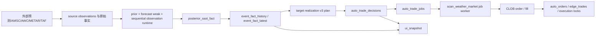
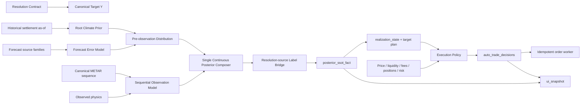

# 天气交易系统架构与信号哲学对抗审查

> **历史证据（2026-07-15）**：本文冻结 2026-07-11 的 Sol 对抗审查现场，其中 v3.1/current 等表述已被 ADR-0002 reported-X v5 生产切换取代。本文不得作为 current/deployed 模型或运维命令权威。

日期：2026-07-11

状态：审查结论，不是生产参数变更单

范围：当前工作树、`data/archive.db` 只读快照、launchd 只读状态、核心文档、概率/事实/决策/执行代码与聚焦测试

方法：Sol 多 Agent 对抗；认识论红队、SSOT/执行红队、文档契约红队独立取证，主 Agent 交叉裁决
安全边界：未回填、未下单、未改参数、未清锁、未重启服务；本文件是唯一新增产物

## 1. 审查结论

系统的大方向有四点是正确的：

1. 市场价格不进入天气后验；
2. 已观测最高温下界不能被弱预测源覆盖；
3. `posterior_ssot_fact -> auto_trade_decisions -> order` 正在成为主链；
4. 旧 Edge/LCB/repricing/stop-loss 已有末端执行过滤，未发现其直接穿透为真实 BUY/SELL 的代码证据。

但系统目前还不能称为“单一认识论、单一生产链、可统计证明的闭环”。当前最高风险不是缺少特征，而是以下四个根问题：

- **模型身份未唯一**：分层 Bayes 的解释面与 v3.1 一体化剩余升温模型同时被称为生产真相；v3.1 可用时，观测门可直接接管最终密度，先验/弱似然只剩诊断意义。
- **结算目标与训练代理未闭合**：NCEI/AMSC 日高温能训练物理过程，但不等于 Polymarket resolution source 的最终结算标签。
- **执行经济学未闭合**：文档写“可成交、深度、净收益”，代码实际按 passive best bid 挂单、忽略对侧深度，并把 `fill_ratio=1` 用于计划计算。
- **运行可靠性已影响主链**：Live 开启时，物化进程长时间持有 DB 写锁，worker 多次 30 秒超时；最新有效事实和决策一度停滞约 37 分钟。
- **执行事务边界不成立**：本地 CLI 可隐式继承 Live；通用路径先向交易所提交、后持久化决策；幂等记忆仍是可静默失败的 JSON 文件。

因此当前正确方向是：**暂停增加新的启发式权重和信号分支；先冻结唯一目标、唯一 posterior、唯一事实写入面、唯一决策契约和唯一执行经济学定义。**

### 1.1 本轮实施状态（源码，尚未重启生产）

已完成：CLI 强制 dry-run、提交前 durable order intent、签名后确定性 `expected_order_id`、SQLite outbox、精确 CLOB reconcile、决策写失败 fail closed、Live UI/文件旁路删除、payload 递归阻断、物化锁外 projection + 锁内 CAS、freshness 缺失 fail closed、UI pinned read transaction、uniqueness audit 误报修复。

模型身份已正式裁决为 v3.1-only：composer schema 升为 `sequential_remaining_warming_bayes_runtime_v31`；v3 runtime、v2 概率回退、旧桶级 runtime 及对应 shadow/测试已删除。v3.1 不可用时 `posterior_ssot_fact.state=blocked`，不再回退。

权威文档已建立：`docs/constitution/SYSTEM_CHARTER.md`、`docs/architecture/GLOSSARY.md`、`docs/architecture/CURRENT_ARCHITECTURE.md`、`docs/adr/ADR-0001-PRODUCTION-PROBABILITY-MODEL-IDENTITY.md`。

尚未完成：源码部署/守护进程重启、24 小时 SLO 验收、resolution-source label bridge、交易经济学闭环。未经单独授权，本轮没有历史回填、历史 payload 重写、数据库压缩或真实下单。

## 2. 当前真实架构

### 2.1 当前概率主链

当前有效事实显示：

- `posterior_composer_schema=sequential_remaining_warming_bayes_runtime_v31`；
- `remaining_warming_source=v31_multimodel_allday_live`；
- `posterior_boundary.live_primary_posterior_composer=sequential_remaining_warming_bayes_runtime_v31_only_fail_closed`；
- 最新有效 `event_fact_latest` 指向 `fact_id=107604`，`posterior_ssot_fact.state=available`。

实际公式应按连续温度域理解：

```text
p_F(y) = Normalize[p_climate(y) * L_forecast(y)^beta_weak]

pi_t(s) = SequentialUpdate(pi_(t-1), canonical_METAR_t)

p_O(y) = RemainingWarmingDistribution(y | current_max, pi_t, observed_state)

p_live(y) = HardCondition[(1-lambda_t) * p_F(y) + lambda_t * p_O(y)]

P(bucket=k) = Integral(bucket_k, p_live(y))
```

但是 v3.1 全时段模型可用时，`lambda/observation gate` 可为 1，最终概率完全由 `p_O` 接管。此时输出中的 prior、weak likelihood、`beta_weak`、`beta_strong` 仍然存在，不代表它们对最终 posterior 有实际因果贡献。

### 2.2 当前端到端链



### 2.3 当前关键分叉

1. **旧加性池 vs 连续顺序 posterior**：`WEATHER_DATA_SOURCE_CHARTER.md` 仍把加性伪样本池写成当前推荐公式；新主链已经不是该公式。
2. **分层解释 vs v3.1 一体化接管**：v3.1 同时消费站点轨迹、GFS/JMA、climo；若它接管最终密度，前置 prior/weak 的“贡献”不再是生产贡献。
3. **两套 prior 构造入口**：scan 路径存在 180 日桶 prior/模型历史 Brier multiplier；fact materializer 使用 730 日、±15 日窗口、site/terrain/weather-type prior。
4. **posterior 内轨迹 vs 策略层再次读轨迹**：策略层还直接读取 `trajectory_state`、当前温度与峰值时间，形成 posterior 之外的第二天气资格链。
5. **事实写入 helper 多面**：canonical writer 已存在，但 UI server、物化任务、受控修复脚本仍编排不同写面。
6. **真实语义审计 vs 字符串审计**：生产唯一性审计部分依赖版本 literal/regex，版本字符串演进后会产生假红，也不能排除假绿。
7. **执行计划事实 vs UI/文件旁路**：执行层可以依次从任意 snapshot file、`event_fact_latest`、`/api/ui_snapshot` HTTP fallback 获取并改写资金计划。
8. **运行态代码 vs 当前工作树**：审查期间运行中的 task queue worker 使用旧版 `db_writer.lock/owner+pid` 协议，而当前源码已改为 `owner.json+pid`；说明未重启进程与工作树之间存在代码代际漂移。

## 3. 系统宪章

以下条款应成为 L0，不由实现细节或单日盈亏覆盖：

1. 唯一结算目标是 `Y = 市场 resolution source 在目标本地日解析出的最高温及其结算桶`。
2. AMSC、AWC、NCEI、WU 自身日高温若不是 resolution source，只是观测或训练代理，不自动等于 `Y`。
3. 天气 posterior 不读取市场价格、盘口、成交量、钱包或 P&L。
4. 交易决策可以把价格、流动性、费用、队列、仓位和风险作为**执行硬门**；“不是天气证据”不等于“不是交易硬门”。
5. 所有概率输入必须满足 `available_at <= decision_as_of`；缺关键时间字段时 fail closed，不得按质量 1.0 接纳。
6. 每个信息祖先只能消费一次；同 provider、同模型祖先、同 METAR 序列的派生特征不能伪装成独立票。
7. 轨迹是 canonical 温度有效时序列；动量是该序列的稳健派生特征，不是独立似然层。
8. `hard_temperature_floor` 只置零不可能低桶；`final_bucket_lock` 才允许 one-hot。
9. 生产只能有一个 posterior composer；fallback 未通过同级 OOS gate 时必须 no-trade，不能静默换模型。
10. 执行层只消费版本化 posterior/realization SSOT、市场状态、仓位和风险，不从原始天气 feature 重开第二条信号链。
11. `auto_trade_decisions` 是执行阻断原因唯一事实；订单层不得重新解释天气概率。
12. 训练只生成版本化、可回放、待审阅 artifact；不得因单日结果自动写生产参数或自动重启。
13. UI 只读同一快照，不复算 posterior、目标桶、资金或阻断原因。
14. 任一 Live 声明必须同时满足结构 gate、统计 gate、lineage gate、运行健康 gate；测试通过不能替代 OOS 有效性。
15. 本地 CLI 默认必须强制 dry-run；Live 只能通过显式 `--live` 和人工确认短语开启，不能从 `.env` 静默继承。
16. 任何网络下单前必须先持久化唯一 `DecisionIntent/PENDING_SUBMIT`；没有 durable `order_intent_id` 不得调用 CLOB。
17. 幂等状态必须是原子、可恢复的持久账本；未知提交结果进入 `reconcile_required`，不得直接 retry。
18. 执行层不得从 UI HTTP、UI live compose 或任意本地 snapshot file 读取生产资金计划。

## 4. 术语与层级

| 层级 | 唯一定义 | 允许输入 | 禁止输入/行为 |
|---|---|---|---|
| 结算目标 `Y` | resolution source 的最终日高温/桶 | 已解析最终事实 | 用 AMSC/NCEI 代理直接替代 |
| 根先验 `p_climate` | as-of 前可见的历史结算气候分布 | 站点、DOY、静态地形/盆地、长期气候 | 当前模型、METAR、盘口；由当日动量反推天气型 |
| 预测弱信息 `L_forecast` | 各预测源误差分布的去重组合 | GFS/ECMWF/ICON/JMA、TAF、WU/TWC forecast | 硬锁桶；把同 provider 当独立源重复计权 |
| 实况观测更新 | canonical METAR 按 valid_time 的顺序状态更新 | 温度、云、雨、风、露点、气压及其一次派生 | 把轨迹/动量/云雨拆成独立同级票 |
| 轨迹 | 规范化温度序列及其状态摘要 | 去重、时序完整的观测 | 把缺时标点按满质量接纳 |
| 动量 | 两个或多个有效观测间的稳健斜率/变化状态 | canonical trajectory | 再次独立乘权或在执行层重算 |
| posterior | 对 `Y` 的唯一版本化概率分布 | 唯一 composer 的全部合法输入 | 多 composer 同时自称主链；前端/执行层复算 |
| realization state | 从 posterior 内部派生、可供策略消费的天气状态 | posterior 及其同版本状态摘要 | 策略直接读取游离 raw feature |
| target realization | posterior/official lock 对目标桶、持仓目标的改变 | posterior SSOT、官方锁定 | 把止盈、资本回笼、风险再平衡都伪装成天气目标失效 |
| 执行层 | posterior + price/liquidity/position/risk 到订单 | SSOT、盘口、仓位、预算、费用 | 重新训练/解释天气概率 |

### 4.1 盆地与气候的边界

“成都盆地”不能作为一个自由加减分项，应拆成：

- 静态站点/地形条件：可进入根先验；
- 季节/DOY：可进入根先验或校准分层；
- 当日环流、通风、冷池、湿度：属于当日预测或观测状态，不能回填成 prior；
- 模型对盆地的历史偏差：属于模型校准 artifact，不属于当前事件独立似然。

### 4.2 退出原因族（已由后续 L0/L1 裁决收口）

本轮审计最初识别出天气失效、市场止盈、风险再平衡和资本回笼四种不同哲学；后续 accepted L0/L1 已作更严格裁决：真实卖单只允许两个互斥闭集。

- `target_realization`：posterior、hard condition 或 settlement 改变天气/结算目标；
- `market_alpha_take_profit`：仅限绑定入场前冻结目标和批准 artifact 的 `top_yes_wave`，当前 `accepted-not-live`。

`portfolio_risk_rebalance` 只能阻断/缩减新入场或形成诊断，`liquidity_capital_recycle` 只能形成持仓/资金诊断；二者均不得触发真实 SELL。最终 family/code 以 L1 交易退出合同为准，禁止统一前缀、改名或兼容分叉。

## 5. 主要问题分级

### P0-1：生产模型身份不唯一

证据：

- `sequential_remaining_warming_bayes_runtime.py:1599-1627`：v3.1 可用时观测 gate 可为 1；
- `sequential_remaining_warming_bayes_runtime.py:1758-1760`：`beta_strong` 只是兼容 trace；
- `docs/HIERARCHICAL_JOINT_LIKELIHOOD_DEVELOPMENT_PLAN.md:602-616`：文档仍以分层链解释 production；
- 最新事实同时包含分层 contribution 与 `remaining_warming_source=v31_multimodel_allday_live`。

影响：无法回答“哪一层改变了最终概率”，消融、校准和责任归因都会失真。

裁决：保留连续顺序框架，但必须把 v3.1 定义为唯一模型中的一个明确条件模块，或正式承认其为整体 Model B；不能同时宣称前置分层贡献仍然生效。

### P0-S（安全优先）：执行安全与事务性未闭合

这是优先于模型优化的最高级安全问题。

#### P0-S1：文档承诺默认 dry-run，但 CLI 会继承 Live

- `AGENTS.md:4,40-42` 声明默认 dry-run，并给出 `python3 -m bot.main --once`；
- `bot/main.py:50-70` 先加载 `.env`，再执行 `os.environ.setdefault("PM_AUTO_TRADE_DRY_RUN", "1")`；
- 当前 `.env` 已是 `PM_AUTO_TRADE_ENABLED=1`、`PM_AUTO_TRADE_DRY_RUN=0`。

因此操作员按文档直接运行 bot，并不会得到文档承诺的 dry-run。必须改为 CLI 显式授权 Live，`.env` 不能静默升级交互命令。

#### P0-S2：先向交易所提交，后写 `auto_trade_decisions`

- direct fast path 在 `scan_weather_market.py:31518` 调 `_run_node_order`，到 `31789` 才 `_flush_decisions()`；
- 通用路径在 `51359-51363` 捕获 decision flush 异常后只打印，随后仍在 `51371` commit。

可能出现：

```text
CLOB 已接受订单
  -> auto_orders/edge_trades 已变更
  -> auto_trade_decisions 写失败
  -> 流程仍提交或作业重试
```

这直接破坏“执行阻断原因唯一来源是 `auto_trade_decisions`”，也留下重复提交窗口。

#### P0-S3：CLOB 幂等账本非原子且失败静默

- `scripts/clob_order_service.mjs:339` 使用 JSON 文件；
- `409-419` 读取异常被空 catch 吞掉；
- `422-435` 直接 `writeFileSync`，无临时文件、fsync、原子 rename，写失败同样被吞掉；
- 成功/失败结果均在交易请求完成后才写入幂等 map/file。

进程或磁盘故障后，服务可能忘记已提交 key；若 job 同时 retry，会形成重复订单风险。

#### P0-S4：订单—决策 lineage 覆盖不足

只读数据库统计：

- `auto_orders` 151 条中 150 条缺 `decision_id`；
- 114 条 exit order 全部缺 `decision_id`；
- `auto_trade_decisions id>160000 AND will_order=1` 共 391 条，全部缺 `order_intent_id`。

裁决：引入提交前 durable `order_intent_id`，唯一贯穿 decision、job、CLOB、auto_order、edge_trade、fill；使用事务性 outbox。`will_order` 拆为 `submit_attempted/exchange_accepted/already_live/submit_failed`，不能继续过载。

### P0-2：Live 状态早于统计 gate

只读验收结果：

- 文档指定回测 `status=fail`；可比独立结算样本 32，失败项为 `insufficient_ctp_settled_samples`；
- CTP 与 additive baseline 的 bucket Brier/logloss 在该样本中相同；target churn 无数据；
- direct-replacement 审计报告 43 个 latest 温度 fact 中 10 个缺完整 CTP 分布，且包含当前事件；
- 当前结构已 Live，但文档自身规定少于 50 个独立结算样本不得声称质量达标。

影响：结构上线不等于概率改善，更不等于策略收益已被证明。

裁决：禁止继续使用“已验证优于基线”的表述；保留前向采集和安全执行，但所有概率/策略优化必须通过冻结 OOS gate。

### P0-3：训练标签域与真实结算域不一致

`v3.1` 训练拥有多年 NCEI/小时样本和 walk-forward，这是有效的物理过程训练证据；但 release caveat 已明确 `ncei_hourly_labels_not_amsc_half_hour_settlement_labels`，高质量 AMSC 与生产结算同源重叠样本仍很少。

影响：可能精确预测“站点物理日高温”，却仍在市场结算桶上系统偏一桶。

裁决：建立独立 `resolution_source_label_bridge`：

```text
p(physical_daily_max | weather data)
    -> p(settlement_daily_max | physical_daily_max, source behavior)
    -> P(market bucket)
```

### P0-4：运行链路被 DB 写锁与 payload 膨胀阻断

审查时的只读运行态：

- `.env` 为 `PM_AUTO_TRADE_ENABLED=1`、`PM_AUTO_TRADE_DRY_RUN=0`；
- `materialize_amsc_posterior_task` 持有 `data/db_writer.lock` 超过 5 分钟，进程状态为不可中断 I/O；
- `target_realization_worker.err.log` 多次出现 `archive_db_write_queue_timeout ... waited=30s`；
- 最新有效事实和最新决策一度停滞约 37 分钟；
- `fact_id=107604` 的 `fact_json` 约 6.9MB，出现 30 次 `extra_payload_preserved`；此前同类 payload 多为约 90-128KB。
- 后续链路恢复时，新 `fact_id=107608` 再次膨胀到约 7.3MB、31 次 `extra_payload_preserved`，并继续产生 `hard_deadline_exceeded` 决策；说明不是一次性历史异常。

代码风险：

- `posterior_ssot_projection_runtime.py:1885` 深拷贝整个旧 payload；
- `weather_fact_snapshot_writer.py:5838-5854` 对冲突字段继续深拷贝到 `extra_payload_preserved`；
- 若旧 payload 已含 `extra_payload_preserved`，该结构存在递归保留和无界增长窗口。

影响：事实物化延迟、写锁持有时间、worker deadline、数据库体积和 UI 读取延迟相互放大。

裁决：这是首个工程修复主线。必须先做无写入复现与 payload size/depth guard，再受控修复；本审查未清锁、未删数据、未回填。

补充运行态漂移：运行中的 `task_queue_worker.py` 已持续超过一天且使用旧版 lock metadata（`owner+pid`），当前源码使用 `owner.json+pid`。任何修复验收必须同时核对“仓库代码、安装 plist、实际进程启动时间与加载代码版本”，不能只看工作树。

### P0-5：时间血缘存在 fail-open

- 弱源 freshness metadata 缺失时可得到 `freshness_metadata_missing_no_penalty`；
- observation inputs 存在但 source trace 缺失时，强观测 freshness 可被设为 1；
- prior 复用检查偏重 schema/归一化，未完整绑定 prior 的训练截止时间与当前 replay as-of。

影响：实时环境会放大陈旧风险，历史 replay 可能产生 later-materialized 信息泄漏窗口。

裁决：所有概率层必须携带 `issued_at/valid_at/fetched_at/available_at/training_cutoff`；缺少决定性时标时 no-probability/no-trade。

### P0-6：当前文档没有唯一真相层级

直接冲突包括：

- `WEATHER_DATA_SOURCE_CHARTER.md:32-106` 的加性伪样本公式与当前连续顺序公式冲突；
- `TEMPERATURE_POSTERIOR_REFACTOR_PLAN.md` 同时写“已 Live”“当前仍是加性池”和历史 shadow 步骤；
- `AUTO_TRADE_SOP.md` 仍允许 lag/trend/trail/hold 等退出，与 Bayes-only 退出硬规则冲突；
- `SSOT_FACTS.md`、`ssot_facts_design.md` 的旧 API/read-model 与 `/api/ui_snapshot` 当前 SSOT 冲突；
- 根目录 LCB/Edge 自动训练文档仍以现在时存在，与当前 target realization 方向冲突。

影响：未来 Agent 或人工维护者会在错误文档上继续优化。

裁决：先建立权威元数据与 archive/superseded 状态，再继续模型开发。

### P1-1：先验定义与入口不唯一

问题：180 日桶 prior/模型 Brier multiplier 与 730 日、±15 日、地形/站点条件 prior 并存；“weather_type”如果由当日预测或实况生成，则不能再称为 prior；最低有效样本 3 也过于激进。

方向：根先验只保留一个 builder、一个 artifact schema、一个 as-of cutoff；模型历史表现移到 calibration，不进入 prior 本体。

### P1-2：TAF 与 WU/TWC source-family 去重不闭合

- 数据宪章要求 TAF 未经 created-at walk-forward 校准前关闭，但 runtime 默认给出较高 confidence/precision；
- 宪章要求 WU/TWC 同 provider 合并，runtime 却分组后几何合成。

方向：按 `information_ancestor_id/source_family_id` 去重，不按显示名称分组；precision cap 只能限制双计幅度，不能证明独立性。

### P1-3：轨迹/动量在 posterior 与策略层重复消费

posterior 内消费轨迹/动量是合理的；`target_realization_v3_runtime.py` 和策略模块再次读取这些状态并改变 NO 候选、近端开放和峰值冻结，则形成第二天气信号。

方向：将策略需要的状态写进同版本 `posterior_ssot_fact.realization_state`；执行层只读，不再从 raw feature 派生。

### P1-4：交易经济学定义不闭合

- 文档要求“可成交价格、订单簿深度、正净收益”；
- 实现使用 passive best bid，maker queue depth 仅诊断，`fill_ratio=1.0`；
- 配置名仍叫 `no_max_ask/yes_max_ask`，实际比较的是 maker quote/bid。

该段是历史问题证据。后续 L0/L1 已裁决 production runtime 不使用 EV/Edge 类交易硬门；正确方向改为严格拆分可执行报价事实与离线 release 评价：

```text
maker_quote_price
executable_price_for_size
fill_probability
queue_ahead_and_depth
fees_and_cancel_risk
realized_fill_rate
realized_slippage_and_fees
realized_pnl_and_drawdown
capital_time_cost
```

这些字段不得进入天气 posterior，也不得恢复为 production 入场/仓位/退出 gate。未建立 as-of fill model 前，`fill_ratio=1` 不能称为经验成交率或预期收益。

### P1-5：服务与写入职责过载

`ui/server.py` 不只是 serving，还承担 composition、latest repoint、prior/posterior materialization 和写入编排。即使 SQL 最终通过 canonical adapter，职责边界仍不清晰。

方向：抽出 application composer/materializer；UI server 只 query/present。

### P1-6：生产唯一性 audit 过度依赖 literal/regex

当前 audit 的部分 blocker 是版本 literal 过期或文件分类误报；同时 regex 绿灯也不能证明运行时无旁路。

方向：用注册表 + import/runtime trace + 最近事实 lineage replay 替代纯字符串扫描。静态审计保留为第一层，不再作为唯一 release gate。

### P1-7：UI/文件成为执行计划旁路

`scan_weather_market.py:14290-14385` 的读取顺序为：

1. 任意 `PM_TARGET_REALIZATION_SSOT_SNAPSHOT_FILE`；
2. local `event_fact_latest`；
3. `/api/ui_snapshot` HTTP fallback。

随后 `scan_weather_market.py:22659-22730` 会用该计划覆盖目标 notional、概率和价格 cap。与此同时，`ui/server.py:76498` 还会 live compose 并替换快照 item。

影响：UI 从只读展示层变成生产执行旁路；文件、DB、HTTP/cache/live compose 可代表不同 as-of。

方向：把 `target_realization_execution_plan` 持久化为独立事实，以 `fact_snapshot_id + plan_id` 唯一标识；UI 和执行都只读它。生产执行删除 snapshot file/UI HTTP fallback。

### P1-8：`/api/ui_snapshot` 尚不是严格单一读快照

UI 只读连接设置 `query_only`，但没有显式固定读事务；端点顺序查询多表，又混入 positions API/cache 和 live compose。因此一个响应可混合 DB、仓位、缓存与实时合成的不同时间点。

方向：入口显式 `BEGIN DEFERRED` 固定 SQLite 读视图并输出 `snapshot_id/as_of_db`；外部仓位作为独立 `positions_as_of` section，不冒充同一事实快照。

### P1-9：文档 SSOT 名称仍有虚假双口径

实际事实层是 `data/archive.db/event_fact_history + event_fact_latest`；根目录和 `data/` 下多个 `facts.sqlite` 为 0 字节，但旧原则仍写 `facts.sqlite.*_meta_json`。

方向：当前宪章统一为 archive.db 事实层；未来若拆库，必须作为正式迁移，不保留双名。

### P2：兼容面与命名债务

- `beta_strong` 已不参与 bucket exponent，应改为明确的 legacy trace 或退役；
- compatibility-only posterior composer 仍以正常 API/测试存在，建议移入 `legacy/` 并以 manifest 限定读者；
- `target_realization_*` 前缀承载过多非天气语义；
- 大型计划把规范、历史、完成记录混写，难以判断当前有效状态。

## 6. 已确认的正面控制

1. 市场源被排除出天气 posterior。
2. canonical METAR 会按 valid time 去重，明确未来观测会被排除。
3. 已观测最高温下界在连续密度上执行 hard condition。
4. 非 Bayes BUY 候选在真实下单末端被 `legacy_strategy_retired_bayes_only` 阻断。
5. SELL 末端只接受允许的 target-realization 代码族；未发现旧 Edge/LCB/repricing 直接穿透。
6. `MONITOR_SIGNAL_LOG` 与 `POLY_SIGNAL_PATH` 当前不相同。
7. `check_ssot_alignment.py` 返回 0 blocker/0 warning；表、路由和最新决策对象存在。
8. 聚焦 prior/weak/strong/sequential/pipeline/strategy/SSOT 契约测试 97 项通过，证明局部归一化、hard floor/lock、valid-time 去重、资金与互斥等行为存在。

这些正面控制证明“安全骨架已形成”，但不能证明预测质量、策略收益、唯一生产路径和运行时新鲜度已经达标。

## 7. 目标架构



### 7.1 对 v3.1 的建议定位

不建议废弃 v3.1；建议重新定位为以下二者之一，并明确二选一：

1. **条件剩余升温模块**：只建模 `p(remaining_warming | canonical observation state, as-of context)`，与 `p_F` 在唯一 composer 中合成；重复使用的 GFS/JMA/climo 特征必须移除或作条件去重。
2. **整体联合 Model B**：v3.1 直接从所有特征输出完整连续 posterior；此时 prior/weak/strong 只作为诊断与消融，不再声称是生产贡献。

推荐优先选择方案 1，因为边界更清晰、可解释、便于按信息祖先去重；如果 OOS 证明方案 2 显著更好，则用 Accepted ADR 正式替换，不做“双主模型”。

## 8. 训练与验证方向

### 8.1 训练单位与防泄漏

- 独立统计单位是事件日，不是小时行；小时行只是日内重复测量；
- split 使用 rolling-origin/expanding-window，bootstrap 和置信区间按事件日聚类；
- 每个 cutoff 重建当时可见的 prior、forecast、METAR 与 source version；
- 禁止复用 later-materialized prior、最终修正报文或未来 provider 权重。

### 8.2 必须完成的 source-family 消融

1. climate prior only；
2. + model family；
3. + TAF；
4. + WU/TWC dedup；
5. + canonical METAR path；
6. + observed physics；
7. v3.1 integrated；
8. resolution-source bridge。

每一步报告 CRPS、RPS、bucket Brier、bucket logloss、校准截距/斜率、尾桶过信、D0 hard-floor 违约率和 target churn。

### 8.3 Release gate

- 少于 50 个独立已结算事件日：只能报告工程可运行，不能报告质量达标；
- 声称显著改善：至少 80 个独立事件日，并给事件日聚类置信区间；
- challenger 未通过同一 gate 不得晋级；主模型不可用时 fail closed，不允许旧模型 fallback；
- 概率模型与 maker fill/费用/P&L 模型分开训练；交易收益不能反向污染天气 posterior。

## 9. 迭代路线

### Phase 0：先恢复可审计与可运行

目标：不改概率方向，先消除会让任何结论失真的工程阻断。

1. 修复 bot CLI：默认强制 dry-run；Live 必须显式 `--live --confirm-live <短语>`；
2. 建立提交前 `DecisionIntent/PENDING_SUBMIT`、durable `order_intent_id` 和事务性 outbox；decision 写失败必须 fail closed；
3. CLOB 幂等迁入 SQLite/同级 durable store；未知结果必须 reconcile，禁止直接 retry；
4. 执行层删除 snapshot file/UI HTTP fallback，只读持久化 execution plan；
5. 复现并修复 `extra_payload_preserved` 无界嵌套；增加 payload 字节数、深度和冲突字段白名单 gate；
6. 缩短 DB 写锁临界区：projection/序列化在锁外完成，锁内只做短事务与 CAS latest；
7. 为物化和 worker 建立 lock-hold、fact freshness、decision freshness、deadline SLO；
8. 修复 production uniqueness audit 的过期 literal/误分类，并增加运行时 lineage replay；
9. 将旧 SOP/旧加性宪章/旧 SSOT/LCB/Edge 文档标为 superseded，不删除历史。

验收：交互 CLI 不可隐式 Live；任一外部订单都有预提交 decision/intention；重复进程/崩溃恢复不重复下单；执行无 UI/文件旁路；连续 24 小时无 write-queue timeout；payload size/depth 有硬上限；最新 fact/decision 不超过各自 freshness SLO；单事件 lineage 可重放。

### Phase 1：冻结唯一宪章与唯一模型身份

1. 建立 `SYSTEM_CHARTER`、`GLOSSARY`、`CURRENT_ARCHITECTURE`；
2. 固定 v3.1 为 current 唯一 production；目标 challenger 的模块边界必须由 accepted ADR 单选裁决，禁止双主模型；
3. 退役 `beta_strong` 生产贡献表述；
4. 将 trajectory/momentum 统一收口到 observation model；
5. execution 只消费 `posterior_ssot_fact.realization_state`。

验收：任何一条生产 fact 都能唯一回答 composer、feature ownership、训练 artifact、as-of cutoff 和 fallback policy。

### Phase 2：结算标签桥与概率校准

1. 建立 NCEI/AMSC/AWC/WU 与正式 resolution source 的逐事件差异表；
2. 按季节、缺报、修正报文和时间覆盖训练 label bridge；
3. 完成 source-family 消融、OOS 校准与单一 challenger 晋级门；
4. 只在 gate 通过后发布新 artifact。

验收：主指标在冻结 OOS 上改善，置信区间与样本成熟度满足 gate；无时间泄漏。

### Phase 3：交易执行与离线评价闭环

1. maker quote、queue/depth、fill probability、fee/cancel risk 分层；
2. 分别报告 realized fill、slippage、fees、P&L、drawdown 和 capital time；不得形成 runtime EV/Edge gate；
3. 真实退出只评估 `target_realization` 与独立 `market_alpha_take_profit`；risk rebalance/capital recycle 不得触发 SELL；
4. 逐结算桶组合损益与资本占用统一进入决策快照。

验收：每个订单可解释 posterior/target 身份、可执行报价、费用、风险与精确授权原因；旧 EV/Edge gate 命中数为零，未激活 market-alpha 始终 fail closed，不再使用含义错误的 `*_max_ask` 或 `fill_ratio=1` 作为经验事实。

### Phase 4：模块化与长期治理

1. 从 `ui/server.py` 抽出 composer/materializer；
2. canonical writer 单 owner，受控修复工具通过明确 maintenance interface；
3. compatibility runtime 移入 legacy manifest；
4. 建立每日只读校准/lineage/运行健康报告；参数变更只生成 reviewed proposal。

## 10. 文档权威层级

建议目录：

```text
docs/constitution/SYSTEM_CHARTER.md
docs/architecture/GLOSSARY.md
docs/architecture/CURRENT_ARCHITECTURE.md
docs/adr/ADR-00xx-*.md
docs/contracts/*.md
docs/runbooks/*.md
docs/research/*.md
docs/archive/*.md
```

每份文档必须包含：

```yaml
status: accepted | draft | research | superseded | archived
authority: L0 | L1 | L2 | L3
owner: <module/team>
effective_from: <timestamp>
supersedes: [<docs/ADR>]
implementation_symbols: [<path:symbol>]
verification_gates: [<command/schema>]
last_verified_commit: <sha>
```

优先降级为 superseded/archive 的文档：旧加性数据源宪章中的 posterior 公式、旧 SSOT 设计、旧 Auto Trade SOP、LCB/Edge 自动训练和收益信号文档。可保留其中仍正确的数据源角色表，但必须迁入当前 contract。

## 11. 当前红黄绿矩阵

| 领域 | 状态 | 结论 |
|---|---|---|
| Bayes-only 末端执行保护 | 绿 | 未发现旧 Edge/LCB 直接穿透 |
| 市场与天气 posterior 隔离 | 绿 | 市场源未进入天气后验 |
| hard floor/final lock 区分 | 绿/黄 | 合同存在；需持续做 lineage replay |
| SSOT 表与 UI 路由存在性 | 绿 | `check_ssot_alignment` 通过 |
| 单一 posterior 模型身份 | 红 | 分层解释与 v3.1 接管并存 |
| 单一事实写入/生产链 | 红 | uniqueness audit 失败且 audit 本身有误报 |
| 先验唯一性 | 红 | 两套入口与口径风险 |
| 时间 as-of 完整性 | 红 | freshness fail-open 与 replay 污染窗口 |
| 概率 OOS 质量 | 红 | 样本 32，小于自身最低 50 gate |
| 结算标签一致性 | 红 | 物理代理与 resolution source 未桥接 |
| 执行经济学 | 红 | passive quote/fill/depth 定义不闭合 |
| DB 写入与主链新鲜度 | 红 | 长锁、worker timeout、事实/决策停滞 |
| CLI dry-run 安全承诺 | 红 | 当前可从 `.env` 静默继承 Live |
| 决策—订单原子性 | 红 | 先网络提交、后写决策；通用 flush 失败被吞 |
| CLOB durable 幂等 | 红 | JSON 非原子持久化且异常静默 |
| 订单 lineage | 红 | 150/151 orders 缺 decision_id；近期 will_order 全缺 intent id |
| UI 与执行解耦 | 红 | 文件/local fact/UI HTTP 三路计划读取 |
| 文档权威性 | 红 | 多份互相冲突的“当前真相” |
| 局部契约测试 | 绿 | 聚焦测试通过，但不代表统计有效性 |

## 12. 下一个主线任务

下一个主线任务应是：**执行安全与事务性 P0 闭环**，顺序为：CLI 强制 dry-run → 提交前 DecisionIntent/outbox → durable CLOB 幂等与 reconcile → 删除 UI/文件执行旁路 → payload/DB 长锁与 freshness。

理由：当前既存在误触 Live 的操作面，也存在“订单已提交但决策/幂等账本未可靠持久化”的崩溃窗口；这比模型误差更直接。完成执行安全与数据库可靠性闭环后，第二主线才是发布精简 `SYSTEM_CHARTER + CURRENT_ARCHITECTURE + GLOSSARY`，并正式裁决 v3.1 的唯一模型身份。

未经熊先生确认，不执行历史 payload 清理、数据库压缩、历史事实重写或大范围回填。

## 13. 2026-07-11 实施追踪（源码态，未部署）

本节覆盖上文审计时点后的代码实施进度；上文历史证据保留，不据此宣称全仓旧代码清零。

已完成：

1. 物理删除 `bayesian_probability_runtime.py`；当前层级后验入口迁为 `posterior_pipeline_entry_runtime.py`，显式 legacy additive bridge 元数据已删除；生产概率身份仍固定为 v3.1。
2. scanner 删除通用 LCB/Edge 候选构建、历史 payload q fallback、market quote q proxy、事件级温度 Edge 阻断和 legacy Node 下单旁路；通用旧 Edge 入场不再生成候选。
3. 执行计划只从 `event_fact_latest` 读取；snapshot file 与 UI HTTP 执行计划旁路已删除。
4. UI 删除本地 Edge/LCB/v2/strategy profile 重算及 LCB→path-probability 配置别名；UI 只消费已持久化字段。
5. 全仓真实收集仍为 `2778 tests collected`；`tests/test_entry_budget_sizing.py` 当前 `40 passed`。
6. 所有 Bayes BUY/SELL 提交点均已在网络下单前持久化 `auto_trade_decisions/pending_submit`，注入 durable `order_intent_id`；决策持久化失败时 fail closed。
7. CLOB 下单仅允许 SQLite durable service；旧 Node place-order fallback 及对应测试合同已删除，超时进入 `reconcile_required`。
8. `posterior_ssot_fact` 所有投影状态均显式携带 `production_model_family=v3.1`、`production_probability_policy=v3.1_only_fail_closed` 与 `legacy_model_fallback_allowed=false`；最新事实只读重投影验证为 v3.1 official final lock。
9. 决策缓冲已按载荷指纹去重，避免同一轮重复插入未变化 decision；新增订单账本前向写入 decision/correlation/signal/intent lineage。

仍未完成：

1. UI server 已删除 heavy-lane summary-cache/metadata fallback，繁忙时仅返回明确 busy/retry；`ui/index.html` 仍有旧 Edge/LCB 配置、诊断卡片和字段渲染，且相应 fallback 的旧测试合同尚待删除并同步静态/UI 测试。
2. scanner/UI 仍有仅展示或复盘用途的 Edge/LCB 字段与配置面；必须逐一裁决为删除或明确的非执行账本字段。
3. `intraday_likelihood_runtime.py` 与新的 posterior entry 仍存在循环式私有符号依赖，尚未按 ownership 拆开。
4. 全量真实执行尚未全绿：第三次完整执行为 `200 failed, 2586 passed`（当时收集 2786 项，耗时 8m21s）；随后已删除 11 个明确退役的 LCB/path-probability、additive physical likelihood 与 UI 本地后验重算测试，当前重新收集为 `2778 tests collected`，尚未完成下一轮全量执行。失败主要集中在 UI busy/cache fallback、本地 fact 物化兼容、hard-source 旧写入链和旧策略批处理合同，不能宣称 2778 全绿。
5. 源码尚未重启/部署，未进行数据库回填、历史重写或守护进程切换。
6. 历史 identity 只读审计仍有债务：`auto_trade_decisions` 7,349 行缺 decision/correlation identity，`auto_orders` 3 行缺 intent/correlation；未经确认不回填。

下一个主线任务：删除 UI busy/cache/本地 fact 重算 fallback 及对应旧测试，随后清理 hard-source 旧 writer 兼容链；重新执行全量 2778 项并按失败簇继续收敛。全绿前不部署、不启动 24 小时 SLO。
