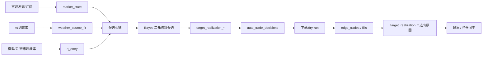

# Weather Decision Core

本系统的交易口径只使用天气交易链路已有概念，不引入 `trust_weight`、`Governance Projection` 这类外部架构词。`settlement_actual` 等字段只表示天气市场已解析结果，不作为新的抽象层名称。

## 关联文档

- `TEMPERATURE_POSTERIOR_REFACTOR_PLAN.md`：Bayes 温度后验从加性证据池迁移到连续温度分布引擎的最终方案。

## 核心对象

- `market_state`：合约是否可交易。来自 token、active/closed/archived、accepting orders、orderbook、盘口新鲜度。
- `weather_source_fit`：预测与合约规则是否对齐。包含结算站点、单位、日期、最高/最低温、数据源可用性。
- `source_fit_tier`：天气源与合约规则的匹配层级。旧字段 `source_trust_tier` 仅保留兼容，不作为新方案术语。
- `q_entry`：当前入场概率。用于解释、排序和构造 Bayes 二元结算候选，不单独作为硬门槛。
- `target_realization_*`：Bayes 二元结算/目标桶实现口径，是当前交易策略的唯一语义前缀。
- `edge_tradeability` / `entry_usable_edge`：旧 Edge/LCB 诊断与兼容字段，只能用于展示、排序、复盘或软惩罚，不得触发真实下单。
- `hold_edge_realizable`：旧退出收益诊断字段，只能用于展示、排序、复盘或兼容，不得触发真实卖单。
- `auto_trade_decisions`：执行阻断原因的唯一事实来源。
- `auto_trade_decisions.details_json.source_fit_tier`：天气源对齐等级的顶层 SSOT 字段；缺失时必须写 `source_fit_na_reason`，旧的 `source_trust_tier` / `weather_strategy_source_fit_tier` 只能作为兼容或补充字段。

## 入场顺序

1. `market_state` 先判定不可交易项：关闭、归档、不接单、无 token、无 orderbook、盘口过期。
2. `weather_source_fit` 判定预测是否对准合约：站点、数据源、单位、日期、最高/最低温口径。
3. 生成 Bayes 二元结算候选：posterior settlement、SSOT target realization、hard-source direct SSOT target 是可交易候选来源。
4. 非 Bayes 候选直接写 `legacy_strategy_retired_bayes_only` 阻断，不进入真实下单。
5. Edge/LCB、q/ask/lag/spread/depth/volume/churn 等只作为诊断、排序、size 或软惩罚，不是硬门槛。
6. 写 `auto_trade_decisions`：硬阻断 reason code 只保留不可交易项和 Bayes 策略阻断项；旧策略形态类代码写入兼容/诊断字段。
7. 下单层只读候选、价格、size 和 market token；dry-run 不得写成真实持仓。

## 退出顺序

1. 持仓真值来自 `edge_trades.position_size`、同步持仓和 fills reconciliation。
2. 已无仓位必须 reconcile 到 `exit/no_position`，不能靠 `confirmed` 状态推断仍有持仓。
3. 退出触发只允许 Bayes 目标实现原因，即 `target_realization_*`。
4. 旧 `edge_min`、`hold_edge_realizable`、`lcb_*`、`stop_loss`、`trail_stop`、`weather_repricing*` 只保留诊断/兼容，不得触发真实卖单。
5. 退出原因归一写入 `edge_trades.exit_reason_family_codes`，当前策略家族只允许 `target_realization_exit`；`edge_trades.exit_reason_codes` 可保留原始兼容码，但执行层必须过滤非 Bayes 触发码。
6. 退出未触发必须写 `edge_trades.exit_skip_reason/exit_skip_detail/exit_skip_at`。

## 统计口径

- 历史命中率按 ET 日口径。
- 已解析样本可用 `settlement_actual`，但报告中称为“已解析结果”或“实际结果”。
- 未解析样本只用于预判、模拟和风险分布，不混入命中率分母。
- 回测和实盘复盘必须区分：真实成交、dry-run 意图、纸面结算、持仓同步修正。
- 策略统计主口径按 Bayes 二元结算/目标桶实现拆分；旧 `lcb_global_main`、`repricing_bucket` 等只作为历史兼容标签。
- 反事实复盘使用 `scripts/entry_counterfactual_review.py`，按候选合约去重，并把 live 意图、dry-run 意图、真实 BUY fill、真实 SELL fill 分开统计。

## 不变量

- 前端只渲染服务端/事实层口径，不在浏览器复算交易结论。
- `/api/ui_snapshot` 展示 `auto_trade_decisions.details_json`；候选 SSOT 重建也必须输出顶层 `source_fit_tier` 或 `source_fit_na_reason`。
- `edge_realizable`、`edge_tradeability`、`exec_edge_entry` 只做上游供数、排序、展示和复盘，不得成为交易触发条件。
- 旧收益退出诊断、repricing、lag、edge flip、LCB Q 峰值切换不得触发真实卖单；退出只认 `target_realization_*`。
- `entry_usable_edge` 必须进入每条入场决策明细；无法构造时必须写 `entry_usable_edge_na_reason`。
- `edge_tradeability_pass=false` 或 `edge_tradeability_blocked=true` 时，不得继续把 `edge_tradeability_profit_value` 的正数展示成可买 `entry_usable_edge`；必须写 `entry_usable_edge_na_reason=edge_tradeability_blocked:*` 并把 size scale 置 0。
- 若候选因策略形态软过滤未进入 `edge_tradeability` 计算，`entry_usable_edge_na_reason` 必须写具体形态原因，例如 `soft_shape_filter_plain_lcb_pinned_tail_no`，不得笼统写成上游供数缺失。
- 若候选已应用过仓位系数，但最新 `entry_usable_edge_size_scale` 从 0 恢复为正，必须用 `size_base` 重算 `strategy_size_ratio`，避免出现正 `entry_usable_edge` 却因陈旧 0 仓位状态空跳过。
- 若 `edge_tradeability_pass=true` 且 `entry_usable_edge>0`，但执行层读到陈旧的 `strategy_size_ratio=0`，必须按 `strategy_size_ratio_base * strategy_size_ratio_extra * entry_usable_edge_size_scale` 恢复尺寸；只有显式策略尺寸配置为 0 时才允许继续 0 仓。
- 关闭或不可接单市场可以记录市场状态，但不得继续污染“策略未达标”类入场阻断。
- `confirmed` 订单没有正向成交量时，不等于已有持仓。
- dry-run 只能产生 `entry_dry_run` 决策意图，不能产生 durable `entry` 持仓。

## Mermaid 流程

