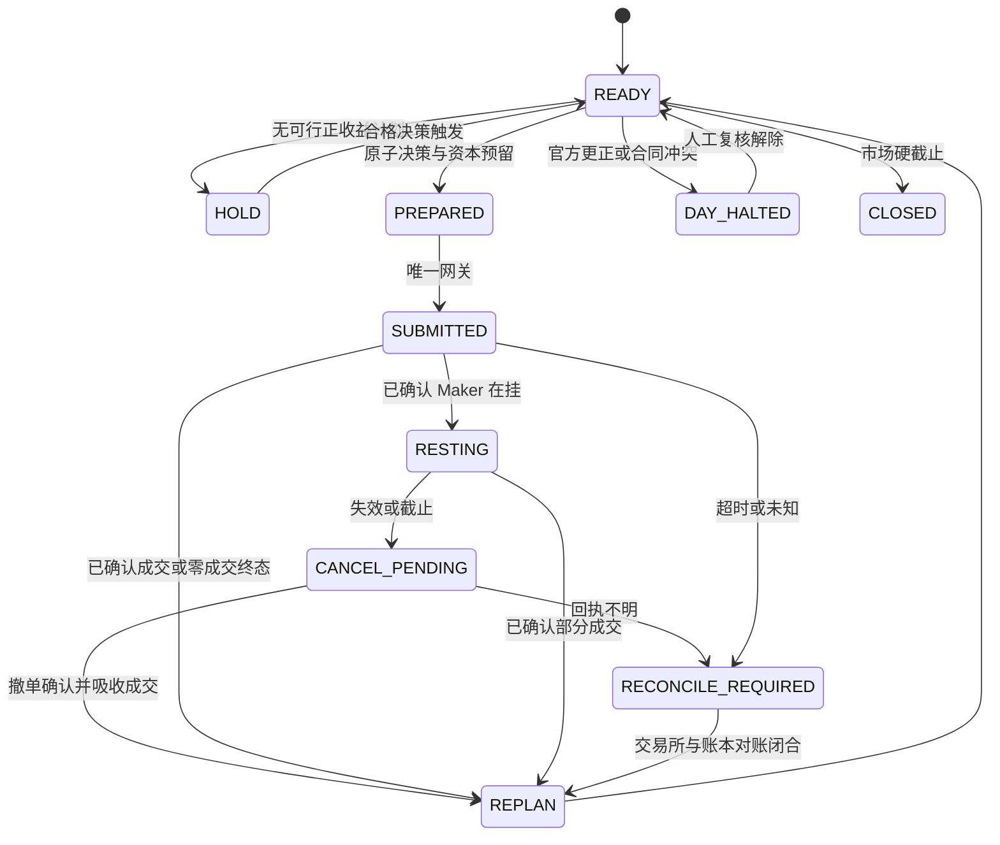

# P0 为根、TAF／区域／观测为条件似然：完整交易与执行设计

## 0. 交付与裁定范围

**Goal：给出可实现、可回放的闭环：证据 → 唯一后验 → 目标 YES 库存 → 有条件执行计划 → 成交与对账 → 重新决策。** 本文规定数学对象、层间合同、买卖规则、资金约束、订单状态机、训练与验收门；配套数值程序验证算术和边界。

本文是熊先生要求的完整候选设计，不是生产生效单。此次未修改生产代码、参数、车道、宪章或服务。收益、参数优越性和真实成交效果需要历史严格 OOS 验证。

设计取舍已经明确：

1. **一个概率体系**：P0 是根，其他天气来源贡献相对于已知信息的增量证据。
2. **一个交易账户**：只交易 YES，多个阶段共同管理同一站日的实际持仓。
3. **一个经济授权口径**：整个可执行动作的期望新增赔付减全部成本；风险用显式约束表达。
4. **一个执行状态机**：目标篮子与实际成交分开，逐笔确认、逐笔重算，接受有时应停止补齐。
5. **候选执行主路径为限价 FOK**；Maker 是需要独立成交证据的可选执行方式。本建议与当前 Maker 入场政策存在差异，见第 14 节。

阅读依据为当前工作树，不把历史研究稿当作现行授权：宪章第 161 条及 `p1_direct_update.py` 已落地直接更新；`materialization.py` 的 P1 版本为 v17；`delta_v2_runtime.py` 默认仍为 Maker。`strategy_lanes_v1.json` 显示篮子 BUY 暂停，秤砣线与回收卖出车道启用；这里只确认配置事实，未检查驻留进程的实际加载状态。

## 1. 概率到底预测什么

### 1.1 唯一结算变量

- 事件键：`station_id × event_date × market_contract_version`。
- \(T^\star\)：该市场合同定义的最终结算温度，温度计算统一转换为 °C。
- \(K=k\iff T^\star\in I_k\)：由 canonical bucket contract 决定；精度、四舍五入和开闭边界也来自合同。
- 全部 \(I_k\) 必须互斥且覆盖完整结算域；“以上／以下”保留无限尾部。
- 不把气象上的真实瞬时最高温、仪器报告最高温和市场结算数值默认为同一变量；由 canonical truth 映射证明对应关系。
- C／F 桶宽从 registry 的 `lower/upper` 推导。物理残差用 °C；相邻桶与跨桶次数用序数，二者不混用。
- 天气事件日及日界从逐站市场合同与绑定时区取得；全簿交易日统计采用 ET。

### 1.2 信息集与贝叶斯链

记 \(Z\) 为 P0 已使用的全部信息及其版本，\(F\) 为 TAF，\(R\) 为区域模型，\(O_{\le t}\) 为截至决策时刻可见的完整 canonical 观测前缀。

理论上的条件分解是：

\[
p(T^\star\mid Z,F,R,O_{\le t})\propto
p_0(T^\star\mid Z)\,
p(F\mid T^\star,Z)\,
p(R\mid T^\star,Z,F)\,
p(O_{\le t}\mid T^\star,Z,F,R).
\]

**每项都条件于前面已知的信息。** TAF 和区域产品可能来自同一全球模式；区域模式可能已同化部分观测；连续 METAR 高度相关。把三个独立拟合的预测分布直接相乘不满足这个分解。

上式次序是固定模型合同，不是报文到达次序。R 先到时使用经过验证的 R-only 条件模型；F 后到时从 P0 重算联合 F＋R，不能在旧的 R-only 后验上再乘一个为 P0 单独训练的 TAF 因子。

## 2. 每层的职责与算法

### 2.1 P0：全球集合给基础分布

正式根只使用 active registry 的五类全球原生集合：ECMWF IFS ENS、ECMWF AIFS ENS、DWD ICON EPS、NOAA GEFS、ECCC GEM ENS。每个 exact scope 至少两个正权重、不同 independence family，分别有原生成员、arrival／receipt、历史 OOS 和 activation。

集合成员提供初始位置、离散度与尾部，再以历史 strict-as-of 样本校准成完整分布。成员数不是独立系统数。根的中心、方差、云辐射等协变量以及已有区域特征，全部进入 `root_information_manifest`，让后续层能识别重复信息。

原生缺失时，仅按既有独立历史激活规则使用显式 republisher 的 no-live P0 fallback；它不获得 P1 或 formal/live 权限。缺少合格根时，TAF、METAR 或区域产品不能拼出一个伪 P0。

### 2.2 TAF：相对于根的预报增量

可解释的基线保留：

\[
X=TX-c_0,\qquad Y=T^\star-c_0,\qquad
X\mid Y,Z\sim N(a(Z)+b(Z)Y,\tau^2(Z)).
\]

\[
\ell_F(T^\star)= -\frac{[X-a-bY]^2}{2\tau^2}.
\]

- 回归方向是“假设最终温度为这个值，会看到怎样的 TX”；不是把 TX 当结算真值。
- \(c_0\) 只能来自该条样本当时的原始 P0，禁止从已吃过 TAF 的 P0-M 反取。
- \(b\) 是条件响应斜率，不是相信 TAF 的百分比。若加温度参数／信息强度，也须在最终后验上历史验证。
- 当方差或分量权重随候选温度改变，`−log τ` 等项不能作为常数省略；不同缺失模式也不能共用未经训练的参数。
- TX、云、雨、风构成一个联合 TAF 证据包；物理一致性由同一 head 的特征／交互建模，原子物化。不得在策略端再按“晴天多买一桶”修正。
- TAF 的 TEMPO／PROB／有效时段依其语义编码，不能把任一时段的温度挪作当天 TX。
- TAF 修订替换其适用范围内的旧版本；不把原报和修订当两张独立票。官方观测 COR／修订则按第 9 节停牌规则处理。

**积分要求**：若使用连续似然，桶概率正比于 \(\int_{I_k}p_0(T)L(T)dT\)。对应桶似然为该积分除以 \(p_0(k)\)，而非无条件取桶中心。窄桶中心近似需给误差界；无限尾桶必须积分或使用经验证的尾桶特征，不能捏造有限上界。

### 2.3 区域模型：只学习全球根尚未解释的局地部分

区域产品的价值来自地形、海风、锋面时间、云雨演变及局地温度路径，不来自“分辨率高，所以默认权重大”。

候选特征包括：区域与 P0 的温度路径残差、剩余时段峰值、峰时差、海风／降水／云时序、模型龄期、已知上游全球 family。观测到来后可使用 `regional_live_gap`、`regional_headroom`，但这些含观测的量只能在联合 P1 head 中计算一次。

- 区域只进入 forecast likelihood namespace，不能加入 active P0 family 计数。
- product、站点、lead、原始时序和上游 family 不明时不应用；新产品必须有独立历史准入。
- 共享全球边界条件、NBM 等混合产品、同一模型的多个接口，必须显式登记依赖。没有可识别增量时更新为零。
- 原生／republisher 权限按来源合同分别控制。本提案允许**合格区域原生产物作为似然**是新的候选 authority scope，不把现有退役／历史对象重新命名后入场。
- 某区域产品缺测或没有覆盖，不填成“剩余升温 0°C”，不借别站、别来源补值；走经过训练的缺失模式或 identity。
- 仓库 09-07 的区域研究结果仅作为候选特征依据；其旧根、旧观测模型与旧时序证据不能直接为本方案激活。

### 2.4 METAR／ASOS：硬事实与软预测各司其职

**硬部分**：由 canonical source 仲裁及结算合同生成数学排除集合 \(M_t(k)\in\{0,1\}\)。只有已证实不可能的桶置零。有限精度观测不是无误差实数；若桶与可行温度域仍相交，就不能整桶排除。连续模型可进一步积分处理边界桶的可行部分。

**软部分**：学习完整前缀对“今天最终落在哪个桶”的新增信息：本地时钟、过去趋势、距已报最高的回落、云雨风、露点差、路径与根的偏差，以及和区域／TAF 的交互。

\[
p_1(k)=\mathcal N\left[p_{\mathrm{forecast}}(k)M_t(k)
\exp f_O(k;Z,F,R,O_{\le t})\right].
\]

以第 161 条 b2 为基线，按最终 P1 拟合直接更新量。它估计的是**相对于指定根的条件对数概率比**，不是已证明对观测空间归一化的生成式 \(p(O\mid T)\)。这是可检验的贝叶斯更新近似，不能靠改函数名变成严格生成模型。

每次从当前有效的 P0／P0-M 重算整个前缀，不能 `上一份 P1 × 又一份全前缀似然`。连续报文数不等于独立证据数。

美国 ASOS 依既有优先级选完整、新鲜且有 exact OOS 的 IEM／NCEI 220、MADIS 210，否则 AWC 100；非 ASOS 用 AWC。只消费 canonical winner，不逐值混源取最大。赢家切换须重建前缀与 lineage；冲突或硬下界回退不能静默释放旧排除，进入站日复核。

## 3. 实现采用联合更新头，保留三阶段

推荐运行模型：

\[
p_{0M}(k)=\mathcal N[p_0(k)\exp f_{FR}(k;Z,F,R,D)],
\quad
p_1(k)=\mathcal N[p_{0M}(k)M_t(k)\exp f_O(k;Z,F,R,O_{\le t},D)].
\]

\(\mathcal N\) 表示在所有合法桶上归一化；\(D\) 是来源可用性／版本／缺失模式。TAF 和区域首先作为一个联合 forecast head，包含必要交互；避免给三个相关来源各乘一个任意权重。无 forecast 证据时 \(f_{FR}=0\)。观测 head 必须在实际使用的 forecast 根及其信息集上训练，不能直接把当前仅绑定旧根的 b2 工件套到新 P0-M 上。

| 可用且已激活的证据 | 本提案输出 | 来源不合格时 |
|---|---|---|
| 只有全球集合 | P0 | 无合格根则不交易 |
| TAF；或 TAF＋区域 | P0-M | 可选来源 identity，声明原因 |
| 只有区域，没有 TAF | P0-M，`taf_state=ABSENT` | 未完成此 scope 激活则继续 P0 |
| canonical 观测到来 | P1，根为有效 P0-M，否则合格原生 P0 | 软 head 不可用可输出 masked root，并显式标记 |
| 所有桶被排除／根在可行域无质量 | 无有效后验 | 阻断新风险，不能回到均匀先验 |

**明确的阶段调整**：建议把 P0-M 扩展为“预报条件似然聚合层”，允许区域-only 或无 TX 但有有效 TAF 物理字段的模式独立激活。当前 AGENTS 对 P0-M 的 TX 顺序更窄，采用本方案时需修改阶段合同及消费者选择规则。仍只有 P0、P0-M、P1，不新增 P0-F。合同变更前区域-only 仅保存候选证据。

生命周期规则：

1. source identity＋有效范围＋revision 唯一去重，重复报文零写入；同一有效输入集重放结果相同。
2. 固定 evidence 截面再计算；到达次序不能改变该截面的结果。
3. 新全球 run 成为合格根时，将全部仍适用证据重放到新根，生成新 checkpoint，不续乘旧根后验。
4. 数据缺失或未激活是 identity 的允许原因；schema 错、NaN、全零、根版本不符是 INVALID，不能偷换成正常 identity。
5. 有效 P1 软模型暂不可用可退到带硬掩码的根，但 `trading_eligible` 由该降级 scope 的 activation 决定；陈旧 P1 不能靠 stage 优先级长期压住新根。
6. 当前 \(g^\alpha\) 是第 161 条的现有回退；本候选体系最终改为 masked-root 回退，旧法仅作对照。采用前不能擅自改变现行回退。

## 4. 学习目标、数值与证据合同

### 4.1 学的是最终更新效果

对每个历史 cutoff，完整重建当时的根、可见证据、掩码及服务后处理：

\[
\hat\theta=\arg\min_\theta
-\sum_d w_d\sum_{t\in d}w_{t|d}\log p^{\mathrm{served}}_\theta(K_d\mid\mathcal I_t)
+\lambda\|\theta\|^2.
\]

站日权重与站日内时点权重预先确定，防止一站报文多就占据训练／显著性。正则将对数更新向零收缩。先冻结并按时间交叉拟合 P0，再拟合 forecast head，再用外推的 forecast 根拟合观测 head；调参只用训练段内部的更早数据。

head 使用完整信息摘要而不只是根均值；若摘要不足以描述共源关系，仍可能重复计证据，必须通过“相同根＋删去一个来源”的成对 OOS 消融检查。直接更新本身不保证自动消除所有相关性。

### 4.2 strict-as-of

特征必须满足 `issued/run_init ≤ provider_available ≤ 可证明的本地可用时刻 ≤ decision_at`；不同时间字段按来源合同解释，不以空串、起报时刻或回填时间猜 arrival。训练标签的 final truth 必须在训练 cutoff 前已闭日且已提交。

- 按事件日整组前推；同站日全部报文留在同一侧，不能交错日期 crossfit。
- 根版本、区域 product、source authority、站点、lead／run、缺失模式需有匹配 activation。
- ASOS 的 20 train＋8 holdout、TAF 24 样本等既有门是最低资格，不能替代时序正确性、独立样本量或显著性。
- forward 记录为 `observational_candidate_not_oos`，不计入严格历史 OOS／晋级门，不阻断合格 no-live 主链。

### 4.3 数值合同

在 log 空间计算 `log_p0 + log_likelihood`，硬排除为 `−∞`，减去存活最大值再归一。极端合理证据不能因 exp 下溢突然变回先验。

软零地板、尾部处理、桶积分、异常返回和归一化必须由 fitter／replay／serving 共用同一实现。若沿用现有地板，就拟合并评分地板后的概率；若改成向根混合的平滑，视为新模型重新 OOS。软平滑绝不复活硬排除桶。

任何一层更新都不得读取盘口、持仓、交易盈亏作为天气训练目标。概率误差与成交逆向选择分开量，不能把买不进的赢腿当作“概率说错了”。

### 4.4 最小物化合同

`checkpoint_id / parent_root_id / root_hash / model_version / evidence_set_hash / source_revision_ids / dependency_manifest / decision_at / event_contract / timezone_binding / bucket_geometry / probabilities / hard_exclusions / authority_scope / activation_ids / forecast_status / observation_status / trading_eligible`。

每个 head 保存 artifact hash、训练截止、源可用模式、更新前后概率和有限的诊断量。服务消费者只读 canonical envelope；未知字段语义 fail closed，不在消费者拼兼容分支。

## 5. 交易层：后验给赔付概率，盘口给成本

篮子 lane 只读已物化 P0／P0-M／P1、regime、官方硬事实集合、账户／订单和官方 WS。所有天气方向在概率层完成。

- 概率优先级：同一合法事件 scope 中最新有效 P1，其次 P0-M，最后 P0。
- 中心 \(M\) 来自后验众数，平局规则固定；regime 仅作既定方向一致性闸，不移动中心。
- 概率核心是候选种子，完整已报价梯子是枚举域；允许非相邻、边缘、单桶或多桶结果，不预设 2／3／4 桶。
- 低价／高倍赔率本身不是买入理由。未报价、深度不足或数学排除桶不能买。
- TAF TX 不保留策略层的强制席位；模型已使用的天气信息不能绕过后验与 EV 再加仓。
- 不把市场归一化中价称作真实概率，不把 `λ(a)·p` 的非归一化分量另当一套后验。需要价格条件偏差补偿时，放入独立验证的交易不确定性合同。

## 6. 收益、资金与目标持仓

### 6.0 EV 的精确定义（2026-09-20 补充）

**EV 是 Expected Value，数学上指期望值。本文将其对象固定为净利润；交易授权使用的是“相对维持当前状态，一次新增交易计划带来的期望新增净利润”，单位为 USDC。**

\[
\Delta EV_t(a)=E[W_{\mathrm{结算}}(a)-W_{\mathrm{结算}}(\mathrm{HOLD})\mid\mathcal I_t].
\]

两边必须使用同一个决策时刻的信息集、同一后验与同一已有账户状态。未受动作影响的已有持仓在差值中抵消；撤单、替换或其他会改变 pending 成交路径的动作，必须把这些路径变化一并纳入。EV 有正负，表示按当前概率加权后的净收益；单位不是概率，也不是收益率。

术语固定如下，代码／审计字段不得只写一个无对象的 ev：

| 名称 | 精确定义 | 用途 |
|---|---|---|
| position_ev_usdc | 当前全部实际持仓的期望结算赔付减累计净成本 | 描述当前仓位 |
| delta_ev_if_filled_usdc | 指定新增份数全部成交时，按当前后验算出的期望新增赔付减全包成本 | 比较纸面交易方案 |
| execution_delta_ev_usdc | 计入不成交、部分成交、费用及结果条件成交后，整条执行计划相对 HOLD 的期望新增净利润 | 执行方案评价 |
| robust_execution_delta_ev_usdc | 对已校准的不确定性集合取保守值后的执行增量 EV | 本设计最终经济授权量 |

全成交 BUY 计划的公式是 \(\Delta EV=\sum_k p_kx_k-c(x)\)。其中 \(p_k\) 是当前有效 P0／P0-M／P1 对**完整结算域**的概率，\(x_k\) 是新增净 YES 份数，每份命中赔付 1 USDC，\(c(x)\) 是沿实际深度计算的全包成本。未购买桶仍有概率，其新增赔付为零；禁止把所买窗口内概率重新归一化到 100%。

**例一：单桶。** 该桶概率 60%，每份全包价 0.45，买 10 份。成本 4.50；命中赚 5.50，不命中亏 4.50。因此 EV＝0.60×5.50＋0.40×(−4.50)＝**+1.50 USDC**，也等于 10×0.60−4.50。按本例固定成本计算的期望 ROI＝1.50÷4.50＝33.33%；命中率为 60%。这三个数含义不同。按当前概率重复类似机会时，其理论平均净收益为每次 1.50；单次仍可能亏 4.50，概率估计错误也会使计算偏离实际。

**例二：整篮。** A／B／其他的概率为 60%／30%／10%；A、B 各买 10 份，全包价分别 0.40、0.35。总成本 7.50；命中 A 或 B 均赚 2.50，落在其他桶亏 7.50。整篮 EV＝0.60×2.50＋0.30×2.50−0.10×7.50＝**+1.50 USDC**。只买 A 的 EV＝+2.00，只买 B 的 EV＝−0.50，二者相加等于整篮 EV。整篮正 EV 仅是必要条件，还须与只买 A 等同风险约束下的可行方案比较。

**例三：已有仓位后的增量。** 已经持有上述 A，当前全部仓位 EV 为 +2.00；再买 B 后，全部仓位 EV 为 +1.50。此次买 B 的增量 EV＝1.50−2.00＝**−0.50**。不能以“买完后总 EV 仍为正”授权这次新增交易。旧仓成本影响总账及风险，但不会把新买 B 的期望赔付变多。

**例四：执行未必全部成功。** 计划先买上述 B，再买 A；假设 B 已确定能成交，而 A 随后有 80% 概率成交，且这一成交概率与最终结算结果独立（仅为算术示例）。两腿都成时 EV＝+1.50，只成 B 时 EV＝−0.50，所以执行 EV＝0.80×1.50＋0.20×(−0.50)＝**+1.10 USDC**。实际模型必须使用条件成交概率；未知成交率不能默认等于 100%。

本方案的正式执行经济门为 robust_execution_delta_ev_usdc > ε，同时满足资金及全部风险约束；ε 只覆盖尚未计入全包成本的执行估计误差，已计费用不得重复扣除。EV 不含任意的覆盖奖励、CVaR 惩罚或浓度分数；那些另列风险约束。

### 6.1 全情景算账

一个站日，\(q_k\) 为实际净持有 YES 份数，\(C\) 为累计买入、费用减已实现卖出收入的净成本：

\[
\Pi_k=q_k-C.
\]

增买净份数 \(x_k\ge0\)，沿真实 ask 深度计算全部成本 \(c(x)\)：

\[
\Delta\Pi_k=x_k-c(x),\qquad
\Delta EV(p,x)=\sum_k p_kx_k-c(x).
\]

报价数量若为毛份数，须先按交易所当时的费用规则换成净赔付份数；不能拿扣费前份数算收益。费用不重复加进已含费用的 `all_in`。

**窗口外同样是结算情景。** 窗内地板 \(\min_{k\in S}\Pi_k\) 和全域地板 \(\min_{k:M_k=1}\Pi_k\) 分开报告。只买部分桶时，窗口外可能损失全部净成本。

`Σ all_in_yes_ask < 1` 沿用为立即执行的额外准入条件，按每条腿请求量走深度后的保守单股成本计算；它不是不等份数篮子的盈利证明，也不能用它替代上面实际份数的情景核算。staged GTC 的既有例外不能给 FOK 计划借用。

### 6.2 一套概率不确定性，一套经济授权

以最终后验 \(p\) 为中心，用闭日 OOS 的校准误差构造一个归一化分布集合 \(\mathcal P_t\)。首选可实现形式为在未排除支持集上约束 \(D_{KL}(\tilde p\Vert p)\le\rho_{\mathrm{scope}}\)，并满足 \(\sum_k\tilde p_k=1\)。半径及必要的尾部校准约束只从训练段及内层验证确定，外层留出检查其保守性。它是稳健决策集合，不自动等于有统计覆盖保证的置信域；未经校准的软零也不能被当成真实不可能。

\[
\underline{\Delta EV}(x)=\inf_{\tilde p\in\mathcal P_t}
\left[\sum_k\tilde p_kx_k-c(x)\right].
\]

这是同一 EV 的保守估计，不改写天气概率。计划须满足该值大于可执行误差缓冲 \(\epsilon\)；有实际随机成交时改用第 8 节的联合执行分布，不能继续假设全篮成交。没有可靠不确定性校准时，不生成声称有置信保障的 live 策略。

`ΔBasketScore` 在本设计中固定为上述可执行动作的保守新增 EV；覆盖、CVaR、集中度用显式约束／排序表达，不再叠出另一套隐藏的经济裁判。该统一是候选策略语义调整，见第 14 节。

### 6.3 资金与跨站相关风险

- 预算来源为新鲜、已对账的真实现金和权益；不能使用资金池计数器代替。
- 现金约束：所有未决订单尚未扣款的最坏预留＋拟新增预留不超过当前已对账现金余额；已成交扣款已反映在余额中，不再次扣除。若官方字段已经扣除了挂单占款，先按唯一账户合同转换口径，再核对本地预留，避免重复扣减或重复使用。
- 站日以实际净投入、当前占款和情景最大亏损分别计限额；P0／P0-M／P1共用额度，不每升一层重新领钱。
- 第 141 条的 6.5% 可作为现有单站日资金封顶的候选起点，必须与全簿、同一天气系统／区域、相邻事件日的风险上限共同取最小；45 站不能各自独立用满。
- 联合场景包括同时发生的地区高温偏差、同一根模型误差及跨日持续性。联合历史证据不足时使用明确的组别最坏损失总和上限，不能假定站点独立后获得虚假的分散收益。
- 全簿以现金＋各事件结算赔付计算最终财富；若从当前 mark-to-market 权益出发，必须先减已有持仓市值再加未来赔付，避免持仓计两次。

### 6.4 定规模与选桶的明确算法

不直接把二元 Kelly 的 \((P-c)/(1-c)\) 套到不等份数多桶篮子。候选方向 \(d\) 的规模 \(s\) 必须使用真实情景财富：

\[
W_\omega(s)=B_{\rm cash}-c(sd)+\sum_e[q_{e,K_e(\omega)}+sd_{e,K_e(\omega)}].
\]

\(B_{cash}\) 为当前已结算现金；已有订单的可能成交另外纳入联合情景与现金预留。用风险厌恶效用 \(u_\gamma(W)=W^{1-\gamma}/(1-\gamma)\)，\(\gamma=1\) 为 log，在所有情景财富保持正值的可行范围内求
\[
s_\gamma=\arg\max_{s\ge0}\inf_{\mu\in\mathcal U_t}E_\mu[u_\gamma(W_\omega(s))].
\]
\(\mathcal U_t\) 是符合各事件边际分布和已验证相关约束的联合场景集合。研究起点可取 \(\gamma=4\)，代表较保守的增长偏好，**不声称它在任意多桶情景下等于四分之一 Kelly**。\(\gamma\) 最终必须绑定历史验收参数包。

最终流程：

1. HOLD 为基线，实际持仓 \(q\) 是不可忽略的起点；已买入成本仍留在账上，不重复扣现金。
2. 从概率核心出发，使用整条有效梯子的价格深度断点和交易所数量步长构建候选最终库存；可加入覆盖腿，桶数不写死。
3. 每种份数方向只允许 \(0\le s\le s_\gamma\)，并满足现金、站日、组别、集中度、全域损失、目标窗内地板和执行中途风险限制；向下量化后重新核算。若最小订单需要抬量，必须重做全部验算，不能机械抬到最小单。
4. **在可行候选中按保守新增 EV 选最大者**。效用仅用于定规模／风险，不恢复已被历史质疑的“曲线分直接选窗”。平局依次选占款少、订单少、token 固定排序。
5. 没有超过 \(\epsilon\) 的可行候选即 HOLD。输出唯一目标 \(q^*\)、缺口、情景收益、风险占用及有界执行计划。
6. 求解器设时间、节点、内存及最优间隙上限；超限且不能证明有合格可行解与所需间隙时不下单，不把截断枚举叫全局最优。

按**总持仓的目标**定规模；同一个 checkpoint／账户状态／盘口反复触发，目标不变。不能每次对“剩余现金”重新发一次四分之一 Kelly，使小注轮询成满仓。跨事件共享资本由同一预留账本串行仲裁。

目标窗内正地板是完整目标的约束；逐腿成交的每个中间状态使用独立的硬损失上限。若要求每个中间状态也满足同样正地板，从空仓开始的多腿方案常常不可达，应拒绝该计划，不能假装 FOK 提供整篮原子性。

## 7. 开仓、加仓、持有、减仓与截止

| 事件 | 允许的处理 |
|---|---|
| 新合格 P0／P0-M，或官方观测推动当日新高 | 更新合法证据截面，重算目标；有正缺口和正计划 EV 才买 |
| 同温、旧温、重复 METAR | 重复零写入；合法新前缀可按既有规则刷新概率状态，但不以此新增风险 |
| 时钟推移、无新高 | 可记录状态变化、撤销失效挂单；不将时钟伪装成新高触发加仓 |
| WS 更新 | 使已有有效计划重定价／失效或重新检查已授权机会；不能每个 tick 重新领一份预算 |
| 确认成交 | 原子记实际库存／成本／预留，基于新状态重算剩余目标 |
| 新后验使旧持仓过量 | 默认 HOLD、撤销未成交超量订单；不自动卖仓止损 |
| 需要补腿 | 只执行当前仍有效的剩余动作／新计划，不承诺不计代价恢复旧形状 |
| 结算或停止交易 | 撤销已知挂单、确认撤单、停止新增风险，按官方结算记账 |

默认只有买入与撤单。显式角色调仓仅按既有授权卖 S／B／L／C 的超额，恢复 `M>S>A>B>F`；M／A／F 不卖，卖单不能用于绕过预算。卖出读取真实 YES bid 深度，成交后以实际收入降低净成本。回收卖出等其他车道必须同账计仓与预留；本设计不自动获得那些车道的卖出权限。

所有截止由结算合同、市场停止接单时刻、源时效和执行截止共同决定；`last_submit = min(相关硬截止) − 经验证的最坏执行/对账缓冲`。截止后只能撤单／对账／结算；天气日尚未结束不代表交易所仍接受订单。

## 8. 执行策略：FOK 主路径，Maker 需成交证据

### 8.1 对执行计划而非纸面篮子授权

令执行策略为 \(\pi\)，成交路径为 \(F\)，其最终净增份数为 \(X^\pi(F)\)，实际成本为 \(C^\pi(F)\)：

\[
EV_{exec}(\pi)=E_{K,F\mid\mathcal I,\pi}
[X^\pi_K(F)-C^\pi(F)].
\]

成交可能与最终结果相关，不能默认 \(P(F\mid K)=P(F)\)。所有新计划还要通过每条可达路径的现金／硬风险上限；相关成交模型不足时采用保守失败情景并收窄允许动作。

**FOK 只约束单腿**。篮子 A 全成、B 零成后，持有的是 A，不能把计划 A＋B 的地板记入账户。

### 8.2 FOK 下单与顺序

1. 锁外取官方 WS 的逐 token 原子快照，检查连接连续性、快照龄期、跨腿时间差、market／token映射、tick／lot／费用／交易状态。
2. 每条腿按数量走真实深度；限价取能覆盖数量的最深档，且不超过整个当前计划的可承受成本。若 FOK 以 limit 保留资金，按 limit×数量及费用保守预留，不能仅预留理想 VWAP。
3. 在候选顺序中比较缺腿损失、深度消失风险、成交耗时和执行期望；不能固定“最便宜的先买”或无条件“最难买的先买”。每一可能停止前缀都须落在已授权最大亏损内。
4. 每次最多推进一个依赖步骤。收到可验证成交／零成交终态后，更新库存并重算后缀；新根、新硬事实、新价格、账户或策略版本改变时旧计划失效。
5. 某腿零成交：终结本次 intent，释放经确认不占用的预留；只有新证据／更新快照、重新计算且通过尝试次数与截止门，才可创建新 intent。
6. POST 超时、未知成交、数量／费用不符合合同：进入 `reconcile_required`。保持必要预留，禁止猜测重发或提交依赖腿。

**负边际覆盖腿的处理**：全篮正 EV 不要求每条腿都正 EV，但单独新增负 EV 腿不能借用过去成交腿的正 EV 作为新授权。若覆盖腿必须先成交，应将其与后续正 EV 腿组成有期限的执行策略，按成功／失败联合路径证明计划仍正 EV，并预先接受失败时仅持有覆盖腿的损失。后续条件变化则重新授权，允许停止。若无法验证续腿成功模型，就拒绝这类需要负 EV 首腿的计划；不能假定“稍后一定补到”。

### 8.3 Maker 可选方式

Maker 只有在其**条件成交后的收益**优于可执行 FOK／等待，而且有 exact 成交工件时才可选：

\[
E[1_{fill}(K)\,(\text{净赔付}-\text{成交成本})].
\]

挂得便宜不等于划算。必须建模结果条件成交率、部分成交、队列位置、撤改单失去优先级以及等待期间信息变化。没有历史官方 WS／订单回执支撑，不能用“价格碰到就全成”回测取得 live 资格。

Maker 的价格来自现有 tick 和 post-only 合法区间，并受整个计划成本边界约束；到达等待截止、证据失效、订单超量或全篮边际不再成立时撤单。撤单发出后仍算可能成交；只有撤单确认并吸收迟到成交后，才能释放预留或替换为新订单。这里是通用对账屏障，不恢复已退役的 `confirmed_cancel_for_fok` 策略分支。

**pending 分三种用途**：不是实际库存／已实现地板；是最坏现金与风险占用；是防重复下单的已承诺数量。若要增加同桶订单，先计算实际＋confirmed pending 的缺口；未知订单先对账。

## 9. 状态机、异常与一致性

该图是策略状态，不要求把现有数据库状态字符串改成同名。映射须唯一，不允许周期“结束”被误解成订单“无风险”。

- 官方观测更正／修订、结算映射改变、无法解释的 source 冲突：站日停牌，撤销可撤订单并人工复核，禁止自动反向交易。
- WS 丢序／断线：冻结使用旧簿新增订单，重新取得官方完整快照与连续性证据；不能拿 REST 或本地猜测补盘口。
- 余额过期／预留不一致：停止新风险；已有订单继续对账。缺钱是拒绝新单的理由，不是删除预留的理由。
- 意外成交、重复／乱序回报：按 exchange order＋fill identity 幂等归并；累计成交量和净份数由唯一账本确认。
- FOK 毛量与净量的合法费用差按 venue contract 明确映射。不能改写原始 requested quantity 来掩盖未知部分成交；原请求、回执、费用、净持仓分别保留。
- 硬掩码发生变化不能抹掉已有亏损；数学排除桶上已经持有的 YES 仍在账上，风险评估仍计成本。

## 10. 单写者、网关与持久化协议

1. 采集、只读解析、模型计算、盘口读取、求解都在写锁外，资源有界。
2. 已捕获的证据截面生成待提交对象；写锁内按版本比较并交换。受影响的新观测／bounds、概率 checkpoint、decision、intent、资本预留同事务提交；失败全部回滚。即使 HOLD 也提交合法新事实及拒绝原因，不能因无盘口而丢观测。
3. 最小 `version_vector`：根／posterior、event contract、canonical source／prefix、hard exclusions、策略／activation、账户／position／reserve、各 token book sequence／time、venue 参数。
4. 提交后立即通知本机唯一 gateway；发送前再次核验关键版本和盘口成本边界，过期计划取消或重编译。
5. durable intent 是恢复依据，内存通知只负责低延迟；崩溃恢复时查 intent＋交易所后再行动，不靠秒级 outbox 扫描猜发单。
6. `intent_id` 确定性绑定 decision／plan／leg／attempt；同一逻辑尝试幂等，改变数量／价格需新的决策与 intent。查询未知尝试时沿用原 identity。
7. 已确认 fill、成本、库存、预留释放、下一次重算事件原子提交。多个站点共享一个资本写者，不能并行各花同一笔现金。
8. 各拒绝原因最终落 `auto_trade_decisions`，回执引用它，不在 UI／日志另造一套执行裁判。

只使用现有三个用户域服务。拟合、报告、只读探针不得占 SSOT 写者轮转；维护不得连占生产到期的两个槽，超长任务拆分／移出。外置盘不构成交易、恢复或备份依赖。资源探针不可用或超限立即 fail closed。

## 11. 参数包：哪些能固定，哪些必须学

| 项目 | 本设计规定 | 准入依据 |
|---|---|---|
| BUY NO | 永久不生成 | 项目硬约束 |
| 新增风险 | 正计划 EV＋全部结构约束 | 统一策略核 |
| 单站日资金封顶 | 当前 6.5% 仅作起点，合并全簿约束 | 现条款＋新策略 OOS |
| 定规模风险厌恶 | 研究起点 γ=4，不冒称精确 ¼ Kelly | 历史嵌套调参 |
| 概率核心质量、集中度、组别亏损、CVaR／全域损失上限 | 显式 policy 参数 | 训练期选定、留出不再改 |
| 价格／概率误差缓冲 ε、不确定性集合 | 按费用、延迟及校准误差 | 独立历史 OOS |
| WS 最大龄期、跨腿时差、订单 deadline／次数 | 按连接与 gateway 历史延迟分布设硬界 | 执行工件＋故障试验 |
| tick／lot／最小金额／费用 | 逐市场当前官方合同 | 不硬编码历史常数 |
| 地板、尾部、缺失模式 | fitter 与 serving 共用版本 | 概率 OOS |

以上必要参数缺失则该策略 scope 不激活。完整设计给出参数语义与选择方法，不以没有数据依据的数值填空制造“可以马上开实盘”的假象。

## 12. 数值例子：检查设计有没有自相矛盾

配套程序 `bayes_root_likelihood_design_checks_20260920.py`，输出同名 JSON。所有例子是假设报价，费用已包含，**不是当前市场机会或盈利回测**。

### 12.1 非等份篮子和窗口外损失

| 桶 | 后验 | 单股全包价 | 实际份数 | 成本 | 命中该桶的整篮利润 |
|---|---:|---:|---:|---:|---:|
| A | 0.10 | 0.06 | 0 | 0 | −10.40 |
| B | 0.50 | 0.37 | 20 | 7.40 | +9.60 |
| C | 0.30 | 0.25 | 12 | 3.00 | +1.60 |
| D | 0.10 | 0.10 | 0 | 0 | −10.40 |

成本 10.40，期望赔付 13.60，EV＝3.20；所买两腿报价和 0.62＜1，仍有 20% 后验质量对应 −10.40。若只成交 B，成本 7.40、C 情景是 −7.40；未成交 C 不能把它写成 +1.60。

### 12.2 负 EV 腿与非原子执行

\(p=(0.60,0.30,0.10)\)，报价 A＝0.40、B＝0.35，各买 10：A 的边际 EV＝+2.00，B＝−0.50，整篮＝+1.50。

先买 B、再买 A：若为纯算术演示假设 A 的后续成交概率为 \(\pi\) 且与结果独立，执行 EV＝−0.50＋2π；π＝0.8 时为 1.10，π＝0.2 时为 −0.10。B 单独成交时最坏损失 3.50，必须事先接受这个风险。真实审批必须估计条件成交，不能默认独立。

先买 A 后，若只剩 B、无新信息，B 单独新增 EV 仍为 −0.50。按本方案的重新授权规则，这个单独后缀应停止；若要花钱单独修复风险，需要另行定义并批准风险修复政策，不能把过去的正 EV 当作此次新增收益。

### 12.3 重复信息与 Maker 逆向选择

- 根为 (0.8,0.2)，一份只是重复根意见的“预测分布”再相乘，变成 (0.941176,0.058824)；正确零增量更新应仍是 (0.8,0.2)。
- 二元根 (0.5,0.5)，真正一次似然比 4，得到 (0.8,0.2)；同一证据复制十遍仍只能用一次。
- 某 YES 真实概率 0.60，挂价 0.45；若赢时成交率 0.10、输时 0.90，实际期望为 `0.6×0.1×0.55 − 0.4×0.9×0.45 = −0.129`／申报股。用平均成交率 0.42 乘名义 edge 0.15 会误报 +0.063。

## 13. 验证、上线与回退

### 13.1 概率验收

基线固定为当前已物化 P0／P0-M＋第 161 条 b2；分别比较 TAF-only、区域-only、联合 forecast、联合 forecast＋METAR。所有臂必须同样本、同 cutoff、同 root lineage，不能靠删难样本得到提升。

主指标为最终服务 log score，辅以 C 单位 CRPS、RPS／Brier、校准斜率／可靠性、尾桶和极端事件表现。置信区间按事件日及地区共同天气块聚类，不能把上万报文视为上万独立样本。新增来源只在匹配的 scope 有正增量证据后激活；多来源、多阈值搜索使用内层验证和一次未触碰留出集。

必须逐项核验：45 站覆盖；34 C／11 F；有限桶、开口上下尾；缺失／迟到／修订；同源复制；根切换；时区日界／DST；train-label 迟提交；云雨风与区域交互；异常数值与全硬排除。

### 13.2 交易与执行验收

历史回放需重建完整库存过程，而不是逐行假设从空仓下单。按实际可知盘口、深度、费用、延迟、最小单、挂单、撤单和失败路径走同一个内核；缺执行证据的样本标不可验证，不按理想成交补齐。

比较现有基线与候选的：净盈亏／资金占用、最大回撤、全域／组别损失、命中但赢腿未成、残篮持续时间、保守 EV 的实现、越限次数、reconcile 暴露时间。分站、季节、P0／P0-M／P1、订单族和根版本报告；概率更准不能替代交易获利证据。

故障注入至少包含：第一腿成交后盘口消失；取消与成交乱序；网关成功但回执丢失；同一 fill 重放；余额被别站占用；WS 断线／序号回绕；checkpoint 在发送前变化；更正报到达；进程在事务前后／发单前后崩溃。**不得真实下单做测试。**

### 13.3 发布顺序

1. 本设计与差异表完成；冻结参数语义和现有基线快照。
2. 离线实现统一概率 composer／收益核／执行计划回放器；先修复已知时序、数值与合同问题，再比较学习方法。
3. 严格闭日历史 OOS 生成按 scope 的 artifact／activation；没有覆盖的 scope 继续原有合格链或阻断。
4. `production_no_live` 接入同一决策与订单状态机，以虚拟执行／回放验收；未来观察只验证接口和时序，不借其做历史晋级。
5. 采用新的策略与阶段合同、完成全部门后，才按明确范围启用 live；不能因本文存在自动恢复当前暂停的篮子车道。
6. 上线回退以整个版本包为单位；先处理未决订单和预留，再换概率／策略版本。实仓永远按实际账本承接，不能靠回滚代码删除真实成交。

## 14. 与现行规则的差异：需要一起采纳的政策变更

| 主题 | 当前可核实依据 | 本方案建议 |
|---|---|---|
| P1 | 第 161 条直接更新，g^α 仍回退 | 延续 b2 思路，绑定联合 forecast 根；最终以 masked-root 作为缺软模型回退 |
| P0-M | AGENTS 要求 TAF TX＋物理确认 | 允许区域-only／无 TX 的已验证缺失模式；仍仅三阶段 |
| 区域权限 | 不属于 active P0，历史／退役产品不得借名进 formal | 新建明确的 forecast-likelihood authority scope，逐产品重新资格审查 |
| TX 席位 | 第 90／145 条存在 TX 强制入篮及豁免 | 删除策略层的天气特许席位，TAF 全部经后验表达 |
| 选桶／规模 | 历史固定形状、质量／edge 选窗与 Kelly 混合演变 | 不固定桶数；保守 EV 排序，情景财富定规模，整体库存幂等 |
| 经济裁判 | AGENTS 的 ΔBasketScore 与第 73 条整篮 EV 并存 | 统一为可执行动作的保守 EV，其他风险显式约束 |
| 执行族 | AGENTS 指向第 65 条 taker 目标；后续第 94／110／127 条及代码默认 Maker 入场 | 候选默认限价 FOK；Maker 需要条件成交证据，账本与运行时同配置 |
| 补腿 | 第 143／145 条有特殊补齐／豁免路径 | 从真实库存计算剩余计划，不借沉没收益／TX 绕过新增风险授权 |
| 车道开关 | 当前配置篮子 BUY 关闭、秤砣与回收车道启用 | 设计交付不改变开关；采纳后由同一资本／库存合同协调 |

此表使目标设计可审查，不替熊先生改宪章或宣布历史条款失效。实施时应按唯一新合同整体消除冲突，不能一部分读旧规则、一部分读新规则。

## 15. 本次验证范围与下一步

配套数值检查验证：无信息更新、同源复制、到达顺序、根替换、硬掩码、极端似然、C／F 几何往返、开放尾桶、非等份收益、深度成本、partial／pending、负 EV 覆盖腿、Maker 逆向选择、重复重放、全簿现金算术及成交后总库存定规模。

最终运行结果：**11 组、7,479 项断言全部通过**，含 300 组随机概率边界和 300 组各四次 C／F 几何往返；新增总持仓定规模检查确认 γ=4 不等于精确四分之一 Kelly，达到目标后相同信息不会再买一份“新 Kelly”。这些是设计性质和公式检查，不导入生产模块，不构成生产端到端验收，不证明任何收益或学习方法优越性。真实 45 站覆盖和历史成交质量仍需第 13 节完成。

**下一个主线任务：冻结当前 b2 基线，建立同 cutoff 的 P0 → TAF／区域联合更新 → METAR 全前缀重放及逐笔库存回放，先完成严格历史对照与 source authority 合同，再进入 no-live 实施。**

## 参考位置

- `AGENTS.md`：项目来源、概率阶段、纯 YES、资金、调度和操作约束。
- `docs/constitution/SYSTEM_CHARTER.md`：第 72／73／94／110／127／131／141／143／145／146／161 条；部分有后续覆盖，不能只读原文首句。
- `bayes_basket_target/p1_direct_update.py`、`p1_observation_likelihood.py`、`taf_likelihood.py`：当前更新算法。
- `bayes_basket_target/materialization.py`：P1 v17、immutable root 与完整前缀重算。
- `bayes_basket_target/delta_v2_runtime.py`：当前 Maker 默认与执行编译。
- `config/trading/strategy_lanes_v1.json`：此次读取的车道配置。
- `docs/research/REGIONAL_REGRESSION_FUSION_2026-09-07.md`、`REGIONAL_LIVE_GAP_AND_ASOF_LEAK_2026-09-07.md`：区域特征与历史时序问题研究，作为研究背景而非本方案 activation。
