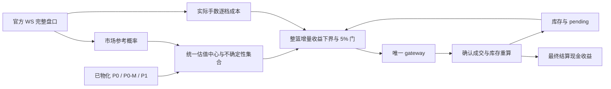

**概率 → 价格 → 可兑现 edge：完整优化方案**

熊先生，核心建议是：保留天气概率的独立性，把市场价格中的信息与实际买入成本分开；用 β 衡量模型相对市场的增量信息，用完整的条件期望与不确定性判断是否值得买，再用真实成交后的整篮现金流证明兑现。λ 留作历史比较与校准诊断，不能靠继续分档承担这整条链。

本次 Goal：完成可对照代码、公式、账本验证的设计方案，明确现有断点、正确口径、实施顺序和全域验收。交付范围为方案、只读审计和可复现反例；没有修改交易规则、激活参数、重启服务或提交订单。

证据基线：工作树 HEAD `b4b26c46fbd75846be04d4c1d1f64d5813b7164a`，2026-09-13 UTC 只读 SSOT 快照。源码默认不等于驻留进程实际配置；本次没有声称已核实线上进程的全部环境。合成反例用于证明公式性质，不是盈利回测。

**一、先统一六个量，避免把不同的 edge 写成同一列**

对一个站点、一个事件日、同一信息时点 t，令 b 为互斥结算桶，W 为候选窗：

| 量 | 唯一含义 | 使用边界 |
|---|---|---|
| `p_weather[b]` | 已物化 P0/P0-M/P1 给出的天气概率 | 不因买价、下注量或想买哪个窗而改变 |
| `m_market[b]` | 从完整、时间一致的官方 WS 盘口构造的市场参考概率 | 是待校准估计，不能把 ask 或最后成交价直接当成真概率 |
| `p_value[b]` | 在历史 OOS 上验证的、结合市场信息的交易估值中心 | 独立带 lineage；不回写天气阶段，不改变天气中心或 regime |
| `C(action)` | 动作在实际数量下的成本：逐档深度、费用、取整等 | 同一项费用只计一次，不能再从 all-in edge 重扣 |
| `E_L(action)` | 同一估值不确定性集合下的增量净收益下界 | 是行动价值，不能命名为一桶概率 |
| `PnL_settled` | 实际成交份额的最终兑付减实际净支出 | 只能由已确认成交、费用、允许的卖出回款和结算回执认定 |

理论声称：`p_weather(W) − c_ref(W)`。

信息优势：`p_value(W) − m_market(W)`。

确定成交时的净 edge：`p_value(W) − c_exec(W, n)`；n 变大，逐档成本可能吃掉 edge。

对每腿等份、命中窗口赔付 1 的一单位篮子，美元 edge 是 `p−c`，净 ROI 是 `(p−c)/c`；`p/c` 本身既不是净利润，也不是可靠性。三者不能同名。

对实际份额向量 Δn，统一为：

`ΔEV = Σ_b p_value[b] × Δn[b] − ΔC`。

这个式子覆盖新建仓、加仓与补齐。不等份篮子不能继续拿“窗命中率减一股窗价”代替它。已有成本是增量决策的沉没成本，但必须留在整链地板、总净成本和资本约束中。

**二、当前系统已经具备什么，实际断在哪里**

已具备：三阶段概率、官方 WS 证据、候选窗表、λ/β artifact、共用内核、整篮 Kelly、5% 经济门、持仓与订单原子账本。改造应沿这些接口进行，不建立第二套交易系统。

| 已核实问题 | 证据与影响 | 优先级 |
|---|---|---|
| β 拟合截距，服务却删掉截距 | `hit−c=α+β(p−c)`，实际服务 `c+β_lcb(p−c)`。合成例 p=.8、c=.6、β=.3、α=−.08：服务 edge=+.06，可过 5%；完整拟合 edge=−.02 | P0 |
| 成本同时充当市场信念 | 同一 p=.8、β=.3，仅成本 .6→.7，服务信念 .66→.73。费率/自身冲击提高竟能提高事件胜率 | P0 |
| β 下界不等于 edge 下界 | d=p−c=−.2、β 区间 [−.8,.4]，当前下界乘法得到 +.16；区间最坏收益却是 −.08 | P0 |
| 按窗改写概率，跨窗不一致 | 引导 λ 表下，二桶子窗 p=.4、c=.31 得有效概率 .348；包含它的三桶窗 p=.7、c=.34 得 .098。每个窗重新归一化仍可彼此矛盾 | P0 |
| λ 历史重拟合缺截止上界 | `fit_lambda_table(as_of=...)` 只把滚动下界传入 `_candidate_population`。内存反例截至 09-05 仍读入 09-12 的结算行 | P0 |
| β 的日期过滤不是完整 strict-as-of | 有 event_date 上界，但没有标签实际可知时间、revision 可知时间约束；`hit=NULL` 还会被 `hit or 0` 当成失败 | P0 |
| β 与 λ 样本合同不同 | β 没有 λ 的 band/shape 精确分区检查；锚读取失败会退为无下界。影子不应因此继承正式估值资格 | P0 |
| 当前 shape 迁移证据不闭合 | 快照中 λ 表无 `seat_shape_rule` 列，已激活 payload 同样无 shape；候选表却已有新旧 shape。加载器允许未记录 shape 的表继续匹配 | P0 |
| Maker 兑现与天气命中混为一谈的风险仍在 | 既有研究记录的实盘与模拟条件成交率方向不同。当前候选标签已独立计算，但执行收益仍须单独验证 | P1 |

代码定位：

- `bayes_basket_target/beta_edge_store.py`：population、OLS、bootstrap、persist/load。
- `bayes_basket_target/basket_kernel/delta_v2.py`：`beta_belief_v1`、λ 分发、`deflate_window_partition_v1`。
- `bayes_basket_target/delta_v2_runtime.py`：`_support_windows`、`_solve_over_support_windows` 和实际执行评估。
- `bayes_basket_target/effective_edge_store.py`：样本抽取、as-of、shape/schema 检查。
- `scripts/paper_trading_ledger.py::_score_candidate_windows`：窗标签独立于成交。

本次读到的最新激活 β artifact（均拟合于 2026-09-12 00:52:55Z，as-of 事件日 09-11）：

| 阶段 | 拟合记录行数 | 事件日数 | β_lcb | 状态 |
|---|---:|---:|---:|---|
| P0 | 0 | 0 | 0 | accumulating |
| P0-M | 16 | 1 | 0 | accumulating |
| P1 | 210 | 5 | 0 | accumulating |

这说明最后拟合时没有足够证据，并不等于 β 已被证明为零或为负，也不等于现在重拟合仍会得到同样样本数。本次没有运行激活或重拟合生产表。

3763 条已标注候选窗的 `hit` 全部等于“结算桶是否属于窗口”，缺失和不一致均为零。这个检查证明内部标签一致性，不证明天气 truth 来源已逐条复核，更不证明这些窗曾实际成交或按链上回执兑付。

**三、市场的错与模型的错：应该检验什么**

不能用一次结算判断一个 70% 概率“错了”。正确问题是：在事前可识别、没有泄漏的条件下，模型的分歧是否改善对结果的预测，并且改善幅度是否覆盖成交成本。

对二元窗口令 `Y=1{结算在W内}`、`d=p−m`：

`E[Y−m | d,z] = α(z) + β(z)·d`。

z 只包括决策前存在的信息：阶段、提前量、观测新鲜度、源 lineage、模型离散度、市场流动性及版本等。先少量预注册分层，再考虑复杂交互。

- α：即使模型与市场没有分歧，市场参考概率仍存在的条件偏差。使用 all-in c 时，截距还会吸收交易摩擦和选择效应，不能直接断言它纯粹是费用。
- β：控制基准和特征后，分歧的条件斜率。它是统计关系，不是模型正确的百分比，也不是因果归因。
- 残差：仍未解释的气象变化、模型偏差、盘口信息与随机性。

共同减同一价格会制造机械相关。反例：模型恒报 .7、真实命中率恒 .5，四种独立价格各配相同 0/1 结果，回归仍得 β=1、α=−.2。单看 β 会误读为“模型分歧全部兑现”，完整式子才保留模型高估的 .2。

有用的恒等式是：

`E[(p−m)(Y−m)] = E[(m−Y)²] − E[(p−Y)(m−Y)]`。

它说明分歧价值依赖市场误差以及两者误差的共同部分。写成 Var−Cov 需要相应中心化/均值条件；它也没有包含成本、YES 单边限制、选窗和动态下注，不能直接证明生产正收益。

检验至少设三个同信息时点基准：天气概率单独、市场参考概率单独、组合估值。用 proper score（多桶 Brier、log score、温度分布 CRPS）检验信念，再用成本后的整链收益检验策略。整体评分落后不能排除局部 edge；局部事后赢家也不能证明存在可用 edge。

**四、λ 的定位与 β 的正确实现**

λ 的经验读数是某个样本条件下 `ΣY/Σp`，它能描述模型声称的兑现比例。`λ>1` 不等于赚钱；买得太贵仍亏。`λ<1` 不等于无 edge；价格足够低仍可能有价值。

若 β 模型成立，对 p>0：

`λ_equiv = [m + α + β(p−m)] / p = β + (1−β)m/p + α/p`。

所以 λ 和 β 不能先后相乘；这通常是在重复校正同一批误差。λ 等价关系是逐观察条件公式，不能把一个分档均值当成所有桶共同的物理概率。

建议落地为两个研究候选，按同一历史协议比较：

1. **短期修复候选**：保留 `Y−c = α+β(p−c)` 作为直接净收益回归，完整保留截距，并对 `α+βd` 的联合 bootstrap 预测取下界。字段叫“条件净收益估计”，不叫概率。这条路用于诊断和迁移对照。
2. **长期主候选**：构建完整市场概率向量 m，估计统一 `p_value`。首个低自由度模型可用 `p_value=(1−β)m+βp_weather`、β∈[0,1]，逐阶段拟合；若市场基准有稳定偏差，先做有约束的市场校准，或在同一 simplex 模型中加入收缩的零和偏差项。不能把二元窗的任意截距逐桶相加。

β<0 的估计应先触发“模型分歧不可信”的诊断，不能因系数下界×负分歧变正就自动反向交易，更不能生成 BUY NO。β>1、非线性、逐站参数都是后续研究候选，须另有证据。

新方案中的 `p_value` 是交易估值 artifact，不是 P0-F、另一个 P1 或天气真值。它的 schema 与消费边界应在实施时显式立约；篮子只读取已物化对象，热路径不得临时拟合。

**五、一个信念应扩展为“一个估值中心、一个不确定性集合”**

同一站日、同一信息快照，所有候选共用一份完整 `p_value`，满足非负、总和 1、互斥穷尽、硬事实排除桶为零。任何 W 的概率都是对同一向量求和；不能因准备买 W 就重新给 W 外的结果分配概率。

但不存在“每个方向都更保守且仍总和为 1”的万能概率向量。正确的保守性放到动作上：

`E_L(action) = inf_{p∈P_t} [Σ_b p[b]·Δn_b(action) − ΔC(action)]`。

`P_t` 是同一估值 artifact 的置信/歧义集合，来自按事件日分块、保留参数联合相关性的历史估计。每个动作可有不同最坏分布，但这些分布必须来自同一个集合，审计时不能冒充另一份“真实信念”。

简单 β 区间下，d≥0 才使用 β 下端；d<0 的最坏值在上端。实际应 bootstrap 整个预测 `α+βd`，保留 α、β 的相关性、预测误差和模型选择不确定性，不能只取 β 的边际分位数。候选排名产生的 winner's curse 由外层历史留出评估整个策略处理。

选窗、Kelly、配额、补齐、最低手数抬升后的授权都读取同一 `valuation_evidence_id`。¼ Kelly 暂保留为既有规模上限；置信下界与分数 Kelly 职能不同，不能把二者随意调大当成盈利证据。

**六、市场参考概率怎么得到**

1. 读取官方 CLOB WS 的 YES bid/ask 与逐档深度，绑定 token、完整桶合同、quote version、接收时间和各 token 最大时间偏差。
2. 首个基准可为完整盘口的中价归一化 `m_b=mid_b/Σmid`，但必须记录归一化前总和、价差和流动性；这是估计，不是无风险公允价。缺桶、单边空盘、跨 token 时间不一致时，不能把剩余桶归一化成“全市场”。
3. 用历史同信息时点检验这个市场基准的校准误差。薄盘口和高 spread 进入市场信念的不确定性；不从未来报价补缺。
4. fees、自己的手数和撮合冲击全部在 C(action) 中。只改手续费而不改市场信息时，`p_weather` 和 `p_value` 必须逐字不变。
5. 若市场参考不可构建，该组合估值车道 fail closed。原生 p-only 是否能独立工作，只由其自身历史 exact activation 决定，不能隐式 fallback。

天气校准 truth 与现金兑付标签分别有唯一 lineage。canonical ASOS/AWC 是天气事实来源；市场实际结算规则、单位、边界和最终兑付回执是现金账的依据。两者无法一一映射的站日不得作为交易盈利训练样本。

**七、edge 最可能在哪里：只列待证伪假设**

| 候选来源 | 应出现的证据 | 怎么兑现 | 否定条件 |
|---|---|---|---|
| P1 官方新高/强观测后的市场反应延迟 | 新报文接收后、市场追价前，原有预测外仍有增量命中信息 | 在真实延迟预算内按 WS 深度执行纯 YES 合法动作 | 加上采集、排队和提交延迟后收益消失 |
| P0 多个独立原生集合提供市场未吸收的信息 | 相同 as-of 上，组合比校准市场基准更好，且分歧收益覆盖 spread | 在容量与 5% 门内建仓 | 仅高声称/廉价尾桶占优，历史留出后消失 |
| P0-M 的 TAF/物理确认有增量价值 | 在 P0 和市场信息之外改善历史预测及链收益 | 在已有阶段合同内有限调整 | 重复计算 P0 已有信息，或只有阶段迁移后选样收益 |
| 桶结构、流动性错价 | 与天气分歧分开仍有成本后收益 | 小容量、完整深度、已确认库存下交易 | 仅卖一可见、实际最小手吃掉全部优势 |
| 市场和模型误差不完全相同 | 组合在留出日比两者各自更好 | 按置信度缩小模型权重与注额 | 共误差占主导、组合校准没有增益 |

这些不是已发现盈利清单。P1 历史上的较高兑现率也不能当成无条件白名单。

观察硬事实可以排除不可能桶，却不能证明任意剩余 YES 值得买。选中支持集的 `sum(ask)<1` 也不能称为无风险套利：支持集外仍可结算，且多腿可能只成交一部分。无风险说法必须满足全状态穷尽、实际支付约束与全部成交等严格条件。

**八、从可信 edge 到可兑现 edge：把成交纳入随机变量**

令 N_b 为最终确认成交份额，Y 为最终结算桶，则一次尝试的现金流为：

`Π = Σ_b N_b·1{Y=b} − C(N) − 已单列且尚未计入的真实费用`。

一般 `E[N_b·1{Y=b}] ≠ E[N_b]·p_value[b]`。Maker 成交本身携带信息：别人愿意卖给我们，可能恰好意味着我们这一桶将输。因此不能用“成交率×无条件 edge”计算兑现。

单腿固定价的简式：

`EΠ = P(fill) × [P(Y=b | fill, 决策信息) − c_fill]`。

实际篮子必须对联合成交路径估计，不能默认各腿独立。离线可以按结局统计成交差异用于诊断；可执行模拟必须从事前信息/可验证路径建模，不能偷看最终结局决定某笔单是否成交。只有压力测试的事后条件化模型应单独标记，不能升为可执行 OOS 证据。

**示例，全部为假设数值：**天气 p=.80、市场 m=.50、β=.30 ⇒ p_value=.59。小手数 all-in c=.54 ⇒ edge=.05、净 ROI 9.26%；吃深度后 c=.58 ⇒ edge=.01、净 ROI 1.72%，不过现行 5%。若改挂 maker c=.51、成交率 .40，而成交条件命中率只有 .48，则每次尝试 EV=.40×(.48−.51)=−.012。名义价更便宜，仍可能更亏。

执行方案：

- 保留单一 gateway，报价在写锁外取得；plan 绑定 quote/inventory/order-state version，任一失效先重算。
- 沿既有执行族合同完成 maker/taker 授权一致性后再比较模式，不单独翻默认。逐腿 FOK 不代表整篮原子成交，必须计入先后腿失败的残缺风险。
- 最低手数、最小名义金额、tick 取整和深度完成后再算 E_L 与整链情景损益；不能把零/很小 Kelly 强抬成看似便宜的下注。
- 补齐从当前真实库存出发，同过增量门；pending 是可能负债，不是已兑现保护。成交后重算；撤单不明、迟到回报或未知成交进入 reconcile_required。
- 只有既有合同允许的角色卖出才能进入候选；不能用新增卖出策略修饰 edge，也不引入 NO。
- 成本收益存在的容量是 `n_max=max{n: 深度、E_L、预算、地板均成立}`。edge 百分比与可投金额必须同时报告，避免把一股机会当成整站机会。

**九、找到 edge 的历史实验协议**

先修复证据时间合同，再重跑，不能在有前视的读数上优化阈值。

一条训练/评估样本必须包含：station、事件本地日与 ET 统计日、阶段、桶合同版本、模型/概率版本、模型 run/arrival/receipt、决策可知时间、市场快照接收时间、truth 首次可知时间与修订时间、枚举规则、参数激活时间、来源与 evidence_role。

必须同时满足：特征在 decision 时可知，拟合标签在 fit cutoff 前已闭日且可知，参数在被评估 decision 前已发布/激活。只看 `event_date≤某天` 不够。修订 truth 需要双时间版本，不能让今天的更正替代过去当时能训练到的标签。

样本的独立单位至少按站日处理；同一天多个站受共同天气冲击，区间按事件日/相邻日块聚类，必要时加入地域块。多次 checkpoint、嵌套窗不能按行数冒充独立样本。为避免繁忙站日压过安静站日，训练权重先归一到站日/预注册 checkpoint，枚举数只影响覆盖，不自动增加权重。

β 当前 60 行、8 天只是拟合下限；10 天影子也只说明车道运行。晋升需置信区间足够窄、分层覆盖和成本后效果同时成立，不能把最低天数解释为统计证明。P1/TAF 等既有 exact 历史门槛照常满足。

四个固定比较臂：

| 臂 | 目的 |
|---|---|
| 当前 λ | 留下可复现基线；使用当时实际可用 artifact，不拿今天重拟合表覆盖过去 |
| 天气 p-only | 检验概率层本身 |
| 校准市场 m-only | 检验市场基准与交易摩擦 |
| 修正 β / 统一估值 | 检验增量信息和净收益是否超过前三者 |

训练/调参放内层历史时间窗，选臂只看外层滚动闭日历史留出。所有上游校准表同样必须按该折的训练截止重新构建或使用真实历史激活记录；对重建数据记录为历史反事实，不能称为原始实际决策。

分三轮检验，逐步接回真实系统：

1. 所有可判定候选窗的同手数信息检验：命中、proper score、每股净 edge；包括拒绝窗。没有报价、真值或 lineage 的样本计缺失，不记零收益。
2. 所有基准共用同一候选域、时点、深度、预算、初始库存的策略检验：h=5%、现行 131 窗形与 ¼ Kelly 固定，避免边换估值边换席位。
3. 真实订单生命周期与实际成交/结算对照：按整链、站日和资金聚合。共同链做配对比较，同时报告所有 eligible 站日上的策略收益，未交易的零现金收益与数据缺失分开；不能只报幸存共同链。

记录 Brier/log score、净收益/承诺资本、美元收益、日聚类下界、命中条件保护与全状态亏损、最大回撤、最差日、资金占用时长、容量、赢/输腿成交率、残缺链率和 unknown fill。

必须折返验证：留一站/地域、留一事件日、去掉贡献最大的若干链、参数扰动、报价延迟及深度恶化、费用变化、簿内 F/C 单位与 DST、零分歧、负分歧、缺桶、单边空盘、重复报文、重启/重复执行。去极值用来检查收益是否集中，不把“每个删减子集都显著盈利”设为不合理门槛。

未来/forward 继续登记为 `observational_candidate_not_oos`，用于时序、接口和执行观测，不计入正式 OOS、不顶替 20/8 或 TAF 样本门、不阻断 production_no_live。正式晋升只接受独立构建的闭日 strict-as-of 历史 artifact。

**十、概率层应同步优化的具体方向**

如果修正后 β 无增量信息，应回到概率形成过程，而不是加更多 edge 门。

- P0：保留已准入的五个官方原生全球集合成员产品，每个 station×lead×run exact scope 至少两个不同 independence family 的正权重系统。历史 OOS 分别检查均值偏差、离散度、尾部概率和成员相关性；高 σ/低 σ 的错误分开，不用一个乘子同时掩盖中心与宽度错误。
- P0-M：核验 TAF TX 校准、到达时点与物理确认是否在 P0 之外提供新信息；既有原子阶段合同内完成，不另造概率阶段或乘子链。
- P1：检查 canonical ASOS/AWC 当日最高温、剩余升温分布、站点当地时刻、报文修订和 truth contract；硬下界只排除数学不可能桶，不能把“已到某温度”变成“此桶必结算”。
- 单位和时区：桶概率按 registry 的实际 lower/upper 积分；温度误差统一换 °C 后比较，桶序数规则不换算；站点当地日/剩余时间与 ET 报表日分别记录。禁止用统一 UTC 正午代替 45 站事件时钟。

每项概率改动都必须先提高其历史校准和增量预测能力，再检验是否转为成本后的收益；不能因为回测赢钱就容忍 lineage 错误。

**十一、落地接口与单写者架构**

建议的唯一合同对象 `valuation_evidence`（名字为提案，落库前与现有 schema 对齐，避免重复事实）：

`valuation_id / probability_artifact_id / market_snapshot_id / inventory_version / stage / contract_sha / feature_available_at / fit_cutoff_at / activation_id / method_version / p_value / uncertainty_artifact_id / completeness / exclusion_reason`。

天气事实、盘口原始数据、成交回执只引用原 canonical id，不复制另一套 SSOT。新增证据的语义缺失即拒绝，不能将“没记录 shape”默认为当前 shape。代码和 schema readiness 必须共同检查。

链路：已物化天气概率 + 官方 WS 市场参考 → 已物化估值证据 → 现行候选域 → 实际数量/逐档成本 → 单一经济评估 → gateway → 实际 fill → SSOT 库存与利润曲线重算 → 最终结算与归因。

执行阻断原因仍唯一写 `auto_trade_decisions`。估值内部质量说明可以放 artifact，但不得再建立第二套执行拒绝账。

概率/价格/成交归因报告走独立只读 executor；历史拟合在内存/局部有界数据上完成，仅 artifact 和激活回执通过短写事务进入唯一写者。不得新增第四个生产驻留服务，不写 event_market_ticks；候选与动作只保留必要决策快照，不为报告采集连续行情历史。

维护任务不得连占生产槽，单槽超过约 300 秒必须拆分。硬限制覆盖 RSS、查询时间、单次输入、累计响应、临时输出和最低磁盘余量；探针不可用 fail closed。外置盘不成为证据、生产备份或切换依赖。

**十二、实施顺序和可验证终点**

| 阶段 | 要改的核心 | 通过条件 |
|---|---|---|
| A：证据合同修复 | λ 截止上界；β/λ 标签可知时间；NULL/NaN/不匹配拒绝；shape/版本激活与读取；缺锚不默许 | 在含未来标签、修订、旧 schema 的回绕测试中全部拒绝；历史 artifact 选择可复现 |
| B：估值研究候选 | 截距完整、价格信息/成本分离、联合下界、全桶一致向量 | 同一快照所有候选读同一向量；费用变动不改信念；负分歧不反转保守性；子集概率≤超集概率 |
| C：历史判别力 | 固定四臂、嵌套时间验证、同域同预算、45 站分层 | 合格覆盖内，净收益下界及模型增量评分达预注册标准；没有证据的 scope 明确 HOLD，不补默认值 |
| D：执行兑现 | 数量/最小手、联合成交路径、延迟、补齐和实际结算归因 | 账本与生产对同快照给同决定；逆选择方向、深度和整链风险受验证；unknown fill 零误认 |
| E：原子迁移 | 新估值与授权层同时接入；退休重复校正；明确 schema/代码/artifact 版本 | no-live 全域验收、既有服务控制合同通过；正式/live 仅据合格历史 OOS 和所需明确裁决 |

完整验收指 45 站逐站具有“可估值/有明确证据阻断”结果，不等于强迫 45 站全部交易。样本不足的 P0-M 或 P1 不能借其他阶段参数；允许的分层共享必须预注册并经过该 exact scope 的激活合同。

实施期间先保留 λ 作固定对照。通过迁移条件后删除同一路径上的旧乘子/重复估值分叉，历史工件保留原 lineage。席位形状、5% h、¼ Kelly 和执行模式在首次对照中固定；后续如要优化这些规则，应做独立实验和显式条款修订，不同时改变所有自由度。

本次用户要求的是完整方案，因此没有提前改宪章占号，也没有自动开启 β。特别是第 128 条的现有晋升条件只是原方案的最低门槛；本方案在落实时要把截距、联合不确定性、as-of 与成本后收益条件一并修订，不能以修 bug 为由偷偷改变策略授权。

**十三、edge 必须能沿账本解释每一美元**

每条实际尝试保留同一个 lineage 链，顺序解释：

`理论声称 → 历史校准/市场信息修正 → 不确定性折减 → 实际数量与逐档成本 → 提交延迟与成交条件选择 → 确认持仓 → 最终现金兑付`。

收益归因分别报告模型校准误差、市场参考误差、两者共误差、费用/冲击、错失成交、条件成交差异、残缺篮子、等待资金占用与结算偏差。各项反事实必须固定归因顺序或使用明确分解法，不能把互相重叠的损失项相加，也不能把事后归因叫成确定因果。

当系统说“这里有 edge”，它应能同时给出：**哪条决策前信息、哪份历史证据、哪份完整信念、哪档真实深度、能买多少、最坏合理收益、已成交多少、最终赚了多少**。其中任一项缺失，就明确停在哪一层，不能用较大的理论概率差补上空白。

本次验证：9 类可复现探针，其中包含 84 组正负分歧/区间/截距边界组合；另运行 β、λ、P1 scope、5% 经济门及 lineage 的 6 个现有测试文件，84 项全部通过。单元测试用于验证当前实现行为，不能替代上述历史和执行验收。

证据文件：`tmp/edge_realization_20260913/verify.py`、`evidence.json`、`test_result.json`。旧研究只作历史背景，不当成新 shape/new vintage 的当期盈利结论：`ADMISSION_EDGE_ROLLING_2026-09-11.md`、`LEDGER_RESTING_LIFECYCLE_V127_2026-09-11.md`。

**下一个主线任务：阶段 A——统一并修复 β/λ 的训练截止、标签可知时间和版本匹配合同，同时将本次截距、负分歧、价格变动与跨窗一致性反例转成正式回归验收；随后进入阶段 B 的估值候选。**
