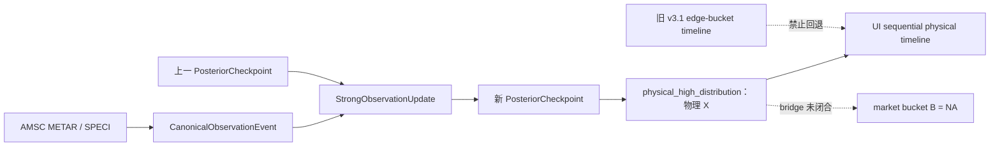

# 顺序 Bayes SSOT “34°C”显示异常诊断（2026-07-14）

> **历史诊断证据**：本文记录 v2 reported surface 切换前后的 2026-07-14 UI 故障，字段 `physical_high_distribution` 与 0.25℃格点均不是当前 v5 reported-X SSOT。当前定义以 ADR-0002、SSOT 合同和 Current Architecture 为准。

## 技术结论

当前生产物理最高温后验没有落在 34°C。2026-07-14 17:44（Asia/Shanghai）最后一条 AMSC SPECI 报告温度为 38°C；唯一顺序 Bayes SSOT 的物理最高温格点主峰为 37.5°C（59.48%），其次为 37.75°C（26.81%）和 38.0°C（10.44%）。界面曾出现的 `34°C or below` 来自旧 `event_fact_history` 市场边缘桶时间线被挂接到新物理 X 后验，属于 UI 语义串线，不是当前 Bayes 计算结果。

已修复为：当 `posterior_ssot_fact.schema=sequential_temperature_posterior_ssot_v2` 时，UI 只沿当前 checkpoint 链读取物理 X；不得回退到旧 v3.1 市场边缘桶时间线。市场 bridge 未闭合时，市场桶 B 继续明确为 NA，不得用 `or below/or higher` 标签伪装物理 X。

## 证据与定义

| 项目 | 当前证据 | 口径 |
|---|---:|---|
| 最新事实源 | AMSC SPECI | AMSC 为 primary，SPECI 可立即更新强似然 |
| 报告时刻 | 2026-07-14T09:41:00Z | 报文 valid time |
| 首次可行动时刻 T1 | 2026-07-14T09:44:04.149Z | 本机首次取得完整候选 payload |
| 报告温度 | 38.0°C | METAR/SPECI 整数温度观测 |
| 物理观测下界 | 37.5°C | 整数 38°C 对连续真温度的量化区间下界 |
| 物理 X 主峰 | 37.5°C / 59.48% | 精确 0.25°C 物理格点，不是市场边缘桶 |
| 无显著新高概率 | 99.556% | 同一强更新中的 termination-risk 边缘量 |
| 市场 B | NA | `x_to_s_to_b_bridge_unavailable` |

37.5°C 主峰与 38°C 报文并不矛盾：当前报告算子将整数 38°C 解释为连续真温度的量化观测，因而日最高温硬下界为 37.5°C。UI 必须明确显示“物理 X 格点”，不能把 37.5°C 或过去的 34°C 改写成市场累计桶。

## 根因与修复

### 34°C 来自展示层语义污染，不来自后验公式

旧时间线读取 `event_fact_history` 中的累计市场边缘桶，并携带 `target_bucket="34°C or below"`；新页面同时读取 `sequential_temperature_posterior_ssot_v2`，造成同屏两个口径。修复后的后端构造 `sequential_physical_temperature_timeline_v2`，字段固定为 `probability_semantics=physical_high_exact_grid`，并通过 active checkpoint lineage 读取每个时点的物理模式、观测、动量、云雨露点和 termination risk。前端只渲染该快照，不再复算或混用旧桶。

### 3 秒热路径被陈旧锁冻结

常规 METAR fast lane 原先只以“锁目录是否存在”判断互斥。进程异常退出后留下空目录，后续 :00/:30 报文全部被误判为“previous runner still active”；09:00 与 09:30 两条 METAR 一直积压到 09:44 SPECI 快速通道才排空，产生 2588.773 秒、810.384 秒与 5.809 秒的 T1→T3 失败。

锁合同已改为：锁目录必须记录 owner PID；PID 存活则互斥，PID 不存在/已退出且无 fast-lane 进程时，原锁被原子隔离并恢复。释放时只能由匹配 owner PID 的进程删除锁。异常退出不再永久冻结后续报文。

### 模型激活与运维补丁必须分层

原合同把采集脚本哈希放入不可变 Bayes 激活收据，导致锁修复被误判为概率模型换代。现固定两个边界：

- Bayes 激活合同：绑定 P0、先验/弱似然/强 LR artifact、公式与 composer schema；改变这些内容必须形成新概率纪元并重放。
- 运维部署证明：只允许 `operational_ingress_supervision_only`，绑定现有激活哈希、未变化的概率 runtime manifest 和新的采集退役收据；必须声明 `probability_semantics_changed=false`、`places_orders=false`、`authorizes_clob=false`。

因此，本次锁修复不旋转 P0，也不能借运维证明改变概率或获得下单权限。

## 方法与验证范围

本诊断使用 `data/archive.db` 只读查询、`/api/ui_snapshot_summary` 单一快照、生产 chain audit 与 fast-lane 日志。定向测试覆盖：新物理时间线不读取 legacy edge bucket、前端标签为物理 X、陈旧锁只在无活 owner 时恢复、SPECI 失败分支使用正确 ingress flag、运维证明不能改变概率语义或订单边界。

当前已验证 UI 语义与部署 readiness；历史 SLO 失败记录必须保留，不能因修复而删除。修复后第一条真实前向证据为 2026-07-14T10:00:00Z AMSC METAR：T1=`10:00:39Z`，T3=`10:00:40.306Z`，T1→T3=`1306ms`，低于 3000ms；锁在完成后正常释放，canonical、strong update、checkpoint 与 public SSOT 无积压。该结果证明本次锁恢复在单条真实 METAR 上通过，不等于已经形成长期 p95 样本。

## 限制与后续验收

- 37.5°C 是连续物理 X 的格点后验，不等于市场结算值 S，也不等于市场桶 B。
- termination risk 是同一强更新的边缘量，不是额外乘一次的独立似然。
- 全日历史窗口仍保留三条失败和一条通过；当前部署窗口从补丁证明的 `approved_at` 起独立评价，第一条真实 METAR 为 1306ms/通过。不得用当前窗口覆盖或删除历史事故。
- 后续公式审计确认旧 operational strong baseline 只沿 `X` 轴区分 likelihood：最新生产 checkpoint 的八类 latent state 均为 12.5%。第一版状态 scorer 虽能打破等权，却错误沿用 identity transition，36 条真实 canonical 全日重放在晚间仍给出 `warming=94.39%`，证明方向错误，已禁止切换。修正版 `operational_physical_state_aware_lr_v2` 增加事件条件化、row-normalized post-state transition；同一重放日末变为 `terminal_cooling=66.72%`、`temporary_cooling=22.03%`、`warming=0.48%`，且 transition 不改变同一 X 总质量。修正版已固化为新内容寻址、production-eligible 预校准 artifact；它只能通过 successor activation + successor P0 + canonical replay 的新概率纪元切换，旧状态中性/identity baseline 均不得 fallback。完成受管切换前，当前 activation 因 runtime identity drift 按设计 fail closed，不能将预览结果冒充生产证据。
- 当天 canonical 链确认首次显式 CB 为 17:00 的 `FEW033CB`，温度与截至当时观测日高均为 38°C；13:30 起的 `FEW033TCU` 不属于 CB。First-CB 已作为因果时序 feature 进入同一 Strong LR：对 38°C 已实现格点的专属 penalty 为 0，仅轻微约束更高的剩余升温候选，并通过同一 joint update 影响 latent termination 状态。UI 从 StrongObservationUpdate 的 feature/audit lineage 直接展示“首次 CB 17:00”，前端不复算。
- 下一主线验收是持续积累修复后真实 METAR/SPECI 的 T1→T3 分布，至少分别报告样本数、成功率、p50、p95 与最大值；单样本通过不应被宣称为长期 p95 达标。
