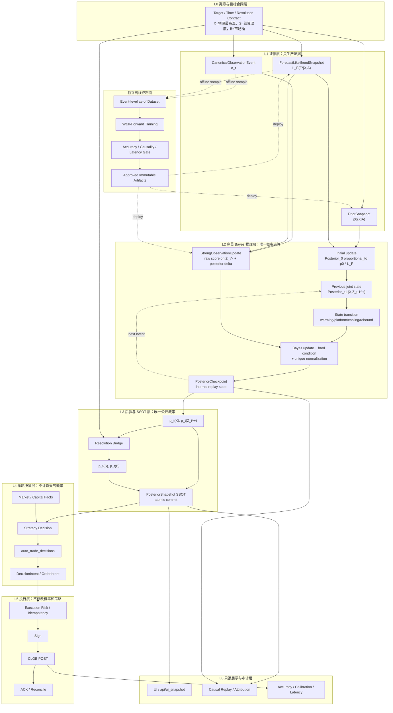
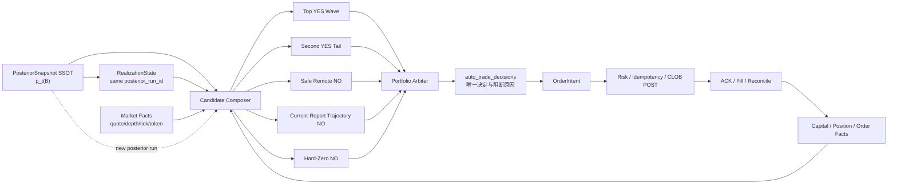
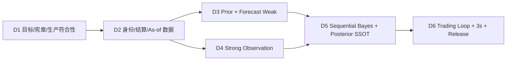
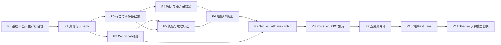

# 天气概率系统 v2 重构总方案

## 0. 文档治理

本文是天气概率系统重构的统一研究总文档。先验、弱似然及后续强观测、后验、温度轨迹、温度动量、执行层和 3 秒链路全部在本文持续追加，不再分别维护互相竞争的方案文档。

本文当前已经完成的是以下模块的 **目标定义与研究合同**，不表示对应 runtime、Schema、统计门或生产切换已经完成：

- 模块一：Temperature Prior；
- 模块二：Forecast Weak Evidence / Weak Likelihood；
- 模块三：强观测与报文实况的目标合同；
- 模块四：温度轨迹与温度动量边界；
- 模块五：唯一序贯 Bayes filter 与 posterior SSOT 合同；
- 模块六：四类策略、五条交易腿与完整交易闭环；
- 模块七：observation-to-order 3 秒目标链路；
- 七层生产架构与独立离线控制面；
- 重构开发计划、验收 Checklist 与全系统缺口总表。

后续将在同一文档继续完成模块八的 SSOT、UI、审计和发布治理，并逐项关闭第 29、30 节中的实施缺口。

本文是 `research/L2`，不是生产切换单。在 Accepted ADR、严格 OOS、release gate 和人工批准完成以前：

- 当前生产模型仍为 v3.1-only；
- 不改变 production posterior；
- 不改变参数、事实数据库、信号或订单；
- 不恢复旧模型 fallback；
- 主模型不可用时继续 fail closed；
- UI、决策和执行不得根据本文自行复算第二套概率。

文档权威已经拆分：

- 当前生产：`ADR-0001 + CURRENT_ARCHITECTURE`；
- 目标 shadow：`ADR-0002 + TARGET_ARCHITECTURE_V2`；
- 本文：研究依据、详细 Schema、对抗记录、开发路线和 Checklist；
- 实际部署：必须由 immutable runtime manifest 证明，不能以 `working-tree-*` 代替。

ADR-0002 只授权 shadow，不改变 v3.1 production。任何 production cutover 仍需另行 accepted cutover ADR。

原先验和弱似然研究稿保留为 superseded 历史快照，后续修改只进入本文。

## 1. 系统总目标与变量

### 1.1 三个严格目标变量

```text
X = 物理模型所描述的目标站点/仪器在 resolution local day 的真实最高温
S = resolution source 按版本化正式规则解析出的结算温度标量
B = 市场根据 S 和 bucket contract 最终结算的离散 outcome/bucket
```

物理预测模型回答：

```text
p(X | climate, forecasts, observations)
```

物理、结算和市场三层必须通过版本化 resolution bridge：

```text
p(S | evidence, C)
  = Integral[
      p(S | X, C)
      * p(X | evidence)
    dX]

p(B=b | evidence, C)
  = Sum_s[
      p(B=b | S=s, C)
      * p(S=s | evidence, C)
    ]
```

未建立 `X -> S -> B` bridge 前，只能声称物理最高温预测改善，不能声称 resolution 结算温度或 Polymarket 结算桶预测改善。

时间口径必须分开：

```text
operations_date_et      = 交易、统计、值班和资金报表的 ET 日口径
resolution_local_date   = 由 C 决定的物理/结算目标当地日
```

两者都必须显式进入 lineage，禁止用 ET 覆盖成都物理日界，也禁止由 runtime 根据城市名称猜测。

序贯更新使用以下附加变量：

```text
A      = prior owner 提供的日期、季节、气候、四川盆地和站点上下文
F*     = strict as-of 的全部预测源 canonical 快照
o_t    = 第 t 条 canonical AMSC/SPECI 观测事件
O_<t   = o_t 之前已经消费的 canonical 观测历史
M_t^LB = 截至 t 的已观测物理最高温确定性下界
Z_t^-  = 消费 o_t 之前的预测联合隐状态
Z_t^+  = 消费 o_t 之后、供下一事件使用的联合隐状态
C      = resolution/source/unit/day/rounding/bucket contract
```

### 1.2 模块角色

| 模块 | 输入信息 | 输出 | 不能做什么 |
|---|---|---|---|
| 先验 | 历史标签、日期、站点、静态地理 | 连续气候基础分布 | 读取当前预测、实况、市场 |
| 弱预测 | ECMWF/GFS/ICON/TAF/WU/TWC 等预测 | 联合预测弱似然 `L_F(F*|X,A)` | 形成硬下界、事实或独立后验 |
| 强观测 | canonical METAR/SPECI 等实况 | 新事件条件 log-LR、状态更新、硬下界候选 | 输出独立绝对后验或绕过 composer |
| 轨迹/动量 | canonical observation sequence | 一次派生物 | 成为独立买卖信号 |
| 后验 | 上一版 posterior、预测弱似然、新观测增量 LR | 唯一连续概率分布 | 线性混合、替换、多 composer 或 fallback |
| resolution bridge | 物理分布、结算规则 | 市场结算桶概率 | 使用市场价格反推天气 |
| 策略 | posterior SSOT、市场和资本事实 | DecisionIntent | 重算天气概率 |
| 执行 | 已持久化意图、CLOB 状态 | 订单和对账 | 改写 posterior |

### 1.3 系统不变量

1. 生产只有一个概率 composer。
2. 生产概率内部以连续温度域为 SSOT，桶概率只做最终积分。
3. 同一信息祖先只能消费一次。
4. 所有 live 输入必须满足 strict as-of。
5. 所有训练和评估必须按 event day 严格 walk-forward。
6. 评估必须区分物理真值 `X`、resolution 结算标量 `S` 和市场桶 `B`；任何代理域不得冒充另一层真值。
7. 预测源永远是预测，不能形成硬下界或最终锁。
8. canonical observation 可以形成已观测最高温硬下界，但不能伪装成预测命中。
9. 市场、成交、仓位和 P&L 不进入天气 posterior。
10. 生产 artifact 不可变；runtime 请求不能训练或改参数。
11. 缺失必须是 NA/blocked，不得用默认值掩盖决定性血缘缺失。
12. 主模型不可用时 fail closed，不回退旧模型。
13. 预测是弱似然；报文是强似然；两者都不能作为已经归一化的独立 posterior 再乘入。
14. 强观测必须修正上一版 posterior，不得用新的绝对分布线性替换前序信念。
15. 每个 canonical observation event 只能产生一次增量 LR。
16. 不使用外置 `beta_strong`，不使用强观测线性混合权重。

## 2. 统一目标架构

### 2.1 七层生产架构与独立离线控制面



### 2.2 层级定义、唯一输出与禁止事项

| 层级 | 唯一职责 | 唯一正式输出 | 严格禁止 |
|---|---|---|---|
| L0 宪章合同 | 定义目标、时间、站点、结算规则 | Target/Time/Resolution Contract | 计算概率、读取市场 |
| L1 证据 | 规范先验、预测和观测 | PriorSnapshot、ForecastLikelihoodSnapshot、CanonicalObservationEvent | 输出 posterior 或交易信号 |
| L2 Bayes 推理 | 执行状态转移和唯一概率更新 | joint posterior candidate、StrongObservationUpdate、checkpoint | 读取市场、决定交易 |
| L3 Posterior SSOT | 边缘化、resolution 映射、原子提交 | 唯一 PosteriorSnapshot | 重算证据、执行策略 |
| L4 策略 | 将 posterior 与市场/资本结合 | auto_trade_decisions、DecisionIntent | 读取 raw weather 重判天气 |
| L5 执行 | 风控、签名、POST、对账 | order/reconcile state | 修改 posterior、目标桶或策略理由 |
| L6 展示审计 | 只读展示、监控和回放 | UI snapshot、audit report | 写事实、复算生产概率 |
| Offline 控制面 | 训练、校准、批准 artifact | approved immutable artifact | 在线训练、修改当日参数 |

### 2.3 上位架构宪章

1. L1 只生产证据，不能生产后验。
2. L2 是唯一概率计算层，不能读取市场或决定交易。
3. L3 是唯一公开 posterior owner；checkpoint 只是 L2 内部状态。
4. L4 只能读取已提交 posterior SSOT，不得读取 raw weather 重判天气。
5. L5 只执行已持久化 intent，不修改概率和策略。
6. L6 全部只读，不形成第二口径。
7. Offline artifact 只有经 release gate 和批准后才能部署，runtime 不训练。
8. 上层只能向下提供正式输出，下层不得回写或绕过上层。
9. 市场、仓位、成交和 P&L 只进入 L4/L5，禁止进入 L1–L3 天气概率链。
10. 任一身份、证据、artifact、posterior 或事务不完整时 fail closed，无旧模型 fallback。

### 2.4 核心组件归属

| 组件 | 所属层 | 边界 |
|---|---|---|
| `source_observations` | L1 内部入口 | append-only 的首到达物理 source evidence；不是 canonical event，也不是完整 transport log |
| `CanonicalObservationEvent` | L1 | 唯一可触发 strong update 的观测事件 |
| `StrongObservationUpdate` | L2 | 输出增量 log-LR，不输出独立 posterior |
| `PosteriorCheckpoint` | L2 | 服务下一次更新和 replay，不对策略公开 |
| `event_fact_history/event_fact_latest` | L3 | posterior 历史和唯一 latest 指针 |
| `posterior_commit_outbox` | L3→L4 边界 | 只通知 posterior 已提交，不复制概率 |
| `auto_trade_decisions` | L4 | 唯一执行决定和阻断原因 |
| OrderIntent/CLOB service | L5 | 幂等提交与对账 |
| `/api/ui_snapshot` | L6 | 单一只读展示快照 |

预测弱似然与观测强似然都属于 Bayes 证据，但时序不同：预测先建立 `Posterior_0`，每条新报文随后产生一次条件增量 LR。基础权重、D0 来源可信状态、轨迹和物理证据都只能在同一 likelihood/filter 内消费一次。

# 模块一：Temperature Prior

## 3. 当前实现

当前 `temperature_prior_runtime.py`：

- 默认读取 730 天历史；
- 使用目标 DOY ±15 天季节窗口；
- 默认 `min_samples=3`；
- 同时构造桶计数先验与 0.1°C 网格 KDE；
- KDE bandwidth 使用稳健 Silverman 规则，限制在 0.45–2.25°C；
- 支持 `weather_type`、terrain、site、urbanization 条件；
- 支持人工 site/terrain/UHI 温度 bias；
- 历史标签来自 `event_daily_temps` 和 `event_runs`；
- 构造过程只读，不读取市场价格。

2026-07-12 active fact 快照：

| 字段 | 当前值 |
|---|---:|
| 宽历史样本 | 391 |
| DOY ±15 日样本 | 39 |
| 宽历史 bandwidth | 2.089°C |
| 季节 bandwidth | 0.898°C |
| `date_window_weight` | 1.0 |
| `min_samples` | 3 |
| 当前人工 bias | 0°C |

当前 v3.1 all-day 模型可用时：

```text
observation_weight = 1
forecast_climate_weight = 0
```

所以当前先验被物化和展示，但不改变最终 production posterior。

## 4. 先验正式定义

物理气候先验：

```text
p0_X(x)
  = p(X=x |
      station,
      local_date,
      static_geography,
      training_cutoff)
```

结算标量与市场桶先验：

```text
p0_S(s)
  = Integral[
      p(S=s | X=x, C)
      * p0_X(x)
    dx]

p0_B(b)
  = Sum_s[
      p(B=b | S=s, C)
      * p0_S(s)
    ]
```

生产可消费的结算/市场先验必须绑定 resolution contract。`p0_X` 不能直接冒充 `p0_S` 或市场桶概率 `p0_B`。

先验是在不读取当前事件预测、实况、市场和交易信息的前提下，仅依据严格 as-of 历史标签、目标日期、站点和静态地理条件形成的连续基础分布。

## 5. 先验宪章

1. 先验在连续温度域定义，桶概率只能从连续密度积分。
2. 每条训练标签必须声明 `label_domain`。
3. `physical_proxy` 只能训练 `p0_X`，不能直接训练 `p0_S/p0_B`。
4. 市场先验必须绑定 `resolution_contract_id` 和 label bridge identity。
5. 先验不得读取当前 GFS/JMA/ECMWF/ICON、TAF、WU/TWC forecast。
6. 先验不得读取 METAR/SPECI/AMSC/AWC、轨迹或动量。
7. 先验不得读取市场价格、订单、仓位和 P&L。
8. 盆地只表达静态地理归属；当天冷池、通风和边界层状态不属于先验。
9. 所有历史标签必须满足 `available_at < training_cutoff`。
10. 同一事件日只能选择一个权威标签。
11. prior snapshot 在事件首次生成后冻结。
12. 小样本条件层必须连续收缩到父层。
13. artifact 必须不可变、可重放并绑定 manifest、cutoff、代码和参数哈希。
14. 同一气候祖先只能消费一次。

## 6. 先验边界

### 6.1 允许输入

| 输入 | 条件 |
|---|---|
| 历史 resolution settlement | resolution identity、available-at 完整 |
| 历史物理站点最高温 | 标记 `physical_proxy` |
| 目标本地日、循环 DOY | 静态日期信息 |
| 站点、海拔、经纬度 | 绑定 resolution contract |
| 静态盆地/地形 | 只做 grouping，不手工加温 |
| 长期趋势和历史城市化 | 只使用冻结 artifact 学习结果 |
| resolution 单位、舍入、日界 | 版本化 bridge |

### 6.2 禁止输入

| 输入 | 正确归属 |
|---|---|
| 当前模型、TAF、WU/TWC forecast | 弱预测 |
| METAR/SPECI/AMSC/AWC | 强观测 |
| 轨迹和动量 | observation/joint composer |
| 当天通风、冷池、云雨、湿度 | 预测或观测 |
| 模型近期表现 | source calibration |
| 市场、成交、仓位 | 策略/执行 |

成都单站长期盆地效应已经隐含在 ZUUU 历史分布中。再增加“成都盆地加温”会重复计算。当天盆地状态只能进入 forecast/observation。

## 7. 先验当前问题

### P0：标签域没有闭合

当前历史表先后顺序可能决定标签，而不是 resolution authority。缺少正式 `X -> S -> B` bridge，物理站点标签可能被当成结算标量或市场桶目标。

### P0：两个先验构造路径

当前既有桶计数先验，又有连续 KDE。当前数值接近不代表长期一致，生产必须只保留连续 SSOT。

### P1：条件来源边界模糊

`weather_type` 可从当前 payload 进入 prior，无法证明它是静态条件。若来自当天预测或实况，会污染先验。

### P1：小样本满权跃迁

`min_samples=3` 后条件层可能突然达到满权，缺少连续 ESS shrinkage。

### P1：硬季节窗口

DOY ±15 日和边界权重是人工离散规则，不应成为最终季节模型。

### P1：人工温度偏置

site/terrain/UHI bias 缺少 resolution 标签 OOS 证据，不能作为生产手工加减温度。

## 8. 先验目标方案

### 8.1 标签 authority

```text
resolution_settlement
  > resolution_replay
  > physical_proxy_same_station
  > physical_proxy_reference_station
```

不同 authority 不得在同一目标域直接混合。physical proxy 必须经过 label bridge。

### 8.2 单一连续先验

建议 schema：

```text
temperature_prior_continuous_v2
```

至少包含：

```text
artifact_sha256
training_manifest_sha256
training_cutoff
label_domain
resolution_contract_id
station_id
target_date_local
continuous_grid_c
density_or_mass
normalization
effective_sample_size
season_model
trend_model
parent_shrinkage
lineage
```

桶先验必须由同一 continuous object 按 resolution bucket contract 积分。

### 8.3 季节与小样本

- 使用循环 DOY basis 或周期核，不使用月份和 ±15 日硬边界；
- 条件层按 ESS 连续收缩到 station/global parent；
- 任何静态 geography 增量必须由多站点 OOS 识别；
- 不再保留人工温度加减项。

### 8.4 先验实施顺序

1. 建立 resolution label bridge 和 authority schema。
2. 固化 prior snapshot cutoff 与不可变 artifact。
3. 统一为 continuous prior SSOT。
4. 替换硬季节窗口和 `min_samples=3` 跃迁。
5. 进行 event-day rolling OOS。
6. 在 v3.2 中作为唯一 climate context/offset 消费一次。

## 9. 先验完成门槛

- 标签 authority、available-at 和 label domain 完整；
- resolution bridge 可重放；
- continuous prior 与桶积分完全一致；
- snapshot 对后续预测/实况更新保持不变；
- 小样本连续收缩；
- event-day OOS 的 NLL/RPS/CRPS 和 calibration 通过；
- 同一 climate ancestor 在 v3.2 lineage 仅出现一次；
- current v3.1 在切换前保持不变。

# 模块二：Forecast Weak Evidence / Weak Likelihood

## 10. 当前实现

当前弱层把预测源按固定文本规则分组：

| group | 当前来源 | sigma | confidence | cap | shrinkage |
|---|---|---:|---:|---:|---:|
| model | ECMWF/GFS/ICON/Meteoblue | 1.15°C | 0.70 | 1.25 | 1.00 |
| TAF | TAF | 0.90°C | 0.80 | 1.50 | 0.01 |
| WU | WU | 1.05°C | 0.55 | 0.70 | 1.25 |
| TWC | Weather.com/TWC | 1.05°C | 0.55 | 0.70 | 1.25 |
| other | 其他预测 | 1.30°C | 0.40 | 0.45 | 1.50 |

单源点温度转换为 Normal 桶分布：

```text
q_s(bucket) = NormalBucket(forecast_peak_c, sigma_s)
precision_s = confidence_s / sigma_s^2
```

组内：

```text
q_g = precision-weighted arithmetic mixture
capped_precision_g = min(Sum precision_s, cap_g)
q_g_shrunk = alpha_g*q_g + (1-alpha_g)*uniform
```

组间正常使用 geometric pool；模型与 TAF 分歧时在 geometric pool 和 scenario mixture 之间插值。

当前后验 composer 又根据 group mean、effective sigma 和 capped precision 重建另一张连续 Gaussian mixture。于是系统实际存在：

1. 桶级 geometric/conflict weak map；
2. composer 连续 arithmetic Gaussian mixture。

两张分布不是同一概率对象。

当前 v3.1 all-day 可用时 observation gate 为 1，因此整个弱层不改变最终 production posterior。

## 11. 弱预测正式定义与宪章

所有 ECMWF、GFS、ICON、TAF、WU、TWC 都是预测源，统一归属弱预测信息。官方 TAF 仍是预测，不是事实。

每个来源输出：

```text
q_s(X | causal forecast revision, calibration artifact)
```

`q_s` 是来源自身的最高温预测分布，通常已经隐含一份气候基准率，不能直接与 prior 相乘。弱层必须把预测转换为对真实最高温候选的弱似然或 likelihood ratio：

```text
L_s(F_s | X=x,A,c)
  = p(forecast_error_s = F_s-x | season,weather,lead_time,artifact)

或

LR_s(x)
  proportional_to q_s(x | F_s,A) / p0_X(x | A)
```

因此预测当然是 Bayes 证据，但正式生产接口必须是 `L_s/LR_s`，不是把 `q_s` 当成第二张 prior/posterior。

弱预测宪章：

1. 预测源不能创建硬温度下界、最终锁或 settlement fact。
2. 每个 revision 必须具有 immutable identity 和 causal time lineage。
3. 生产只允许 `as_of_eligible_at <= decision_as_of`。
4. 不允许用本机 fetched-at 替代上游 available-at。
5. 同一信息祖先每个 cutoff 只消费一个 canonical revision。
6. 同 provider family 先去重，再分配 family 内份额。
7. 缺档是 NA，不是错误预测。
8. 来源数量和刷新频率不能提高总信息预算或训练样本权重。
9. 来源技能必须按 resolution 标签和 event day OOS 学习。
10. 当前请求不得训练、改权重或更新 artifact。
11. 当日动态仲裁只能影响当前事件，不能写回长期能力。
12. 同一预测祖先只能进入唯一 composer 一次。
13. 多来源相关性必须由联合误差模型、copula、stacking 或受约束 density-ratio 模型处理，禁止假设来源独立后全部相乘。
14. 单源 `q_s`、联合弱似然 `L_F` 和最终 posterior 必须具有不同 schema 和角色字段。

## 12. ForecastRevision 与 canonicalization

最小身份：

```text
forecast_revision_id
information_ancestor_id
source_id
provider_family
target_station_id
target_event_date_local
target_variable
unit
issued_at
provider_available_at
as_of_eligible_at
valid_start
valid_end
run_id
raw_sha256
parser_version
```

Canonicalization：

1. 排除 future、时间身份不完整和目标不匹配 revision；
2. 同一 revision/transport mirror 去重；
3. 同一信息祖先选择 cutoff 前最新可见 revision；
4. 同 provider family 先做成员选择或 family mixture；
5. 冲突 revision 整体标记，不把多个版本当独立证据；
6. 输出顺序无关、重复无关的 snapshot hash。

当前明确 family：

```text
WU forecast + Weather.com/TWC forecast -> twc_provider
```

TAF identity 至少是：

```text
station + issue_time + valid_window + raw_sha256 + parser_version
```

每个 cutoff 只消费最新可见且覆盖目标的 TAF revision。

## 13. 弱预测当前问题

### P0：预测分布被当作 likelihood

旧路径：

```text
p_pre(X) proportional_to p0_X(X) * q_weak(X)^beta_weak
```

预测分布通常已经隐含气候基准率，直接乘 prior 存在 base-rate 双计。

### P0：TAF revision 重复

当前同一 TAF 34°C 和 36°C 同时进入 group，既改变均值又提高 raw precision。

### P0：WU/TWC 同 family 双计

baseline 按接口组聚合，不按 provider family 去重。

### P0：causal time fail-open

event date、valid time 或 fetched time 缺失仍可能进入；没有使用已有 `provider_available_at/as_of_eligible_at`；还允许未来 60 秒宽容。

### P0：两张弱分布

桶级 conflict map 与 composer 连续 mixture 分叉，scenario conflict 结果通常不被 composer 直接消费。

### P1：固定参数

ECMWF/GFS/ICON 使用相同默认能力，TAF shrinkage 近乎不收缩。参数没有按 season、lead、weather regime 和 settlement skill 学习。

### P1：三模型先压成一个 group

三模型内部的分歧和多峰在与 TAF 比较前已经被均值与 effective sigma 压缩。

### P1：缺失被表示为 uniform

无来源时返回 uniform，容易把“无数据”误读为“均匀预测证据”。

## 14. 历史基础能力权重

每个来源/家庭先单独校准：

```text
q_s(X | forecast_curve,
        lead_time,
        season,
        forecast_regime,
        calibration_artifact)
```

同时建立相同条件下的预测误差密度：

```text
L_s(F_s | X,A,c)
  = ErrorDensity_s(F_s-X | c,artifact)
```

基础权重：

```text
w_base_s(c)
  = softmax_s h_phi(
      source_family,
      cyclic_day_of_year,
      lead_time,
      forecast_weather_regime,
      forecast_disagreement,
      source_availability)
```

基础权重只使用 forecast cutoff 时已知信息：

- 连续季节；
- 连续 lead time；
- 预测云雨、风、日较差和峰值时刻；
- 来源间分歧；
- 来源 availability。

不能使用事后实况定义基础天气型。模型使用 hierarchical shrinkage，避免 season×weather×lead 硬切分造成小样本过拟合。

评分：

- 主指标：NLL、RPS、CRPS、calibration；
- 辅助：MAE、bias、Top-1；
- 聚合单位：event day；
- 验证：strict walk-forward 和 event-day cluster bootstrap。

建议 artifact：

```text
forecast_source_base_skill_artifact_v2
```

runtime 只读 approved artifact，不得在线更新。

基础权重只参数化联合预测 likelihood 的来源贡献、相关性收缩和 missingness，不直接充当可与 posterior 相乘的概率。正式联合弱似然是：

```text
L_F(F* | X,A)
  = p(F_ECMWF,F_GFS,F_ICON,F_TAF,F_WU,F_TWC | X,A)
```

它可以由联合误差模型或条件 density-ratio 模型实现，但禁止使用：

```text
Product_s q_s(X)
Product_s L_s(X)  # 未处理相关性时
p0_X(X) * q_weak(X)
```

## 15. D0 预测轨迹动态仲裁

D0 允许使用 cutoff 前 canonical 报文实况，对当前事件的来源可信状态进行因果软更新。但这不再是弱层独立生成一张 `dynamic_weak_distribution`；它属于强观测条件 likelihood 内部的 `forecast × observation` 交互。

职责边界：

```text
weak layer:
  F* + historical base skill -> L_F(F* | X,A)

strong sequential update:
  new o_t + O_<t + F* + A
  -> score o_t using pre-event state Z_t^- / W_t^-
  -> update posterior and post-event state Z_t^+ / W_t^+
```

匹配特征：

```text
level_residual
slope_residual_30m_1h_3h
acceleration_residual
peak_refresh_error
phase_lag
curve_shape_distance
cloud_rain_timing_match
comparable_point_count
comparable_window_hours
```

动态权重：

```text
g_s(t) = h_theta_s(trajectory_match_features_s(0:t))

w_dynamic_s(t+)
  = softmax_s(
      log(max(epsilon, w_base_s))
      + lambda_s*g_s(t)
    )
```

约束：

- `h_theta/lambda` 必须由原始时序回放 OOS 学习；
- 只使用当前 cutoff 前已获取观测；
- 软更新，不做 winner-take-all；
- floor、cap、最大单次变化和恢复速度必须 OOS 验证；
- family 总信息预算前后守恒；
- 当前 `o_t` 只能生成 `W_t^+` 供后续事件使用；不得先用 `o_t` 提高来源权重，再以提高后的权重为同一 `o_t` 评分；
- 无可比轨迹时 multiplier 中性，不判失败；
- 单个异常报文不能把来源权重置零；
- 当前 dynamic weight 不写回 base artifact；
- 相同 observation/forecast snapshot 只能消费一次。

`w_dynamic_s(t-)` 是 `Z_t^-` 内供当前事件使用的来源可信状态，不是新的外置概率权重：

```text
L_O(o_t | X,Z_t^-,O_<t,F*,A)
```

由 `o_t` 计算得到的 `w_dynamic_s(t+)` 只能写入 `Z_t^+` 并供后续事件使用。当前报文的 forecast residual 可以作为 raw observation model 的联合输入，但不能通过“先更新权重、再评分自己”的反馈环二次放大。

禁止：

```text
L_F_dynamic(X | F*,O_0:t)
  * separate_L_O(X | O_0:t)
```

因为这会让同一报文同时修正预测权重并再次作为强似然相乘。

轨迹可比性：

- ECMWF/GFS/ICON：逐小时温度、斜率、峰值时刻和天气要素；
- WU/TWC：仅 `trajectory_eligible=true` 的逐小时产品按不可变快照比较，并先做 family 去重；`daily_max_event_window` 只参与最高温标量弱似然，不进入轨迹比较；
- TAF：只比较明确 TX、有效时段、趋势和天气组，不能伪造逐小时曲线。

## 16. 模型—TAF 双峰审查与多场景方案

当前设计在严重分歧时使用算术 scenario mixture，避免 geometric pool 产生人工中点，这个意图正确：

```text
q_scenario = w_model*q_model + w_taf*q_taf
```

但当前实现不能作为正确生产算法：

1. conflict 后的桶分布通常不被 composer 直接消费；
2. TAF 重复 revision 会平均均值、扩大 sigma 并掩盖分歧；
3. 三模型先被压成一个 group，内部多峰丢失；
4. model 与 TAF shrinkage 极不对称；
5. 1/2 sigma、JS 0.25/0.75 阈值未历史拟合；
6. scenario mixture 只保证保留场景，不保证一定形成两个局部峰值。

v2 不保留专门“模型 vs TAF 双峰”特判。所有来源先作为独立 forecast expert 形成可审计预测面：

```text
q_forecast_trace(X | F*)
  = Sum_s w_base_s
          * q_s(X | F_s)
```

该预测面用于多峰解释、单源校准和构造联合预测 likelihood，不直接与 prior 相乘。来源一致时自然单峰；分成两组时自然双峰；分成多组时允许多峰。峰数是连续预测面的结果，不由状态机决定。

多峰只用于解释 trace，不形成额外 likelihood、beta 或策略信号。

### 16.1 正式退役决定

`forecast_model_taf_conflict_v1` 及其“模型 vs TAF 双峰特判”被列为明确退役机制。它不属于 v2/v3.2 目标架构，不得与历史基础能力权重、D0 实况轨迹软仲裁同时作为生产概率调整规则。

退役原因：

1. forecast disagreement 已进入 `w_base` 的上下文，旧特判再次按差异调整会重复消费；
2. D0 已通过轨迹兑现更新 `w_dynamic(t)`，旧特判可能重新抬回已被降权场景；
3. 旧特判只给 TAF 特殊地位，违反所有预测源统一 expert 的边界；
4. 旧特判使用固定阈值和不对称 shrinkage，破坏来源权重的历史能力解释；
5. 旧 conflict map 与 composer 连续 mixture 分叉，不能形成唯一概率 SSOT。

退役状态：

```text
current v3.1 period: code/output/UI dependency removed; only immutable historical payloads may retain legacy fields
v2/v3.2 shadow: forbidden as probability input
future production switch: no compatibility fallback may restore it
historical facts: preserve as immutable legacy fields, no backfill rewrite
```

### 16.2 退役代码与字段清单

| 类别 | 明确退役项 | 目标处理 |
|---|---|---|
| 常量 | `MODEL_TAF_CONFLICT_START_SIGMA` | 删除 |
| 常量 | `MODEL_TAF_CONFLICT_FULL_SIGMA` | 删除 |
| 常量 | `MODEL_TAF_JS_FALLBACK_START` | 删除 |
| 常量 | `MODEL_TAF_JS_FALLBACK_FULL` | 删除 |
| 函数 | `_model_taf_conflict_pool` | 删除，不保留 production fallback |
| schema | `forecast_model_taf_conflict_v1` | 停止生成新事实 |
| 字段 | `conflict_mixture_coefficient` | 删除 |
| 字段 | `coefficient_source` | 删除 |
| 字段 | `model_taf_normalized_distance` | 不再驱动概率；需要时转为普通 disagreement diagnostic |
| 字段 | `model_taf_js_divergence` | 不再驱动概率；需要时转为普通 disagreement diagnostic |
| 字段 | `scenario_mixture_distribution` | 删除 |
| 字段 | `scenario_pool_distribution` | 删除 |
| 字段 | `scenario_mixture_decision` | 删除 |
| 字段 | `model_taf_conflict_consumed_once` | 删除 |
| 字段 | `model_taf_conflict_does_not_change_beta` | 删除 |
| pipeline | `forecast_model_taf_conflict` | 停止传递和落新事实 |
| quality | `model_taf_conflict_consumed_in_distribution_shape` | 删除 |
| quality | `model_taf_conflict_not_reused_as_beta_penalty` | 删除 |
| UI | model-vs-TAF conflict state/coefficient 面板 | 替换为全来源多峰只读解释 |

主要涉及当前文件：

```text
forecast_weak_likelihood_runtime.py
hierarchical_posterior_pipeline_runtime.py
weather_fact_snapshot_writer.py
ui_server.py / current UI consumers
tests/test_forecast_weak_likelihood_runtime.py
tests/test_hierarchical_posterior_pipeline_runtime.py
tests/test_weather_fact_snapshot_writer.py
tests/test_ui_server_runtime.py
```

该删除清单已落实到新 runtime、事实 writer 和 UI compact projection：新事实只输出 `forecast_group_precision_pool_v1` 的对称 group pool，历史 payload 保持不可变但不再被新 reader 投影为概率贡献。`scripts/retired_model_taf_conflict_audit.py` 会扫描四个新事实生产锚点；旧常量、函数、概率字段或 UI 投影任一回流即 fail。不存在兼容概率分叉。

### 16.3 替代机制

旧特判由三个职责清晰的对象替代：

1. `source_expert_continuous_mixture_v1`：按经 source-family cap 与相关性折扣后的权重合成连续预测面，并经 information temper 后作为唯一弱似然；它保留预测分歧的多峰结构，不能再被对数池化压成中间单峰；
2. `joint_forecast_weak_likelihood_v1`：根据联合误差/相关性模型输出正式 `L_F(F*|X,A)`；
3. `forecast_multimodality_trace_v1`：在只读连续预测面上识别模式，不修改 likelihood 或 posterior。

多峰 trace 建议字段：

```text
continuous_distribution_sha256
mode_count
modes[]:
  temperature_c
  local_mass
  supporting_source_families[]
  source_weight_share
valley_depth_between_modes
multimodality_state
diagnostic_only = true
changes_probability = false
changes_source_weights = false
creates_strategy_signal = false
```

多峰 trace 必须从已经归一化的只读 continuous forecast surface 派生，不能反向调整 `w_base`、`Z_t^-/Z_t^+` 中的当日来源可信状态、`L_F`、raw score/posterior delta、posterior 或交易策略。

### 16.4 退役验收门

- v3.2 production 路径不再调用 `_model_taf_conflict_pool`；
- 新事实不再生成 `forecast_model_taf_conflict_v1` 和 `scenario_mixture_decision`；
- 历史事实原样可读，不执行 payload 回填；
- ECMWF/GFS/ICON/TAF/WU/TWC 都作为独立 source/family expert 进入 canonical forecast snapshot；
- 相同 `w_base` 与 source distributions 只能产生一张只读 continuous forecast surface；
- 生产概率只消费正式联合 `L_F`，不消费诊断 forecast surface 的 bucket map；
- 新测试验证自然单峰/双峰/多峰、输入顺序不变性和 family 去重；
- 新测试验证 multimodality trace 不改变任何概率或 source weight；
- 仓库生产代码中旧常量、函数和概率字段引用归零；仅允许 migration reader/历史展示显式读取 legacy 字段；
- UI 不再把 model-vs-TAF coefficient 展示为 production probability contribution。
- `python3 scripts/retired_model_taf_conflict_audit.py` 必须通过。

## 17. 唯一目标 Shadow Bayes 数学合同

### 17.1 完整链式公式

固定目标公式（晋级前仅用于 shadow/replay，不宣称已替换 current production）：

```text
p_t(X | A,F*,O_1:t)
  proportional_to
    p0_X(X | A)
    * L_F(F* | X,A)
    * Product_i=1..t L_O(o_i | X,O_<i,F*,A)
    * I[X >= M_t^LB]
```

其中：

- `p0_X` 是唯一先验；
- `L_F` 是处理来源相关性后的联合预测弱似然；
- `L_O` 是每条 canonical 报文的条件强似然；
- `I[X >= M_t^LB]` 是确定性 support condition；
- 每个 `o_i` 只能出现一次。

这条公式来自严格 chain rule：

```text
p(F*,O_1:t | X,A)
  = p(F* | X,A)
    * Product_i p(o_i | X,O_<i,F*,A)
```

因此预测是似然，报文也是似然；差别在于预测先建立 D0 初始信念，报文随后逐事件修正。

### 17.2 初始 posterior

```text
Posterior_0(X,Z_0^+)
  = Normalize[
      p0_X(X | A)
      * L_F(F* | X,A)
      * p(Z_0^+ | X,A,F*)
    ]
```

`Z_t^- / Z_t^+` 是同一 D0 联合状态在事件前后的两个明确时点：

```text
physical regime:
  warming / slowing / platform / temporary_cooling /
  rebound / weather_suppressed / terminal_cooling

path memory:
  recent slopes / acceleration / drop depth /
  cooling duration / time since observed max

source reliability state:
  current-event reliability of each forecast family
```

### 17.3 状态预测

每条新报文到达前：

```text
Posterior_t_minus(X,Z_t^-)
  = Sum_Z_t-1^+[
      p(Z_t^- | Z_t-1^+,X,F*,A,delta_t)
      * Posterior_t-1(X,Z_t-1^+)
    ]
```

状态转移同时允许升温、平台、降温和反弹，不能把“降温”错误编码为负的最终最高温增量。

`Z_t^-` 是本条 `o_t` 的唯一评分状态。当前观测形成的 trajectory innovation、source-reliability 更新和物理阶段更新只能进入 `Z_t^+`，不得回灌本条 likelihood。

### 17.4 增量 strong log-LR

观测模型先输出未按上一版 posterior 归一化的原始分数：

```text
raw_log_score_t(X,Z_t^-)
  = log p(o_t | X,Z_t^-,O_<t,F*,A)
```

composer 对指定的 `previous_posterior_run_id/hash` 计算 predictive normalizer：

```text
normalizer_offset_t
  = log Sum_X,Z_t^-[
      Posterior_t_minus(X,Z_t^-)
      * exp(raw_log_score_t(X,Z_t^-))
    ]

posterior_delta_t(X,Z_t^-)
  = raw_log_score_t(X,Z_t^-)
    - normalizer_offset_t
```

随后完成当前事件更新和 post-event state transition：

```text
log Posterior_t_pre_state_update(X,Z_t^-)
  = log Posterior_t_minus(X,Z_t^-)
    + posterior_delta_t(X,Z_t^-)
    + log I[X >= M_t^LB]
    - log hard_condition_normalizer_t

Posterior_t(X,Z_t^+)
  = Sum_Z_t^-[
      p(Z_t^+ | Z_t^-,X,o_t,F*,A)
      * Posterior_t_pre_state_update(X,Z_t^-)
    ]
```

语义：

```text
raw score constant across X,Z_t^-  -> 对 X 的中性新信息
posterior_delta = 0                 -> canonical-centered 中性增量
exp(posterior_delta) > 1            -> 相对支持该候选
exp(posterior_delta) < 1            -> 相对反对该候选
```

`raw_log_score` 属于观测模型；`normalizer_offset/posterior_delta` 属于 composer，并与指定 previous posterior 绑定。训练、校准和跨事件比较不得把 posterior-dependent delta 冒充可独立复用的纯 observation likelihood。

### 17.5 物理最高温、结算标量和市场桶

```text
p_t(X)
  = Sum_Z_t^+ Posterior_t(X,Z_t^+)

p_t(S)
  = Integral[
      p(S | X,C)
      * p_t(X)
    dX]

p_t(B=b)
  = Sum_s[
      p(B=b | S=s,C)
      * p_t(S=s)
    ]
```

`p_t(X)`、`p_t(S)` 与 `p_t(B)` 必须属于同一 `posterior_run_id` 和 `resolution_contract_id`。交易只消费 `p_t(B)`；物理状态、trajectory heads 和 source-reliability trace 不得直接交易。

最终训练/结算标签也必须保持同一条严格桥：`resolution_final_label_v1` 只接受 raw-object-backed 的最终物理 `X` 与 resolution-source 最终 `S`，验证 `S` 落在冻结 `p(S|X,C)` kernel 的正支持上，再由同一 bucket contract 唯一导出 `B`。旧 `settlement_actual` 标量、城市名、实时 METAR、NCEI 代理或市场价格都不能反向补造这条标签。标签的 `resolution_label_sha256` 一经写入 append-only shadow registry 不得改写；同 contract identity 的任何 label 或 contract 漂移必须拒绝。

### 17.6 明确禁止的旧公式

```text
p0_X(X) * q_weak(X)^beta_weak

(1-alpha_t) * pre_observation(X)
  + alpha_t * absolute_strong_distribution(X)

dynamic_weak_distribution(X | O_0:t)
  * separate_strong_distribution(X | O_0:t)

Product_s q_s(X)
```

不再保留外置 `beta_weak` 作为来源权重，不再保留 `beta_strong`，不再把 v3.1 绝对剩余升温分布当作增量 strong likelihood。

## 18. Weak Evidence schemas

### 18.1 ForecastEvidenceSnapshot

```text
forecast_weak_evidence_snapshot_v2
```

核心字段：

```text
snapshot_id
snapshot_sha256
decision_as_of
target identity
resolution_contract_id
canonical_revisions[]
provider_families[]
source_predictive_distributions[]
forecast_trajectories_by_source
forecast_context_features
missingness
conflicts
excluded_revisions[]
artifact_identity
lineage
na_reasons[]
```

该 snapshot 只包含预测，不包含报文事实。

### 18.2 D0 arbitration trace

```text
d0_forecast_trajectory_arbitration_v1
```

包含：

```text
decision_as_of
canonical_observation_snapshot_id
forecast_evidence_snapshot_id
base_skill_artifact_sha256
trajectory_match_features_by_source
base_family_weights
dynamic_family_weights
family_weight_deltas
coverage_state_by_source
neutral_reasons_by_source
total_information_budget_before_after
consumed_by_posterior_run_id
```

它由 strong observation update 在计算 `raw_log_score_t` 和 `Z_t^+` 时产生，是 `forecast × observation` 交互的解释 trace，不是弱层独立分布、独立 likelihood 或独立 posterior。

## 19. 弱预测完成门槛

- strict as-of、target alignment、revision 和 family dedupe 自动化；
- TAF 只消费 latest-visible revision；
- WU/TWC mirror 注入不改变 family evidence；
- source input 重排、重复投递不改变 snapshot；
- 单源概率校准和 base skill artifact 通过 OOS；
- prior-only、prior+joint-weak、sequential-strong、full filter 逐层消融通过；
- D0 gating 只存在于条件 strong likelihood，不使用未来实况、不写回 base artifact；
- family 总信息预算守恒；
- 所有来源缺失时输出 NA/blocked，不伪造 uniform；
- `q_s`、`L_F`、`raw_log_score`、`posterior_delta` 和 posterior schema 角色不可混淆；
- 联合预测 likelihood 与桶积分来自同一连续概率对象；
- 同一 observation 注入 weak/strong 任一重复路径时测试必须失败；
- 旧 model-TAF conflict map 和 composer 二次重建生产路径删除；
- v3.2 切换前 current v3.1 保持不变。

# 后续模块统一目录

## 20. 模块三：强观测与报文实况

状态：目标定义、Bayes 角色、事实边界和迁移方向已完成。

### 20.1 正式定义

强观测是由 canonical 报文事件驱动的序贯 Bayes 更新层。它利用新报文温度及云、雨、露点、能见度、风、气压等物理证据，结合截至当前的温度轨迹和路径记忆，持续修正：

- 当前处于升温、减速、平台、暂时降温、反弹还是终局降温；
- 各预测源在当前目标日的轨迹兑现程度和可信状态；
- 未来双向温度路径；
- 最终物理最高温 `X` 的概率分布。

强观测不是一张静态概率表，也不是独立 posterior。每条新事件的模型输出与 composer 输出必须分开：

```text
model output:     raw_log_score_t(X,Z_t^-)
composer output: normalizer_offset_t + posterior_delta_t(X,Z_t^-)
```

唯一 Bayes filter 将 posterior delta 应用一次，随后形成 `Z_t^+` 并提交新的 posterior SSOT。

### 20.2 唯一实时事实源

在 D0 实时物理观测域：

```text
canonical METAR/SPECI sequence
= 唯一实时事实源
```

来源选择固定为：

1. AMSC 整点报文是主要候选；
2. AMSC 半点报文是主要候选；
3. AWC 整点报文只做确认、AMSC 缺失补位和冲突诊断；
4. SPECI 是事件型补充报文，满足身份和因果门后进入 canonical sequence；
5. AMSC/AWC 对同一物理报文只形成一个 canonical event；
6. AWC 与已消费 AMSC 完全一致时只写 confirmation，不创建 StrongObservationUpdate 或 posterior run；counterfactual 审计要求 `posterior_delta=0`；
7. AMSC/AWC 冲突时不得平均；无法依据 COR、valid-time、raw identity 和版本关系判定时 fail closed。

WU/TWC current、网页当前温度和 PWS 只能诊断，不进入 production strong likelihood。最终结算域的事实 authority 仍是 resolution settlement；METAR/SPECI 不取代最终标签 authority。

### 20.2.1 P2 strict primary 读取与回放边界

离线 P2 回放只能由 `strict_amsc_hard_observation_reader_v1` 从既有 `source_observations` 读取 primary AMSC。每条可交给 canonicalizer 的报文必须同时闭合：表列与 `observation_json`、raw object 内容/hash、signed poll manifest、source/station、`METAR|SPECI` 身份、valid-time、`first_seen_at` 与 raw manifest object entry。读取器明确设置：

```text
first_transport_seen_at = immutable raw first_seen_at
first_actionable_seen_at = immutable raw first_seen_at
```

AWC、legacy fact-projection adapter、当前 poll 的 `fetched_at/response_completed_at` 都不得重建、替换或推迟 T1。原始 `as_of_eligible_at` 与 immutable first-seen 不一致的历史行只能独立 quarantine；不得用当前时间补写历史、更不能阻塞其它独立合格 AMSC 报文。raw archive metadata 被附着到重抓报文时，`as_of_eligible_at` 必须同步复用该 immutable first-seen，防止同一物理报文在新 poll 被伪造为新可行动到达。

`p2_canonical_amsc_staging_probe.py` 在 read-only archive + SQLite memory 下证明“strict primary source → CanonicalObservationEvent → exact retry idempotency”；它不授权 production P1 写入、posterior、fact、decision 或 order。实时入口仍只能走 P10 AMSC resident envelope/journal，不能拿此离线读取器替代 watcher。

### 20.3 CanonicalObservationEvent

每条事件至少具备：

```text
canonical_observation_event_id
station_id
target_event_identity
report_type: METAR | SPECI
valid_time
provider_available_at
first_seen_at
response_completed_at
source_id
source_role: primary | reference | substitute
revision/COR identity
raw_report
raw_sha256
parser_version
quality_flags[]
supersedes_event_id
confirmation_of_event_id
```

以下任一情况不得产生 strong update 或 hard floor：

- station 或目标日不匹配；
- valid-time、first-seen 或 raw identity 缺失；
- future、cutoff 后首次可见或无法证明 as-of；
- 重复 transport/retry；
- 冲突未解决；
- 解析温度和原报文无法互证。

METAR 整数温度必须按量化区间处理，不得假设为无误差连续真值。`M_t^LB` 由解析器、量化合同和 resolution contract 一致确定。

### 20.4 强似然输入

事实输入：

```text
temperature interval
dewpoint interval
wind direction/speed/gust/variability
visibility
cloud layers/cover/ceiling
current weather and precipitation
convection tokens
pressure/QNH
explicit missingness
```

从 canonical sequence 唯一派生：

```text
current temperature interval
observed maximum lower bound
time since observed maximum
30m/1h/2h/3h robust slope
acceleration
consecutive rise/flat/fall count
drop depth and duration
rebound depth and speed
temperature-dewpoint spread and trend
cloud/rain/wind/pressure transition features
report gaps and quantization uncertainty
```

只读条件上下文：

```text
A: season/climate/basin/solar-window context id
F*: canonical forecast distributions and trajectories
Posterior_t-1 identity
approved model artifact identity
```

`A` 出现在条件项中不等于重复加入先验；`F*` 用于计算观测创新量和来源兑现交互，不得再生成一张独立 D0 weak distribution。

禁止输入：

- 市场价格、盘口、仓位和 P&L；
- WU/TWC current；
- 人工指定的 platform/cutoff；
- 旧 strong map、phase map 和 `beta_strong`；
- future report 或事后天气型；
- 同一物理报文的 AMSC/AWC 两份副本。

### 20.4.1 已固定的事件时序与运行时合同

对同一 canonical event `o_t`，强似然只能消费下列一次性的联合输入：

```text
StrongObservationInput_t
  = { o_t 的温度/露点/云雨/风压等事实,
      Trajectory(O_<t),
      W_t^- 的来源可靠度,
      forecast_evidence_snapshot_id,
      prior_context_id }

raw_log_score_t = ApprovedFeatureEvaluator(StrongObservationInput_t, X, Z_t^-)
Posterior_t      = Composer(HardMask(o_t), Posterior_t-1, raw_log_score_t)
Checkpoint_t     = { Posterior_t, Trajectory(O_<=t), Z_t^+ }
```

这同时保证“报文实况修正先验与预测”与“不把同一温度重复乘两次”：当前报文本身是 `o_t`，而轨迹输入严格止于上一条 canonical event。第一条报文没有历史时，`no_prior_observation` 是显式缺失状态，绝不伪造动量。当前 `o_t` 被纳入 post-event trajectory 仅发生在 composer 已完成之后，供下一条报文使用。

运行时 artifact 必须采用 `strong_observation_incremental_lr_artifact_v3`：除基础 raw score 与 latent transition 外，必须含 `strong_observation_feature_evaluator_v2`，覆盖当前温度、当地时刻、pre-event 路径、当前步升降温速度、60/120 分钟背景动量、加速度、含当前值的已观测峰值、回落深度/持续时间、每个候选 X 的剩余升温、露点差、云况、天气现象及 selected-source 的 pre-state。每个实际 bin/category 均须有按 `(X,Z_t^-)` 定义的 raw-log-score 面；未知或缺失值必须显式映射，缺面直接 fail closed。artifact 必须绑定训练 manifest、OOS evaluation 和 feature-ablation manifest；composer 不拥有也不得学习这些权重。旧 v2 因无法表达当前报文形成的新动量、降温持续性和候选温度可达性而退役。

当前 v2 source-reliability post-state head 尚无可训练的 strict-OOS 数据，故 `W_t^+` 暂时严格等于 `W_t^-`；prepared cycle 或 caller 提供不同 after state 会在 Transaction B 前拒绝。未来只有显式受训、批准且带 OOS 证据的 post-state proposal 才能替换这条 no-op guard，绝不可由配置字典或 D0 单次报文直接改写 base skill。

下列旧实现已退役，不能作为 v2 strong likelihood 或 compatibility fallback：

- `strong_observation_incremental_lr_artifact_v1` 的静态温度/状态 score map；
- caller/prewarm 注入的 event-specific trajectory；
- 将 `o_t` 写入 trajectory 后再把该 trajectory 与 `o_t` 同次评分；
- 缺失物理/轨迹输入时静默回退为 static score。

### 20.5 双向物理过程

定义：

```text
T_t       = 当前温度区间
DeltaT_h  = T_t+h - T_t，可正、可零、可负
M_t       = 截至当前的已观测最高温
R_t       = max(0, X-M_t)，不能为负
```

强观测必须同时建模：

```text
P(DeltaT_h > 0)   warming
P(DeltaT_h ~= 0)  platform
P(DeltaT_h < 0)   cooling
cooling depth/duration
rebound probability/magnitude
probability of new high after rebound
P(R_t = 0)
P(R_t > 0) and positive remaining distribution
```

“降温”描述未来温度路径，不代表已经发生的日最高温下降。最终最高温始终是：

```text
X = max(M_t, future temperature path maximum)
```

### 20.6 物理状态

`Z_t^- / Z_t^+` 的物理状态空间至少包括：

```text
warming
slowing_warming
temporary_platform
temporary_cooling
cooling_then_rebound
weather_suppressed
terminal_cooling
final_locked
```

单个 `RA/CB/TCU/TSRA`、单次整数温降或“当前温度接近滚动最高温”都不能独立确认终局。终局降温必须由时间阶段、持续温度响应、云雨、露点、风压及反弹缺失联合支持。

### 20.7 StrongObservationUpdate 输出合同

```text
strong_observation_update_v3
```

核心字段：

```text
update_id
previous_posterior_run_id
previous_posterior_sha256
canonical_observation_event_id
observation_sequence_checkpoint_id
forecast_evidence_snapshot_id
prior_context_id
model_artifact_sha256
decision_as_of
raw_log_score_by_temperature_and_pre_state
normalizer_offset
posterior_delta_by_temperature_and_pre_state
pre_state_transition
post_state_transition
state_before_after_trace
source_reliability_state_before_after
temperature_path_auxiliary_heads
observed_max_lower_bound_c
hard_condition_trace
quality/freshness/missingness
consumed_ancestor_ids[]
na_reasons[]
```

观测模型只拥有 `raw_log_score` 与 post-state transition proposal；composer 绑定 previous posterior 后拥有 `normalizer_offset/posterior_delta`。数值更新只应用一次 `posterior_delta`，状态、路径和来源可信变化不得再次独立相乘。

### 20.8 强观测宪章

1. 强观测是更新算子，不是独立 posterior。
2. 每条 canonical event 对指定 previous posterior 只产生一次 posterior delta。
3. `L_O` 必须条件化于 `O_<t`、`F*` 和 `A`。
4. D0 source arbitration 只存在于 strong likelihood 的 forecast-observation interaction。
5. base source skill 不因当日实况写回。
6. 轨迹和动量是 observation sequence 派生特征，不是第二份事实。
7. 云雨露点等必须联合建模，不能单 token 决策。
8. 无信息更新必须满足 raw score 对所有候选为同一常数，canonical-centered `posterior_delta=0`。
9. 外置 `beta_strong`、phase alpha 和 absolute strong map 全部退役。
10. hard condition 不由模型学习，不受 tempering。
11. duplicate/confirmation 不更新概率。
12. COR 修订撤销旧事件并从检查点重放。
13. 乱序事件重放结果必须与 valid-time 顺序一致。
14. 模型、证据、posterior 或血缘缺失时 fail closed。
15. 强观测不能直接触发交易；只能提交 posterior SSOT。
16. 当前 `o_t` 使用 `Z_t^- / W_t^-` 评分；由该事件产生的 `Z_t^+ / W_t^+` 只供后续事件使用。

### 20.9 当前实现与目标公式差异

当前 v3.1 路径是：

```text
PreObservation
  proportional_to p0_X * ForecastLikelihood^beta_weak

Q_v31(X | A,F,O_0:t)
  = absolute zero-inflated remaining-warming predictive distribution

Posterior_current
  = (1-alpha_t)*PreObservation + alpha_t*Q_v31
```

全天 v3.1 ready 时 `alpha_t=1`，生产 posterior 实际由 `Q_v31` 接管。它不是：

```text
Posterior_t-1 * incremental_L_O(o_t)
```

当前已有正确基础：

- AMSC primary、AWC reference；
- v3.1 zero-inflated remaining-warming head；
- 温度、露点、云雨、风压和部分路径特征；
- continuous grid、observed-max hard condition、bucket integral；
- v3.1-only fail closed 和 posterior SSOT。

当前关键差距：

1. v3.1 输出绝对分布，不输出 event-level raw log score、post-state proposal 或绑定 previous posterior 的 posterior delta；
2. previous posterior 不参与下一次数学更新；
3. 全日 ready 时独立 prior/weak pre-observation 被替换；
4. 当前模型只显式使用凌晨 GFS+JMA、其余 GFS，没有全来源 D0 可信状态；
5. sequential physical-state transition/emission 仍为手工参数，且不直接决定 v3.1 remaining mass；
6. 输出只覆盖剩余升温，没有完整双向未来路径；
7. AMSC 的 SPECI source 接入已完成，但尚未经 P1 生产持久化、forward shadow 与常驻 watcher 验收；
8. observation freshness/missing-valid-time 没有完整 fail-closed 门；
9. 当前 active strong contract 审计 2/2 blocked；
10. NCEI 小时训练标签尚未闭合到 resolution settlement；
11. AMSC 热链仍有 35 秒 release delay、同步模型刷新和通用 task queue。

### 20.10 迁移原则

- 保留 v3.1 特征资产、零膨胀 head、连续网格、hard condition 和 SSOT；
- current v3.1 在新模型批准前仍是唯一生产模型；
- 建立 report-event 粒度 strict as-of 数据集；
- 训练 `raw_log_score_t(X,Z_t^-)` 与 post-state proposal，由固定 composer 产生 centered posterior delta；以最高温/结算桶为主任务，以双向路径为辅助任务；
- shadow challenger 不写 production posterior、不交易；
- 新模型同时通过准确率、校准、因果和 3 秒门后原子切换；
- 切换时删除旧绝对 strong map/线性混合生产路径，不保留 fallback。

### 20.11 持久化拓扑：复用现有 SSOT

当前 `archive.db` 已有：

```text
source_observations
event_fact_history
event_fact_latest
auto_trade_decisions
task_queue
```

目标设计不得复制第二套 raw observation 或 posterior latest：

```text
source_observations
  = 不可变 transport/source observation 入口

canonical_observation_events
  = 跨 AMSC/AWC 的唯一物理事件和 revision 状态

strong_observation_updates
  = 每条 canonical event 的增量 LR 审计记录

posterior_checkpoints
  = Bayes filter 内部可重放状态

event_fact_history / event_fact_latest
  = 对 UI、策略和执行公开的 posterior SSOT 日志/指针
```

`station_observations` 不承担新的 strong likelihood SSOT；`task_queue` 不进入 3 秒 observation hot path。

### 20.12 CanonicalObservationEvent 数据合同

建议新增 append-only 表：

```text
canonical_observation_events
```

逻辑字段：

```text
canonical_observation_event_id TEXT PRIMARY KEY
canonical_observation_key      TEXT NOT NULL
target_identity                TEXT NOT NULL
station_id                     TEXT NOT NULL
report_type                    TEXT NOT NULL  # METAR | SPECI
valid_time                     TEXT NOT NULL
revision_no                    INTEGER NOT NULL
normalized_physical_sha256     TEXT NOT NULL
selected_source_observation_id TEXT NOT NULL
selected_source_id             TEXT NOT NULL
selection_role                 TEXT NOT NULL  # primary | substitute
selection_policy_version       TEXT NOT NULL
first_transport_seen_at        TEXT NOT NULL
first_actionable_seen_at       TEXT NOT NULL
accepted_at                    TEXT NOT NULL
state                          TEXT NOT NULL
supersedes_event_id            TEXT
conflict_group_id              TEXT
parsed_observation_json        TEXT NOT NULL
quality_flags_json             TEXT NOT NULL
created_at                     TEXT NOT NULL
```

关键约束：

```text
UNIQUE(canonical_observation_key, revision_no)
UNIQUE(canonical_observation_key, normalized_physical_sha256)
```

定义：

```text
canonical_observation_key
  = Hash(target_identity,station_id,report_type,valid_time)

canonical_observation_event_id
  = Hash(canonical_observation_key,revision_no,normalized_physical_sha256)
```

不同传输格式的 AMSC/AWC 报文必须先规范化为物理字段和标准 token，再计算 `normalized_physical_sha256`，不能直接用 transport raw hash 判断物理相同。

来源关联使用单独 append-only 表：

```text
canonical_observation_event_sources

canonical_observation_event_id
source_observation_id
source_event_id
source_id
relation: selected | confirmation | substitute | conflicting | superseded
seen_at
raw_sha256
PRIMARY KEY(canonical_observation_event_id,source_observation_id)
```

状态机：

```text
candidate
-> accepted_primary | accepted_substitute
-> confirmed | superseded | conflict_blocked
```

规则：

1. AMSC 整点/半点合格事件到达即 `accepted_primary`；
2. AWC 同物理内容只增加 `confirmation` relation，不创建新概率事件；
3. AWC 只有在版本化 missing/substitution policy 成立时成为 `accepted_substitute`；
4. 后到的相同 AMSC 对已接受 AWC substitute 只确认，不重复更新；
5. 内容不同且无 COR/版本依据时进入 `conflict_blocked`；
6. `first_actionable_seen_at` 是训练 cutoff 和 3 秒链路起点，不能用更早但当时不可执行的 reference arrival 回填；
7. raw `source_event_id/source_observation_id` 继续由现有 lineage contract 生成，不得被 canonical id 替代。

需要在 lineage identity 中新增目标前缀，但不得复用现有含义：

```text
canonical_observation_event_id -> canobs_*
strong_observation_update_id   -> stupd_*
posterior_checkpoint_id        -> pchk_*
realization_state_id           -> rstate_*
training_sample_id             -> trsample_*
```

### 20.13 StrongObservationUpdate 接口合同

纯计算接口建议为：

```text
build_strong_observation_update(
  previous_checkpoint,
  canonical_observation_event,
  forecast_evidence_snapshot,
  prior_context,
  approved_lr_artifact,
  decision_as_of,
  deadline_at
) -> StrongObservationUpdate
```

runtime 本身只读，不写数据库、不下单。建议持久化：

```text
strong_observation_updates
```

逻辑字段：

```text
strong_observation_update_id TEXT PRIMARY KEY
target_identity              TEXT NOT NULL
previous_posterior_run_id    TEXT NOT NULL
previous_posterior_sha256    TEXT NOT NULL
previous_checkpoint_id       TEXT NOT NULL
canonical_observation_event_id TEXT NOT NULL
forecast_evidence_snapshot_id  TEXT NOT NULL
prior_context_id             TEXT NOT NULL
model_artifact_sha256        TEXT NOT NULL
decision_as_of               TEXT NOT NULL
state                        TEXT NOT NULL  # applied | neutral | blocked
raw_log_score_json           TEXT NOT NULL
raw_log_score_sha256         TEXT NOT NULL
normalizer_offset            REAL NOT NULL
posterior_delta_json         TEXT NOT NULL
posterior_delta_sha256       TEXT NOT NULL
pre_state_transition_json    TEXT NOT NULL
post_state_transition_json   TEXT NOT NULL
source_reliability_before_json TEXT NOT NULL
source_reliability_after_json  TEXT NOT NULL
path_auxiliary_json          TEXT NOT NULL
observed_max_lower_bound_c   REAL
quality_json                 TEXT NOT NULL
block_reasons_json           TEXT NOT NULL
started_at                   TEXT NOT NULL
completed_at                 TEXT NOT NULL
created_at                   TEXT NOT NULL
```

幂等唯一键：

```text
UNIQUE(
  previous_posterior_run_id,
  previous_posterior_sha256,
  canonical_observation_event_id,
  forecast_evidence_snapshot_id,
  model_artifact_sha256
)
```

原始观测 score 在数学上只确定到与温度无关的比例常数。composer 必须针对绑定的 previous posterior 计算并持久化 canonical center：

```text
Sum_X,Z[
  Posterior_t_minus(X,Z_t^-)
  * exp(posterior_delta_t(X,Z_t^-))
] = 1
```

这样中性事件稳定表示为全零 `posterior_delta`。`raw_log_score_sha256` 用于模型输出审计，`posterior_delta_sha256` 只在相同 previous posterior/grid 下可比较；不得把后者作为独立 likelihood 训练样本。composer 必须验证：

```text
finite values
same temperature/state grid identity
normalization invariant
hard-floor compatibility
deadline not exceeded
previous posterior hash match
```

失败时输出 `state=blocked`，不得伪造 neutral update。confirmation relation 正常情况下不调用该接口；若防御性适配器收到 confirmation-only 输入，只能返回未持久化的 `state=neutral`，不得创建 strong update 或 posterior run。

## 21. 模块四：温度轨迹与温度动量

状态：目标边界已完成；具体特征参数必须由 OOS 学习确定。

### 21.1 唯一 owner

温度轨迹只能由 canonical observation sequence 构造：

```text
Trajectory_t = DeterministicFeatureEngine(O_1:t)
```

任何 UI、策略、弱预测层和执行层不得重算第二套轨迹。轨迹只进入 `StrongObservationUpdate`，不单独形成 likelihood 或交易信号。

### 21.2 核心特征

```text
robust slope: 30m/1h/2h/3h
acceleration and slope change
time since last new high
drop from observed max
cooling duration and reports below max
rebound depth/rate
recent-vs-background momentum divergence
temperature/dewpoint/cloud/rain/wind/pressure transitions
quantization interval and report-gap uncertainty
solar-heating-window remaining
```

窗口和阈值不得由展示需要或单日经验设定，必须在 event-day walk-forward 中学习和消融。

### 21.3 platform 与 cooling

`platform` 必须同时要求：

- 多个 distinct valid-time；
- 稳健斜率接近零；
- 达到最短持续时间；
- 无稳定正动量；
- 整数量化不确定性不足以解释状态；
- 所处日内阶段支持平台判断。

已退役“显式 trajectory state 无条件优先返回”：在 active v3.1 `temperature_trajectory_summary_v1` 中，legacy `platform` 只有在没有连续多窗口正动量时才保留。若至少两个确认窗口为正、stable rate `>=0.35°C/h` 且没有任一确认窗口非正，则必须输出 `sustained_warming`，并写入 `state_selection_reason=continuous_positive_momentum_overrides_explicit_platform`；单个短窗口正值仍不足以推翻 platform。`31->32->33->34` 和等价的多窗口连续升温不得被 platform 规则截断。

cooling 至少区分：

```text
single-step quantization noise
temporary pullback
weather-suppressed cooling
cooling then rebound
terminal cooling
```

### 21.4 辅助路径输出

同一强观测模型可以联合训练：

```text
P(DeltaT_30m)
P(DeltaT_1h)
P(DeltaT_2h)
state-transition probabilities
cooling depth/duration
rebound probability/magnitude
new-high-after-rebound probability
```

这些 auxiliary heads 用于改善 `raw_log_score_t(X,Z_t^-)`、post-state proposal 和解释性，不进入独立 posterior，不直接下单。

### 21.5 完成门槛

- duplicate/reordered observation 不改变 trajectory；
- interval-aware slope 处理整数 METAR；
- 单次下降不确认 terminal cooling；
- 单 token 云雨不确认 cutoff；
- sustained warming 不被 platform 覆盖；
- cooling/rebound/terminal 状态均有 OOS 支持；
- trajectory 消融能证明对最高温 NLL/RPS/MAE 的真实贡献。

## 22. 模块五：后验与唯一 composer

状态：唯一序贯 Bayes filter、hard condition、resolution bridge 和 SSOT 的目标定义已完成；P1 私有 shadow 表的四记录原子提交已有 source 实现与故障注入测试。完整 public SSOT Transaction B、生产 Schema 部署、replay 闭环和 production cutover 尚未实现。

### 22.1 Composer 唯一职责

唯一 composer/Bayes filter 只负责：

1. 从 `p0_X * L_F` 建立 `Posterior_0(X,Z_0^+)`；
2. 对上一版 posterior 执行状态转移；
3. 对 raw score 计算一次 normalizer，并应用一个绑定 previous posterior 的 `posterior_delta_t`；
4. 应用 `I[X>=M_t^LB]`；
5. 在联合连续状态上唯一归一化；
6. 边缘化得到连续 `p_t(X)`；
7. 通过 resolution contract 得到同 run 的 `p_t(S)` 与 `p_t(B)`；
8. 原子提交新的 posterior、RealizationState 和交易 outbox trigger。

它不训练模型、不抓取数据、不重算轨迹、不选择市场策略，也不线性混合两个已经归一化的 posterior。

### 22.2 PosteriorSnapshot

```text
sequential_temperature_posterior_ssot_v2
```

核心字段：

```text
posterior_run_id
previous_posterior_run_id
fact_snapshot_id
target_identity
decision_as_of
prior_artifact_sha256
forecast_evidence_snapshot_id
forecast_likelihood_artifact_sha256
last_strong_update_id
canonical_observation_checkpoint_id
continuous_physical_high_distribution       # p_t(X)
settlement_scalar_distribution               # p_t(S)
market_bucket_probabilities                  # p_t(B)
latent_post_state_distribution               # p_t(Z_t^+)
temperature_path_auxiliary_distribution
observed_max_lower_bound_c
hard_condition_trace
resolution_contract_id
top_bucket/target_probability
source_event_ids[]
consumed_ancestor_ids[]
causal_timestamps
model_artifact_sha256
state: available | blocked | final
block_reasons[]
```

UI、策略和执行只读已提交 snapshot；任何 consumer 不得根据 strong map、trajectory、source weights 或 raw reports 复算概率。

### 22.3 Hard condition

```text
Hard_t(X) = I[X >= M_t^LB]
```

- 在连续域归一化前施加；
- 低于下界的 mass 必须严格为零；
- 不受 beta、quality weight 或 phase 调节；
- `M_t^LB` 单调不减；
- 只有 resolution final authority 才能执行最终结算锁定。

### 22.4 更新、重复和修订

- duplicate event：返回已有 posterior，不生成新 run；
- AWC confirmation：只补 lineage，不改变 probability hash；
- new canonical event：基于上一版 posterior 增量更新；
- COR/superseding event：回滚至最近 checkpoint，替换旧事件并重放；
- forecast revision：重建对应 `L_F` 后，从受影响 checkpoint 重放 canonical observations；
- out-of-order event：按 valid-time/first-seen 合同重放；
- hot incremental 与 full canonical replay 必须在数值容差内一致。

### 22.5 Attribution

必须展示真实数学贡献：

```text
prior log density
joint forecast weak log-likelihood
per-event raw score / normalizer offset / posterior delta
state-transition contribution
hard condition removal
resolution mapping
```

禁止继续把未参与生产公式的 `beta_strong`、legacy strong map 或 diagnostic state map 展示为 posterior contribution。

### 22.6 Fail closed

以下任一情况禁止提交 executable posterior：

- production artifact 不可用或 hash 未批准；
- prior/forecast/observation/resolution identity 不闭合；
- first-seen/valid-time/freshness 不合格；
- canonical conflict 未解决；
- previous posterior lineage 不连续；
- incremental 与 replay 不一致；
- hard condition violation；
- posterior commit 或 outbox commit 失败；
- deadline 已过而尚未完成决策。

主模型不可用时不回退 v3.1、v2、legacy map 或 uniform。

### 22.7 完成门槛

- 新公式在 strict event-level as-of replay 中通过；
- current v3.1 与新 filter 同 cutoff 配对评估；
- NLL、RPS、MAE、Brier 和 calibration 全部通过 release gate；
- 关键升温、降温、降雨、反弹和高温尾部无不可接受退化；
- duplicate/revision/replay/hard-mask property tests 通过；
- posterior SSOT 是唯一生产概率对象；
- 生产仍只有一个批准模型，无 fallback。

### 22.8 准确率 release gate

当前 v3.1 的 2021–2025 expanding-year walk-forward 工程基线：

| 时段 | Bucket NLL | RPS | 最高温 MAE | Continue Brier |
|---|---:|---:|---:|---:|
| 全时段 | 1.316174 | 0.01164494 | 0.995°C | 0.065825 |
| 10–17 时 | 1.093596 | 0.00761683 | 0.685°C | 0.105762 |
| 热季 10–17 时 | 1.266305 | 0.00903188 | 0.784°C | 0.118739 |

这些是 NCEI 小时代理标签基线，不是最终 resolution release authority。新模型必须先在同 cutoff、同 event、同标签上配对战胜 current v3.1，再在 resolution settlement label bridge 上通过最终门。

最低建议门槛：

```text
overall bucket NLL improvement >= 1%
overall RPS improvement >= 2%
overall highest-temperature MAE improvement >= 0.03°C
10-17 highest-temperature MAE <= 0.645°C
Continue Brier and calibration: no degradation
event-day block bootstrap 95% lower confidence bound > 0
```

必须按季节、晴/云/雨/对流、升温/降温/反弹、峰前/峰后和高温尾部分层；任何关键层显著退化都阻断发布。

逐报文反应指标：

```text
IncrementalLogScoreGain_t
  = log p_t(realized settlement bucket)
    - log p_t-1(realized settlement bucket)
```

对新高、连续升温、首次下降、连续下降、降雨开始、云层消散、降温后反弹分别统计。模型必须证明信息性报文到来后，比 current v3.1 更快把质量移动到最终正确桶，而不是只在日终平均指标上获胜。

### 22.9 PosteriorCheckpoint 合同

每个初始 posterior 和每个已应用 canonical observation event 都必须产生可重放 checkpoint。checkpoint 是 filter 内部状态，不是第二个 UI/交易 SSOT。

建议新增 append-only 表：

```text
posterior_checkpoints
```

逻辑字段：

```text
posterior_checkpoint_id       TEXT PRIMARY KEY
target_identity              TEXT NOT NULL
posterior_run_id              TEXT NOT NULL UNIQUE
previous_checkpoint_id        TEXT
checkpoint_kind               TEXT NOT NULL
  # initial | incremental | replay | final
forecast_evidence_snapshot_id TEXT NOT NULL
prior_context_id              TEXT NOT NULL
resolution_contract_id        TEXT NOT NULL
last_strong_update_id         TEXT
last_canonical_event_id       TEXT
canonical_sequence_sha256     TEXT NOT NULL
temperature_grid_id           TEXT NOT NULL
state_grid_id                 TEXT NOT NULL
joint_posterior_json          TEXT NOT NULL
joint_posterior_sha256        TEXT NOT NULL
physical_high_distribution_json TEXT NOT NULL
settlement_scalar_distribution_json TEXT NOT NULL
market_bucket_distribution_json TEXT NOT NULL
latent_post_state_json        TEXT NOT NULL
trajectory_feature_state_json TEXT NOT NULL
source_reliability_state_json TEXT NOT NULL
observed_max_lower_bound_c    REAL
consumed_event_ids_json       TEXT NOT NULL
consumed_ancestor_sha256      TEXT NOT NULL
model_artifact_sha256         TEXT NOT NULL
replay_generation             INTEGER NOT NULL
supersedes_checkpoint_id      TEXT
state                         TEXT NOT NULL
created_at                    TEXT NOT NULL
committed_at                  TEXT NOT NULL
```

每个 checkpoint 必须足以在不读取 UI payload、不重新抓取来源的情况下执行下一次增量更新。`consumed_event_ids_json` 是 P1 的完整 canonical-event 序列：后续 `posterior_run_id` 必须从该**完整序列**派生，绝不能依赖未持久化的 caller `source_event_ids`，否则第二次更新或进程重启会丢失前序事件并破坏 replay identity。每个公开提交的 posterior checkpoint 对应一条具有相同 `posterior_run_id/fact_snapshot_id` 的 `event_fact_history`；`event_fact_latest` 仍是唯一最新 posterior 指针。

禁止原地覆盖 checkpoint。revision/replay 产生新的 `replay_generation` 和 `supersedes_checkpoint_id`，旧 checkpoint 保留审计。

### 22.10 Canonical replay 规则

对任一 cutoff：

```text
CanonicalSequence(cutoff)
  = 对每个 canonical_observation_key
    选择 first_actionable_seen_at <= cutoff 的最新 accepted revision
    按 valid_time + deterministic tie-break 排序
```

更新语义：

```text
new event:
  checkpoint_t-1 -> one LR update -> checkpoint_t

duplicate/confirmation:
  probability hash unchanged; no new posterior run

COR/revision:
  locate checkpoint immediately before affected canonical key
  replace old revision
  replay all later canonical events visible at current cutoff
  commit a new replay generation
```

必须存在两条等价路径：

```text
hot_incremental_result
full_replay_from_initial_checkpoint
```

以下字段必须一致：

```text
canonical_sequence_sha256
consumed_ancestor_sha256
observed_max_lower_bound_c
joint posterior within numeric tolerance
physical posterior hash after canonical rounding
settlement bucket probabilities
```

不一致即 fail closed，并禁止 `event_fact_latest` 指向候选结果。

### 22.11 原子提交边界

目标热链使用两个短事务，不持有数据库锁执行模型推理：

```text
Transaction A:
  append source_observation
  CAS canonical event/relation
  commit quickly

outside transaction:
  read immutable inputs
  run incremental LR inference
  build candidate posterior/checkpoint

Transaction B:
  insert strong_observation_update
  insert posterior_checkpoint
  insert realization_state
  insert event_fact_history
  repoint event_fact_latest
  insert posterior_commit_outbox event
  commit atomically
```

Transaction B 在第一条写入前必须再次 CAS 验证：

```text
previous_posterior_run_id/hash unchanged
previous_checkpoint_id/hash unchanged
canonical_sequence_sha256 unchanged
resolution_contract_id unchanged
model/strategy artifact approval unchanged
deadline not exceeded
```

任一不一致都回滚候选并从最新 committed checkpoint 重新评估，不能把过期推理结果提交为 latest。

当前 P7 source 的最小、可验证实现是 `commit_shadow_transaction_b`：它只在 P1 shadow 表中以 savepoint 原子写入 `StrongObservationUpdate + PosteriorCheckpoint + RealizationState + posterior_commit_outbox`，并校验前序 checkpoint id/run/hash、update/checkpoint/realization/outbox 的血缘绑定。`RealizationState` 只能由 `realization_state_projection_v1` 的已通过投影物化：同一 checkpoint、X→S→B bridge、accepted canonical event、strong update 与已批准 realization policy 缺一不可；旧的“只按桶概率排名”状态生成器已删除。重复完整提交返回幂等成功；前序变化、跨行绑定错误或最后 outbox 写入冲突，均不得留下部分四记录状态。

这不是完整 public SSOT Transaction B：它**不**写 `event_fact_history`、不重指 `event_fact_latest`，其 outbox 也不得被任何生产 decision/order consumer 消费。P1 六表已于 2026-07-12 在 `archive.db` 以单事务 additive migration 建立，但没有因此启用 canonical writer、posterior consumer 或生产 decision/order consumer；完整 Transaction B 仍必须满足本节列出的全部 CAS、隔离 shadow sentinel 和 public SSOT 原子性。

`realization_states` 是 L3 append-only 交易桥，不是第二 posterior：

```text
realization_state_id TEXT PRIMARY KEY
posterior_run_id TEXT NOT NULL UNIQUE
fact_snapshot_id TEXT NOT NULL UNIQUE
resolution_contract_id TEXT NOT NULL
target_bucket TEXT NOT NULL
second_target_bucket TEXT
credible_bucket_set_json TEXT NOT NULL
current_report_bucket TEXT
current_report_bucket_probability REAL
probability_above_current_report_bucket REAL
current_report_bucket_hard_zero INTEGER NOT NULL
settlement_exclusion_certificates_json TEXT NOT NULL
state_json TEXT NOT NULL
state_sha256 TEXT NOT NULL
created_at TEXT NOT NULL
committed_at TEXT NOT NULL
```

`event_fact_history.posterior_ssot_fact` 必须引用同一 `realization_state_id/state_sha256`；UI 和策略不得根据 posterior 或 raw weather 各自重建第二份 RealizationState。

常驻 decision worker 只消费已提交 `posterior_commit_outbox`，读取对应 `posterior_run_id`，再写 `auto_trade_decisions` 和订单 intent。通用 `task_queue` 不承担 observation hot-path 唤醒。

`posterior_commit_outbox` 最小合同：

```text
outbox_event_id TEXT PRIMARY KEY
posterior_run_id TEXT NOT NULL UNIQUE
fact_snapshot_id TEXT NOT NULL
correlation_id TEXT NOT NULL
state TEXT NOT NULL  # pending | claimed | completed | failed | dead_letter
created_at TEXT NOT NULL
claimed_at TEXT
completed_at TEXT
attempt_count INTEGER NOT NULL
claim_generation INTEGER NOT NULL
lease_owner TEXT
lease_until TEXT
next_attempt_at TEXT
error_class TEXT
last_error TEXT
terminal_reason TEXT
completed_decision_id TEXT
```

它只通知“某个posterior已经提交”，不携带第二份概率。decision worker 必须按 `posterior_run_id` 回读已提交 SSOT。

领取与恢复规则：

```text
claim:
  pending AND next_attempt_at<=now
  -> CAS(state,claim_generation)
  -> claimed + lease_owner + lease_until + generation+1

worker crash:
  claimed AND lease_until<now
  -> 仅新 generation 可重新领取

complete:
  仅当前 lease_owner/generation 可写 completed_decision_id

failed:
  retryable -> pending + next_attempt_at
  permanent -> failed/dead_letter + terminal_reason
```

同一 `posterior_run_id` 只能产生一个有效 `TradingPlan revision 0`；后续 market/position/execution 变化通过明确的 plan revision 追加，不得重复消费同一 outbox event 创建并行初始计划。

Transaction B 任一步失败时全部回滚；不得出现 checkpoint/RealizationState 已提交但 posterior latest 未指向它，或 latest 已更新但 outbox 丢失。必须对 Transaction B 每个 insert/repoint 边界执行故障注入，验证零 partial state。

### 22.12 事件级训练样本合同

现有 `trajectory_label_sample_v1` 已具备 cutoff-safe observation snapshot、label provenance 和 A/B/C 质量分级，应升级而不是另建不相容样本体系：

```text
temperature_incremental_bayes_training_sample_v2
```

一条可训练样本对应一个会改变 posterior 的 canonical event：

```text
sample at t
  = evidence available immediately after o_t first became actionable
  + labels observed only after target day finalization
```

confirmation/duplicate 不生成训练样本；COR 在真实 `first_actionable_seen_at` 生成新的后续样本，不回写过去 cutoff。

身份和切分字段：

```text
training_sample_id
target_identity
station_id
event_date
cutoff_as_of = canonical_event.first_actionable_seen_at
canonical_observation_event_id
previous_canonical_event_id
canonical_sequence_sha256
prior_context_id
forecast_evidence_snapshot_id
source_revision_ids[]
coverage_manifest_sha256
feature_builder_version
label_builder_version
```

模型输入：

```text
canonical new observation
observation innovation vs previous state
O_<t deterministic trajectory/path memory
F* source distributions and trajectories
forecast-vs-observation residuals by source family
prior context id/features
observed maximum lower bound
time/solar-heating context
quality/missingness/quantization
```

标签：

```text
final_physical_high_X or interval
resolution settlement scalar S
market settlement bucket B
remaining_increment R_t = max(0,X-M_t)
future DeltaT at 30m/1h/2h
cooling depth/duration
rebound occurrence/magnitude
new high after rebound
label_available_at
label provenance/finality
resolution_contract_id + resolution_label_sha256
```

严禁把 labels、未来 observations、日终天气型或最终 source skill 放入 feature payload。

训练时 `Posterior_t-1` 必须由当前 walk-forward fold 的已批准训练前状态重放得到，不能把使用全量年份训练的 production posterior 当作历史特征。数据集保存不可变 evidence references；fold runtime 生成 fold-local previous posterior/checkpoint。

样本权重：

```text
day_weight = 1 / eligible_event_count_of_day
```

避免报文多的日期获得更高训练权重。split 固定为 event-day/year expanding walk-forward，禁止随机拆分同一天报文。

质量等级：

```text
A: first-seen/coverage/forecast-as-of/final X→S→B resolution label 全部闭合
B: 物理最高温标签可信，但 resolution label 或完整到达史不闭合
C: 仅诊断，不进入 release metric
```

只有 A 级样本可以决定 settlement production promotion；B 级可以训练/评估物理路径 auxiliary heads，但不能证明市场结算概率改善。

### 22.13 训练目标与增量约束

模型输出 `raw_log_score_t(X,Z_t^-)` 和 post-state proposal，composer 产生 `posterior_delta_t` 并更新 `Posterior_t` 后计算主损失：

```text
L_main
  = settlement_bucket_NLL
    + lambda_rps * RPS
    + lambda_crps * physical_high_CRPS
```

辅助损失：

```text
highest-temperature MAE calibration term
warming/platform/cooling/rebound state loss
30m/1h/2h path distribution loss
continue/new-high Brier
```

结构约束：

- no-new-information counterfactual 必须使 raw score 对所有候选为常数，并在 composer 中得到 `posterior_delta=0`；
- duplicate/confirmation augmentation 必须保持 posterior 不变；
- 每个 update 的 `posterior_delta` 满足 canonical-centering；
- below-hard-floor mass 严格为零；
- 同一 ancestor 重复注入测试必须失败；
- 模型复杂度和状态维度必须受控，以满足单次预热推理时延门。

## 23. 模块六：目标桶、信号与交易策略

状态：四类策略、五条交易腿、两个状态机制、互斥关系和事件闭环已固定；参数仍须 OOS 回测、shadow 和资金门批准。

### 23.1 正式定义

交易环不是新的天气判断层，而是把同一版 `PosteriorSnapshot` 转换为持仓目标并安全执行的闭环：

```text
已提交 PosteriorSnapshot + 同版本 RealizationState
+ market/capital/position/execution facts
-> CandidateSet
-> PortfolioTarget
-> auto_trade_decisions
-> DecisionIntent / OrderIntent
-> execution / ACK / reconcile
-> position and order facts
-> 下一次 posterior 或 execution event 重新评估
```

天气信息只能沿 `Prior/Weak/Strong -> Posterior SSOT` 进入交易环。策略不得直接读取报文、轨迹、动量、云雨、模型预测或 `StrongObservationUpdate` 重判天气。

### 23.2 交易环目标架构



一次评估必须使用单一只读快照，至少绑定：

```text
fact_snapshot_id
posterior_run_id
realization_state_id
market_snapshot_id
position_snapshot_id
capital_epoch_id
strategy_artifact_sha256
decision_as_of
```

### 23.3 `RealizationState`：天气层与策略层的唯一桥

`RealizationState` 由 L3 从同一 `PosteriorCheckpoint/PosteriorSnapshot` 确定性派生并原子提交，不是第二 posterior，也不允许包含新的手工天气打分。

正式字段：

```text
realization_state_id
posterior_run_id
trigger_kind                       # initial_forecast | strong_observation | replay | settlement
canonical_observation_event_id     # 非观测更新可空
strong_observation_update_id       # 非观测更新可空
target_bucket                      # argmax p_t(B)
target_probability
second_target_bucket               # argmax outside target
second_target_probability
credible_bucket_set
current_report_bucket              # latest accepted event 的温度映射桶
current_report_bucket_probability  # p_t(B=b_obs)
probability_above_current_report_bucket
probability_below_current_report_bucket
current_report_bucket_hard_zero
observed_high_floor_bucket
posterior_fresh_until
```

`probability_above_current_report_bucket` 必须直接对强观测更新后的 `p_t(B)` 按 bucket contract 的温度顺序求和：

```math
P_t(B \succ b_{obs}) = \sum_{b:\operatorname{lower}(b)>\operatorname{upper}(b_{obs})} p_t(B=b)
```

因此“根据强似然判断还会不会升温/是否已转为降温”的结果已经进入 posterior；策略消费的是更新后的概率结论，而不是再次读取动量或轨迹。降温同样进入 strong update：若 cooling/terminal-cooling 证据使当前桶概率上升、上方质量下降，轨迹 NO 必须自动阻断或退出。

### 23.4 四类策略与五条独立策略腿

最终交易集合由四类策略、五条互斥腿组成：YES 双桶包含两条腿，安全远端 NO、当前报文轨迹 NO 和 Hard-Zero NO 各一条腿。

| 策略腿 | 唯一目标 | 候选桶 | 资金性质 | 默认持有逻辑 |
|---|---|---|---|---|
| `top_yes_wave` | 交易最高 posterior 桶的概率波段 | `target_bucket` | YES 主资金 | 预先声明 wave target；完成或 posterior 失效时退出 |
| `second_yes_tail` | 用小资金覆盖次高概率情景 | `second_target_bucket` | YES 尾部小资金 | 不追单、不摊平；角色失效或结算时处理 |
| `safe_remote_no` | 买入 posterior 明确排斥的远端桶 NO | credible set 外的安全远端桶 | NO 防守资金 | posterior 仍排斥该桶则持有 |
| `trajectory_no_current_report` | 报文更新后买当前报文温度桶 NO | 仅 `current_report_bucket` | 事件驱动小资金 | strong-updated posterior 仍支持越过当前桶则持有 |
| `hard_zero_no` | 买入已被确定性 hard condition 排除的桶 NO | `hard_zero=true` 的桶 | 硬事实资金 | hard zero 未被 correction/replay 撤销则持有 |

五条腿共享一个 `PortfolioTarget`、一个最坏结算损失计算和一个执行状态机；不得分别生成互相不知道的订单。同一桶同时满足多个 NO 条件时只保留一条经济敞口，角色优先级为 `hard_zero_no > trajectory_no_current_report > safe_remote_no`。

### 23.5 YES 双桶

定义：

```math
b_1 = \arg\max_b p_t(B=b)
```

```math
b_2 = \arg\max_{b\ne b_1} p_t(B=b)
```

#### 23.5.1 最高概率 YES：`top_yes_wave`

入场必须同时满足：

- `b1` 来自当前 posterior SSOT，而非旧目标冻结或 UI 推断；
- posterior、盘口、token、仓位和资金快照均 fresh；
- 单桶、单事件和全组合最坏结算损失均未超限；
- 同桶不存在 NO 持仓、NO 买单或未完成的反向 intent；
- `wave_cycle_id` 幂等且未达到当日最大循环次数。

YES 双桶不比较市场价格与 posterior fair value，不计算 EV、Edge、LCB、exec_edge 或 signal_edge。价格只用于限价执行、资金占用、流动性和风险控制，不决定最高/次高桶是否具备天气资格。

每次入场必须不可变地保存：

```text
entry_posterior_probability
entry_executable_cost
strategy_plan_id / plan_revision
wave_cycle_id
frozen_wave_target_price
market_alpha_policy_version
strategy_artifact_sha256
max_holding_deadline
posterior_invalidation_rule_version
```

`frozen_wave_target_price` 必须在任何 BUY intent 之前由批准 artifact 计算并随 plan/cycle 原子持久化，持仓后不允许移动、追踪或重新优化。目标架构定义三个退出语义；其中 market-alpha 尚无真实卖单权限：

- `target_realization_top_yes_invalidated`：`b1` 被新 posterior 替换、hard zero 或跌破批准的保留门；
- `market_alpha_take_profit_top_yes_wave_completed`：fresh executable sell quote 达到冻结目标，且当前 plan/cycle/position/artifact 身份完整；
- `target_realization_settled`：进入正式 settlement 流程。

`market_alpha_take_profit_*` 已由 L0/L1 定义为独立可执行原因族，本质是市场价格兑现，不是天气 target invalidation；必须写独立 `exit_reason_family`，不得使用 `target_realization_*` 前缀伪装。当前文档状态为 `accepted-not-live`：完成 plan/cycle 唯一约束、fresh executable quote、partial-fill/ACK-loss/reconcile、shadow release 和部署激活前，执行器必须 fail closed。旧 `repricing/edge_min/stop_loss/trail_stop` 仍不得触发真实卖单。

market-alpha 触发与订单必须满足：

```text
active top_yes_wave YES position
AND exact strategy_plan_id/plan_revision/wave_cycle_id match
AND strategy_artifact_sha256 approved
AND fresh executable_sell_quote >= frozen_wave_target_price
AND no pending SELL or reconcile for the cycle
AND sell size <= remaining position and max_exit_size
AND durable auto_trade_decision + order_intent commit
```

不得使用 mid/last/UI/stale price，不能用 EV、Edge、LCB、exec_edge 或 signal_edge 触发或阻断。

一个 wave 完成后不能立即原价重入。新 cycle 至少要求新的 `posterior_run_id`、无 pending/reconcile、满足 cooldown/reset 规则并重新通过资金风险门；cycle 数量和资金上限必须经 OOS 批准。

#### 23.5.2 次高概率 YES：`second_yes_tail`

- 只选择 `b2`，不得用“相邻桶”替代真实次高 posterior 桶；
- 资金上限显著低于 top YES，`top_yes_ratio > second_yes_ratio`；
- 必须通过资金、互斥和最坏损失门；
- 默认每个 event/bucket 只建立一次，不追价、不摊平；
- `b2` 升为 `b1` 时可在不交易的情况下迁移 role，但同桶只能保留一条 YES 经济敞口；
- `b2` 退出只允许 `target_realization_second_yes_invalidated` 或正式 settlement；不得复制 top YES 的高频 wave 循环。

YES 双桶严格只允许 `BUY/SELL YES`。目标失效时只卖出原 YES，不得自动反手买同桶 NO；只有该桶独立满足某一 NO 策略并完成 sell-fill-refresh 后，统一组合器才可另行生成 NO intent。

YES 资金池必须在总风险预算内独立存在。当前“YES 预算只能来自已持有 NO 的预期利润”会在没有 NO 持仓时把 YES 双桶饿死，应退役；NO 的未实现预期收益不能当作现金。

### 23.6 安全远端 NO：`safe_remote_no`

“远端”不是固定距离的同义词，“安全”也不能只由桶距定义。候选桶 `b` 必须同时满足：

```text
b 不属于 target/second/current-report YES 经济敞口
b 位于批准 credible_bucket_set 之外
p_t(B=b) <= remote_no_entry_probability_max
NO 实际下单价格 < 0.98
posterior/market/position snapshots fresh
portfolio worst-case settlement loss pass
```

安全远端 NO 不计算 EV、Edge、LCB、exec_edge、signal_edge，不比较 `1-p_t(B=b)` 与市场价格，也不要求“正 posterior value”。价格只保留严格硬上限：`buy_price < 0.98`；达到或超过 `0.98` 必须阻断。

桶距、上下尾方向和天气阶段仅作为安全远端分类与风险分层维度，不得替代 posterior 资格。所有满足天气资格且价格低于 `0.98` 的桶都可以成为候选，但最终仍受单桶、单策略、单事件和账户资金上限约束，禁止无上限堆叠高度相关敞口。

退出：

- `target_realization_remote_no_invalidated`：该桶进入 credible set、posterior probability 穿越退出门或与新 YES 目标冲突；
- `target_realization_remote_no_settled`：正式结算；
- EV、Edge、资本回笼、通用止盈和盘口 repricing 只可诊断，不得单独触发该腿真实卖单。

### 23.7 安全轨迹 NO：只买当前报文温度桶

正式策略名：`trajectory_no_current_report`。

触发源必须是一个已应用的 `CanonicalObservationEvent -> StrongObservationUpdate -> PosteriorSnapshot`。定义：

```text
b_obs = current_report_bucket
p_eq  = p_t(B = b_obs)
p_up  = P_t(B \succ b_obs)
q_no  = 1 - p_eq
```

入场必须同时满足：

- `trigger_kind=strong_observation`，且 canonical event 为 accepted primary/revision，不是 duplicate/confirmation；
- 只交易 `B_obs` 的 NO；
- `p_up` 达到经 OOS 批准的 exceed 门，或 `current_report_bucket_hard_zero=true`；
- `p_eq` 低于批准上限；
- NO 实际下单价格严格 `< 0.98`；
- posterior 明确包含升温、降温、平台、回落和反弹证据后的联合结果；
- 同桶不存在 YES 敞口，且同一 event/bucket 未重复提交；
- 当前报文、posterior 和盘口均在 3 秒交易 deadline 内。

轨迹 NO 不计算 EV、Edge、LCB、exec_edge、signal_edge，不比较 `1-p_eq` 与市场价格，也不要求“正 posterior value”。天气资格只来自 strong-updated posterior；市场价格只执行 `<0.98` 的硬上限。

明确删除：

```text
for bucket in (current_report_bucket, next_temperature_bucket)
```

替换为：

```text
candidate_bucket = current_report_bucket
```

“下一温度桶 NO”没有独立事实支撑，只是邻接外推，会在剩余升温约 1°C、平台或转降温时直接打到高概率结算桶，必须退役。

双向行为：

- 持续升温/反弹使 `p_up` 高：允许当前报文桶 NO；
- 已观测最高温高于当前报文温度：当前桶可被 hard condition 置零，允许 hard-zero NO；
- 平台或降温使 `p_eq` 上升、`p_up` 下降：阻断新单；
- 新报文后 `p_up` 跌破退出门或 `p_eq` 穿越退出门：`target_realization_trajectory_no_invalidated`；
- 不因下一报文升到相邻桶而自动买相邻桶 NO，必须由新的 posterior run 独立重新判断其“当前报文桶”。

幂等键：

```text
(posterior_run_id, canonical_observation_event_id,
 strategy_leg=trajectory_no_current_report, bucket, side=NO)
```

### 23.8 Hard-Zero NO：确定性硬事实腿

正式策略名：`hard_zero_no`。

该腿只消费 Posterior SSOT 已提交且可验证的 settlement exclusion certificate：

```text
bucket.hard_zero = true
AND settlement_exclusion_certificate.state = valid
AND resolution_bridge_state = closed
AND NO 实际下单价格 < 0.98
AND risk/capital/idempotency pass
=> BUY bucket NO
```

物理 hard floor 只证明 `X` 域的 support 排除；只有版本化 `X->S->B` bridge 能进一步证明市场桶 `B` 被排除。Hard-Zero NO 不读取 raw METAR、不自行映射温度，也不把强观测概率当硬事实。

证书必须绑定：

```text
resolution_contract_id
bridge_artifact_sha256
canonical_observation_event_id
observed_temperature_interval
excluded_market_bucket
correction/replay_generation
certificate_sha256
```

bridge 未闭合或证书不完整时必须写 `hard_zero_na_reason=resolution_bridge_unclosed_or_certificate_invalid`，可以继续在物理 posterior 中应用 hard floor，但不得生成市场桶 NO intent。

Hard-Zero NO：

- 不计算 EV、Edge、LCB、exec_edge 或 signal_edge；
- 不比较 NO 价格与 posterior fair value；
- 只保留 `buy_price < 0.98`、资金、互斥、幂等和执行新鲜度门；
- 同一 hard-zero bucket 只允许一条 NO 经济敞口；
- correction/replay 若合法撤销 hard zero，使用 `target_realization_hard_zero_no_invalidated` 退出；
- 正常情况下 hard floor 单调不减，持有至正式 settlement。

Hard-Zero NO 与另外两个 NO 的边界：

```text
hard_zero_no
  = settlement exclusion certificate 已确定排除市场桶 B

trajectory_no_current_report
  = strong-updated posterior 判断最终最高温会越过当前报文桶

safe_remote_no
  = posterior 判断某远端桶概率很低但不是零
```

### 23.9 两个状态机制：目标迁移与峰值确认持有

#### 23.9.1 `posterior_target_rotation`

它不是第六条交易腿，而是 YES 双桶在新 posterior 到达时的角色迁移状态机：

```text
new posterior committed
-> compare old/new b1,b2
-> cancel conflicting pending intents
-> sell invalidated old YES
-> wait fill/reconcile
-> refresh posterior/position/market snapshot
-> migrate same-bucket role without duplicate trade
-> buy new top/second YES
```

旧最高桶失效时只卖旧 YES，不自动反手买 NO。若该桶随后独立满足 Hard-Zero、轨迹或远端 NO 条件，必须经过统一组合器重新建候选并遵守同桶 sell-first 互斥。

#### 23.9.2 `peak_confirmed_settlement_hold`

它是 `top_yes_wave` 的持有模式，不是新方向策略：

```text
WAVE
  = 峰值形成前，最高 posterior 桶执行受控波段 cycle

SETTLEMENT_HOLD
  = strong-updated posterior 已吸收 terminal cooling/rebound 证据，
    目标桶保持最高且达到批准的峰值确认状态后，停止波段卖出并持有至失效或结算
```

模式判断由同版本 `RealizationState` 给出；策略不得读取 raw cooling、momentum 或 peak features 自行确认。模式切换只改变 top YES 的退出合同，不创建重复 YES 仓位。

### 23.10 组合仲裁与资金宪章

资金不再只按 `NO 90% / YES 10%` 静态切开，也不能让 YES 依赖 NO 未实现利润。目标结构为：

```text
event risk budget
  -> YES budget
       -> top_yes_wave budget
       -> second_yes_tail small cap
  -> NO budget
       -> hard_zero_no cap
       -> safe_remote_no cap
       -> trajectory_no_current_report event cap
  -> uncommitted reserve
```

所有比例、posterior 资格门和 cycle 次数都必须通过回测/批准；三个 NO 策略的买入价格硬上限已经固定为严格 `<0.98`，不得由 EV/Edge 动态改写。不可变规则：

1. `top_yes_budget > second_yes_budget`；
2. Hard-Zero、trajectory NO 和 remote NO 分别有独立上限，任何单腿不能侵占全部 NO 池；
3. 同桶 YES/NO 经济敞口互斥；
4. 所有 legs 联合计算每个可能结算桶下的 P&L；
5. 单桶、单策略、单事件、跨事件和全账户风险逐级限额；
6. 先取消/卖出失效旧腿并确认 fill/reconcile，再开冲突新腿；
7. 可用现金只来自真实 cash/fill，不来自期望利润；
8. 盘口缺失、posterior stale、身份不完整、事务失败或 deadline 超时一律 fail closed。
9. YES 双桶只允许 YES；三个 NO 策略只允许 NO，目标迁移不能自动反手。
10. EV、Edge、LCB、exec_edge、signal_edge 仅可展示或复盘，不参与五条腿的入场、仓位或退出。

组合优先级：

```text
hard invalidation / settlement
-> cancel stale conflicting orders
-> sell invalidated opposite leg
-> wait fill and refresh SSOT/position/market
-> role-only migration
-> portfolio risk cap blocks/reduces new entries; never emits SELL
-> new entries
```

### 23.11 决策、执行与反馈闭环

以下四类事件均触发一次幂等评估：

```text
posterior committed
market snapshot materially updated
order/fill/cancel/reconcile fact committed
settlement fact committed
```

市场更新只能触发冻结 wave target 的执行检查、订单维护和资金重算，不能改变天气 posterior 或目标桶排名。

```text
1. 读取同一 snapshot 的 posterior/realization/market/position/capital
2. 生成五条策略腿的 candidate 或明确 NA/block reason
3. Portfolio Arbiter 生成唯一 desired position vector
4. 原子写 auto_trade_decisions + outbox
5. 执行器只处理已持久化 intent
6. ACK/fill/cancel/reconcile 写执行事实
7. 新执行事实只改变 position/order/capital，不反向修改 posterior
8. 下一 posterior 或执行事件重新求 desired-current delta
```

交易环的闭环状态机固定为：

```text
EVALUATE
-> CANCEL_CONFLICT
-> SELL_OLD
-> WAIT_FILL_OR_RECONCILE
-> REFRESH_SNAPSHOT
-> ROLE_MIGRATION
-> BUY_NEW
-> ACK_OR_RECONCILE
-> EVALUATE
```

任一状态超时、身份变化或快照过期都回到 `EVALUATE/BLOCKED`，不得沿用旧 intent 继续下单。订单 ACK/fill 只能更新订单、仓位和现金事实，永远不能回写 posterior。

每条策略腿无论 `BUY/SELL/HOLD/BLOCKED/NA` 都必须写清：

```text
strategy_leg
candidate_bucket / side
posterior_probability / complement_probability
entry_or_exit_rule_version
decision_action
reason_family / reason_code / reason_detail
target_notional / current_notional / delta_notional
worst_case_loss_contribution
source posterior_run_id / realization_state_id / market_snapshot_id
```

训练反馈与生产概率隔离：成交率、滑点、P&L 和波段完成率只进入离线策略评估/资金 artifact，不能写回 prior、weak、strong 或当日 posterior。

### 23.12 当前实现差异与退役清单

| 当前实现 | 问题 | 目标 |
|---|---|---|
| 策略读取 `trajectory_state/current_temperature_c` | L4 重复消费天气证据 | 只读同 posterior 的 `RealizationState` |
| trajectory NO 遍历 current 与 current+1 | 下一桶为无证据邻接外推 | 只保留 current-report bucket |
| runtime 将 `trajectory_no` 改写为 `remote_no` | 策略身份、资金和退出无法区分 | 五条腿身份全链保留 |
| remote NO 主要按 target interval 固定 2/3 桶几何距离 | 桶距不等于安全远端资格 | SSOT credible set/probability 定资格，价格只检查 `<0.98` |
| NO 90% / YES 10% 固定分池 | 未按策略风险和 OOS 能力分配 | 分腿风险预算与组合最坏损失 |
| YES 资金取 `min(yes_pool, expected NO profit, cash)` | 未实现 NO 利润限制甚至饿死 YES | YES 独立预算，只受真实 cash 和风险约束 |
| YES/NO 使用 `unit_value/nonpositive_posterior_value` 阻断 | 将 EV/fair-value 重新变成交易硬门 | 五条腿删除 EV/Edge 入场与退出门 |
| top YES 一次止盈后永久 lock | 不能形成受控波段 cycle | posterior 驱动、有限次数、幂等 wave cycle |
| maker `fill_ratio=1` | 未验证非成交概率 | 只作确定性 sizing 或使用批准的 as-of fill model |
| invalidation/止盈/rebalance/recycle 均伪装为同一哲学 | 审计无法解释真实退出目的 | reason code 仍服从执行白名单，同时显式 reason family |
| NO capital recycle 可单独触发卖出 | 与安全 NO 的 posterior 持有逻辑冲突 | 降为诊断，真实退出只认 posterior invalidation/settlement |

明确退役代码语义：

- `for index in (current_index, current_index + 1)`；
- trajectory leg 的 `role = remote_no` 政名；
- `yes_target_pool = min(yes_pool_cap, no_expected_profit_reference, available_cash)`；
- YES/NO 的 `unit_value <= 0`、`nonpositive_posterior_value` 和 fair-value gate；
- 永久 `top_yes_profit_lock_no_reentry`；
- geometry-only remote NO eligibility；
- `target_realization_no_capital_recycle` 真实卖单触发能力；
- 策略层 `_trajectory_direction()` 和 raw `current_temperature_c` 天气判定。
- 所有 Edge/LCB/exec_edge/signal_edge 对五条腿真实订单的 gate 能力。

### 23.13 交易策略完成门槛

- 五条腿全部只读同一 posterior/realization snapshot；
- YES 双桶真实订单中 NO side 数量为零；
- 三个 NO 策略的真实买单全部满足 `price < 0.98`；
- 五条腿的 EV/Edge/LCB/exec_edge/signal_edge 阻断计数为零；
- current-report trajectory NO 的 next-bucket 候选测试为零；
- hard-zero、trajectory、remote 同桶只产生一条 NO 经济敞口；
- strong warming/cooling/rebound/platform 场景均有双向 property tests；
- 同桶 YES/NO、pending order、intent 和 position 四层互斥；
- incremental decision 与相同快照 full replay 结果一致；
- 每个退出 reason family 与实际触发条件一致；
- 组合逐桶 P&L、worst loss、cash 和 fee 计算通过；
- top YES wave 与 second YES tail 分开回测；
- Hard-Zero、remote NO 与 trajectory NO 分开回测、分开资金上限；
- posterior target rotation 完成 sell-fill-refresh-buy 状态机演练；
- peak-confirmed settlement hold 不读取 raw trajectory/momentum；
- OOS 报告同时给出收益、最大回撤、Brier 条件表现、成交率、滑点和资本占用；
- shadow 决策不下单，production 切换后只保留唯一策略 composer；
- posterior commit 到 `auto_trade_decisions` P99 纳入 3 秒链路。

## 24. 模块七：执行架构与 3 秒链路

状态：目标链路、SLO 边界和当前差距已完成；仍需生产压测和部署验收。

必须覆盖：

```text
source response completed
-> canonicalized
-> posterior committed
-> decision committed
-> order intent committed
-> signed
-> CLOB POST
-> exchange ACK
```

要求：

- 同一 correlation id；
- posterior/decision/intent/submit 每段都有不可变 timestamp；
- POST ≤3 秒与 exchange ACK 分开定义；
- 执行合同同时保存 `T1` 与 `T3`：`T1` 只能是 `first_actionable_seen_at`（legacy 可明确降级为 response-completed transport time），绝不能使用 `fact_as_of`/posterior commit 伪造新信号；缺失 T1、T1 晚于 T3 或 T1 起算超过 5 秒，禁止迟到订单；
- `sell-fill` transition 不能重置原始物理 T1；它仅能在原始 T1 gate 已通过且 transition 被独立授权时，为后续执行动作另起计时；
- 热路径禁止同步拉模型、启动子进程和等待通用 queue；
- posterior SSOT 提交失败、身份缺失或预算超时即 fail closed。

### 24.1 时间点定义

```text
T0 = 报文在上游首次可见
T1 = 本系统首次收到完整响应
T2 = canonical observation commit
T3 = posterior SSOT commit
T4 = DecisionIntent/outbox commit
T5 = CLOB POST started
T6 = exchange ACK
```

内部硬 SLO：

```text
T1 -> T3  P99 <= 500ms
T1 -> T5  P99 <= 3000ms
```

`T0->T1` 是来源发现延迟，必须独立监控；`T5->T6` 受网络与交易所影响，单独作为 external SLI，不伪装成内部计算时延。

### 24.2 热路径

```text
resident AMSC/SPECI watcher
-> canonical event CAS/dedupe
-> incremental trajectory state update
-> prewarmed LR model inference
-> posterior vector update + hard condition + normalize
-> posterior/outbox atomic commit
-> resident decision/risk/signing worker
-> keep-alive CLOB POST
```

热路径必须预加载：

- prior、joint weak likelihood 和 forecast trajectories；
- approved LR artifact；
- 上一版 posterior/checkpoint；
- 市场 identity、token、tick 和常用风控状态；
- CLOB client、凭证、连接池和 signer。

AMSC 报文到达即更新，不等待 AWC。AWC 后续相同 confirmation 不触发概率或交易；差异修订按 replay 合同处理。

### 24.3 当前差距

当前 AMSC 流程存在：

```text
slot launchd
-> 35s release delay
-> synchronous multimodel refresh
-> AMSC polling
-> source fact write
-> generic task_queue
-> launchctl kickstart worker
-> posterior materialization
-> order watcher
```

它不能证明 `T1->T5 P99<=3s`，也可能因同步 forecast refresh 推迟首次发现报文。重构必须将 forecast refresh 移出 observation hot path，并以常驻增量 worker 替代 per-event shell/subprocess/general queue。

### 24.4 时延与正确性共同门槛

- 每段记录同一 correlation id 和 monotonic/UTC timestamps；
- inference 超时、posterior stale、orderbook stale、signing failure 均 fail closed；
- 超过交易 deadline 后禁止迟到订单；
- ACK timeout 进入 reconcile，不重复提交；
- P50/P95/P99 按事件类型和目标日统计；
- 只优化本地速度不能牺牲 posterior accuracy、lineage 或幂等。

## 25. 模块八：SSOT、UI、审计与发布

状态：待审查并追加本文。

必须覆盖：

- `data/archive.db` 只读 UI 事实口径；
- `/api/ui_snapshot` 单一只读快照；
- current、shadow、diagnostic、production contribution 明确标识；
- document authority、artifact approval 和 rollout；
- 7/30/90 天监控和原子回滚；
- 回滚只切批准 artifact，不恢复旧模型代码。

## 26. 统一实施路线

### Phase A：目标与数据身份

- resolution label bridge；
- prior label authority；
- ForecastRevision；
- `CanonicalObservationEvent` identity、source relation 和 revision state；
- strict as-of 和 source family。

### Phase B：先验与预测证据

- continuous prior artifact；
- single-source forecast calibration；
- historical base skill artifact；
- ForecastEvidenceSnapshot；
- D0 arbitration shadow。

### Phase C：强观测与物理过程

- canonical observation sequence；
- trajectory/momentum 修复；
- observed-max hard condition；
- 双向 temperature-path/state contract；
- report-event strict as-of dataset；
- `StrongObservationUpdate` 与 conditional incremental log-LR shadow。

### Phase D：v3.2 联合模型

- `p0_X * L_F` 初始 posterior；
- sequential conditional LR Bayes filter；
- source/base/D0/observation interaction joint training；
- resolution settlement OOS；
- ancestor uniqueness audit；
- `PosteriorCheckpoint`、incremental/full-replay equivalence；
- single continuous posterior SSOT。

### Phase E：五腿交易环

- 同 posterior 的 `RealizationState`；
- 五腿唯一 strategy composer；
- YES-only、三个 NO `<0.98`、EV/Edge gate 归零；
- current-report-only trajectory NO 与 Hard-Zero NO；
- target rotation、peak hold 和同桶互斥；
- `auto_trade_decisions`、sell-fill-refresh-buy 与逐桶组合 P&L。

### Phase F：3 秒执行 fast lane

- resident/prewarmed inference；
- canonical CAS -> LR update -> checkpoint/posterior atomic commit；
- dedicated posterior outbox -> decision -> intent -> POST；
- correlation timeline；
- P95/P99 release gate；
- fail-closed timeout。

### Phase G：批准与切换

- 完整 release packet；
- 人工批准具体 artifact hash；
- v3.2 成为唯一 production composer；
- 按 16.2 清单删除模型 vs TAF 双峰特判及其新事实/UI 依赖；
- 删除 v1 weak multiplier、`beta_strong`、线性 observation mixture、绝对 strong map 和旧 fallback；
- 删除 next-bucket trajectory NO、EV/Edge 订单门、NO recycle 真实卖单和策略层 raw weather 判断；
- 启用 `joint_forecast_weak_likelihood_v1`，以相关性折扣的 tempered source-expert mixture 作为弱似然；`forecast_multimodality_trace_v1` 只读描述该真实输出分布，不能改变源权重或替代强似然；
- 原子切换、对账和回滚演练。

## 27. 当前主线优先级

```text
resolution label bridge
-> strict source identity/as-of
-> prior continuous SSOT
-> TAF revision canonicalization
-> WU/TWC family dedupe
-> historical source base skill
-> joint forecast weak likelihood L_F
-> canonical METAR/SPECI event log
-> bidirectional trajectory/state model
-> conditional incremental log-LR shadow
-> sequential Bayes filter OOS
-> dynamic three-leg closed-loop trading shadow
-> 3-second execution fast lane
```

当前最重要的不是调固定权重，而是先保证目标、时间、revision、family 和概率语义正确。只有数据与模型身份闭合后，权重、轨迹和执行速度的优化才具有真实意义。

### 27.1 正确的后续迭代方向（六条主线）

本节是本 L2 方案内部唯一的推进路线。后续 P0–P11 是它的工程拆分，G1–G10 是它的缺口清单；两者不得自行改变本节顺序。若本节与 L0/L1/ADR 冲突，永远以上位 accepted 合同为准。

系统目标不是增加更多信号，而是在同一条因果链上同时提高最高温预测准确率、D0 报文后的反应速度和订单执行正确性：

| 顺序 | 正确方向 | 必须解决 | 完成门 | 此阶段禁止 |
|---|---|---|---|---|
| D1 | 先闭合目标、宪章与当前生产不符合项 | 固定 `X/S/B`、Current/Target/Deployed；删除真实入场旧 EV/Edge 类硬门；退出改为 family/code 闭集；market-alpha 保持 default-deny | gate-zero 与 closed-allowlist 可失败审计通过；无伪装 reason；文档状态与 runtime 一致 | 激活 market-alpha、扩大资金、把目标规则写成已部署 |
| D2 | 建立可信、可重放的数据与身份底座 | resolution bridge；source/revision/family/first-seen；CanonicalObservationEvent；strict as-of 事件样本 | 任一 cutoff 可重建相同预测、观测与标签；零 future leakage；同一物理事件只更新一次 | 在身份未闭合前调权重、报告模型提升或回填覆盖历史 |
| D3 | 提高 prior 与所有预测源的基础预测能力 | continuous prior；ECMWF/GFS/ICON/TAF/WU/TWC 按季节、天气、lead 的 OOS 误差；family 去重/相关性；canonical forecast trajectories 与历史基础能力 artifact | 最高温 MAE、NLL、RPS、校准和关键天气分层通过；artifact 不可变且可回放 | 固定经验权重、无条件 likelihood 相乘、旧模型-vs-TAF 双峰特判、用 D0 实况回写历史基础能力 |
| D4 | 用当天实况和物理证据做双向快速修正 | AMSC 整点/半点 accepted-primary；AWC confirmation/substitute；升温、平台、降温、反弹；云雨露点风压联合建模；观测轨迹与各预测轨迹的 D0 软仲裁；event incremental log-LR | no-information 零增量；warming/cooling/rebound 分层 OOS 通过；报文到达即产生一次幂等 update；D0 仲裁不改写 base-skill artifact | 单字段拍脑袋、只建模继续升温、轨迹在策略层二次消费、等待 AWC 才处理 AMSC |
| D5 | 合成唯一 Bayes posterior 与原子 SSOT | `p0*L_F` 初始化；逐 canonical event 的 `L_O`；hard condition；checkpoint/replay；Transaction B 原子写 PosteriorSnapshot/RealizationState/outbox | incremental/full replay 等价；hard-floor 零违例；consumer 全部只读同一 `posterior_run_id`；零 partial commit | 第二 composer、消费者复算、旧模型 fallback、用市场数据修改天气 posterior |
| D6 | 最后闭合交易环、3 秒链路与发布 | 五腿唯一 composer；两类退出 family；MarketAlphaCycle；订单 intent/ACK/partial-fill/reconcile；resident fast lane；shadow/cutover/rollback | 五腿方向与互斥通过；market-alpha 独立激活门通过；`T1->T5 P99<=3s`；单模型、单策略 composer、无 fallback | 用速度绕过事务/幂等；恢复 EV/Edge gate；未通过 shadow 就下真实单 |

严格依赖关系：



只有 D3 与 D4 可以在 D2 闭合后并行；D5 必须等待两者都形成批准的 replayable artifact，D6 必须只消费 D5 已提交的 SSOT。3 秒优化从 D2 开始埋点和预热设计，但真实下单 fast lane 只有在 D5 原子语义闭合后才能启用。

与现有计划映射如下：

| 六条主线 | P0–P11 | G1–G10 |
|---|---|---|
| D1 | P0 | G8 当前不符合项与 L0 目标合同 |
| D2 | P1–P3 | G1–G3 |
| D3 | P4 | G4 |
| D4 | P5–P6 | G5 |
| D5 | P7–P8 | G6–G7 |
| D6 | P9–P11 | G8–G10 |

### 27.2 六条禁止走偏的裁决

1. 没有 resolution/settlement bridge，不得用代理标签宣称市场最高温桶预测变准。
2. 没有 strict as-of replay，不得根据同日最终结果回头调来源权重或强观测参数。
3. 预测源永远是弱证据；报文实况是观测事实，但两者都必须经唯一 Bayes composer 才能成为 posterior。
4. 轨迹、动量、云雨和露点只在强观测模型消费一次；策略层不得形成第二天气判断链。
5. production runtime 永久不使用 EV/Edge/LCB/exec_edge/signal_edge 硬门；离线收益、成交、费用、回撤和资本占用只用于 release 评价。
6. `market_alpha_take_profit` 只能按独立 L1 合同激活；不得改名复活 repricing、stop-loss、trail-stop、risk-rebalance sell 或 capital-recycle sell。

## 28. 重构开发计划

### 28.1 开发原则

1. 不进行 big-bang 切换；current v3.1 在新链批准前继续作为唯一 production 模型。
2. shadow/challenger 不写 production posterior、不影响 `event_fact_latest`、不交易。
3. 每个阶段先完成 contract/property tests，再接下游。
4. 不允许为了兼容保留第二套生产概率；切换完成后删除旧路径。
5. 数据库 migration 必须可前向部署、可只读旧数据、不可覆盖历史事实。
6. 所有生产写入仍进入 `data/archive.db` 的明确 owner；UI 只读。
7. 速度优化不得绕过 lineage、posterior commit、auto_trade_decisions 或订单幂等。

### 28.2 依赖顺序



### 28.3 分阶段交付

| 阶段 | 核心任务 | 主要交付物 | 退出门 |
|---|---|---|---|
| P0 基线与宪章符合性 | 固定 current v3.1、数据/准确率/时延基线；关闭当前 EV/Edge gate 与 reason-prefix P0 | baseline manifest、artifact hash、gate-zero/closed-allowlist 审计 | 可重复生成相同基线；生产链唯一性、gate-zero、精确 reason 闭集全部通过 |
| P1 身份与 Schema | 新 lineage ids、表结构、索引、migration | canonical/update/checkpoint/realization/outbox DDL 与 contract tests | migration dry-run、重复执行、旧读路径均通过 |
| P2 Canonical 观测 | AMSC 主源、AWC confirmation/substitute、SPECI、revision/conflict | CanonicalObservationEvent runtime 与持久化 | duplicate/order/revision/future/freshness property tests 通过 |
| P3 标签与事件数据集 | resolution bridge、first-seen coverage、事件样本、fold manifest | training sample v2、A/B/C coverage report | 零 future leakage；A 级 settlement 样本闭合 |
| P4 Prior 与联合弱似然 | continuous prior、单源误差、family correlation、`L_F` | approved prior/weak artifacts、ForecastLikelihoodSnapshot | NLL/RPS/calibration OOS 门通过；来源去重通过 |
| P5 轨迹与物理状态 | interval-aware slope、cooling/rebound、platform 修复 | deterministic feature engine、state labels/auxiliary heads | sustained warming/platform/cooling/rebound 消融通过 |
| P6 增量 LR 模型 | `raw_log_score_t(X,Z_t^-)`、post-state proposal、composer centering | shadow LR artifact、training/evaluation report | 同 cutoff 战胜 v3.1；关键分层无阻断退化 |
| P7 Sequential Filter | transition、LR update、hard condition、checkpoint/replay | filter runtime、replay engine、equivalence audit | hot incremental 与 full replay 一致；hard mask 零违例 |
| P8 Posterior SSOT | atomic fact/latest/checkpoint/outbox、consumer alignment | PosteriorSnapshot v2、writer/reader contracts | SSOT alignment、UI/decision no-recompute、rollback tests 通过 |
| P9 五腿交易环 | RealizationState、五腿 composer、组合仲裁、迁移/持有状态机 | TradingPlan v4、decision/outbox contracts、逐桶 P&L | 五腿方向/价格/互斥/退出测试通过；EV/Edge 硬门归零 |
| P10 3 秒 Fast Lane | resident watcher/inference/decision/signer、缓存和连接池 | dry-run/live-safe latency packet | `T1->T3 P99<=500ms`、`T1->T5 P99<=3s`、安全审计通过 |
| P11 Shadow 与切换 | forward shadow、批准、原子切换、旧代码删除 | release packet、cutover/rollback runbook、退役清单完成证据 | 单一 production 模型/策略 composer、无 fallback、对账与回滚演练通过 |

### 28.4 每阶段开发内容

#### P0：冻结基线并先关闭当前生产 P0

- 固定 v3.1 production artifact hash 和当前生产公式身份；
- 保存 2021–2025 walk-forward 指标及分层指标；
- 保存 active source/strong/posterior/decision/latency 审计；
- 建立 current-vs-candidate 同 cutoff 比较 harness；
- 删除当前真实入场的 `q_settlement` 价格比较、`entry_usable_edge` 与 size-scale 硬阻断；
- 将当前真实退出从 `target_realization_` 前缀匹配改为 `exit_reason_family + exit_reason_code` 精确闭集；
- 增加伪装前缀、缺失 family、双 family 和未知 code 负向测试；
- `market_alpha_take_profit` 继续 default-deny，不在 P0 顺手激活；
- 禁止在基线冻结期间顺手调参改变冠军模型。

#### P1：身份与 Schema

- 扩展 lineage 前缀：`canobs/stupd/pchk/rstate/trsample`；
- P1 source 已提供 `sequential_bayes_schema_contract.py` 与受控 `scripts/sequential_bayes_schema_apply.py`；默认只输出 additive DDL plan，必须以确认短语和 writer-quiescent 显式执行；
- P1 source 已提供 `scripts/sequential_bayes_schema_staging.py`：只读 archive 的 P1 object namespace，在 memory-only skeleton 中两次 apply 并以严格 DDL 指纹验证；它不复制当前约 10GB archive、不写 archive、不会替代受控 migration；
- P1 source 已提供 `strict_asof_forecast_p1_ingress_writer.py` 与 `scripts/append_strict_asof_forecast_p1_ingress.py`：只有 P1 六表已经迁移、显式确认且 writer quiescent 时，才可把已验证的 Tier-A forecast proposal append 到既有 `source_observations`；默认只读，单源 peak-valid-time 缺失只 quarantine，不得猜补或污染其他来源；该 ingress 不创建 canonical event、posterior、fact、outbox、decision 或 order；
- 首次实际 P1 activation 必须使用 `scripts/activate_p1_schema_and_forecast_ingress.py`：先对每个待 append event-day 运行内存 raw→append→reader→ForecastRevision preflight，再在同一 `BEGIN IMMEDIATE` 事务内 apply additive DDL、验证 exact P1/ingress schema、append 全部当前 Tier-A forecast proposal；任何 preflight/DDL/验证/append 异常均阻断或回滚，不允许出现“表已建、证据只写一半”的状态；
- P1 source 已提供 `strict_asof_forecast_p1_reader.py`：从既有 `source_observations.observation_json` 反序列化 strict forecast，再逐项比对 searchable column、Tier-A/header/raw/snapshot/time binding；只有完全一致的行可交给 `ForecastRevision`。`scripts/p1_forecast_ingress_staging_probe.py` 在 memory-only DB 证明 raw Tier-A→P1 append→reader→latest-visible ForecastRevision，不写 archive/research/posterior/order；
- migration 新增 `canonical_observation_events`；
- migration 新增 `canonical_observation_event_sources`；
- migration 新增 `strong_observation_updates`；
- migration 新增 `posterior_checkpoints`；
- migration 新增 `realization_states`；
- migration 新增 `posterior_commit_outbox`；
- 为 target、valid-time、state、posterior-run 和 pending outbox 建必要索引；
- migration 不修改既有 `source_observations/event_fact_history` 历史行。

#### P2：Canonical 观测

- P2 source 已提供 `canonical_observation_runtime.py` 与 append-only `canonical_observation_writer.py`；它们仅形成/持久化 proposal，不运行 posterior 或交易；
- 采集器接受 METAR 与 SPECI；
- 规范化 physical fingerprint，而非直接比较 transport raw；
- AMSC 整点/半点到达即 accepted primary；
- AWC 相同内容写 confirmation relation；
- AWC substitute 使用版本化且 OOS 验证的 missing policy；
- COR、冲突和 supersede 状态闭合；
- 建立 `first_transport_seen_at/first_actionable_seen_at`；
- 当前 active strong contract 的 exclusion-reason 问题清零。

#### P3：标签与事件数据集

- P3 source 已在既有 `trajectory_label_sample_runtime.py` 内新增兼容的 `temperature_incremental_bayes_training_sample_v2`：它以 accepted canonical event 为粒度，冻结 cutoff、前一事件、canonical sequence、prior/forecast/source revision、coverage 与 X/S/B 标签；不会改写旧 `trajectory_label_sample_v1`；
- 完成物理最高温 `X`、resolution settlement scalar `S` 与 market bucket `B` 的 label bridge；
- 对每个 canonical event 构造 strict as-of 样本；
- 预测 revision 只使用 cutoff 前 latest-visible；
- correction 在真实到达时刻形成新样本，不回写历史 cutoff；
- 同一 event day 样本总权重为 1；
- fold-local previous posterior 由训练 fold 重放；
- 发布 A/B/C coverage 和所有排除原因。

#### P4：Prior 与联合弱似然

- P4 source 已提供 `joint_forecast_weak_likelihood_runtime.py` 的 shadow-only `joint_forecast_weak_likelihood_v1`：它只接受 approved、season/weather/lead 条件的误差/相关性 artifact；所有预测源统一 expert、WU/TWC 以 family information cap 去重、多峰仅为诊断，缺 artifact/context/evidence 一律 blocked；
- 先验只消费历史/日期/站点/气候/盆地；
- 每个来源建立 season/weather/lead 条件误差分布；
- WU/TWC provider family 去重；
- TAF revision canonicalization；
- 建模来源相关性，禁止无条件 likelihood product；
- 输出正式 `L_F` 和只读 forecast surface/multimodality trace；
- 证明 source reorder/mirror/missing 不改变概率合同。

#### P5：轨迹与状态

- P5 source 已提供 `temperature_trajectory_feature_runtime.py` 的唯一 deterministic owner：它只消费 accepted canonical event sequence，输出量化区间、30m/1h/2h/3h 斜率、加速度、降温深度/时长、反弹与状态候选；不输出 posterior、交易信号或策略动作；
- 温度区间而非整数点值进入 slope；
- 一个 deterministic owner 计算 30m/1h/2h/3h 特征；
- 删除显式 platform 优先覆盖正动量的旧语义；
- 区分 quantization noise、temporary cooling、rebound、terminal cooling；
- 云雨露点风压只做联合证据；
- auxiliary heads 只辅助训练，不直接交易。

#### P6：增量 LR

- 固定 LR input/output grid identity；
- 输入上一版 fold-local state、新 event、F* 和 A；
- 输出 raw log score 和 post-state proposal，由 composer 产生 canonical-centered posterior delta；
- duplicate/no-information augmentation 输出零增量；
- 训练主目标为 settlement NLL/RPS 与 physical CRPS；
- 路径、状态、continue/new-high 为辅助目标；
- shadow artifact 不写 production posterior。

#### P7：Sequential Filter

- 初始化 `Posterior_0 proportional_to p0*L_F`；
- 实现状态 transition；
- 每次只应用一个 accepted event LR；
- continuous grid 上应用 hard condition；
- 唯一归一化、边缘化和 resolution mapping；
- 每次更新产生 checkpoint；
- COR/revision 从受影响 checkpoint 前重放；
- 实现 incremental/full-replay equivalence audit。

#### P8：Posterior SSOT

- P8 source 已提供 `sequential_bayes_public_ssot_shadow_writer.py`：它在隔离 shadow DB 的 outer Transaction B 中原子写 P1 四记录、public posterior history、latest pointer 与 outbox；
- Transaction B 原子写 update/checkpoint/RealizationState/history/latest/outbox；
- posterior latest 只指向 fully committed run；
- decision worker 通过 outbox 回读 SSOT；
- `auto_trade_decisions` 继续作为唯一执行决定来源；
- `/api/ui_snapshot` 只显示 SSOT，不读 checkpoint 计算概率；
- attribution 与真实公式一致，删除未生效 beta/map 贡献。

#### P9：五腿交易环

- P9 source 已提供 `five_leg_trading_plan_shadow_v1`：只读 committed `RealizationState + market/capital snapshot`，生成候选而不写 decision、intent 或订单；
- P9 source 已提供 `dynamic_three_leg_shadow_decision_writer.py`：它仅在带隔离哨兵的临时 DB 用 outbox lease/generation 回读 latest committed SSOT，按当前 posterior 动态重选三腿，再原子写 shadow `auto_trade_decisions` 与 `decision_intents`；不创建冻结 `market_alpha_cycles`。所有 `will_order=0`、`live_submit_authorized=0`，不存在 CLOB/真实下单调用；
- L3 原子提交同版本 `RealizationState`；
- 唯一 composer 生成 `top_yes_wave/second_yes_tail/safe_remote_no/trajectory_no_current_report/hard_zero_no`；
- YES 双桶只允许 YES，失效后不得自动反手 NO；
- 三个 NO 策略买入价严格 `<0.98`，删除 EV/Edge/LCB/fair-value gate；
- trajectory NO 删除 next-temperature bucket，只保留 current-report bucket；
- 同桶 NO 角色按 `hard-zero > trajectory > remote` 去重；
- 实现 `posterior_target_rotation` 的 sell-fill-refresh-buy 状态机；
- 实现 `peak_confirmed_settlement_hold`，且不读取 raw trajectory/momentum；
- 五腿联合逐桶 P&L、现金、单桶/策略/事件/账户风险；
- 真实退出只使用批准的 `target_realization_*` 或 `market_alpha_take_profit_*` reason code；两个 reason family 互斥且如实标记；
- 原子写 `auto_trade_decisions` 与执行 outbox。

#### P10：3 秒 Fast Lane

- P10 source 已提供 `observation_fast_lane_contract_v1`：它分段审计 canonicalization、strong inference + Transaction B、durable decision intent、sign/submit，并固定总 `T1→T5<=3000ms`；
- P10 source 已提供 `run_observation_fast_lane_shadow`：它在 topology 先验验证通过后，串联 isolated P8 public SSOT 与 P9 durable shadow decision/intent，并用调用方真实埋点生成 `T1→T4` SLO packet；它无 signer/CLOB 调用，拓扑不合格时在任何 shadow posterior/decision 写入前拒绝；
- P10 source 已提供 read-only `observation_fast_lane_latency_slo_report_v1`：它以 immutable correlation-id packet 为单位，按 event-date/report-type 输出 `T1→T3`、shadow `T1→T4` 和 live `T1→T5` 的 P50/P95/P99；shadow intent 永不计作 live POST；
- 常驻 AMSC/SPECI watcher；
- prior/weak/forecast path/LR artifact/checkpoint 预热；
- observation hot path 不同步刷新 forecast；
- 不启动 shell/Python 子进程；
- 不进入通用 task queue；
- resident decision/risk/signer 和 keep-alive CLOB client；
- 全链 correlation id 和 monotonic timestamps；
- deadline 超时 fail closed，禁止迟到订单。

#### P11：Shadow、批准与退役

- shadow 只读运行，逐 event 对比 v3.1；
- 满足准确率、校准、物理路径、因果和时延全部门槛；
- 人工批准具体 artifact/schema/migration hash；
- 原子切换至唯一新 production 模型；
- 删除线性 observation mixture、absolute strong map、`beta_strong`、旧双峰特判和 fallback；
- 删除 trajectory next-bucket NO、EV/Edge gate、NO recycle 卖出、策略层 raw weather 判断和多 composer；
- 完成订单幂等、reconcile、UI、审计和 rollback 演练。

### 28.5 里程碑

```text
M1 Identity Closed
  = target/source/revision/first-seen/canonical event 闭合

M2 Replayable Dataset
  = 任一 cutoff 可重建相同 F*、O_1:t、label eligibility

M3 Shadow Posterior
  = incremental LR + filter 产生可重放 shadow posterior

M4 Closed-Loop Trading Shadow
  = 五腿、两状态机制和 sell-fill-refresh-buy 可重放且不下真实单

M5 Fast-Lane Dry Run
  = posterior commit 和订单意图全链 P99 达标且不下真实单

M6 Production Cutover
  = 唯一批准模型、无 fallback、旧路径删除、回滚演练通过
```

## 29. 开发与发布 Checklist

### 29.1 已固定的架构决策

- [x] 区分物理最高温 `X`、resolution settlement scalar `S` 与 market bucket `B`。
- [x] 固定七层生产架构和独立离线控制面。
- [x] 固定唯一序贯 Bayes 公式。
- [x] 预测定义为联合弱似然 `L_F`。
- [x] 强观测模型输出 raw log score；唯一 composer 生成绑定 previous posterior 的 posterior delta。
- [x] hard condition 定义为确定性 support constraint。
- [x] posterior 定义为唯一 SSOT。
- [x] AMSC 整点、半点均为主要候选。
- [x] AWC 定义为确认、补位和冲突诊断。
- [x] trajectory/momentum 定义为单一 observation 派生物。
- [x] checkpoint 定义为 L2 内部状态，不是第二 SSOT。
- [x] 市场数据禁止进入天气 posterior。
- [x] 固定四类策略、五条交易腿和唯一组合器。
- [x] YES 双桶只允许 YES，不允许自动反手 NO。
- [x] 安全远端 NO 的买入价硬上限为严格 `<0.98`，不看 EV/Edge。
- [x] 轨迹 NO 只买当前报文温度桶，价格严格 `<0.98`，不看 EV/Edge。
- [x] Hard-Zero NO 只消费 closed bridge 生成的 settlement exclusion certificate，价格严格 `<0.98`。
- [x] Accepted 目标规则已固定：production runtime 永久不得使用 EV/Edge/LCB/exec_edge/signal_edge 作为入场、仓位、退出或下单硬门。
- [x] Accepted 目标规则已固定：可执行退出原因族仅为互斥的 `target_realization_*` 与 `market_alpha_take_profit_*`。
- [x] D1/P0 source 已删除 `q_settlement`、`entry_usable_edge`、size-scale 入场硬门和退出前缀通配；gate-zero 与精确闭集负向测试通过。
- [ ] D1/P0 deployed conformance：immutable manifest、守护进程重启及 24 小时运行验收尚未完成。
- [x] market-alpha 只适用于入场前冻结目标价并绑定批准 artifact 的 `top_yes_wave`。
- [x] 固定 `posterior_target_rotation` 与 `peak_confirmed_settlement_hold` 两个状态机制。
- [x] current v3.1 在新模型批准前保持唯一 production。

### 29.2 当前重构阻断项（须在相应阶段关闭）

- [x] D1/P0 source：删除 `q_settlement` 价格比较、`entry_usable_edge` 和 size-scale 真实入场阻断；`production_trade_gate_zero_audit.py` 通过。
- [x] D1/P0 source：退出由前缀通配改为 family/code 闭集；伪装、缺失、双 family 与未知 code 全部 fail closed。
- [x] D1/P0 source：market-alpha 保持 `accepted-not-live/default-deny`，未与上述修复捆绑激活。
- [ ] D1/P0 deployment：以 immutable manifest 绑定这三项 source 证据、重启守护进程并完成 24 小时验收。
- [x] G1 source：`resolution_bridge_runtime.py` 已要求显式、版本化的 `p(S|X)` kernel 与 bucket contract，拒绝 market/Edge 输入；`build_final_resolution_label` 已要求 X/S 的独立 raw-object lineage、finality、kernel-support 与唯一 B；关闭 bridge 前 Hard-Zero certificate 保持 NA。
- [x] G1 source：`resolution_final_label_proposal_runtime.py` 只将两类 final source observations 转为 proposal；`resolution_label_shadow_writer.py` 仅在 isolated sentinel DB append 最终标签；exact retry 幂等，label/contract identity drift 均 fail closed；`v2_training_data_readiness_audit.py` 只从该 registry 计算 X/S/B 覆盖。
- [x] G1 source audit：`resolution_final_source_readiness_audit.py` 逐项检查 `physical_daily_high_final_truth`、`resolution_settlement_final`、raw lineage、同日 X/S 配对与 isolated registry；legacy scalar 只作为诊断列出，绝不提升为 final label。
- [x] G1 authority/config：`config/resolution_authorities/zuuu_amsc_wunderground_daily_high_v4.json` 固定：`X=AMSC ZUUU primary METAR` 按版本化 44 槽时刻表形成日高；`S` 由 Wunderground ZUUU 站点历史观测 JSON 在 `Asia/Shanghai` 目标日内取 metric `temp` 最大值；`B` 仅由冻结 market bucket contract 从 `S` 导出。v3 因渲染 HTML 混有未来预报数组而退役，禁止再把 `calendarDayTemperatureMax` 等字段当历史 S。v4 仍强制 raw/finality attestation 与 bridge=`data_accumulation/closed=false`，来源确认不等于已完成 X→S→B bridge。
- [x] G1 authority/config：登记同时冻结 AMSC raw endpoint `amsc_packet_retrieval_message_retrieval_sort`、Wunderground ZUUU daily-history base URL、AMSC 日窗关闭且完整计划槽覆盖的 `X` finality、WU 的市场解析 attestation 与 append-only revision policy。每个 market 的规则文本 hash、单位、舍入和 bucket 边界仍须在 target 创建时冻结，不能由这份站点级合同替代。
- [x] G1 L0 target-contract registry：`market_rule_raw_archive.py` content-addressed 保留原始 Gamma rule response；`market_rule_target_contract_parser.py` 仅从 raw JSON 导出 slug、目标日、resolution source、单位、舍入和 bucket 边界，显式不读 outcome/价格/深度/成交/仓位/P&L，且只保留不含这些字段的最小 literal rule fragments，避免把 raw 中的市场数据复制进 L0 contract。`resolution_target_contract_runtime.py` 将其绑定 authority contract，且极端桶保持单侧无界，不得编造温度截断；`resolution_target_contract_shadow_writer.py` 只允许同 target/day 的 explicit successor append，重放或隐式漂移 fail closed。`target_rule_shadow_capture_runtime.py` 只读 archive discovery 的 slug/日期/first-seen，利用 immutable `forward_capture_not_before` 排除历史发现；`data/shadow/resolution_final_labels.db` 已以最小 sentinel 初始化（watermark=`2026-07-12T05:34:30Z`），target/final-source/final-label 当前均为零行。
- [x] G1 candidate discovery（历史证据，已被 authority config 取代）：`resolution_authority_candidate_audit.py` 曾从 current market metadata 提取 Wunderground 与 AMSC 候选；它继续只读、不得写 role/label/artifact/参数，但不再拥有“要求重新选择来源”的解释权。
- [x] G1 final-source builder：`resolution_final_source_runtime.py` 将已接受的来源收敛为两个纯 builder。`X` 强制闭日、全部 44 个计划 primary METAR、无计划外槽/未解决 correction、`coverage_v2` raw hash/ref，并以 `physical_source_observation_ids/physical_raw_sha256_list` 声明站点日物理成员；晚到或其他 as-of 缺口不否定 X，只显式写 `strict_asof_training_eligible=false` 并隔离 strict weak/strong/OOS 样本。`S` 强制 Wunderground raw body/ref/hash、抽取证据、capture 时序和 per-target market-resolution-final attestation/rule snapshot hash。`resolution_final_source_shadow_writer.py` 只在 isolated sentinel DB append `(source_id,event_date)` 幂等 final observations，drift/UPDATE/DELETE 均拒绝；它不抓网页、不写 `archive.db`、posterior、decision 或 order。
- [x] G1 Wunderground raw collector：`wunderground_final_raw_archive.py` 与显式脚本 `fetch_wunderground_zuuu_final_raw.py` 仅抓 authority contract 指定的 `.../history/daily/cn/chengdu/ZUUU/date/{event_date}` 站点页面；`ZUUU` 不得省略，通用 Chengdu city page 不具备结算源身份。HTML 原始 bytes、去敏 headers、request/start/complete 与响应状态被 content-addressed 归档，重放时逐项校验 object/manifest hash。它不读取 Weather.com API、不解析 scalar、不写 archive/posterior/order，因而不能单独构成 `S`。
- [x] G1 Wunderground parser/finality：`wunderground_daily_settlement_parser.py` 仅从已归档的 raw HTML/JSON script 解析同日 daily-high；日期绑定、单位、原文片段和唯一标量同时成立才返回候选，缺任一项或多候选冲突即拒绝。`market_resolution_finality_runtime.py` 只凭 resolved 状态、目标身份、authority-bound resolution source 和 raw market-rule snapshot 形成 attestation；它不读取 outcome、价格、成交或持仓。`resolution_final_source_dispatcher.py` 只将 verified raw capture、parser 结果与同日 attestation 交给既有 `S` builder；全程无网络、无数据库、无 posterior/order side effect。
- [x] G1 finality/final-source runtime：`market_resolution_finality_parser.py` 明确要求 event closed 且全桶 `umaResolutionStatus=resolved`，只把原文响应完成时刻记录为 finality-observed time；`market_finality_shadow_capture_runtime.py` 把它 append 到 isolated `market_resolution_finality_attestations`。`physical_final_source_shadow_capture_runtime.py` 现按 ZUUU station-day strict AMSC reader + immutable schedule-bound coverage 独立生成 X，并强制 44 个计划槽；它不读取 target、finality、S 或 bridge。`settlement_final_source_shadow_capture_runtime.py` 只在同一 finality 后抓 Wunderground raw、parser 与 dispatcher；随后 X/S pair 才按 target/date join。单测已证明无完整 AMSC 计划槽覆盖不生成 X、无 finality 不生成 S、无 market finality 仍可生成 X。
- [ ] G1 data/deployment：physical-X、market target/finality、settlement-S 与 X/S-pair 四条通道均收编至唯一 `system/com.weather.monitor.daemon` 的低优先级 child，禁止额外 LaunchDaemon。physical-X 先按 station day 连续积累；target/finality/S 独立积累，pair 只在后续 join。受控重载 monitor 后，需验证它们只写 isolated shadow、连续 24 小时无 archive 写入、target watermark 不发生历史回填。随后持续积累实际 X、target/finality/S 覆盖，并在**已关闭** bridge 下配对写 final-label registry。校验异常/取消/争议/revision；此前不得宣称 `p(S)` 或 `p(B)` 准确率提升。
- [x] 修复 active strong contract `non_hard_source_exclusion_reason_invalid`：非强源在 event-date 不一致时保留更强的时间身份排除原因，最新 active facts 合同审计通过。
- [x] P2 source：AMSC fetcher 已请求 `SP` 报告类型，并将 SPECI 解析、raw archive、`report_type` 透传为独立 hard-observation candidate；METAR/SPECI canonical identity 与相邻事件顺序测试通过。
- [x] P2/P6 source：canonical 与 strong-update 入口均对 missing/invalid `valid_time`、`first_transport_seen_at`、`first_actionable_seen_at` 及 `valid→transport→actionable→as-of` 的因果矛盾 fail closed；这不伪造上游发布延迟阈值，T0→T1 仍由 P10 独立量测。
- [x] P10 source-correctness：`amsc_poll_slot_runtime.py` 将槽位期望绑定到每次实际 fetch attempt，并要求 exact `latest_metar_at == expected_slot_at`；长 retry 不得按 launcher 起始槽位误放行旧报文，早/晚槽位均 retry 并带原因留痕。
- [x] Runtime/Research 边界：`validate_strong_observation_lr_artifact` 只校验 artifact 内离线证据引用字段完整，不能把 hash 字符串误报为已完成 promotion；完整 strict-as-of/OOS/feature-ablation 只能由 `strong_observation_artifact_promotion_gate_v1` 逐项绑定 dataset、重算 OOS 和 ablation evidence 后声明为 registry-eligible。P8/P10 与 evaluator 仍只用 `validate_strong_observation_lr_runtime_artifact`，只验证实际 score surface 的结构、identity、物理/时序边界与当前 freshness。strict-as-of/OOS 不能作为实时交易阻断；它们只能阻止新 artifact 激活。
- [x] Live gate audit：`live_trade_research_gate_isolation_audit.py` 对 bot、market decision、strategy、watcher、worker 与 CLOB submitter的直接源码 fail-closed 检查，禁止 `strict_asof`、`OOS/out_of_sample` 研究门进入真实交易模块；当前 SSOT、风险、市场/报价 freshness、签名、幂等与 deadline 仍是必须保留的 live 安全门。
- [x] 修复 platform 显式状态覆盖持续正动量：`metar_strong_likelihood_runtime._trajectory_state_from_rates` 已把 legacy `platform` 限制为非连续正动量的标签；`30m/1h/2h/3h` 多窗口确认、stable `>=0.35°C/h`、无非正确认窗口时强制转为 `sustained_warming`，并在 strong-output 的 trajectory 证据中输出选择原因。单窗口正率仍保留 platform，避免将量化噪声误作升温。该规则只修正 active v3.1 强观测内部状态选择，不增加独立 likelihood、交易信号、EV/Edge gate 或 P10 生产激活。
- [ ] 移除 observation hot path 的 35 秒固定延迟影响。
- [ ] 将同步 multimodel refresh 移出 observation hot path。
- [ ] 将通用 task queue 移出 posterior-to-order 热链。
- [ ] 建立完整 `T1->T3/T5` P50/P95/P99 观测。

### 29.3 数据与身份

- [x] P1 source：`canobs/stupd/pchk/rstate/trsample` lineage ID 与 additive DDL/索引合同已实现，并经临时库 apply/idempotency 测试。
- [x] P1 source：`verify_schema` 除表/索引名外还校验 contract DDL 指纹；`sequential_bayes_schema_staging.py --db data/archive.db` 的只读 memory namespace 演练已通过：现 archive P1 object 数为 0、首次可创建 12 项、第二次为 0、source schema 未变。
- [x] P1 source：`source_observations` 保持 append-only、首到达保留。相同 `source_event_id` 的 raw hash、来源、时间、解析或观测值漂移，以及相同 `source_observation_id` 的**物理字段**冲突，必须令整个事实写事务 fail closed；但相同物理报文的后续 transport receipt（不同 `source_event_id`，仅 fetched/parsed/response timing 不同）必须幂等忽略，绝不覆盖首到达记录、更不得形成假 drift。`source_observation_append_only_audit.py` 分开验证结构 append-only 与 strict-as-of replay readiness。
- [x] P1 data classification：最新只读核验的 1,641 条中 123 条 `posterior_ssot_projection_fact_feature_source_adapter_v1` 被显式标为 legacy-derived 并永久排除 strict replay；其余 1,518 条 strict source-lineage candidate 的 event/source-observation/raw/fetched identity 完整且唯一、无缺 valid-time/fetched-at。该统计不把 legacy 行修补或升级为 first-seen 证据。
- [x] P1 deployment：`canonical_observation_events` migration 已在 production `archive.db` 受控执行、exact-schema 验证通过；2026-07-12 P2 capture 已 append 17 条 accepted-primary AMSC physical event。
- [x] P1 deployment：`canonical_observation_event_sources` migration 已在 production `archive.db` 受控执行、exact-schema 验证通过；与上述 17 条 canonical event 一一关联，当前 17 条 relation。
- [x] P1 deployment：`strong_observation_updates` migration 已在 production `archive.db` 受控执行、exact-schema 验证通过，当前 0 行。
- [x] P1 deployment：`posterior_checkpoints` migration 已在 production `archive.db` 受控执行、exact-schema 验证通过，当前 0 行。
- [x] P1 deployment：`realization_states` migration 已在 production `archive.db` 受控执行、exact-schema 验证通过，当前 0 行。
- [x] P1 deployment：`posterior_commit_outbox` migration 已在 production `archive.db` 受控执行、exact-schema 验证通过，当前 0 行。
- [x] P1 first strict forecast ingress：writer 静默后以单个 `BEGIN IMMEDIATE` 同时完成上述 DDL 与 11 条 Tier-A forecast append；strict reader 回读 11 条且 0 blocked，latest-visible ForecastRevision 为 ECMWF/GFS/ICON/Weather.com 四条。事务没有写 canonical、posterior、fact/latest、decision、outbox 或 order。
- [x] P1 source：migration 重复执行幂等、仅新增表/索引且不改写历史事实的临时库测试通过。
- [ ] 所有新表 owner、index、retention 和 read/write boundary 明确。
- [ ] `first_transport_seen_at` 与 `first_actionable_seen_at` 均可追溯。
- [ ] valid-time、available-at、first-seen、fetched-at 语义不混用。

### 29.3.1 训练数据 Readiness（2026-07-12 只读核查）

`python3 scripts/v2_training_data_readiness_audit.py --db data/archive.db --min-history-days 365 --resolution-label-registry data/shadow/resolution_final_labels.db` 当前返回 `blocked`，禁止据此训练或批准 P3/P4/P6 artifact。它把“前向 capture 合同已开始工作”与“季节级训练历史已足够”分开：最新只读核验显示 P1 六表已部署并已完成 strict forecast ingress；`source_observations` 共 1,649 条，其中 127 条 legacy/post-hoc adapter 明确排除，剩余 1,522 条 strict source-lineage candidate 仅覆盖 2026-07-04 至 2026-07-12（9 天），无缺 valid-time/fetched-at；根因仍是数据闭合未完成，不是模型参数问题：

- strict source-lineage candidate 仅覆盖 9 天，且 forecast family 仍远低于季节、天气型和 lead 所需历史；
- 127 条 legacy/post-hoc adapter 已被正式排除，不能修补为 first-seen 证据；
- `event_daily_temps` 覆盖 legacy scalar，但 `resolution_final_source_readiness_audit.py` 已证明其中 368 个有值日混用 WU 与 Open-Meteo 两种 resolution source，且缺 final-role/raw-object lineage；它不能代替严格 X→S→B bridge，也不能代替同期 first-seen forecast/observation revision 历史。
- 最新只读审计显示 raw capture 现有 367 份 envelope：A 级 13、B 级 294、C 级 60，三模型在 2026-07-12 形成 1 个完整 Tier-A event day。新增 A 级记录是按“响应头真实到达”宪章自然积累的 prospective evidence；旧 live envelope 虽有 request/start/complete 与 raw body，却未证明 header-arrival，仍为 C。这个一日只证明 capture contract 已开始工作，B/C 永不计入 strict 训练覆盖，也不构成季节训练 readiness。

工作区已有 `data/research/ncei_zuuu_joint_model/2021_2025` 的 NCEI 物理历史、以及部分 Open-Meteo/ECMWF 研究资产；它们可继续服务 prior、盆地/气候与 auxiliary research，但不能绕过上述 gate。既有 deterministic audit 已记录部分模式 raw object 缺不可变 `requested_as_of_utc/response_completed_at` 封套，AMSC 半点报告也明确缺少同刻 causal forecast captures；因此这些事后研究文件不得被升级为 P3 canonical-event strict-as-of、P4 全来源 skill 或 P6 strong LR 的 A 级证据。

AMSC UI 确认存在 UTC 时间段检索，但 `amsc_historical_retention_probe_v2` 的真实只读查询显示：2026-07-10/11 各返回完整 44 槽，2026-07-07 及更早和 2025-07-05 均返回空集。两日已被追加到 isolated `data/shadow/amsc_historical_backfill`，可重建观测定义的 `X` 与 88 条升温/降温轨迹辅助样本；它们没有 historical T1/first-actionable proof，且样本量远不足训练，故明确 `approved_strong_lr_artifact_training_eligible=false`、`p10_latency_evaluation_eligible=false`。这证明 H 管道正确、也证明当前在线接口不是多年训练数据来源。

要缩短物理/轨迹历史积累，应走**官方资料申请**，而非假设在线 AMSC 日期检索具备多年保留： [中国气象局历史气象资料查询说明](https://www.cma.gov.cn/wmhd/gzly/cjwt/202204/t20220415_4759049.html) 指向注册后的数据服务/国家气象信息中心资料服务渠道。该渠道的历史站点数据可补 prior、盆地/气候和物理辅助研究；但若原始报文到达时钟、同刻 forecast revision 或 X→S→B final bridge 不存在，补采数据仍只能标为 B/C 或 auxiliary，绝不可倒灌为 P3/P4/P6 strict-as-of A 级样本。申请、授权、下载与 license 留痕必须作为独立 data-ingest contract 进入研究目录，不能直接写入 production facts 或绕过前向 capture。

新增只读 `python3 scripts/strict_asof_forecast_capture_readiness.py --root data/research/forecast_source_skill/raw` 默认以 `minimum_complete_event_days=365` 验证训练 readiness；若只验证 capture contract 是否首次形成完整三模型日，必须显式传 `--minimum-complete-event-days 1`。最新只读核验显示 raw envelope 为 A=13、B=294、C=60、完整 A 级事件日=1；`response_completed_at` 或 collector health 不能替代 header-arrival evidence，故只有带 header fact 的新增 raw 才进入 A。365 日门仍未满足，故绝不能被误报为可训练。仓库与 `/Library/LaunchDaemons` 的 capture 合同均为非登录 shell `zsh -c`，daily acceptance 通过，system service 的恢复状态必须由 deployed identity/launcher audit 另行确认。该安装一致性不替代样本积累：未来必须持续积累足量 A 级 source/day、对应 canonical observation 和 final X→S→B label，才可训练、批准或切换 v2 artifact。

因此正确次序是：先持续 append-only 采集并闭合 P1 identity/arrival/resolution contract，再由该审计放行历史 strict-as-of 数据集，最后训练与批准 artifact。禁止用现有 9 天前向数据或仅物理温度历史伪造 seasonal OOS。

### 29.4 Canonical Observation

- [x] P2 source：AMSC 整点/半点均按 valid-time 作为 accepted-primary；相同 AWC 只写 confirmation relation。
- [x] P2 source：AWC substitute 必须显式启用；相同物理内容的后到 AMSC 只 confirmation，不生成第二个事件。
- [x] P2 source：未解释物理冲突进入 `conflict_blocked`，已标识 COR 追加新 revision 并引用 superseded event，future transport 被 strict as-of 拒绝，append-only writer 临时库幂等通过。
- [x] P2/P6 source：`valid_time`、`first_transport_seen_at`、`first_actionable_seen_at` 必须可解析且满足因果顺序；canonical 前拒绝无效时间、valid 晚于 actionable、transport 晚于 actionable 或 cutoff 后首次可执行，强更新再次独立校验，防止绕过 canonical writer。
- [x] P2 source/replay：`strict_amsc_hard_observation_reader_v1` 只接受 primary AMSC 且逐项重验表列/JSON/raw object/manifest/T1；AWC 与 legacy fact-projection adapter 不能由回放重建 primary 事件。`p2_canonical_amsc_staging_probe.py` 已在只读 archive + 内存 P1 表证明 strict source→canonical append→exact retry 幂等；读到 T1 与 as-of 不闭合的历史行只独立 quarantine，不做回填或当前时间修补。原始 archive metadata attach 已固定把 re-fetch 的 `as_of_eligible_at` 复用 immutable first-seen，防止后续行再产生同类漂移。
- [x] P2 AMSC primary capture：`p2_canonical_amsc_forward_writer_v1` 将 strict raw-object/manifest/T1-bound 的 primary AMSC `METAR/SPECI` append 到 production P1 canonical 两表；target identity 固定为 `physical_weather_day_v1:{station}:{local_date}`，不绑定 market slug 或未批准 resolution contract。writer 的唯一事务只能改变两张 canonical 表，所有 posterior/fact/latest/outbox/decision/order 表变化均 fail closed。2026-07-12 首批 append 16 条 accepted-primary METAR 和 16 条 relation，第二次 apply 0/0；04:30Z/12:30 CST 的实际 launchd forward report 又自动 append 1/1，当前 strict/canonical/relation=17/17/17，7 条 T1 不闭合 row 继续 quarantine。只读 `p2_canonical_amsc_forward_capture_audit.py` 已验证每条 T1 binding 一致。`scripts/append_strict_amsc_p2_canonical.py` 限制 apply 为当日 physical day 且需要 forward-capture attestation；AMSC launcher 在 v3.1 fact commit 后已经实际调用该 sidecar，sidecar 失败不影响 v3.1 fact。它只积累 evidence，不是 P10 watcher/3 秒链路。
- [x] P7 real-source isolation bridge：`p2_canonical_shadow_mirror_v1` 在 source read snapshot 中先重验 production P2 strict raw/manifest/T1 proof，再只读复制同一 snapshot 的 canonical event/relation；destination 必须带 `isolated_shadow_only` manifest 和 exact P1 schema，且 mirror transaction 对 checkpoint/public fact/outbox/decision/order 表严格零写入。2026-07-12 已创建 durable `data/shadow/p2_canonical_amsc_shadow.db`，首批真实 source 输入为 16 event/16 relation、retry 0/0；04:30Z/12:30 CST forward sidecar 又自动 mirror 1/1，当前 17/17，所有 Transaction-B/public/decision 表均为 0。AMSC launcher 仅在 P2 append 成功后调用 mirror 并把两个 sidecar result 写入采集 status；任一 sidecar 失败不影响已提交 v3.1 fact/P2 capture。它只提供 P7 replay input，不是 LR artifact、Transaction B、3 秒或 production activation 证据。
- [ ] P2 deployment：AMSC 连续 forward runtime、AWC confirmation/substitute、METAR/SPECI 跨源/late/COR/retry 状态机仍须以真实 forward shadow 验收；未通过前不产生 StrongObservationUpdate 或 Transaction B。
- [ ] AWC same-report confirmation 不产生 LR。
- [ ] AWC substitute 只在批准 missing policy 下成立。
- [ ] AMSC/AWC transport 格式差异不产生重复物理事件。
- [ ] COR/supersede/revision 状态机通过。
- [ ] unresolved conflict fail closed。
- [ ] duplicate/retry/reorder 幂等。
- [x] P2 source：future、missing/invalid time 与时间因果倒置全部阻断；跨日与真实 late-arrival 的 production forward 行为仍待部署验收，late 不得被伪造成 T0→T1 达标。
- [ ] METAR 整数量化区间正确。
- [x] P2 source：SPECI 顺序、身份和事件触发测试通过；相邻 METAR/SPECI 即使温度相同也必须拥有不同 canonical key/event，不能被跨报告类型去重。

### 29.5 Prior 与 Forecast Weak Likelihood

- [x] P4 source：`joint_forecast_weak_likelihood_v1` 已实现 context-calibrated expert、family cap、source correlation discount 与只读 multimodality trace；输入顺序不改变正式 `L_F`，且不存在模型-vs-TAF 特判字段或概率分支。
- [x] P4 source：weak runtime 拒绝 D0 observation/trajectory、market/trading surface、future revision 与不在 artifact catalog 的来源；artifact/context/forecast 缺失均 fail closed，绝不伪造 uniform `L_F`。
- [x] P4 source：`forecast_revision_canonical_snapshot_v1` 已以系统 `fetched_at/first actionable` 作为唯一 availability clock，按 source 选 strict-as-of latest-visible revision；provider 自称更早 available 不能倒灌，缺 valid-time、未来 revision、hard/market source 均不修补而是排除。
- [x] P4 current research guard：`forecast_source_weight_daily_acceptance_audit` 当前确认 99 个 paired event-day、TAF strict forward snapshot=27、日研究/小时 capture 的 launchd 合同均已运行，但 contextual/curve candidate 的 release gate 仍未通过，选择仍为 `static_champion`，且没有 active approved runtime artifact。故现阶段不把“季节/天气型权重”伪装为已证明改进；runtime 继续只读静态 champion，研究 scheduler 继续积累样本。旧 model-vs-TAF special case 已由 `retired_model_taf_conflict_audit` 验证无回流。
- [ ] P4 artifact/data：以 P3 严格 as-of 历史样本训练并批准 ECMWF/GFS/ICON/TAF/WU/TWC 的 season/weather/lead 误差、权重和相关性 artifact；当前 readiness audit 因 P1/历史覆盖/X→S→B bridge 被阻断，fixture artifact 仅验证合同，不构成准确率或生产批准。
- [ ] P4 integration：current v3.1 继续使用 legacy weak runtime；新 joint `L_F` 仅用于 shadow/replay，完整 OOS 与 cutover approval 前不得替换 current production，旧 model-vs-TAF 特判不得移植到新路径。
- [ ] prior 不读取 forecast、observation、market。
- [ ] prior 标签 authority 与 resolution bridge 明确。
- [ ] ForecastRevision identity 与 latest-visible 选择稳定。
- [ ] TAF revision 不重复计入。
- [ ] WU/TWC family mirror 不增加信息预算。
- [ ] ECMWF/GFS/ICON/TAF/WU/TWC 单源误差分布通过 OOS。
- [ ] 来源相关性被联合模型显式处理。
- [ ] `q_s`、`L_s/LR_s`、`L_F` schema 不混淆。
- [ ] source reorder 和 duplicate 输入不改变 `L_F`。
- [x] 全预测源缺失按唯一弱似然 artifact 的精确 `empty` surface 处理：该 surface 只能输出中性弱似然与零信息置信度，使 `prior × strong × hard_mask` 继续更新；没有获批 `empty` surface 时才返回 blocked/NA。不得用默认 uniform 伪装成任意非空预测源，也不得把空集合解释为某个旧模型 fallback。
- [ ] forecast multimodality trace 不改变 probability。

### 29.6 Trajectory 与 Strong Observation

- [x] P5 source：`canonical_temperature_trajectory_owner_v1` 已把 interval-aware 30m/1h/2h/3h slope、acceleration、cooling depth/duration、rebound 与状态候选收敛到单一 pure owner；`31→32→33→34` 固定为 sustained warming，单次下跌只为 pullback watch，连续两次下跌后才产生 cooling candidate。
- [x] P5 source：future、duplicate 或 nonaccepted canonical event 一律 blocked；输出明确为 strong artifact 的单次内部输入，绝不形成独立 likelihood、posterior 或策略信号。
- [x] P5/P6 shadow integration：P8 已从 canonical sequence 在 T0 本地重建 trajectory，不再接受 prepared-cycle/caller 注入的 event-specific trajectory；强 LR 只消费 `O_<t` 的 pre-event state，当前报文只在 composer 后形成 `O_<=t` post-event checkpoint state。第一条报文使用显式 `no_prior_observation`，不伪造动量；RFC3339 小数秒比较在 Python UTC instant 上完成，避免刚到报文被 SQLite 文本排序漏掉。
- [x] P6 source：`sequential_bayes_filter_shadow_runtime.py` 将 raw log score、post-state proposal、canonical centering、hard condition 与 checkpoint 构造分层；checkpoint 的 posterior-run identity 已固定从完整 `consumed_event_ids` canonical 序列生成，第二次 update 或从持久化 checkpoint 恢复都不能丢弃先前事件；duplicate、乱序 replay、无信息零 delta、hard floor 及禁止 market/Edge 输入均有纯计算测试。
- [x] P6 source contract/evaluator：`strong_observation_incremental_lr_artifact_v3` 与 `strong_observation_feature_evaluator_v2` 已把 canonical 当前事实、`O_<t` trajectory、forecast/prior identity 与 `Z_t^-` source reliability 绑定为唯一 raw-LR 输入；当前事件会与 pre-event state 组合出当前步升降温速度，且每个候选 X 都有自己的剩余升温特征。当地时刻、背景动量、加速度、已观测峰值、回落深度/持续时间、露点差、云、天气现象和来源 pre-state 均必须有受训 bin/category score surface。artifact 只能输出 raw log score 与 post-state proposal；market/price/position/Edge、`beta_strong`、normalizer、posterior delta、独立 posterior 和策略信号均被拒绝；composer 是唯一 normalizer/hard-floor/delta owner。静态 v1 与信息不足的 v2 score map 均已退役且不再被 filter 接受。
- [x] P6 offline feature/data contract：`strong_observation_training_feature_v1` 只从同一 `strong_observation_lr_input_v3` 调用 runtime feature owner，因而训练与运行时的当前步动量、背景轨迹、时刻、回落及物理证据完全同源；候选剩余升温在 fit/evaluate 时以同一函数按候选 X 派生，final X/S/B label 不会进入持久化 feature object。dataset/feature/latent replay/fit 现显式携带互斥 `training_scope`：`physical_x` 接受 A/B 的 final-X 物理样本，不要求 S、market bucket、finality 或 bridge；`settlement` 保留 A 级 settlement-evaluable 的严格闭环。两域都强制 sample/feature 一对一血缘、每日 `1/N` 权重与 expanding-year fold。现有 `strong_observation_oos_evaluation_v1`、feature ablation 与 promotion gate 只接受 `settlement`，重新计算 bucket NLL/Brier 与 physical-high CRPS，并要求无信息、duplicate、hard-floor、ancestor 四项不变量证据；`physical_x` candidate 只可 shadow，不能借此晋级真实交易。以上均 offline/read-only，不能激活 artifact 或阻断既有 live。
- [x] P7 source：`sequential_bayes_shadow_writer.py` 已实现仅限 P1 shadow 表的四记录 Transaction B；前序 checkpoint id/run/hash CAS、四记录血缘绑定、重复幂等、并发前序冲突与 outbox 尾端故障全回滚均有临时库测试。RealizationState 仅接收同 run 的 L3 projection 物化行，不再存在按桶概率粗略生成的第二状态路径；它不写 public posterior facts/latest，也不触发交易。
- [x] P6 runtime registry：`strong_lr_runtime_artifacts_shadow` 与 `strong_lr_runtime_artifact_activations_shadow` 已成为 isolated runtime scorer 的唯一 append-only SSOT；注册与激活分离，每 target/as-of 只允许最新 activation 选出一个 active artifact。P0、prepared-cycle persist 和 host reload 均重验该 identity，任意 caller-supplied 非 active scorer 被拒绝。激活不能只留 promotion ref：`approved_runtime_baseline` 必须冻结明确声明未冒充训练/OOS晋级的基线批准本体；`promoted_candidate` 必须冻结带自身 SHA、且与 artifact 的 training/OOS/ablation hashes 完全绑定的 promotion gate。activation attestation 本体、其 SHA 与 activation event hash 形成同一 append-only 链，读取时全部重算。strict-as-of/OOS/final label 只控制新 candidate 晋级，不进入 active runtime 的每事件阻断。
- [ ] P6 artifact：以 strict as-of 事件级训练产出并批准真实 `raw_log_score_t(X,Z_t^-)` 与 post-state artifact；不得以当前测试 artifact 冒充准确率模型。当前 isolated registry 仍为空，不得伪造 active artifact；这只阻止目标 shadow P10 首次启动，不阻断当前已批准生产基线。
- [ ] P6 evidence readiness（最新只读审计）：`archive.db` 仅有 9 天 strict source lineage；按 response-header Tier-A 宪章，367 captures 中 A/B/C 为 13/294/60、完整 A 级日为 1，仍远低于 365 日门；isolated final `X->S->B` registry 已初始化但为 0 行。因此不得把新 candidate 标记为 `promoted_candidate`；该不足不得阻断 AMSC 入库、final X 日积累或任何已经激活的批准基线。
- [x] P7 source integration：`build_canonical_event_transaction_b_candidate` 是 shadow 与 production 共用的唯一 canonical event→LR→checkpoint 候选计算路径。`compile_production_transaction_b_candidate` 固定标记 `candidate_mode=production`，仅生成冻结 bundle，零 SQLite 写入、零市场/决策/执行能力；bridge closed 时候选含 X→S→B、L3 与 outbox，bridge 未 closed 时只产出 X-only，S/B/realization 明确 NA 且零 outbox。临时库继续证明两种 shadow 事务均重试幂等、尾端故障全回滚，bridge 不再决定物理 posterior 是否公开。
- [ ] P7 shadow deployment：在受控 P1 shadow 库接入上述路径，完成 real source input 与 multi-event incremental/full replay 等价审计；未通过前不得让 shadow outbox 被生产 consumer 领取。
- [ ] trajectory 只有一个 deterministic owner。
- [ ] 30m/1h/2h/3h interval-aware slope 完成。
- [ ] acceleration、drop depth、cooling duration、rebound 完成。
- [ ] 单次整数下降不确认 terminal cooling。
- [ ] 单个天气 token 不确认 cutoff。
- [ ] `31->32->33->34` 不得被判 platform。
- [ ] warming/platform/cooling/rebound 状态有 OOS 标签。
- [ ] D0 source reliability 只在 strong interaction 中更新。
- [ ] base skill 不被当日实况写回。
- [ ] StrongObservationUpdate 输出 canonical-centered LR。
- [ ] no-information/confirmation 对应零增量。
- [ ] invalid evidence 输出 blocked，不伪造 neutral。
- [ ] strong layer 不直接写交易信号。

### 29.7 事件训练数据与模型

- [x] P3 source：`build_temperature_incremental_bayes_training_sample` 已强制 accepted canonical event、`cutoff_as_of=first_actionable_seen_at`、sequence/previous-event identity、forecast revision `available_at<=cutoff`、显式 X/S/B final label 与 label-feature 物理隔离；`trajectory_path_memory` 必须标为 `pre_event` 且恰为 canonical sequence 的 `O_<t>` 前缀，包含当前 event、缺 sequence 或与 canonical 前缀不一致均 fail closed。confirmation、future revision 和 label/future feature surface 同样 fail closed。
- [x] P3 source：A 级仅在 arrival/coverage 与 final resolution label 全闭合时允许 settlement 评估；B 级仅可用于物理/路径 auxiliary；event-day `1/N` weight 和 expanding-year split builder 不允许随机拆分同一天。
- [x] P3/P6 offline assembly：强似然训练 feature 只能由 runtime `strong_observation_lr_input_v3` 与同一 deterministic extractor 生成；候选相关特征在 fit/runtime 均调用同一 candidate-binding 函数。`physical_x` dataset 接受一对一 A/B sample/feature lineage，以 final X 作每日物理校正标签且不读取 S/bridge，`settlement` dataset 保留 A 级结算血缘。OOS evaluator 只接受 `settlement` manifest 指定的 expanding-year test rows，并重新算分，不能相信调用者聚合指标；它是市场晋级证据合同，不是物理 X 日学习或 runtime gate。
- [x] P3 source capture gate：`strict_asof_forecast_capture_v1` 将 immutable forecast envelope 分为 A（live + raw provider response + `response_headers_observed=true`）、B（historical declared availability）和 C（不可验证）；`response_completed_at` 不是 header 到达的替代物，derived parser/caller 不能提升该 boolean，B/C 永不计入 strict 训练覆盖，provider availability 不能倒填 system first-seen。`capture_current_forecast_source_forward.py` 的 Open-Meteo `urlopen`、WU inline page 和 Weather.com/TWC daily fetch 均以 streamed transport 在 response headers 返回且 body 尚未读取时记录 header fact，direct-proxy session 在 body 读取后关闭；WU 仍优先取页面内嵌 payload（不把可能 403 的旁路 API 当作唯一真相）。这只适用于之后新写入的 immutable envelope，既有 raw 不可回填。raw gzip envelope 与 latest health report 均以 temporary-file + atomic replace 发布，进程中断不得留下部分 JSON/gzip 被误读为历史证据。readiness 区分 `capture_contract_ready`（至少一日）与 `minimum_complete_event_days` 训练门；当前工作区真实 raw 已有 1 日完整三模型 A 级 capture，但尚不构成历史覆盖、更不授权训练或切换。
- [x] P3 source health：`forecast_source_forward_capture_health_audit_v1` 独立检查当日 latest report 的 age、三模型成功状态、raw hash 和研究边界；它严格区分“collector healthy”与“strict training ready”，不创建 ForecastRevision、不提升 B/C。当前 repo launcher 使用非登录 shell `zsh -c`，避免 login profile 的环境副作用。
- [x] P3 source/installed capture contract：2026-07-12 后续 read-only daily acceptance 已同时通过 source 与 installed forward-capture contract；`com.weather.forecast_source_forward_capture` 以 `zsh -c` 加载为 system calendar trigger、last exit=0，最新三模型 collector health 也通过。它只关闭 launcher drift，不增加训练样本、不写 P1/production posterior/订单，也不允许权重切换。
- [ ] P3 strict-as-of data accumulation：当前 raw envelope A=13、B=294、C=60，完整 A 级 event day=1；source-weight 继续 `static_champion`、release gate=false。已进入 P1 的 Tier-A 行仍须逐项通过 source/time/raw binding：ECMWF/GFS/ICON 使用真实 peak-valid-time，Weather.com/TWC daily maximum明确标为 `daily_max_event_window`，以 provider daily record valid-time 表示窗口且 `trajectory_eligible=false`；它不伪造峰值时刻，也不把独立小时产品并入同一轨迹。`amsc_taf_strict_asof_capture_runtime` 已要求 raw object/first manifest/hash/首见/response-start/峰值时间逐项闭合，并由只读 probe 审计；现有 probe archive 的 26 条 TAF 均缺 response-start，eligible=0，且含目标峰值后才首见的旧报文，不能倒灌为 Tier-A forecast。TAF/WU/TWC 必须各自持续 prospective capture 并闭合 canonical observation/final X→S→B label，禁止用 B/C、三模型样本或事后历史替代后训练或切换。
- [x] P3 source proposal bridge：`build_tier_a_forecast_source_observation_proposal` 只将 A 级 capture 转为 append-ready forecast SourceObservation proposal，并绑定 raw hash、first system-seen、response-header evidence、forecast snapshot 与 peak-valid-time；B/C、derived-only、缺 valid-time 或跨 capture snapshot 一律 blocked。`strict_asof_forecast_p1_ingress_writer` + explicit ingress CLI 已把它接到 P1-ready 后的既有 `source_observations` append-only boundary：缺有效时间的单来源 quarantine，完整 Tier-A proposal 才可写入，且没有 canonical/posterior/fact/decision/order side effect。`strict_asof_forecast_p1_reader` 重新校验 storage JSON/column binding 后才交给 `ForecastRevision`；2026-07-12 首次 P1 activation 已以单事务写入 11 条真实 Tier-A row，reader 回读 11 条、0 blocked，并得到 4 个 latest-visible source revisions。该部署仍只提供 forecast evidence ingress，不授权 canonical strong update、posterior、交易或权重切换。
- [x] P3 isolated staging proof：`strict_asof_forecast_shadow_writer.py` 只在 `isolated_shadow_only` 哨兵 DB append Tier-A proposal；同一 event 的 exact retry 幂等、任何 payload/raw drift fail closed，普通 DB 在建表前拒绝。已证明 staging row 可以被 `ForecastRevision` strict-as-of latest-visible 读取；它不是 production P1 deployment，也未写当前 archive。
- [ ] P3 data integration：从实际 P1 canonical/forecast/coverage/resolution registry 生成历史不可变样本与 coverage manifest；当前临时测试合同不构成历史覆盖或准确率证据。
- [ ] 每个 accepted canonical event 生成一个样本。
- [ ] duplicate/confirmation 不生成训练样本。
- [ ] correction 只在真实 first-seen cutoff 生成后续样本。
- [ ] 同一 event day 样本权重和为 1。
- [ ] 同一天报文不跨 train/test fold。
- [ ] fold-local previous posterior 由 fold artifact 重放。
- [ ] labels 与 feature payload 物理隔离。
- [ ] A/B/C coverage manifest 完整。
- [ ] A 级 settlement 样本决定 production promotion。
- [ ] B 级仅用于物理/路径研究与辅助训练。
- [ ] 未来观测、最终天气型和事后 source skill 零泄漏。
- [ ] current v3.1 与 challenger 使用同 cutoff 配对评分。

### 29.8 Sequential Bayes Filter

- [x] P0 source/shadow：`initial_posterior_checkpoint_shadow_v1` 已将 `Normalize[p_prior(X)*L_F(F*|X)*p_prior(Z_0+|X,F*)]` 固定为唯一初始 checkpoint；它要求同一连续温度格，并把 prior/weak/strong-artifact、initial source-reliability pre-state hash、resolution 的不可变血缘追加到 `initial_posterior_lineage_shadow`。P0-X 不依赖闭合 `X→S→B` bridge；bridge 未闭合时 market bucket 固定 NA，只有已闭合 bridge 才投影 P0-B。P0 不消费 D0 实况或市场/策略，不写 StrongObservationUpdate、RealizationState、outbox/fact/decision/order；retry 幂等、不同初始 fork fail closed。source-reliability 可按真实 source ID（如 `zuuu_metar_raw_amsc`）键控，身份字符串不被误当成当前报文，但嵌套温度/云雨/轨迹/市场字段仍拒绝。P0 bootstrap 的 preview/apply 均只从 active registry 读取 scorer，输入 JSON 携带任意 strong artifact 会被拒绝；persist 再次验证 target/as-of binding。strict-as-of/OOS/approval packet 不在热路径重验。isolated synthetic chain 已验证 `P0 → 首条 canonical strong update → Transaction B → public shadow SSOT` 的 previous-checkpoint/run 绑定与五记录提交；该测试不构成真实数据、3 秒或 production 证据。当前没有 active runtime artifact，故尚未向 durable shadow 写入实际 P0，更不改变 production。
- [ ] 状态 transition 经过 OOS 拟合。
- [ ] 每次只应用一个 accepted event LR。
- [ ] LR grid/state identity 与 checkpoint 一致。
- [ ] hard floor 单调不减。
- [ ] below-floor mass 严格为零。
- [ ] 唯一归一化和边缘化正确。
- [ ] physical `p(X)`、settlement `p(S)` 与 market `p(B)` 同 run、同 resolution contract。
- [ ] 每次 applied update 创建新 checkpoint/posterior run。
- [ ] confirmation 不创建新 posterior run。
- [ ] COR 从受影响 checkpoint 前重放。
- [ ] incremental 与 full replay 数值一致。
- [ ] ancestor duplication audit 为零。
- [ ] 主模型不可用时 fail closed，无 fallback。

### 29.9 Posterior SSOT 与消费者

- [x] P7 source only：私有 shadow `StrongObservationUpdate/Checkpoint/RealizationState/outbox` 的四记录原子提交与故障注入已验证；它明确不等同于下列完整 public SSOT 事务。
- [x] P8 source isolated：`run_canonical_event_public_ssot_shadow_update` 复用上述唯一 candidate 和同一个 L3 RealizationState，在 temp-DB 的完整 Transaction B 中原子覆盖 P1 四记录、`event_fact_history` append、`event_fact_latest` repoint 与 outbox；history/latest 之后的故障会回滚此前所有 P1/public 写入，完整 retry 幂等。writer 必须存在 `v2_shadow_runtime_manifest=isolated_shadow_only` 才可执行，正常 archive.db 缺哨兵时硬拒绝且零 P1/public 写入。
- [x] P8 boundary audit：生产唯一性审计将该 writer 分类为 `isolated_shadow_ssot_writer`，只有同时存在 manifest、硬 archive 拒绝、`writes_production_archive=false`、`writes_production_auto_trade_decisions=false` 与 `places_orders=false` 时才可从 live writer inventory 排除；未知或弱化边界仍会阻断 release。
- [x] P7 real-source shadow input：上述 durable isolated mirror 已接收真实 17 条 production P2 canonical event/relation，并在 read-snapshot binding、sentinel、destination P1 schema、初始 retry zero-write 与一次真实 forward 1/1 mirror 上验证通过；因 active runtime strong artifact 和 initial checkpoint 不存在，尚未尝试/授权 Transaction B。resolution bridge 缺失只关闭 S/B/交易投影，不再阻止 X-only Transaction B。
- [ ] Transaction B 原子写 update/checkpoint/RealizationState/history/latest/outbox。
- [ ] Transaction B 每个写入边界的故障注入均证明零 partial state。
- [ ] outbox lease owner/expiry/generation CAS/retry class/terminal reason 完成。
- [ ] 事务失败不留下部分状态。
- [ ] `event_fact_latest` 只指向 fully committed run。
- [ ] outbox 不复制概率，只引用 posterior run。
- [ ] decision worker 回读已提交 SSOT。
- [ ] `auto_trade_decisions` 保持唯一执行决定来源。
- [ ] UI 只读 `/api/ui_snapshot`。
- [ ] UI 不读取 checkpoint 复算。
- [ ] 策略不读取 raw weather 重判天气。
- [ ] attribution 只展示真实公式贡献。
- [ ] legacy beta/map 标记为 retired/diagnostic，不冒充贡献。

### 29.10 五腿交易环

- [x] P9 source：五腿 shadow composer 已实现 `top_yes_wave/second_yes_tail/hard_zero_no/trajectory_no_current_report/safe_remote_no`；YES 双桶只生成 YES，YES 不含 EV/Edge/fair-value 买入条件。
- [x] P9 source：所有 NO 统一严格 `no_ask<0.98`，不含 EV/Edge/fair-value gate；trajectory NO 只允许 `current_report_bucket` 且必须由 `RealizationState.trajectory_no_weather_eligible` 授权，绝不读取 raw report 或 next bucket。
- [x] P9 source：同桶互斥已按 `hard_zero_no > trajectory_no_current_report > safe_remote_no` 仲裁；source runtime 不写 `auto_trade_decisions`、intent 或订单。
- [x] P9 source：`realization_state_projection_v1` 已从同 run 的 checkpoint/X→S→B bridge、latest canonical event 与 applied strong update 生成 `current_report_bucket`、`P(above current)`、credible/remote/hard-zero 集与 trajectory-NO weather eligibility；`materialize_projected_realization_state_row` 将其以同 run/state hash/fact snapshot 物化，并被 private P1 与 isolated public-SSOT Transaction B 共用；不消费市场、资本、EV 或 Edge。
- [x] P9 source isolated：`run_isolated_dynamic_three_leg_shadow_decision_cycle` 已将 P8 outbox 的 lease/generation CAS → latest committed SSOT/L3 回读 → 唯一动态三腿 composer → shadow `auto_trade_decisions`/durable `decision_intents` → outbox completion 接为一条原子 source 流。任何 plan/decision/intent 中途故障均回滚，outbox 保持 claimed；重试 completed outbox 幂等。所有 source 测试均 `will_order=0`、`live_submit_authorized=0`，绝不调用 CLOB。
- [ ] P9 shadow deployment：上述 isolated source 尚未接入受控常驻 shadow worker、真实市场/资本/仓位 snapshot、portfolio 风险与持仓迁移；更未接入 production archive 或真实订单。
- [ ] `RealizationState` 与 PosteriorSnapshot 同事务、同 `posterior_run_id`。
- [ ] `target/second/credible/current-report/hard-zero` 字段全部由 L3 确定性生成。
- [ ] 策略 composer 不读取 raw report、trajectory、momentum、weak/strong payload。
- [x] P9 source：`top_yes_wave` 只生成 YES shadow intent，且缺少 approved plan-time `frozen_wave_target_price`、策略/市场/资本风险版本或 entry quote/token/tick/fee identity 时 fail closed；这只冻结 cycle，未开启 market-alpha SELL。
- [ ] `second_yes_tail` 只生成 YES intent。
- [ ] YES 双桶不包含 fair-value、EV、Edge、LCB、exec_edge、signal_edge gate。
- [x] P9 source isolated：旧 top-YES `frozen_wave_target_price`、deterministic `wave_cycle_id` 与 `market_alpha_cycles` 已退役。主 YES 和次 YES 随每次 posterior 动态重选；主 YES 当前波段退出目标为 0.90，但不得用冻结旧桶阻止后验重选。
- [ ] `market_alpha_take_profit_top_yes_wave_completed` 只使用 fresh executable sell quote，且只适用于 top YES WAVE 模式。
- [ ] 新五腿路径继续满足 P0 已建立的 production gate-zero 审计，不引入任何新 fair-value/EV/Edge gate。
- [ ] 新五腿路径只使用 P0 已建立的 `exit_reason_family + exit_reason_code` 闭集，不扩张 reason code。
- [ ] market-alpha partial fill、ACK loss、worker restart、duplicate market tick 故障注入通过。
- [ ] market-alpha runtime 未 live 激活前 fail closed；激活后一个 wave cycle 只能有一个有效退出 intent。
- [ ] second YES 不追价、不摊平，不复制 top YES 的 wave cycle。
- [ ] `safe_remote_no` 候选价格全部严格 `<0.98`。
- [ ] `safe_remote_no` 不包含 EV/Edge/fair-value gate。
- [ ] `trajectory_no_current_report` 只产生当前报文桶候选。
- [ ] trajectory next-temperature bucket 候选数为零。
- [ ] trajectory NO 由 strong-updated `p_up/p_eq` 决定天气资格。
- [ ] trajectory NO 候选价格全部严格 `<0.98`，不包含 EV/Edge gate。
- [ ] `hard_zero_no` 同时要求 `bucket.hard_zero=true`、bridge closed 和有效 settlement exclusion certificate。
- [ ] Hard-Zero NO 候选价格全部严格 `<0.98`，不包含 EV/Edge gate。
- [ ] 同桶 NO 角色优先级 `hard-zero > trajectory > remote` 且只有一条经济敞口。
- [ ] 同桶 YES/NO 在 position/order/intent/desired-position 四层互斥。
- [ ] `posterior_target_rotation` 完成 cancel/sell/fill/reconcile/refresh/buy。
- [ ] 同桶 second→top role migration 不产生重复订单。
- [ ] 旧 YES 失效不会自动创建该桶 NO。
- [ ] `peak_confirmed_settlement_hold` 只读 RealizationState。
- [ ] peak hold 模式停止 wave take-profit，但仍响应 posterior invalidation/settlement。
- [ ] 五腿分别设置单腿、单桶、单事件和账户资金上限。
- [ ] 可用现金不包含未实现/期望 NO 利润。
- [ ] 五腿组合逐 settlement bucket P&L 与 worst loss 计算通过。
- [ ] `auto_trade_decisions` 写出五腿 BUY/SELL/HOLD/BLOCKED/NA 与唯一原因。
- [ ] 所有真实退出 reason code 只属于批准的 `target_realization_*` 或 `market_alpha_take_profit_*`，且两族互斥。
- [ ] `target_realization_no_capital_recycle` 不再触发真实卖单。
- [ ] posterior/market/execution/settlement 四类事件重评估幂等。
- [ ] 相同 snapshot incremental decision 与 full replay 完全一致。
- [ ] shadow composer 不写 production decision、不下单。

### 29.11 3 秒执行链

- [x] P10 source contract：P8/P9 fast-lane topology 必须 `release_delay_ms=0`、无 synchronous forecast refresh、无 generic task queue，并保留 resident inference worker、Transaction B 原子提交、durable posterior outbox 与 committed-SSOT decision；L5 的 resident signer/connection pool 只在真实 sign/submit 前以独立执行预检验证，不能成为 P8/P9 或 shadow posterior 的依赖。
- [x] P10 source execution preflight：`sequential_bayes_execution_contract` 已将报文 `T1` 与 posterior `T3` 分开；只接受 `first_actionable_seen_at`，legacy 仅允许带来源标签的 transport-completed fallback。`T3` 的 3/5 秒局部计时不能覆盖 T1 起算的 3/5 秒门，缺 T1、T1>T3 或 observation→order 超过 5 秒必须 fail closed。对 2026-07-12 `fact_id=107691` 的 source replay 显示 7,597,134ms 的 T1→decision 正确命中该 gate。
- [x] P10 runtime T1 activation：2026-07-12 `t1_execution_activation_audit.py` 已同时验证唯一 `hard_source_direct_poller --loop` 在 T1 源码之后启动，且 forward `fact_id=107693` 的 persisted execution contract 含 `observation_trigger_at/observation_trigger_time_source/observation_to_order_hard_deadline_at`。该事实在 `T1→decision=6,246ms` 时被 `sequential_bayes_observation_to_order_hard_deadline_exceeded` 正确阻断，`will_order=false`；这证明 T1 fail-closed 已运行，不证明 3 秒 SLO 已达标。
- [x] P10 activation audit：`t1_execution_activation_audit.py` 将 source probe、`hard_source_direct_poller --loop` 的启动时间与 archive forward contract 分开验证；source-only 通过不等于 runtime 已加载，full audit 必须同时满足“唯一新 poller + 新 forward decision 含 T1 三字段”。当前 full audit 正确处于 `runtime_not_loaded`，不得绕过它。
- [x] P10 source contract：shadow 可审计 `first_actionable→canonical→Transaction B→durable intent`；live 另要求 `intent→POST`。L0 固定 `T1→T3 P99≤500ms`，故四段预算为 100ms/400ms/500ms/2000ms，总和恰为 3000ms；不能让两个各自“合格”的前段相加突破 T1→T3，也不能通过跳过事务或 outbox 达标。
- [x] P10 source isolated：`run_observation_fast_lane_shadow` 已以唯一 `P8 Transaction B → committed posterior outbox → ResidentPosteriorCommitOutboxShadowWorker → P9` 路径将 `T1→canonical→Transaction B→durable shadow intent` 串联；orchestrator 不得绕过 outbox 直调 P9。topology 缺 release-delay/queue/resident/SSOT 条件时零写入拒绝，正常 source path 只产生 `will_order=0/live_submit_authorized=0` 的 shadow 记录。T2 由 resident worker 在 canonical append 后捕获；T3/T4 由 orchestrator 在各自原子提交函数返回后捕获。caller 提供的 `canonicalized_at/completed_at/claimed_at` 只保留业务事务语义，不能作为 P10 telemetry 或伪造 SLO。
- [x] P10 source resident core：`ResidentObservationFastLaneShadowWorker` 在同一进程中以 resident clock 取得 canonicalization cutoff（不信任 caller `decision_as_of`），将单个已接收 source observation canonical append，并在 append 后捕获 T2；T2 已晚于 T1+5s 时只保留 canonical fact、拒绝 P8。尚未物化的 accepted event 才能进入唯一 P8→P9 path；它强制 isolated sentinel、prewarmed dependency identity、零 release delay/forecast refresh/generic queue，重复事件不二次 dispatch。Transaction B 被 artifact/decision 阻断时 canonical 事实仍 append 保留，供后续受控重试；它不含网络 poll、subprocess、signer 或 CLOB，不是已部署 watcher。
- [x] P10 source ingress：`AmscSpecliResidentShadowIngress` 只接收 primary AMSC 的 `METAR/SPECI`；必须校验调用方提供的真实 `valid_time ≤ first_transport_seen_at ≤ first_actionable_seen_at ≤ decision_as_of` 及其后的 canonicalization 时间，再交给 resident shadow worker。它不含网络 poll、AWC 等待、通用队列、子进程、signer 或 CLOB；仅能产生 isolated shadow 结果，不能被标注为常驻 watcher 或真实下单链路。
- [x] P10 source arrival boundary：`amsc_specli_resident_arrival_contract` 将一个已解析、primary AMSC `METAR/SPECI` 的 source observation 封装为唯一 host-facing arrival envelope。T1 只能来自已持久化的 `payload.first_seen_at`（`arrival_time_quality=observed_first_seen`）；重抓时较晚的 `response_completed_at` 只记录 retrieval lineage，不能覆盖 T1。整批 poll 结果不允许充当 arrival；envelope 在 ingress 前重新推导、比对 source identity/T1，并由 ingress 对 `T1→dispatch>5s` fail closed。该 source boundary 仍仅接 isolated shadow，不等于 resident watcher、production Transaction B 或真实 CLOB 路径。
- [x] P10 source AMSC bundle adapter：`amsc_p10_shadow_source_adapter` 已将 raw-archived `amsc_zuuu_metar_taf_observation_bundle_v1` 拆为按 immutable T1/valid-time/source-id 排序的单条 primary `METAR/SPECI`，再同步交给 prepared `ResidentP10ShadowHost`。每条都必须通过 arrival envelope，且 `payload.raw_object_ref`、raw SHA、T1、arrival quality 和 archive manifest ref/SHA 均须与同 bundle archive receipt 匹配；因此当前 poll 的 `fetched_at/response_completed_at`、TAF、AWC、无 archive lineage 或伪造 receipt 的主报文均不能伪造 arrival/T1。坏单条被拒绝，不影响同 batch 其他合格 primary。adapter 只抑制 batch 内相同 source-observation id；跨 batch、重抓、重启的 physical dedupe 和原 T1 续用仍专属 durable journal。host fault 会停止 batch，禁止后序报文越过 retryable 前序事件；adapter 无网络、queue、archive 写入、AWC wait、signer 或 CLOB，不能被标为 AMSC watcher。
- [x] P10 source first-seen durability：`ResidentAmscSpecliArrivalJournalShadow` 只在带 isolated sentinel 的 shadow DB 以 `source/station/report-type/valid-time/raw-sha` 写入 physical-arrival journal，并在任何 canonical/posterior work 前 durable commit 首见 T1。进程重启、同一 raw 的重复 poll 与更晚 response 都复用原 T1；dispatch 成功或 deadline-blocked 后终止重复派发，非 deadline 的下游临时阻断可在原 T1 下受控重试。它没有网络、generic queue、subprocess、production archive 或 CLOB 权限，不能被标注为 production watcher。
- [x] P10 source prewarm contract：`resident_fast_lane_prewarm_contract` 已将概率 SSOT 的 forecast snapshot、prior context、approved strong-LR artifact 三类依赖与 market projection/decision 依赖分离。worker 初始化和每次 dispatch 均重验概率 identity/expiry；它们失效时 canonical observation 保留、posterior mutation fail closed。market snapshot 缺失或过期只使 `X→S→B`、RealizationState、outbox 与 intent NA，不得阻断 StrongUpdate、Checkpoint 和 X-only public posterior SSOT。dependency identity SHA 是运行依赖、**不进入 prior/weak/strong likelihood**，但在同一事务中持久化到 P1 `path_auxiliary_json` 与公开 posterior SSOT 的 `runtime_dependency_lineage`。L5 signer/connection pool 由独立 execution prewarm 在真实 sign/submit 前验证，不属于概率 prepared cycle 或 Bayes。retry 发现同一事务的概率依赖指纹变化必须拒绝，不能伪装成幂等。
- [x] P10 source prepared-cycle registry：`resident_p10_shadow_prepared_cycle` 先要求 caller 显式提供 `prepared_at/prepared_by`，从 P8 概率输入及 forecast/prior/strong-LR 三类概率 prewarm identity 冻结 content-addressed `prepared_cycle_id/SHA`；只有 bridge 已验证闭合才额外要求 market prewarm 与 decision context，X-only cycle 不依赖市场。冻结前必须通过 runtime v3 strong-artifact contract，并证明该 scorer 正是同 target 在 `prepared_at` 的 active strong-LR registry identity；随后才可在同一 isolated DB 已持久化 previous checkpoint 时追加写入 `resident_p10_prepared_cycles_shadow`。registry 拒绝 UPDATE/DELETE；host 不再接收调用方内存字典，只按 ID 读取并重验完整 JSON/SHA/目标/依赖绑定，active scorer 切换会使旧 cycle 失效。signer/CLOB 不得被 P10 cycle 消费；该 SHA 是运行依赖血缘，不属于 Bayes 证据；模块不抓取、不刷新、不训练、不制造时间，更不写 production 或下单。
- [x] P10 source prepared host：`ResidentP10ShadowHost` 只从 append-only prepared-cycle registry 按 ID 加载一个已持久化 previous checkpoint、prewarmed forecast/prior/approved LR/market identity 与冻结 P8/P9 输入；这些 identity 任一不符即拒绝启动。它启动时从同 target 最新持久化 P1 checkpoint 重建 next-update joint posterior 与完整 `consumed_event_ids`，不信任过期内存 checkpoint；对每条 AMSC source observation 只生成 correlation/fact/outbox identity，并走 journal→ingress→P8→P9，P8 成功后推进下一 checkpoint，重启/第二次更新不丢失前序观测。它不 bootstrap prior/weak、不网络抓取、不刷新、不用 queue、不写 production archive、不含 signer/CLOB，因此只是未部署 shadow host 核心，不能称为 AMSC watcher 或真实订单链。
- [x] P10 source controlled composition：`run_resident_p10_shadow_bundle` 现在以唯一组合点用已持久化的 `prepared_cycle_id` 建立 isolated prepared host，再调用 AMSC bundle adapter；因此 source batch 只能逐条进入 journal→ingress→P8→P9，不能绕开 T1/raw archive/physical dedupe 边界。它只接受外部已采集 bundle 与 registry ID，明确没有 watcher/scheduler、network、generic queue、per-event subprocess、production archive 或 CLOB；可用于产生持久化 shadow latency packets，但不是 launchd watcher、production deployment 或 3 秒 release evidence。
- [x] P10 source resident service：`ResidentP10ShadowService` 已用一个 registry-ID-bound isolated prepared host 串行消费 successive raw-archived AMSC bundles；每次都复用冻结 prewarm、physical-arrival journal 和最新 P1 checkpoint，避免 per-bundle host bootstrap。并发 bundle fail closed，防止 canonical event 越序；它只接收 adapter 输出，不拥有 acquisition loop/scheduler、network、generic queue、subprocess、production archive 或 CLOB。该 service 已由唯一 monitor 受管部署为 shadow consumer，但尚无目标日真实前向事件，故不构成 SLO 或真实下单证据。
- [x] P10 source inbox boundary：`amsc_p10_shadow_bundle_loader` 会从 immutable archive root 重新读取并校验 poll manifest、manifest object index 与 gzip raw object，而不是信任 fact-plan 的 archive 摘要；每条 primary 的 raw SHA/text/source/station/object ref/observed-first-seen 必须闭合。`forward_new_primary_only` 只接受**本次 manifest 新首次归档**的 primary raw object，历史对象只能走显式 `replay_all_archived_primary`，文件读入时刻永不成为 T1。`scripts/run_resident_p10_shadow_inbox.py` 可在一个进程中复用单一 prepared host，apply 只能进入 isolated shadow DB 并拒绝 `archive.db`；`--from-now` 防止启动 backlog 被误算为 forward 样本。唯一 monitor 已加载该 consumer 与独立 source sidecar；当前只缺目标日首条真实前向事件，不能把部署状态冒充 3 秒样本或 production activation。
- [x] P10 source direct sidecar：`amsc_p10_shadow_source_sidecar` 已将独立 AMSC acquisition 固定为 urllib observed-header transport，禁止 curl/subprocess fallback；它先写入由 P10 独占的 `data/shadow/p10_amsc_raw` immutable raw/manifest，再以 loader 验证并仅在 exact half-hour slot 与**该 P10 manifest**新 primary raw object 同时成立时原子发布 inbox bundle。旧 `data/amsc_raw_history` 的同内容对象绝不能抑制 P10 的独立 first-seen/T1；否则 legacy poller 会抢先按 content dedupe，使 direct sidecar 永远没有 forward candidate。首次独立运行暴露 AMSC 未附送 `GlobalSign RSA OV SSL CA 2018` 中间证书，Python OpenSSL 因而报 `SSLCertVerificationError`；修复后只在 `CERT_REQUIRED` certifi root context 中额外加载该固定公开 issuer，不允许 `verify=false`、curl 或子进程降级，direct preflight 已回 `code=200`。stale report、P10 root 内重抓已归档 raw、无新 primary 或 fetch 异常一律不发布，不能以文件时间重置 T1；状态会记录无 token 泄露的异常类别。sidecar 不写 `archive.db`、不 kick queue、不刷新 forecast、不含 signer/CLOB。它现在仅由 `system/com.weather.monitor.daemon` 在 `:00/:30` 槽开始附近作为受限 shadow child 启动；`gui/501/com.weather.amsc_p10_shadow_source_sidecar` 与其安装器已列入退役并由 monitor installer 清除，禁止平行采集器争夺 T1。2026-07-12 `07:30Z` 首个独立 forward run 在第 38 次受管 retry 收到 exact primary，`response_completed/first_seen/T1=07:30:41.822Z`，P10 manifest `1956eafe…` 写入 1 条新 raw object 并发布 1 个 inbox bundle。inbox consumer 仍没有真实 prepared cycle，所以该样本不能作为 full watcher/3 秒/生产 activation 证据。
- [x] P10 source acceptance：`p10_amsc_source_sidecar_acceptance` 对每个 inbox JSON 再次运行 manifest/raw/T1 loader 和 adapter；只有留有真实 primary candidate 才标记 `forward_evidence_ready`，零文件明确为 `waiting_first_forward_capture`，错误 bundle 则 blocked。它和 P10 preparation audit 都只将 `raw_archive_dir=data/shadow/p10_amsc_raw` 的 status 作为当前 source 状态；共享 legacy raw root 的 status 分别只保留为 `unbound_latest_sidecar_status` / `unbound_source_status` 诊断，不能构成 direct transport/T1/forward sample。它不创建 journal arrival、checkpoint、telemetry 或订单。2026-07-12 首个独立 inbox bundle 已重验 accepted，`forward_evidence_ready=true` 且一条 primary candidate 的 T1 为 `07:30:41.822Z`；安装现在已成为 forward source sample，但仍不是 checkpoint/telemetry/3 秒/production sample。
- [x] P0/P10 physical-X live closure（2026-07-13）：`physical_weather_day_v1:ZUUU:2026-07-14` 已提交唯一 P0 checkpoint `pchk_52376aab171a033144fa9931`，绑定 NCEI climate-reference prior、neutral-Z baseline、唯一 joint weak artifact `2c1a7562…`、registry active neutral strong-LR `71835e72…` 与 open bridge resolution `physicalonly_b181…`。`scripts/prepare_live_physical_p10_cycle_shadow.py` 从 durable checkpoint/lineage 自动冻结并追加 cycle `p10pc_e562678a1a5cfaa06671cf79`；host readiness 的 checkpoint、依赖 SHA、active scorer、expiry 和 topology blocker 全为空。市场 context/decision 在 bridge open 时明确 NA，不阻断 physical p(X)。样本、strict-as-of、OOS 和 bridge 只控制未来 artifact/市场映射晋级，不是 live ingest 或 strong update gate。
- [x] P10 resident deployment wiring（2026-07-13）：唯一 `system/com.weather.monitor.daemon` 新增受管 resident inbox child；它按 `Asia/Shanghai` 当前 event date 从 append-only prepared-cycle registry 选择最新 cycle，复用同一 host 以 50ms inbox poll 消费 sidecar 已 raw-archive 的 forward bundle。cycle 缺失时明确等待，不 fallback 旧 target；cycle 变化或 child 退出时由同一 monitor 受管切换/重启。该 child 不含 network acquisition、forecast refresh、generic queue、market、signer、CLOB 或订单。尚未发生 2026-07-14 首条真实 AMSC forward event，因此当前已完成的是“部署与 readiness”，不是伪造的 T1→T3 SLO 样本。
- [x] P10 daily preparation wiring（2026-07-13）：`scripts/ensure_next_live_physical_p10_cycle_shadow.py` 由同一 monitor daemon 在 ZUUU 当地 18:00 后低频执行；对次日 target 先检查 existing prepared cycle，再仅在无 active scorer 时激活批准 neutral baseline，仅在无 P0 时构造并提交 P0，最后冻结 cycle 并启动 host readiness。整个准备过程位于 isolated DB 的受控事务内，重复运行返回同一 cycle，不追加重复 activation/P0；训练、OOS、finality、S/B 和市场均不参与。报文热路径不运行该脚本。
- [x] P10 deployment attestation（2026-07-13）：monitor 与 resident 不再以“launchd 已有 label”或“脚本文件已修改”冒充加载成功。monitor 启动原子写 generation+PID status；resident 每 5 秒写 cycle/event-date/PID heartbeat，并保留最后处理结果。`scripts/ssot_probability_runtime_acceptance.py` 只读核对实际存活 PID、generation、heartbeat freshness、当地日期 expected target/cycle、默认 v3 weak artifact 与结构主线。北京时间 22:53，唯一 `system/com.weather.monitor.daemon` 已以 PID 40095 加载 `ssot_probability_mainline_v1`；runtime acceptance 为 `accepted_runtime_ready`。当地日期仍为 2026-07-13，resident 正确等待次日 target，而不是提前消费旧 inbox；这证明部署加载，不伪造 forward latency。
- [x] P10 Transaction B fault injection（2026-07-13）：`scripts/materialize_probability_transaction_fault_injection_report.py` 将 public/physical-only history 故障回滚、前驱 checkpoint/hash CAS 和 outbox 冲突整笔回滚五个 isolated/in-memory 场景绑定当前实现、测试文件及生成器自身 SHA。内容寻址报告 `c7c5baea0c7635c95f527d2acf8ee0a752709ba047680eaa058e11b73a9fc73e` 全部通过，并已由 `ssot_probability_cutover_readiness.py` 验证；任一绑定变化会自动使报告 stale。该项只关闭原子事务门，不替代 forward event、replay、bridge、ADR 或延迟验收。
- [x] P10 replay evidence path（2026-07-13）：`scripts/materialize_probability_replay_equivalence_report.py` 已固定真实 target 级报告入口：只允许读取最新 durable incremental checkpoint 已消费的 canonical sequence，从冻结 P0/cycle 全量重放，并比较 posterior/physical-X/latent/observed-max/lineage；报告与当前代码 SHA、cycle、checkpoint 和事件序列内容寻址绑定，新事件或代码变化会使其 stale。`2026-07-14` 尚无真实 incremental event，当前明确返回 `replay_real_incremental_checkpoint_missing` 且不落通过报告；synthetic 测试不关闭该门。
- [x] weak mode-formation correction（2026-07-13）：预校准基线升级为 `joint_weak_operational_baseline_v3`，将固定 scale 明确降级为无样本 fallback residual distribution；训练 artifact 明确输出逐源、分条件 bias 后 residual distribution 与 residual correlation。峰形只能由校正后距离、残差尺度、密度重叠及相关性自然产生，既不强制多峰也不强制单峰；runtime 同时修复了合法负相关被错误拒绝和数值网格尾部伪峰。v2 已绑定的既有 P0 保持不可变 as-of，v3 从后续新 P0 生效。
- [x] P10 isolated schema：`p10_shadow_runtime_schema` 创建 P10 所需的**空** P1/P9/P10 schema，要求 sentinel 且拒绝 `archive.db`；仅创建缺失 table/index，不能创建 checkpoint、posterior、fact、decision、intent、order 或 prepared cycle row。P2 的 `p2_canonical_amsc_shadow.db` 保持 evidence-only mirror；P10 现在只使用独立 `data/shadow/p10_runtime.db`。这是 T1 正确性的必要隔离：direct sidecar 的同一 07:30Z 报文在旧 P2 有 legacy T1=07:30:48Z，而 P10 own-root T1=07:30:41.822Z；共库 dedupe 会使 direct event 变为 relation，污染其 T1。新 DB 初始为空，后续只允许 P10 自己的 P0、prepared-cycle 与 direct inbox event。preparation audit 的 checkpoint、cycle、runtime strong artifact blocker 仍是实质依赖，不能靠 schema 或 live strict-as-of/OOS gate 伪装满足。
- [x] P10 source outbox consumer：`ResidentPosteriorCommitOutboxShadowWorker` 已被上述 shadow fast-lane 消费；它只从 `posterior_commit_outbox` 选择仍是 `event_fact_latest` 的 committed run，宿主在领取前注入同 target/date 的冻结 market/capital/artifact/top-YES 输入。缺输入、输入 provider 异常或身份错配均在 claim 前拒绝；runner 异常后的 lease 保留给显式 expiry/retry，绝不猜测释放。它不处理 superseded run，不是 generic task queue、网络 poll、signer 或 CLOB，也只写 isolated shadow。
- [x] P10 source contract：每个 P10 packet 强制携带非空 `correlation_id`；P8 public fact 必须与输入相同，缺失在任何 shadow posterior 写入前 fail closed。
- [x] P10 source observability：`observation_fast_lane_shadow_telemetry_writer` 在 isolated shadow DB 的 P8/P9 返回后追加 immutable latency packet；T2 来自 resident append 后观察，T3/T4 来自各自 commit-return 观察，caller 的逻辑 `completed_at/claimed_at` 不可进入 packet。遥测失败不会回滚已提交的 shadow posterior/intent，但该次不能作为 release sample。`observation_fast_lane_shadow_db_slo_audit.py` 只读带 sentinel 的 shadow DB、拒绝 `archive.db`；与 `observation_fast_lane_latency_slo_audit.py` 一样按目标日/报文类型 nearest-rank 聚合 P50/P95/P99，`T1→T3`、shadow `T1→T4` 与 live `T1→T5` 分开统计，wrapper/contract correlation 不一致、缺 T1/T3 或 live 缺 T5 都明确 blocked，绝不以 shadow T4 伪装 T5。
- [x] P10 current evidence：legacy materializer 现于 fact transaction **commit 返回后**，向 append-only `posterior_materialization_commit_attestations` 写入 `materialized_fact_id ↔ task_queue/source_fact ↔ committed_at` 的精确绑定；表禁止 UPDATE/DELETE，posterior fact 本身不回写。`v31_posterior_execution_latency_audit.py` 优先且只将该账本行视为新的 T3 证明；task completed、事实 `created_at`、UI rematerialization 或复用 posterior run 都不能冒充原 AMSC materializer 的 T3。已存在的 `task#244/fact_id=107732` 没有该新账本行，故它仍明确为 T3、T1→T3、decision 和 T1→T5 缺失；queue completion 仅是诊断。此修复从新 materialization 开始积累可信 T3，不回填旧事实，也不等于 generic queue、T4 或 CLOB T5 已满足 3 秒。
- [x] P10 prewarm groundwork：`v31_multimodel_prewarm_readiness` 只读检查 v3.1 GFS/JMA cache 的 response age、core model identity、因果 valid-time（0–7h）与 source identity；当前检查明确显示旧 cache 已 stale，未误报为 ready。`gui/501/com.weather.v31_multimodel_prewarm` 已安装为 `:15/:45` 受管 LaunchAgent，独立于 AMSC `:00/:30` 报文窗口、只刷新 `data/runtime/multimodel_sichuan_v31/latest.json` 与其 raw runtime evidence、不写 archive/posterior/queue/order。预热和旧 source-inline refresh 默认只请求生产所需 GFS/JMA；ECMWF/ICON/GEM/CMA 明确为 `not_requested` shadow entries，只有独立研究采集以 `--include-shadow-models` 显式 opt-in 才会请求，避免每窗口额外四次 upstream 调用。HTTP 429 不在同一预热窗口重试，而是记录去敏 `upstream_http_429` 并交给下一受管周期；cache 保持原样，绝不把失败或旧 cache 伪装为 ready。cache 带有不可混淆的 `capture_role`：只有 runner 写出的 `prewarm_v1` 可满足 cache-only，source-inline 缓存、旧无角色缓存或角色不符缓存都会 fail-close。切换不再依赖 `AMSC_ZUUU_V31_PREWARMED_CACHE_REQUIRED` 在 source/worker 两个进程中偶然一致：source apply 将 `v31_multimodel_context_policy_v1` 原子写入每条 `amsc_posterior_materialization_task_payload_v1`，目前默认 `source_inline_refresh_v1`；未来仅在验收后把新任务切为 `prewarmed_cache_only_v1`。后者禁止源窗口模型请求，materializer 在 posterior 写入前要求同一 cache 的 prewarm identity、source-as-of 因果性、age≤1,200 秒、GFS/JMA identity 完整及 0–7 小时 valid-time；schema/mode 无效或 cache 不合格只 fail-close posterior，绝不丢弃 AMSC source fact。正式切换前须排空旧任务，避免旧/新解释混行。首个真实 prewarm sample 与下一报文前 cache-only run 尚未同时验收，旧 poller 的同步 refresh 仍未移除，故不构成 hot-path 已解除或 P10 证据。
- [x] P10 cache-only cutover release gate：`v31_multimodel_cache_only_cutover_readiness` 在任何模式变更前只读计算**下一** regular AMSC 槽及其 release-delay 后的 source-as-of；同一 `prewarm_v1` cache 必须届时仍因果、GFS/JMA 完整且 age≤1,200 秒，runner status 必须和 cache path/identity 绑定，旧 `amsc_posterior_materialize` pending/running 任务必须为零。它还从 source plist 读取当前 context mode：仅旧 `source_inline_refresh_v1` 才报告 `ready_to_switch`，已经是 `prewarmed_cache_only_v1` 时也必须重验全部条件。该 gate 不抓取、不写库、不改 launchd、更不下单；任一缺失只报告 blocker，禁止靠单改环境变量切换。
- [x] P10 generation binding hardening：对抗审查确认“只冻结 mode、worker 再读可变 latest”会造成 source/worker 代际漂移，且 source-inline 失败时旧 stale cache 曾可被 attach。现已把 inline 与 prewarm 物理拆分为 `source_inline/current.json` 与 `prewarm/current.json`；每次成功抓取先落 `generations/mmgen_*` 不可变 bundle，再原子更新 current。每个新入队任务携带 generation ID/SHA/path/capture-role/response time/core IDs；worker 只读该 generation，并重验 GFS/JMA raw gzip envelope、alias/model、raw body SHA、response completion 与 request→response timing、bundle SHA、角色、时效和因果性。inline 每槽强制 fetch，失败时 generation ref 明确为 missing，posterior fail-close，绝不重用前一槽；数据库锁造成 pending apply 时 generation ref 随 pending plan 独立保存，重试不会错绑后续 cache。runner status 同时记录 before/after generation 和 written/reused/unchanged 状态，cutover gate 还要求 status generation 与 current 完全一致。2026-07-12 08:00Z 的真实 AMSC task #247 已验证失败路径：报文事实成功 append，但 upstream 429 后 policy 的 generation ref 为 missing，task 立即失败且未写 posterior；这不是 3 秒成功样本，却证明旧 cache 不会被误用。
- [x] P10 legacy posterior precheck 退役：2026-07-14 对生产写锁的实测证明，把 `posterior_target_direct` fast precheck 前移到 AWC 之前仍是错误架构；该旧函数通过 writable connection 持有全局 `archive.db` writer queue 约 44.5 秒，使 10:30Z AMSC METAR 虽已进入 immutable raw archive，却在 canonical/Transaction B 前因锁超时中断。运行时现已从 `hard_source_direct_poller.poll_once` 删除所有 `record_posterior_target_direct_decisions` 与旧 claimable-job drain 调用；环境变量不能复活这条分叉。posterior 的唯一消费方固定为 AMSC canonical ingress → sequential Transaction B → posterior outbox。fast lane 失败会把冻结 plan 写入独立 pending-probability 队列，并在兼容事实投影释放写句柄后有界重放；原始 T1 与历史 SLO 失败保留不改写，补偿重放不触发 direct order，也不把迟到提交伪装成 3 秒成功。
- [x] P0 production daily rollover（2026-07-15）：真实 16:00Z/成都 00:00 首报证明 production 只有切换日 P0、没有每日原子初始化，导致 canonical 事实已落库但 Strong-LR 以 `production_probability_current_activation_lineage_not_unique` fail closed。现由唯一 AMSC ingress 在同一 writer-queue claim 内幂等 `ensure_production_daily_p0`：当前 activation 当日 P0 缺失时只用 prior＋唯一 joint weak 创建 X-only P0，再消费已落库 canonical；同日重试复用同一 lineage。P0 不消费该报文，不等待 market discovery/finality/bridge，public key 仅按 ZUUU 日期确定性生成。14GB 冻结克隆已用真实 7 月 15 日首报验证 source set `ecmwf+twc`、P0 generation 0、单条 canonical→Transaction B→SSOT 全部提交且零订单。
- [x] P10 WAL last-close 尾延迟（2026-07-15）：14GB 冻结克隆即使两个关键连接均 `wal_autocheckpoint=0`，无其他连接时仍在 A0/A1 connection close 隐藏同步 checkpoint，首日总墙钟为 16.59 秒；加入只读 keeper 后同版本总墙钟降至 1.698 秒，其中 P0 ensure 585.6ms、sequential update 967.9ms、两个 connection-close 分别 0.7/1.1ms。`archive_db_wal_keeper.py` 现由唯一 system monitor 先于 AMSC child 守护，只持有 `mode=ro`、无事务连接；切换验收以独立 audit 验证 heartbeat、PID 与 lsof `r` 句柄。该 clone 证据证明架构/性能条件，不冒充 production 前向 T1→T3。
- [x] P10 keeper 验收权限口径（2026-07-15）：首次 successor cutover 在服务恢复后读到持续更新的 root keeper 心跳，却由普通用户执行 `kill(pid,0)`/`lsof`，把 `EPERM` 错报成 `pid_not_alive` 与 `archive_handle_missing`。现固定为维护窗口使用非交互 sudo 做只读 PID/FD 审计，并加入 30 秒有界监督接管等待；普通用户审计将权限不足显式报告为 `wal_keeper_archive_handle_inspection_permission_denied`，不再伪造进程死亡。
- [ ] P10 pending probability 终态归档（下一受控概率纪元）：当前 `2026-07-14T15:30Z` 旧日计划精确返回 `noncurrent_physical_station_day_forbidden`，但 drain 仍按可重试失败在队首 `break`，会挡住后续恢复项并长期积累。目标实现只允许该精确终态进入 content-addressed `terminal/`，完整保留 plan/deferred/result/raw lineage 后继续 drain；未知 blocker 仍 fail closed。该修复已完成方案与测试原型，但因 `amsc_probability_pending_queue.py` 属于 activation manifest，不能在 17:00Z 前向验收前热改，必须随下一 successor activation 原子发布。
- [~] P11 AMSC 半点与 TAF Forecast Revision（successor activation 待维护窗口）：所有 `:00/:30` 采集、日间计划半点 METAR 强更新、夜间非计划 regular-METAR 半点 no-op、`TAF/TAF AMD/TAF COR` parser、raw SHA/first-system-seen 去重、target-day 隔离、TAF `issue_time_utc` 顺序（同 issue 时 `COR > AMD > original`）、同一 TAF 只保留最新有效 revision、`L_new/L_old` joint-posterior 替换、弱快照、独立 `weak_forecast_revision_updates`、P0/修订原子 SSOT writer、direct-predecessor strong 绑定、readiness 与链审计均已实现并通过相关回归。晚发现的旧 issue 只归档；预测特征未变化的修订为 neutral，不强造后验变化。checkpoint head 已固定为 active replay generation 内的 append 顺序，禁止以证据时间 `committed_at` 排 head；真实 17:30 半点 plan 的克隆复演已证明 `P0 → canonical strong replay → AMD weak replacement` 后 weak checkpoint 为唯一 head，链审计无 blocker。真实外盘冻结备份上的 v2 no-order drill 已同时执行强 Transaction B 与 TAF AMD replacement：后者 `posterior_commit_outbox`、decision、order、position 表增量均为 0。TAF revision 永远是弱预测，不得进入 strong lane。剩余唯一部署步骤是受控 schema＋successor activation＋P0/canonical replay；部署前旧 activation 因公式/manifest 不匹配保持 fail-closed，AMSC raw/source/canonical 采集不得停止。
- [ ] P10 current remediation：legacy production AMSC 链仍有 `AMSC_ZUUU_RELEASE_DELAY_SEC=35`，并经 source append → generic task queue → per-event materializer subprocess → poller；它尚未被 shadow resident 主线替换。isolated physical-X P0、真实 prepared cycle 和 resident inbox deployment 已闭合，下一验收点是 2026-07-14 真实 AMSC forward event 的 canonical→Transaction B→physical posterior telemetry。只有真实 `T1→T3 P99<=500ms` 通过后，才讨论 production probability cutover；交易/签名/CLOB 的 `T1→T5<=3000ms` 属后续 L5，不得用 shadow T3 冒充。不能直接调低旧 delay、跳过事务或放宽门限宣称达标。

  2026-07-12 15:30Z 的失败重现还暴露两个必须先修的正确性缺口：其一，projection adapter 每次重投影都会改变本地 `parsed_at`，而它并非上游不可变事实；现已将其从 immutable replay comparison 排除，保留首个落库值，真实 raw/SHA/温度/露点/有效时刻等物理字段仍继续 fail-closed。其二，旧 task 若晚到重试会查询 task source time 之后的新 source fact、model cache 或 WU/TWC event run，构成 future leakage；materializer 现将 `amsc_source_fact_as_of` 作为全投影 strict-as-of cutoff，三类读取均不得越界。故该失败任务不可直接重跑；新任务会以各自当时 source fact 重新计算。以上只修正确性和可观测性，仍不构成 3 秒达标。

  物理 X 的终局边界已进一步校正：`final X` 与 `strict-as-of training eligibility` 不是同一概念。2026-07-12 的 coverage 已证明 44/44 计划槽、raw integrity 和无修正，但存在一条 1,860 秒迟到报文；系统现在仍写入 `X=33°C` 的 append-only AMSC physical final source，并标记 `physical_x_label_quality=complete_schedule_late_or_non_strict_arrival`、`strict_asof_training_eligible=false`。因此它不会进入 strict weak/strong/OOS 训练，却不再被市场 finality、bridge 或训练资格互锁。后续严格样本继续只接受 `strict_asof_training_eligible=true`；物理真值标签积累则每日独立推进。
- [ ] AMSC/SPECI watcher 常驻。
- [ ] 报文到达不等待 AWC。
- [ ] prior/weak/LR/checkpoint 全部预热。
- [ ] hot path 无同步 forecast fetch。
- [ ] hot path 无 per-event subprocess。
- [ ] hot path 无通用 task queue 轮询。
- [ ] posterior commit outbox 常驻消费。
- [ ] market identity/orderbook/risk context 预热且 fresh。
- [ ] signer 和 CLOB client 常驻并 keep-alive。
- [ ] P10 deployment：correlation id 已由 source contract 约束至 T4；仍须在 resident watcher、signer、CLOB POST/ACK/reconcile 中贯穿至 T6，并以真实 forward trace 验收。
- [ ] P10 telemetry/release：真实 forward samples 的 `T1->T3 P99<=500ms`。
- [ ] P10 telemetry/release：真实 live-safe samples 的 `T1->T5 P99<=3000ms`。
- [ ] T0→T1 与 T5→T6 分开统计。
- [ ] deadline 超时禁止迟到订单。
- [ ] ACK timeout 进入 reconcile，不重复 POST。

### 29.12 准确率与发布

- [ ] overall NLL 改善达到门槛且 95% CI 下界大于 0。
- [ ] overall RPS 改善达到门槛且 95% CI 下界大于 0。
- [ ] highest-temperature MAE 达到门槛。
- [ ] Continue Brier 和 calibration 不退化。
- [ ] 10–17 时核心观测窗口通过。
- [ ] 热季核心窗口通过。
- [ ] 晴/云/雨/对流分层通过。
- [ ] warming/cooling/rebound/terminal 分层通过。
- [ ] 高温尾部无不可接受退化。
- [ ] 五条策略腿分别完成 as-of 回测和 forward shadow。
- [ ] top YES wave/second YES tail 的收益、回撤、cycle 和资本占用报告完整。
- [ ] Hard-Zero/remote/trajectory NO 的收益、回撤、成交率和资本占用分别报告。
- [ ] NO `<0.98` 边界、YES-only 和 next-bucket-zero 生产审计通过。
- [ ] EV/Edge/LCB/exec_edge/signal_edge 对真实订单 gate 命中数为零。
- [ ] posterior target rotation 与 peak hold 完成 dry-run 故障演练。
- [ ] shadow 不写 production posterior、不交易。
- [ ] release packet 包含 data/model/schema/code hashes。
- [ ] 人工批准具体 artifact hash。
- [ ] 切换后生产只有一个模型和一个交易策略 composer。
- [ ] 旧双峰特判、线性 mixture、absolute strong map、`beta_strong` 删除。
- [ ] 旧 fallback 引用归零。
- [ ] UI、订单、对账和 rollback 演练通过。
- [ ] 7/30/90 天监控计划就绪。

## 30. 全系统剩余闭环与缺口总表

### 30.1 核心诊断

系统当前不缺新的天气层、概率层或交易策略名词，缺的是把既定合同实现成一条可重放、可归因、可交易、可结算的单一生产因果链：

```text
source/revision/first-seen
-> canonical evidence
-> approved model artifacts
-> posterior/checkpoint/realization SSOT
-> auto_trade_decisions
-> order intent/submit/fill/reconcile
-> settlement_actual
-> as-of evaluation/offline learning/release
```

任何一个环节没有唯一身份、唯一 owner、原子状态和退出门，系统就不能宣称闭环。最危险的不是少一个策略，而是在 `X->S->B` 标签、canonical event 或 posterior composer 尚未闭合时，先扩大资金或只优化下单速度。

### 30.2 十项剩余系统缺口

| ID | 环节 | 当前状态 | 必须交付 | 完成退出门 |
|---|---|---|---|---|
| G1 | `X -> S -> B` resolution/settlement bridge | source 已实现严格 final-label builder 与 isolated registry；历史覆盖/production registry 未闭合 | 版本化 resolution contract、settlement scalar builder、bucket mapper、异常/取消处理 | X/S/B 在训练、posterior、UI、策略和结算中映射一致 |
| G2 | Canonical observation event log | source observation 已有，canonical/revision/confirmation 目标合同未生产化 | AMSC/AWC/METAR/SPECI/COR/dedupe/conflict/first-seen 状态机 | 同一物理事件只更新一次；replay 顺序稳定；future/freshness fail closed |
| G3 | 事件级 strict as-of 数据集 | 样本与标签基础组件已有，新事件合同未闭合 | event sample v2、fold-local replay、A/B/C coverage manifest | 零 future leakage；同一天不跨 fold；任一 cutoff 可重建 |
| G4 | Prior 与联合弱似然 artifact | 方案和部分 runtime 已有，统一 OOS artifact/批准未完成 | continuous prior、source-family calibration/correlation、TAF revision、WU/TWC dedupe | NLL/RPS/MAE/calibration 门通过；artifact hash 不可变 |
| G5 | Strong incremental update | current v3.1 仍为 production，目标 raw score/post-state/delta 尚未成为批准模型 | 双向 warming/platform/cooling/rebound 模型、事件 update artifact | no-information delta 为零；confirmation 不更新；同 cutoff OOS 通过 |
| G6 | Sequential Bayes filter | 目标公式已固定，生产仍非完整增量语义 | `p0*L_F` 初始化、transition、LR、hard condition、normalize、replay | incremental/full replay 等价；hard-floor 零违例；无 fallback |
| G7 | Posterior/Realization 原子 SSOT | 目标表和事务边界已定义，生产集成未完成 | checkpoint/history/latest/RealizationState/outbox 同事务 | consumer 只读同 run；部分提交为零；UI/策略零复算 |
| G8 | 五腿交易环 | 文档合同已闭合，生产仍为旧 `target_realization_v3` 语义 | 唯一 composer、五腿、两个状态机制、逐桶组合 P&L | YES-only、NO `<0.98`、next-bucket-zero、EV/Edge gate-zero 全部通过 |
| G9 | 订单生命周期与 3 秒 Fast Lane | 现链存在固定延迟、同步刷新、通用 queue/per-event 进程 | resident watcher/inference/decision/signer、幂等 intent、fill/reconcile 状态机 | `T1->T3 P99<=500ms`、`T1->T5 P99<=3s`；ACK timeout 不重复 POST |
| G10 | Settlement、监控、发布与运维治理 | 分散能力存在，统一 release/rollback/观察闭环未完成 | settlement closeout、五腿复盘、数据/模型/时延看板、artifact approval、7/30/90 日监控 | 单模型、单策略 composer、单 UI SSOT；切换/回滚/守护恢复演练通过 |

### 30.3 G1：Resolution 与最终结算真值

必须闭合：

```text
physical high X
-> unit/timezone/station/day contract
-> resolution source mapping
-> settlement scalar S
-> market bucket B
-> settlement_actual
-> training label + posterior score + trade review
```

必须覆盖：

- 结算站点和来源 authority；
- `operations_date_et` 仅用于交易/统计，`resolution_local_date(C)` 用于物理与结算目标日；
- 摄氏/华氏、整数/区间、rounding 与边界桶；
- 市场取消、异常、争议、resolution revision；
- `settlement_actual` 只表示已解析最终结果，不能被实时 METAR 或 NCEI 代理填充。

当前 source 边界已固定为：`build_final_resolution_label` 要求 `X` 与 `S` 各自具备 source-observation identity、raw object hash/ref、observed-at 和 finality，强制 `S ∈ support[p(S|X,C)]`，并由 contract 推导唯一 `B`；`build_final_resolution_label_proposal` 只接受角色为 `physical_daily_high_final_truth` 与 `resolution_settlement_final` 的最终 source observations，普通 METAR、legacy scalar 和非最终源一律拒绝；`resolution_label_shadow_writer` 只在 `isolated_shadow_only` 哨兵数据库 append，exact retry 幂等、label drift 和同 contract-id 的 contract drift 均 fail closed。readiness audit 不再把 `event_daily_temps.settlement_actual` 当作 bridge 证据，只有登记册至少覆盖所需的 distinct final event days 才能移除 G1 gate。

G1 未完成前，可以评估物理最高温 `X`，不能宣称结算标量 `S` 或市场桶 `B` 已被正确训练或预测。

### 30.4 G2–G3：证据身份与可重放数据

全链身份必须保持：

```text
source_observation_id
-> canonical_observation_event_id
-> strong_observation_update_id
-> posterior_run_id / checkpoint_id
-> realization_state_id
-> decision_id / order_intent_id
-> exchange_order_id
-> settlement_id
```

时间字段必须分开：

```text
valid_time
available_at
first_transport_seen_at
first_actionable_seen_at
accepted_at
decision_as_of
submitted_at
acknowledged_at
settled_at
```

训练样本以 accepted canonical event 为单位；duplicate/confirmation 不产生样本，correction 只在真实首次可见时点形成后续样本，不能回写过去 cutoff。

### 30.5 G4–G6：概率模型生产闭环

生产概率必须最终收敛为一条链：

```text
approved PriorArtifact
+ approved ForecastWeakArtifact
-> Posterior_0
+ accepted canonical event
-> approved StrongIncrementalLRArtifact
-> transition + hard condition + unique normalize
-> Posterior_t(X)
-> ResolutionBridge
-> Posterior_t(S)
-> Posterior_t(B)
```

需要同时证明：

- 弱预测 family/revision/as-of 去重；
- 强观测同时学习升温和降温；
- trajectory/momentum 只在 strong 内消费一次；
- duplicate/no-information posterior 不变；
- correction/revision 可从受影响 checkpoint 前重放；
- current 与 challenger 使用同 cutoff 配对评分；
- 新模型未批准前 current v3.1 继续是唯一 production，不能启用旧 fallback。

### 30.6 G7–G8：Posterior 到交易的单一决策闭环

L3 必须原子提交：

```text
StrongObservationUpdate
PosteriorCheckpoint
PosteriorSnapshot
RealizationState
posterior_commit_outbox
```

L4 只能回读已提交 run，生成唯一 `TradingPlan`：

```text
top_yes_wave
second_yes_tail
safe_remote_no
trajectory_no_current_report
hard_zero_no
```

同时应用：

```text
posterior_target_rotation
peak_confirmed_settlement_hold
```

正式验收必须证明：

- YES 双桶不生成 NO；
- 三种 NO 的买入价格严格 `<0.98`；
- EV/Edge/LCB/exec_edge/signal_edge 不形成真实订单 gate；
- trajectory NO 只产生 current-report bucket；
- Hard-Zero/trajectory/remote 同桶只保留一条 NO 敞口；
- 策略不读取 raw weather 重判天气。

### 30.7 G9：订单生命周期和 3 秒链路

单次 intent 的正式状态机：

```text
DECIDED
-> INTENT_COMMITTED
-> SUBMITTING
-> ACKED
-> PARTIAL_FILL
-> FILLED | CANCELLED | RECONCILE_REQUIRED
-> RECONCILED
```

组合迁移状态机：

```text
EVALUATE
-> CANCEL_CONFLICT
-> SELL_OLD
-> WAIT_FILL_OR_RECONCILE
-> REFRESH_SNAPSHOT
-> ROLE_MIGRATION
-> BUY_NEW
-> ACK_OR_RECONCILE
-> EVALUATE
```

必须关闭：

- observation hot path 的固定 35 秒延迟；
- 同步 multimodel refresh；
- 通用 task queue 轮询；
- per-event shell/Python/launchctl 启动；
- stale intent、partial fill、ACK timeout 和守护重启后的未完成订单恢复缺口。

`T0->T1`、`T1->T3`、`T1->T5`、`T5->T6` 必须分别统计，不能用 exchange ACK 延迟掩盖内部计算延迟，也不能只优化本地时延而牺牲身份、事务和幂等。

### 30.8 G10：资金、结算、复盘和发布

资金闭环必须统一计算：

- 单腿、单桶、单策略、单事件、跨事件和账户上限；
- pending/partial-fill 资金占用；
- 同一 event 所有可能 settlement bucket 下的组合 P&L；
- 多个 NO 的相关资金占用；
- top YES wave cycle 次数和累计风险；
- 可用现金只来自真实 cash/fill，不来自期望利润。

结算后必须形成：

```text
settlement_actual
-> position closeout/reconcile
-> per-leg realized P&L
-> posterior scoring
-> latency/fill/slippage attribution
-> offline dataset
-> retrain/evaluate/release gate
```

成交率、滑点、P&L 和资本占用只能进入离线策略/执行 artifact，不能写回当日 prior、weak、strong 或 posterior。

### 30.9 系统完成定义

只有以下条件全部满足，系统才可以称为“完整闭环”：

1. **目标闭合**：`X`、`S`、`B`、resolution 和 settlement authority 唯一；
2. **证据闭合**：预测 revision 和观测 canonical event strict as-of、可去重、可重放；
3. **概率闭合**：唯一 Bayes composer、唯一 normalization、唯一 posterior SSOT；
4. **决策闭合**：唯一 TradingPlan 和 `auto_trade_decisions`，五腿无第二天气信号；
5. **执行闭合**：intent、submit、ACK、fill、cancel、reconcile 幂等恢复；
6. **结算闭合**：最终结果、持仓关闭、P&L、模型评分同一 resolution contract；
7. **学习闭合**：严格 as-of 数据、walk-forward、artifact approval，不在线训练；
8. **运维闭合**：时延 SLO、数据质量、单模型/单策略 composer、shadow、回滚和 UI SSOT 全部可审计。

### 30.10 唯一正确的关闭顺序

```text
G1 resolution/settlement bridge
-> G2 canonical identity
-> G3 event-level as-of dataset
-> G4 prior + joint weak artifacts
-> G5 strong incremental LR
-> G6 sequential Bayes filter
-> G7 posterior/realization atomic SSOT
-> G8 dynamic three-leg trading shadow
-> G9 3-second fast lane + order lifecycle
-> G10 settlement/monitor/release/cutover
```

禁止绕行：

- G1–G3 未闭合前，不以调权或增加模型复杂度掩盖标签/身份问题；
- G4–G7 未闭合前，不让策略读取 raw weather 建第二天气口径；
- G8 未完成 shadow 和逐腿回放前，不切真实订单；
- G9 未证明幂等和 SLO 前，不以跳过事务/血缘换速度；
- G10 未完成 release packet 和回滚演练前，不切换唯一 production 模型或策略 composer。

本文当前完成的是目标合同、架构、开发计划和验收定义；第 29、30 节未勾选/未关闭项仍代表真实生产缺口，不得把文档完成误报为系统能力完成。
